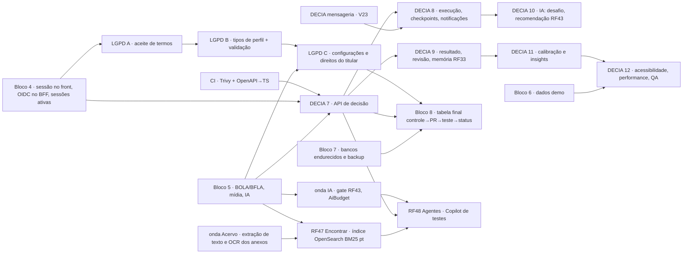

# Plano de execução — tudo o que falta (2026-10-06)

Fonte de verdade dos requisitos: board Trello **Work Station** (48 RFs — RF47 Encontrar e RF48 Agentes entraram no board em 2026-10-06; nenhum RF novo é inventado aqui). Este plano junta
as três trilhas abertas — **segurança (blocos 4–8)**, **LGPD/cadastro (blocos A–C)** e **DECIA (fases 7–12 +
mensageria)** — com dependências, ordem de PRs e reserva de numeração para trabalho em paralelo sem colisão.

## 1. Estado em `main`

| Entregue | PRs |
|---|---|
| Bloco 1 esqueleto seguro · Bloco 2 banco/FKs · Bloco 3 autenticação RF1–RF3 (D-14) + correções | #2, #14, #16, #18 |
| Shell do app (todas as abas, DS v2, BFF com cookie `ws_rt` e IP assinado), correções | #23, #27, #28 |
| Domínio de todos os RFs (123 entidades, V10–V21; tabelas LGPD já existem em V10) | #22 |
| DECIA fases 1–6: auditoria, matriz bibliográfica, modelo, domínio V22, cards, workspace, correções | #29, #30, #31, #32 |
| Diagramas, anatomias, bibliografia | #17, #19, #20, #21 |
| RF47 Encontrar e RF48 Agentes: diagramas, matriz bibliográfica, catálogo dos 17 agentes, esqueletos `/find` e `/agents` (sem backend) | branch `claude/rf47-rf48` |

Em andamento: **mensageria do DECIA** (Hohpe & Woolf) — branch `claude/decia-mensageria`, V23.

## 2. Grafo de dependências

## 3. Blocos — escopo, controles e testes-guarda

Regras de todos: um PR por bloco, CI verde antes do próximo, Conventional Commits com escopo, cada controle nasce com um
teste que falharia sem ele, segredos só pelo nome, nunca editar migration aplicada, nunca pular teste.

| Bloco | Escopo | Testes-guarda principais | Depende de |
|---|---|---|---|
| **4 — Sessão no front** | Proteção de rotas no `middleware.ts` (não autenticado → `/login?next=`, sem open redirect); renovação silenciosa e logout em todas as abas; cabeçalhos de segurança no Next (CSP com nonce, HSTS, frame-ancestors, referrer, permissions); OIDC Authorization Code + PKCE/`state`/`nonce` no BFF atrás de `WS_OIDC_ENABLED`; `GET/DELETE /api/auth/sessions` (RF2.CA05) + aba Sessões em `/settings` | rota protegida sem sessão redireciona; `next` externo ignorado; CSP presente; `state`/`nonce` inválidos → 400; PKCE obrigatório; revogar sessão derruba o refresh; 403 ao revogar sessão de outro usuário | Bloco 3 |
| **4b — 2FA e SMTP** | TOTP (RFC 6238): cadastro com QR + códigos de recuperação de uso único (hash Argon2), `POST /api/auth/2fa/verify` para concluir o login que hoje para em `401 DOIS_FATORES_NECESSARIO`, limite de tentativas por conta e IP, desativação exige senha + código; adaptador SMTP real (TLS obrigatório, templates i18n) no lugar do registrador de e-mails do Bloco 3. **Até o Bloco 4b, nenhum fluxo do app ativa 2FA** (só existe o campo `two_factor_enabled`, sem endpoint que o ligue), então ninguém fica preso no login por esse caminho | código errado/reutilizado → 401; 6ª tentativa → 429; código de recuperação só vale uma vez; desativar sem senha → 403; e-mail sem TLS recusado | Bloco 4, Q-83, Q-84 |
| **5 — BOLA/BFLA, mídia, IA** | Políticas de autorização por recurso (`AccessPolicy` por agregado: dono, papel DACI/departamento, visibilidade, ADMIN) aplicadas no serviço, não no controller; matriz endpoint × perfil com teste 403; upload: tipo real por magic bytes, limite por formato, teto de pixels, zip-bomb, prefixo `restricted/`, OwnMedia; IA: `AiBudget` por usuário/empresa, classificação de acesso e mascaramento antes de IA externa (RF43.CA02), `SIGILOSO`/`RESTRITO` nunca saem | id de outro usuário → 403/404 sem vazar existência; papel insuficiente → 403; PNG com extensão .jpg recusado; bomba de descompressão recusada; payload `SIGILOSO` não chega ao provedor externo; orçamento estourado → 429 com motivo | Bloco 3 |
| **6 — Dados demo** | `DemoEnvironmentGuard` (seeds só fora de prod), contas `account_origin = TEST_SEED/DEMO`, seed idempotente dos 5 casos DECIA e do shell, reset seguro (ledgers/trilhas antes, Q-80) | seed nunca roda em prod; reset não apaga conta REAL; idempotência | Blocos 3, DECIA 7 |
| **7 — Bancos endurecidos e backup** | usuário MySQL de menor privilégio (sem DDL em runtime; Flyway com usuário próprio), TLS obrigatório, Redis com ACL e senha, OpenSearch/Cassandra/S3 só com credencial, backup diário cifrado + teste de restauração automatizado, runbook | conexão sem TLS recusada; usuário da app sem `DROP`; restauração reproduz checksum | Bloco 2 |
| **8 — Fechamento** | tabela controle → PR → teste → status (SEGURANCA.md §6), lista de ações só do time (segredos por nome, branch protection Q-52, IdP/WAF, Qs abertas), diagramas SEG atualizados | — | todos |
| **CI** | Trivy na imagem `Dockerfile.backend` (falha em HIGH/CRITICAL corrigível); OpenAPI → TypeScript (`openapi-typescript`) gerado do `/v3/api-docs` em teste e diff obrigatório | CI falha se tipos divergirem | — |
| **LGPD A — Aceite de termos** | `PolicyDocument` versionado substitui `ws.legal.current-versions`; aceite append-only no cadastro (`policy_acceptances`); `PolicyGateFilter` → `403 ACEITE_PENDENTE` em nova versão; telas `/termos` e `/privacidade`; componentes do DS (Checkbox, Banner, FormField) | cadastro sem aceite → 422; nova versão bloqueia até aceitar; histórico nunca editável | Bloco 4 |
| **LGPD B — Tipos de perfil** | EMPRESA e CHEFE_DEPARTAMENTO com `ApprovalRequest` (PENDENTE·AJUSTES·APROVADO·RECUSADO), `VerificationPolicy`, fila de revisão do ADMIN (RF28.CA01) | perfil pendente não acessa recursos institucionais; AJUSTES volta ao solicitante; 403 para não-ADMIN na fila | LGPD A |
| **RF47 — Encontrar (`/find`)** | interface do card "Opção A + Opção C" (busca KWIC alinhada ±4/±8/±16 + aba Extrair termos e entidades, também dentro do RF48 com escopo do dossiê); extração de texto paginado (PDF, DOCX, XLSX, PPTX, TXT, MD, CSV, EML/MSG) com OCR local; índice OpenSearch `ws-find-*` com analisador pt (asciifolding, stop pt, `portuguese_rslp`) e BM25; `QueryParser` (aspas, E/OU/NÃO, curinga, `~N`); KWIC ±N palavras; YAKE!/TF-IDF; entidades com mascaramento LGPD; glossários; exportação e evidência (RF29); auditoria sem conteúdo; RESTRITO/SIGILOSO só local | documento invisível nunca aparece **nem é contado** (filtro dentro da consulta, inclusive no total); `NÃO` isolado → 422; RESTRITO/SIGILOSO não chega ao provedor externo; CPF nunca sai aberto na exportação; `audit_log` sem trecho de documento; documento não indexado avisado como "ficou de fora"; 1º lote ≤ 2 s medido (`docs/diagramas/RF47/README.md` §7) | onda Acervo, Bloco 5 |
| **RF48 — Agentes (`/agents`)** | Encontrar/Extrair no dossiê reaproveitando os serviços do RF47 com `FindScope.DOSSIE` (lista de termos ausente → ⚠️, nunca ⛔); 17 agentes de teste (antes do início · execução · transversais) sobre o dossiê da contratação; `FindingAssembler` (sem evidência ou sem referência curada → "Hipóteses não fundamentadas"); consultas oficiais (CEIS/CNEP pela API da CGU com `WS_CGU_API_KEY`, certidões) com fonte, data/hora e hash; Score do Contrato sobre o motor do DECIA com portões, contribuições, confiança e pesos versionados; gatilhos de execução; contraditório; exportação PDF/XLSX ABNT | achado sem referência nunca vira achado nem entra no Score; consulta que falha/expira/pede captcha → ❔ (nunca ✅); portão disparado → "bloqueado para verificação" com qualquer número; mesmo dossiê + mesmas regras → resultado idêntico; dossiê RESTRITO/SIGILOSO → IA só local; Copilot não tem ação de redigir/aprovar; aviso jurídico sempre no relatório (`docs/diagramas/RF48/README.md` §10) | RF47, DECIA 7, onda IA (RF43), Bloco 5 |
| **LGPD C — Configurações e direitos (RF3)** | consentimentos opcionais (`ConsentEvent`), exportação assíncrona (REQUESTED→PROCESSING→READY→EXPIRED/FAILED), exclusão = anonimização com retenção legal (`AccountAnonymizationJob` com lock e teste de agendamento), `DataSubjectRequest` | job roda no horário com lock único; exportação expira; anonimização mantém trilhas legais | LGPD B, Bloco 5 |

## 4. DECIA — fases restantes

| Fase | Escopo | Depende de |
|---|---|---|
| **Mensageria** (em andamento) | envelope, canais, comando × evento, outbox V23, despacho em processo, idempotência, retry/dead letter, roteamento em tabela, aggregator | — |
| **7 — API de decisão** | `DecisionService` (casos de uso do §4.3 do modelo), controllers REST com `@Operation(summary = "RF29…")`, DTOs, políticas do Bloco 5 (participantes DACI, visibilidade), outbox no mesmo commit, cliente TS gerado do OpenAPI substituindo o repositório em memória, projeção do card | Blocos 4–5, CI OpenAPI, mensageria |
| **8 — Execução e acompanhamento** | decisão → tarefas/marcos (`decision_work_links`), checkpoints agendados (`CheckpointDue`), gatilhos, notificações agrupadas | 7 |
| **9 — Resultado, revisão e memória** | resultado, retrospectiva (processo × resultado), lições → Memória Institucional (RF33), "decisões parecidas" com diferenças de contexto | 7 |
| **10 — IA crítica** | splitter/aggregator de análise, 5 modos de desafio, recomendação com os 4 porquês, proveniência `ai_inference_log`, modos ECONOMIA/AVANCADO | 8, cliente de IA (RF43) |
| **11 — Calibração e insights** | Brier/calibração privados (n ≥ 10), padrões observados (opt-in) | 9 |
| **12 — QA** | axe, regressão visual, performance de grade, testes de usabilidade (roteiro em `docs/decia/08_BACKLOG_E_PLANO.md` §3) | 11 |

## 5. Ondas de execução (paralelo só onde não há dependência)

| Onda | Em paralelo | Saída |
|---|---|---|
| 1 (agora) | Mensageria · Perfil + rede social + Delegar (RF6, RF14–RF19, RF27) · Bloco 5 · Bloco 4 · CI Trivy + OpenAPI→TS | 5 PRs |
| 2 | LGPD A · Bloco 7 · DECIA 7 · Bloco 4b (2FA + SMTP, assim que Q-83/Q-84 forem decididas) · onda Acervo (RF4, RF8, RF11, RF12, RF23, RF41) | 5 PRs |
| 3 | LGPD B · DECIA 8 · DECIA 9 · Bloco 6 · onda Institucional (RF9, RF10, RF28, RF36, RF39) · onda Mensageria (RF46) | 6 PRs |
| 4 | LGPD C · DECIA 10 · onda Projetos (RF5, RF7, RF20–RF22, RF25, RF31, RF32) · onda Planejamento (RF24) · onda IA (RF13, RF26, RF43) · RF47 Encontrar (depois da onda Acervo e do Bloco 5) | 6 PRs |
| 5 | DECIA 11 · onda Gamificação (RF35, RF40, RF42, RF44, RF45) · RF30 e RF34 (IA sobre projetos) · RF48 Agentes (depende de RF47, DECIA 7 e do gate de IA do RF43) | 4 PRs |
| 6 | DECIA 12 (QA: axe, regressão visual, performance, usabilidade) — depende de DECIA 11 | 1 PR |
| 7 | Bloco 8 (fechamento: tabela controle → PR → teste → status) — por último, depende de tudo | 1 PR |

## 6. Reserva de numeração (cada trabalho tem a sua faixa; nada compartilhado)

| Trabalho | Decisões | Dúvidas | Migration |
|---|---|---|---|
| Mensageria | D-58–D-59 | Q-157–Q-159 | V23 |
| Bloco 4 | D-60–D-64 | Q-160–Q-164 | — (usa `refresh_tokens`) |
| Bloco 5 | D-65–D-69 | Q-165–Q-169 | V24 |
| CI | D-70–D-71 | Q-170–Q-171 | — |
| LGPD A | D-72–D-74 | Q-172–Q-174 | V25 |
| Bloco 7 | D-75–D-77 | Q-175–Q-177 | — |
| DECIA 7 | D-78–D-82 | Q-178–Q-182 | V26 |
| LGPD B | D-83–D-85 | Q-183–Q-185 | V27 |
| LGPD C | D-86–D-88 | Q-186–Q-188 | V28 |
| DECIA 8 | D-89 | Q-189 | V29 |
| Perfil + rede social + Delegar | D-90–D-94 | Q-190–Q-194 | V30 |
| DECIA 9 | D-95–D-96 | Q-195–Q-196 | V31 |
| Bloco 6 | D-97 | Q-197 | V32 |
| Bloco 4b (2FA + SMTP) | D-98–D-99 | Q-198–Q-199 | V33 |
| DECIA 10 | D-100–D-101 | Q-200–Q-201 | V34 |
| DECIA 11 | D-102 | Q-202 | V35 |
| DECIA 12 | D-103 | Q-203 | — |
| Bloco 8 | D-104 | Q-204 | — |
| Onda Acervo | D-105–D-107 | Q-205–Q-207 | V36 |
| Onda Institucional | D-108–D-110 | Q-208–Q-210 | V37 |
| Onda Mensageria (RF46) | D-111–D-112 | Q-211–Q-212 | V38 |
| Onda Projetos | D-113–D-116 | Q-213–Q-216 | V39 |
| Onda Planejamento | D-117 | Q-217 | V40 |
| Onda IA | D-118–D-120 | Q-218–Q-220 | V41 |
| Onda Gamificação | D-121–D-124 | Q-221–Q-224 | V42 |
| RF30 + RF34 | D-125–D-126 | Q-225–Q-226 | V43 |
| RF47 Encontrar | D-127–D-129 | Q-227–Q-229 | V44 |
| RF48 Agentes (Copilot de testes) | D-130–D-134 | Q-230–Q-234 | V45 |

Faixa não usada fica livre (o `MigrationVersionsTest` só proíbe versão repetida e aceita lacunas; se um trabalho precisar
de mais de uma migration, pede uma faixa nova neste quadro antes de criar).

**Ordem de merge das migrations:** o Flyway (sem `outOfOrder`) recusa aplicar uma versão menor depois que uma maior já
rodou num banco. Então PRs com migration entram em `main` **em ordem crescente de versão**; se um PR com versão maior
ficar pronto antes, ele espera, ou a sua migration é renumerada para a próxima livre acima da maior já mesclada (antes
de qualquer deploy que a aplique). Versões reservadas e não usadas nunca bloqueiam.

## 7. Só o time pode fazer (não é código)

Proteção de branch em `main` (Q-52) · criar os segredos no cofre pelos nomes do runbook (`docs/seguranca/SEGURANCA.md` §5) ·
registrar o app no IdP institucional (OIDC) · WAF/borda e `WS_TRUSTED_PROXIES` · decidir Q-152…Q-156 (DECIA) e as Qs de
LGPD/jurídico (Q-60…Q-73) · escolher o provedor SMTP institucional (Q-84) e a política de 2FA (Q-83) — a
**implementação** dessas duas é o Bloco 4b (código e testes), não ação do time. · RF47/RF48: pedir a chave da API de
dados do Portal da Transparência (guardada como `WS_CGU_API_KEY`), levantar com a SEAP/TCE-PR o acesso às fontes
estaduais (Q-230), nomear quem cura a base bibliográfica (Q-228) e validar o aviso jurídico (Q-234) — "Pessoas
cuidam do jurídico".

## 8. Todos os RFs — estado e onda

"Domínio + esqueleto" = records/tabelas (V10–V22) e tela RfPage com os CAs; falta serviço/API/UI funcional.

| RF | Tema | Estado em `main` | Próximo passo | Onda |
|---|---|---|---|---|
| RF1 | Cadastro | API real + tela (Bloco 3) | LGPD A (aceite) | 2 |
| RF2 | Autenticação | API real + BFF + tela | Bloco 4 (OIDC, sessões) | 1 |
| RF3 | Perfil e preferências | API real + /settings (RF23) | LGPD C (direitos do titular) | 4 |
| RF4 | Criador de tarefas | domínio + esqueleto | onda Acervo | 3 |
| RF5 | Criador de projetos | domínio + esqueleto | onda Projetos | 4 |
| RF6 | Perfil Empresarial (Acervo + salvos) | domínio + esqueleto | **onda Social (agora)** | 1 |
| RF7 | Abrir tarefa a partir do projeto | domínio + esqueleto | onda Projetos | 4 |
| RF8 | Editar arquivos no perfil | domínio + esqueleto | onda Acervo | 3 |
| RF9 | Chefe adiciona/remove empregados | domínio + esqueleto | onda Institucional | 3 |
| RF10 | Chefe atribui tarefa/projeto | domínio + esqueleto | onda Institucional | 3 |
| RF11 | Editor de arte de fundo | domínio + artes | onda Acervo | 3 |
| RF12 | Editar esquema de tarefa/projeto | domínio + esqueleto | onda Acervo | 3 |
| RF13 | Gerar artefato | domínio + esqueleto | DECIA 10 / IA | 4 |
| RF14 | Perfil de chefe de departamento | domínio + esqueleto | **onda Social (agora)** | 1 |
| RF15 | Perfil de empresa/órgão | domínio + esqueleto | **onda Social (agora)** | 1 |
| RF16 | Perfil de empregado (terceiros) | GET /api/users/{id} real + esqueleto | **onda Social (agora)** | 1 |
| RF17 | Esquemas de outros na rede social | domínio + esqueleto | **onda Social (agora)** | 1 |
| RF18 | Interagir: curtir, comentar, salvar, compartilhar, remixar, retornar, atribuir | domínio + esqueleto | **onda Social (agora)** | 1 |
| RF19 | Interações sociais em tarefas, projetos e planos | domínio (V16) + esqueleto | **onda Social (agora)** | 1 |
| RF20 | Construtor de projetos (adequação do acervo) | domínio + esqueleto | onda Projetos | 4 |
| RF21 | Mesa de trabalho digital | domínio + esqueleto | onda Projetos | 4 |
| RF22 | Editar projeto na Mesa (versões) | domínio + esqueleto | onda Projetos | 4 |
| RF23 | Importar de outros provedores | domínio + esqueleto | onda Acervo (+ tradutores da mensageria) | 3 |
| RF24 | Metas & objetivos com insights | domínio + esqueleto | onda Planejamento | 4 |
| RF25 | Programas, Exercícios e Gestões | domínio + esqueleto | onda Projetos | 4 |
| RF26 | Copilot do WS | domínio + esqueleto | DECIA 10 / IA | 4 |
| RF27 | Mural e Buscar | domínio + esqueleto | **onda Social (agora)** | 1 |
| RF28 | Perfis institucionais e chancelas | domínio + esqueleto | LGPD B + onda Institucional | 3 |
| RF29 | DECIA ↔ Criador de Projetos, Rastro de Decisão | **DECIA estruturado entregue** (domínio V22 + UI demo) | DECIA 7–12 + sessão em grupo | 2 |
| RF30 | Autopiloto de Projeto | domínio + esqueleto | onda Projetos / IA | 5 |
| RF31 | Simular cenários | domínio + esqueleto | onda Projetos | 4 |
| RF32 | Espelho de Conformidade | domínio + esqueleto | onda Projetos | 4 |
| RF33 | Memória Institucional | domínio + esqueleto | DECIA 9 | 3 |
| RF34 | Extrair de desenhos técnicos | domínio + esqueleto | onda Projetos / IA | 5 |
| RF35 | Metas coletivas, Destaques, Reconhecimentos | domínio + esqueleto | onda Gamificação | 5 |
| RF36 | Dossiê de Transição | domínio + esqueleto | onda Institucional | 4 |
| RF37 | Ata Viva | domínio + esqueleto | DECIA (sessão) | 4 |
| RF38 | Identidade visual | DS v2, tokens, glyphs, artes; cards DECIA | contínuo (cards de tarefa/projeto na onda Social) | 1 |
| RF39 | Chancelas | domínio + esqueleto | onda Institucional | 4 |
| RF40 | Balcão de Modelos | domínio + esqueleto | onda Gamificação | 5 |
| RF41 | Acervo de Tarefas | domínio + esqueleto | onda Acervo | 3 |
| RF42 | DECIA Points | domínio + esqueleto | onda Gamificação (Q-152) | 5 |
| RF43 | IA do sistema | domínio + stub de provedor | DECIA 10 / IA | 4 |
| RF44 | Tarefa do Dia e HSE | domínio + esqueleto | onda Gamificação | 5 |
| RF45 | Hype Score do Perfil | domínio + esqueleto | onda Gamificação (Q-153) | 5 |
| RF46 | Chats de mensageria | domínio + esqueleto | onda Mensageria/Social | 3 |
| RF47 | Encontrar palavras-chave em documentos (`/find`) | diagramas + matriz bibliográfica + esqueleto (sem domínio) | onda Encontrar (após Acervo e Bloco 5) | 4 |
| RF48 | Agentes — Copilot de testes de contratação (`/agents`) | diagramas + catálogo dos 17 agentes + matriz bibliográfica + esqueleto (sem domínio) | onda Agentes (após RF47, DECIA 7 e onda IA) | 5 |

Ondas temáticas: **Social** (RF6, RF14–RF19, RF27, cards de tarefa RF38) · **Acervo** (RF4, RF8, RF11, RF12, RF23, RF41) · **Projetos** (RF5, RF7, RF20–RF22, RF25, RF30–RF32, RF34) · **Institucional** (RF9, RF10, RF28, RF36, RF39) · **Planejamento** (RF24) · **Gamificação** (RF35, RF40, RF42, RF44, RF45) · **IA** (RF13, RF26, RF43) · **DECIA** (RF29, RF33, RF37) · **Mensageria** (RF46) · **Encontrar** (RF47) · **Agentes** (RF48). Cada onda entrega primeiro UI funcional com repositório de demonstração rotulado (como o DECIA) e regras puras testadas; a API entra depois dos Blocos 4–5.

