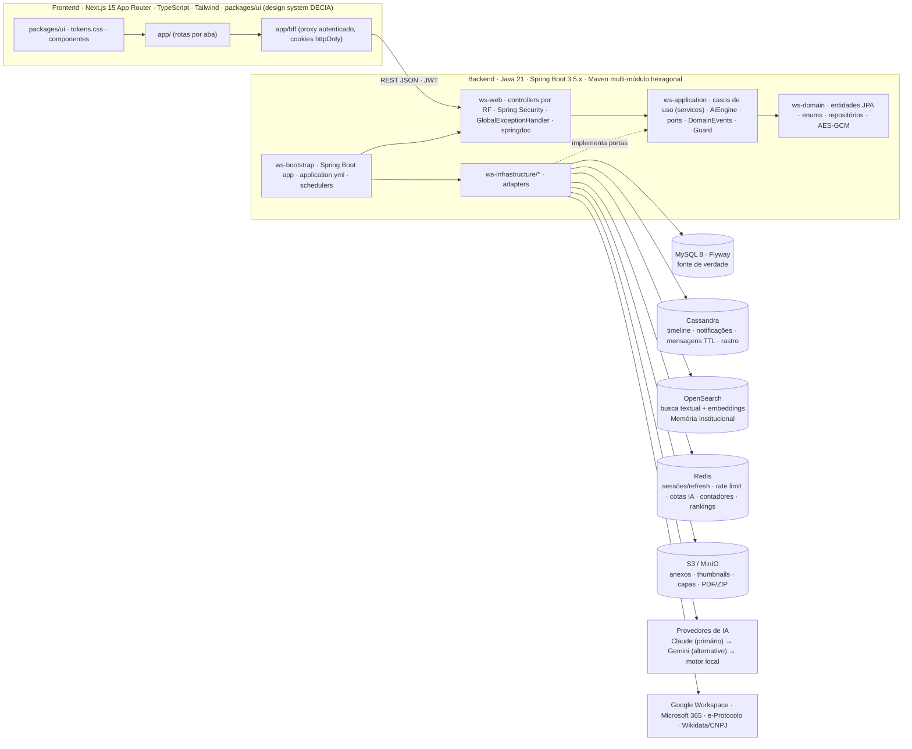
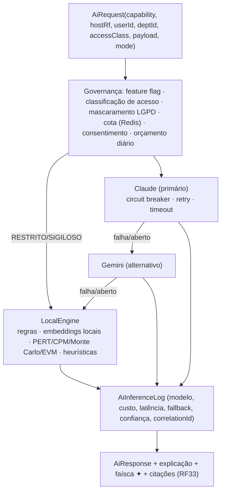
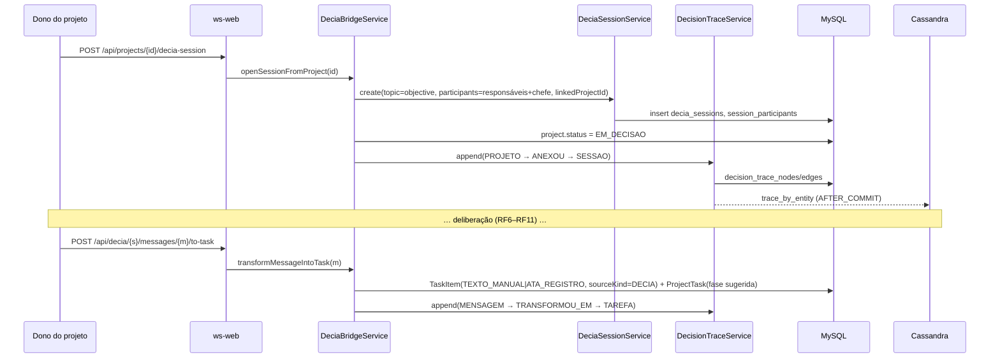
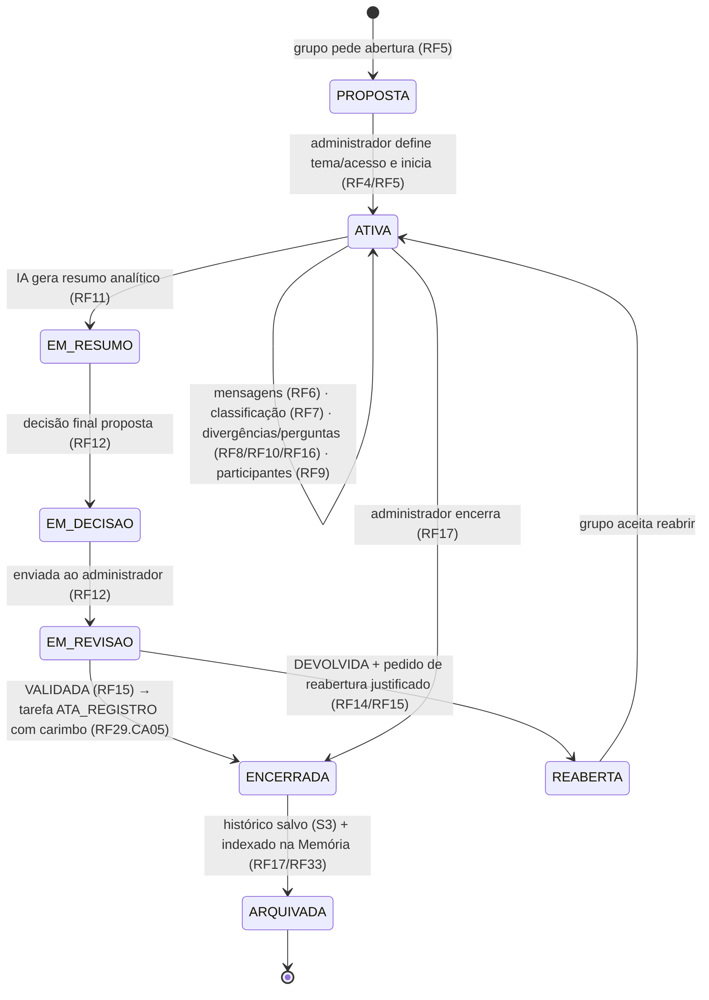

# Work Station / DECIA — Arquitetura (plano v1)

> **Nome do produto:** **Work Station** (os cards do board ainda citam o nome antigo "Work AI"; leia-os como Work Station). Prefixo dos módulos: `ws-`.

> Produto da SECID-PR. O **Work Station** é o app; o **DECIA** (Decisão com Inteligência Artificial) é o centro: mensageria deliberativa em grupo assistida por IA, ligada ao **Criador de Projetos** (tarefas compostas em esquemas de projeto). Requisitos: board Trello **Work Station** (RF1–RF45, HU1–HU45). Esqueleto herdado do **Fashion AI (FAI)**.
> Documentos irmãos: [`TAXONOMIA.md`](TAXONOMIA.md) (entidades e atributos), [`DIAGRAMA_CLASSES_v1.md`](DIAGRAMA_CLASSES_v1.md), [`../diagramas/`](../diagramas/) (5 diagramas por RF), [`../design-system/`](../design-system/), [`../DECISOES.md`](../DECISOES.md).

## 1. Objetivos que a arquitetura precisa provar (board, card principal)
| Objetivo | Métrica verificável | Onde nasce na arquitetura |
|---|---|---|
| 1. DECIA + Criador de Projetos com autoridade humana | % de projetos CONCLUÍDOS com decisão registrada em sessão DECIA com rastro completo (argumentos → tarefas → decisão validada) | `DecisionTrace` append-only (RF29), `FinalDecision`/`DecisionReview` (RF12/RF15), view `vw_decisions_with_trace` (RF18) |
| 2. Retorno estruturado ao empregado | variação das métricas do perfil deliberativo entre sessões/projetos | `DeliberativeProfile`, `ProfileHypeScore`, `DailyTask`/HSE, ledger de DECIA Points (RF19, RF42–RF45) |
| 3. Decisões fundamentadas e alinhadas ao plano anual | % de decisões com justificativa, critérios, fontes institucionais e projeto vinculado | `AnalyticalSummary` + `Citation` (RF11/RF33), `ComplianceResult` (RF32), `ProjectScenario` (RF31), `PlanAxis` (RF24), `vw_decisions_with_sources` |

## 2. Visão geral

## 3. Backend — módulos Maven (igual ao FAI, prefixo `wai-`)

| Módulo | Conteúdo | Depende de |
|---|---|---|
| `ws-domain` | Entidades JPA (`TaskItem`, `ProjectScheme`, `ProjectTask`, `AnnualPlan`, `DeciaSession`, `Seal`, `SealBond`, `DeciaPointsLedgerEntry`, …), enums, `*Repository` (Spring Data), `AuditableEntity`/`VersionedAuditableEntity`, `AesGcmStringConverter` | — |
| `ws-application` | Um pacote por contexto (`identity`, `acervo`, `projects`, `planning`, `decia`, `seals`, `points`, `social`, `gamification`, `ai`, `handoff`); casos de uso em `service/*` (um por RF/área); `ai/AiEngine` (Strategy + Chain of Responsibility); `ports/*` (interfaces para o mundo externo); `events/DomainEvents` + listeners `@TransactionalEventListener(AFTER_COMMIT)` com `SideEffectRunner` (REQUIRES_NEW); `security/Guard` (`requireRole`, `requireOwner`, `requireParticipant`, `requireIssuer`); `metrics/*` (serviços de domínio testáveis do catálogo RF43 §8, `METRICAS_GESTAO.md`) | domain |
| `ws-infrastructure` (pom agregador) | `persistence-mysql` (Flyway `V1__…`, analytics via views/procedures, backup), `persistence-cassandra` (projeções `timeline_by_user`, `notifications_by_user`, `messages_by_session`, `trace_by_entity`), `search-opensearch` (índices `ws-tasks`, `ws-projects`, `ws-memory` com `dense_vector`), `cache-redis` (refresh tokens, rate limit, cotas, contadores, ranking cache, circuit state), `storage-s3` (MinIO em dev), `ai-providers` (Claude SDK, Gemini, `LocalEngine`), `platform` (e-mail, OCR/antivírus hooks, Google/Microsoft OAuth connectors, e-Protocolo, Wikidata/CNPJ, transcrição) — **todos opt-in por propriedade/feature flag** | application |
| `ws-web` | Controllers REST por RF (`@Operation(summary="RF20.CA02 …")`), `SecurityConfig` (OAuth2 Resource Server + login OIDC institucional + JWT próprio curto), `GlobalExceptionHandler` → `{code, message, details, correlationId}`, filtros de correlação/rate-limit, CSP/HSTS/CORS | application |
| `ws-bootstrap` | `WorkStationApplication`, `application.yml` por perfil (`dev`, `test`, `prod`), schedulers (Tarefa do Dia 06:00, Hype diário, expiração de pontos, recertificação de chancelas, purge de notificações) | web + infrastructure |

**Padrões** (herdados do FAI, obrigatórios): Ports & Adapters · Strategy + Chain of Responsibility no `AiEngine` (primário → alternativo → local, sempre com `ai_inference_log`) · Observer `AFTER_COMMIT` (pontos, notificações, projeções Cassandra, indexação OpenSearch, thumbnails, avaliação de política de chancela) · Repository · Circuit Breaker + Retry + TimeLimiter (Resilience4j) por provedor e por integração externa · Facade (`DashboardService`, `ProfileService`, `InsightsFacade`) · State Machine explícita para `TaskState`, `ProjectStatus`, `SessionStatus`, `SealBondStatus`, `DecisionStatus` (classe `*StateMachine` com tabela de transições testada).

### 3.1 AiEngine (RF7, RF11, RF43)

Regra de ouro (RF43): a IA **só interpreta métricas calculadas pelo sistema**; nada vira decisão, chancela, ranking oficial ou projeto sem confirmação humana. Modo `ECONOMIA` (local + provedor barato) ou `AVANCADO` (premium; debita cota/DECIA Points).

### 3.2 Persistência poliglota — responsabilidades e flags
| Store | Responsabilidade | Flag | Dev |
|---|---|---|---|
| MySQL 8.4 | Fonte de verdade transacional: `users`, `tasks`, `project_schemes`, `project_tasks`, `annual_plans`, `groupings`, `seals`, `seal_bonds`, `benefits`, `decia_points_ledger`, `decision_trace_*`, `audit_log`, `ai_inference_log`, … Uma migração Flyway por mudança (`V1__baseline.sql`, `V2__rf20_tasks.sql`, …) | sempre | compose |
| Cassandra 4.1 | `timeline_by_user`, `notifications_by_user` (TTL), `messages_by_session` (TTL configurável por sessão), `trace_by_entity` (append-only) | `ws.cassandra.enabled` | profile `cassandra` |
| OpenSearch 2.19 | Busca textual (RF27) e semântica/embeddings (RF33) de tarefas, projetos, sessões, artefatos; OCR | `ws.opensearch.enabled` | profile `opensearch` |
| Redis 7 | refresh tokens (família/rotação), rate limit, contadores sociais, cotas de IA, cache de rankings, circuit state, autosave do compositor | `ws.redis.enabled` | profile `redis` |
| S3 / MinIO | anexos, thumbnails, capas, exports PDF/ZIP, arquivo de sessão, áudio temporário de reunião | `ws.storage.type=s3` | profile `minio` |

Sem as flags, o sistema funciona só com MySQL (projeções e cache caem para implementações MySQL/in-memory, como no FAI). Testes de integração usam **Testcontainers** (MySQL sempre; Cassandra/OpenSearch/Redis/MinIO nos módulos que os adaptam).

### 3.3 Segurança
- Spring Security 6 · login institucional **OAuth2/OIDC** (Keycloak/Entra ID) + cadastro local (RF1) com **Argon2id**; **JWT curto (RS256, 10 min)** + **refresh em Redis** com rotação por família e revogação (RF2).
- **RBAC por perfil** (`EMPREGADO`, `EMPRESA`, `CHEFE_DEPARTAMENTO`, `ADMIN`; papel contextual `CURADOR`) com `Guard.requireRole/requireOwner/requireParticipant/requireIssuer` relendo o papel do banco; testes 403 em todo endpoint (RF22.CA01, RF28.CA01/CA08, RF39.CA01, RF41.CA08).
- **Classificação de acesso** das tarefas (`PUBLICO/INTERNO/RESTRITO/SIGILOSO`): RESTRITO/SIGILOSO nunca saem para provedor de IA externo (RF43.CA02); mascaramento de dados pessoais antes de qualquer inferência externa (LGPD).
- AES-GCM em campos sensíveis (e-mail, telefone, CNPJ, geolocalização, transcrições); `audit_log` com `correlationId` em toda mudança de estado relevante (chancelas, pontos, decisões, lotações, curadores).
- Upload: tipo real (magic bytes), limite por formato, hook de antivírus (quarentena), zip-bomb guard; CSP/HSTS/CORS estritos; rate limiting por IP e por usuário (Redis).
- Erros HTTP: 200/201/202/204/400/403/404/409/422/429; corpo `{code, message, details, correlationId}`; códigos de negócio nomeados nos CAs (`VALIDACAO`, `ACESSO_NEGADO`, `PERIODO_INVALIDO`, `LIMITE_ESGOTADO`, `CHANCELA_INVALIDA`, `SALDO_INSUFICIENTE`, `ITEM_INDISPONIVEL`).

### 3.4 Gate de desenvolvedor (CI obrigatório em todo PR)
`.github/workflows/ci.yml`: build + testes (`mvn -B verify`) · **JaCoCo ≥ 70 % linhas** em `ws-application` e `ws-web` · SpotBugs + Checkstyle · OWASP Dependency-Check · Trivy nas imagens · gitleaks · frontend `lint` + `typecheck` + `vitest` + `i18n:check` · Playwright smoke · lint de **Conventional Commits** com RF no escopo (`feat(rf20): …`, `docs(arch): …`) · PR template com checklist (CA, migração, testes, i18n, evidência em `docs/testes/`). Branch protection na `main`: 1 revisão obrigatória de outro integrante, CI verde, sem push direto. Ambientes `dev`/`test`/`prod` separados (profiles + secrets por ambiente).

## 4. Frontend
- **Next.js 15 (App Router) + TypeScript + Tailwind 4**, componentes próprios em `packages/ui` (base radix/shadcn) com **tokens CSS** (`styles/tokens.css`) e 4 temas via `data-theme` (claro, escuro, alto contraste, blueprint). **Nenhum HTML/CSS solto nas telas**: todo elemento visual vem de um componente do design system (ver [`../design-system/DESIGN_SYSTEM.md`](../design-system/DESIGN_SYSTEM.md)).
- i18n **pt-BR / en / es** com ICU (mesmo `lib/i18n` do FAI: `check`, `scan`, pseudo-locale).
- Rotas (abas do card "Mapa de equivalência"): `/mural`, `/search`, `/memory`, `/companies`, `/models`, `/profile`, `/u/[username]`, `/tasks`, `/attachments`, `/desk`, `/projects/[id]/(edit|simulate|mirror)`, `/tasks/new`, `/projects/new`, `/plans`, `/autopilot`, `/decia`, `/decia/[sessionId]`, `/insights`, `/goals`, `/points`, `/store`, `/highlights`, `/recognitions`, `/benefits`, `/admin`, `/lab/design-system`.
- BFF em `app/bff` guarda tokens em cookies httpOnly e injeta `X-Correlation-Id`.

## 5. Fluxos centrais

### 5.1 Ponte DECIA ↔ Criador de Projetos (RF29)

### 5.2 Ciclo de vida da sessão DECIA (RF4–RF17)

## 6. Ordem de implementação (do pedido) e entregáveis por RF
| Fase | Escopo | Entregáveis |
|---|---|---|
| (a) | Esqueleto Maven (`ws-*`), `docker-compose.dev.yml` (mysql, redis, cassandra, opensearch, minio), CI gate, `V1__baseline.sql` (users, preferences, refresh_tokens, audit_log, ai_inference_log, feature_flags, domain_events, media_objects) | PR `chore(skeleton)` |
| (b) | Design system DECIA (`packages/ui`, tokens, componentes obrigatórios, `/lab/design-system`) | PR `feat(rf38)` |
| (c) | RF1–RF3 auth/perfis (OIDC + local, JWT/refresh Redis, preferências, aprovação EMPRESA/CHEFE) | PR `feat(rf1)`, `feat(rf2)`, `feat(rf3)` |
| (d) | RF20 Criador de Tarefas + RF41 Acervo (TaskItem, estados, prazos legais, anexos, thumbnails) | PRs por RF |
| (e) | RF21 Criador de Projetos (selects = inventário), RF22 Mesa, RF23 extração | PRs por RF |
| (f) | RF4–RF6 sessão DECIA + RF29 ponte + RF7 classificação | PRs por RF |
| (g) | Demais RFs pela prioridade do board: Sprint 2 (RF8–RF11), Sprint 3 (RF12–RF18), Sprint 4 (RF26–RF28), backlog (RF24, RF25, RF30–RF45) | PRs por RF |

Cada RF entrega: migração Flyway própria · endpoints com RF/CA no `@Operation` · testes unit + integração Testcontainers (inclui 403) · tela com componentes do design system · i18n pt-BR/en/es · evidência em `docs/testes/RFnn/` · diagramas em `docs/diagramas/RFnn/`.

## 7. Decisões abertas
Ver [`../DECISOES.md`](../DECISOES.md).
