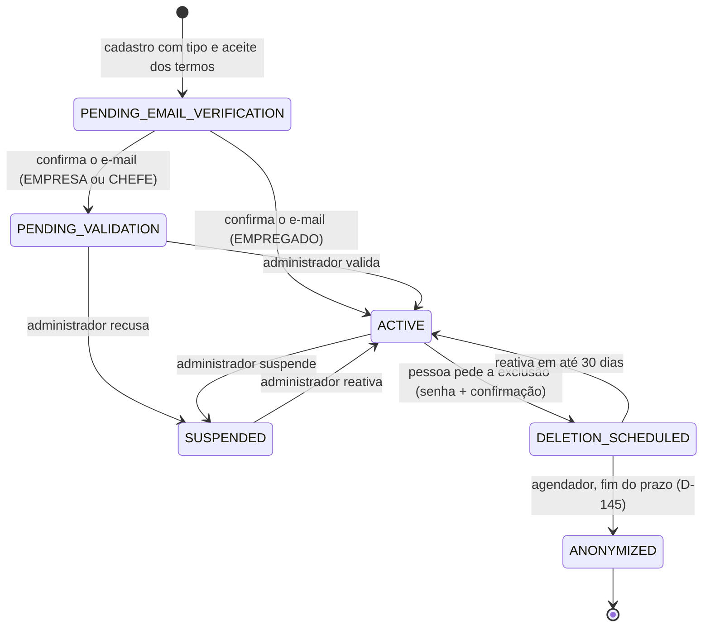

# Taxonomia de atores e de atributos — Work Station (Velion · Orange Social)

17/10/2026. Documento de referência para quem modela telas, regras de acesso e diagramas. Ele responde duas perguntas: **quem age no sistema** (atores) e **como classificar cada dado** (atributos). As entidades e seus campos continuam em [`TAXONOMIA.md`](TAXONOMIA.md); a pesquisa de campos de perfil por tipo, com fontes e LGPD, está em [`../produto/DADOS_DE_PERFIL_POR_TIPO.md`](../produto/DADOS_DE_PERFIL_POR_TIPO.md); as matrizes de abas por perfil, em [`../produto/ABAS_POR_PERFIL.md`](../produto/ABAS_POR_PERFIL.md).

Os identificadores da coluna **id** são os mesmos usados nos diagramas de casos de uso de `docs/diagramas/RFnn/README.md` (seção 0). Marcação de situação: **real** = existe no código publicado; **planejado** = só especificado.

## 1. Como os atores se organizam

Um ator é definido por **quem é** (tipo de conta escolhido no cadastro), **o que pode em todo o sistema** (papel global) e **o que pode em um recurso específico** (papel contextual). Os três se combinam: uma pessoa EMPREGADO pode ser dona de uma tarefa, colaboradora de outra e APROVADOR numa decisão.

```mermaid
flowchart TB
  classDef human fill:#fde7d3,stroke:#b4531a,color:#1b1b1b
  classDef role fill:#e7eefc,stroke:#3557a6,color:#1b1b1b
  classDef ctx fill:#eaf6ea,stroke:#2e7d32,color:#1b1b1b
  classDef sys fill:#f1ecf9,stroke:#6a4bb3,color:#1b1b1b
  classDef ext fill:#f2f2f2,stroke:#777,color:#1b1b1b,stroke-dasharray:4 3

  pessoa["Pessoa"]:::human --> visitante["Visitante (sem conta)"]:::human
  pessoa --> autenticado["Pessoa autenticada"]:::human
  autenticado --> empregado["Empregado"]:::human
  autenticado --> chefe["Chefe de departamento"]:::human
  autenticado --> empresa["Empresa ou órgão"]:::human
  autenticado -.papel global.-> admin["Administrador"]:::role
  autenticado -.papel no departamento.-> curador["Curador"]:::role
  autenticado -.papel no recurso.-> dono["Dono"]:::ctx
  autenticado -.papel no recurso.-> colaborador["Colaborador explícito"]:::ctx
  autenticado -.papel na atribuição.-> responsavel["Responsável atribuído"]:::ctx
  autenticado -.papel na decisão.-> daci["Responsável · Condutor · Aprovador · Contribuidor · Informado"]:::ctx
  autenticado -.papel na sessão.-> sessao["Admin · Membro · Observador da sessão"]:::ctx
  sistema["Sistema"]:::sys --> ia["IA (AiGateway)"]:::sys
  sistema --> agendador["Agendador de trabalhos"]:::sys
  externo["Sistema externo"]:::ext --> oidc["Provedor de login institucional (OIDC)"]:::ext
  externo --> autenticador["Aplicativo autenticador"]:::ext
  externo --> email["Serviço de e-mail"]:::ext
  externo --> conectores["Google · Microsoft · e-Protocolo"]:::ext
```

## 2. Catálogo de atores

### 2.1 Pessoas (atores primários)

| id | Ator | Como surge | Fonte no código | Situação |
|---|---|---|---|---|
| `autenticado` | Pessoa autenticada (qualquer tipo) | Usado quando o caso de uso vale igual para Empregado, Chefe e Empresa. Generaliza os três. | token válido + `SessionActiveFilter` | real |
| `visitante` | Visitante | Qualquer pessoa sem sessão, inclusive numa aba anônima (D-146). Vê só o que é público. | `ViewerProfile.VISITANTE` (front); sem token na API | real |
| `empregado` | Empregado | Cadastro com tipo EMPREGADO; ativa ao confirmar o e-mail. | `ProfileType.EMPREGADO` | real |
| `chefe` | Chefe de departamento | Cadastro com tipo CHEFE_DEPARTAMENTO; nasce em validação e o administrador valida. No departamento, `DeptRole.CHEFE`. | `ProfileType.CHEFE_DEPARTAMENTO`, `DeptRole.CHEFE` | real (cadastro) · planejado (gestão do departamento) |
| `empresa` | Empresa ou órgão | Cadastro com tipo EMPRESA (conta institucional); nasce em validação. | `ProfileType.EMPRESA` | real (cadastro) · planejado (página institucional) |

### 2.2 Papéis (dão poderes a uma pessoa)

| id | Papel | Escopo | Poderes e limites | Fonte | Situação |
|---|---|---|---|---|---|
| `admin` | Administrador | Global | Valida contas EMPRESA e CHEFE, vê e gere o que não é SIGILOSO; **não** vê SIGILOSO sem vínculo explícito (D-139); não avalia nem decide pelo responsável. | `Role.ADMIN`, `AccessPolicy`, `DecisionAccessPolicy` | real |
| `curador` | Curador | Departamento (nomeação) | Gere recursos do departamento fora de PRIVADA; filas de revisão e premiação. | `DeptRole.CURADOR`, `CuratorAppointment`, `CuratorScope` | planejado |
| `dono` | Dono do recurso | Um recurso | Vê, edita, apaga e gere. | `ScopedResource.ownerId` | real |
| `colaborador` | Colaborador explícito | Um recurso | Vê e edita; não apaga nem gere. Único jeito de terceiros verem SIGILOSO. | `ScopedResource.collaborators` | real (regra) · planejado (tela) |
| `responsavel` | Responsável atribuído | Uma atribuição | Recebe, aceita ou devolve tarefa ou projeto atribuído. | `Assignment` (mensageria) | planejado |
| `decisor` | Responsável pela decisão | Uma decisão DECIA | Único que decide e reabre (ou o APROVADOR com delegação registrada). | `Decision.responsibleId`, `DecisionAccessPolicy` | real (DEMO no front) |
| `participante_daci` | Condutor · Aprovador · Contribuidor · Informado | Uma decisão | Condutor e Aprovador editam a estrutura; com o Contribuidor, avaliam; Informado só lê. | `DecisionRole` | real (regra) |
| `participante_sessao` | Admin · Membro · Observador da sessão | Uma sessão DECIA | Conduz, participa ou só observa. | `ParticipantRole` | planejado |

### 2.3 Sistema e externos (atores secundários)

| id | Ator | O que faz | Limites | Fonte | Situação |
|---|---|---|---|---|---|
| `ia` | IA (AiGateway) | Sugere, resume, completa, extrai. Sempre como proposta revisável. | Autonomia em 5 modos (`lib/ai/autonomy.ts`); RESTRITO/SIGILOSO nunca vão a provedor externo; orçamento por pessoa. Nenhum motor registrado hoje. | `AiGateway`, `AiBudget`, `ParticipantRole.IA` | parcial |
| `agendador` | Agendador de trabalhos | Rotinas de horário: anonimizar contas no fim do prazo de 30 dias (D-145). | Idempotente; desligável por `ws.jobs.enabled`. | `AccountAnonymizer`, `SchedulingConfig` | real |
| `oidc` | Provedor de login institucional | Autentica a pessoa e devolve o `id_token`. | Desligado por padrão (`WS_OIDC_ENABLED`). | `OidcService` | real (desligado) |
| `autenticador` | Aplicativo autenticador | Gera o código TOTP do 2FA no celular da pessoa. | Não fala com o servidor; só compartilha o segredo uma vez. | `Totp`, `TwoFactorService` | real |
| `email` | Serviço de e-mail | Entrega código de verificação e redefinição de senha. | Hoje só registra em log (adaptador sem SMTP). | `MailPort`, `LoggingMailAdapter` | parcial |
| `conectores` | Google Workspace · Microsoft 365 · e-Protocolo | Importar e vincular documentos e processos. | Um conector por vez, com escopos mínimos (`docs/auditoria/2026-10-17/CONECTORES.md`). | `SourceKind` (só enum) | planejado |

### 2.4 Regras que valem para todos os atores

- **Invisível é igual a inexistente:** recurso que a pessoa não pode ver responde `404 NAO_ENCONTRADO`, a mesma resposta de um id que não existe (D-65, D-141).
- **A classificação só restringe:** RESTRITO nunca passa de DEPARTAMENTO; SIGILOSO equivale a PRIVADA (dono e colaboradores explícitos).
- **Contas sintéticas não contam:** `AccountOrigin` TEST_SEED, DEMO e SYSTEM nunca pontuam, nem entram em ranking ou métrica.
- **IA nunca publica sozinha** e nunca age fora do escopo e da seleção autorizados (`authorizePatch`, RF51).

## 3. Matriz ator × capacidade

V = vê · E = edita/executa · — = não pode · (c) = só no contexto indicado. Fonte: `AccessPolicy`, `DecisionAccessPolicy`, `ABAS_POR_PERFIL.md`.

| Capacidade | Visitante | Empregado | Chefe | Empresa | Admin | Curador | Dono | Colaborador |
|---|---|---|---|---|---|---|---|---|
| Ver conteúdo PUBLICA | V | V | V | V | V | V | V | V |
| Ver conteúdo EMPRESA / DEPARTAMENTO | — | V (mesma empresa/lotação) | V | V (sua empresa) | V | V (seu departamento) | V | V |
| Ver conteúdo SIGILOSO | — | — | — | — | — | — | V | V |
| Cadastrar-se e escolher o tipo | E | — | — | — | — | — | — | — |
| Criar tarefa ou projeto | — | E | E | E | E | E | — | — |
| Editar um recurso | — | — | — | — | E (fora de SIGILOSO) | — | E | E |
| Apagar um recurso | — | — | — | — | E (fora de SIGILOSO) | — | E | — |
| Gerir recurso do departamento | — | — | E (c) | — | E | E (c) | E | — |
| Validar contas EMPRESA e CHEFE | — | — | — | — | E | — | — | — |
| Atribuir tarefa ou projeto | — | — | E (sua equipe) | E | — | — | E | — |
| Decidir ou reabrir uma decisão | — | — | — | — | — | — | — | — (só o responsável ou o aprovador delegado) |
| Configurar 2FA, sessões, excluir a própria conta | — | E | E | E | E | E | — | — |

## 4. Ciclo de vida de uma conta

## 5. Taxonomia de atributos

### 5.1 Categorias

Todo atributo de toda entidade cai em exatamente uma categoria. A categoria decide onde o dado aparece e como é protegido.

| Categoria | O que contém | Exemplos reais | Regra de proteção |
|---|---|---|---|
| **Identificação** | Quem é a pessoa ou a coisa | `User.id`, `username`, `fullName`, `displayName`; `TaskItem.id`, `title` | `username` imutável depois da verificação; ids nunca revelam existência de recurso invisível |
| **Contato** | Como alcançar a pessoa | `User.email`, `phone` | Cifrado em repouso (AES-GCM); e-mail buscado por hash; nunca no perfil público |
| **Profissional** | O que a pessoa faz | `jobTitle`, `bio`, competências (planejado) | Público conforme a visibilidade do perfil |
| **Institucional** | A que organização pertence | `companyId`, `departmentId`, `DepartmentMembership`, `DeptRole` | Só leitura para a pessoa; muda por lotação (RF9/RF28) |
| **Conteúdo autoral** | O que a pessoa produz | briefing da tarefa (`objective`, `deliverables`, `acceptanceCriteria`), peças, decisões | Pertence ao dono; visibilidade e classificação próprias |
| **Classificação e visibilidade** | Quem pode ver | `Visibility` (PRIVADA · DEPARTAMENTO · EMPRESA · PUBLICA), `AccessClassification` (PUBLICO · INTERNO · RESTRITO · SIGILOSO), `hypeVisibility` | A classificação só restringe; SIGILOSO = PRIVADA |
| **Segurança** | Como a conta é protegida | `passwordHash` (Argon2id), `twoFactorSecret` (cifrado), códigos de recuperação (SHA-256), sessões (`RefreshRecord`) | Nunca sai da API; nunca em log nem em auditoria |
| **Preferências** | Como a pessoa quer usar | `UserPreferences` (tema, idioma, densidade, autonomia da IA, fuso, WIP) | Só a própria pessoa lê e grava |
| **Estado e ciclo de vida** | Em que ponto está | `AccountStatus`, `TaskState`, `DecisionStatus`, `deletionScheduledAt` | Muda só por transição validada (`StateMachine`) |
| **Proveniência e auditoria** | De onde veio e quem mudou | `SourceKind`, `createdAt`, `updatedAt`, `version`, `audit_log`, `AccountOrigin` | Append-only; sobrevive à anonimização sem identificar |
| **Métricas e reputação** | Números derivados | DECIA Points, Hype, contadores sociais | Só contas REAL contam; visibilidade própria |
| **Integração** | Vínculo com sistema externo | `oidcSubject`, `oidcIssuer`, referências de conector | Cifrado ou opaco; apagado na anonimização |

### 5.2 Facetas de cada atributo

Ao criar um atributo, preencha as oito facetas. Elas aparecem nas tabelas de [`TAXONOMIA.md`](TAXONOMIA.md) e no catálogo gerado de [`DADOS_DE_PERFIL_POR_TIPO.json`](../produto/DADOS_DE_PERFIL_POR_TIPO.json).

| Faceta | Valores | Exemplo |
|---|---|---|
| Categoria | uma da tabela 5.1 | `email` → Contato |
| Obrigatoriedade | obrigatório · opcional · derivado | `fullName` obrigatório; `displayName` opcional |
| Mutabilidade | livre · com senha (step-up) · imutável · só sistema | `email` com senha; `username` imutável |
| Origem | pessoa · sistema · IA (proposta aceita) · conector | `SourceKind.MANUAL` = pessoa |
| Visibilidade padrão | público · empresa · departamento · só eu | `hypeVisibility` padrão só eu |
| Sensibilidade LGPD | comum · pessoal · sensível (art. 5º II, não coletar) · proibido sem base legal | `phone` pessoal; religião nunca coletada |
| Armazenamento | claro · cifrado · hash · fora do banco | `twoFactorSecret` cifrado |
| Retenção | enquanto a conta existir · prazo legal · anonimizado | registros de acesso 6 meses (Marco Civil) |

### 5.3 Atributos por tipo de ator (resumo)

Contagens do catálogo gerado em `DADOS_DE_PERFIL_POR_TIPO.json` (138 campos, 18 referências de mercado).

| Tipo | Campos aplicáveis | Obrigatórios | Já existem no modelo | Lacunas |
|---|---:|---:|---:|---:|
| Empregado | 91 | 25 | 44 | 47 |
| Empresa | 75 | 35 | 45 | 30 |
| Chefe de departamento | 95 | 39 | 48 | 47 |
| Curador | 92 | 30 | 46 | 46 |
| Administrador | 91 | 29 | 44 | 47 |
| Visitante | 7 | 1 | 5 | 2 |

As lacunas de maior prioridade são competências, descoberta do perfil, visibilidade por campo, público padrão das produções, quem pode atribuir e convidar, bloqueios, tipo de organização e coadministradores da EMPRESA (detalhes e fontes no documento de pesquisa).

## 6. Como usar nos diagramas de casos de uso

- Use os ids da seção 2 como ids dos nós de ator e o nome da coluna **Ator** como rótulo.
- Pessoas e papéis ficam à esquerda do limite do sistema; IA, agendador e externos, à direita.
- Um papel contextual (dono, colaborador, responsável, papéis DACI) só aparece no diagrama do RF em que ele muda o que a pessoa pode fazer.
- A convenção completa do diagrama está em [`../diagramas/CONVENCOES.md`](../diagramas/CONVENCOES.md).
