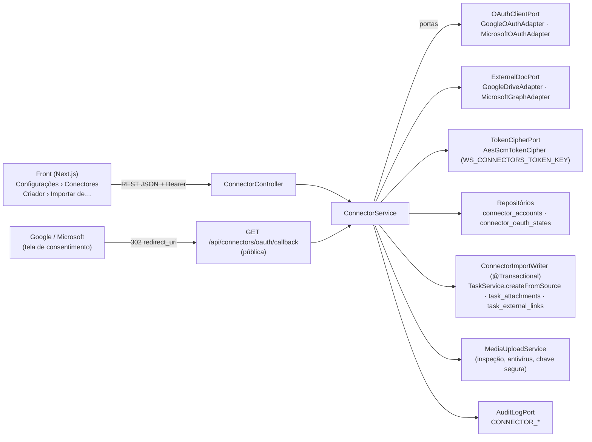

# Conectores de fontes externas (RF4, RF20.CA07, RF23, RF34)

> O dono do produto pediu: "não basta listar as fontes; é preciso integrar APIs externas e links de serviço — o app deve ter
> CONECTORES". Este documento descreve o que foi construído no backend (Java) e o contrato com o front (Next.js), a segurança, os
> escopos e por quê, como registrar os aplicativos no **Google Cloud** e no **Microsoft Entra**, as variáveis de ambiente e os limites
> conhecidos. Pesquisa de fontes primárias (09/11/2026): `contracts/connectors/sources.json` (Google, Microsoft e Apple; o que cada
> aplicativo produz e o que vira no Work Station).

## 1. O que existe

| Peça | Onde | O que faz |
|---|---|---|
| Enums ampliados | `ws-domain/…/acervo/TaskType.java`, `SourceKind.java`; migration **V60** (à mão, como a V37) | +16 `TaskType` (APRESENTACAO … ATIVIDADE_CURSO); `SourceKind` ganha um valor por aplicativo (GOOGLE_*, MS_*, APPLE_*), sem contatos; os 17 anteriores ficam (GOOGLE/MICROSOFT = legado). CHECKs de `tasks.type`, `tasks.source_kind` e `compliance_items.expected_type`. |
| Domínio `connectors` | `ws-domain/…/domain/connectors/` | `ConnectorProvider` (GOOGLE/MICROSOFT = OAUTH, APPLE_ICLOUD = LINK), `ConnectionStatus`, `ConnectorAccount`, `ConnectorOAuthState`, `TaskExternalLink` (as três com `@DomainEntity`, tabelas na **V61** gerada pelo catálogo) e `ExternalSources` (regras puras: fonte → tipo/provedor, classificação de itens do Drive e do Graph, tabela de hosts do link). |
| Serviço e portas | `ws-application/…/application/connectors/` | `ConnectorService` (casos de uso), `ConnectorImportWriter` (gravação transacional da tarefa importada), portas `OAuthClientPort`, `ExternalDocPort`, `TokenCipherPort`, `ConnectorAccountRepositoryPort`, `ConnectorOAuthStateRepositoryPort`, `TaskExternalLinkRepositoryPort`; `TaskService.createFromSource` e `TaskAttachmentRepositoryPort` no acervo. |
| Adaptadores HTTP | `ws-infrastructure/platform/…/platform/connectors/` | `GoogleOAuthAdapter`, `GoogleDriveAdapter` (Drive API v3), `MicrosoftOAuthAdapter` (identity platform v2.0), `MicrosoftGraphAdapter` (Graph v1.0), `ConnectorHttp` (JDK `HttpClient`), `AesGcmTokenCipher`, `ConnectorsAdaptersConfig` (só com `ws.connectors.enabled=true`). URLs configuráveis (testes usam servidor HTTP local). |
| Persistência | `ws-infrastructure/persistence-mysql/…/mysql/connectors/` | `JpaConnectorAdapters` (contas, estado OAuth com consumo atômico, origem externa) e o adaptador de anexos em `JpaAcervoAdapters`. |
| API | `ws-web/…/web/connectors/ConnectorController.java` | Contrato da §3. O callback é a única rota pública (`SecurityConfig.PUBLIC_GET`) e é limitado por IP (`AuthRateLimitFilter`, 60/10 min). |
| Front | `lib/connectors/**`, `contracts/connectors/sources.json`, aba Configurações › Conectores, "Importar de…" no criador | Agente FRONTEND (tipos TS próprios que espelham este contrato). |



## 2. Modos de importação

| Modo | O que guarda | Como |
|---|---|---|
| **VINCULADO** | `tasks.source_ref` = URL web do item (https, ≤ 500); `task_external_links` = id no provedor (Drive: `fileId`; Graph: `driveId~itemId`), conta usada, MIME e versão remota (`headRevisionId`/`version` no Drive, `cTag`/`eTag` no Graph); a URL também entra nas referências do briefing. | Para o job `SYNC_EXTERNO` atualizar depois (agendamento **planejado**). Sem URL https, `source_ref` = `<provedor>:<id>`. |
| **COPIADO** | O mesmo do VINCULADO **e** o conteúdo como anexo (`task_attachments` → `media_objects`) pelo pipeline de mídia existente (D-67: tipo real por magic bytes, limite por tipo, antivírus/quarentena, dedupe por dono, chave segura). | Drive: `files.export?mimeType=application/pdf` para Docs/Sheets/Slides/Drawings, `files.get?alt=media` para os demais. Graph: `/content?format=pdf` até `WS_CONNECTORS_MICROSOFT_PDF_MAX_BYTES` (a doc cita 2 MB), senão o original; se a conversão é recusada, cai para o original. |
| **Link** (`link-import`) | Tarefa VINCULADA com `source_ref` = o link colado, `format = url`. | Qualquer provedor, inclusive iCloud. O servidor **nunca busca** o endereço (sem SSRF); só aceita os hosts da §3.3. |

`exportFormats` de cada item (lista de busca) diz **em que formato ESTE servidor copia** o item, na ordem de preferência (o primeiro é o
usado no COPIADO): `PDF` (gerado pelo provedor) e/ou o original quando o pipeline de mídia o aceita (`PDF`, `DOCX`, `XLSX`, `PPTX`,
`PNG`, `JPEG`, `GIF`, `WEBP`, `ZIP`, `DWG`, `DXF`, `IFC`, `GLB`) e cabe em `WS_CONNECTORS_MAX_IMPORT_BYTES`. Vazio = só VINCULADO
(pasta, Forms, Sites, Apps Script, My Maps, Vids, caderno do OneNote, vídeo, áudio…). Os formatos de exportação "da interface" de cada
aplicativo estão no catálogo do front (`sources.json`), não aqui.

O tipo de tarefa vem da fonte (tabela da pesquisa, igual ao catálogo do front: GOOGLE_DRIVE→DOCUMENTO, GOOGLE_MEET→GRAVACAO_REUNIAO,
MS_TEAMS→MENSAGEM_CHAT, MS_ONEDRIVE→DOCUMENTO…); para arquivo de Drive/OneDrive, pelo MIME real (imagem → IMAGEM_EDITADA, vídeo → VIDEO,
planilha → PLANILHA, pasta → PASTA, CAD → DESENHO_TECNICO…). A tarefa nasce PRIVADA, INTERNO, RASCUNHO → DISPONIVEL (como no criador),
com `task_state_log` e `TASK_CREATED` no `audit_log`.

## 3. Contrato REST

JSON camelCase; erros no formato da API (`{status, code, message, details, path, timestamp, correlationId}`).

| Método e caminho | Corpo / parâmetros | Resposta |
|---|---|---|
| `GET /api/connectors/providers` | — | `[{provider, enabled, mode: OAUTH\|LINK, scopes[]}]` (APPLE_ICLOUD: `LINK`, sempre `enabled`) |
| `GET /api/connectors` | — | `[{id, provider, accountEmail, status: ATIVO\|EXPIRADO\|REVOGADO\|ERRO, scopes[], connectedAt, lastUsedAt?, lastError?}]` — só as do usuário; nunca token |
| `POST /api/connectors/{provider}/authorize` | `{returnTo?}` (caminho interno, ex.: `/tasks/new?importar=conta`) | `{url}` |
| `GET /api/connectors/oauth/callback` | `state`, `code` ou `error` | **302** para `{frontendBaseUrl}{returnTo ou /settings?tab=conectores}` + `conector=ok` ou `conector=erro&motivo=<CODIGO>` (`&` quando o `returnTo` já tem `?`) |
| `DELETE /api/connectors/{id}` | — | 204 |
| `GET /api/connectors/{id}/items` | `q?`, `pageToken?`, `pageSize?` (1–50; padrão 25; fora disso é ajustado) | `{items: [{externalId, name, mimeType, sourceKind, taskType, webUrl, modifiedAt, sizeBytes?, exportFormats[], linkable}], nextPageToken?}` |
| `POST /api/connectors/{id}/import` | `{externalId, linkMode: COPIADO\|VINCULADO, title?}` | `TaskView` (201) |
| `POST /api/connectors/link-import` | `{url, title?}` | `TaskView` (201) |

`TaskView` passou a expor `sourceKind`, `linkMode` e `sourceRef`.

### 3.1 Códigos de erro

| Código | HTTP | Quando |
|---|---|---|
| `VALIDACAO` | 400 | provedor desconhecido ou sem OAuth no authorize, `returnTo` que não é caminho interno, `externalId`/`linkMode`/`title` inválidos, item que não dá para copiar, link fora da tabela; a cópia recusada pelo pipeline de mídia também vira 400 com o código original em `details.reason` (ex.: `TIPO_NAO_PERMITIDO`). Campo em `details.fields`. |
| `ACESSO_NEGADO` | 403 | o provedor recusou o item à conta conectada. |
| `NAO_ENCONTRADO` | 404 | conta inexistente **ou de outra pessoa** (mesma resposta — não confirma que existe); item sumiu no provedor. |
| `CONECTOR_EXPIRADO` | 409 | a renovação foi recusada (refresh revogado, senha trocada, consentimento removido) ou o token não abre: a conta fica EXPIRADO e é preciso reconectar. |
| `CONECTOR_DESABILITADO` | 503 | sem `WS_CONNECTORS_ENABLED`, sem client id/segredo/redirect do provedor ou sem `WS_CONNECTORS_TOKEN_KEY` válida. |
| `PROVEDOR_INDISPONIVEL` | 502 | provedor fora do ar, cota/limite de taxa, resposta inesperada (a conta fica ERRO até o próximo sucesso). |

Observação: o resto da API usa 422 para `VALIDACAO` de campo; os conectores seguem o contrato combinado (400). O `code` é o mesmo.

### 3.2 Motivos do callback (`conector=erro&motivo=`)

`ESTADO_INVALIDO` (state ausente, desconhecido, vencido, já usado, ou código recusado na troca) · `ACESSO_NEGADO` (a pessoa recusou o
consentimento) · `ESCOPO_INSUFICIENTE` (o consentimento veio sem o escopo de arquivos — o Google deixa desmarcar; o token obtido é
revogado) · `CONECTOR_DESABILITADO` · `PROVEDOR_INDISPONIVEL` · `ERRO_INTERNO`. Nunca o texto do provedor.

### 3.3 Importação por link — hosts aceitos (só `https`, porta padrão, sem usuário/senha na URL)

| Host | Caminho | `sourceKind` |
|---|---|---|
| `docs.google.com` | `/document` · `/spreadsheets` · `/presentation` · `/forms` · `/drawings` (aceita o prefixo `/a/<domínio>` do Workspace) | GOOGLE_DOCS · GOOGLE_SHEETS · GOOGLE_SLIDES · GOOGLE_FORMS · GOOGLE_DRAWINGS |
| `drive.google.com` | qualquer | GOOGLE_DRIVE |
| `sites.google.com` | qualquer | GOOGLE_SITES |
| `onedrive.live.com`, `1drv.ms` | qualquer | MS_ONEDRIVE |
| `*.sharepoint.com` | contém `/SitePages/` (sem diferenciar maiúsculas) → página; senão arquivo | MS_SHAREPOINT_PAGE · MS_ONEDRIVE |
| `www.icloud.com` | `/pages/` · `/numbers/` · `/keynote/` · `/iclouddrive/` · `/freeform/` · `/notes/` | APPLE_PAGES · APPLE_NUMBERS · APPLE_KEYNOTE · APPLE_ICLOUD_DRIVE · APPLE_FREEFORM · APPLE_NOTES |

O resto é recusado com `VALIDACAO`. `taskType` = o padrão da fonte; `linkMode` = VINCULADO.

## 4. Fluxo OAuth 2.0 com PKCE

```mermaid
sequenceDiagram
  autonumber
  participant F as Front
  participant A as API (ConnectorService)
  participant DB as MySQL
  participant P as Google / Microsoft
  F->>A: POST /api/connectors/GOOGLE/authorize {returnTo} (Bearer)
  A->>A: state = 256 bits aleatórios · code_verifier = 256 bits · challenge = S256(verifier)
  A->>DB: connector_oauth_states (SHA-256 do state, dono, provedor, verifier SELADO, returnTo, expira em 10 min)
  A-->>F: {url} (client_id, redirect_uri fixo, escopos mínimos, state, code_challenge)
  F->>P: navegação para a url (consentimento)
  P->>A: 302 → GET /api/connectors/oauth/callback?state&code (sem Bearer: rota pública, limitada por IP)
  A->>DB: consome o state (SELECT … FOR UPDATE + DELETE: uso único entre instâncias)
  A->>P: POST token (code + code_verifier + client_secret)
  P-->>A: access_token, refresh_token, scope
  A->>A: confere o escopo de arquivos · lê o perfil (userinfo / Graph /me)
  A->>DB: connector_accounts (tokens SELADOS com AES-256-GCM; e-mail cifrado) · audit CONNECTOR_CONNECTED
  A-->>F: 302 {frontendBaseUrl}{returnTo}?conector=ok
```

A conta é ligada ao **dono do state** (quem chamou o authorize), não a quem abre o callback: um atacante que force a vítima a abrir o
callback com o state dele só conecta a conta Google/Microsoft **dele** ao Work Station **dele**. Conta inativa entre a ida e a volta é
recusada. Reconectar a mesma conta externa reaproveita a linha (volta a ATIVO).

Renovação: o access token é renovado 60 s antes de vencer; numa recusa 401 renova uma vez e repete; renovação recusada → EXPIRADO + 409.
A Microsoft gira o refresh token a cada renovação (o novo é guardado).

## 5. Segurança e LGPD

- **Tokens nunca em texto puro**: AES-256-GCM com chave própria (`WS_CONNECTORS_TOKEN_KEY`, separada de `WS_DATA_ENCRYPTION_KEY`), IV
  aleatório de 96 bits, contexto (dono + provedor + tipo) como AAD — um token copiado de uma linha para outra no banco não abre. Sem chave
  válida: conectores OAuth desabilitados (503). O verificador PKCE também vai selado. Formato `ctk:v1:<iv>:<ct>` (rotação futura pelo
  prefixo).
- **Nunca no front nem no log**: nenhuma visão expõe token; `toString()` de conta, concessão e propriedades mascara segredos; mensagens de
  erro dos adaptadores não levam corpo, token nem código; o `AuditEvent` ainda descarta chaves suspeitas.
- **BOLA**: toda conta tem dono; `ResourceAuthorizer.requireOwnConnector` em todas as rotas com id (404 igual ao inexistente); o
  `AuthorizationEnforcementAdvice` bloqueia resposta sem a verificação.
- **Redirecionamento aberto**: `returnTo` só caminho interno (`/…`, sem `//`, `\`, esquema, fragmento, `..` nem `%` no caminho, ≤ 200;
  a consulta aceita os escapes do `URLSearchParams`); a origem do destino é sempre `WS_CONNECTORS_FRONTEND_BASE_URL`.
- **SSRF**: o link colado nunca é buscado; a página seguinte do Graph (`@odata.nextLink`) só é aceita de volta se começar pela base
  configurada do Graph; o 302 do `/content` é seguido à mão e o Bearer **não** acompanha para outra origem nem para `http`.
- **Auditoria** (`audit_log`): `CONNECTOR_CONNECTED`, `CONNECTOR_CONNECT_FAILED` (com o motivo), `CONNECTOR_DISCONNECTED` (com
  `revokedAtProvider`), `CONNECTOR_IMPORTED` (provedor, modo, fonte; via LINK quando por link) — sem token nem e-mail.
- **Desconectar**: os tokens saem do banco primeiro (status REVOGADO), depois o Google é revogado (`oauth2.googleapis.com/revoke`) e a
  linha some. A Microsoft não revoga refresh token por API para um só aplicativo: a conta some daqui e a tela orienta remover o
  consentimento em <https://myapps.microsoft.com> (conta corporativa) ou <https://account.live.com/consent/Manage> (pessoal). As tarefas
  importadas ficam; o vínculo perde a conta (`account_id` → NULL).
- **LGPD**: finalidade (importar documentos que a pessoa escolhe para virar tarefas) explicada na tela; minimização — só leitura, escopos
  mínimos, nenhum contato importado, e-mail da conta externa cifrado em repouso (`account_email_enc`); exclusão da conta Work Station
  apaga contas conectadas e estados (CASCADE). Itens com dados de terceiros (e-mail, chat, gravações) só entram por link escolhido pela
  pessoa.

## 6. Escopos e por quê

| Provedor | Escopos | Por quê |
|---|---|---|
| Google | `openid email https://www.googleapis.com/auth/drive.readonly` + `access_type=offline&prompt=consent` | Buscar e ler qualquer arquivo do Drive da pessoa (inclusive unidades compartilhadas) e exportar Docs/Sheets/Slides em PDF; `offline` + `consent` para receber o refresh token. **`drive.readonly` é escopo RESTRITO**: app **interno** do Workspace da organização dispensa verificação; app **externo** exige verificação do Google (e avaliação de segurança anual). O caminho sem escopo restrito (`drive.file` + Google Picker, a pessoa escolhe arquivo a arquivo) fica **planejado**. |
| Microsoft | `openid email offline_access User.Read Files.Read` (delegados) | `User.Read` para o `/me`; `Files.Read` para ler o **OneDrive da própria pessoa**; `offline_access` para o refresh token. Nenhum exige consentimento de administrador (mas tenants de governo costumam bloquear o consentimento do usuário — então o admin dá "Grant admin consent"). **`Files.Read` não cobre bibliotecas do SharePoint/Teams nem arquivos compartilhados por outros**: esses entram por link (`*.sharepoint.com`); `Files.Read.All` fica planejado. |
| Apple (iCloud) | — | Sem API pública para iWork, Notas ou Lembretes (o CloudKit Web Services só acessa contêineres do próprio app). Entra por link de compartilhamento do iCloud ou pelo arquivo exportado no upload. CalDAV (Calendário) fica planejado. |

## 7. Registrar o aplicativo no Google Cloud

1. Console do Google Cloud → selecione (ou crie) o projeto **da organização** (no Workspace do órgão, para poder ser app interno).
2. **APIs e serviços → Biblioteca**: ative a **Google Drive API**.
3. **Tela de consentimento OAuth** (Google Auth Platform → Branding/Público-alvo):
   - Tipo de usuário **Interno** (só contas do Workspace do órgão): `drive.readonly` dispensa verificação. Recomendado.
   - **Externo** (qualquer conta Google): `drive.readonly` é restrito — enquanto o app estiver em "Teste" só entram os usuários de teste
     cadastrados e o **refresh token vence em 7 dias**; em produção é preciso pedir a verificação do Google (justificar o escopo, vídeo do
     fluxo, política de privacidade publicada) e passar pela avaliação de segurança anual exigida para escopos restritos.
   - Informe nome do app, e-mail de suporte, domínios autorizados (o do front e o da API), links da política de privacidade e dos termos.
   - **Acesso a dados/escopos**: `openid`, `.../auth/userinfo.email` e `.../auth/drive.readonly`.
4. **Credenciais → Criar credenciais → ID do cliente OAuth → Aplicativo da Web**. Em **URIs de redirecionamento autorizados** cadastre
   exatamente o valor de `WS_CONNECTORS_GOOGLE_REDIRECT_URI` (padrão `${WS_APP_BASE_URL}/api/connectors/oauth/callback`, por exemplo
   `https://api.workstation.pr.gov.br/api/connectors/oauth/callback`). Origens JavaScript não são necessárias (o fluxo é no servidor).
5. Copie o **ID do cliente** → `WS_CONNECTORS_GOOGLE_CLIENT_ID` e o **segredo** → `WS_CONNECTORS_GOOGLE_CLIENT_SECRET` (cofre de
   segredos; nunca em arquivo versionado).

## 8. Registrar o aplicativo no Microsoft Entra

1. Centro de administração do Microsoft Entra → **Identidade → Aplicativos → Registros de aplicativo → Novo registro**.
2. **Tipos de conta com suporte**: só o diretório do órgão (single tenant → `WS_CONNECTORS_MICROSOFT_TENANT=<id do tenant>`); qualquer
   diretório organizacional (`organizations`); ou organizacional + contas Microsoft pessoais (`common`, o padrão).
3. **URI de redirecionamento**: plataforma **Web**, valor exato de `WS_CONNECTORS_MICROSOFT_REDIRECT_URI` (padrão
   `${WS_APP_BASE_URL}/api/connectors/oauth/callback`).
4. **Certificados e segredos → Novo segredo do cliente**: copie o **Valor** → `WS_CONNECTORS_MICROSOFT_CLIENT_SECRET` (anote a validade e
   gire antes de vencer). O **ID do aplicativo (cliente)** → `WS_CONNECTORS_MICROSOFT_CLIENT_ID`.
5. **Permissões de API → Microsoft Graph → Permissões delegadas**: `openid`, `email`, `offline_access`, `User.Read`, `Files.Read`. Nenhuma
   exige consentimento de administrador; se a política do tenant bloquear o consentimento do usuário, use **Conceder consentimento do
   administrador**.

## 9. Variáveis de ambiente

| Variável | Padrão | Uso |
|---|---|---|
| `WS_CONNECTORS_ENABLED` | `false` | Chave geral dos conectores OAuth (a importação por link não depende dela). |
| `WS_CONNECTORS_TOKEN_KEY` | — (segredo) | Base64 de 32 bytes (`openssl rand -base64 32`). Sem ela ou inválida: conectores OAuth desabilitados. Trocar a chave invalida os tokens guardados (as contas expiram e pedem reconexão). |
| `WS_CONNECTORS_FRONTEND_BASE_URL` | `WS_FRONTEND_URL` | Destino do 302 do callback. |
| `WS_CONNECTORS_HTTP_TIMEOUT` | `20s` | Tempo de cada chamada aos provedores (o download tem 6×). |
| `WS_CONNECTORS_MAX_IMPORT_BYTES` | `52428800` | Teto do download de um item COPIADO (o pipeline de mídia ainda aplica o limite por tipo). |
| `WS_CONNECTORS_GOOGLE_CLIENT_ID` / `_CLIENT_SECRET` | — | Credencial OAuth do Google Cloud (segredo no cofre). |
| `WS_CONNECTORS_GOOGLE_REDIRECT_URI` | `${WS_APP_BASE_URL}/api/connectors/oauth/callback` | Igual ao cadastrado no Google. |
| `WS_CONNECTORS_MICROSOFT_CLIENT_ID` / `_CLIENT_SECRET` | — | Registro de aplicativo do Entra (segredo no cofre). |
| `WS_CONNECTORS_MICROSOFT_REDIRECT_URI` | `${WS_APP_BASE_URL}/api/connectors/oauth/callback` | Igual ao cadastrado no Entra. |
| `WS_CONNECTORS_MICROSOFT_TENANT` | `common` | `common`, `organizations` ou o id do tenant do órgão. |
| `WS_CONNECTORS_MICROSOFT_PDF_MAX_BYTES` | `2097152` | Até onde se pede `?format=pdf` ao Graph. |

As URLs dos provedores (`ws.connectors.google.authorization-url`, `token-url`, `revocation-url`, `userinfo-url`, `drive-url`;
`ws.connectors.microsoft.authority-url`, `graph-url`) têm os valores oficiais como padrão e só mudam em teste ou em nuvem soberana.

## 10. Testes

- Domínio: `ExternalSourcesTest`, `ConnectorDomainTest` (`mvn -pl ws-domain test`).
- Serviço com portas falsas (fluxo OAuth completo, PKCE, uso único, renovação, BOLA, importação, link, desconexão):
  `ConnectorServiceTest` (`mvn -pl ws-application -am test -Dtest=ConnectorServiceTest -Dsurefire.failIfNoSpecifiedTests=false`).
- Adaptadores contra servidor HTTP local (`LocalProvider`, JDK `HttpServer` em 127.0.0.1): `GoogleAdaptersTest`, `MicrosoftAdaptersTest`,
  `AesGcmTokenCipherTest` (platform).
- Controller com a segurança real: `ConnectorControllerWebTest` (ws-web).
- MySQL 8.4 real (Testcontainers, pula sem Docker): `ConnectorPersistenceIT`; guarda de CHECKs × enums: `EnumChecksMatchCatalogTest`.
- Configuração: `ApplicationYmlSecurityTest.conectoresDesligadosPorPadraoESemSegredoPadrao`.

## 11. Limites conhecidos e planejado

- **Conversão do Graph**: a documentação limita `?format=pdf` a arquivos pequenos (2 MB, não conferido na prática — por isso é
  configurável); acima disso copia-se o original (DOCX/XLSX/PPTX…). `.doc/.xls/.ppt` antigos acima do limite não são copiáveis (o pipeline
  de mídia só aceita OOXML) — só VINCULADO. Visio, Whiteboard, Loop e OneNote dependem da conversão ou só vinculam.
- **Google**: `files.export` limita a 10 MB (vira 400 "acima do limite: vincule"); Google Vids, Forms, Sites, My Maps, Apps Script e
  atalhos só vinculam.
- **Apple**: sem API pública (iWork, Notas, Lembretes, Freeform): link do iCloud ou arquivo exportado. **CalDAV** (Calendário, senha
  específica de app sem escopo) fica planejado — a pesquisa recomenda evitar guardar essa senha.
- **Planejado**: agendamento do `SYNC_EXTERNO` (assinaturas/webhooks do Drive `changes.watch` e do Graph `subscriptions` + delta, e
  `TaskVersion` a cada mudança); `drive.file` + Google Picker (sem escopo restrito); `Files.Read.All` para bibliotecas do SharePoint/Teams;
  Gmail, Agenda, Teams, Outlook, Keep, Classroom por API (hoje só por link); cópia de pasta como ZIP; varredura de antivírus real (sem motor
  o anexo fica PENDENTE/NAO_VERIFICADO — D-67, Q-165); tela de "vinculado desatualizado".
- O front valida o link do lado dele também; o prefixo `/a/<domínio>` do Docs é aceito aqui e pode ser recusado lá.
