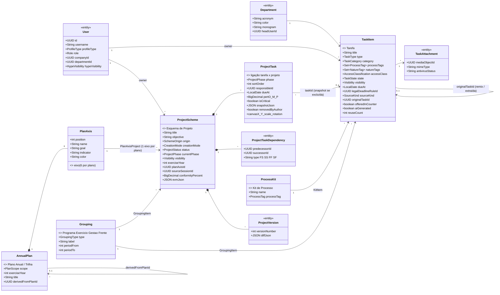
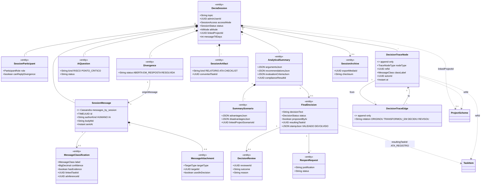
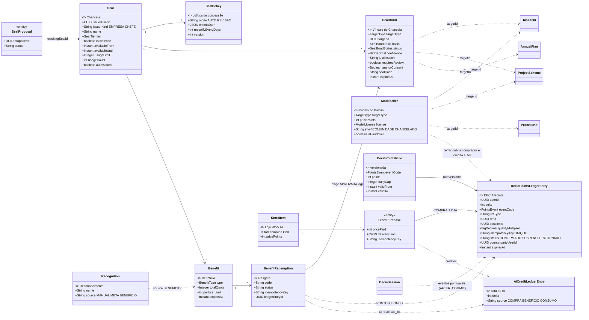
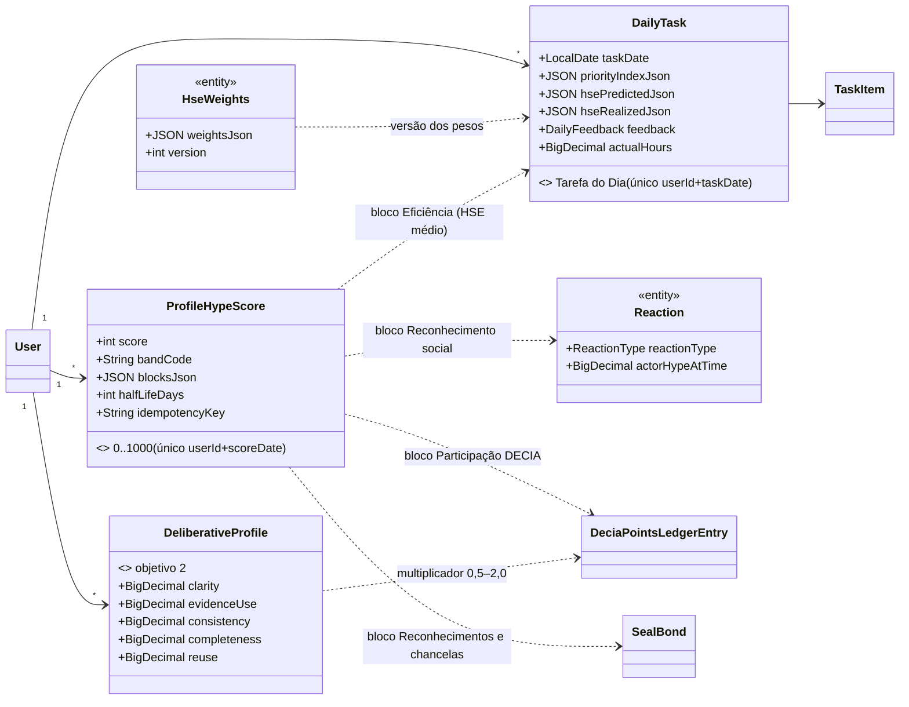

# Diagrama de classes v1 — núcleo do Work AI / DECIA

Entidades centrais pedidas na sessão inicial: **Tarefa**, **ProjectScheme**, **ProjectTask**, **Plano Anual**, **Chancela / Vínculo / Benefício**, **DecisionTrace**, **DeciaPointsLedger**, mais a **sessão DECIA** que as liga. Atributos completos em [`TAXONOMIA.md`](TAXONOMIA.md); aqui só os que explicam as relações. Diagramas por RF em [`../diagramas/`](../diagramas/).

## 1. Acervo, projetos e planejamento (Tarefa = peça · Esquema de Projeto = look · Plano Anual = DNA)

## 2. Sessão DECIA e Rastro de Decisão (hub do app, RF4–RF17, RF29)

## 3. Chancelas, benefícios, Balcão e DECIA Points (RF39, RF40, RF42)

## 4. Reputação e eficiência (RF44, RF45) — como se ligam ao núcleo

## 5. Camadas (hexagonal) — onde cada classe vive

| Camada | Classes |
|---|---|
| `wai-domain` | todas as `<<entity>>` acima, enums, `*Repository` |
| `wai-application` | `AcervoService`, `TaskCreatorService`, `ProjectComposerService`, `ProjectDeskService`, `PlanService`, `GroupingService`, `DeciaSessionService`, `MessageService`, `ClassificationService`, `SummaryService`, `DecisionService`, `DecisionTraceService`, `DeciaBridgeService`, `SealService`, `SealPolicyEvaluator`, `BenefitService`, `CounterService`, `DeciaPointsService`, `StoreService`, `DailyTaskService`, `HypeScoreService`, `AiEngine`, `Guard`, `DomainEvents`; portas `AiProviderPort`, `MediaStoragePort`, `SearchIndexPort`, `EmbeddingPort`, `TimelineProjectionPort`, `NotificationProjectionPort`, `MessageStorePort`, `CounterStorePort`, `RateLimitPort`, `TokenIssuerPort`, `ExternalDocPort`, `AntivirusPort`, `OcrPort`, `CadReaderPort`, `TranscriptionPort`, `EmailSenderPort` |
| `wai-infrastructure` | `Mysql*Adapter`, `Cassandra*Adapter`, `OpenSearch*Adapter`, `Redis*Adapter`, `S3MediaStorage`, `ClaudeProvider`, `GeminiProvider`, `LocalEngine`, `GoogleWorkspaceAdapter`, `Microsoft365Adapter`, `EProtocoloAdapter` |
| `wai-web` | `AuthController`, `AccountController`, `TaskController`, `ProjectController`, `PlanController`, `GroupingController`, `DeciaSessionController`, `MessageController`, `DecisionController`, `SealController`, `BenefitController`, `CounterController`, `PointsController`, `StoreController`, `DailyTaskController`, `HypeController`, `InsightsController`, `AdminController` |
