# Taxonomia de entidades — Work Station / DECIA (v1)

> **Nome do produto:** **Work Station** (os cards do board ainda citam o nome antigo "Work AI"; leia-os como Work Station). Prefixo dos módulos: `ws-`.

> Fonte de verdade dos requisitos: board Trello **Work Station** (ex-"Decisão com Inteligência Artificial - DECIA - SECIDPR"), listas *Work Station + DECIA*, *Requisitos Funcionais* (RF1–RF45) e *Product Backlog* (HU1–HU45).
> Esqueleto reaproveitado do **Fashion AI (FAI)** (`matheushaliski/tcc-2026-fashion-ai-backend`, módulo `fai-domain`). Cada entidade indica a equivalente no FAI e o RF que a origina.
> **Implementação (D-40):** cada entidade abaixo é um record de `ws-domain` anotado com `@DomainEntity`/`@Attr`; nomes de coluna, tipos SQL, nulidade, CHECKs, FKs e store ficam em [`catalogo-entidades.json`](catalogo-entidades.json) (gerado, 123 entidades / 1522 atributos) e nas migrations `V10`–`V21` geradas dele — ver §17. Quando este texto e o catálogo divergirem, vale o catálogo.
> Convenções: identificadores `UUID` (BINARY(16) no MySQL), auditoria herdada de `AuditableEntity` (`createdAt`, `updatedAt`, `createdBy`, `updatedBy`) e, quando houver concorrência, `VersionedAuditableEntity` (`@Version version`). Campos `*Json` são colunas `JSON` do MySQL 8. Campos sensíveis (LGPD) usam o conversor `AesGcmStringConverter`.

## 0. Mapa de contextos (bounded contexts)

| # | Contexto | Entidades principais | RFs | Store principal |
|---|---|---|---|---|
| 1 | **Identidade & Acesso** | User (+ extensões EMPRESA/CHEFE), UserPreferences, RefreshToken, Company, Department, DepartmentMembership, CuratorAppointment, ApprovalRequest, VerificationPolicy, PendingUpload, **PolicyDocument, PolicyAcceptance, UserConsent, ConsentEvent, DataSubjectRequest** (proposta, LGPD) | RF1–RF3, RF28 | MySQL + Redis (sessões) |
| 2 | **Acervo de Tarefas** (inventário) | TaskItem, TaskAttachment, TaskVersion, TaskStateLog, LegalDeadlineRule, OrgEntity, Evidence | RF20, RF23, RF34, RF41 | MySQL + S3 + OpenSearch |
| 3 | **Criador de Projetos** | ProjectScheme, ProjectTask, ProjectVersion, ProjectScenario, ComplianceChecklist, ComplianceItem, ComplianceResult, ProcessKit, KitItem | RF21, RF22, RF30, RF31, RF32 | MySQL |
| 4 | **Planejamento institucional** | AnnualPlan, PlanAxis, PlanAxisProject, Grouping, GroupingItem | RF24, RF25 | MySQL |
| 5 | **DECIA** (centro do app) | DeciaSession, SessionParticipant, SessionMessage, MessageClassification, MessageAttachment, Divergence, DivergenceReply, AiQuestion, AnalyticalSummary, SummaryScenario, FinalDecision, DecisionReview, ReopenRequest, SessionArtifact, DecisionTrace, DecisionTraceNode, DecisionTraceEdge, Meeting, MeetingTranscript, RecordingConsent | RF4–RF17, RF29, RF37 | MySQL (estado) + Cassandra (mensagens/rastro append-only) |
| 6 | **Chancelas & Benefícios** | Seal (Chancela), SealPolicy, SealBond (VínculoChancela), SealProposal, Benefit, BenefitRedemption, Recognition | RF39, RF35, RF28 | MySQL |
| 7 | **Balcão & Loja & DECIA Points** | ModelOffer, ModelLicense, DeciaPointsLedgerEntry, DeciaPointsRule, StoreItem, StorePurchase, AiCreditLedgerEntry, PointsDonation | RF40, RF42 | MySQL + Redis (saldos/cache) |
| 8 | **Social & Descoberta** | Reaction, Comment, SavedItem, Share, Remix, Follow, MuralEntry, Notification, TimelineEvent | RF26, RF27 | MySQL + Cassandra (timeline/notificações) |
| 9 | **Gamificação & Reputação** | CollectiveGoal, GoalParticipant, Highlight, DailyTask, WeekPlan, WeekPlanDay, HseWeights, EfficiencyScoreSnapshot, ProfileHypeScore, HypeBand, HypeIgnoredEvent, DeliberativeProfile, RankingEntry, RankingWeights, RankingOptOut | RF35, RF43, RF44, RF45, RF19 | MySQL + Redis (rankings) |
| 10 | **IA do sistema** | AiInferenceLog, AiQuota, AiProviderCircuitState, Insight, FeasibilitySheet, MetricDefinition, MetricSnapshot, ExtractionResult, ExtractionCorrection, InstitutionalMemoryDocument, Citation | RF7, RF11, RF30, RF33, RF34, RF43 | MySQL + OpenSearch (embeddings) + Redis (cotas) |
| 11 | **Transição & Memória** | HandoffDossier, HandoffItem, SessionArchive | RF36, RF17, RF33 | MySQL + S3 + OpenSearch |
| 12 | **Plataforma** | AuditLog, DomainEvent (outbox), PipelineJob, FeatureFlag, MediaObject, DataExportRequest, PersonalDataRegistry (código), Theme/Skin (UserSkin) | transversal, RF3, RF38 | MySQL + S3 |

Mapa de equivalência FAI → Work Station (card "Mapa de equivalência"): Tarefa = peça (WardrobeItem) · Esquema de Projeto = look (Scheme) · ProjectTask = SchemeItem · Plano Anual = DNA (DnaScheme) · Chancela = selo (Seal) · VínculoChancela = SealBond · Benefício/Resgate = Promotion/PromotionRedemption/CouponRight · DECIA Points = FAI Points · Tarefa do Dia = Look do Dia (DailyLook) · DECIA = Copilot · Kit de Processo = Cápsula · Agrupamento = SchemeGrouping.

---

## 1. Identidade & Acesso (RF1–RF3, RF28)

### 1.1 `User` (= FAI `User`) — tabela `users`
| Atributo | Tipo | Regra |
|---|---|---|
| id | UUID | PK |
| username | String(80) | único, imutável após verificação |
| fullName | String(160) | obrigatório |
| displayName | String(80) | |
| email → coluna `email_enc` | String (AES-GCM, `WS_DATA_ENCRYPTION_KEY`) | sensível; só o cifrado vai ao banco |
| emailHash | String(128) | único, busca |
| emailVerified | boolean | |
| phone → coluna `phone_enc` | String (AES-GCM) | opcional |
| passwordHash | String | Argon2id; nulo para login só OIDC |
| oidcSubject / oidcIssuer | String | login institucional (RF2) |
| profileType | `ProfileType` | EMPREGADO · EMPRESA · CHEFE_DEPARTAMENTO |
| role | `Role` | USER · ADMIN |
| status | `AccountStatus` | PENDING_EMAIL_VERIFICATION · PENDING_VALIDATION (EMPRESA/CHEFE aguardam ADMIN, RF28.CA01) · ACTIVE · SUSPENDED · DELETION_SCHEDULED |
| jobTitle (cargo) | String(120) | RF19 cabeçalho |
| companyId | UUID → Company | empresa atual |
| departmentId | UUID → Department | lotação atual (1 por vez, RF28.CA02) |
| avatarUrl, coverUrl, bio | String | |
| verified | boolean | perfil aprovado (conta para Hype, RF45.CA03) |
| twoFactorEnabled | boolean | |
| hypeVisibility | `HypeVisibility` | PUBLICO · EMPRESA · SO_EU (padrão) (RF45.CA06) |
| rankingOptOut | boolean | RF43.CA05 |
| accountOrigin | `AccountOrigin` | REAL (padrão) · TEST_SEED · DEMO · SYSTEM — `VARCHAR` + CHECK, indexada (D-23) |
| fixtureKey | String(80) | único, nulo em conta real; chave imutável da fixture de seed/demo |
| testAccount | boolean **gerada** | coluna `GENERATED ALWAYS AS (account_origin IN ('TEST_SEED','DEMO')) STORED`, indexada; a aplicação nunca grava (D-23). Não pontua (RF42) |
| lastLoginAt | Instant | |
| termsVersion / privacyVersion | String(20) | **(proposta, RF1 bloco A)** cópia da última versão aceita de cada documento, para o gate ser rápido; a prova é `PolicyAcceptance` |
| birthDate | LocalDate (AES-GCM) | **(proposta, condicional à Q-63)** só coletada se menores (aprendizes/estagiários) puderem usar; então obrigatória no servidor (art. 14) |
| deletionRequestedAt / deletionScheduledAt | Instant | **(proposta, RF3 bloco C)** pedido de exclusão e data em que o job anonimiza (+30 d, cancelável) |
| deletionReason | String(500) | **(proposta)** motivo opcional informado pelo titular (nunca exibido a terceiros) |
| anonymizedAt | Instant | **(proposta)** preenchido pelo job `AccountAnonymizationJob`; `status` vai a `ANONYMIZED` |
| createdAt / updatedAt / version | Instant · long | `AuditableEntity` + lock otimista (`version`) |

Colunas no banco (`V2__baseline_dominio_base.sql`, fonte de verdade): `company_id` e `department_id` ficam **sem FK** até o RF28 criar `companies`/`departments` (D-23); unicidades `ux_users_username`, `ux_users_email_hash`, `ux_users_fixture_key`, `ux_users_oidc (oidc_issuer, oidc_subject)`.

**Extensões de perfil (proposta, Q-64)** — 1:1 com `User`, preenchidas no cadastro e conferidas na validação (RF28); os valores confirmados viram `Company`/`Department` na aprovação (Q-65, Q-66):

| Extensão | Tabela | Campos |
|---|---|---|
| `EmpresaProfileExtension` | `user_empresa_ext` | userId (PK) · legalName (razão social) · companyCnpj (AES-GCM, dígitos verificadores conferidos) · officialSite (obrigatório, normalizado para `https://`, recusa `@perfil`) · representationDocId → `PendingUpload`/`MediaObject` em `restricted/` (ato de nomeação ou portaria) |
| `ChefeProfileExtension` | `user_chefe_ext` | userId (PK) · companyId → `Company` existente · departmentName ou departmentId · appointmentLink (link oficial do ato de nomeação no Diário Oficial, normalizado `https://`) |
| EMPREGADO | — (campos em `users`) | jobTitle (cargo) · intendedDepartmentId (opcional; **não lota** ninguém, quem lota é o chefe, RF28.CA02) |

### 1.2 `UserPreferences` (= FAI) — `user_preferences` (RF3, RF38.CA08)
theme `ThemeMode` (AUTO·CLARO·ESCURO·ALTO_CONTRASTE·BLUEPRINT) · language `UiLanguage` (PT_BR·EN·ES) · density · fontScale · reduceMotion · deskSkin `DeskSkin` (PAPEL·CORTICA·BLUEPRINT·PAPEL_TIMBRADO) · defaultCardSkin · notificationPrefsJson (inclui `dailyTaskAt` 08:00, RF44.CA10) · timezone · wipLimit (padrão 3, RF44.CA05) · dashboardLayoutJson · aiModeDefault (ECONOMIA·AVANCADO).

### 1.3 `RefreshToken` (= FAI) — Redis (hash por `familyId`) com espelho em `refresh_tokens`
tokenHash (único) · familyId (índice) · userId (FK `users` **CASCADE**) · expiresAt · revokedAt · rotatedFromId (FK self **SET NULL**) · createdIp · userAgent · deviceName · lastUsedAt · persistent · createdAt. Só o **hash** do token é persistido.

### 1.4 `Company` (= FAI `BrandProfile`) — `companies` (RF28)
id · ownerUserId (perfil EMPRESA) · legalName · slug (único) · cnpj (AES) · logoUrl · coatOfArmsUrl · about · websiteUrl · accentColor · pointsPolicyJson (tetos, expiração RF42.CA09, limite de doação) · hypePolicyJson (pesos, meia-vida, nomes das faixas RF45.CA07) · rankingWeightsId · recordingRetentionPolicy (RF37.CA05) · status.

### 1.5 `Department` (= FAI `CelebrityProfile`) — `departments` (RF28.CA02)
id · companyId · name · acronym (SECID-UTS, CPOE…) · slug · color · monogram · headUserId (CHEFE) · about · coverUrl · active.

### 1.6 `DepartmentMembership` — `department_memberships` (histórico de lotações)
id · userId · departmentId · roleInDept `DeptRole` (MEMBRO · CHEFE · CURADOR) · startedAt · endedAt · reason.

### 1.7 `CuratorAppointment` — `curator_appointments` (RF28.CA03)
id · departmentId · curatorUserId · appointedBy · appointedAt · revokedAt · revokeReason · scope `CuratorScope` (FILA_REVISAO · PREMIACAO · AMBOS).

### 1.8 `ApprovalRequest` — `approval_requests` (RF28.CA01, RF28.CA09–CA17 **proposta**, D-19)
id · userId · requestedProfile · evidenceJson · status `ApprovalStatus` (PENDENTE · **AJUSTES** · APROVADO · **RECUSADO**, antes REJEITADO) · policyVersion → `VerificationPolicy.version` · criteriaJson (checklist `[{code, mandatory, auto OK|FALHA|ANALISTA, checked, checkedBy, checkedAt}]`) · reasonsJson (motivos padronizados da recusa/ajustes, ≥ 1) · note (≤ 500, sem dado sensível) · attempts (cadastro = 1; **≤ 5**, depois só ADMIN reabre) · emailConfirmedAt · submittedAt · dueAt (prazo em **dias úteis** contado de `emailConfirmedAt`; reenvio conta de `submittedAt`) · verificationCode (`WS-` + 6 hex derivados do `userId`, mostrado só ao dono) · documentKeysJson (`restricted/pending/{uploadId}/representation.jpg` …) · confirmedBy / confirmedAt (CHEFE: chefe atual ou dono da EMPRESA, Q-66) · reviewedBy · reviewedAt.
Regras: nasce **só depois da confirmação do e-mail** (corrige a divergência do RF1.CA04); `APROVADO` exige todos os critérios obrigatórios marcados (`409 CRITERIOS_PENDENTES`); `AJUSTES`/`RECUSADO` exigem motivo (`422 VALIDACAO details.reasons`); o ADMIN não decide o próprio pedido (`403 ACESSO_NEGADO`); cada abertura de documento é `no-store` e gera `AuditLog APPROVAL_DOCUMENT_VIEWED`.

### 1.9 `VerificationPolicy` — `verification_policies` (RF28, **proposta**, = FAI `IssuerVerificationPolicy` versionada)
id · version (ex.: `1.0`) · profileType (EMPRESA · CHEFE_DEPARTAMENTO) · criteriaJson (`[{code, mandatory, howChecked}]`) · reasonsJson (catálogo de motivos) · maxSubmissions (5) · slaBusinessDays (3, Q-71) · resubmitSlaBusinessDays (2) · adjustmentsReplyDays (30) · freeMailDomainsJson (gmail.com, outlook.com, …: domínio do e-mail não prova representação) · validFrom · status (RASCUNHO · VIGENTE · SUBSTITUIDA). O código carrega a vigente; o `ApprovalRequest` congela `policyVersion`. Critérios e motivos propostos em `docs/diagramas/RF28/README.md` §8.

### 1.10 `PolicyDocument` — `policy_documents` (RF1 bloco A, **proposta**, D-15)
id · document `PolicyDocumentKind` (TERMOS · PRIVACIDADE) · version (ex.: `1.0`; **independente por documento**) · language `UiLanguage` (PT_BR oficial; EN/ES cortesia, Q-69) · effectiveFrom · changelog (resumo das mudanças mostrado no gate) · bodyMd (fonte: `docs/legal/*.md`) · status (RASCUNHO · VIGENTE · SUBSTITUIDA) · publishedBy · publishedAt. Único (document, version, language); **uma** VIGENTE por (document, language). Publicar falha se o corpo tiver marcador `[` … `]` ou "validar com jurídico" (`PolicyTextGuardTest`). Lido em `GET /api/legal/{document}/current` e `/versions`.

### 1.11 `PolicyAcceptance` — `policy_acceptances` (RF1 bloco A, **proposta**, D-16) — **append-only**
id · userId · document · version · acceptedAt · ip · userAgent · channel `AcceptanceChannel` (CADASTRO_LOCAL · OIDC · REACEITE · SEED) · correlationId. Sem UPDATE/DELETE (trigger ou `@Immutable`); FK `users` **ON DELETE RESTRICT**; **sobrevive à anonimização** (prova do aceite, art. 8º §2º) — o `userId` fica, os demais dados pessoais do `User` já foram anonimizados. Gera `AuditLog POLICY_ACCEPTED {document, version, channel}`.

### 1.12 `UserConsent` — `user_consents` (RF3 bloco C, **proposta**, D-17) — estado atual por finalidade
id · userId · purpose `ConsentPurpose` · granted · grantedAt · revokedAt · policyVersion (versão da Política vigente no ato) · lastEventId → `ConsentEvent`. Único (userId, purpose). **Nunca nasce concedido**; só finalidades **opcionais** (a base legal das demais não é consentimento). Cada valor do enum tem um **ponto de verificação** obrigatório registrado em `ConsentChecks` (mapa finalidade → checagem usada pelo serviço); finalidade sem checagem quebra o CI e finalidade sem uso não aparece na tela.

### 1.13 `ConsentEvent` — `consent_events` (RF3 bloco C, **proposta**) — **append-only**
id · userId · purpose · action `ConsentAction` (GRANTED · REVOKED) · at · ip · userAgent · policyVersion · channel (SETTINGS · API) · correlationId. Sobrevive à anonimização junto com `PolicyAcceptance`. Auditoria `CONSENT_GRANTED` / `CONSENT_REVOKED`.

### 1.14 `DataSubjectRequest` — `data_subject_requests` (RF3 bloco C, **proposta**, LGPD art. 18 e 20)
id · userId · kind `DsrKind` (REVISAO_DECISAO_AUTOMATIZADA · OPOSICAO · INFORMACAO_COMPARTILHAMENTO · CORRECAO) · target `DsrTarget` (HSE · RANKING · HYPE · CLASSIFICACAO_IA; só para revisão) · targetId (ex.: `EfficiencyScoreSnapshot`, `RankingEntry`, `MessageClassification`) · description (≤ 2000) · status `DsrStatus` (ABERTA · EM_ANALISE · RESPONDIDA · RECUSADA · ENCERRADA) · openedAt · dueAt (prazo, Q-71) · assigneeId (ADMIN/encarregado; o canal do encarregado vem de `WS_LEGAL_DPO_CONTACT`) · responseMd · respondedAt · correlationId. Auditoria `DSR_OPENED`, `DSR_RESPONDED`. CORRECAO é atendida pela aba Conta (RF3.CA01) e só vira pedido quando o campo não é editável pelo titular.

### 1.15 `PendingUpload` — `pending_uploads` (RF1 bloco B, **proposta**, D-22)
id · kind `UploadKind` (avatar · identity · representation) · key (`pending/{id}/avatar.webp` público-depois-de-consumido; `restricted/pending/{id}/{kind}.jpg` para identity/representation) · mimeType (magic bytes) · sizeBytes · width · height (teto de pixels antes de alocar, SEG) · sha256 · ip · createdAt · expiresAt (**+24 h**) · consumedByUserId · consumedAt. Reencode remove EXIF/GPS. O cadastro só aceita `PendingUpload` **do mesmo `kind`** e não consumido; `PendingUploadCleanupJob` apaga os vencidos (`@Scheduled` + lock, com teste que prova o agendamento).

---

## 2. Acervo de Tarefas (RF20, RF23, RF34, RF41)

### 2.1 `TaskItem` — **Tarefa** (= FAI `WardrobeItem`) — `tasks`
| Atributo | Tipo | Regra / equivalente FAI |
|---|---|---|
| id | UUID | PK |
| ownerId | UUID → User | dono (= user) |
| departmentId | UUID → Department | departamento |
| title | String(200) | obrigatório (= name) |
| summary | Text | resumo 3 linhas (IA) |
| descriptionMd | Text | |
| type | `TaskType` | TEXTO_MANUAL · TEXTO_IA · IMAGEM_WEB · IMAGEM_EDITADA · PLANILHA · DOCUMENTO · PASTA · LINK · DESENHO_TECNICO · FORMULARIO · ATA_REGISTRO · EMAIL · PROTOCOLO · CRONOGRAMA · ESTUDO_TECNICO_PRELIMINAR |
| category | `TaskCategory` | OFICIO_MEMORANDO · PARECER_TECNICO · ETP · TERMO_REFERENCIA · PLANILHA_ORCAMENTARIA · PROJETO_BASICO_EXECUTIVO · CRONOGRAMA · ATA · PORTARIA_RESOLUCAO · CONTRATO_CONVENIO · VISTORIA_RELATORIO_FOTOGRAFICO · LICENCA_ANUENCIA · MAPA_GEORREFERENCIA · FORMULARIO · OUTRO (= category) |
| subcategory | String(80) | depende da categoria |
| processTags | Set<`ProcessTag`> (≤2) | LICITACAO · CONVENIO · OBRA · REGULARIZACAO_FUNDIARIA · PLANEJAMENTO_URBANO · ORCAMENTO · PESSOAL · JURIDICO … (= occasion) |
| natureTags | Set<`NatureTag`> (≤2) | TECNICA · JURIDICA · FINANCEIRA · ADMINISTRATIVA · AMBIENTAL · SOCIAL (= style) |
| accessClass | `AccessClassification` | PUBLICO · INTERNO · RESTRITO · SIGILOSO (= color); RESTRITO/SIGILOSO nunca vai a IA externa |
| format | String(20) | docx, xlsx, pdf, gdoc, gsheet, url… (= material) |
| effortSize | `EffortSize` | P · M · G + estimatedHours (= size) |
| amountInvolved | BigDecimal | R$ (= price), 0 se não se aplica |
| origin | `TaskOrigin` | INTERNA · ORGAO_EXTERNO · FORNECEDOR · CIDADAO (= market) |
| sourceKind | `SourceKind` | ARQUIVO · COLAR · GOOGLE · MICROSOFT · EMAIL · LINK · PROTOCOLO · FOTO · TEXTO_IA · EXTRAIDA_DE_PROJETO · REMIX · DECIA · AUTOPILOT · ATA_VIVA · DOSSIE · EXTRACAO (RF34) |
| sourceRef | String | id do Drive/OneDrive, URL, nº de protocolo, messageId do e-mail |
| linkMode | `LinkMode` | VINCULADO · COPIADO (RF20.CA07) |
| orgEntityId | UUID → OrgEntity | órgão/fornecedor (= brand) |
| responsibleId | UUID → User | padrão dono |
| dueAt | LocalDate | prazo |
| legalDeadlineRuleId | UUID → LegalDeadlineRule | quando categoria tem prazo legal |
| legalDeadlineBaseDate / legalDueAt / legalOverrideReason | LocalDate / LocalDate / String | RF20.CA11 |
| priority | `Priority` | BAIXA · MEDIA · ALTA · CRITICA |
| state | `TaskState` | RASCUNHO · DISPONIVEL · EM_USO · BLOQUEADA · CONCLUIDA · ARQUIVADA · MODELO_PUBLICO · OFERECIDA (RF41) |
| blockedByTaskId / blockedByUserId / blockReason | UUID / UUID / String | BLOQUEADA |
| docSituation | `DocSituation` | MINUTA · REVISADO · ASSINADO · PUBLICADO (= condition) |
| receivedAt | LocalDate | data de recebimento (= data de compra) |
| senderOrigin | String | remetente (= local de compra) |
| protocolNumber | String(60) | nº protocolo/processo (= SKU) |
| retentionPolicyJson | JSON | guarda e temporalidade (= cuidados) |
| visibility | `Visibility` | PRIVADA · DEPARTAMENTO · EMPRESA · PUBLICA |
| favorite | boolean | |
| offeredInCounter | boolean | RF40 (= forSale) |
| aiGenerated | boolean + aiInferenceId | faísca ✦ |
| aiConfidenceJson | JSON | confiança por campo (RF20.CA02) |
| thumbnailUrl / coverUrl / coverMode | String / String / `CoverMode` (AUTO · MANUAL · IA) | RF38.CA02 |
| cardSkin | String | |
| tags | Set<String> | |
| notes | Text | |
| originalTaskId | UUID → TaskItem | crédito (RF23/RF26 remix) |
| sourceProjectId | UUID → ProjectScheme | quando EXTRAIDA_DE_PROJETO |
| checklistItemId | UUID → ComplianceItem | tarefa faltante criada pelo Espelho (RF32.CA03) |
| reuseCount, projectUsageCount | int | métricas de reutilização |
| likesCount, commentsCount, savesCount, sharesCount, remixesCount, viewsCount | long | contadores desnormalizados |
| sealIdsJson | JSON | chancelas aprovadas (cache) |
| version | long | otimista |

### 2.2 `TaskAttachment` — `task_attachments`
id · taskId · mediaObjectId · fileName · mimeType (detectado, não só extensão) · sizeBytes · sha256 · antivirusStatus (PENDENTE·LIMPO·INFECTADO) · ocrStatus · ocrTextRef (OpenSearch) · isPrimary · sortOrder.

### 2.3 `TaskVersion` — `task_versions` (itens vinculados Google/Microsoft, RF20.CA07)
id · taskId · versionNumber · externalRevisionId · syncedAt · thumbnailUrl · changeSummary · snapshotMediaId.

### 2.4 `TaskStateLog` — `task_state_log` (RF41.CA02)
id · taskId · fromState · toState · actorId · reason · projectId (quando EM_USO automático) · correlationId · at.

### 2.5 `LegalDeadlineRule` — `legal_deadline_rules` (RF20.CA11)
id · companyId (null = padrão) · category · subcategory · days · businessDays (bool) · legalBasis · description · active · validFrom/validTo.

### 2.6 `OrgEntity` — órgão / entidade / fornecedor (= FAI `Brand`) — `org_entities`
id · name · cnpj · kind (ORGAO · FORNECEDOR · ENTIDADE · CIDADAO) · source (WIKIDATA · CNPJ · SITE · MANUAL) · externalRef · websiteUrl · logoUrl (tratado) · verified.

### 2.7 `Evidence` — Anexos & Evidências (= FAI `Photo`) — `evidences` (RF41.CA06)
id · ownerId · mediaObjectId · takenAt · latitude/longitude (opcional, AES) · caption · linkedTaskId · linkedProjectId · studioStatus (ORIGINAL · ENDIREITADA · RECORTADA · SEM_FUNDO · OCR) · derivedTaskId.

### 2.8 `TaskSnapshot` (valor embutido em `ProjectTask.snapshotJson`, RF23.CA03)
title · type · category · thumbnailUrl · summary · ownerName · capturedAt.

---

## 3. Criador de Projetos (RF21, RF22, RF30, RF31, RF32)

### 3.1 `ProjectScheme` — **Esquema de Projeto** (= FAI `Scheme`) — `project_schemes`
| Atributo | Tipo | Regra |
|---|---|---|
| id | UUID | |
| ownerId | UUID → User | |
| companyId, departmentId | UUID | |
| title | String(200) | obrigatório |
| emoji / iconId | String | RF38 §13 |
| objective | String(300) | 1 frase; vira tema da sessão (RF29.CA01) |
| descriptionMd | Text | |
| processTags (≤2), natureTags (≤2) | Set | (= occasion/style) |
| creationMode | `CreationMode` | MANUAL · COM_IA |
| origin | `SchemeOrigin` | CRIAR_PROJETO · DECIA · REMIX · AUTOPILOTO · MODELO · CENARIO · DOSSIE · ATA_VIVA |
| originalProjectId | UUID → ProjectScheme | remix/modelo (crédito) |
| sourceSessionId | UUID → DeciaSession | origem DECIA |
| aiOrientation | Text | orientação livre para a IA |
| status | `ProjectStatus` | RASCUNHO · PUBLICADO · EM_DECISAO · APROVADO · EM_EXECUCAO · CONCLUIDO · ARQUIVADO · DEVOLVIDO |
| currentPhase | `ProjectPhase` | DEMANDA · PLANEJAMENTO · ELABORACAO · ANALISE · APROVACAO · EXECUCAO · ENCERRAMENTO |
| priority | `Priority` | |
| visibility | `Visibility` | herdada do perfil |
| exerciseYear | int | exercício |
| programGroupingId, exerciseGroupingId, managementGroupingId | UUID → Grouping | RF25.CA02 |
| planAxisId | UUID → PlanAxis | eixo (1 por plano, RF24.CA02) |
| coverMode | `CoverMode` | MOSAICO · FOTO · IA |
| coverUrl, mosaicJson | String / JSON | RF38.CA03 |
| deskSkin, deskBackgroundJson | String / JSON | Mesa (RF22) |
| conformityPercent | BigDecimal | selo de conformidade (RF32.CA04) |
| hasBlockingPending | boolean | ⛔ pendente |
| criticalPathJson | JSON | ids em ordem (RF21.CA08) |
| evmJson | JSON | PV, EV, AC, CPI, SPI, EAC, ETC, VAC, TCPI (RF43.CA09) |
| nextMilestoneAt | LocalDate | |
| lastDeciaEventAt / lastDeciaEventLabel | Instant / String | card do projeto |
| offeredInCounter | boolean | RF40 |
| aiGenerated, aiInferenceId | boolean, UUID | |
| likesCount … viewsCount | long | contadores |
| sealIdsJson | JSON | |
| autosaveDraftJson | JSON | RF21.CA14 |
| version | long | |

### 3.2 `ProjectTask` — ligação tarefa ↔ projeto (= FAI `SchemeItem`) — `project_tasks`
id · projectId · taskId (nullable se removida) · phase `ProjectPhase` (= slot) · sortOrder · responsibleId · dueAt · startAt · estimatedHours (PERT O/M/P: `pertOptimistic`, `pertMostLikely`, `pertPessimistic`) · actualHours · percentComplete · plannedValue / earnedValue / actualCost (EVM) · isCritical · slackDays · moscow (MUST·SHOULD·COULD·WONT) · snapshotJson (`TaskSnapshot`, RF23.CA03) · removedByAuthor (bool) · canvasX, canvasY, canvasScale, canvasRotation, canvasLayer (Mesa, RF22.CA03) · stickyColor · decisionTraceNodeId.

### 3.3 `ProjectTaskDependency` — `project_task_dependencies`
id · projectId · predecessorProjectTaskId · successorProjectTaskId · type (FS·SS·FF·SF) · lagDays. Regra: sem ciclos (422).

### 3.4 `ProjectVersion` — `project_versions` (RF22.CA02)
id · projectId · versionNumber · authorId · createdAt · diffJson (legível) · snapshotJson · reason · restoredFromVersionId · sourceScenarioId.

### 3.5 `ProjectComment` — comentário por tarefa dentro do projeto (RF22.CA05) → usa `Comment` com targetType PROJECT_TASK.

### 3.6 `ProjectScenario` — Simulador de Cenários (RF31) — `project_scenarios`
id · projectId · authorId · name · variablesJson (budgetDeltaPct, scheduleDeltaDays, removedTaskIds, addedTasksJson, responsibleSwaps, supplierSwaps, scopeChangeText) · impactReportJson (affectedTasks, newEndDate, newRisks, conformity, pros/cons — formato dos cenários do RF11) · recalculatedTimelineJson · riskByPhaseJson · status (RASCUNHO · SALVO · APLICADO · DESCARTADO) · appliedVersionId · sharedInSessionId · aiInferenceId.

### 3.7 `ComplianceChecklist` — `compliance_checklists` (RF32.CA01)
id · companyId · departmentId (null = empresa) · processTag · name · legalBasis · active · version.

### 3.8 `ComplianceItem` — `compliance_items`
id · checklistId · label · requirement (OBRIGATORIO · RECOMENDADO) · expectedPhase · expectedCategory · expectedType · mustPrecedeItemId · sortOrder.

### 3.9 `ComplianceResult` — `compliance_results` (RF32.CA02)
id · projectId · checklistId · evaluatedAt · itemsJson [{itemId, status ATENDIDO·RECOMENDADO_AUSENTE·OBRIGATORIO_AUSENTE·FORA_DE_ORDEM, satisfiedByProjectTaskId}] · percent · blockingCount · overrideByUserId · overrideReason (RF32.CA04) · aiInferenceId.

### 3.10 `ProcessKit` — Kit de Processo (= FAI Cápsula) — `process_kits`
id · ownerId · departmentId · name · description · emoji · processTag · visibility · offeredInCounter · sealIdsJson · remixCount.

### 3.11 `KitItem` — `kit_items`
id · kitId · taskId · phase · sortOrder · optional.

---

## 4. Planejamento institucional (RF24, RF25)

### 4.1 `AnnualPlan` — Plano Anual / Trilha Estratégica (= FAI `DnaScheme`) — `annual_plans`
id · ownerId · scope `PlanScope` (EMPRESA · DEPARTAMENTO · PESSOAL) · companyId · departmentId · exerciseYear · title · identityPhrase · derivedFromPlanId (RF24.CA04) · status (RASCUNHO · PUBLICADO · ENCERRADO) · visibility · coverUrl · backgroundJson · creationMode · aiExplanationJson · likesCount… · sealIdsJson · publishedAt.

### 4.2 `PlanAxis` — eixo (= FAI `DnaCell`, 6 por plano) — `plan_axes`
id · planId · position (1..6) · name · goal · indicator · targetValue · color · icon · projectsCount · completedPct · nearestDueAt · aggregatedRisk (BAIXO·MEDIO·ALTO, IA RF31/RF32).

### 4.3 `PlanAxisProject` — `plan_axis_projects`
id · axisId · projectId · linkedBy · linkedAt. Único (planId, projectId) via trigger/índice composto.

### 4.4 `Grouping` — Agrupamento (= FAI `SchemeGrouping`) — `groupings`
id · ownerId · companyId · departmentId · type `GroupingType` (PROGRAMA · EXERCICIO · GESTAO · FRENTE) · label · description · coverUrl · periodFrom · periodTo · accentColor · status (ATIVO · ENCERRADO) · closedAt · handoffDossierId (RF25.CA05).

### 4.5 `GroupingItem` — `grouping_items`
id · groupingId · targetType (PROJECT · TASK) · targetId · addedAt.

---

## 5. DECIA — sessão deliberativa (RF4–RF17, RF29, RF37)

### 5.1 `DeciaSession` — `decia_sessions`
| Atributo | Tipo | Regra |
|---|---|---|
| id | UUID | |
| topic (tema) | String(300) | RF4 |
| description | Text | |
| adminUserId | UUID → User | administrador da sessão (CHEFE ou ADMIN) |
| createdByUserId | UUID | quem pediu a abertura (grupo, RF5) |
| companyId, departmentId | UUID | |
| accessMode | `SessionAccess` | FECHADA (convite) · DEPARTAMENTO · EMPRESA (RF4) |
| status | `SessionStatus` | PROPOSTA · ATIVA · EM_RESUMO · EM_DECISAO · EM_REVISAO · REABERTA · ENCERRADA · ARQUIVADA |
| aiMode | `AiMode` | ECONOMIA · AVANCADO (RF43.CA06) |
| linkedProjectId | UUID → ProjectScheme | sessão aberta a partir do projeto (RF29.CA01) |
| planAxisId | UUID | eixo citado (RF24.CA07) |
| startedAt, closedAt, archivedAt | Instant | |
| messageCount, participantCount | int | |
| messageTtlDays | int | TTL Cassandra configurável |
| archiveMediaId | UUID | histórico exportado (RF17) |
| indexedInMemory | boolean | RF33.CA01 |

### 5.2 `SessionParticipant` — `session_participants` (RF5, RF9)
id · sessionId · userId · role `ParticipantRole` (ADMIN · MEMBRO · OBSERVADOR · IA) · joinedAt · leftAt · addedBy · removedBy · removeReason · canReplyDivergence (RF10) · lastReadAt.

### 5.3 `SessionMessage` — Cassandra `messages_by_session` (partição sessionId, cluster `sentAt`, TTL) + índice MySQL `session_messages_idx` (id, sessionId, authorId, sentAt, classificationId)
id (TIMEUUID) · sessionId · authorId · authorKind (HUMANO · IA · SISTEMA) · bodyMd · replyToMessageId · sentAt · editedAt · deleted · attachmentsJson (ids) · classificationId · similarityHash (anti-repetição RF42) · correlationId.

### 5.4 `MessageClassification` — `message_classifications` (RF7)
id · messageId · sessionId · label `MessageClass` (ARGUMENTO · DIVERGENCIA · RISCO · CONSENSO · PERGUNTA · RUIDO) · confidence · hasEvidence (cita tarefa/fonte, RF42) · evidenceRefsJson · linkedTaskId / linkedProjectId (RF29) · rationale · aiInferenceId · confirmedByUserId (correção humana) · at.

### 5.5 `MessageAttachment` — `message_attachments` (RF29.CA03, ≤5)
id · messageId · targetType (TASK · PROJECT · PLAN · SCENARIO · ARTIFACT · EVIDENCE) · targetId · snapshotJson · usedInDecision (bool, crédito +6 DP).

### 5.6 `Divergence` — `divergences` (RF8, RF10)
id · sessionId · originMessageId · detectedByAi (bool) · summary · partiesJson (autores) · status (ABERTA · EM_RESPOSTA · RESOLVIDA · SEM_CONSENSO) · resolvedByReplyId · resolvedAt · notifiedAt · aiInferenceId.

### 5.7 `DivergenceReply` — `divergence_replies`
id · divergenceId · authorId (user ou grupo) · messageId · resolves (bool, marcado pela IA) · at.

### 5.8 `AiQuestion` — perguntas em pontos críticos (RF8, RF16) — `ai_questions`
id · sessionId · kind (RISCO · PONTO_CRITICO · ESCLARECIMENTO) · questionText · basisMessageIds · status (ABERTA · RESPONDIDA · IGNORADA) · answeredByMessageId · answeredWithEvidence · aiInferenceId · citationsJson (RF33.CA03).

### 5.9 `AnalyticalSummary` — resumo analítico (RF11) — `analytical_summaries`
id · sessionId · versionNumber · generatedAt · argumentsJson · consensusJson · divergencesJson · risksJson · attentionPointsJson · recommendationsJson [{text, affectedTaskIds, affectedProjectIds, planAxisId, citations[]}] (RF29.CA08) · evaluationCriteriaJson · complianceResultId (RF32.CA05) · aiInferenceId · status (RASCUNHO · PUBLICADO).

### 5.10 `SummaryScenario` — `summary_scenarios`
id · summaryId · name · description · advantagesJson · disadvantagesJson · criteriaScoresJson · linkedProjectScenarioId (RF31.CA04).

### 5.11 `FinalDecision` — `final_decisions` (RF12, RF15)
id · sessionId · summaryId · decisionText · rationale · chosenScenarioId · proposedByAi (bool) · proposedAt · status (PROPOSTA · EM_REVISAO · VALIDADA · DEVOLVIDA · SUBSTITUIDA) · reviewId · resultingTaskId (ATA_REGISTRO em APROVACAO, RF29.CA05) · stampJson {kind VALIDADO|DEVOLVIDO, date, reviewerName} · citationsJson.

### 5.12 `DecisionReview` — `decision_reviews` (RF15)
id · decisionId · reviewerId (admin da sessão) · outcome (VALIDADA · DEVOLVIDA) · reason (obrigatório se DEVOLVIDA) · reviewedAt · notifiedGroupAt.

### 5.13 `ReopenRequest` — `reopen_requests` (RF14)
id · sessionId · decisionId · requestedBy (IA ou user) · justification (≥ 20 caracteres) · status (PENDENTE · ACEITA · RECUSADA) · votesJson · votingDeadlineAt · decidedBy · decidedAt. Regra: 1 pedido PENDENTE por decisão.

### 5.14 `SessionArtifact` — artefatos automáticos (RF13) — `session_artifacts`
id · sessionId · kind (RELATORIO · ATA · CHECKLIST · RESUMO_PDF) · title · mediaObjectId · contentMd · generatedAt · aiInferenceId · notifiedAt · convertedTaskId (RF29).

### 5.15 `DecisionTrace` — Rastro de Decisão (RF29) — grafo append-only
- `decision_trace_nodes` (MySQL) e espelho Cassandra `trace_by_entity`: id · sessionId · nodeType `TraceNodeType` (MENSAGEM · CLASSIFICACAO · DIVERGENCIA · PERGUNTA · RESUMO · CENARIO · DECISAO · REVISAO · TAREFA · PROJETO · ARTEFATO · ATA_VIVA · CONFORMIDADE) · refId · label · classLabel (cor do nó RF38.CA07) · actorId · at · snapshotJson.
- `decision_trace_edges`: id · fromNodeId · toNodeId · relation (ORIGINOU · CLASSIFICOU · RESPONDEU · RESUMIU · DECIDIU · REVISOU · TRANSFORMOU_EM · ANEXOU · VERIFICOU) · at.
- Imutável; exportável PDF/JSON (RF29.CA07).

### 5.16 `Meeting` — Ata Viva (RF37) — `meetings`
id · sessionId (opcional) · projectId (opcional) · organizerId · title · startedAt · endedAt · source (GRAVACAO_NAVEGADOR · ARQUIVO · TRANSCRICAO_COLADA) · audioMediaId (apagado após transcrição, política da empresa) · status (GRAVANDO · TRANSCREVENDO · ATA_PROPOSTA · CONFIRMADA · CONTESTADA) · minutesTaskId (ATA_REGISTRO) · followUpTaskIdsJson · ratificationDeadlineAt (48 h) · aiInferenceId.

### 5.17 `MeetingTranscript` — `meeting_transcripts`
id · meetingId · text (AES) · segmentsJson [{speaker, start, end, classLabel}] · language · provider.

### 5.18 `RecordingConsent` — `recording_consents` (RF37.CA05)
id · meetingId · userId · consented · at · ip.

---

## 6. Chancelas, benefícios e reconhecimentos (RF39, RF35, RF28)

### 6.1 `Seal` — **Chancela** (= FAI `Seal`) — `seals`
id · issuerUserId (EMPRESA ou CHEFE) · issuerKind (EMPRESA · CHEFE) · companyId · departmentId · name · tier `SealTier` (TAREFA · PROJETO · PLANO) · status (ATIVA · PAUSADA · ENCERRADA) · artJson (lacre: forma, cor dourado/azul-marinho, fita) · iconUrl · excellence (bool, = premium; fita vermelha) · availableFrom · availableUntil (ciclo) · usageLimit · usageCount · autoIssued · policyId · recertificationRequired (bool) · description.

### 6.2 `SealPolicy` — política de concessão estruturada — `seal_policies` (RF39.CA02)
id · sealId · mode (AUTO · REVISAO) · criteriaJson [{criterion `SealCriterion` (CONFORMIDADE_MIN · RASTRO_COMPLETO · PRAZO_CUMPRIDO · REACOES_MIN · REUTILIZACOES_MIN · DECISAO_VALIDADA · SEM_PENDENCIA), threshold}] · recertifyEveryDays · version · validFrom.

### 6.3 `SealBond` — **Vínculo de Chancela** (= FAI `SealBond`) — `seal_bonds`
id · sealId · issuerUserId · targetType (TASK · PROJECT · PLAN) · targetId · targetOwnerId · requestedBy · basis `SealBondBasis` (MODELO_MATCH · DEPARTAMENTO_MATCH · PLANO_MATCH · DECISAO_MATCH · POLITICA · INDICACAO · PREMIACAO) · origin (SUGESTAO_IA · POLITICA · INDICACAO · CURADORIA · MANUAL) · confidence · justification · criteriaReportJson · status `SealBondStatus` (SUGERIDA · ACEITA · EDITADA · RECUSADA · EM_REVISAO · APROVADA · APROVADA_PRIVADA · REJEITADA · REVOGADA · EXPIRADA) · requiresReview · authorConsent (Boolean) · aiInferenceId · respondedAt · reviewedAt · reviewedBy · reviewNote · sealCode (único) · issuedAt · expiresAt · revokeReason · lastRecertifiedAt. Único (targetId, issuerUserId) (RF39.CA08).

### 6.4 `SealProposal` — proposta de chancela nova por empregado (RF39.CA06) — `seal_proposals`
id · proposerId · departmentId · name · rationale · status (PENDENTE · CRIADA · RECUSADA) · resultingSealId · decidedBy.

### 6.5 `Benefit` — **Benefício** (= FAI `Promotion`) — `benefits`
id · sealId · issuerUserId · type `BenefitType` (CERTIFICADO · CREDITOS_IA · PONTOS_BONUS · VITRINE_DIRETA · PRIORIDADE_REVISAO · CAPACITACAO · MENCAO_RELATORIO) · title · rules · valueJson (ex.: créditos, pontos) · startsAt · expiresAt · totalQuota · perUserLimit (1) · redeemedCount · status (DISPONIVEL · ESGOTADO · ENCERRADO) · visibility.

### 6.6 `BenefitRedemption` — **Resgate** (= `PromotionRedemption` + `CouponRight`) — `benefit_redemptions`
id · benefitId · sealBondId · userId · code (único, QR) · status (EMITIDO · RESGATADO · EXPIRADO · CANCELADO) · redeemedAt · expiresAt · certificateMediaId · ledgerEntryId (quando pontos/créditos) · idempotencyKey.

### 6.7 `Recognition` — Reconhecimento (= FAI cupom/medalha) — `recognitions` (RF35.CA04, RF28.CA05)
id · issuerUserId · recipientUserId · name · medalArtJson · criterion · source (MANUAL · META · BENEFICIO) · sourceId · validUntil · issuedAt · publicOnMural · certificateMediaId.

---

## 7. Balcão, Loja e DECIA Points (RF40, RF42)

### 7.1 `ModelOffer` — modelo oferecido no Balcão (= FAI "à venda") — `model_offers`
id · ownerId · targetType (TASK · PROJECT · KIT) · targetId · pricePoints (0 = grátis) · license `ModelLicense` (COPIA_LIVRE · ATRIBUICAO · SOMENTE_LEITURA) · usageDescription · visibility (DEPARTAMENTO · EMPRESA · PUBLICO) · shelf (COMUNIDADE · CHANCELADO) · isHandover (repasse, RF40.CA05) · availableFrom/Until · status (ATIVA · RETIRADA · ESGOTADA) · viewsCount · remixCount · pointsEarned · highlightedBy (RF40.CA07).

### 7.2 `DeciaPointsLedgerEntry` — **DECIA Points** (= FAI `FaiPointsLedgerEntry`) — `decia_points_ledger`
id · userId · delta (±) · eventCode `PointsEvent` (ARGUMENTO_EVIDENCIA · CONSENSO · DIVERGENCIA_RESOLVIDA · PERGUNTA_RESPONDIDA · ARTEFATO_USADO · DECISAO_VALIDADA · PRESENCA_ENCERRADA · REACAO_QUALIDADE · ATA_RATIFICADA · ENCAMINHAMENTO_CUMPRIDO · META_ATINGIDA · BENEFICIO_BONUS · COMPRA_LOJA · VENDA_BALCAO · DOACAO_ENVIADA · DOACAO_RECEBIDA · ESTORNO · EXPIRACAO) · refType · refId · sessionId · ruleVersionId · qualityMultiplier (0,5–2,0) · idempotencyKey (único = tipo+idEvento+usuário) · status (CONFIRMADO · SUSPENSO · ESTORNADO) · suspendedReason · reviewedBy · counterpartyUserId (transferência) · correlationId · expiresAt · createdAt.

### 7.3 `DeciaPointsRule` — `decia_points_rules` (RF42.CA02, versionada)
id · eventCode · points · dailyCap · weeklyCap · perSessionCap · oncePerRef · multiplierSource · validFrom · validTo · active · editedBy · description.

### 7.4 `StoreItem` — Loja Work Station — `store_items`
id · kind `StoreItemKind` (MODELO_BALCAO · CREDITOS_IA · SKIN_MESA · MOLDURA_CARD · CAPA_IA_LOTE · IMPULSO_MURAL · SESSAO_IA_AVANCADA · KIT_CHANCELADO · CERTIFICADO_PERSONALIZADO) · refId · title · pricePoints · stock · availableFrom/Until · companyId · active.

### 7.5 `StorePurchase` — `store_purchases` (RF42.CA04)
id · buyerId · storeItemId · pricePaid · ledgerEntryId · deliveryJson (copiedTargetId, creditsAdded, skinId, boostUntil) · status (CONCLUIDA · FALHA · ESTORNADA) · idempotencyKey.

### 7.6 `AiCreditLedgerEntry` — cota de IA comprada (RF42.CA06, RF39.CA10) — `ai_credit_ledger`
id · userId · departmentId · delta · source (COMPRA · BENEFICIO · CONSUMO · EXPIRACAO · MENSAL) · refId · expiresAt · createdAt.

### 7.7 `PointsDonation` — `points_donations` (RF42.CA09)
id · fromUserId · toUserId · points · message · ledgerDebitId · ledgerCreditId · monthKey.

---

## 8. Social & Descoberta (RF26, RF27)

Alvo polimórfico `TargetType`: TASK · PROJECT · PLAN · KIT · PROJECT_TASK · MESSAGE · RECOGNITION.

### 8.1 `Reaction` — `reactions` — id · actorId · targetType · targetId · reactionType `ReactionType` (CURTIR · UTIL · BEM_FUNDAMENTADO · INOVADOR · CONFORME) · at · actorHypeAtTime (peso PageRank, RF45.CA04) · ignoredReason (antifraude). Único (actorId, targetType, targetId, reactionType=CURTIR).
### 8.2 `Comment` — `comments` — id · authorId · targetType · targetId · parentCommentId · contentMd · mentionsJson · editedAt · deletedBy · active.
### 8.3 `SavedItem` — `saved_items` — id · userId · targetType · targetId · favorite · savedAt.
### 8.4 `Share` — `shares` — id · actorId · targetType · targetId · channel `ShareChannel` (MURAL · SESSAO_DECIA · LINK_EXTERNO) · sessionId · externalToken · expiresAt · imageMediaId.
### 8.5 `Remix` — `remixes` — id · actorId · sourceType · sourceId · resultType · resultId · modelOfferId · ledgerEntryId · at.
### 8.6 `Follow` — `follows` — id · followerId · targetType (USER · DEPARTMENT · COMPANY) · targetId · status · at. Único.
### 8.7 `MuralEntry` — `mural_entries` (+ Cassandra `timeline_by_user`) — id · companyId · departmentId · kind (COMPARTILHAMENTO · DECISAO_VALIDADA · PROJETO_PUBLICADO · RECONHECIMENTO · META · DESTAQUE · IMPULSO) · targetType · targetId · actorId · boostUntil · at.
### 8.8 `Notification` — Cassandra `notifications_by_user` (TTL) + `notifications` — id · recipientId · actorId · type `NotificationType` (SESSAO_PROPOSTA · SESSAO_INICIADA · PARTICIPANTE_ADICIONADO · PARTICIPANTE_REMOVIDO · DIVERGENCIA_DETECTADA · PERGUNTA_IA · RESUMO_PUBLICADO · DECISAO_PROPOSTA · DECISAO_VALIDADA · DECISAO_DEVOLVIDA · REABERTURA · ARTEFATO · PRAZO_PROXIMO · PRAZO_VENCIDO · REACAO · COMENTARIO · MENCAO · REMIX · CHANCELA_ESTADO · INDICACAO · BENEFICIO · PONTOS · META · RECONHECIMENTO · TAREFA_DO_DIA · TRANSICAO · MENSAGEM_DIRETA · ATRIBUICAO_PROPOSTA · ATRIBUICAO_ACEITA · ATRIBUICAO_RECUSADA · ATRIBUICAO_DEVOLVIDA · TAREFA_REUTILIZADA · SISTEMA) · category (SOCIAL · DECIA · PRAZO · CHANCELA · PONTOS · SISTEMA) · resourceType · resourceId · title · body · payloadJson · groupKey (agrupamento por hora) · read · readAt · deliveredChannels.
### 8.9 `TimelineEvent` — Cassandra `timeline_by_user` — userId · at (cluster desc) · eventType · targetType · targetId · payloadJson.

---

## 9. Gamificação & Reputação (RF19, RF35, RF43, RF44, RF45)

### 9.1 `CollectiveGoal` — Meta coletiva (= FAI `ChallengeTemplate/Instance`) — `collective_goals`
id · creatorId · companyId · departmentId · title · description · criterionJson {metricCode, operator, target} · periodFrom · periodTo · rewardPointsPerParticipant · recognitionTemplateJson · minEffortCheck (anti-trivial) · progress (0–1) · status (ABERTA · ATINGIDA · EXPIRADA) · achievedAt · ledgerBatchId.
### 9.2 `GoalParticipant` — `goal_participants` — id · goalId · userId · joinedAt · contributionJson.
### 9.3 `Highlight` — Destaque do mês — `highlights` — id · companyId · departmentId · monthKey · targetType (PROJECT · DECISION · USER) · targetId · algorithmScoreJson (critérios visíveis) · curatedBy · position · publishedAt.
### 9.4 `DailyTask` — Tarefa do Dia (= FAI `DailyLook`) — `daily_tasks` — único (userId, taskDate)
id · userId · taskDate · taskId · suggestedByAi · priorityIndexJson {eisenhower, wsjf, cpmSlack, moscow, pareto, wipAdvice} · hsePredictedJson {total, components[]} · hseRealizedJson · feedback `DailyFeedback` (CONCLUI · ADIEI · BLOQUEADA · DELEGUEI) · feedbackAt · actualHours · swapReason · swappedFromTaskId · delegatedToUserId · blockedByRef · weekPlanDayId · aiInferenceId.
### 9.5 `WeekPlan` / `WeekPlanDay` — `week_plans`, `week_plan_days` — id · userId · weekStart · streak · closingHse · recommendation // id · weekPlanId · date · taskId · sortOrder · meetingsJson · loadPct.
### 9.6 `HseWeights` — `hse_weights` (RF44.CA08) — id · companyId · version · weightsJson {eficiencia 20, eficacia 20, valor 15, pontualidade 15, qualidade 15, impactoEquipe 10, foco 5} · validFrom.
### 9.7 `EfficiencyScoreSnapshot` — `hse_snapshots` — id · userId · date · hse · movingAvg7 · weightsVersion.
### 9.8 `ProfileHypeScore` — Hype Score do Perfil (RF45) — `profile_hype_scores` — único (userId, scoreDate)
id · userId · scoreDate · score (0–1000) · bandCode · blocksJson {producao 25, reconhecimentoSocial 25, participacaoDecia 25, eficienciaImpacto 15, reconhecimentosChancelas 10} · bayesianPriorsJson · halfLifeDays (180) · percentileInDept · topPositiveEventsJson · topNegativeEventsJson · suggestionsJson · weightsVersion · aiInferenceId · idempotencyKey.
### 9.9 `HypeBand` — `hype_bands` — id · companyId · min · max · name (Iniciante · Contribuinte · Referência · Líder de prática · Lenda do departamento).
### 9.10 `HypeIgnoredEvent` — `hype_ignored_events` (RF45.CA03) — id · userId · eventType · eventId · reason (NAO_VERIFICADO · AUTO_INTERACAO · ANTIFRAUDE) · at.
### 9.11 `DeliberativeProfile` — perfil deliberativo (objetivo 2) — `deliberative_profiles` — id · userId · periodKey (mês/sessão) · clarity · evidenceUse · consistency · completeness · reuse · deltaJson (▲▼) · badgesJson · publicIndicatorsJson · aiInsightsJson.
### 9.12 `RankingEntry` — `ranking_entries` (+ cache Redis) — id · scope (DEPARTAMENTO · EMPRESA) · scopeId · periodKey · dimension `RankingDimension` (QUALIDADE_DELIBERATIVA · DECIA_POINTS · REUTILIZACAO · RASTRO_CONFORMIDADE · PONTUALIDADE_SPI · HSE_MEDIO · HYPE_PERFIL) · userId · value · position · explanationJson.
### 9.13 `RankingWeights` — `ranking_weights` — id · companyId · version · weightsJson · criteriaPublicText · validFrom · editedBy.

---

## 10. IA do sistema (RF7, RF11, RF30, RF33, RF34, RF43)

### 10.1 `AiInferenceLog` (= FAI) — `ai_inference_log`
id · userId · departmentId · capability `AiCapability` (ABRIR_SESSAO · CLASSIFICAR_MENSAGEM · DETECTAR_DIVERGENCIA · FORMULAR_PERGUNTA · RESUMO_ANALITICO · DECISAO_FINAL · ARTEFATO · PREENCHER_TAREFA · COMPOR_PROJETO · AUTOPILOT_PROJETO · AUTOPILOT_TAREFAS · SIMULAR_CENARIO · CONFORMIDADE · MEMORIA_BUSCA · EXTRAIR_DESENHO · EXTRAIR_DOCUMENTO · TRANSCREVER · ATA_VIVA · SUGERIR_CHANCELA · AVALIAR_POLITICA · TAREFA_DO_DIA · HSE · HYPE_PERFIL · INSIGHT · DOSSIE · THUMBNAIL · CAPA_IA) · hostRf · provider (CLAUDE · GEMINI · LOCAL) · model · mode (ECONOMIA · AVANCADO) · latencyMs · inputTokens · outputTokens · estimatedCostUsd · result (OK · FALLBACK · ERRO · BLOQUEADO_SIGILO) · fallbackUsed · maskedFieldsJson · inputSummaryJson · outputSummary · confidence · reviewedBy · reviewedAt · quotaSource (MENSAL · CREDITO · PONTOS) · correlationId · createdAt. **Append-only**: `userId` e `reviewedBy` são FK `users` **RESTRICT** (nunca cascateiam); `capability` sem CHECK no banco porque cresce por RF (D-23); `departmentId` sem FK até o RF28.

### 10.2 `AiQuota` — Redis (`quota:{scope}:{id}:{month}`) + `ai_quotas` — scope (USER · DEPARTMENT) · scopeId · monthKey · monthlyLimit · consumed · purchasedCredits · resetAt.
### 10.3 `AiProviderCircuitState` — Redis — provider · state (CLOSED · OPEN · HALF_OPEN) · failures · openedAt.
### 10.4 `Insight` — `insights` (RF43 §2–4) — id · scope (ACERVO · PERFIL · EQUIPE · PROJETO) · scopeId · kind · title · bodyMd · metricRefsJson [{metricCode, value, formula, source, proxy}] · actionsJson (1 clique) · severity · aiInferenceId · dismissedAt · generatedAt.
### 10.5 `FeasibilitySheet` — Ficha de Viabilidade (RF43 §7) — `feasibility_sheets` — id · candidateTitle · demandRef · costJson {p10,p50,p90, wbsBudget} · timeJson {pert, cpm, leadCycle} · deadlineJson {monteCarloRuns 1000, pOnTime, milestones} · viabilityScoreJson {total, tecnica, juridica, orcamentaria, prazo, risco, roi, payback, vpl, alinhamentoPlano, smart} · risksJson (top 5 P×I) · wbsJson · raciJson · assumptionsJson · unknownsJson · status (PROPOSTA · ACEITA · DESCARTADA) · discardReason · resultingProjectId · resultingTaskId (ESTUDO_TECNICO_PRELIMINAR) · aiInferenceId.
### 10.6 `MetricDefinition` — catálogo (RF43 §8, `METRICAS_GESTAO.md`) — `metric_definitions` — code · domain (INOVACAO · TI · PROJETOS · EQUIPES · DECIA · PONTOS) · name · formula · sourceDescription · proxyNote · unit · minSamples.
### 10.7 `MetricSnapshot` (= FAI) — `metric_snapshots` — id · metricCode · scope `MetricScope` (GLOBAL · EMPRESA · DEPARTAMENTO · USUARIO) · scopeId · periodStart · periodEnd · value · valuesJson · computedAt.
### 10.8 `ExtractionResult` — RF34 — `extraction_results` — id · taskId · kind (QUANTITATIVOS · ITENS_PRAZOS · ESTRUTURAL) · rowsJson [{item, unit, qty, area, volume, confidence}] · layersJson · derivedTaskId (PLANILHA/CRONOGRAMA) · status · aiInferenceId.
### 10.9 `ExtractionCorrection` — `extraction_corrections` (RF34.CA04) — id · extractionId · rowIndex · field · oldValue · newValue · userId · departmentId · at.
### 10.10 `InstitutionalMemoryDocument` — OpenSearch índice `ws-memory` (RF33) — docId · sourceType (SESSAO · ARTEFATO · DECISAO · PROJETO · TAREFA · DOCUMENTO) · sourceId · companyId · departmentId · category · exerciseYear · authorId · title · text · embedding (dense_vector) · visibility · accessClass · indexedAt.
### 10.11 `Citation` — valor embutido em respostas/resumos — sourceType · sourceId · excerpt · url · score. "Sem precedente" quando vazio (RF33.CA03).
### 10.12 `MemoryQuery` — `memory_queries` — id · userId · queryText · filtersJson · resultsJson · aiInferenceId · at.

---

## 11. Transição & Memória (RF36, RF17)

### 11.1 `HandoffDossier` — Dossiê de Transição — `handoff_dossiers`
id · subjectType (EMPREGADO · GESTAO) · subjectUserId · groupingId · requestedBy · reason (SAIDA · TRANSFERENCIA · FIM_GESTAO · TROCA_CHEFE) · generatedAt · contentJson {openProjectsByPhase, pendingTasks, blockedTasks, activeSessions, pendingReviews, contacts, contextSummaries[]} · documentTaskId (DOCUMENTO PDF) · transitionProjectId · successorUserId · successorAcceptedAt · status `HandoffStatus` · consentForPrivateItems · aiInferenceId.
### 11.2 `HandoffItem` — `handoff_items` — id · dossierId · targetType (TASK · PROJECT · SESSION · REVIEW) · targetId · previousResponsibleId · newResponsibleId · transferredAt · note.
### 11.3 `SessionArchive` — histórico salvo (RF17) — `session_archives` + S3 — id · sessionId · exportJsonMediaId · exportPdfMediaId · messageCount · checksum (SHA-256) · archivedAt · closedWithoutDecision (bool) · closeReason · analyticsSnapshotJson.

---

## 12. Plataforma (transversal, RF18, RF38)

### 12.1 `AuditLog` (= FAI) — `audit_log` — id · actorId (FK `users` **RESTRICT**, nulo = sistema/anônimo) · action · resourceType · resourceId · result (OK · FALHA · NEGADO, Q-79) · ip · userAgent · correlationId · metadataJson (sanitizado) · at. **Append-only** (só INSERT); índices (actorId, at), (resourceType, resourceId), (action, at), correlationId.
### 12.2 `DomainEventOutbox` — `domain_events` — id · aggregateType · aggregateId (textual: UUID ou chave natural) · eventType · payloadJson · occurredAt · publishedAt (índice) · attempts. Observer AFTER_COMMIT. Sem FK por desenho: o evento sobrevive ao agregado.
### 12.3 `PipelineJob` (= FAI) — `pipeline_jobs` — id · type (THUMBNAIL · OCR · ANTIVIRUS · SYNC_EXTERNO · INDEXAR_MEMORIA · EXPORT_PDF · TRANSCRICAO · RECALC_HYPE · RECALC_RANKING · RECALC_METRICS · PERGUNTA_ADIADA · **DATA_EXPORT** (proposta, RF3)) · targetType · targetId · status (PENDENTE · RODANDO · OK · FALHA · REPROCESSAR) · attempts · lastError · scheduledAt · finishedAt.
### 12.4 `FeatureFlag` — `feature_flags` — flagKey (PK) · enabled · scope (GLOBAL · EMPRESA · DEPARTAMENTO · USUARIO) · rolloutJson · updatedAt. Todas nascem **desligadas** no V2, exceto `ai.local.only = TRUE`. Flags obrigatórias: `redis.enabled`, `cassandra.enabled`, `opensearch.enabled`, `storage.s3`, `ai.provider.claude`, `ai.provider.gemini`, `ai.local.only`.
### 12.5 `MediaObject` — S3/MinIO + `media_objects` — id · bucket · objectKey (único) · mimeType · sizeBytes · sha256 · ownerId (FK `users` **CASCADE**) · accessClass (PUBLIC · PRIVATE · RESTRICTED — classe de armazenamento, distinta de `AccessClassification` do conteúdo, Q-79) · variantsJson (thumb, preview) · createdAt.
### 12.6 `DataExportRequest` (= FAI, LGPD art. 18 II e V) — `data_export_requests` (**proposta**, D-20)
id · userId · status `ExportStatus` (**REQUESTED → PROCESSING → READY → EXPIRED | FAILED**) · jobId → `PipelineJob DATA_EXPORT` (assíncrona) · fileKey (`restricted/users/{userId}/exports/{id}.json` ou `.zip`) · format `ExportFormat` (JSON · ZIP) · language `UiLanguage` (idioma da pessoa) · sizeBytes · requestedAt · completedAt · expiresAt (**+7 d**) · downloadedAt · failureReason. Limite **3 por dia por pessoa** (contador atômico `RateLimitPort`, `429 LIMITE_EXPORTACOES`); download só do dono (`OwnMedia`, `403`), vencida `410 EXPORTACAO_EXPIRADA`; nome e tipo corretos (`.json` + `application/json`, ou ZIP de verdade); conteúdo vem do `PersonalDataRegistry` (§12.9). Notificação quando READY.
### 12.7 `UserSkin` — skins/capas compradas (RF38, RF42) — `user_skins` — id · userId · skinKind (MESA · CARD · TEMA) · skinKey · acquiredVia (PADRAO · COMPRA · BENEFICIO) · purchaseId.
### 12.8 `UsageIndicator` (RF18) — views/procedures MySQL: `vw_sessions_by_period`, `vw_decisions_with_trace` (objetivo 1), `vw_decisions_with_sources` (objetivo 3), `sp_admin_kpis`, `sp_timeseries`; materializadas em `MetricSnapshot`.
### 12.9 `PersonalDataRegistry` — registro único de fontes de dados pessoais (RF3 bloco C, **proposta**, D-18) — código em `ws-application/.../lgpd/PersonalDataRegistry.java`, exposto em `GET /api/me/data-map`
Entradas `PersonalDataSource`: category (IDENTIFICACAO · CONTATO · CREDENCIAIS · PERFIL_PROFISSIONAL · PREFERENCIAS · ACEITES_E_CONSENTIMENTOS · SESSOES_E_ACESSO · LOTACOES_E_NOMEACOES · CONTEUDO_AUTORAL · MENSAGENS_DECIA · DECISOES_E_RASTRO · PONTOS_E_RECONHECIMENTOS · INFERENCIAS_IA · AUDITORIA · DOCUMENTOS_DE_VERIFICACAO) · entities[] (ex.: `User.email`, `SessionMessage.authorId`) · purpose · legalBasis (art. 7º II/V/IX, art. 11, art. 23) · retention (texto + regra) · sharing[] (`AI_PROVIDER_MASKED` · `GOOGLE_WORKSPACE` · `MICROSOFT_365` · `NONE`) · exportSection · onAnonymization (ANONIMIZAR · APAGAR · GUARDAR_LEGAL). É a **única fonte** da página "Quais dados temos" (transparência, art. 9º), do conteúdo da exportação e do plano do `AccountAnonymizationJob`. **Teste-guarda** `PersonalDataRegistryCoverageTest`: toda entidade JPA/Cassandra com coluna de pessoa (`userId`, `authorId`, `actorId`, `ownerId`, `recipientId`, `issuerUserId`…) está no registro ou em `EXCLUDED_WITH_REASON`; entidade nova sem classificação quebra o CI.

---

## 12b. Mensageria & Atribuição (RF10, RF18/RF19 "atribuir/retornar", RF46) — proposta

### 12b.1 `DirectConversation` — `direct_conversations` — id · companyId · kind `ConversationKind` (DIRETA · GRUPO) · title · createdBy · lastMessageAt · messagingPolicy (TTL de `Company.messagingPolicyJson`).
### 12b.2 `DirectConversationParticipant` — id · conversationId · userId · joinedAt · leftAt · lastReadAt.
### 12b.3 `DirectMessage` — Cassandra `messages_by_conversation` (partição conversationId, TTL) — id (TIMEUUID) · authorId · bodyMd · attachmentsJson (TASK/PROJECT) · assignmentId · sentAt. Sem IA, sem DECIA Points, não indexado na Memória.
### 12b.4 `Assignment` — `assignments` — id · targetType `AssignmentTargetType` (TASK · PROJECT) · targetId · fromUserId · toUserId · origin `AssignmentOrigin` (CHAT_WS · CHAT_DECIA · BOTAO_ESQUEMA · MINHA_EQUIPE) · status `AssignmentStatus` (PROPOSTA · ACEITA · RECUSADA · DEVOLVIDA) · dueAt · message · reason (obrigatório em RECUSADA/DEVOLVIDA) · previousResponsibleId · traceNodeId (quando origem CHAT_DECIA) · respondedAt. Mesma entidade para RF10 (chefe atribui), RF18/RF19 (ações "atribuir" e "retornar") e RF46.

## 13. Enums consolidados

| Enum | Valores |
|---|---|
| ProfileType | EMPREGADO · EMPRESA · CHEFE_DEPARTAMENTO |
| Role | USER · ADMIN (+ papel contextual CURADOR via `CuratorAppointment`) |
| AccountStatus | PENDING_EMAIL_VERIFICATION · PENDING_VALIDATION · ACTIVE · SUSPENDED · DELETION_SCHEDULED · **ANONYMIZED** (proposta, D-18: estado final após o job; nunca há DELETE de `users`) |
| ApprovalStatus | PENDENTE · **AJUSTES** · APROVADO · **RECUSADO** (proposta, D-19; antes PENDENTE · APROVADO · REJEITADO) |
| ReviewDecision | APROVAR · AJUSTES · RECUSAR (proposta) |
| CriterionAuto | OK · FALHA · ANALISTA (proposta; resultado da verificação automática de um critério) |
| PolicyDocumentKind | TERMOS · PRIVACIDADE (proposta, D-15) |
| PolicyDocumentStatus | RASCUNHO · VIGENTE · SUBSTITUIDA (proposta) |
| AcceptanceChannel | CADASTRO_LOCAL · OIDC · REACEITE · SEED (proposta, D-16) |
| ConsentPurpose | **RESUMO_PROFISSIONAL_IA** (RF43.CA04) · **GRAVACAO_REUNIOES_PADRAO** (preferência; o consentimento por reunião segue no RF37) — proposta, Q-67; cada valor exige ponto de verificação em `ConsentChecks` |
| ConsentAction | GRANTED · REVOKED (proposta) |
| DsrKind | REVISAO_DECISAO_AUTOMATIZADA · OPOSICAO · INFORMACAO_COMPARTILHAMENTO · CORRECAO (proposta) |
| DsrTarget | HSE · RANKING · HYPE · CLASSIFICACAO_IA (proposta) |
| DsrStatus | ABERTA · EM_ANALISE · RESPONDIDA · RECUSADA · ENCERRADA (proposta) |
| ExportStatus | REQUESTED · PROCESSING · READY · EXPIRED · FAILED (proposta, D-20) |
| ExportFormat | JSON · ZIP (proposta) |
| UploadKind | avatar · identity · representation (proposta, D-22; valores em minúsculas porque viajam no query `?kind=`) |
| Visibility | PRIVADA · DEPARTAMENTO · EMPRESA · PUBLICA |
| AccessClassification | PUBLICO · INTERNO · RESTRITO · SIGILOSO |
| TaskType | TEXTO_MANUAL · TEXTO_IA · IMAGEM_WEB · IMAGEM_EDITADA · PLANILHA · DOCUMENTO · PASTA · LINK · DESENHO_TECNICO · FORMULARIO · ATA_REGISTRO · EMAIL · PROTOCOLO · CRONOGRAMA · ESTUDO_TECNICO_PRELIMINAR |
| TaskCategory | OFICIO_MEMORANDO · PARECER_TECNICO · ETP · TERMO_REFERENCIA · PLANILHA_ORCAMENTARIA · PROJETO_BASICO_EXECUTIVO · CRONOGRAMA · ATA · PORTARIA_RESOLUCAO · CONTRATO_CONVENIO · VISTORIA_RELATORIO_FOTOGRAFICO · LICENCA_ANUENCIA · MAPA_GEORREFERENCIA · FORMULARIO · OUTRO |
| TaskState | RASCUNHO · DISPONIVEL · EM_USO · BLOQUEADA · CONCLUIDA · ARQUIVADA · MODELO_PUBLICO · OFERECIDA |
| ProjectPhase | DEMANDA · PLANEJAMENTO · ELABORACAO · ANALISE · APROVACAO · EXECUCAO · ENCERRAMENTO |
| ProjectStatus | RASCUNHO · PUBLICADO · EM_DECISAO · APROVADO · EM_EXECUCAO · CONCLUIDO · ARQUIVADO · DEVOLVIDO |
| SchemeOrigin | CRIAR_PROJETO · DECIA · REMIX · AUTOPILOTO · MODELO · CENARIO · DOSSIE · ATA_VIVA |
| CreationMode | MANUAL · COM_IA |
| SessionStatus | PROPOSTA · ATIVA · EM_RESUMO · EM_DECISAO · EM_REVISAO · REABERTA · ENCERRADA · ARQUIVADA |
| SessionAccess | FECHADA · DEPARTAMENTO · EMPRESA |
| MessageClass | ARGUMENTO (azul) · DIVERGENCIA (laranja) · RISCO (vermelho) · CONSENSO (verde) · PERGUNTA (roxo) · RUIDO |
| DecisionStatus | PROPOSTA · EM_REVISAO · VALIDADA · DEVOLVIDA · SUBSTITUIDA |
| SealTier | TAREFA · PROJETO · PLANO |
| SealBondBasis | MODELO_MATCH · DEPARTAMENTO_MATCH · PLANO_MATCH · DECISAO_MATCH · POLITICA · INDICACAO · PREMIACAO |
| SealBondStatus | SUGERIDA · ACEITA · EDITADA · RECUSADA · EM_REVISAO · APROVADA · APROVADA_PRIVADA · REJEITADA · REVOGADA · EXPIRADA |
| BenefitType | CERTIFICADO · CREDITOS_IA · PONTOS_BONUS · VITRINE_DIRETA · PRIORIDADE_REVISAO · CAPACITACAO · MENCAO_RELATORIO |
| ModelLicense | COPIA_LIVRE · ATRIBUICAO · SOMENTE_LEITURA |
| ReactionType | CURTIR · UTIL · BEM_FUNDAMENTADO · INOVADOR · CONFORME |
| TargetType | TASK · PROJECT · PLAN · KIT · PROJECT_TASK · MESSAGE · RECOGNITION |
| GroupingType | PROGRAMA · EXERCICIO · GESTAO · FRENTE |
| DailyFeedback | CONCLUI · ADIEI · BLOQUEADA · DELEGUEI |
| HypeVisibility | PUBLICO · EMPRESA · SO_EU |
| AiMode | ECONOMIA · AVANCADO |
| ThemeMode | AUTO · CLARO · ESCURO · ALTO_CONTRASTE · BLUEPRINT |
| DeskSkin | PAPEL · CORTICA · BLUEPRINT · PAPEL_TIMBRADO |
| MetricScope | GLOBAL · EMPRESA · DEPARTAMENTO · USUARIO |
| MetricDomain | INOVACAO · TI · PROJETOS · EQUIPES · DECIA · PONTOS |
| AiQuestionKind | RISCO (RF8) · PONTO_CRITICO (RF16) · ESCLARECIMENTO |
| ExtractionStatus | PROCESSANDO · PRONTA · REVISADA · CONVERTIDA · FALHA |
| MemorySourceType | SESSAO · ARTEFATO · DECISAO · PROJETO · TAREFA · DOCUMENTO |
| PipelineJobStatus | PENDENTE · RODANDO · OK · FALHA · REPROCESSAR |
| GoalStatus | ABERTA · ATINGIDA · EXPIRADA |
| RecognitionSource | MANUAL · META · BENEFICIO |
| HandoffStatus | GERADO · AGUARDANDO_SUCESSOR · TRANSFERIDO · RECUSADO · CANCELADO |
| HandoffReason | SAIDA · TRANSFERENCIA · FIM_GESTAO · TROCA_CHEFE |
| PlanStatus | RASCUNHO · PUBLICADO · ENCERRADO |
| RiskLevel | BAIXO · MEDIO · ALTO |
| CompareBucket (RF24.CA05) | NOVO · CONCLUIDO · REPROGRAMADO · MANTIDO |
| GroupingStatus | ATIVO · ENCERRADO |
| FollowStatus | ATIVO · REMOVIDO |
| FollowTargetType | USER · DEPARTMENT · COMPANY |
| MuralKind | COMPARTILHAMENTO · DECISAO_VALIDADA · PROJETO_PUBLICADO · RECONHECIMENTO · META · DESTAQUE · IMPULSO |
| ShareChannel | MURAL · SESSAO_DECIA · LINK_EXTERNO |
| MeetingStatus | GRAVANDO · TRANSCREVENDO · ATA_PROPOSTA · CONFIRMADA · CONTESTADA |
| MeetingSource | GRAVACAO_NAVEGADOR · ARQUIVO · TRANSCRICAO_COLADA |
| SealStatus | ATIVA · PAUSADA · ENCERRADA |
| PolicyMode | AUTO · REVISAO |
| SealBondOrigin | SUGESTAO_IA · POLITICA · INDICACAO · CURADORIA · MANUAL |
| OfferStatus | ATIVA · RETIRADA · ESGOTADA |
| Shelf | COMUNIDADE · CHANCELADO |
| LedgerStatus | CONFIRMADO · SUSPENSO · ESTORNADO |
| PurchaseStatus | CONCLUIDA · FALHA · ESTORNADA |
| AiProvider | CLAUDE · GEMINI · LOCAL |
| InferenceResult | OK · FALLBACK · ERRO · BLOQUEADO_SIGILO |
| CircuitState | CLOSED · OPEN · HALF_OPEN |
| InsightScope | ACERVO · PERFIL · EQUIPE · PROJETO |
| SheetStatus | PROPOSTA · ACEITA · DESCARTADA |
| IgnoredReason | NAO_VERIFICADO · AUTO_INTERACAO · ANTIFRAUDE |
| StudioStatus | ORIGINAL · ENDIREITADA · RECORTADA · SEM_FUNDO · OCR |
| ConversationKind | DIRETA · GRUPO |
| AssignmentTargetType | TASK · PROJECT |
| AssignmentOrigin | CHAT_WS · CHAT_DECIA · BOTAO_ESQUEMA · MINHA_EQUIPE |
| AssignmentStatus | PROPOSTA · ACEITA · RECUSADA · DEVOLVIDA |
| CoverMode / ProjectCoverMode | AUTO · MANUAL · IA / MOSAICO · FOTO · IA (unificação em aberto, Q-41) |

## 14. Pendências de modelagem (ver `docs/DECISOES.md`)
- Os cards RF1–RF18 do board não têm critérios de aceite escritos (só as HUs). A taxonomia do DECIA (seção 5) foi derivada das HUs + RF29/RF42/RF43; confirmar CAs antes da Sprint 1.
- "Grupo da conversa" (HU5) foi modelado como `SessionParticipant` com `role MEMBRO`; não existe entidade `Group` separada. Confirmar.
- Avatar 3D fora de escopo (card "Ideias"); "persona profissional" pode virar campo `jobTitle` + `DeliberativeProfile`.
- **Cadastro e LGPD (proposta, 2026-10-05):** `PolicyDocument`, `PolicyAcceptance`, `UserConsent`, `ConsentEvent`, `DataSubjectRequest`, `VerificationPolicy`, `PendingUpload`, `PersonalDataRegistry`, as extensões EMPRESA/CHEFE de `User`, `ApprovalStatus` com AJUSTES/RECUSADO, `ExportStatus` e `AccountStatus.ANONYMIZED` são **propostas** (D-15…D-22) que dependem das respostas Q-60…Q-73 (encarregado, jurídico, PO). Plano em `docs/produto/CADASTRO_E_LGPD.md`.

## 15. Visão ER consolidada (relacionamentos entre contextos)

```mermaid
erDiagram
  COMPANY ||--o{ DEPARTMENT : possui
  COMPANY ||--o{ USER : emprega
  DEPARTMENT ||--o{ DEPARTMENT_MEMBERSHIP : lotacoes
  USER ||--o{ DEPARTMENT_MEMBERSHIP : historico
  DEPARTMENT ||--o{ CURATOR_APPOINTMENT : curadores
  USER ||--|| USER_PREFERENCES : tem
  USER ||--o{ REFRESH_TOKEN : sessoes
  USER ||--o{ POLICY_ACCEPTANCE : aceites_append_only
  POLICY_DOCUMENT ||--o{ POLICY_ACCEPTANCE : versao_aceita
  USER ||--o{ USER_CONSENT : consentimentos
  USER ||--o{ CONSENT_EVENT : historico_consentimento
  USER ||--o{ DATA_SUBJECT_REQUEST : direitos_art18_art20
  USER ||--o{ DATA_EXPORT_REQUEST : exportacoes
  USER ||--o| APPROVAL_REQUEST : validacao_perfil
  VERIFICATION_POLICY ||--o{ APPROVAL_REQUEST : versao_da_politica
  PENDING_UPLOAD }o--o| USER : consumido_no_cadastro

  USER ||--o{ TASK_ITEM : cria
  DEPARTMENT ||--o{ TASK_ITEM : origem
  TASK_ITEM ||--o{ TASK_ATTACHMENT : anexos
  TASK_ITEM ||--o{ TASK_VERSION : versoes_vinculadas
  TASK_ITEM ||--o{ TASK_STATE_LOG : transicoes
  TASK_ITEM }o--o| LEGAL_DEADLINE_RULE : prazo_legal
  TASK_ITEM }o--o| ORG_ENTITY : orgao_fornecedor
  TASK_ITEM }o--o| TASK_ITEM : original_remix_extraida
  EVIDENCE }o--o| TASK_ITEM : vinculada

  USER ||--o{ PROJECT_SCHEME : cria
  PROJECT_SCHEME ||--o{ PROJECT_TASK : compoe
  PROJECT_TASK }o--o| TASK_ITEM : referencia_ou_snapshot
  PROJECT_SCHEME ||--o{ PROJECT_TASK_DEPENDENCY : dependencias
  PROJECT_SCHEME ||--o{ PROJECT_VERSION : historico
  PROJECT_SCHEME ||--o{ PROJECT_SCENARIO : cenarios
  PROJECT_SCHEME ||--o{ COMPLIANCE_RESULT : espelho
  COMPLIANCE_CHECKLIST ||--o{ COMPLIANCE_ITEM : itens
  COMPLIANCE_CHECKLIST ||--o{ COMPLIANCE_RESULT : avaliacoes
  PROCESS_KIT ||--o{ KIT_ITEM : itens
  KIT_ITEM }o--|| TASK_ITEM : tarefa

  ANNUAL_PLAN ||--|{ PLAN_AXIS : seis_eixos
  PLAN_AXIS ||--o{ PLAN_AXIS_PROJECT : vincula
  PLAN_AXIS_PROJECT }o--|| PROJECT_SCHEME : projeto
  ANNUAL_PLAN }o--o| ANNUAL_PLAN : derivado_de
  GROUPING ||--o{ GROUPING_ITEM : agrupa
  GROUPING_ITEM }o--o| PROJECT_SCHEME : projeto
  GROUPING_ITEM }o--o| TASK_ITEM : tarefa
  GROUPING }o--o| HANDOFF_DOSSIER : encerra_gestao

  DECIA_SESSION ||--o{ SESSION_PARTICIPANT : participantes
  DECIA_SESSION ||--o{ SESSION_MESSAGE : mensagens
  SESSION_MESSAGE ||--o| MESSAGE_CLASSIFICATION : classificada
  SESSION_MESSAGE ||--o{ MESSAGE_ATTACHMENT : anexos_do_acervo
  DECIA_SESSION ||--o{ DIVERGENCE : divergencias
  DIVERGENCE ||--o{ DIVERGENCE_REPLY : respostas
  DECIA_SESSION ||--o{ AI_QUESTION : perguntas
  DECIA_SESSION ||--o{ ANALYTICAL_SUMMARY : resumos
  ANALYTICAL_SUMMARY ||--o{ SUMMARY_SCENARIO : cenarios
  ANALYTICAL_SUMMARY ||--o| FINAL_DECISION : decisao
  FINAL_DECISION ||--o| DECISION_REVIEW : revisao
  FINAL_DECISION ||--o{ REOPEN_REQUEST : reaberturas
  FINAL_DECISION }o--o| TASK_ITEM : ata_registro_resultante
  DECIA_SESSION ||--o{ SESSION_ARTIFACT : artefatos
  DECIA_SESSION ||--o| SESSION_ARCHIVE : historico
  DECIA_SESSION }o--o| PROJECT_SCHEME : aberta_a_partir_de
  DECIA_SESSION ||--o{ DECISION_TRACE_NODE : rastro
  DECISION_TRACE_NODE ||--o{ DECISION_TRACE_EDGE : arestas
  DECIA_SESSION ||--o{ MEETING : reunioes
  MEETING ||--o| MEETING_TRANSCRIPT : transcricao
  MEETING ||--o{ RECORDING_CONSENT : consentimentos

  SEAL ||--|| SEAL_POLICY : politica
  SEAL ||--o{ SEAL_BOND : vinculos
  SEAL_BOND }o--o| TASK_ITEM : alvo
  SEAL_BOND }o--o| PROJECT_SCHEME : alvo
  SEAL_BOND }o--o| ANNUAL_PLAN : alvo
  SEAL ||--o{ BENEFIT : habilita
  BENEFIT ||--o{ BENEFIT_REDEMPTION : resgates
  BENEFIT_REDEMPTION }o--|| SEAL_BOND : exige_aprovada
  USER ||--o{ RECOGNITION : recebe

  USER ||--o{ MODEL_OFFER : oferece
  USER ||--o{ DECIA_POINTS_LEDGER_ENTRY : extrato
  DECIA_POINTS_RULE ||--o{ DECIA_POINTS_LEDGER_ENTRY : regra_versionada
  STORE_ITEM ||--o{ STORE_PURCHASE : compras
  STORE_PURCHASE ||--|| DECIA_POINTS_LEDGER_ENTRY : debito
  USER ||--o{ AI_CREDIT_LEDGER_ENTRY : cota_ia

  USER ||--o{ REACTION : reage
  USER ||--o{ COMMENT : comenta
  USER ||--o{ SAVED_ITEM : salva
  USER ||--o{ SHARE : compartilha
  USER ||--o{ REMIX : remixa
  USER ||--o{ FOLLOW : segue
  USER ||--o{ NOTIFICATION : recebe

  USER ||--o{ DAILY_TASK : tarefa_do_dia
  DAILY_TASK }o--|| TASK_ITEM : tarefa
  USER ||--o{ WEEK_PLAN : semana
  WEEK_PLAN ||--|{ WEEK_PLAN_DAY : dias
  USER ||--o{ PROFILE_HYPE_SCORE : hype
  USER ||--o{ DELIBERATIVE_PROFILE : perfil_deliberativo
  USER ||--o{ RANKING_ENTRY : posicoes
  COLLECTIVE_GOAL ||--o{ GOAL_PARTICIPANT : participantes

  USER ||--o{ AI_INFERENCE_LOG : inferencias
  TASK_ITEM ||--o{ EXTRACTION_RESULT : extracoes
  EXTRACTION_RESULT ||--o{ EXTRACTION_CORRECTION : correcoes
  FEASIBILITY_SHEET }o--o| PROJECT_SCHEME : projeto_resultante
  HANDOFF_DOSSIER ||--o{ HANDOFF_ITEM : itens_transferidos
```

## 16. Matriz entidade × RF (onde cada entidade nasce e quem a lê)

| Entidade | Nasce em | Lida/alterada em |
|---|---|---|
| User, UserPreferences, RefreshToken | RF1, RF2, RF3 | todos |
| Company, Department, DepartmentMembership, CuratorAppointment | RF28 | RF19, RF24, RF25, RF35, RF39 |
| ApprovalRequest, VerificationPolicy (proposta) | RF1 (após e-mail confirmado), RF28 | RF3 (central de validação), RF18 |
| PendingUpload (proposta) | RF1 | RF3 (avatar), job de limpeza |
| PolicyDocument, PolicyAcceptance (proposta) | RF1 (cadastro local, OIDC, seed), páginas `/termos` e `/privacidade` | RF2 (gate `403 ACEITE_PENDENTE`), RF3 (aba Termos e políticas), RF18 |
| UserConsent, ConsentEvent (proposta) | RF3 | RF37 (gravação), RF43 (resumo profissional), RF18 |
| DataSubjectRequest (proposta) | RF3 | RF18 (fila do encarregado/ADMIN), RF43/RF44/RF45 (revisão art. 20) |
| TaskItem, TaskAttachment, TaskVersion, TaskStateLog, LegalDeadlineRule, OrgEntity, Evidence | RF20, RF41 | RF21–RF23, RF29, RF34, RF40, RF44 |
| ProjectScheme, ProjectTask, ProjectTaskDependency, ProjectVersion | RF21, RF22 | RF23, RF24, RF25, RF29–RF32, RF43 |
| ProjectScenario | RF31 | RF11, RF29 |
| ComplianceChecklist, ComplianceItem, ComplianceResult | RF32 | RF11, RF39, RF45 |
| ProcessKit, KitItem | RF21 | RF40, RF43 |
| AnnualPlan, PlanAxis, PlanAxisProject | RF24 | RF11, RF21, RF39, RF44 |
| Grouping, GroupingItem | RF25 | RF19, RF28, RF36 |
| DeciaSession, SessionParticipant | RF4, RF5, RF9 | RF6–RF17, RF29 |
| SessionMessage, MessageClassification, MessageAttachment | RF6, RF7, RF29 | RF8, RF11, RF42 |
| Divergence, DivergenceReply, AiQuestion | RF8, RF10, RF16 | RF11, RF42 |
| AnalyticalSummary, SummaryScenario | RF11 | RF12, RF31, RF33 |
| FinalDecision, DecisionReview, ReopenRequest | RF12, RF14, RF15 | RF29, RF42 |
| SessionArtifact | RF13 | RF29, RF33 |
| DecisionTraceNode, DecisionTraceEdge | RF29 | RF22, RF38, RF41, RF45 |
| SessionArchive | RF17 | RF18, RF33 |
| Meeting, MeetingTranscript, RecordingConsent | RF37 | RF29, RF42 |
| Seal, SealPolicy, SealBond, SealProposal | RF39 | RF20, RF21, RF28, RF40, RF45 |
| Benefit, BenefitRedemption, Recognition | RF39, RF35, RF28 | RF19, RF42 |
| ModelOffer | RF40 | RF19, RF21, RF42 |
| DeciaPointsLedgerEntry, DeciaPointsRule, StoreItem, StorePurchase, AiCreditLedgerEntry, PointsDonation | RF42 | RF19, RF35, RF39, RF40, RF43, RF45 |
| Reaction, Comment, SavedItem, Share, Remix, Follow, MuralEntry, Notification, TimelineEvent | RF26, RF27 | RF19, RF39, RF45 |
| CollectiveGoal, GoalParticipant, Highlight | RF35 | RF27, RF39 |
| DailyTask, WeekPlan, WeekPlanDay, HseWeights, EfficiencyScoreSnapshot | RF44 | RF19, RF43, RF45 |
| ProfileHypeScore, HypeBand, HypeIgnoredEvent, DeliberativeProfile, RankingEntry, RankingWeights | RF45, RF43 | RF19, RF28 |
| AiInferenceLog, AiQuota, Insight, FeasibilitySheet, MetricDefinition, MetricSnapshot | RF43 (e todo RF com IA) | RF18, RF28 |
| ExtractionResult, ExtractionCorrection | RF34 | RF20, RF21 |
| InstitutionalMemoryDocument, Citation, MemoryQuery | RF33 | RF8, RF11, RF16, RF27, RF30 |
| HandoffDossier, HandoffItem | RF36 | RF25, RF28 |
| AuditLog, DomainEventOutbox, PipelineJob, FeatureFlag, MediaObject, UserSkin | transversal | RF18, RF38, RF42 |
| DataExportRequest, PersonalDataRegistry (proposta) | RF3 (exportação, transparência, anonimização) | todo RF com dado pessoal (teste-guarda de cobertura) |

## 17. Alinhamento com o que foi implementado (D-40 — 2026-10-05)

Mapa seção → migration → pacote de `ws-domain` → pacote JPA (`persistence-mysql/…/infrastructure/mysql/<ctx>`):

| Seção | Migration | Pacote domínio | Observações de alinhamento |
|---|---|---|---|
| §1.4–1.9, §1.15, extensões | `V10__rf28_institucional_lgpd` | `institutional` | `ApprovalStatus` ganha **ESGOTADO** (README RF28, Q-127); `Company` ganha `messagingPolicyJson` (RF46) e `status` `CompanyStatus` (Q-121); `PendingUpload.key` → coluna `object_key` |
| §1.10–1.14, §12.6 | `V10` | `lgpd` | `user_consents`/`consent_events`/`policy_acceptances`/`data_subject_requests` com FK `users` **RESTRICT** (Q-128) |
| §2 | `V11__rf41_acervo_tarefas` | `acervo` | `processTags`/`natureTags`/`tags` → colunas `*_json`; `cnpj`, `latitude`, `longitude` → `*_enc`; `estimatedHours` separado de `effortSize`; `OcrStatus` (Q-123); `ProcessTag` fechado (Q-122) |
| §3 (+ RF21 `TeamDesk`, `DeskNote`) | `V12__rf21_criador_projetos` | `projetos` | `ComplianceChecklist.version` → `checklist_version`; `ProjectComment` (§3.5) é `comments` com `PROJECT_TASK` |
| §4 | `V13__rf24_planejamento` | `planejamento` | `plan_axis_projects.plan_id` desnormalizado para a unicidade (plano, projeto) |
| §5.1–5.14, 5.16–5.18 | `V14__rf4_decia_sessao` | `decia` | `SessionMessage` = Cassandra + `SessionMessageIndex` (`session_messages_idx`); `SessionArtifact` ⊇ `GeneratedArtifact` do RF13 (Q-125); `AiQuestion.basisMessageIds` → `basis_message_ids_json`; `SessionStatus` (Q-124) |
| §5.15, §11 | `V15__rf29_rastro_decisao` | `rastro` | nós/arestas RESTRICT (imutáveis); `HandoffStatus` com máquina de estados |
| §8 (+ RF15 `Announcement`) | `V16__rf27_social` | `social` | `Notification.read` → `is_read`; `deliveredChannels` → `delivered_channels_json`; `MuralKind.COMUNICADO`; `TimelineEvent` só Cassandra |
| §6.7, §7.2–7.3, §7.6–7.7, §9 | `V17__rf42_gamificacao` | `gamificacao` | `HypeBand.min/max` → `min_score`/`max_score` (+ `code`); `EfficiencyScoreSnapshot.date` → `score_date`; `WeekPlanDay.date` → `plan_date` |
| §6.1–6.6 | `V18__rf39_chancelas` | `chancelas` | `SealBond.targetType` = `SealTargetType`; unicidades `(target_id, issuer_user_id)` e `seal_code` |
| §7.1, §7.4–7.5, §12.7 | `V19__rf40_balcao_loja` | `balcao` | `UserSkin` aqui (compra/benefício), não em Plataforma |
| §12b | `V20__rf46_mensageria_atribuicao` | `mensageria` | `DirectConversation.messagingPolicy` → `messaging_ttl_days`; `DirectMessage` só Cassandra |
| §10, §12.2–12.5, §12.9 | `V21__rf43_ia_plataforma` (+ V2) | `ia`, `plataforma` | `AiInferenceLog`, `DomainEventOutbox`, `FeatureFlag`, `MediaObject` descrevem as tabelas do V2 (sem SQL novo, Q-131); `metric_snapshots.metric_code` → FK `metric_definitions(code)`; `UsageIndicator` (§12.8) adiado (Q-130); `PersonalDataSource`, `Citation`, `TaskSnapshot` são valores só em código (`store: code`) |
| §1.1–1.3, §12.1 | `V2`/`V3` (Bloco 3) | `identity` (Bloco 3) | fora deste catálogo por decisão de escopo; `users.company_id`/`department_id` ganham FK no V10 |

