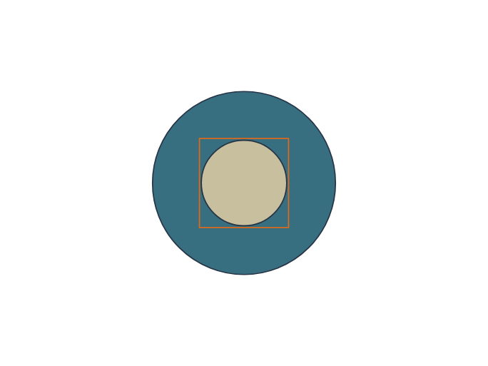
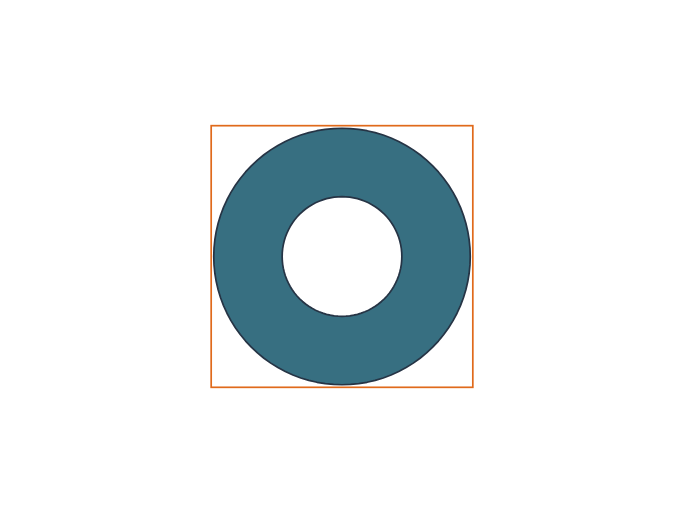
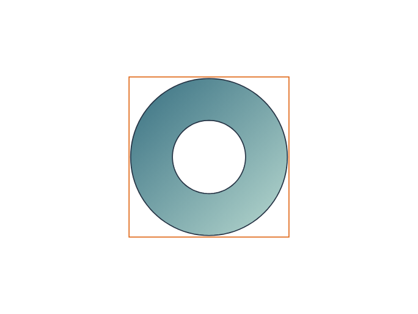
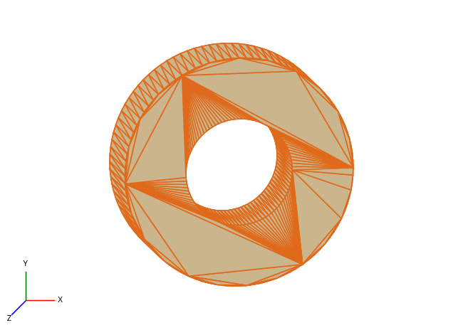
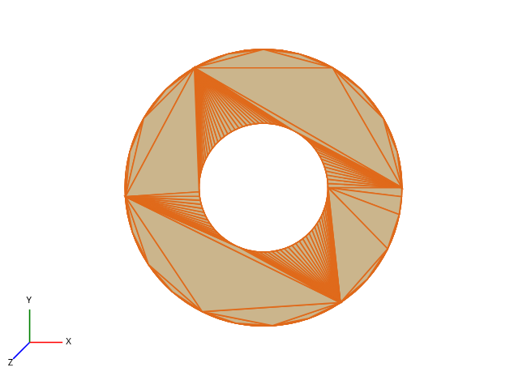
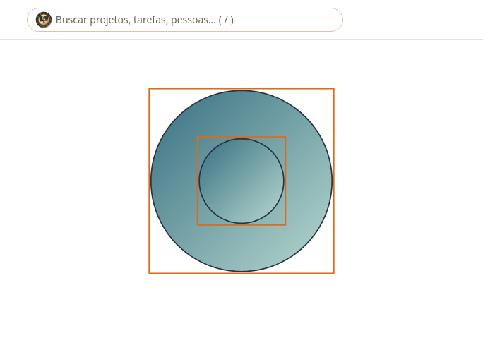
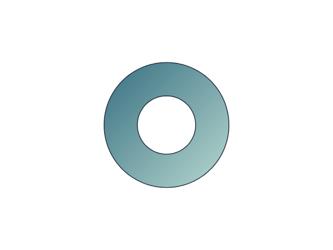
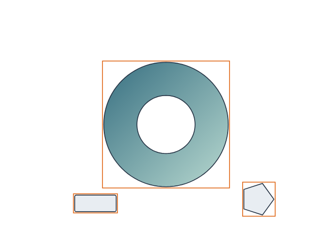
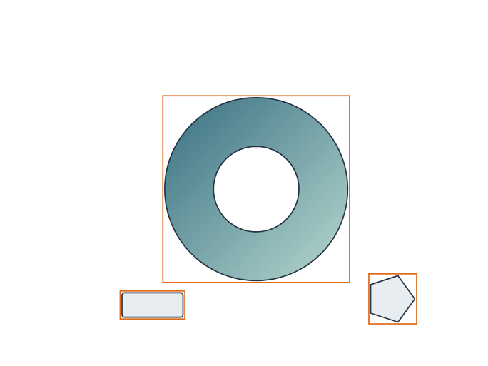
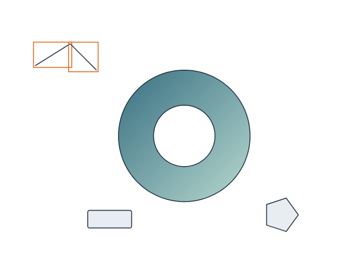

# Caminhos compostos, grupos e expansão — auditoria incremental

Fluxo local real de 15/10/2026: anel com furo, extrusão vazada, agrupamento, movimento, tesoura, expansão e reabertura. As 14 capturas foram feitas pelo navegador após operações na interface. Não há geração de imagem simulando o editor e não houve chamada de IA.

## Resultado e correção encontrada

A inspeção visual da primeira execução identificou erro de orientação do contorno interno na extrusão: o motor podia gerar o volume interno em vez do anel. A correção normaliza cada operando antes da subtração geométrica. O caso agora tem teste independente de volume; malha fechada ou GLB válido, isoladamente, não provam a preservação do furo.

O volume final é 5.525.225,2236 unidades cúbicas, comparado a 5.525.256,3574 para o anel poligonal de 96 lados. Erro relativo: 5,635 ppm, abaixo do limite de 10 ppm do teste. O círculo é aproximado por polígono; essa tolerância não é certificação dimensional, normativa ou de fabricação.

519 testes frontend passaram, além de tipos, lint e build. O navegador não registrou erros. O arquivo GLB passou no validador Khronos sem erros ou avisos.

### Etapa 01 — Tela vazia.

### Etapa 02 — Dois círculos concêntricos.

### Etapa 03 — Subtração: anel com furo real no vetor.

### Etapa 04 — Gradiente preservando abertura.

### Etapa 05 — Extrusão do perfil composto: peça 3D vazada.

### Etapa 06 — VPOINT no eixo Z: abertura vista de frente.

### Etapa 07 — Liberar caminho composto: contornos independentes.

### Etapa 08 — Desfazer restaura o caminho com furo.

### Etapa 09 — Agrupar anel, retângulo e polígono.

### Etapa 10 — Mover o grupo: todos avançam 20 em X e 10 em Y.

### Etapa 11 — Desagrupar preservando as coordenadas.

### Etapa 12 — Tesoura por âncora: dois trechos da polilinha.

### Etapa 13 — Expandir os traçados abertos em contornos.

### Etapa 14 — Reimportar o arquivo: furo e detalhes preservados.

## Arquivos

- [PDF das 14 etapas](AUDITORIA_COMPOSTOS.pdf) e [pacote completo](PACOTE_COMPOSTOS.zip).
- [Anel 2D editável](ANEL_COMPOSTO.ws-studio.json), [estudo final](ESTUDO_FINAL.ws-studio.json).
- [Anel 3D editável](ANEL_3D.ws-asset.json) e [GLB](ANEL_3D.glb).
- [Grupo antes do movimento](GRUPO.ws-studio.json) e [objetos desagrupados após movimento](DESAGRUPADO.ws-studio.json).
- [Registro da execução](EVIDENCIAS.json), [volume](VALIDACAO_VOLUME.json), [validação GLB](VALIDACAO_GLB.json).

## Escopo implementado e pendências

O formato nativo local preserva contorno externo, furos e identificador de grupo. Operações booleanas preservam furos; o SVG usa preenchimento par/ímpar. A seleção não captura uma janela inteiramente vazia dentro do furo. Importação recusa contornos internos externos, degenerados, sobrepostos ou autointersectantes. Grupos são planos, sem hierarquia de grupos aninhados. A tesoura corta caminhos lineares por âncora; curvas e corte em qualquer posição de segmento permanecem pendentes. Expandir converte traçados abertos em contornos, sem equivalência integral a todos os modos de aparência do Illustrator.

Extrusão e revolução recebem perfis compostos; loft, sweep e inflate de perfis compostos são bloqueados em vez de descartar furos. A bancada 3D continua local e não comprova colaboração 3D. Máscaras de recorte, efeitos vetoriais arbitrários e formato CAD B-rep continuam pendentes.

Grupos e contornos compostos ainda não integram o contrato do servidor. Criar uma peça compartilhada ou enviá-los à IA remota é bloqueado antes da requisição, com explicação e preservação do arquivo local. Isso evita perda silenciosa, mas deixa o RF parcial. Não há chamada paga para testar essa rejeição. O código da aplicação permanece local; este PR publica apenas evidências e especificação atualizada. Nenhum RF inteiro é declarado concluído.
