# Auditoria prática — desenhos do zero e comandos

Capturas reais do editor local em 15/10/2026. Fluxo executado por Playwright, com usuário sintético autenticado. Nenhuma chamada de IA foi feita: estas etapas testam comandos e geometria determinísticos, não geração por LLM. O código da aplicação permanece local; este PR publica documentação e evidências.

## Resultado

- Início com zero objetos; luminária concluída com quatro objetos, seguida de uma curva de estudo (cinco elementos no arquivo final).
- Seleção direcional comprovada por contagem: quatro objetos contidos e três cruzados.
- Sólido com subtração volumétrica, inspeção wireframe, mudança de vista, corte, desmembramento e recomposição.
- Sem erros de página. GLB final: zero erros e zero avisos no validador Khronos.
- Execução integral frontend: 508 testes passaram. Validação incremental posterior cobre os arquivos alterados; metadados anexos.

## Etapas

### 01 — Tela vazia: nenhuma geometria inicial.

### 02 — ELLIPSE: base da luminária.

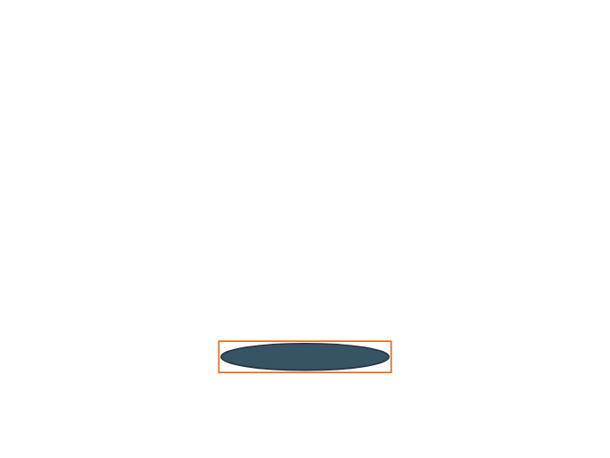

### 03 — RECTANG + POLYGON: haste e cúpula.

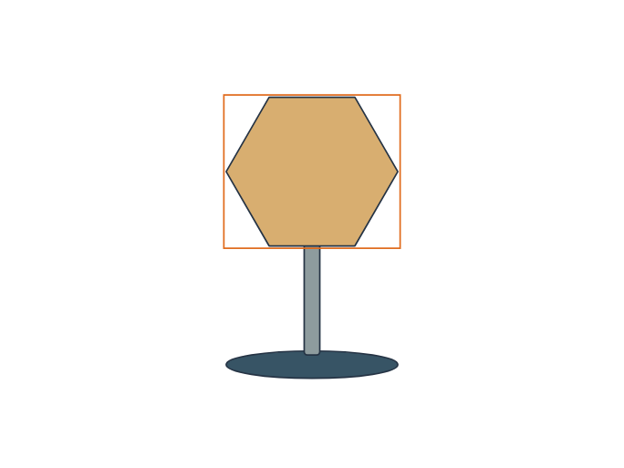

### 04 — Gradiente linear e traçado tracejado da cúpula.

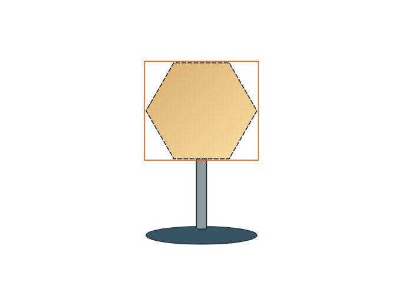

### 05 — CIRCLE: lâmpada e composição final.

### 06 — Janela esquerda-direita: quatro objetos totalmente contidos.

### 07 — Cruzamento direita-esquerda: três objetos tocados.

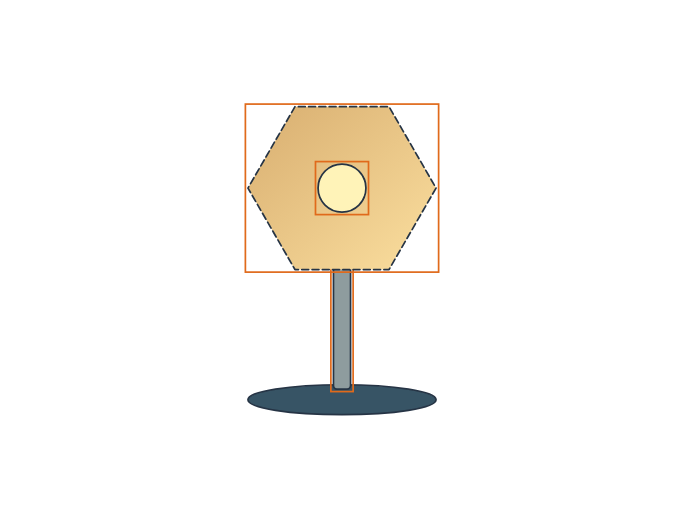

### 08 — SPLINE: edição de controle Bézier.

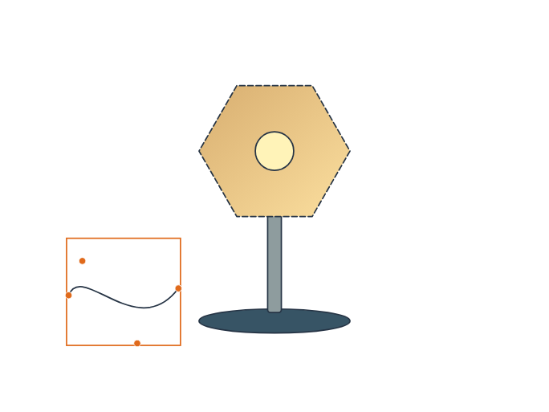

### 09 — BOX: sólido inicial.

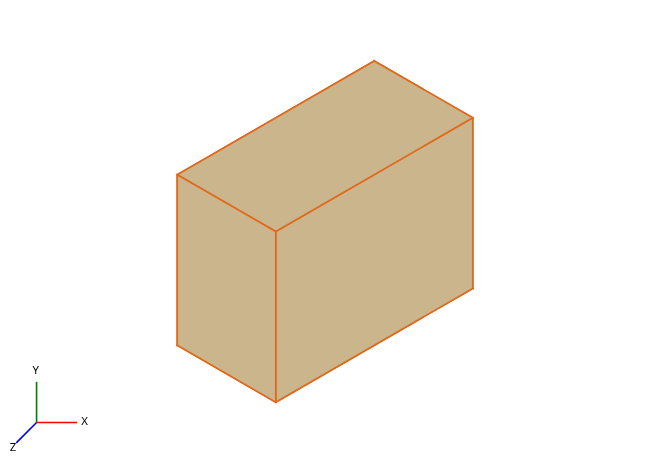

### 10 — CYLINDER, escala, movimento e SUBTRACT: recorte volumétrico.

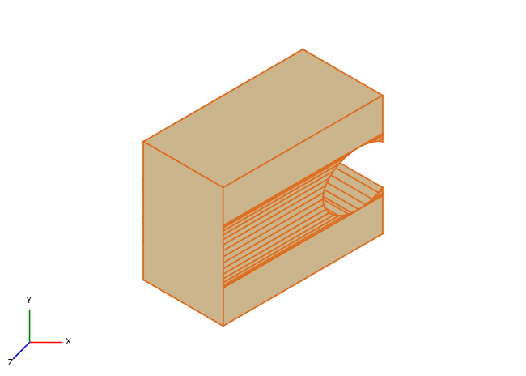

### 11 — VS wireframe: inspeção da malha.

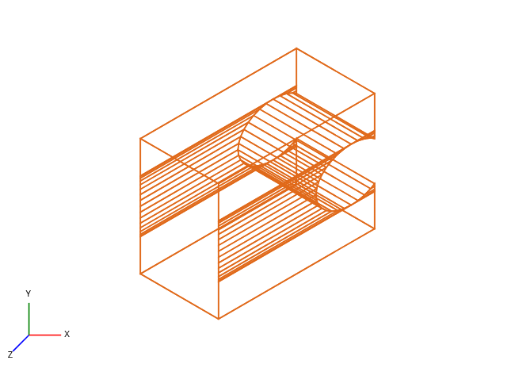

### 12 — PLAN: vista superior.

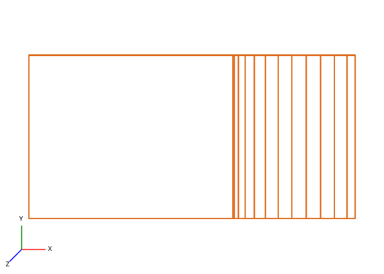

### 13 — VPOINT e SLICE: sólido dividido por plano.

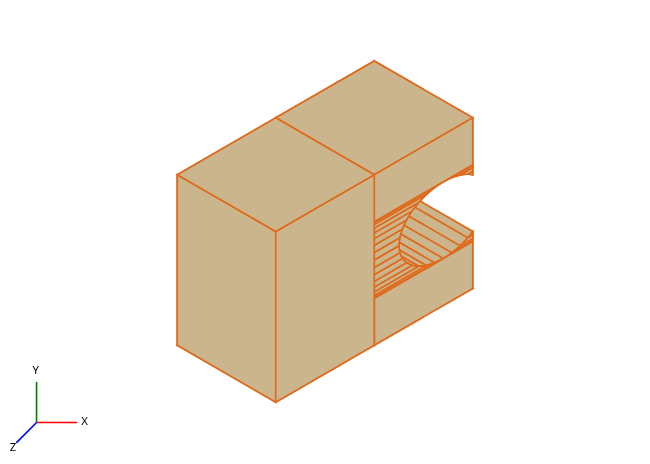

### 14 — Desfazer o corte e EXPLODE: faces independentes.

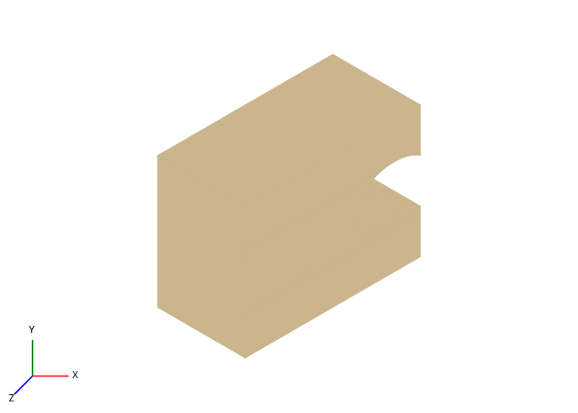

### 15 — CONVTOSOLID: recomposição e verificação de fechamento.

## Downloads

- [PDF das 15 etapas](AUDITORIA_COMANDOS.pdf).
- [Pacote completo da auditoria](PACOTE_AUDITORIA_COMANDOS.zip).
- [Luminária editável](LUMINARIA.ws-studio.json).
- [Sólido editável](ESTUDO_SOLIDO.ws-asset.json) e [GLB](ESTUDO_SOLIDO.glb).
- [Registro dos comandos e resultados](EVIDENCIAS.json), [validação GLB](VALIDACAO_GLB.json).
- [Pesquisa de comandos](../pesquisa-comandos/COMANDOS_ADICIONAIS.md) e [IA nos quatro níveis](../pesquisa-comandos/IA_QUATRO_NIVEIS.md).
- [RF51–RF72 e critérios de aceite](../../../produto/requisitos-studio/README.md).

## Limitações verificadas

Seleção e booleanas 2D amostram curvas; não constituem geometria CAD exata. Contornos com furos são recusados sem alteração em vez de descartados. Caminhos compostos, máscaras, blocos com atributos e Xrefs ainda exigem modelo e implementação próprios. Ferramentas por âncora usam campos numéricos; seleção direta de segmentos e gizmos completos ainda são parciais. Caneta exige grupos cúbicos de controles; círculo TTR, arco elíptico, OSNAP, UCS orientável e grade de perspectiva ainda não estão implementados nesta oficina.

Modelagem 3D usa malhas poligonais. PRESSPULL reutiliza extrusão explícita; Inflate é aproximação por loft. SWEEP mantém orientação da seção e usa elevação parametrizada, sem um referencial de transporte paralelo. FILLETEDGE/CHAMFEREDGE têm escopo de caixas, sem acabamento arbitrário de arestas. CONVTOSOLID verifica fechamento de arestas, sem provar ausência de auto-interseção. NAVVCUBE oferece botões de orientação, não cubo 3D arrastável. Sem kernel B-rep, PBR, conformidade normativa, colaboração 3D ou cobertura integral de todos os novos CA.

Recursos avançados de IA, recuperação e formatos constam como requisitos pendentes ou parciais. A pesquisa não equivale a implementação. Checklists do Trello permanecem abertas. Nenhuma nota global é aumentada por estes exemplos isolados.
