# Wireframe e edição avançada — fluxo capturado no editor

Estas são capturas reais da aplicação local em 15/10/2026. A demonstração não afirma que o código esteja publicado em main. O exemplo foi composto em código e refinado pela interface, sem geração por IA ou chamadas pagas.

O jardim usa 149 elementos em cinco camadas. Dois usuários autenticados editaram camadas distintas, com reservas e patches persistidos no backend, até a revisão 4. Profundidade de camada, subdivisão espacial e câmera 3D são controles diferentes. A área menor foi reservada em três subdivisões; ocultar suas linhas não remove a reserva. O wireframe remove preenchimentos do escopo, preservando os traçados editáveis.

O escritório combina sete grupos paramétricos em 43 partes. A edição interna do tampo alterou posição, largura, rotação e gradiente. Esta edição 3D é local; não demonstra colaboração 3D, CAD completo nem conformidade normativa.

## Etapa 01 — Composição inicial: 149 elementos em cinco camadas.

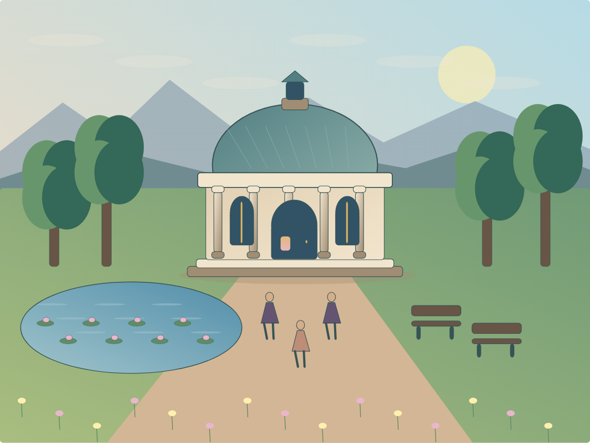

## Etapa 02 — Divisórias opcionais e reserva da camada Arquitetura.

## Etapa 03 — Wireframe aplicado somente à arquitetura reservada.

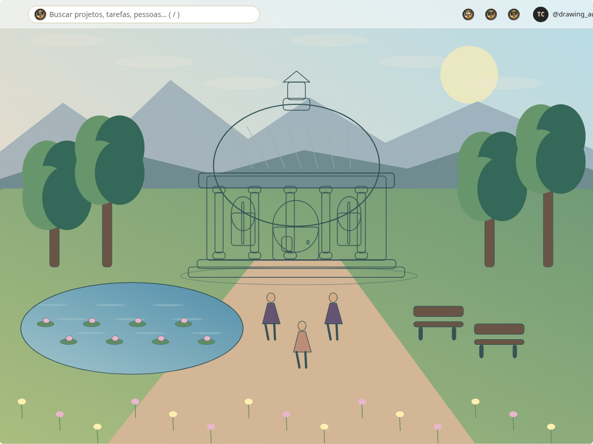

## Etapa 04 — Dois usuários: arquitetura e mobiliário em camadas diferentes.

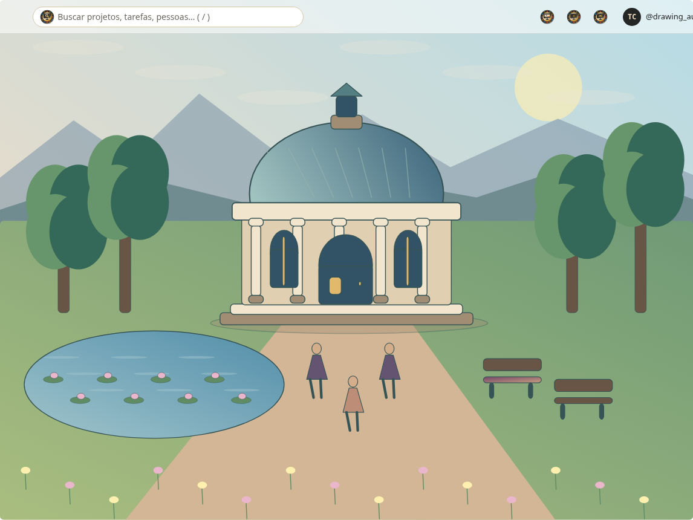

## Etapa 05 — Reserva espacial em três níveis: root/5/3/1.

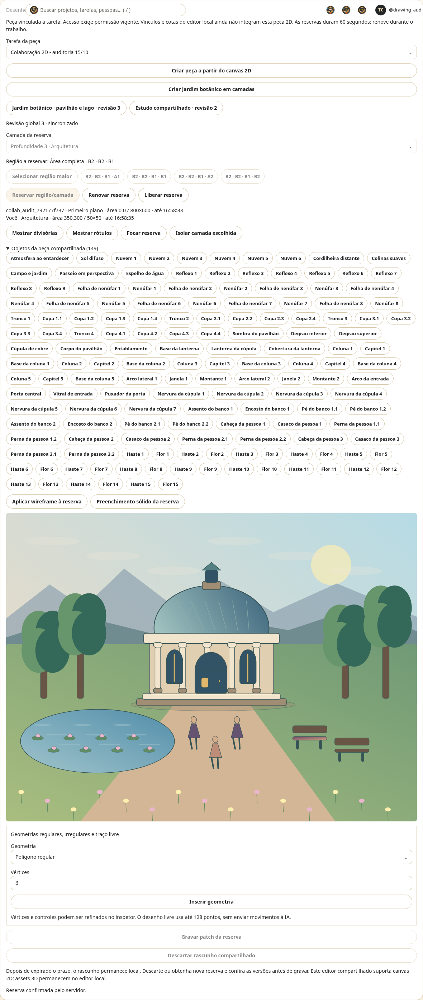

## Etapa 06 — Vitral: posição, dimensões, rotação, gradiente radial e pontilhado.

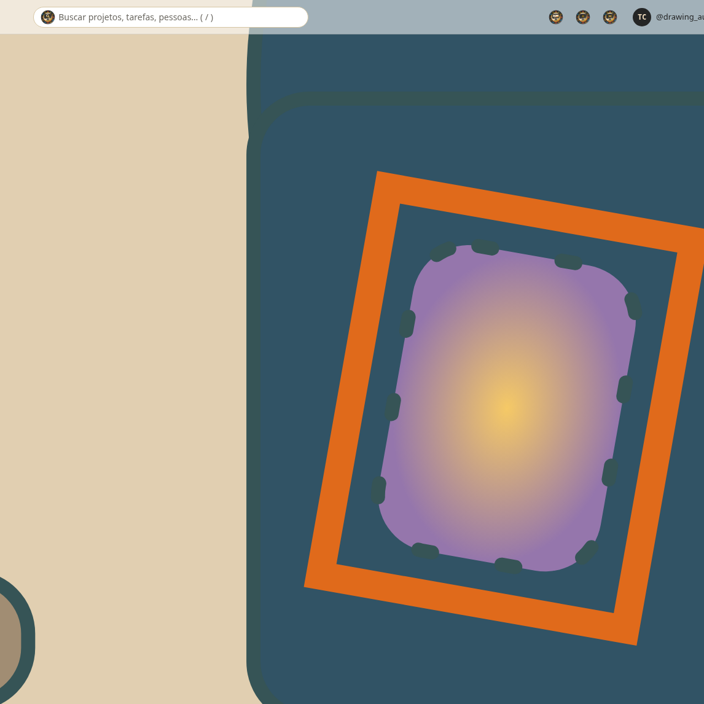

## Etapa 07 — Refino persistido na revisão 4.

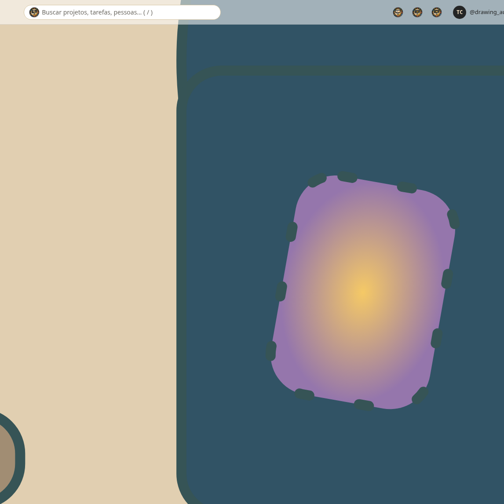

## Etapa 08 — Composição final com divisórias ocultas; reservas continuam válidas.

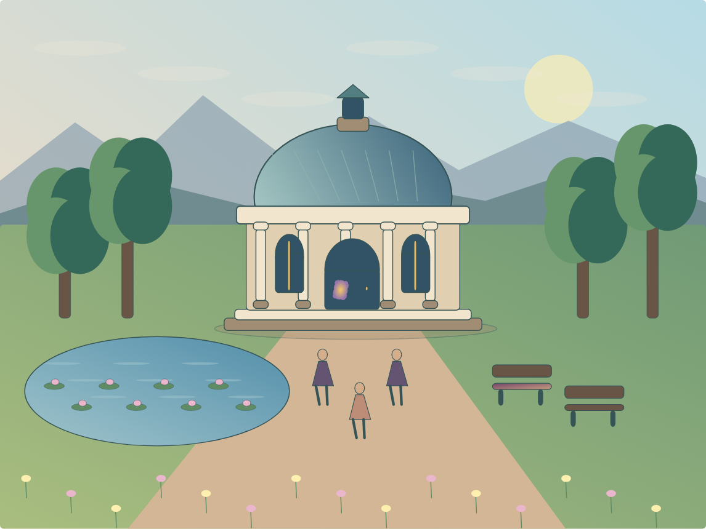

## Etapa 09 — Escritório 3D: 43 partes provenientes de sete geradores paramétricos.

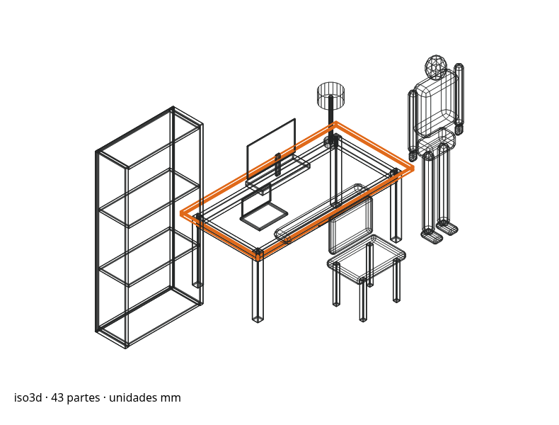

## Etapa 10 — Entrada no wireframe e edição interna do tampo da escrivaninha.

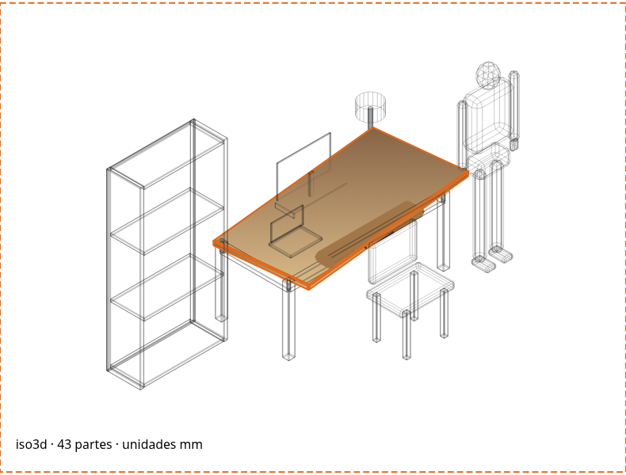

## Etapa 11 — Materiais e gradiente aplicados; estudo 3D permanece local.

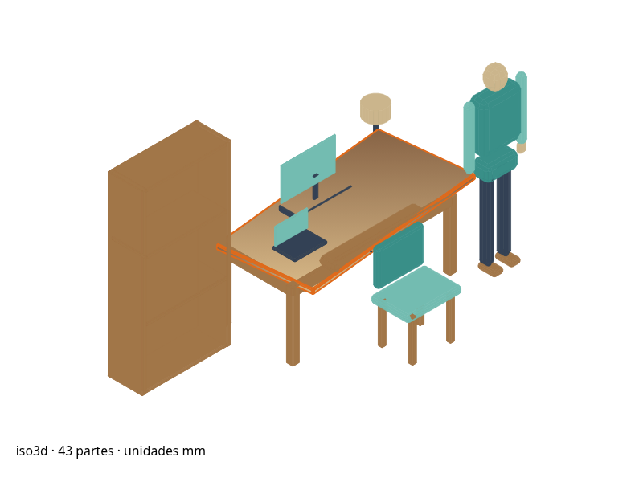

## Etapa 12 — Alternância da câmera isométrica para vista superior.

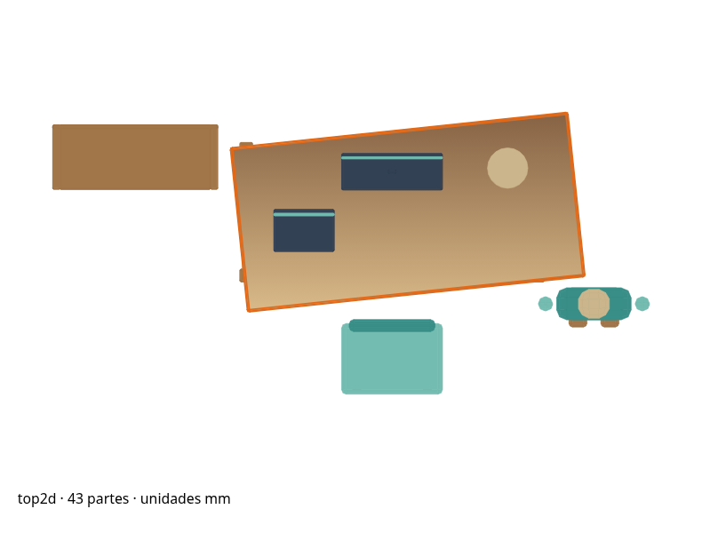

## Arquivos reutilizáveis

- [Jardim editável](JARDIM_FINAL.ws-studio.json) e [SVG](JARDIM_FINAL.svg).
- [Escritório editável](ESCRITORIO_FINAL.ws-asset.json), [GLB](ESCRITORIO_FINAL.glb) e [PNG](ESCRITORIO_FINAL.png).
- [PDF das etapas](DEMONSTRACAO_WIREFRAME.pdf) e [pacote completo](PACOTE_WIREFRAME.zip).
- [Metadados da execução](EVIDENCIAS.json) e [validação GLB](VALIDACAO_GLB.json).

Validação: 495 testes frontend na execução integral; 12 testes backend na execução incremental mais recente. Captura em dois contextos autenticados, sem erros de página. GLB validado pelo Khronos: zero erros e avisos. Persistem as lacunas descritas na matriz; os catálogos desejados não equivalem a funcionalidades concluídas.
