# Painéis, Bézier e preview PNG — auditoria de 16/10/2026

Fluxo real do editor local, com 12 capturas. A integração de IA foi interceptada por uma fixture identificada como `TESTE_MOCK`: nenhum provedor real foi chamado e nenhum crédito foi consumido. A prévia PNG foi rasterizada localmente a partir da proposta vetorial de teste; não é imagem gerada por modelo multimodal.

## Resultados

- Editor determinístico e assistente lateral separados; fechar o drawer preserva a peça e o estado da proposta.
- Conversão canto/suave, alças independentes, remoção de controle, restrição angular e campos numéricos acessíveis.
- Alt preservou a alça oposta; Shift foi medido em 45°; vinte movimentos de ponteiro produziram uma única revisão no histórico.
- Shift+X troca aparência suportada; D restaura branco/preto; / remove o atributo ativo. Modos não representáveis são recusados sem perda.
- PNG 800 × 600 com canal alpha validado; overlay a 50%, sem interceptar o ponteiro.
- Enter aplicou a proposta com foco devolvido ao canvas. Escape rejeitou uma segunda proposta sem alterar a geometria. Tab aceita somente se a opção for ativada e o foco estiver na prancheta; por padrão continua navegando.
- Letters aplicou correção local e devolveu foco ao texto.
- 529 testes frontend, tipos, lint e build passaram; nenhum erro de página. Axe não encontrou violações nas regras WCAG 2.0/2.1 A/AA avaliadas **somente nos painéis Bézier e Assistente IA**. Isso não certifica toda a aplicação.

## Etapas

### 01 — Curva com âncoras e alças de direção.

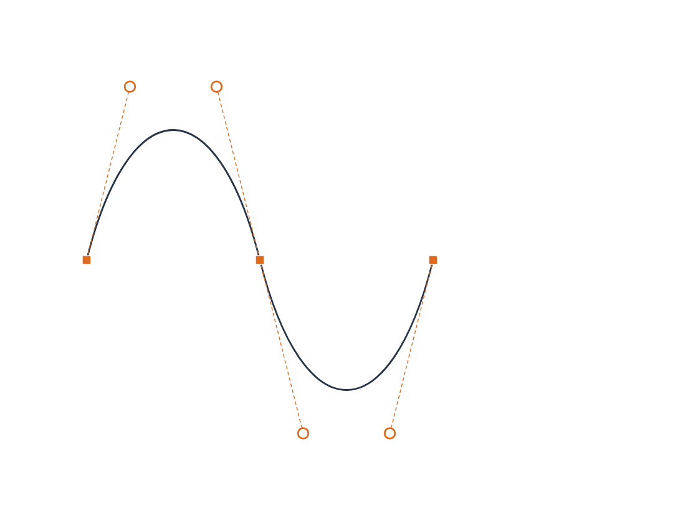

### 02 — Conversão de ponto suave em canto.

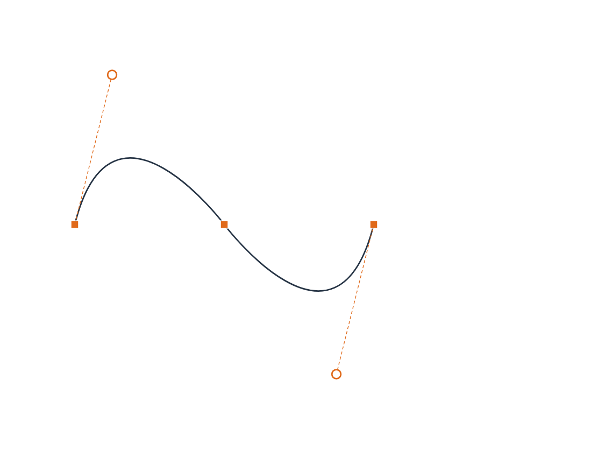

### 03 — Conversão em suave e reconstrução da tangente.

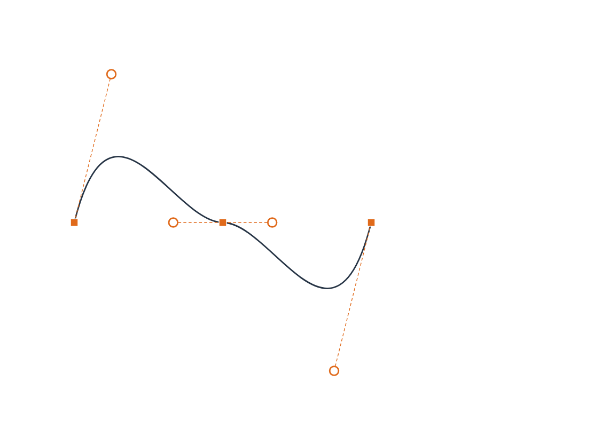

### 04 — Alt: alça independente preservando o controle oposto.


### 05 — Shift: direção restringida a 45 graus.

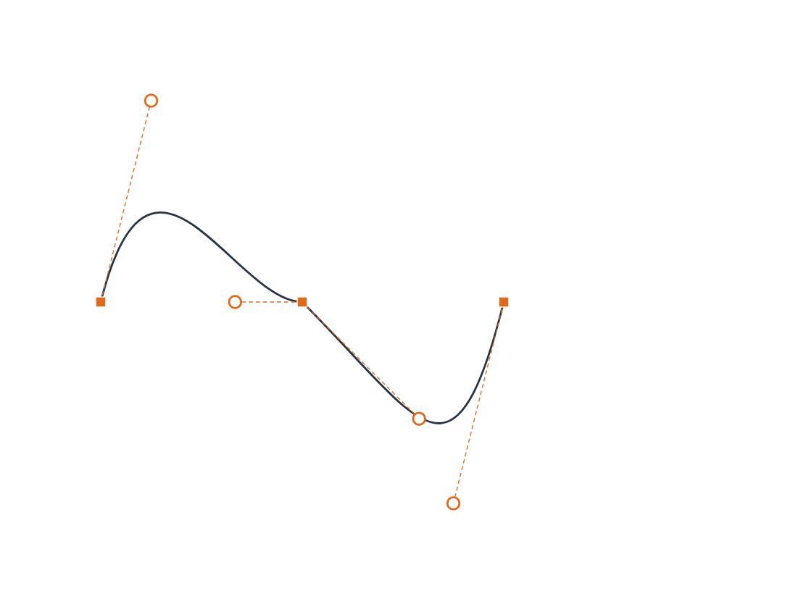

### 06 — Recolher somente a alça de entrada.

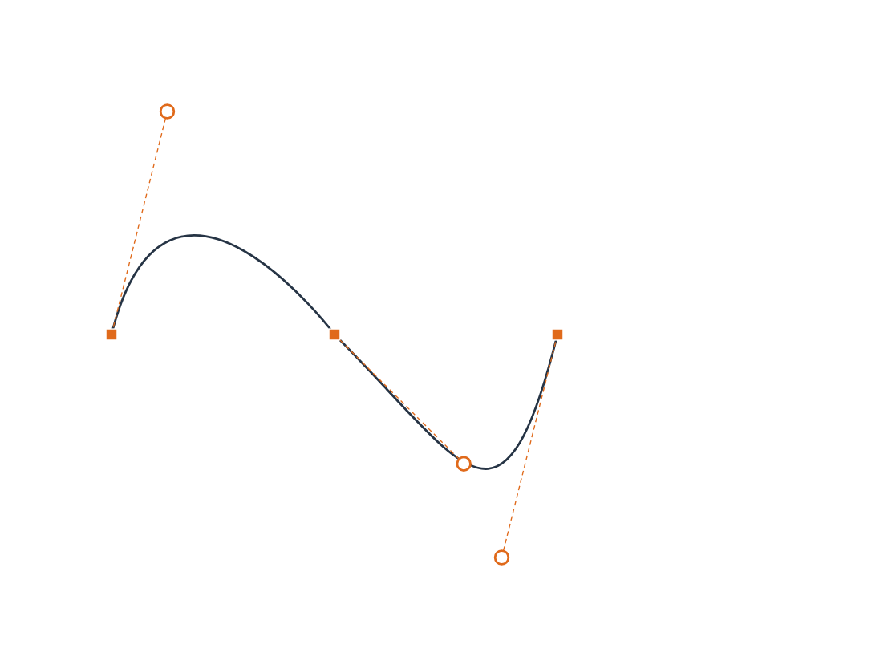

### 07 — Guia visual de conversão, quebra e restrição angular.

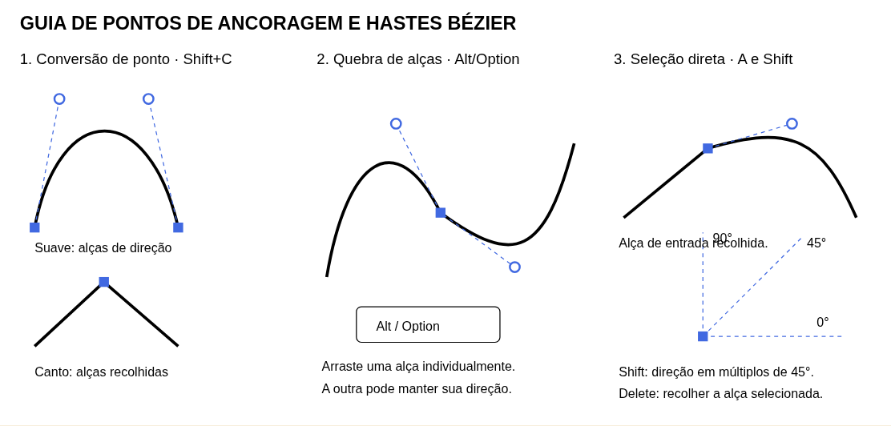

### 08 — Aparência: Shift+X, D e / no atributo ativo.

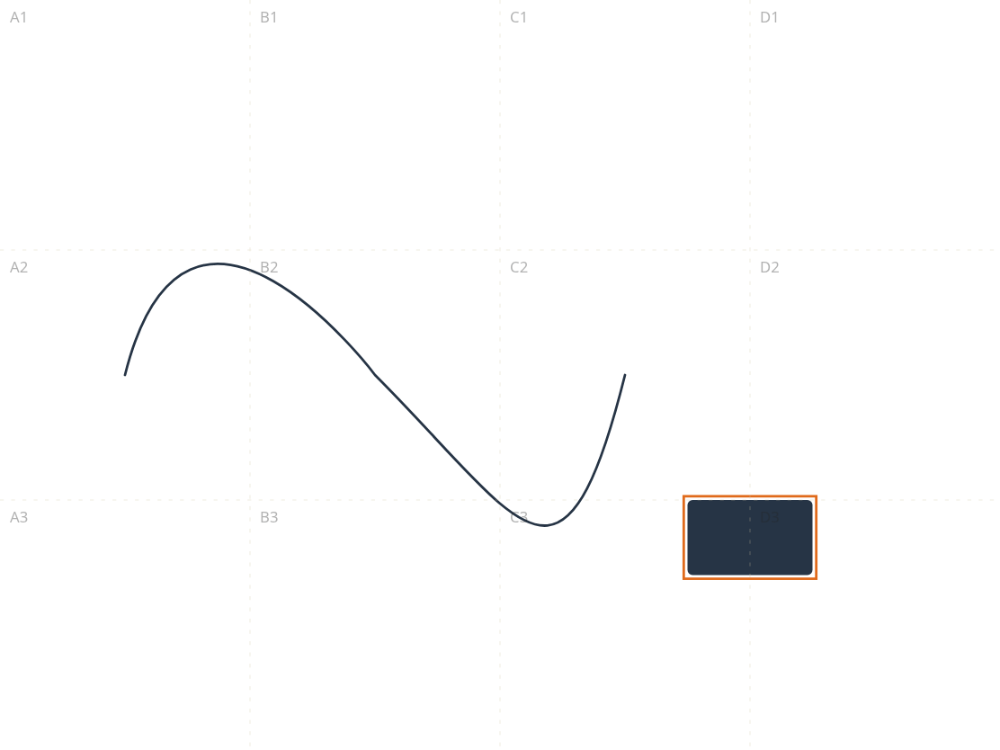

### 09 — Assistente lateral independente, com editor preservado.

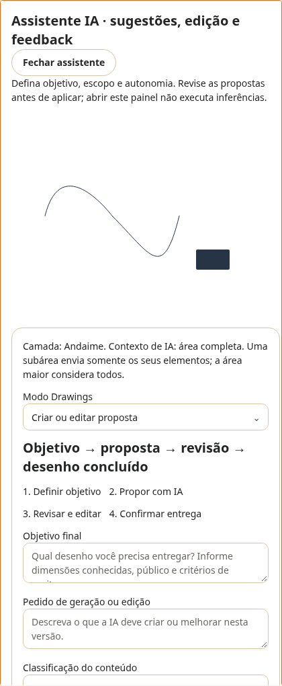

### 10 — Camada PNG semitransparente sobre o desenho original.

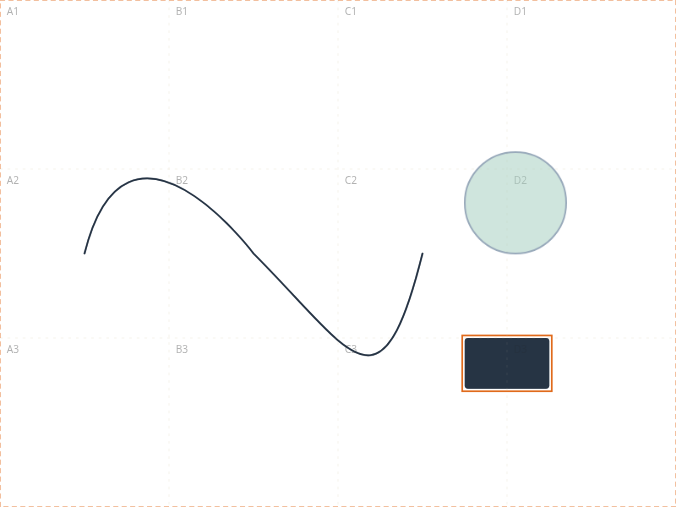

### 11 — Proposta aprovada; foco devolvido à prancheta.

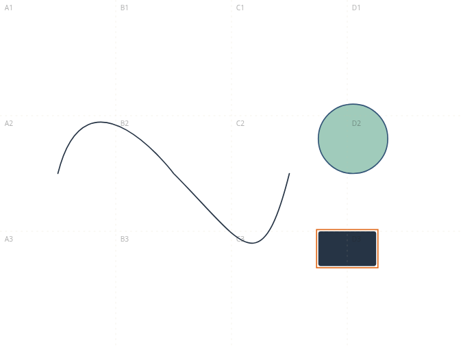

### 12 — Letters: edição principal e revisão local no assistente.

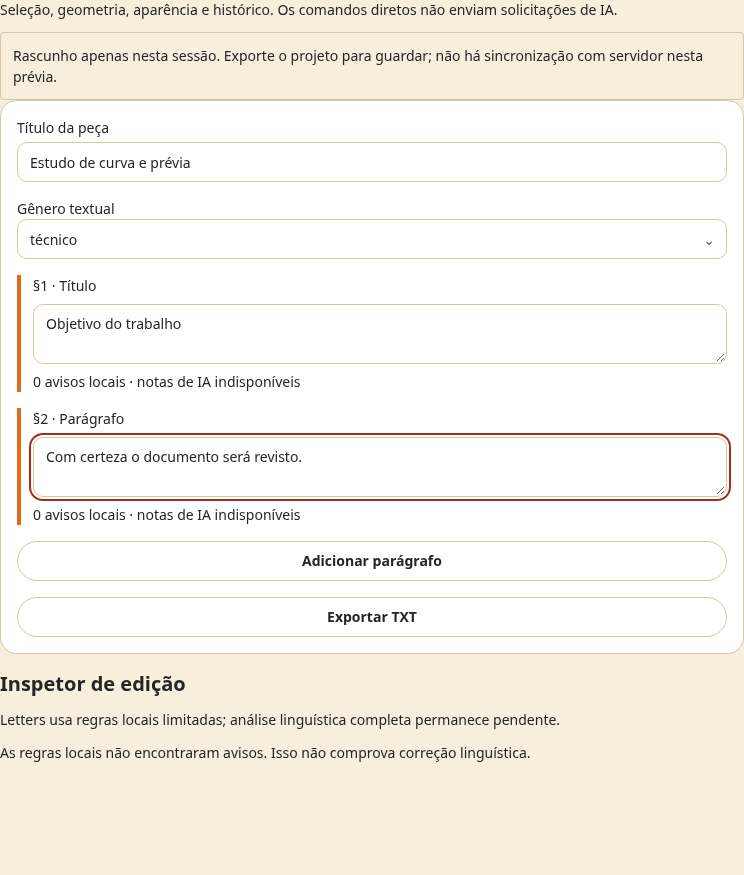

## Downloads e evidências

- [PDF das etapas](PAINEIS_BEZIER_PREVIEW.pdf) e [pacote completo](PACOTE_PAINEIS_BEZIER.zip).
- [PNG transparente da prévia](GHOST_PREVIEW.png) e [validação de alpha](VALIDACAO_ALPHA.json).
- [Desenho final editável](DESENHO_FINAL.ws-studio.json), [antes do arraste](ANTES_ARRASTE.ws-studio.json), [após Alt](DEPOIS_ALT.ws-studio.json) e [após Shift](DEPOIS_SHIFT.ws-studio.json).
- [Arquivo após rejeição](DEPOIS_REJEICAO.ws-studio.json), que preserva a geometria final.
- [Metadados da execução](EVIDENCIAS.json), [Axe do Bézier](AXE_BEZIER.json), [Axe do assistente](AXE_ASSISTENTE.json) e [validação incremental](VALIDACAO_INCREMENTAL.json).
- [Arquitetura dos painéis](../../../produto/ARQUITETURA_PAINEIS_EDITOR_IA.md), [contrato PNG multimodal](../../../produto/PREVIEW_PNG_MULTIMODAL_DRAWINGS.md) e [RF73/RF74](../../../produto/requisitos-studio/README.md).
- [Script do fluxo de navegador](scripts/auditar-paineis-bezier.cjs). Exige código local da aplicação, serviços e fixture sintética próprios; os arquivos deste PR não implementam a aplicação.

## Limites e achados corrigidos

A auditoria encontrou e corrigiu salto de rolagem durante arraste e ausência de papel ARIA nos controles SVG. Os controles agora são alcançáveis por teclado e têm edição numérica equivalente. O inspetor adicional fica abaixo da prancheta para evitar compressão quando o assistente está aberto.

O editor de alças trabalha com curvas cúbicas abertas. Recolher um controle não torna todo o segmento uma reta se outro controle ainda produz curvatura. A migração de todas as ferramentas legadas para Command Pattern e histórico unitário segue pendente.

Captura PNG local e overlay estão operacionais. Backend multimodal com entrada de imagem, geração de duas variantes PNG transparentes, máscara de resposta, vetorização de raster e ancoragem de assets de imagem **continuam pendentes**. O provedor OpenAI já escolhido não foi trocado por Gemini. Consentimento e orçamento não são dispensados pela captura local. A fixture desta auditoria testa a interface, não capacidade generativa real.

O código da aplicação permanece local. Este PR publica documentação, evidências, arquivos editáveis e script de reprodução. RFs e critérios não demonstrados continuam abertos.

## Reexecutar a auditoria

Execute a partir da raiz do repositório, com a aplicação compatível disponível em `http://localhost:3000`, API em `http://localhost:8080`, Chromium em `/usr/bin/chromium` e dependências `@playwright/test` e `@axe-core/playwright` instaladas. Prepare uma fixture sintética local com `owner.username` e `owner.password` válidos; não publique credenciais.

```sh
WS_AUDIT_FIXTURE_PATH=/caminho/fixture-sintetica.json node docs/auditoria/2026-10-16/paineis-bezier/scripts/auditar-paineis-bezier.cjs
```

Sem `WS_AUDIT_OUTPUT`, cada execução cria um diretório vazio exclusivo no diretório temporário do sistema (`ws-audit-paineis-bezier-*`) e imprime o caminho antes de iniciar o navegador. Os artefatos publicados nesta pasta permanecem preservados. Copie os resultados se precisar conservá-los além da limpeza dos temporários.

Para escolher o destino, defina `WS_AUDIT_OUTPUT=/caminho/nova-execucao`: o diretório será criado se necessário e deverá estar vazio, inclusive sem arquivos de tentativas anteriores. Um destino ocupado é rejeitado sem sobrescrever arquivos. A fixture padrão, quando a variável não é informada, é `/tmp/ws-synthetic-audit-fixture.json`.

Validação isolada da escolha de destino, sem navegador nem chamadas de IA:

```sh
node --test docs/auditoria/2026-10-16/paineis-bezier/scripts/audit-output.test.cjs
```
