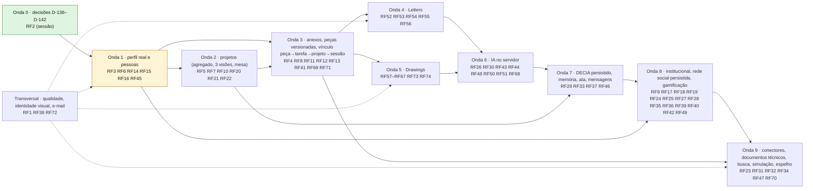
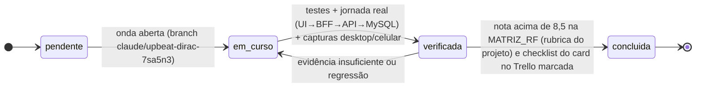

# Plano por ondas — rastreabilidade das observações da matriz de 16/10

17/10/2026. Cada linha traz o **principal erro** e a **melhoria** registrados na auditoria de 16/10 (`MATRIZ_RF.md`), que passam a ser a lista de verificação da onda. Meta pedida pelo responsável: **toda nota acima de 8,5** na rubrica do projeto (notas técnicas, não validação com usuários). A nota só sobe quando a jornada funciona de ponta a ponta com persistência, ACL, recuperação e evidência; a coluna *Situação* é atualizada ao fechar cada onda.

Referências de execução: `docs/auditoria/2026-10-16/.../PLANO_CORRECAO.md` (incrementos 1–7 e gates), `docs/produto/requisitos-studio/RF51–RF74.md` (CAs), `docs/auditoria/2026-10-15/*` (comandos, colaboração 2D, painéis Bézier), `referencias/COMANDOS_REFERENCIA_ILLUSTRATOR_AUTOCAD.md`.

## Diagrama das ondas (dependências e RF por onda)

Cada card RF do board Work Station (lista *Requisitos Funcionais*) recebeu em 17/10/2026 a seção "Auditoria 17/10/2026 — plano de correção" e a checklist "Correção — Onda n"; a lista *Plano por ondas — auditoria 17/10/2026* tem um card por onda com a checklist dos RF. Os diagramas por RF estão em `docs/diagramas/RF1…RF74/README.md` (RF51–RF74 criados nesta data) e o catálogo `lib/rf/catalog.gen.ts` alimenta as páginas-esqueleto `/letters` e `/drawings`.

Legenda: verde = onda concluída e verificada; amarelo = em curso. O gate de cada onda é o da coluna *Situação*: `pendente` → `em curso` → `verificada` → `concluída`.

## Onda 0 — decisões (D-138–D-142)

| RF | Nota 16/10 | Principal erro (16/10) | Melhoria exigida | Situação |
|---|---:|---|---|---|
| RF2 — Autenticar usuário na plataforma com credenciais de acesso | 7.45 | Sessão funciona, mas OIDC/2FA e recuperação completos não foram revalidados nesta rodada. | Concluir matriz de sessão, bloqueio, recuperação e provedor institucional em ambiente de teste. | pendente |

## Onda 1 — perfil real, conta e pessoas

| RF | Nota 16/10 | Principal erro (16/10) | Melhoria exigida | Situação |
|---|---:|---|---|---|
| RF3 — Editar informações pessoais e preferências do perfil do usuário | 6.05 | Preferências e conta existem; foto e todos os direitos do titular não compõem um perfil profissional completo. | Integrar foto segura, biografia, especialidades e controles de publicação com API de conta. | parcial — foto segura real desde 25/10 (upload PNG/JPEG/WEBP ≤ 5 MB, reprocessada sem EXIF/GPS, leitura autenticada, anterior apagada; RF3.CA05); biografia já pela API de conta; especialidades e controle de publicação reais desde 31/10 (`GET/PUT /api/me/publication`, V47: até 10 rótulos normalizados sem repetir; "quem vê meu perfil público" AUTENTICADOS/EMPRESA aplicado em `ResourceAuthorizer.requireProfileVisible` — perfil, foto, tarefas e seguir respondem o mesmo 404 a quem não pode ver; Configurações › Conta e cabeçalhos dos perfis); pendente: consentimentos, exportação e demais direitos do titular, capa por upload |
| RF6 — Acessar e gerenciar o Perfil  Empresarial (Acervo Digital + Projetos S | 5.05 | Perfil empresarial não integra acervo institucional e projetos reais; perfil pessoal antes usava fixture. | Integrar API institucional e separar portfólio publicado de atividade privada, mantendo totais autorizados. | parcial — `/profile` real desde 17/10 (cabeçalho por `/api/me`, Acervo Digital e contadores por `/api/tasks`, P19); parte institucional real desde 31/10 (`GET /api/me/institution`: para a conta EMPRESA, empresa da qual é dona, departamentos ativos com link e totais da API, separada do portfólio; demais contas veem a lotação vigente; especialidades no cabeçalho); pendente: projetos, salvos e demais sub-abas, acervo institucional por empresa |
| RF14 — Visualizar perfil de um chefe de departamento | 3.35 | Página de chefia usa pessoas e vínculos demonstrativos. | Servir perfil público autorizado de chefia com lotação e indicadores reais. | parcial — página do departamento real desde 31/10 (`GET /api/departments/{slug}` com cabeçalho — sigla, nome, cor, monograma, sobre, capa, chefe em projeção pública, empresa com link — e contadores do servidor: pessoas ativas com lotação vigente e seguidores; `GET /api/departments/{slug}/members` na sub-aba Equipe; seguir por `/api/departments/{slug}/follow`; inexistente/inativo/ambíguo → 404 uniforme; `?company=` desambigua o slug); pendente: projetos, sessões, chancelas, reconhecimentos, métricas por período (RF14.CA03) e ações por papel |
| RF15 — Visualizar perfil de um empresa ou órgão público/privado | 3.35 | Página institucional usa dados demonstrativos, não um portfólio persistente. | Conectar identidade institucional verificada, equipe, projetos e publicações à API. | parcial — página da empresa real desde 31/10 (`GET /api/companies/{slug}`: razão social, sobre, site, cor de destaque, conta institucional e contadores do servidor — departamentos ativos, pessoas ativas, seguidores; `GET /api/companies/{slug}/departments` na sub-aba Departamentos; seguir por `/api/companies/{slug}/follow`; inexistente, inativa ou com dona pendente → 404 uniforme); pendente: sigla da empresa (a tabela `companies` não tem a coluna), logotipo/brasão, programas, plano anual, chancelas, benefícios, destaques, pessoas, comunicados e aba Gestão real |
| RF16 — Visualizar perfil de um usuário comum que é empregado dentro de uma em | 4.15 | Perfil de terceiros não tem API social; contagens, foto e trajetória pública não estão integradas. | Disponibilizar endpoint público filtrado por ACL, seguir/seguindo, foto e feed de entregas revisadas. | parcial — fora do laboratório `/u/[username]` é real desde 17/10 (`components/people/PublicProfile`): cabeçalho por `GET /api/people/by-username/{username}` (404 uniforme → "perfil não encontrado"; sem sessão → Entrar; o próprio @usuário vai para `/profile`), Acervo Digital e contador de tarefas visíveis por `GET /api/people/{id}/tasks`; a busca de pessoas que leva a ele é real (RF17, aba PESSOAS de `/search`). Pendentes: seguir/seguindo, foto/capa enviadas pela pessoa, lotação por nome, sub-abas 2–5 (Projetos, Programas, Decisões, Deliberativo) e o feed de entregas revisadas; seguir/seguindo e foto reais desde 25/10 (`/api/people/{id}/follow`, `/api/people/{id}/avatar`); desde 31/10 o perfil mostra as especialidades e respeita o controle de publicação do RF3 (perfil "só minha empresa" → o mesmo 404 para quem é de fora, em perfil, foto, tarefas e seguir) |
| RF45 — Calcular com a IA o Hype Score do Perfil (0–1000) a partir de tudo o q | 0.0 | Hype de perfil é demonstrativo e não representa reputação calculada e auditável. | Definir fórmula, fontes, privacidade e opt-out; não inferir carreira a partir de popularidade. | pendente |

## Onda 2 — projetos (agregado, três visões, mesa)

| RF | Nota 16/10 | Principal erro (16/10) | Melhoria exigida | Situação |
|---|---:|---|---|---|
| RF5 — Utilizar o criador de projetos, escolhendo em cada fase do projeto as  | 0.0 | Criador de projetos é página estrutural; não constrói projeto persistido por fases. | Implementar agregado Projeto, fases, vínculos de tarefas, histórico, ACL e teste completo com recarga. | pendente |
| RF7 — Abrir um esquema de tarefa a partir da lista de um esquema de projeto | 3.8 | Links de tarefas existem em cards demonstrativos; detalhe real de projeto é estrutural. | Persistir composição e navegar projeto→tarefa preservando fase, contexto e autorização. | pendente |
| RF20 — Utilizar o construtor de projetos do Work Station para compreender se  | 0.0 | Não há construtor operacional que avalie adequação empresarial das tarefas. | Adicionar objetivos, restrições e critérios explicáveis à composição do projeto, com revisão humana. | pendente |
| RF21 — Utilizar a mesa de trabalho digital de meu perfil | 2.45 | Mesa visual não é uma visão persistente unificada da execução real. | Ligar mesa aos projetos e tarefas reais, salvar posições e oferecer ações recuperáveis. | pendente |
| RF22 — Editar um Esquema de Projeto na Mesa de Trabalho (quadro por fase, lin | 0.0 | Quadro por fase, timeline e canvas não editam um projeto real versionado. | Construir três visões do mesmo agregado com dependências, conflitos e histórico. | pendente |
| RF10 — Permitir que o chefe de departamento possa atribuir uma tarefa ou proj | 3.2 | Atribuições sociais em memória não comprovam atribuição real de tarefa/projeto pelo chefe. | Implementar proposta/aceite persistentes, responsável e notificações com autorização institucional. | pendente |

## Onda 3 — anexos, peças versionadas e vínculo peça→tarefa→projeto→sessão

| RF | Nota 16/10 | Principal erro (16/10) | Melhoria exigida | Situação |
|---|---:|---|---|---|
| RF4 — Utilizar o criador de tarefas, escolhendo o tipo do arquivo e editando | 6.35 | Criação persistente ainda não integra peças Letters/Drawings, entregáveis e dependências estruturadas. | Unificar tarefa e peças versionadas; ampliar campos comuns e extensões profissionais sem impor domínio único. | pendente |
| RF8 — Editar arquivos de tarefas ou projetos dentro de meu perfil do Work St | 4.75 | Edição local dos estúdios e tarefa persistente usam estruturas separadas. | Vincular documento e desenho à tarefa com revisões, anexos e recuperação, sem exportação manual obrigatória. | pendente |
| RF11 — Utilizar o editor de arte de fundo para personalizar esquemas de taref | 4.1 | Preferência visual existe; aparência de cada tarefa/projeto não está integrada à persistência real. | Persistir capa e tema por esquema e validar contraste e imagem após reabertura. | pendente |
| RF12 — Editar um esquema de tarefa ou projeto de meu perfil | 6.05 | Histórico de tarefas é real; projetos e edição das peças não compartilham essa trilha. | Consolidar revisões de tarefa, projeto e peças com conflito otimista, diff e restauração. | pendente |
| RF13 — Utilizar a funcionalidade gerar artefato dentro de esquemas, chats, ab | 2.3 | Não há fluxo geral de gerar artefato em chats, esquemas e feed com proveniência persistida. | Criar serviço de artefatos com fonte/versão/ACL e aceite humano antes de anexar ou publicar. | pendente |
| RF41 — Gerir o Acervo de Tarefas (inventário do usuário): estados, sub-filtro | 6.35 | Acervo real possui filtros/estados; anexos, evidências, prazos legais e ações completas seguem parciais. | Ampliar card/detalhe com contexto técnico, anexos seguros, dependências e filtros persistentes. | pendente |
| RF69 — Salvar, exportar, recuperar e navegar no histórico das peças | 5.25 | Exportação e histórico local funcionam; reload perde peça sem exportar e histórico 2D/3D é fragmentado. | Persistir documento e revisões com autosave recuperável, backup e importação/exportação auditáveis. | pendente |
| RF71 — Integrar peças Letters e Drawings à jornada de tarefas, projetos e DEC | 3.45 | Estúdios, tarefa, projeto e decisão não compartilham uma peça e um histórico únicos. | Criar vínculo persistente peça→tarefa→projeto→sessão e manter origem, revisão e acesso em cada transição. | pendente |

## Onda 4 — Letters

| RF | Nota 16/10 | Principal erro (16/10) | Melhoria exigida | Situação |
|---|---:|---|---|---|
| RF52 — Editar documentos estruturados no Work Station Letters | 4.75 | Letters é editor de blocos de texto simples, sem formatação profissional e salvamento associado à tarefa. | Introduzir modelo rico estável, estilos, tabelas e referências; persistir revisões com exportação fiel. | pendente |
| RF53 — Analisar língua, morfossintaxe e gramática no Letters | 3.3 | Análise linguística local cobre poucos padrões; não há motor completo de português validado. | Integrar analisador linguístico avaliado em corpus por classe/sintaxe/tempo e informar confiança e limites. | pendente |
| RF54 — Analisar coerência, narrativa, gênero e fontes no Letters | 3.3 | Alertas de gênero são heurísticos; continuidade narrativa e fontes não são analisadas de forma completa. | Extrair entidades/afirmações por trecho e confrontar fontes e cronologia com evidência e revisão. | pendente |
| RF55 — Revisar, completar e reescrever texto com IA no Letters | 5.5 | Revisão e completar têm propostas/diff; precisão técnica e citação de fontes reais não foram avaliadas. | Avaliar casos por área, preservar seleção/fatos e registrar inferência, diff, aceite e rollback no servidor. | pendente |
| RF56 — Colaborar, comentar e resolver conflitos em documentos Letters no DECI | 0.0 | Não há colaboração Letters com permissões, comentários, conflitos e reconexão no DECIA. | Criar documento compartilhado versionado, ACL por ação e protocolo de concorrência com reconexão e sugestões. | pendente |

## Onda 5 — Drawings

| RF | Nota 16/10 | Principal erro (16/10) | Melhoria exigida | Situação |
|---|---:|---|---|---|
| RF57 — Selecionar objetos, pontos e regiões no Drawings | 5.65 | Seleção e Bézier existem; equivalência acessível e geometria de seleção complexa ainda são parciais. | Validar curvas, máscaras e seleção por atributo em casos complexos; oferecer alternativa numérica a cada arraste. | pendente |
| RF58 — Criar e editar geometria vetorial e desenho técnico 2D | 5.15 | Canvas vetorial 2D oferece comandos; rigor técnico não equivale a CAD normativo completo. | Definir unidades/escala/tolerâncias, cotagem associativa e suíte geométrica com exportação fiel. | pendente |
| RF59 — Construir, dividir e desmembrar contornos vetoriais | 5.55 | Booleanas/agrupamento locais existem; certos efeitos, máscaras e operações não têm semântica equivalente completa. | Explicitar matriz de comandos, preservar topologia e testar degenerações e desfazer unitário. | pendente |
| RF60 — Modelar sólidos, superfícies e malhas 3D no Drawings | 4.85 | Ambiente 3D usa malhas locais separado da peça e colaboração 2D. | Persistir B-rep/malha com unidades e tolerâncias, integrar histórico e avaliar operações e faces inválidas. | pendente |
| RF61 — Desmembrar e converter estruturas 3D preservando intenção | 4.85 | Explodir e recompor malhas locais não cobrem toda conversão de sólidos/superfícies CAD. | Preservar volume e intenção, validar malha fechada e documentar operações sem equivalência exata. | pendente |
| RF62 — Controlar vistas, câmera, perspectiva e coordenadas no Drawings | 5.55 | Câmera/vistas funcionam em assets; UCS e perspectiva do documento não formam sistema completo. | Unificar câmera e coordenadas por peça, salvar vistas e testar profundidade e seleção após transformação. | pendente |
| RF63 — Editar cores, gradientes, materiais e estilos de traço | 6.0 | Cores/gradientes/traços existem; CMYK/ICC e Munsell calibrado não estão implementados. | Manter atalhos sem perda e declarar suporte; implementar perfis de cor com conversão medida e exportação fiel. | pendente |
| RF64 — Gerar assets, wireframes e detalhes internos parametrizados | 5.7 | Catálogo de assets e detalhes é parametrizado, mas não uma biblioteca completa de todos os domínios. | Expandir assets por caso profissional e validar componentes internos, escala e edições com fontes técnicas. | pendente |
| RF65 — Editar regiões hierárquicas e camadas sobrepostas no Drawings | 5.7 | Regiões/camadas locais e compartilhadas divergem em capacidades e vínculos. | Unificar árvore cena→camada→região→objeto, escopos e transformações em um modelo persistente. | pendente |
| RF66 — Editar desenhos simultaneamente no DECIA com reservas transacionais | 5.7 | Reservas e patches 2D são reais; edição avançada/3D e política de IA compartilhada não integram o fluxo. | Integrar edição e IA às mesmas reservas, validar concorrência estrita, reconexão e sessão DECIA real. | pendente |
| RF67 — Completar geometria e prever traçados no Drawings | 4.65 | Previsão é geométrica local; intenção semântica e completar cenas complexas não estão validados. | Separar inferência geométrica e semântica, apresentar confiança e testar previsões de círculo, luminária e rotas. | pendente |
| RF73 — Separar editor determinístico e Assistente IA com navegação acessível | 6.95 | Painéis separados são acessíveis na amostra; nem todo comando foi migrado e testado nas superfícies. | Consolidar contratos de comandos/estados e testes de foco, responsividade e preservação de rascunho. | pendente |
| RF74 — Capturar PNG e oferecer prévia fantasma multimodal no Drawings | 4.3 | PNG fantasma é rasterização local de proposta vetorial, não geração multimodal de PNG transparente. | Implementar captura→backend multimodal→duas variantes alpha→ancoragem→aceite com custo/versão/ACL testados. | pendente |

## Onda 6 — IA no servidor (motor local, propostas, autonomia, avaliação)

| RF | Nota 16/10 | Principal erro (16/10) | Melhoria exigida | Situação |
|---|---:|---|---|---|
| RF26 — Utilizar o Copilot do WS para criar sugestões de tarefas e projetos de | 5.05 | Copilot de perfil propõe tarefas; projetos e direcionamento transversal seguem parciais. | Ampliar proposta estruturada para projetos e permitir revisão de tarefas, vínculo e premissas antes do aceite. | pendente |
| RF30 — Gerar um Esquema de Projeto completo com o Autopiloto de Projeto a par | 0.0 | Autopiloto não gera projeto operacional persistido a partir da demanda. | Criar proposta com tarefas/fases/modelos autorizados, premissas e aceite explícito antes de salvar. | pendente |
| RF43 — Usar a IA do sistema — insights do Acervo e do Perfil, ranking de usuá | 5.2 | Gateway real existe; qualidade técnica, fontes e motores quantitativos por módulo não estão validados. | Criar avaliação por domínio e conectar DECIA/Letters/Drawings a fontes verificáveis e ferramentas calculáveis. | pendente |
| RF44 — Receber a Tarefa do Dia sugerida pela IA e acompanhar o Hype Score de  | 0.0 | Tarefa do Dia e comparação previsto×realizado não têm fluxo real completo. | Implementar planejamento diário explicável ligado à capacidade e objetivos aceitos, com contestação. | pendente |
| RF48 — Utilizar a aba Agentes (Copilot de testes) para testar uma contratação | 2.45 | Aba Agentes apresenta áreas de teste; não executa avaliação técnica contratual fundamentada. | Construir casos de avaliação com evidências, bibliografia e limites; nunca automatizar decisão de contratação por score. | pendente |
| RF50 — Analisar o perfil no Copilot e recomendar tarefas, projetos, pessoas d | 5.5 | Análise usa perfil declarado e gera tarefas; rede semelhante, projetos e carreira não são fluxos completos. | Ampliar sugestões por objetivos e fontes declaradas, sem inventar pessoas/vagas; criar rascunhos após revisão. | pendente |
| RF51 — Controlar autonomia, escopo e execução da IA em Letters e Drawings | 5.2 | Níveis são seletores de escopo; nível 4 não é agente e proposta antiga podia sobreviver à troca de nível. | Invalidar proposta em mudança de política; implementar modos reais com plano, orçamento, interrupção e trilha compartilhada. | pendente |
| RF68 — Gerar, auditar, estilizar, otimizar e converter desenhos com IA | 4.5 | Proposta vetorial limitada não implementa todo AI_AUDIT/STYLE/OPTIMIZE/CONVERT. | Criar ferramentas determinísticas por comando, contratos de IA e validação de topologia/fontes/custo. | pendente |

## Onda 7 — DECIA persistido, memória, ata, mensagens

| RF | Nota 16/10 | Principal erro (16/10) | Melhoria exigida | Situação |
|---|---:|---|---|---|
| RF29 — Integrar o DECIA ao Criador de Projetos — compartilhar tarefas/artefat | 4.05 | Decisões ficam em memória; projeto→sessão→encaminhamento→tarefa não fecha com dados reais. | Persistir decisões, participantes, evidências e encaminhamentos com idempotência e autorização. | pendente |
| RF33 — Consultar a Memória Institucional (busca semântica sobre sessões encer | 0.0 | Memória institucional não fornece busca semântica operacional com citações autorizadas. | Indexar recursos por versão e ACL, retornar trecho e fonte, testar revogação e ausência de evidência. | pendente |
| RF37 — Registrar reuniões com a Ata Viva (transcrição ou gravação → ata como  | 0.0 | Ata Viva não grava/transcreve reunião nem gera encaminhamentos persistentes. | Implementar consentimento, transcrição, revisão da ata e criação idempotente de tarefas com responsáveis. | pendente |
| RF46 — Utilizar chats de mensageria para comunicar-se com outros usuários e a | 0.0 | Mensageria profissional não entrega chat real persistente entre usuários. | Implementar canais autorizados, histórico, anexos, entrega e atribuições revisadas. | parcial — mensagens diretas reais desde 31/10 (`/api/conversations`, V59 `direct_messages` em MySQL): conversa 1:1 única por par e grupo de até 10 pessoas ativas da mesma empresa (outra empresa/conta não ativa → recusa 422 uniforme), só participantes leem e escrevem (404 igual a inexistente), texto puro ≤ 4000 cifrado em repouso, editar/apagar a própria mensagem, cursor, não lidas por participante, sair de grupo, polling leve de 5 s com a aba visível e contador real na barra e na sidebar, notificação `MENSAGEM_DIRETA` agrupada por (remetente, conversa) até ser lida, anonimização zera o texto e tira das conversas; tela `/messages` real fora do laboratório (RF46.CA01, CA06). Pendentes: anexos (Onda 3), atribuições pelo chat (CA03–CA05), TTL por empresa e arquivar |

## Onda 8 — institucional, rede social persistida e gamificação

| RF | Nota 16/10 | Principal erro (16/10) | Melhoria exigida | Situação |
|---|---:|---|---|---|
| RF9 — Permitir que um chefe de departamento possa adicionar ou remover um us | 5.8 | Gestão de equipe tem serviço e UI; vínculo institucional real não foi testado nesta auditoria de navegador. | Validar chefe/membro com duas contas, lotação, remoção e revogação em todos os recursos. | pendente |
| RF17 — Visualizar esquemas de tarefa & projetos criados por outros usuários n | 3.75 | Busca de tarefas/projetos de terceiros depende do repositório DEMO. | Criar busca paginada com autorização no servidor e sem vazamento de títulos, miniaturas e contagens. | parcial — aba PESSOAS de `/search` real desde 17/10 (`GET /api/people`, card `PersonResultCard` com link para o perfil real, Onda 1/RF16); tarefas e projetos de terceiros na busca, chefes, empresas e paginação seguem pendentes |
| RF18 — Interagir socialmente com tarefas e projetos: curtir,comentar,salvar,  | 3.95 | Curtir/comentar/salvar/compartilhar/remixar operam em memória e se perdem no reload. | Implementar endpoints sociais idempotentes e testar persistência entre duas contas e visitante. | pendente |
| RF19 — Curtir, comentar, salvar, compartilhar, retornar, atribuir e remixar t | 3.95 | Interações não persistem por tipo de recurso nem contemplam planos reais. | Reutilizar contrato social persistente por TASK/PROJECT/PLAN, com moderação e proveniência do remix. | pendente |
| RF24 — Visualizar a aba metas & objetivos de minha equipe com insights analít | 0.0 | Metas de equipe e insights não têm jornada real persistida. | Criar metas, responsáveis e métricas calculáveis, depois insights fundamentados por período. | pendente |
| RF25 — Agrupar projetos e tarefas em Programas, Exercícios e Gestões (agrupam | 0.0 | Programas/exercícios/gestões estão modelados/documentados sem gestão operacional comprovada. | Implementar agrupamentos com regras de vínculo, ciclo de gestão, autorização e consulta real. | pendente |
| RF27 — Navegar no Mural (mural da empresa e vitrine de projetos) e Buscar pro | 4.05 | Mural e busca mostram exemplos, não carreira e publicações reais do usuário. | Criar eventos de publicação explícita e feed paginado, distinguindo atividade privada e marco público. | parcial — notificações reais desde 17/10 (`/api/notifications`: responsável definido, mudança de estado da tarefa, 2FA; só para quem pode ver o recurso; sino relê a cada minuto). Mural e feed seguem pendentes |
| RF28 — Gerir perfis de empresa e chefe de departamento (departamentos, página | 4.1 | Gestão de equipe cobre parte; aprovação, chancelas e reconhecimentos institucionais continuam incompletos. | Completar ciclo institucional e concessões auditáveis; verificar revogação de todos os poderes. | pendente |
| RF35 — Participar de Metas coletivas, aparecer nos Destaques e receber Reconh | 0.0 | Metas coletivas e reconhecimentos não possuem fluxo operacional persistido. | Implementar contribuição validada, regras transparentes e prevenção de recompensa por volume artificial. | pendente |
| RF36 — Gerar o Dossiê de Transição (handoff) quando um empregado muda de depa | 0.0 | Dossiê de transição não transfere trabalho real com contexto e controle de acesso. | Criar snapshot revisável de pendências, responsáveis e fontes, seguido de transferência autorizada. | pendente |
| RF39 — Criar chancelas (EMPRESA / CHEFE DE DEPARTAMENTO) e concedê-las a tare | 0.0 | Lacres visuais não demonstram concessão, política, benefício e resgate reais. | Implementar ciclo de chancela com emissor, evidência, validade, revogação e trilha de resgate. | pendente |
| RF40 — Oferecer tarefas, projetos e kits como modelos no Balcão de Modelos (m | 0.0 | Balcão não entrega compra/reutilização persistente com crédito e transação. | Implementar licença, versão, snapshot autorizado e transação atômica de pontos sem duplicidade. | pendente |
| RF42 — Acumular DECIA Points por participação de qualidade no chat DECIA e us | 0.0 | Ledger/pontos/loja não compõem um fluxo transacional operacional verificado. | Implementar extrato e eventos idempotentes com limites, antifraude e compras atômicas. | pendente |
| RF49 — Coordenar Pactos de Desbloqueio entre usuários, chefes e departamentos | 0.0 | Pactos de Desbloqueio permanecem uma especificação sem jornada operacional. | Implementar compromisso bilateral, prazo, impedimento, evidência de solução e histórico sem ampliar ACL. | pendente |

## Onda 9 — conectores, documentos técnicos, busca, simulação e espelho

| RF | Nota 16/10 | Principal erro (16/10) | Melhoria exigida | Situação |
|---|---:|---|---|---|
| RF23 — Importar tarefas ou projetos outros provedores para dentro de meu perf | 0.0 | SourceKind GOOGLE/MICROSOFT/EMAIL/PROTOCOLO é enum; não há adapters operacionais de importação. | Implementar um conector de cada vez com OAuth, scopes, revogação, idempotência e prova UI→provedor→tarefa. | pendente |
| RF31 — Simular cenários sobre um Esquema de Projeto (corte de orçamento, atra | 0.0 | Simulador de cenários não executa cálculos rastreáveis em projetos reais. | Implementar motor determinístico com premissas versionadas, baseline e comparação reproduzível. | pendente |
| RF32 — Verificar a conformidade de um Esquema de Projeto no Espelho de Confor | 0.0 | Espelho de conformidade não aplica checklists versionados com evidência real. | Implementar obrigação/fonte/edição/evidência/avaliador, sem transformar recomendação de IA em certificação. | pendente |
| RF34 — Extrair informações de desenhos técnicos e documentos (dwg/dxf/ifc/glb | 0.0 | Leitura de DWG/DXF/IFC/PDF e extração de quantitativos não estão implementadas como pipeline completo. | Definir suporte por formato, parser isolado, unidades, confiança e conferência humana dos quantitativos. | pendente |
| RF47 — Encontrar palavras-chave em documentos — varrer documentos longos de t | 2.45 | Encontrar palavras possui UI de exploração; não extrai termos de documentos reais longos com fonte. | Implementar extração/OCR e índice por versão com trecho verificável e ACL. | pendente |
| RF70 — Importar, exportar e referenciar conteúdo técnico nas peças | 4.2 | JSON nativo e GLB locais não equivalem a importação DWG/DXF/IFC/PDF/Office. | Publicar matriz de leitura/escrita/fidelidade e implementar parsers isolados por formato com proveniência. | pendente |

## Transversal — qualidade, identidade e e-mail

| RF | Nota 16/10 | Principal erro (16/10) | Melhoria exigida | Situação |
|---|---:|---|---|---|
| RF1 — Cadastrar usuário na plataforma com dados de acesso | 6.4 | SMTP e validação institucional não comprovados ponta a ponta. | Testar envio real, expiração, reenvio e aceite por tipo de conta. | pendente |
| RF38 — Aplicar a identidade visual do Work AI — ícones por tipo de tarefa, th | 5.95 | Identidade visual é consistente em partes, mas opacidade animada prejudicava contraste e capas são genéricas. | Manter texto estável e contrastante, thumbnails reais com ACL e ícones que expressem capacidade verdadeira. | pendente |
| RF72 — Validar qualidade, desempenho e evidências dos editores | 5.35 | Há testes e capturas, mas não todos os CA, cenários profissionais ou desempenho de escala. | Manter matriz CA→teste→evidência, benchmarks e amostra com usuários reais por domínio e acessibilidade. | pendente |

