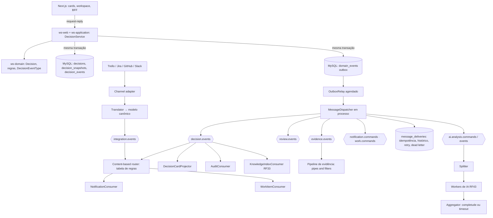

# DECIA — Arquitetura de mensagens e eventos (Hohpe & Woolf)

> Referência central desta seção: **HOHPE, G.; WOOLF, B. *Enterprise Integration Patterns: Designing, Building, and
> Deploying Messaging Solutions*. Addison-Wesley, 2003** (já em `docs/produto/BIBLIOGRAFIA.md` §2, l.121, com uso genérico;
> aqui passa a fundamentar a arquitetura de integração). Escopo do livro **só**: mensagens, canais, roteamento, transformação,
> correlação, rastreabilidade técnica e tratamento de falha. Não fundamenta psicologia da decisão, teoria da decisão nem UX.
>
> Etiquetas: **[EIP: padrão]** = padrão do livro; **DESIGN PROPOSAL** = escolha de engenharia nossa; ver `02_MATRIZ_BIBLIOGRAFICA.md`.

```
ENTERPRISE INTEGRATION PATTERNS → ARQUITETURA DE MENSAGENS DO DECIA → EVENTOS DE DOMÍNIO → PROCESSAMENTO → INTEGRAÇÕES → RASTREABILIDADE
```

## 1. Princípio e estágio do projeto

- Mudanças relevantes do domínio **produzem eventos**; consumidores reagem sem que o produtor os conheça
  [EIP: Event Message, Publish-Subscribe Channel]. O `DecisionService` grava o agregado e o evento; não chama notificação,
  analytics, histórico, trabalho e memória em sequência.
- **Estágio atual (2026-10):** um monólito modular Spring Boot (ws-domain/application/infrastructure/web/bootstrap), MySQL
  como fonte de verdade, Redis já presente, um único deployável, nenhuma API de decisão exposta ainda (D-55). **Não há
  necessidade de broker.** Decisão (**DESIGN PROPOSAL**, D-58): **outbox transacional no MySQL + relay e despacho em
  processo**, com loja de entregas por consumidor. Kafka/RabbitMQ/NATS só quando houver ≥ 1 destes gatilhos medidos:
  (a) mais de um deployável consumindo eventos; (b) conectores externos com volume sustentado que o relay não drena
  (lag > 60 s no p95 por 1 semana); (c) necessidade de replay entre serviços; (d) requisito de entrega a terceiros com
  garantias que o MySQL não dá. A interface (`OutboxPort`, `MessageConsumer`) é a mesma nos dois cenários.
- **Nem tudo vira evento** [EIP: Request-Reply]. Chamada direta/síncrona: `GET` da decisão, validar o formulário, calcular
  a matriz ao editar um peso, o guarda pré-decisão (o usuário precisa da resposta já). Evento quando: há vários
  consumidores, o produtor não precisa do resultado, o desacoplamento ajuda, o fluxo continua assíncrono.

## 2. Mensagem: cabeçalho e corpo [EIP: Message, Command Message, Event Message, Document Message]

```json
{
  "header": {
    "messageId": "0b8f…",              "messageType": "DecisionFinalized",
    "kind": "EVENTO",                   "channel": "decision.events",
    "schemaVersion": 1,                 "occurredAt": "2026-10-06T14:02:11.120Z",
    "correlationId": "op-7c1e…",        "causationId": "0a77…",
    "producer": "ws-application/decisao","actorId": "u-123",
    "aggregateType": "Decision",        "aggregateId": "d-42",
    "expiresAt": null
  },
  "body": { "decisionId": "d-42", "selectedAlternativeId": "alt-b", "ownerId": "u-123", "snapshotVersion": 1 }
}
```

- **Header** = metadados técnicos (roteamento, correlação, versão, expiração). **Body** = dados de domínio, mínimos
  [EIP: Content Filter] — consumidores buscam detalhes por request-reply quando precisam.
- **Evento** (pretérito, "algo aconteceu"): `DecisionCreated`, `EvidenceAdded`, `AlternativeCreated`, `CriterionUpdated`,
  `RiskChanged`, `DecisionFinalized`, `DecisionReopened`, `CheckpointDue`, `OutcomeRecorded`, `ReviewCompleted`,
  `DecisionAnalysisGenerated`, `ExternalWorkItemReceived`. Fonte: `DecisionEventType.messageType()` + catálogo.
- **Comando** (imperativo, "faça algo"): `GenerateDecisionAnalysis`, `AnalyzeEvidence`, `AnalyzeRisks`,
  `AnalyzeAlternatives`, `AnalyzeAssumptions`, `SendNotification`, `SendCriticalRiskAlert`, `CreateWorkItems`,
  `IndexDecisionKnowledge`, `SyncExternalWorkItem`, `GenerateMeetingReminder`. Nome de comando nunca no pretérito; nome de
  evento nunca no imperativo — o catálogo de tipos (`MessageTypes`) valida e o teste-guarda falha se alguém misturar.

## 3. Canais lógicos [EIP: Message Channel, Datatype Channel]

| Canal | Tipo | Mensagens | Produtor | Consumidores |
|---|---|---|---|---|
| `decision.events` | pub-sub de eventos | DecisionCreated, DecisionStatusChanged, AlternativeCreated, CriterionUpdated, AssessmentRecorded, RiskChanged, DecisionFinalized, DecisionReopened, WorkItemsLinked, DecisionArchived | domínio decisão | auditoria, histórico, projeção do card, notificação, trabalho, memória, analytics |
| `evidence.events` | pub-sub | EvidenceAdded, EvidenceSuperseded | domínio decisão | pipeline de evidência, projeção, memória |
| `review.events` | pub-sub | CheckpointDue, CheckpointCompleted, TriggerFired, OutcomeRecorded, ReviewCompleted | domínio decisão / agendador | notificação, projeção, calibração, memória |
| `notification.commands` | ponto a ponto | SendNotification, SendCriticalRiskAlert, GenerateMeetingReminder | roteadores | serviço de notificação (RF46/Notifications) |
| `work.commands` | ponto a ponto | CreateWorkItems | consumidor de DecisionFinalized | Acervo/Projetos (tarefas, marcos) |
| `ai.analysis.commands` | ponto a ponto | GenerateDecisionAnalysis, AnalyzeEvidence/Risks/Alternatives/Assumptions | UI (via aplicação) / splitter | workers de IA (RF43) |
| `ai.analysis.events` | pub-sub | PartialAnalysisProduced, DecisionAnalysisGenerated | workers / aggregator | aggregator, projeção, histórico |
| `integration.events` | pub-sub (entrada canônica) | ExternalWorkItemReceived, ExternalCommentReceived | adaptadores de canal + tradutores | roteador de integração |
| `integration.commands` | ponto a ponto (saída) | SyncExternalWorkItem | domínio | adaptadores Trello/Jira/GitHub/Slack |

Não existe um canal genérico `events`. Canais inválido e dead letter são **estados** na loja de entregas (§8), não filas
físicas, enquanto não houver broker [EIP: Invalid Message Channel, Dead Letter Channel].

## 4. Publish-subscribe: finalização da decisão

```
USUÁRIO → "Decidir" → DecisionService (request-reply: guarda + resposta imediata)
  TRANSAÇÃO ── decisions.status = DECIDIDA
           ├── decision_snapshots (DECISAO, SHA-256)
           ├── decision_events (DECISAO_FINALIZADA — histórico da decisão)
           └── domain_events (outbox: DecisionFinalized, correlationId = X)
  COMMIT
RELAY → decision.events: DecisionFinalized
  ├── AuditConsumer            → audit_log (impacto ≥ ALTO)
  ├── NotificationRouter       → notification.commands: SendNotification(participantes)
  ├── WorkItemConsumer         → work.commands: CreateWorkItems (idempotente por decisionId+snapshotVersion)
  ├── DecisionCardProjector    → projeção de leitura do card
  ├── AnalyticsConsumer        → métricas agregadas (sem conteúdo)
  └── KnowledgeIndexConsumer   → ai: IndexDecisionKnowledge (RF33)
```

Todos os filhos herdam `correlationId = X` e recebem `causationId = messageId` da mensagem que os causou
[EIP: Correlation Identifier, Message History].

## 5. Roteamento explícito e testável [EIP: Message Router, Content-Based Router, Recipient List]

Regras como **tabela de dados**, não `if/else` espalhado em consumidores (`DecisionRoutingRules`, teste por linha):

| Mensagem | Condição (conteúdo) | Rota |
|---|---|---|
| DecisionCreated | `kind = CONTRATACAO` | + aviso de regras institucionais de contratação no workspace (fluxo jurídico é de pessoas) |
| DecisionCreated | `kind = TECNICA` | sugerir modelo "Arquitetura" (ai.analysis.commands opcional) |
| DecisionCreated / DecisionStatusChanged | `impact = CRITICO` | `notification.commands: SendNotification(aprovadores)` + exigir APROVADOR no DACI |
| RiskChanged | `severity = CRITICO` | `notification.commands: SendCriticalRiskAlert` (imediata) |
| RiskChanged | `severity ∈ {ALTO}` | notificação no resumo diário |
| RiskChanged | `severity ∈ {BAIXO, MEDIO, NAO_AVALIADO}` | só persistência/projeção/analytics |
| CheckpointDue | sempre | `notification.commands` para o responsável (agrupada no dia) |
| ExternalWorkItemReceived | `sourceSystem` | tradutor do sistema de origem (§6) |

## 6. Integrações: adaptador → tradutor → modelo canônico [EIP: Channel Adapter, Message Translator, Canonical Data Model, Normalizer]

```
EVENTO EXTERNO (Trello/Jira/GitHub/Slack/E-mail) → CHANNEL ADAPTER → TRANSLATOR → MENSAGEM CANÔNICA → ROUTER → DOMÍNIO
```

Modelo canônico (conceitos internos, independentes de fornecedor): `Decision`, `Evidence`, `WorkItem`, `Participant`,
`Comment`, `Attachment`, `ExternalReference {sourceSystem, externalId, url, syncedAt}`. Exemplo de normalização:

```json
{"trelloCardId": "abc", "name": "Revisar proposta", "due": "2026-10-30T12:00:00Z"}
→ {"externalReference": {"sourceSystem": "TRELLO", "externalId": "abc"}, "workItemTitle": "Revisar proposta", "dueAt": "2026-10-30T12:00:00Z"}
```

O domínio conhece `WorkItem`, nunca o JSON do Trello. Conectores não existem ainda no produto: os tradutores entram com o
primeiro conector (backlog P3); o formato canônico e o canal ficam definidos agora.

## 7. Análise de IA: splitter + aggregator [EIP: Splitter, Aggregator, Scatter-Gather]

```
GenerateDecisionAnalysis (comando, correlationId = A)
  → SPLITTER → AnalyzeEvidence · AnalyzeRisks · AnalyzeAlternatives · AnalyzeAssumptions   (ai.analysis.commands)
  → workers → PartialAnalysisProduced (ai.analysis.events, correlationId = A)
  → AGGREGATOR → DecisionAnalysisGenerated {partial: true|false, missing: [...]}
```

- **Correlação:** `correlationId` do comando original.
- **Condição de completude:** recebeu Risk **e** Evidence **e** Alternatives (Assumptions opcional) **ou** venceu o
  timeout (padrão 120 s, `ws.decia.analysis.timeout`).
- **Algoritmo:** junta as partes em ordem fixa; cada parte guarda `aiInferenceId` (proveniência); `partial = true` lista
  as faltantes. A UI mostra "Análise parcial — riscos ainda não analisados". Nunca espera indefinidamente.
- **Estado da análise** (infraestrutura, **não** é `DecisionLifecycle`): SOLICITADA → PROCESSANDO → PARCIAL | CONCLUIDA | FALHOU.

## 8. Confiabilidade

| Padrão | Regra no DECIA |
|---|---|
| **Transactional Outbox** (Richardson 2018, BIBLIOGRAFIA l.125; complementa EIP) | agregado + snapshot + `decision_events` + `domain_events` na **mesma transação**; nunca "commit ok + publicação perdida" |
| **Guaranteed Delivery** [EIP] | o relay só marca `published_at` depois de despachar; reinicia de onde parou |
| **Idempotent Receiver** [EIP] | loja `message_deliveries (message_id, consumer)` única: a segunda entrega do mesmo `messageId` ao mesmo consumidor vira `IGNORADA_DUPLICADA` sem efeito; `CreateWorkItems` também tem chave natural (decisionId + snapshotVersion) |
| **Retry** | `maxAttempts = 5`, backoff exponencial 30 s → 1 m → 2 m → 4 m (teto 30 m); só erros **retentáveis** (timeout, indisponível, lock); **não retentáveis** (schema inválido, não autorizado, regra de domínio) vão direto a dead letter. Nada de `while(true)` |
| **Invalid Message Channel** [EIP] | envelope sem header obrigatório, tipo desconhecido, `kind` incompatível com o nome ou versão de schema não suportada → `INVALIDA` com `reason`, `messageId`, origem, horário |
| **Dead Letter Channel** [EIP] | esgotou tentativas ou erro permanente → `DEAD_LETTER` com último erro (sem payload sensível) para investigação no Monitor de integrações |
| **Message Expiration** [EIP] | `expiresAt` em comandos que perdem sentido (`GenerateMeetingReminder` depois da reunião, `SendCriticalRiskAlert` depois que o risco caiu) → `EXPIRADA`, sem execução |
| **Claim Check** [EIP] | conteúdo > 16 KB (PDF, planilha, saída longa de IA, dataset) fica em `media_objects`/S3; a mensagem leva `{contentLocation, contentHash (SHA-256), mediaId}` |
| **Content Enricher** [EIP] | `EvidenceAdded` ganha `projectId`, `decisionOwner`, metadados de fonte/documento antes da indexação |
| **Pipes and Filters** [EIP] | evidência: validar → extrair metadados → normalizar → classificar (natureza sugerida ✦) → deduplicar (SHA-256) → enriquecer → indexar → ligar à decisão; cada filtro com uma responsabilidade |

## 9. Rastreabilidade: três históricos diferentes

| | Histórico da decisão | Histórico técnico de mensagens | Analytics de UI |
|---|---|---|---|
| Pergunta | "quem mudou o quê na decisão?" | "o que aconteceu com a mensagem?" | "como as pessoas usam a tela?" |
| Onde | `decision_events` (append-only) | `domain_events` + `message_deliveries` [EIP: Message Store, Message History] | `lib/decia/analytics.ts` |
| Exemplo | "Ana alterou o peso de Segurança para 30 %" | "`CriterionUpdated` consumido por AnalyticsConsumer, tentativa 2, ok" | `card_flipped` |
| Quem vê | participantes | só admin (Monitor de integrações) | produto, agregado |

Loja de mensagens guarda metadados (`messageId`, `correlationId`, `causationId`, `messageType`, `occurredAt`, `producer`,
status por consumidor, tentativas, último erro); payload completo só enquanto pendente e pelo prazo de retenção
(30 dias, **DESIGN PROPOSAL**). `decisionId ≠ correlationId`: a decisão 42 tem uma operação de criação (AAA), uma de
finalização (BBB) e uma de reabertura (CCC), cada uma com sua correlação.

## 10. Projeção do card e consistência eventual [EIP: Event-Driven Consumer; CQRS read model]

- `DecisionCardProjection` consome `decision.events`, `evidence.events`, `review.events` e mantém o `DecisionCardViewModel`
  pronto para leitura (grade de decisões sem recalcular o domínio). **Não é fonte de verdade**: pode ser reconstruída
  reprocessando o histórico.
- Até a API existir, o frontend deriva o view model por função pura (`toDecisionCardViewModel`), com as mesmas regras.
- UI honesta sobre atraso: "Atualizando…", "Processando análise…" quando a projeção ainda não refletiu a ação.
- **Status do card ≠ status de mensagem**: `DecisionLifecycle` é domínio; `MessageProcessingStatus` é infraestrutura e
  nunca aparece no card.

## 11. Observabilidade e logs

- Correlação ponta a ponta: ação na UI (`X-Correlation-Id` já repassado pelo BFF) → API → evento → consumidor →
  integração. Logs estruturados com `correlationId`, `messageId`, `decisionId`, `consumer`; nunca o payload.
- Nunca logar documento confidencial, payload sensível, tokens, segredos ou prompt completo com dado privado;
  `SensitiveDataMaskingConverter` (bootstrap) continua valendo. Metadado operacional ≠ conteúdo.

## 12. UI de integrações

- Usuário comum vê só: **Sincronizando · Sincronizado · Falha na sincronização · Requer atenção**. Nada de "router",
  "consumer", "dead letter".
- Admin: **Monitor de integrações** (`/admin`, futuro) com `messageId`, `correlationId`, origem, destino, tentativas,
  status, erro, e "reprocessar" para dead letters.
- Card de conector (Trello/Jira…, quando existir): frente "Conectado · última sincronização · saudável"; verso "canais ·
  últimos eventos · erros · reprocessar". Nunca misturado com Decision Cards.

## 13. Diagrama



## 14. EIP → DECIA (validado contra a necessidade real)

| EIP | Aplicação DECIA | Precisa agora? |
|---|---|---|
| Message | envelope header/body (§2) | **sim** — base de tudo |
| Message Channel | canais lógicos por intenção (§3) | **sim** (nomes no header; despacho em processo) |
| Command Message / Event Message | catálogo `MessageTypes` com validação de nome | **sim** |
| Publish-Subscribe Channel | DecisionFinalized → N consumidores (§4) | **sim** |
| Message Router / Content-Based Router | tabela `DecisionRoutingRules` (§5) | **sim** (risco crítico, impacto crítico) |
| Message Translator / Canonical Data Model / Normalizer | conectores externos (§6) | modelo e canal agora; tradutores com o 1º conector |
| Channel Adapter | Trello/Jira/GitHub/Slack | não (sem conectores) |
| Correlation Identifier | `correlationId` + `causationId` por operação | **sim** |
| Splitter / Aggregator | análise de IA (§7) | regra de completude agora; workers com RF43 |
| Pipes and Filters | pipeline de evidência (§8) | interfaces agora; filtros com a API de evidência |
| Content Enricher | EvidenceAdded antes de indexar | com RF33 |
| Content Filter | body mínimo | **sim** |
| Claim Check | payload > 16 KB → referência + SHA-256 | **sim** (regra de tamanho) |
| Idempotent Receiver | `message_deliveries` única por (mensagem, consumidor) | **sim** |
| Guaranteed Delivery / Transactional Outbox | outbox MySQL + relay | **sim** |
| Invalid Message / Dead Letter Channel | estados na loja de entregas | **sim** |
| Message Expiration | `expiresAt` em comandos | **sim** (lembretes, alertas) |
| Message Store / Message History | metadados + `causationId` | **sim** |
| Request-Reply | leituras e validações síncronas | **sim** (não converter tudo em evento) |
| Message Broker | Kafka/RabbitMQ/NATS | **não** — gatilhos em §1 |
| Competing Consumers / Message Dispatcher | vários workers de IA | com RF43 |

## 15. Critério de aceite — como cada pergunta é respondida

| Pergunta | Resposta no sistema |
|---|---|
| Qual evento iniciou esta operação? | `domain_events` com `causationId` nulo e o `correlationId` da operação |
| Qual decisão está relacionada? | `aggregateType = Decision`, `aggregateId`, `body.decisionId` |
| Quais consumidores processaram? | `message_deliveries` por `messageId` |
| Qual integração externa foi acionada? | entregas de `integration.commands` com o mesmo `correlationId` |
| Algum passo falhou? Houve retry? | `status`, `attempts`, `last_error` por entrega |
| Processada mais de uma vez? Produziu efeito? | `IGNORADA_DUPLICADA` (sem efeito) vs uma única `PROCESSADA` |
| Qual transformação ocorreu? | tradutor/filtro registrado na entrega (`consumer`) e `schemaVersion` |
| Qual payload/versão? | `schemaVersion` + payload retido (prazo) ou claim check (`contentHash`) |
| Como reconstruir o fluxo? | árvore `correlationId` → `causationId` → `messageId` |

Regra final: **baixo acoplamento + semântica clara + roteamento explícito + rastreabilidade + isolamento de integrações +
tratamento de falha + evolutividade**, sem complexidade gratuita.
