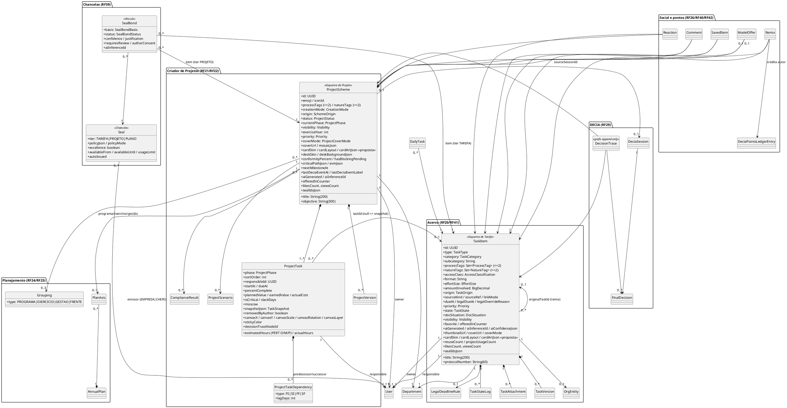

# Anatomias dos esquemas e Estúdio de Arte do Card — Work Station (v2, pesquisa profunda)

> Aprofunda e corrige [`ANATOMIA_CARDS.md`](ANATOMIA_CARDS.md) (v1) e a parte de cards de [`DESIGN_SYSTEM.md`](DESIGN_SYSTEM.md). Não repete o que lá já está certo: onde este documento diverge, a divergência está marcada com **⟲ corrige v1**. Wireframes estáticos em [`../lab/anatomias.html`](../lab/anatomias.html) (captura em [`../lab/capturas/anatomias.png`](../lab/capturas/anatomias.png)).

## 0. Como ler este documento

**Fontes e convenção de citação.** Cada afirmação traz a origem entre parênteses:

| Marca | Significado |
|---|---|
| `arquivo:linha` | arquivo do repositório do FAI (`tcc-2026-fashion-ai-backend`). Caminhos abreviados: `WardrobeItem.java` = `fai-domain/src/main/java/br/com/fashionai/domain/model/WardrobeItem.java` (idem `Scheme`, `SchemeItem`, `DnaScheme`, `DnaSchemeItem`, `SchemeGrouping`, `Seal`, `SealBond`); `Views.java` = `fai-application/src/main/java/br/com/fashionai/application/view/Views.java`; `types.ts` = `lib/api/types.ts`; `v17`, `v18`, `v19`, `DNA_v4` = `docs/anatomias/anatomias_card_v17_1.html`, `anatomias_card_v18.html`, `anatomias_card_v19.html`, `anatomia_cards_DNA_v4_1.html`; `02-rf.md` = `markdowns/02-rf-reestruturados-e-criterios-aceite.md`; `CARDS_ARTE.md` = `docs/checklist/CARDS_ARTE_RF11_2026-09-27.md`. |
| `board › <card>` | dump do board Trello Work Station (`board2.md`): `board › RF20` é o card cujo **título** começa com "RF20:"; `board › Identidade` = card "WORK AI — Identidade visual e estética"; `board › Chancelas` = card "WORK AI — Chancelas"; `board › Mapa` = card "Mapa de equivalência". |
| `TAXONOMIA §x.y` | `docs/arquitetura/TAXONOMIA.md` deste repositório. |
| **proposta** | não vem de nenhuma fonte; decisão de desenho deste documento, a validar (seção 6). |

**Atenção à renumeração (Q-44).** Os títulos dos cards RF4–RF26 do board mudaram, mas os CAs dentro dos cards mantêm os ids antigos. Exemplo: o card cujo título começa com "RF20: Utilizar o construtor de projetos…" é o **Criador de Tarefas** e seus CAs são `RF20.CA01…CA15`; o card "RF5: Utilizar o criador de projetos…" traz os CAs `RF21.CA01…CA14`; o card "RF19: Curtir, comentar…" traz `RF26.CA01…CA09`. Aqui **cada CA é citado com o id como está escrito no corpo do card** (`RF20.CA04`, `RF21.CA10`, `RF26.CA07`…), e o card é citado pelo título (`board › RF20`, `board › RF5`, `board › RF19`).

**Vocabulário.** *Esquema de Tarefa* = `TaskItem` + a sua ligação `ProjectTask` quando está dentro de um projeto (= peça + `SchemeItem` no FAI, `TAXONOMIA §2.1/§3.2`). *Esquema de Projeto* = `ProjectScheme` (= look/`Scheme`), com o seu plano/eixo (= DNA). *Estúdio de Arte do Card* = o que o board chama de "Etapa 5 — Arte do card (= Background Studio)" (`board › RF20`, "Etapa 5") e o RF38 chama de identidade visual.

**Regra de tradução usada em todo o documento.** Para cada elemento de moda do FAI pergunta-se: (1) qual *função* ele cumpre no card (identificar, classificar, medir, posicionar, decorar, reconhecer); (2) que dado do Work Station cumpre a *mesma função*; (3) se nenhum cumpre, o elemento é **descartado** com o motivo (§1.3). Elementos cuja função é a *moda em si* (sexo, estação, manequim, cor da peça) não são traduzidos à força.

---

## 1. Tradução moda → trabalho (campo a campo)

### 1.1 Peça (`WardrobeItem`) → Tarefa (`TaskItem`)

| Campo FAI (`WardrobeItem.java`) | Função no card do FAI | Campo Work Station | Função no card do WS | Fonte WS |
|---|---|---|---|---|
| `name` (:49-50, obrigatório, 180) | título | `title` (200) | título serif, 2 linhas, link | `board › RF20` Etapa 3 ("Nome → Título, obrigatório"); `TAXONOMIA §2.1` |
| `category` (:52-54, 5 partes do corpo) · `subcategory` (:56-57) | classifica a peça; decide o slot do look (`SchemeSlot`) | `category` (`TaskCategory`, 15) · `subcategory` | classifica; decide a **fase compatível** no Criador (mapa categoria→fase) | `board › RF20` Etapa 3; `board › RF5` "mapa categoria→fase, como SLOT_BY_CATEGORY" |
| — (a foto *é* o tipo) | — | `type` (`TaskType`, 13 no board / 15 na taxonomia) | glifo + cor no canto do card | `board › RF20` Etapa 3 ("Tipo (foto) → Tipo… detectado pela fonte, editável"); `board › Identidade §1` |
| `sex` (:59-61, RF4.CA07) | filtra o provador | — | — | descartado (`board › RF20` Etapa 3: "Sexo — não se aplica") |
| `brandName/brandLogoUrl/brandSource/brandRef` (:63-76) | marca com logo tratado | `orgEntityId` → `OrgEntity` (nome, logo tratado, fonte Wikidata/CNPJ/site) | órgão/fornecedor com logo | `board › RF20` Etapa 3 e `RF20.CA10`; `TAXONOMIA §2.6` |
| `color` (:78-79, obrigatório) | cor dominante; alimenta Espectro, Blocos, Cartela | `accessClass` (`AccessClassification`, obrigatório) | classificação de acesso **sempre com o nome em texto** | `board › RF20` Etapa 3 ("Cor → Classificação de acesso… LGPD"); `TAXONOMIA §2.1` |
| `material` (:81-82) | material | `format` (docx, xlsx, pdf, gdoc, url…) | selo da extensão no thumbnail | `board › RF20` Etapa 3; `DESIGN_SYSTEM §2.3` (tokens `--ext-*`) |
| `sizeLabel` (:84-85) | tamanho | `effortSize` P/M/G + `estimatedHours` | porte (esforço) | `board › RF20` Etapa 3 ("Tamanho → Porte") |
| `market` (:87-88) | mercado | `origin` (`TaskOrigin`) | origem INTERNA/ÓRGÃO/FORNECEDOR/CIDADÃO | `board › RF20` Etapa 3 ("Mercado → Origem") |
| `occasionTags` (≤2, :93-94) · `styleTags` (≤2, :90-91) | ocasião/estilo; decidem a Direção recomendada do Studio | `processTags` (≤2) · `natureTags` (≤2) | processo/natureza; chips no bloco de metadados; **decidem o layout/arte sugeridos** (§5.2) | `board › RF20` Etapa 3; `TAXONOMIA §2.1` |
| `price` (:120-121) | preço; total do look; Custo por uso | `amountInvolved` (R$) | valor envolvido; total do projeto | `board › RF20` Etapa 3 ("Preço → Valor envolvido, 0 se não se aplica") |
| `visibility` (:123-125, PRIVATE/FOLLOWERS/PUBLIC) | quem vê | `visibility` PRIVADA/DEPARTAMENTO/EMPRESA/PUBLICA | linha secundária do cabeçalho (só quando útil) | `board › RF20` Etapa 4; `TAXONOMIA §13` |
| `disponivel` + `availabilityStatus` (:127-132) · toggles do topo (RF6.CA11, `02-rf.md:210`) | estado do acervo | `state` (`TaskState`, 8 valores) | **etiqueta de protocolo** com nome em texto | `board › RF41` "Estados"; `RF38.CA05` |
| `condition` (:134-136) | condição da peça | `docSituation` MINUTA/REVISADO/ASSINADO/PUBLICADO | situação do documento | `board › RF20` Etapa 4 ("Situação do documento (= condição)") |
| `favorite` (:138-139) | ⭐ no topo do card (RF31.CA01) | `favorite` | ⭐ no topo | `board › RF41` sub-filtro "Favoritas"; `RF41.CA07` |
| `forSale` (:141-142) | "à venda" | `offeredInCounter` + `ModelOffer` | ficha DP com preço em pontos e licença | `board › RF20` Etapa 4 ("Oferecer no Balcão (= à venda)"); `RF40.CA01` |
| `wearCount` (:144-145) · `lastWornDate` (:147-148) | usos; nível "Clássica do armário" (≥30, `scheme-anatomies.tsx:155-156`) | `reuseCount` · `projectUsageCount` | reutilizações; nível **"Modelo consolidado"** (proposta de limiar, §6) | `TAXONOMIA §2.1`; `RF23.CA04` ("contador de reutilizações… aparece no card") |
| `lookDoDiaCount` (:150-151) | vezes como Look do Dia | — (derivável de `DailyTask`) | — | descartado do card (vive na sub-aba Tarefa do Dia, `board › RF44`) |
| `schemeUsageCount` (:153-154) | em quantos looks | `projectUsageCount` + `projectUsage[]` | "em uso em: projeto" | `ANATOMIA_CARDS §3`; `RF41.CA02` |
| `likesCount … viewCount` (:156-169) | contadores sociais | `likesCount … viewsCount` | rodapé social | `RF26.CA07`; `TAXONOMIA §2.1` |
| `moderationStatus/Confidence/ReasonsJson` (:171-179) | moderação | `antivirusStatus` (`TaskAttachment`) + `aiConfidenceJson` | aviso no card quando pendente | `RF20.CA01` (bloqueio de maliciosos); `RF20.CA12` (job pendente, "aviso no card") |
| `photoProcessingStatus … flatLayMetadataJson` (:181-195) | pipeline Flat Lay | `ocrStatus`, `studioStatus` (`Evidence`) | Estúdio de Documento | `board › RF20` Etapa 1 ("Estúdio de Documento (= Flat Lay/Estúdio)") |
| `backgroundConfigJson` (:197-199) | arte do card da peça (RF11) | **`cardArtJson`** (proposta, §5.7) + `cardSkin` + `coverMode` | arte do card | `TAXONOMIA §2.1` (`cardSkin`, `coverMode`); **proposta** (`cardArtJson`) |
| `hypeScore/hypeScoreGlobal/hypeGroupId` (:201-208) | popularidade da peça | — por tarefa; **Hype do autor** no card (opcional) | "autor com Hype 640" | `board › RF45 §3` ("pode aparecer… nos cards… como 'autor com Hype 640'") |
| `remixedFromPieceId` (:210-211) | crédito do remix | `originalTaskId` | "remixado de…" | `RF26.CA06`; `TAXONOMIA §2.1` |
| `groupingId` (:213-214) | coleção/era | via `GroupingItem` | — no card (chip opcional) | `TAXONOMIA §4.5`; Q-33 |
| `tags` (:216-217) · `notes` (:219-220) | tags/notas | `tags` · `notes` | detalhe | `board › RF20` Etapa 4 |
| `purchaseDate` (:222-223) · `purchaseLocation` (:225-226) | compra | `receivedAt` · `senderOrigin` | detalhe | `board › RF20` Etapa 4 |
| `sku` (:228-229) | código | `protocolNumber` (60) | nº de protocolo em mono no cabeçalho do detalhe e na arte "Protocolo" | `board › RF20` Etapa 4 ("Nº de protocolo/processo (= SKU)") |
| `careInstructions` (:231-232) | cuidados | `retentionPolicyJson` | guarda e temporalidade | `board › RF20` Etapa 4 |
| `model3dStatus/Url` (:234-240) | 3D | — (preview 2D/3D de .glb/.ifc é do tipo DESENHO_TECNICO) | glifo cubo 3D | descartado como campo; `board › Identidade §1` |
| `studioImageUrl/Backdrop/DetailUrl` (:242-251) · `studioFeedUrl` (`Views.java:62`) | foto de produto com variantes | `thumbnailUrl` · `coverUrl` · `coverMode` AUTO/MANUAL/IA | thumbnail automático + capa | `RF38.CA02`; `TAXONOMIA §2.1` |
| `pieceOrigin` (:264-266) | COMPRADA/GARIMPADA/… | `sourceKind` (ARQUIVO · COLAR · GOOGLE · MICROSOFT · EMAIL · LINK · PROTOCOLO · FOTO · TEXTO_IA …) | ícone da origem no detalhe; filtro "origem" | `board › RF20` Etapa 1; `board › RF41` filtros |
| `mannequinImageUrl/Face` (:268-274) | foto com manequim | — | — | descartado |
| — | — | `responsibleId`, `dueAt`, `legalDueAt`, `priority`, `departmentId` | responsável, prazo (⚖), prioridade, borda do departamento | `board › RF20` Etapa 3 última linha; `RF20.CA11`; `RF38.CA09` |
| — | — | `aiGenerated` + `aiInferenceId` | faísca ✦ com tooltip | `RF38.CA04`; `RF20.CA02` |

### 1.2 Look (`Scheme`) + `SchemeItem` + DNA → Projeto (`ProjectScheme`) + `ProjectTask` + Plano

| Campo FAI | Função | Campo WS | Fonte WS |
|---|---|---|---|
| `Scheme.title` (:49-50) · `description` (:52-53) | título/descrição | `title` · `objective` (300, 1 frase) · `descriptionMd` | `board › RF5` ficha; `RF29.CA01` (objetivo vira tema da sessão) |
| `creationMode` MANUAL/AI_ASSISTED (:55-57) | "feito com IA" no rótulo do container (`scheme-card.tsx:177`) | `creationMode` MANUAL/COM_IA | `board › RF5` "Modo de geração"; `RF21.CA06` |
| `origin` (:59-61, CRIAR_LOOK/PROVADOR/REMIX/COPILOT/…/AUTOPILOTO) | "feito pelo Autopiloto" | `origin` CRIAR_PROJETO/DECIA/REMIX/AUTOPILOTO/MODELO/CENARIO/DOSSIE/ATA_VIVA | `RF21.CA04`, `RF21.CA06`, `RF29.CA02`, `RF30.CA04` |
| `style` · `occasion` (:63-67, ≤3 CSV) | chips | `processTags`/`natureTags` (≤2) | `board › RF5` ficha |
| `season` (:69-71) · `mood` (:73-75) | estação (Cartela sazonal, arte sazonal automática) · humor | `exerciseYear` · `priority` | `board › RF5` ficha ("Exercício", "Prioridade") — *tradução de função, não de significado* (§1.3) |
| `visibility` · `status` DRAFT/PUBLISHED/ARCHIVED (:77-83) | ciclo | `visibility` · `status` (`ProjectStatus`, 8) | `TAXONOMIA §3.1`; `RF21.CA12` (EM_DECISÃO) |
| `displayMode` (:85-87) · `layoutAnatomy` (:123-124) · `layoutDensity` (:126-127) | layout do card | `cardArtJson.layout` + `density` (§5.7) | **proposta** |
| `lookDoDia` (:92-93) | badge "Look do dia" no cabeçalho (`scheme-card.tsx:161`) | — (projeto não é Tarefa do Dia) | descartado |
| `coverImageUrl` (:101-102) · `coverOf()` (`scheme-anatomies.tsx:110-111`: capa = foto do look ou foto da 1ª peça) | capa | `coverMode` MOSAICO/FOTO/IA · `coverUrl` · `mosaicJson` | `RF21.CA10`; `RF38.CA03` |
| `backgroundColor/Gradient/ArtUrl/AnimationType` (:104-115) "planos para busca" + `studioConfigJson` (:117-118) | fundo do card | `cardArtJson` + colunas planas `card_skin`, `card_layout` | **proposta** (§5.7), espelhando `Scheme.java:29-34` |
| `cardSkin` (:120-121) · `containerOrigin/Color/Mandatory` (:129-137) | skin e container | `cardArtJson.container.{skin,color}` | **proposta** |
| `totalPrice` (:157-158) | total | Σ `amountInvolved` + `evmJson.PV` | `TAXONOMIA §3.1` |
| `sealIdsJson` (:160-161) · `sealBadges` (`Views.java:194`) | medalhões na zona do selo | `sealIdsJson` + badges dos vínculos APROVADOS | `RF39.CA11`; `RF21.CA09` |
| `renderingStatus/virtualTryOnUrl` (:166-183) | provador | — | descartado |
| `hypeScore(Global)` (:185-189) | Hype do look | `conformityPercent`, `evmJson.{SPI,CPI}`, Hype do autor | `RF32.CA04`; `RF43.CA09`; `board › RF45 §3` |
| `revalidationPending` (:197-199, RF9.CA5) | vínculo com marca passa a "revalidação pendente" após edição | recertificação da chancela | `RF39.CA08` ("recertificação… a chancela caduca se o critério deixa de valer") |
| `favorite` (:204-206) · `publishedAt` (:201-202) | ⭐ · data | `favorite` (via `SavedItem`) · `publishedAt` | `RF26.CA04` |
| `recommendedDirection` (:208-210) | direção recomendada do Studio | **sugestão de arte por processo/natureza** (§5.2) | **proposta** |
| `backgroundVideoUrl` (:212-214) | vídeo em loop do Aura + material | — | descartado (§1.3) |
| `SchemeItem.slot` (:38-40, `SchemeSlot` TOP/BOTTOM/SHOES/ACCESSORY/FULL_BODY/OUTERWEAR) | posição no look | `ProjectTask.phase` (`ProjectPhase`, 7) | `board › Mapa §1` ("Slot do look → Fase do projeto") |
| `sortOrder` · `zIndex` (:46-50) | ordem | `sortOrder` · `canvasLayer` | `TAXONOMIA §3.2` |
| `positionX/Y, scale, rotation, opacity, filtersJson` (:52-68) | transformação no canvas | `canvasX/Y/Scale/Rotation`, `stickyColor` | `RF22.CA03` |
| `snapshotJson` (:70-72, RF7.CA03 peça excluída) | peça removida depois | `snapshotJson` (`TaskSnapshot`) + `removedByAuthor` | `RF23.CA03` |
| — | — | `responsibleId`, `dueAt`, `startAt`, `estimatedHours` (PERT), `percentComplete`, `plannedValue/earnedValue/actualCost`, `isCritical`, `slackDays`, `moscow`, `decisionTraceNodeId` | `RF21.CA04`, `RF21.CA08`, `TAXONOMIA §3.2` |
| `DnaScheme` (2–6 esquemas, `DnaScheme.java:28-31`) · `DnaSchemeItem.cell` (:33-35) | DNA de Estilo | `AnnualPlan` · `PlanAxis` (6 eixos) | `board › Mapa §1` ("DNA de Estilo (6 células) → Plano Anual (6 eixos)") |
| `DnaScheme.cardLayout` (:141-143) · `narrativeType` (:62-64) · `targetElement` (:145-147) | anatomia A1–A4 · narrativas B1–B12 | layouts do **card de plano** (fora do escopo deste doc; §4.4 mapeia) | — |
| `DnaSchemeItem.milestone` (:49-51) · `eraLabel` (:37-38) | marco · época | marco do eixo · exercício | `TAXONOMIA §4.2` |
| `SchemeGrouping` (type/label/cover/period/accentColor, :27-53) | coleção/era/temporada | `Grouping` PROGRAMA/EXERCICIO/GESTAO/FRENTE | `TAXONOMIA §4.4`; `board › RF25` |

### 1.3 O que foi descartado e por quê

| Elemento FAI | Fonte | Por que não entra no Work Station |
|---|---|---|
| `sex` e filtro do provador | `WardrobeItem.java:59-61` | "não se aplica" (`board › RF20` Etapa 3). Nenhum dado de trabalho cumpre a função de "filtrar por corpo". |
| Manequim, Provador 2D, try-on, `renderingStatus`, 3D da peça | `WardrobeItem.java:234-274`, `Scheme.java:166-183` | o Provador vira Simulador de Cenários (`board › Mapa §2`), que é uma tela, não um elemento de card. Preview 3D de `.glb/.ifc` fica como *mídia* do tipo DESENHO_TECNICO, não como campo. |
| `season`/Cartela sazonal/arte sazonal automática | `Scheme.java:69-71`; `scheme-anatomies.tsx:100,400-421`; `background-studio.tsx:65,194` | a "estação" é a época real do look (`v17:~1240`); o análogo temporal do trabalho é o **exercício** (ano), que já é agrupamento (`Grouping EXERCICIO`). Uma arte "por exercício" não comunica nada visualmente; descartada. A faixa de **ciclo** da chancela (`board › Chancelas §1`, "ciclo (ex.: 1º semestre 2026)") cobre o que resta da função. |
| `mood` | `Scheme.java:73-75` | o humor do look vira **prioridade** só por posição na ficha (`board › RF5`); a tradução é de função (um seletor curto na ficha), não de sentido. |
| Hype por peça (`hypeScore` da peça, Hype Focus por peça) | `WardrobeItem.java:201-208`; `scheme-anatomies.tsx:373-398` | o board desloca o Hype para a **pessoa** (RF45) e para a **eficiência diária** (RF44). O card mostra, no máximo, "autor com Hype 640" (`board › RF45 §3`). |
| `wearCount` como "Clássica do armário" por uso | `scheme-anatomies.tsx:155-156`; `v18:~750` | a função (premiar o uso) é cumprida por `reuseCount` (RF23.CA04) e pela chancela; o limiar de 30 não tem base no board (§6, P-07). |
| Aura + material + vídeo em loop + mosaico 3×4 de materiais | `card-art.ts:12,93-106`; `Scheme.java:212-214`; `RF11_MOSAICO_EXEMPLO.jpg` | texturas de tecido/couro/veludo são linguagem de moda. A função "superfície com matéria" é cumprida pelas **texturas de papelaria** (papel, cortiça, blueprint — `board › Identidade §9`) e pela **malha de nós** (o fio de decisão como padrão). O vídeo em loop é descartado também por custo (feed estático, `CARDS_ARTE.md:36-37`). |
| LEGO/Blocos (anatomia, pinos como zona de selo, placa-base com marca) | `scheme-anatomies.tsx:26,48,423-441`; `v18:~1497-1512` ("LEGO é marca registrada") | brinquedo não cabe na "repartição do futuro" (`board › Identidade`, conceito) e a própria v18 registra o problema de marca. A função "o card inteiro feito de outra matéria" é cumprida pelo estilo **Terminal** (§5.3) e pelas texturas. |
| Passarela (trilho por curtidas, holofotes) | `scheme-anatomies.tsx:183-209` | ordenar tarefas por curtidas contradiz a ordem cronológica das fases (`board › Mapa`, "ordem cronológica/sequencial"). A função "destaque do mais reconhecido" vai para a **Vitrine** (hero, `board › RF27`) e para o Painel de métricas. |
| Etiqueta de preço pendurada (hang tag) | `scheme-anatomies.tsx:216-238` | a função (ficha com preço) é cumprida pela **ficha de protocolo** e pela **ficha DP** do Balcão (`board › Chancelas §6`). |
| Espectro (área por cor) | `scheme-anatomies.tsx:288-312` | não há cor por tarefa. A função "proporção das partes" vira a **barra de 7 fases** e, no layout Kanban em miniatura, a contagem de tarefas por fase. |
| Silhueta & Proporção (manequim) | `scheme-anatomies.tsx:342-368` | a forma do corpo não tem análogo. A "forma" de um projeto é a sua **linha do tempo** (caminho crítico, `RF21.CA08`). |
| Raio-X com pinos sobre a foto | `scheme-anatomies.tsx:240-258` | a composição de um projeto não é uma imagem. A função "decompor e numerar" é cumprida pela **prancha técnica** (layout PRANCHA, legenda numerada) e pelo fio de decisão. |
| Zona de selo `STUDS` | `scheme-anatomies.tsx:33,48` | depende dos Blocos. |
| Selo por peça dentro do look (`pieceRows`, `linkedPieceIdsJson`) | `scheme-anatomies.tsx:34-38`; `SealBond.java:49-50` | **mantido** como "lacre por tarefa dentro do projeto" (`RF21.CA09`: "a chancela vem da tarefa"). Entra em §3.5. |
| Reações Trend/Elegante/Criativo | `v19 §11` | substituídas por ÚTIL / BEM FUNDAMENTADO / INOVADOR / CONFORME (`RF26.CA02`). |
| 11 skins de card com nomes editoriais (`atelier`, `spread`, `fai_max`, `luxury_glass_warm`…) | `lib/skins.ts:2-14` | substituídas por 6 skins de papelaria (§5.4). A mecânica (bg/ink/accent/border/radius/titleWeight + tons claro/escuro) é mantida. |
| Direção recomendada por estilo/ocasião (`/api/backgrounds/recommendations`) | `background-studio.tsx:82,173` | mantida como **sugestão de layout/estilo por processo e natureza** (§5.2), sem endpoint de "direção". |

---

## 2. (A) Esquema de Tarefa — todas as entidades

Esquema de Tarefa = `TaskItem` (`TAXONOMIA §2.1`) + `ProjectTask` quando a tarefa está em um projeto (`TAXONOMIA §3.2`) + agregados lidos pelo card (`TaskAttachment`, `TaskVersion`, `SealBond`, contadores, `DecisionTrace`). Colunas: **Obrig.** (obrigatório no `RF20.CA04`), **Origem** (U = usuário, IA = detecção/IA, S = sistema), **No card** (zona da anatomia, §4.2: `TOPO` toggles · `CAB` cabeçalho · `MIDIA` · `META` · `FASES` · `SELO` · `FAISCA` · `RODAPE` · `DET` só no detalhe).

### 2.1 Identificação

| Campo | Tipo | Obrig. | Origem | Validação | No card | RF/CA | Equivalente FAI |
|---|---|---|---|---|---|---|---|
| `id` | UUID | S | S | — | — (link) | — | `VersionedAuditableEntity` |
| `title` | String(200) | **sim** | U/IA | 1–200, trim; IA pré-preenche com confiança | `CAB` (serif, 2 linhas, é o link do card) | `RF20.CA02`, `RF20.CA04` | `name` (`WardrobeItem.java:49-50`); título como link que cobre o container (`scheme-card.tsx:98-103,139`) |
| `type` | `TaskType` | **sim** (detectado) | IA/S (pela fonte), editável | um dos 13 do board: TEXTO_MANUAL · TEXTO_IA · IMAGEM_WEB · IMAGEM_EDITADA · PLANILHA · DOCUMENTO · PASTA · LINK · DESENHO_TECNICO · FORMULARIO · ATA/REGISTRO · E-MAIL · PROTOCOLO (`board › RF20` Etapa 3). ⟲ a `TAXONOMIA §13` acrescenta CRONOGRAMA e ESTUDO_TECNICO_PRELIMINAR (15) — ver P-01 | `CAB`: glifo + cor da família (chip 24 px) | `RF38.CA01`, `RF20.CA06` (colar → TEXTO_MANUAL/PLANILHA/IMAGEM_EDITADA), `RF20.CA09` (PROTOCOLO) | a foto é o tipo; no WS o tipo é um campo (`board › RF20` Etapa 3) |
| `category` | `TaskCategory` (15) | **sim** | IA/U | lista oficial; decide a fase compatível, o prazo legal e o layout sugerido | `CAB` (label mono maiúsculo abaixo do título) | `RF20.CA04`; `board › RF5` (categoria→fase) | `category` (`WardrobeItem.java:52-54`) |
| `subcategory` | String(80) | não | IA/U | depende da categoria (lista por categoria) | `DET` | `board › RF20` Etapa 3 | `subcategory` (:56-57) |
| `summary` | Text (3 linhas) | não | IA | ≤ 3 linhas; marcada com ✦ quando gerada | `DET` (ampliado), tooltip no compacto | `RF20.CA02` | `description` do look (`Scheme.java:52-53`) |
| `descriptionMd` | Text | não | U | markdown seguro | `DET` | `board › RF20` Etapa 1 (e-mail → corpo vira descrição) | `notes` |
| `format` | String(20) | S | S | derivado do MIME real do anexo (`TaskAttachment.mimeType` "detectado, não só extensão", `TAXONOMIA §2.2`) | `MIDIA`: selo da extensão (`--ext-*`) | `board › RF20` Etapa 3 ("Formato… automático") | `material` (:81-82) |

### 2.2 Taxonomia

| Campo | Tipo | Obrig. | Origem | Validação | No card | RF/CA | Equivalente FAI |
|---|---|---|---|---|---|---|---|
| `processTags` | Set<`ProcessTag`> | **≥1** | IA/U | ≤ 2; lista por categoria | `META` chips | `RF20.CA04` | `occasionTags` ≤2 (`WardrobeItem.java:93-94`; javadoc :29) |
| `natureTags` | Set<`NatureTag`> | **≥1** | IA/U | ≤ 2 (Técnica · Jurídica · Financeira · Administrativa · Ambiental · Social) | `META` chips | `RF20.CA04` | `styleTags` ≤2 (:90-91) |
| `accessClass` | `AccessClassification` | **sim** | IA (sugere) / U | PUBLICO · INTERNO · RESTRITO · SIGILOSO; **nome sempre em texto**; RESTRITO/SIGILOSO nunca vai à IA externa | `META` (etiqueta com nome) e borda do anexo no DECIA | `RF20.CA04`; `TAXONOMIA §2.1` | `color` (:78-79) |

### 2.3 Características

| Campo | Tipo | Obrig. | Origem | Validação | No card | RF/CA | Equivalente FAI |
|---|---|---|---|---|---|---|---|
| `effortSize` + `estimatedHours` | `EffortSize` P/M/G + número | não | U/IA | horas ≥ 0; PERT O/M/P só no `ProjectTask` | `META` ("M · 6 h") | `board › RF20` Etapa 3; `board › RF44 §1` (WSJF usa o Porte) | `sizeLabel` (:84-85) |
| `amountInvolved` | BigDecimal | não (0 = n/a) | IA/U | ≥ 0, 2 casas | `META` (só quando > 0) | `board › RF20` Etapa 3 | `price` (:120-121); no card do FAI o preço só aparece "à venda" (`piece-card.tsx:98`) |
| `orgEntityId` | UUID → `OrgEntity` | não | U (busca web) / IA | candidato com fonte (Wikidata/CNPJ/site) e logo tratado | `CAB` linha secundária: logo 18 px + nome (como `BrandLogo` em `piece-card.tsx:58-60`) | `RF20.CA10` | `brandName/LogoUrl/Source/Ref` (:63-76) |
| `origin` | `TaskOrigin` | não | IA/U | INTERNA · ORGAO_EXTERNO · FORNECEDOR · CIDADAO | `DET` | `board › RF20` Etapa 3 | `market` (:87-88) |
| `departmentId` | UUID → `Department` | **sim** (padrão: lotação do dono) | S/U | pertence à empresa do dono | **borda do card** (2 px na cor) + monograma | `RF38.CA09` | `brand` não tem análogo; a borda é novidade do WS |
| `sourceKind` · `sourceRef` · `linkMode` | enums/String | S | S | VINCULADO exige token OAuth válido; revogar → COPIADO (snapshot) | `DET`; ícone da origem no cabeçalho do ampliado | `RF20.CA07`, `RF20.CA08`, `RF20.CA09` | `pieceOrigin` (:264-266) |

### 2.4 Responsabilidade e tempo

| Campo | Tipo | Obrig. | Origem | Validação | No card | RF/CA | Equivalente FAI |
|---|---|---|---|---|---|---|---|
| `responsibleId` | UUID → `User` | **sim** (padrão: eu) | U | membro da empresa | `META`: avatar iniciais 20 px + nome | `board › RF20` Etapa 3 | `owner` do post (`card-header.tsx:18-35`) — no WS o **dono** fica no cabeçalho e o **responsável** no meta (podem diferir, `RF10` atribuição) |
| `dueAt` | LocalDate | **quando a categoria tem prazo legal** | U/IA | ≥ hoje ao criar; no projeto, ≥ prazo da predecessora (`RF21.CA08`) | `META`: relógio + data; âmbar ≤ 3 dias, vermelho vencido | `RF20.CA04`, `RF38.CA05`, `RF41.CA04` | — (novidade) |
| `legalDeadlineRuleId` · `legalDeadlineBaseDate` · `legalDueAt` · `legalOverrideReason` | FK / data / data / String | regra: S; base: U | S calcula ("15 dias úteis a partir do recebimento — base legal X"); sobrescrever exige justificativa | `META`: ⚖ junto do prazo; tooltip com a base legal | `RF20.CA11` | — |
| `priority` | `Priority` BAIXA/MEDIA/ALTA/CRITICA | não (padrão MEDIA) | U/IA | — | `DET`; CRITICA ganha etiqueta no `META` (**proposta**) | `board › RF20` Etapa 3 | `mood` do look (função) |

### 2.5 Estado

| Campo | Tipo | Obrig. | Origem | Validação | No card | RF/CA | Equivalente FAI |
|---|---|---|---|---|---|---|---|
| `state` | `TaskState` | S (padrão RASCUNHO/DISPONIVEL) | U/S | máquina RASCUNHO→DISPONÍVEL→EM_USO⇄BLOQUEADA→CONCLUÍDA→ARQUIVADA; EM_USO automático ao entrar em projeto ativo; MODELO_PÚBLICO só via chancela/publicação; OFERECIDA (Q-36: etiqueta derivada) | `TOPO`/`META`: etiqueta de protocolo (tracejado · sólido · pulso · cadeado · carimbo · esmaecido · estrela · ficha) | `RF41.CA02`, `RF38.CA05` | `disponivel`/`availabilityStatus` (:127-132); toggles do topo (`02-rf.md:210`, RF6.CA11) |
| `blockedByTaskId` · `blockedByUserId` · `blockReason` | FK/FK/String | quando BLOQUEADA | U | ao menos um dos dois + motivo | `META` extra: "bloqueada por …" | `board › RF44 §3` (BLOQUEADA cria dependência) | — |
| `docSituation` | `DocSituation` MINUTA/REVISADO/ASSINADO/PUBLICADO | não | U | — | `DET`; na arte Protocolo vira carimbo discreto (**proposta**) | `board › RF20` Etapa 4 | `condition` (:134-136) |
| `protocolNumber` | String(60) | não (obrigatório no tipo PROTOCOLO) | U/S | formato livre; único por empresa (**proposta**) | `CAB` do ampliado (mono); arte "Protocolo" imprime "PROTOCOLO Nº …" | `RF20.CA09`; `ANATOMIA_CARDS §4` | `sku` (:228-229) |
| `receivedAt` · `senderOrigin` | LocalDate · String | não | U/IA | — | `DET` | `board › RF20` Etapa 4 | `purchaseDate` · `purchaseLocation` (:222-226) |
| `retentionPolicyJson` | JSON | não | U | prazo de retenção + destinação | `DET` | `board › RF20` Etapa 4 | `careInstructions` (:231-232) |
| `favorite` | boolean | S | U | — | `TOPO` ⭐ (só para o dono, como `piece-card.tsx:65-70`) | `RF41.CA07` | `favorite` (:138-139) |
| `offeredInCounter` | boolean (+ `ModelOffer`) | S | U | preço em DP ≥ 0, licença, período | `META`: ficha DP (preço + licença) | `RF40.CA01`, `RF20.CA15` | `forSale` (:141-142) |
| `visibility` | `Visibility` | S (herdada) | U | PRIVADA · DEPARTAMENTO · EMPRESA · PUBLICA | `CAB` linha secundária só se ≠ PUBLICA e viewer é o dono | `board › RF20` Etapa 4; `RF26.CA08` | `visibility` (:123-125); regra "só quando é informação útil" (`piece-card.tsx:30-33,56`) |

### 2.6 Vínculos

| Campo / agregado | Tipo | Obrig. | Origem | Validação | No card | RF/CA | Equivalente FAI |
|---|---|---|---|---|---|---|---|
| `tags` | Set<String> | não | U/IA | normalizadas (como `lib/pieces/tags.ts` no FAI) | `DET` | `board › RF20` Etapa 4 | `tags` (:216-217) |
| `notes` | Text | não | U | — | `DET` | idem | `notes` (:219-220) |
| Dependências (`ProjectTaskDependency`) | FS/SS/FF/SF + lag | não | U | sem ciclos (422); dentro do projeto | `FASES`/`DET`: "depende de N" | `RF21.CA08`; `TAXONOMIA §3.3` | — |
| `TaskAttachment[]` | lista | ≥1 para tipos de arquivo | U/S | MIME real, antivírus, OCR | `MIDIA` (o `isPrimary` gera o thumbnail) | `RF20.CA01`, `RF20.CA12` | `imageUrl/originalImageUrl` (:99-103) |
| `TaskVersion[]` (Google/Microsoft) | lista | só VINCULADO | S | sincronização por OAuth; revogado → snapshot | `DET`: "versão N · sincronizada há…"; thumbnail atualizado | `RF20.CA07`; `RF41.CA03` | — (a foto do FAI tem "versão pendente" com aprovação, `v19 §8`; aqui a versão é a do provedor) |
| `SealBond[]` (chancelas) | vínculos APROVADOS | não | IA (sugere) / U (aceita) / emissor | 1 por par item×emissor; consentimento do autor; `APROVADA_PRIVADA` não aparece | `SELO`: lacre 36 px (22 sm) na zona do layout (§4.3) | `RF20.CA13`, `RF39.CA07`, `RF39.CA08`, `RF39.CA11` | `sealIdsJson` (:96-97) + `SealSlot` (`scheme-card.tsx:38-53`) |
| Interações (`Reaction`, `Comment`, `SavedItem`, `Share`, `Remix`) | contadores | S | outros usuários | respeitam visibilidade | `RODAPE`: curtir · comentar · salvar · compartilhar (+ remixar no detalhe) com contagem no nome acessível | `RF26.CA01-CA09` | `CardActions` (`piece-card.tsx:91`; `v19 §11`) |
| `originalTaskId` · `sourceProjectId` · `checklistItemId` | FK | não | S | — | `DET`: "remixado de / extraída de / sugerida pelo Espelho" | `RF23.CA01`, `RF32.CA03` | `remixedFromPieceId` (:210-211) |
| `projectUsage[]` (derivado) | lista {projectId, phase} | — | S | — | `META` extra em EM_USO: "em uso em: projeto" | `RF41.CA02`; `ANATOMIA_CARDS §3` | `schemeUsageCount` (:153-154) |
| `DecisionTrace` (nós que apontam para a tarefa) | grafo | não | S | append-only | `DET`: painel "Por que isto existe?"; no compacto, nó colorido ao lado do título quando existe (**proposta**) | `RF29.CA04`, `RF29.CA06`, `RF38.CA07` | — |

### 2.7 Indicadores

| Campo | Tipo | Origem | No card | RF/CA | Equivalente FAI |
|---|---|---|---|---|---|
| `aiGenerated` + `aiInferenceId` + `aiConfidenceJson` | boolean / UUID / JSON | S | `FAISCA` ✦ 14 px no cabeçalho; tooltip "gerado por IA em [data] · revisado por [pessoa]" | `RF38.CA04`, `RF20.CA02` | rótulo "feito com IA" no container (`scheme-card.tsx:177`) |
| `reuseCount` · `projectUsageCount` | int | S | `META` (contador "↻ N reutilizações"); nível **Modelo consolidado** a partir de um limiar (P-07) | `RF23.CA04` | `wearCount` + `CLASSIC_USES` (`scheme-anatomies.tsx:155-156`) |
| `likesCount … viewsCount` | long | S | `RODAPE` | `RF26.CA07` | `Counters` (`Views.java:40-41`) |
| HSE da Tarefa do Dia (`DailyTask`, `EfficiencyScoreSnapshot`) | 0–100 previsto × realizado | S (motor determinístico) | **só no contexto Tarefa do Dia** (§4.6): ficha de protocolo com índice de prioridade decomposto e HSE previsto; não aparece no card comum | `RF44.CA01`, `RF44.CA03`, `RF44.CA09` | Hype do Look do Dia (`Scheme.java:92-96`) |
| Hype do autor | 0–1000 (`ProfileHypeScore`) | S | `CAB` opcional: "autor com Hype 640" (respeita `HypeVisibility`) | `board › RF45 §3`, `RF45.CA06` | `HypeBadge` (`scheme-card.tsx:26-31`) — no FAI mostra faixa qualitativa, não número |
| `antivirusStatus` / `ocrStatus` pendentes | enum | S | `MIDIA`: aviso "processando" (como o estado 3D processando, `v19 §10`) | `RF20.CA12` | `photoProcessingStatus` (:181-183) |

### 2.8 Arte

| Campo | Tipo | Origem | No card | RF/CA | Equivalente FAI |
|---|---|---|---|---|---|
| `thumbnailUrl` | String | S (job assíncrono por tipo: 1ª página, mini-gráfico, silhueta do desenho, monograma, favicon+captura) | `MIDIA` 3:2 | `RF38.CA02`, `board › Identidade §2` | `thumbnailUrl` (:105-106) + variantes de estúdio (`Views.java:62`, `piece-card.tsx:23-28`) |
| `coverUrl` · `coverMode` AUTO/MANUAL/IA | String / enum | U / IA | `MIDIA` quando MANUAL/IA (com ✦ se IA) | `RF38.CA02` | `studioImageUrl` (:242-244); `aiArt.url/uploadUrl` (`background-studio.tsx:12`) |
| `cardArtJson` (**proposta**, §5.7) | JSON (`CardArtConfig`) | U (Estúdio) | fundo, layout, container, destaques | `board › RF20` Etapa 5 | `backgroundConfigJson` (:197-199) + v2 `PieceArt` (`lib/piece-art.ts:25-32`) |
| `cardSkin` | String (coluna plana) | U | skin do card (tinta, borda, raio) | `TAXONOMIA §2.1` | `cardSkin` do look (`Scheme.java:120-121`); `CARD_SKINS` (`lib/skins.ts:2-14`) |
| `cardLayout` (**proposta**, coluna plana) | String | U | layout efetivo (§5.1) | — | `layoutAnatomy` (`Scheme.java:123-124`) |

### 2.9 Relacionamentos do Esquema de Tarefa

| Com | Via | Regra que o card precisa saber | Fonte |
|---|---|---|---|
| **Projeto** | `ProjectTask` (fase, ordem, responsável, prazo, dependências, snapshot) | ao entrar em projeto ativo a tarefa vai a EM_USO e o card mostra "em uso em: projeto"; rascunho de projeto não gera EM_USO | `RF21.CA04`, `RF21.CA14`, `RF41.CA02` |
| **Plano** | só indiretamente: projeto → `planAxisId` | o card de tarefa não mostra o eixo; a Tarefa do Dia usa "ligada a eixo do plano (+50)" no HSE | `RF44 §2` (Eficácia) |
| **Chancela** | `SealBond` (item × emissor), tier TAREFA | lacre só com vínculo APROVADA e consentimento; a chancela da tarefa "sobe" para "Chancelas do projeto" | `RF39.CA07`, `RF21.CA09`, `SealBond.java:22-26` (fluxo de estados espelhado) |
| **DecisionTrace** | nó `mensagem → tarefa` | tarefa criada por "Transformar em tarefa" nasce com o nó; decisão validada cria ATA_REGISTRO com carimbo VALIDADO | `RF29.CA04`, `RF29.CA05`, `RF29.CA06` |
| **DECIA Points** | `DeciaPointsLedgerEntry` via `Remix`/`ModelOffer` | remix de modelo oferecido debita/credita; o card do Balcão mostra o preço em DP e "DP recebidos" no perfil | `RF40.CA03`, `RF40.CA06`; `board › Chancelas §6` (ficha "DP" com faísca) |
| **Tarefa do Dia** | `DailyTask` (1 por dia, único usuário+data) | o card vira **ficha de protocolo** no topo do perfil/Acervo/Mesa | `RF44.CA01`; `board › Identidade §12` |

---

## 3. (B) Esquema de Projeto — todas as entidades

Esquema de Projeto = `ProjectScheme` (`TAXONOMIA §3.1`) + `ProjectTask[]` (+ `ProjectTaskDependency`) + ligações com `PlanAxis`, `Grouping`, `DeciaSession`, `SealBond`, `ComplianceResult`, `DecisionTrace`. No FAI o equivalente é `Scheme` + `SchemeItem[]` (`Scheme.java:29-34`; `SchemeItem.java:19-23`).

### 3.1 Ficha (= título · ocasião · estilo do look)

| Campo | Tipo | Obrig. | Origem | Validação | No card | RF/CA | Equivalente FAI |
|---|---|---|---|---|---|---|---|
| `title` | String(200) | **sim** | U/IA | — | `CAB` serif 2 linhas (link) | `RF21.CA04` | `Scheme.title` (:49-50) |
| `emoji` / `iconId` | String | não | U | emoji único ou ícone do catálogo | `CAB` antes do título (22 px) | `board › Identidade §13`; `TAXONOMIA §3.1` | — |
| `objective` | String(300) | não (mas vira tema da sessão) | U/IA | 1 frase | `DET`; hero da Vitrine mostra | `RF29.CA01` | `description` (:52-53) |
| `descriptionMd` | Text | não | U | — | `DET` | — | — |
| `processTags` (≤2) · `natureTags` (≤2) | Set | **≥1 processo** | U/IA | ≤2 cada | `META` chips | `RF21.CA04`; `board › RF5` ficha | `occasion`/`style` ≤3 CSV (`Scheme.java:31,63-67`) ⟲ limite 2, não 3 |
| `departmentId` · `companyId` | FK | **sim** | S/U | — | **borda** + monograma + sigla | `RF38.CA09`; `ANATOMIA_CARDS §5` | — |
| `exerciseYear` | int | não (padrão: ano atual) | U | 4 dígitos | `META` ("2026") | `board › RF5` ficha | `season` (função) |
| `programGroupingId` · `exerciseGroupingId` · `managementGroupingId` | FK → `Grouping` | não | U | 1 por tipo (Q-33) | `DET`; chip "Programa X" no `META` (**proposta**) | `RF25.CA02` | `groupingId` (`Scheme.java:194-195`) |
| `planAxisId` | FK → `PlanAxis` | não | U/IA | 1 eixo por plano | `DET`; no Painel de métricas, "alinhado ao eixo …" | `RF24.CA02`; `RF44 §2` | célula do DNA (`DnaSchemeItem.scheme`, `:29-31`) |
| `priority` | `Priority` | não | U | — | `DET` | `board › RF5` ficha | `mood` |
| `aiOrientation` | Text | não | U | ≤ 1000 (**proposta**) | — (entrada da IA) | `RF21.CA06` | prompt do Studio (`background-studio.tsx:121`) |

### 3.2 Ciclo (= status · visibilidade · origem)

| Campo | Tipo | Obrig. | Origem | Validação | No card | RF/CA | Equivalente FAI |
|---|---|---|---|---|---|---|---|
| `status` | `ProjectStatus` RASCUNHO · PUBLICADO · EM_DECISAO · APROVADO · EM_EXECUCAO · CONCLUIDO · ARQUIVADO · DEVOLVIDO | S | S/U | EM_DECISÃO ao abrir sessão (`RF21.CA12`); APROVADO/DEVOLVIDO pela revisão (`RF29.CA05`, Q-17); CONCLUÍDO/ARQUIVADO bloqueiam edição (`RF22.CA06`) | etiqueta (sólida · pulso roxo em EM_DECISÃO · carimbo VALIDADO/DEVOLVIDO sobre a capa) | `RF38.CA05/CA06` | `SchemeStatus` DRAFT/PUBLISHED/ARCHIVED (`Scheme.java:81-83`) |
| `visibility` | `Visibility` | S (herdada do perfil) | U | — | `CAB` linha secundária | `RF21.CA04`, `RF21.CA11` | `visibility` (:77-79) |
| `origin` | `SchemeOrigin` (8) | S | S | CRIAR_PROJETO (manual), AUTOPILOTO (IA integral), DECIA (da sessão), REMIX, MODELO, CENARIO, DOSSIE, ATA_VIVA | rótulo do container "criado pelo Autopiloto" / "nascido da sessão DECIA" (**proposta**, como `data-label` em `scheme-card.tsx:177`) | `RF21.CA04/CA06`, `RF29.CA02`, `RF30.CA04` | `SchemeOrigin` (`Scheme.java:59-61`) |
| `creationMode` | MANUAL/COM_IA | S | U | — | ✦ quando COM_IA (junto de `aiGenerated`) | `RF21.CA06` | `CreationMode` (:55-57) |
| `originalProjectId` · `sourceSessionId` | FK | não | S | — | `DET`: "remix de … / a partir da sessão …" | `RF26.CA06`, `RF29.CA02` | `originalScheme` (:45-47) |
| `publishedAt` · `favorite` (via `SavedItem`) | Instant / boolean | — | S/U | — | `CAB` (data relativa) · `TOPO` ⭐ | `RF26.CA04` | `publishedAt`/`favorite` (:201-206) |
| `autosaveDraftJson` | JSON | — | S | — | — | `RF21.CA14` | — |

### 3.3 Montagem (= `SchemeItem[]`)

| Campo (`ProjectTask`) | Tipo | Obrig. | Origem | Validação | No card | RF/CA | Equivalente FAI |
|---|---|---|---|---|---|---|---|
| `phase` | `ProjectPhase` (7) | **sim** | U/IA | compatível com a categoria da tarefa; mínimo **1 em DEMANDA + 1 em outra fase** | `FASES`: barra de 7 segmentos; mini-kanban | `RF21.CA04`, `RF21.CA05` | `slot` (`SchemeItem.java:38-40`); mínimo de 1 peça (`RF5.CA06`, `02-rf.md:194`) ⟲ a v1 cita "2 peças"; o board do WS exige 2 fases |
| `sortOrder` | int | S | U (arrastar) | único por fase | ordem na lista e no kanban | `TAXONOMIA §3.2` | `sortOrder` (:46-47) |
| `responsibleId` | FK | S (padrão: dono da tarefa) | U | — | `META`: "n pessoas"; avatares no detalhe | `RF21.CA04` | — |
| `dueAt` · `startAt` | LocalDate | S (padrão: prazo da tarefa) | U | ≥ prazo da predecessora (422) | Linha do tempo; `META`: próximo marco | `RF21.CA08` | — |
| `estimatedHours` (PERT O/M/P) · `actualHours` · `percentComplete` | número | não | U | 0–100 | anel de progresso (média ponderada por fase) | `RF43.CA09`; `RF38.CA03` | — |
| `plannedValue` · `earnedValue` · `actualCost` | BigDecimal | não | S | — | Painel de métricas (SPI/CPI) | `RF43.CA09` | `totalPrice` (:157-158) |
| `isCritical` · `slackDays` | boolean/int | S | S (CPM) | — | Linha do tempo: barras do caminho crítico em destaque | `RF21.CA08` | — |
| `moscow` | MUST/SHOULD/COULD/WONT | não | U | — | `DET` | `board › RF44 §1` | — |
| `snapshotJson` (`TaskSnapshot`: title, type, category, thumbnailUrl, summary, ownerName, capturedAt) · `removedByAuthor` | JSON / boolean | S | S | preenchido ao publicar; obrigatório quando `taskId = NULL` | mosaico usa o thumbnail do snapshot; célula "removida pelo autor" esmaecida | `RF23.CA03`, `RF41.CA05` | `snapshotJson` (`SchemeItem.java:70-72`, RF7.CA03) |
| `canvasX/Y/Scale/Rotation/Layer` · `stickyColor` | números / String | não | U (Mesa) | — | só na Mesa (post-it) | `RF22.CA03` | `positionX/Y, scale, rotation, zIndex` (`SchemeItem.java:49-62`) |
| `decisionTraceNodeId` | FK | não | S | — | nó do fio ao lado da tarefa no detalhe | `RF29.CA04` | — |
| `ProjectTaskDependency` (type FS/SS/FF/SF, lagDays) | entidade | não | U | sem ciclos | linhas na Linha do tempo e na Mesa | `RF21.CA08`; `TAXONOMIA §3.3` | — |

### 3.4 Integrações

| Com | Campo/entidade | No card | RF/CA |
|---|---|---|---|
| Sessão DECIA | `sourceSessionId`; sessão aberta a partir do projeto; `lastDeciaEventAt/Label` | `META`: "decisão validada há 2 dias" (cor da classe); pulso em EM_DECISÃO | `RF29.CA01`, `RF29.CA02`; `board › Identidade §8` |
| Rastro (`DecisionTrace`) | nós mensagem → tarefa → projeto → decisão → revisão | detalhe: fio de decisão vertical; carimbo VALIDADO/DEVOLVIDO com data e revisor sobre a capa | `RF29.CA05/CA06`, `RF38.CA06/CA07` |
| Chancelas | `sealIdsJson` (tier PROJETO) + chancelas herdadas das tarefas (tier TAREFA) | zona do lacre (§4.3); "Chancelas do projeto" na ficha | `RF21.CA09`, `RF39.CA11` |
| Conformidade | `ComplianceResult.percent`, `blockingCount`; `conformityPercent`, `hasBlockingPending` | selo de conformidade (%) e ⛔ pendente no `META` | `RF32.CA02/CA04` |
| Cenários | `ProjectScenario` | — no card (tela própria); "cenário aplicado" vira versão | `RF31` |
| Mesa | `deskSkin`, `deskBackgroundJson` | post-it sobre skin papel/cortiça/blueprint | `RF22.CA03`; `RF38.CA08` |
| Balcão / Kit | `offeredInCounter`; `ProcessKit` | ficha DP; "criar a partir de modelo" | `RF21.CA13`, `RF40.CA01` |

### 3.5 Indicadores

| Indicador | Cálculo / origem | No card | RF/CA | Equivalente FAI |
|---|---|---|---|---|
| Progresso por fase | `percentComplete` ponderado; `currentPhase` | anel 36 px sobre o mosaico; barra de fases com a atual em aro | `RF38.CA03` | — |
| SPI · CPI (+ EAC, ETC, VAC, TCPI) | `evmJson` (EV÷PV, EV÷AC) | Painel de métricas (layout §5.1); no compacto, só quando o viewer é dono/departamento (**proposta**, como Custo por uso "só para o dono", `scheme-anatomies.tsx:93-102`) | `RF43.CA09` | Custo por uso (`scheme-anatomies.tsx:314-340`) |
| Conformidade % | `ComplianceResult` | selo % com cor de status; ⛔ | `RF32.CA04` | — |
| "n tarefas · n pessoas" | contagens de `ProjectTask` | `META` | `board › Identidade §8` | "Look · 4 peças" (`scheme-card.tsx:149`) |
| Próximo marco | menor `dueAt` futuro | `META` com relógio (âmbar/vermelho) | `board › Identidade §8` | — |
| Hype | Hype do autor (0–1000) e, opcionalmente, "remixado por N" | `CAB`/`RODAPE` | `board › RF45 §3`, `RF26.CA06` | `hypeScore` do look (`Scheme.java:185-189`) |
| Contadores sociais | `likesCount … viewsCount` | `RODAPE` | `RF26.CA07` | `Counters` |

### 3.6 Aparência

| Campo | Tipo | Origem | No card | RF/CA | Equivalente FAI |
|---|---|---|---|---|---|
| `coverMode` MOSAICO/FOTO/IA (Q-41 unificação com AUTO/MANUAL/IA) | enum | U | capa: mosaico 2×3 dos thumbnails (padrão), foto (passa pelo Estúdio: endireitar/recortar), ilustração IA com ✦ | `RF21.CA10`, `RF38.CA03` | `coverImageUrl` (:101-102) + `coverOf()` (`scheme-anatomies.tsx:110-111`) |
| `mosaicJson` | JSON (≤ 6 tiles: taskId, thumbnailUrl, type, ext) | S (recalculado quando as tarefas mudam) | mosaico; "pasta em branco" quando vazio | `RF38.CA03` | `GRADE_PECAS` (mosaico 3+N das peças, `scheme-anatomies.tsx:15`) |
| `emoji`/`iconId` | String | U | cabeçalho | `board › Identidade §13` | — |
| `cardArtJson` (**proposta**) | `CardArtConfig` | U | fundo, layout, container, destaques | `board › RF11` (card do WS: "editor de arte de fundo para… tarefas e projetos") | `studioConfigJson` (`Scheme.java:117-118`) |
| `cardSkin` · `cardLayout` (colunas planas, **proposta**) | String | U | skin; layout efetivo | — | `cardSkin`, `layoutAnatomy`, `layoutDensity` (:120-127) |

### 3.7 Diagrama de classes (PlantUML)



Fontes do diagrama: atributos de `TAXONOMIA §2.1, §3.1–3.3, §4, §6, §8`; cardinalidade mínima de `ProjectTask` (1 em DEMANDA + 1 em outra fase) de `RF21.CA05`; `taskId` nulo com snapshot de `RF23.CA03`; ligações com `Seal`/`SealBond` de `board › Chancelas §1` (espelho de `Seal.java:19-23` e `SealBond.java:22-26`); `cardArtJson`/`cardLayout` são **proposta** (§5.7). ⟲ `DIAGRAMA_CLASSES_v1.md` não tinha `cardArtJson` nem a ligação `Remix → DeciaPointsLedgerEntry`.

---

## 4. (C) Anatomia de cards

### 4.1 Mapeamento FAI → Work Station, anatomia por anatomia

A tabela cobre **cada** entrada de `SCHEME_ANATOMIES` (seções A e B, `components/scheme-anatomies.tsx:12-27`), `PIECE_ANATOMIES` (`:83-86`), as famílias v2 da peça (`lib/piece-art.ts:9,52-54`) e o DNA (`components/dna-card.tsx:33-53`). "Equivalente" usa os ids de layout propostos em §5.1 (tarefa: `PAGINA · GRADE · PRANCHA · MENSAGEM · FICHA · LINHA`; projeto: `MOSAICO · LINHA_TEMPO · KANBAN_MINI · PAINEL_METRICAS · CAPA_FOTO · COMPACTO`).

#### Look (`SCHEME_ANATOMIES`) → projeto

| FAI (id · seção · zona do selo) | O que faz no FAI (fonte) | Equivalente WS | O que muda | O que sai |
|---|---|---|---|---|
| `LISTA_VERTICAL` · A · TITLE_ROW + pieceRows (`:14,36`) | foto + título + uma linha por peça com miniatura, nome, marca·tamanho·cor, preço, selo por peça (`scheme-card.tsx:191-199`; `v18:~497-527`) | **`MOSAICO`** com lista de tarefas abaixo (padrão) | capa = mosaico 2×3 (não a foto); cada linha = thumb 32 px + glifo do tipo + título + categoria·fase + prazo; lacre por tarefa no fim da linha (`RF21.CA09`) | preço por linha → valor só no total; marca → órgão só no detalhe |
| `GRADE_PECAS` · A · TITLE_ROW + célula (`:15,37`) | mosaico 3+N das peças abaixo da foto, legenda nome·marca·preço por célula (`scheme-card.tsx:188-190`) | **`MOSAICO`** (a capa já é a grade) | o mosaico sobe para a área da mídia e ganha o anel de progresso (`RF38.CA03`); legenda por célula = glifo + ext | a foto hero (não há "foto do look") |
| `HERO_LISTA` · A · TITLE_ROW (`:16,38`) | foto grande à esquerda, até 4 peças à direita (`scheme-card.tsx:181-186`) | **hero da Vitrine** (`ANATOMIA_CARDS §5`, `projeto-hero-vitrine`) + `LINHA` do Mural | capa 16:9 à esquerda, objetivo + barra de fases larga à direita | lista lateral de peças (vira "n tarefas · n pessoas") |
| `PASSARELA` · B · COVER_CORNER (`:17,39`) | trilho ordenado por curtidas, holofotes proporcionais (`:183-209`) | **Vitrine** (destaque do mês, `RF35`, `board › RF27` "capa grande e remixar") — *contexto*, não layout | o destaque é curadoria/algoritmo com critérios visíveis (`Highlight.algorithmScoreJson`), não votação | ordenar por curtidas; holofotes; plateia |
| `ETIQUETA` · B · TITLE_ROW (`:18,40`) | etiquetas de papel com foto, marca, tamanho, material, preço; "Clássica do armário" (`:216-238`) | **`FICHA`** (tarefa) / ficha DP no **Balcão** (projeto) | a "etiqueta" é a ficha de protocolo: nº, categoria, situação, prazo legal; no Balcão, preço em DP + licença | preço em destaque tipográfico; cuidados de lavagem |
| `RAIO_X` · B · COVER_CORNER (`:19,41`) | pinos numerados sobre a foto, material·cor, peça-âncora (`:240-258`) | **`PRANCHA`** (tarefa DESENHO_TECNICO/MAPA) e **`LINHA_TEMPO`** (projeto: a "âncora" é o caminho crítico) | legenda numerada = itens extraídos (`RF34`, `ExtractionResult.rowsJson`); varredura única ao entrar (mantida, só no ampliado) | pinos sobre foto; material/cor |
| `BENTO` · B · META_BLOCK (`:20,42`) | bloco grande + 3 menores, troca de destaque sem mudar altura (`:260-286`) | **`MOSAICO`** com célula destacada (toque numa célula a leva ao destaque — **proposta**, mesma regra de altura fixa) | o "look completo" inicial vira "capa do projeto"; células = tarefas | dados de preço por bloco |
| `ESPECTRO` · B · TITLE_ROW (`:21,43`) | faixa de cor proporcional à área estimada (`:288-312`; `AREA_WEIGHT :117`) | **barra de 7 fases** com largura proporcional ao nº de tarefas por fase (`KANBAN_MINI`) | a proporção é contada, não estimada; nome da fase sempre em texto | cor; "harmonia" |
| `CUSTO_POR_USO` · B · HEADER · só dono (`:22,44,99`) | preço ÷ usos, meta R$ 20, melhor/pior (`:314-340`) | **`PAINEL_METRICAS`** (SPI, CPI, conformidade, reutilizações) — só dono/departamento (`effectiveAnatomy`, §5.1) | fórmulas do EVM (`RF43.CA09`), não custo por uso; "Só você vê" mantido | meta em R$ por uso |
| `SILHUETA_PROPORCAO` · B · TITLE_ROW (`:23,45`; `SILHOUETTES :90`) | manequim pintado, família declarada (`:342-368`) | **`LINHA_TEMPO`** (a forma do projeto é o cronograma; "família" = tipo de caminho crítico, **proposta**: curto/longo/paralelo) | — | manequim, família de silhueta |
| `HYPE_FOCUS` · B · HEADER (`:24,46`) | medidor da peça em alta, global × esta (`:373-398`; faixas `hypeStatus :154`) | **`PAINEL_METRICAS`** (card) + Hype do autor (cabeçalho) | medidores com 4 faixas de status mantidos (`DESIGN_SYSTEM §2.3` cores de status); "em formação" quando amostra pequena (`RF45.CA02`) | hype por tarefa |
| `CARTELA_SAZONAL` · B · COVER_CORNER · exige `season` (`:25,47,100`) | arte da estação, peças que conversam com a paleta (`:400-421`) | **descartada** (§1.3). A regra "layout que exige dado → cai no padrão" **fica** em `effectiveLayout` | — | tudo |
| `LEGO` · B · STUDS (`:26,48`) | card em blocos, pinos como selo (`:423-441`; `SealStuds` `scheme-card.tsx:55-65`) | **descartada**; a função "outra matéria" vai para o estilo **Terminal** e as texturas (§5.3) | — | tudo (inclusive a zona STUDS) |

#### Peça (`PIECE_ANATOMIES` + famílias v2) → tarefa

| FAI (id · zona do selo) | O que faz (fonte) | Equivalente WS | O que muda | O que sai |
|---|---|---|---|---|
| `PECA_AMPLIADO` · META_BLOCK (`:51,84`) · família `classic` (`piece-art.ts:9,52`) | foto 4:5 + nome + marca; selo na linha "categoria · marca · sexo · selos" (`piece-card.tsx:95-97`) | **`PAGINA`** (padrão) · zona META_BLOCK | mídia 3:2 com selo da extensão; linha secundária = categoria · departamento · formato | sexo; preço (só "à venda" → ficha DP) |
| `PASSARELA` · COVER_CORNER (`:52`) · família `runway` | luz proporcional às curtidas (`v18:~770`) | — (contexto Vitrine) | — | tudo |
| `ETIQUETA` · HEADER (`:53`) | etiqueta de preço; nível por uso (`v18:~780`) | **`FICHA`** · zona HEADER (ao lado do nº de protocolo) | nível "Modelo consolidado" por `reuseCount` (P-07) | preço, "Clássica do armário" |
| `RAIO_X` · COVER_CORNER (`:54`) · família `xray` | ficha técnica (material, cor, tamanho, usos, curtidas) (`v18:~790`) | **`PRANCHA`** · zona COVER_CORNER (canto oposto ao carimbo da prancha) | legenda = quantitativos extraídos; "FL. 01 · ESC. 1:500 · protocolo" (`cards.mjs:33`) | sinais vitais, bpm (já removidos na v18) |
| `BENTO` · META_BLOCK (`:55`) · família `bento` | foto + 3 blocos de dado (preço, usos, curtidas) (`v18:~800`) | **`GRADE`** (planilha) · zona META_BLOCK | blocos = 3 números da planilha (linhas, total, última atualização) ou mini-gráfico | preço |
| `ESPECTRO` · TITLE_ROW (`:56`) | cor da peça + combinações pela roda (`v18:~805`) | — (sem cor por tarefa). A função "o que combina com isto" vira **"tarefas relacionadas"** no detalhe (Memória Institucional, `RF27.CA05`) | — | tudo |
| `CUSTO_POR_USO` · HEADER (`:57`) | preço ÷ usos por peça (`v18:~810`) | **`FICHA`** com "custo por reutilização" só para o dono quando `amountInvolved > 0` (**proposta**) | — | meta R$ 20 |
| `LEGO` · STUDS (`:58`) · família `blocks` | peça em blocos, placa "30 usos" (`v18:~815`) | descartada | — | tudo |
| família `seasonal` (`piece-art.ts:9`) | guirlanda/janela por estação (`v19 §5`) | descartada; texturas de papelaria no lugar | — | tudo |

#### Famílias de arte v1 do WS (`ANATOMIA_CARDS §4`) → esta v2

⟲ **corrige v1.** A v1 chama de "família de arte" cinco composições (Protocolo, Carimbo, Pasta, Blueprint, Monograma) que misturam dois eixos que o FAI separa: o **layout** (anatomia: o que o container mostra; `layoutAnatomy`) e o **estilo/arte** (`ArtKind` do fundo; `card-art.ts:12`) + a **composição das faixas** (`template.family`, `piece-art.ts:9`). Nesta v2: Protocolo → **estilo** `textura:papel` + layout `FICHA`; Carimbo → **destaque** (carimbo é um elemento da zona de estado, não um fundo); Pasta → composição das faixas com ênfase no topo (22/10) do layout `PAGINA` para o tipo PASTA; Blueprint → **estilo** `textura:blueprint` + layout `PRANCHA` (ênfase na base 10/22); Monograma → **estilo** `monograma` (fundo com as iniciais, `ArtKind` novo, §5.3). As cinco pranchas SVG existentes continuam válidas como exemplos de *combinações*.

#### DNA (`DNA_LAYOUTS` + `DNA_NARRATIVES`) → Plano Anual (mapeamento resumido; o card do plano é documento à parte)

| FAI (`dna-card.tsx`) | Equivalente WS | Observação |
|---|---|---|
| A1 `AMPLIADO`, A2 `GRADE`, A3 `HORIZONTAL`, A4 `LATERAL` (`:33-38`; `DNA_v4:372-499`) | card de plano: lista de eixos (A1), grade 2×3 de eixos (A2), fileira (A3), hero + lista lateral clicável (A4) | mesma lógica "cada célula é um esquema inteiro" (`DnaSchemeItem.java:18`) → cada célula é um **eixo com os seus projetos** |
| B1 `TIMELINE` (`:40`) | **`LINHA_TEMPO`** do projeto / linha do exercício no plano | — |
| B2 `MOMENTOS_MARCANTES` (`:41`; `milestone` `DnaSchemeItem.java:49-51`) | Destaques do mês (`RF35`) como capa do plano | marco = `Highlight` |
| B3 `PRIMEIRA_VEZ` (`:42`) | — | sem função de trabalho (descartada) |
| B4 `CAPSULA_VERSATILIDADE` (`:43`; `DNA_v4:~640-671`) | **Kit de Processo** (`TAXONOMIA §3.10`): "N tarefas-base → M projetos", fator de reutilização | tradução direta: cápsula = kit (`board › Mapa §1`) |
| B5 `POR_OCASIAO` (`:44`) | agrupamento por **processo** (uma fileira por `ProcessTag`) | — |
| B6 `MOOD_BOARD` (`:45`; arquétipo no núcleo) | — | arquétipo de estilo não tem análogo; o "núcleo" seria o objetivo do plano (**proposta**, baixa prioridade) |
| B7 `PALETA_DOMINANTE` · B8 `HARMONIA_CROMATICA` (`:46-47`) | **composição por natureza** (barra proporcional Técnica/Jurídica/Financeira…) | cor → natureza |
| B9 `MARCAS_FAVORITAS` (`:48`; regra transversal de logos `DNA_v4:549`) | **órgãos/fornecedores mais presentes** (ranking com logo tratado) | regra transversal mantida: contar por `orgEntityId`, desempate por categoria estrutural (ETP/TR/Projeto básico) — **proposta** |
| B10 `HYPE_FOCUS` (`:49`) | Painel de métricas do plano (SPI médio dos projetos, conformidade) | — |
| B11 `CARTELA_SAZONAL` (`:50`, ownArt) · B12 `LEGO` (`:51`, ownArt; "narrativa ou acabamento?" `DNA_v4:1089`) | descartadas | a decisão em aberto da DNA_v4 (forma × conteúdo) é resolvida aqui separando **layout** de **estilo** (§5) |

### 4.2 Zonas de cada card

Numeração de camadas igual à v1 (`ANATOMIA_CARDS §1`: 1 superfície externa · 2 área artística · 3 container · 4 mídia · 5 efeitos), que já espelha a v19 (`v19:102-118`). Dentro do container, as **zonas de conteúdo** são estas (nomes usados nas tabelas de §2 e §3 e nos wireframes):

| Zona | Card de tarefa | Card de projeto | Fonte |
|---|---|---|---|
| `TOPO` — toggles de estado | ⭐ favorito (só dono) · etiqueta de estado (`TaskState`) · ⛔/cadeado quando BLOQUEADA | ⭐ · etiqueta de status (`ProjectStatus`) · ⛔ pendente de conformidade | RF6.CA11 "no topo, os toggles de estado" (`02-rf.md:210`); `RF38.CA05`; `RF32.CA04`; `piece-card.tsx:65-70` (flags sobre a mídia) |
| `CAB` — cabeçalho | glifo do tipo (chip 24 px, cor da família) · título (serif, 2 linhas, link) · categoria em mono · departamento · formato · ✦ | emoji/ícone · título · departamento (monograma + sigla na cor) · ✦ | `board › Identidade §7-8`; `card-header.tsx:18-35` (avatar 24 px + @usuário como contrato); `ANATOMIA_CARDS §3,§5` |
| `MIDIA` — thumbnail / capa | thumbnail 3:2 com selo da extensão; aviso "processando"; carimbo CONCLUÍDA sobre a mídia | capa-mosaico 2×3 + anel de progresso, ou foto, ou IA (✦); carimbo VALIDADO/DEVOLVIDO | `RF38.CA02/CA03`; `ANATOMIA_CARDS §1` camada 4; `v19:109` ("cinco fundos") |
| `META` — metadados | prazo (⚖ legal; âmbar/vermelho) · responsável (avatar iniciais + nome) · porte · valor (> 0) · classificação de acesso (texto) · chips processo/natureza · extras por estado | próximo marco · "n tarefas · n pessoas" · exercício · conformidade % · último evento DECIA (cor da classe) | `board › Identidade §7-8`; `RF41.CA04`; `scheme-card.tsx:201` (`c-chips`) |
| `FASES` — barra de 7 fases | só quando a tarefa está em projeto: a fase dela destacada (mini) | barra DEMANDA→ENCERRAMENTO com a atual em aro e **nome em texto**; no Kanban mini, contagem por fase | `board › Identidade §8`; `DESIGN_SYSTEM §3` (`PhaseBar`) |
| `SELO` — zona do lacre (= `SealZone`) | lacre 36 px (22 sm) na zona definida pelo layout (§4.3); lugar reservado **invisível no feed**, visível só na prévia do Estúdio | idem; lacres herdados das tarefas em tamanho 22 | `scheme-card.tsx:38-53` (`SealSlot` reserva o espaço); `piece-card.tsx:100-101` ("no feed, o espaço só aparece quando há selo"); `RF39.CA11` |
| `FAISCA` — ✦ | 14 px, canto do cabeçalho; anima só enquanto gera; tooltip de transparência | idem | `RF38.CA04/CA10`; `DESIGN_SYSTEM §3` (`Spark`) |
| `RODAPE` — social | curtir · comentar · salvar · compartilhar com contagem; remixar e as 4 reações só no detalhe, numa linha só; salvar isolado à direita | idem + "remixar" visível na Vitrine | `v19 §11` (`:~141-153` do extrato; arquivo `v19:228` "padrões de rede social"); `RF26.CA02/CA07`; `CARDS_ARTE.md:21-22` |
| `DET` — só no detalhe | resumo 3 linhas, metadados agrupados, transparência da IA, ação principal única ("Adicionar ao projeto" / "Transformar em tarefa"), versões, fio de decisão, "Por que isto existe?" | ficha completa, lista por fase, linha do tempo, chancelas do projeto, decisões | `ANATOMIA_CARDS §3` (Ampliado); `v19:73` ("Detalhe: dono × visitante": ação principal única + alternativa como texto-link); `RF41.CA03`; `RF29.CA06` |

**Ordem de leitura** (⟲ complementa v1): tarefa = glifo+categoria → mídia → título → estado/prazo → responsável → social (deriva de `v18:~507` "Ordem de leitura da peça: foto → nome → marca → … → selos → ações", trocando marca por categoria). Projeto = capa → título → fases → marco → social.

**Decorativo × interativo** (mantido da v19:118 e v1): arte, aura, carimbo, lacre e faísca não recebem clique nem foco; a mídia abre o detalhe mas fica fora da ordem de Tab (o título é o link, `piece-card.tsx:88-90`); lacre, faísca e prazo têm `aria-label` + tooltip.

### 4.3 Zona do lacre por layout (= `SEAL_PLACEMENT`)

Espelha `SEAL_PLACEMENT`/`PIECE_SEAL_PLACEMENT` (`scheme-anatomies.tsx:33-61`): cada layout declara `zone`, `source` ("anatomia" = escrita na prancha; "derivada" = deduzida da estrutura) e, no projeto, `taskRows` (= `pieceRows`: lacre por tarefa nas linhas). ⟲ **corrige v1**, que fixava o lacre "no canto do card" para tudo (`board › Identidade §5`) sem zona por layout.

| Layout | Zona | Fonte | Descrição |
|---|---|---|---|
| tarefa `PAGINA` | `META_BLOCK` | anatomia | linha "categoria · departamento · formato · lacres" (= `PECA_AMPLIADO`, `:51`) |
| tarefa `GRADE` | `META_BLOCK` | derivada | bloco de números (= `BENTO` peça, `:55`) |
| tarefa `PRANCHA` | `COVER_CORNER` | derivada | canto superior direito da prancha, oposto ao carimbo de legenda (= `RAIO_X` peça, `:54`) |
| tarefa `MENSAGEM` | `HEADER` | derivada | ao lado do remetente (**proposta**) |
| tarefa `FICHA` | `HEADER` | derivada | ao lado do nº de protocolo (= `ETIQUETA` peça, `:53`) |
| tarefa `LINHA` | `TITLE_ROW` | anatomia | fim da linha, antes das ações (= `LISTA_VERTICAL` linhas, `:36`) |
| projeto `MOSAICO` | `COVER_CORNER` + `taskRows` | anatomia | canto superior direito da capa; lacre 22 px por tarefa nas linhas (= `GRADE_PECAS`/`LISTA_VERTICAL`, `:36-37`) |
| projeto `LINHA_TEMPO` | `TITLE_ROW` | derivada | linha do título, antes do marco (= `SILHUETA_PROPORCAO`, `:45`) |
| projeto `KANBAN_MINI` | `HEADER` | derivada | cabeçalho, ao lado da sigla do departamento (= `CUSTO_POR_USO`/`HYPE_FOCUS`, `:44,46`) |
| projeto `PAINEL_METRICAS` | `HEADER` | derivada | ao lado do medidor principal (= `HYPE_FOCUS`, `:46`) |
| projeto `CAPA_FOTO` | `COVER_CORNER` | derivada | canto da foto (= `PASSARELA`/`CARTELA_SAZONAL`, `:39,47`) |
| projeto `COMPACTO` | `TITLE_ROW` | anatomia | linha título + marco (= compacto do look, `scheme-card.tsx:140-146`) |
| **`PHASE_BAR`** (zona nova, **proposta**) | — | — | lacre no fim da barra de fases quando o projeto está CONCLUÍDO e chancelado ("modelo oficial"), substituindo o `STUDS` descartado |

Tamanhos: lacre 36 px no card, 22 px "sm" nas linhas e no anexo (`--card-seal`, `--card-seal-sm` em `tokens.css:124-125`), como `SealSlot` 44/36/28/22/20 px (`scheme-card.tsx:42,142,184,189,197`). Tooltip = emissor, critério (`SealBondBasis`), validade; lacre partido/esmaecido para recusada/caducada (`board › Chancelas §6`).

### 4.4 Tamanhos e densidades

| Tamanho | Largura / proporção | Onde | Equivalente FAI |
|---|---|---|---|
| **Compacto** (grade) | 240 px (`--card-x` = `clamp(10px, 5cqi, 16px)`), mídia 3:2 | Acervo, Busca, Perfil, Balcão, grade de projetos | compacto 240–360 px (`v18:~460`, controle "Largura"); card ≈ 220 px na grade (`v19:132`) |
| **Padrão** (feed) | 320–360 px, mídia 3:2 / capa 2×3 | Mural (coluna única no celular) | ampliado do feed (`v18:483` "Densidades") |
| **Destaque** (hero) | largura total, capa 16:9 | Vitrine, Destaques do mês | `HERO_LISTA` + "Passarela" como contexto |
| **Detalhe** (ampliado) | modal ou página; faixas `--card-x-lg` = `clamp(16px, 3cqi, 28px)` | `/tasks/[id]`, `/projects/[id]` | detalhe (`v19:131-134`: laterais 31 px, topo+base 45+45 no desktop) |
| **Linha** | 100 % × 64 px de thumb | listas densas, Mural, fila de revisão | compacto de lista (`scheme-card.tsx:164-175`) |
| **Mini** | 32 px thumb, 1 linha | `SelectList` do Criador, slot da PhaseBar, Mesa | `piece2-sm` da lista lateral (`scheme-card.tsx:184`) |
| **Anexo** | 66×44 thumb | mensagem do DECIA | — |

**Soma topo + base.** ⟲ A v1 fixa `--card-k-sum: 2.6` (`tokens.css:109`); a v19 mede **2,9 × --pc-x** (`v19:132`) e os checklists confirmam que a soma constante é o que garante cards da mesma linha com a mesma altura (`CARDS_ARTE.md:34-35`). Manter 2,6 é aceitável desde que **toda** composição respeite a mesma soma; recomenda-se registrar o valor como decisão (P-09) e verificar no lab (`anatomias.html` usa 2,6).

**Densidade** (preferência do usuário, `data-density="compacta"`, `tokens.css:1638`): *confortável* (padrão) · *compacta* (raio 6 px, `--card-pad` 8 px, controles 36/44). A densidade **não** muda o layout nem a arte; muda padding, raio e tipografia (`DESIGN_SYSTEM §1`). O FAI tem `layoutDensity` por esquema (`Scheme.java:126-127`) — ⟲ no WS a densidade é **do usuário**, não do card (RF3 preferências), evitando cards de alturas diferentes na mesma grade.

### 4.5 Estados visuais (resumo; detalhe em `ANATOMIA_CARDS §3.1/§5.1`)

Mantidos da v1, com dois acréscimos: **"processando"** na mídia (OCR/antivírus/thumbnail pendente, `RF20.CA12`) — equivalente ao "3D processando" do FAI (`v19 §10`), barra indeterminada sem porcentagem inventada; e **"vinculado · sincronizado há N"** para `linkMode = VINCULADO` (`RF20.CA07`). Estados obrigatórios antes do feed, como a seção D da v18 (`v18:804`): carregando (skeleton), erro ("tentar de novo", `RF41.CA01`), privado, removido pelo autor (`RF23.CA03`), sem thumbnail (glifo grande + "sem prévia"), texto longo (2 linhas + reticências), mídia difícil (documento escaneado torto → Estúdio de Documento).

### 4.6 Contextos de exibição

| Contexto | Tamanho / layout forçado | Particularidades | Fonte |
|---|---|---|---|
| **Acervo de Tarefas** (`/tasks`) | compacto, grade; `effectiveLayout` do card | contadores por sub-filtro; skeleton; vazio ilustrado; ações rápidas no menu ⋯ (favoritar, duplicar, levar ao projeto, compartilhar na sessão, pedir chancela, oferecer no Balcão, arquivar) | `RF41.CA01`, `RF41.CA07`; = Closet (`closet/page.tsx:56` grade de `PieceCard`) |
| **SelectList do Criador** (por fase) | mini | só tarefas do meu Acervo (+ compartilhadas), compatíveis com a fase; BLOQUEADA/ARQUIVADA desabilitadas com motivo em itálico; "Cadastrar nova tarefa" abre RF20 em modal | `RF21.CA03`, `RF21.CA07`; = `PieceCard selectable` no `scheme-builder.tsx:213` |
| **Mural** (`/mural`) | linha (projeto/tarefa) com avatar do ator + verbo; padrão no celular | ações do RF26 inline; 20 por página | `RF27.CA01/CA02`; = feed (`feed/page.tsx:38`) |
| **Vitrine** | destaque (hero 16:9) | projetos chancelados e modelos públicos; "remixar" em destaque | `board › RF27` sub-aba 2; `RF35` |
| **Busca** (`/search`) | compacto | 5 abas com contadores; respeita visibilidade | `RF27.CA03/CA04`; = `search/page.tsx:97-98` |
| **Perfil** (sub-abas Acervo, Projetos, Salvos…) | compacto | só itens com visibilidade compatível; "Levar ao meu acervo" | `RF19.CA02`, `RF41.CA08`; = `lookbook-tabs.tsx:71-123` |
| **Balcão** (`/models`) | compacto + ficha DP (preço em pontos, licença, etiqueta "repasse") | duas prateleiras (chancelados × comunidade) | `RF40.CA02/CA05` |
| **Anexo no DECIA** | anexo 66×44 | borda na cor da classificação da mensagem; "abrir" se tiver permissão; ≤ 5 por mensagem | `RF29.CA03`; `TAXONOMIA §5.5` |
| **Tarefa do Dia** | ficha de protocolo (topo do perfil, Acervo e Mesa) | índice de prioridade decomposto + HSE previsto; botões CONCLUÍ / ADIEI / BLOQUEADA / DELEGUEI | `RF44.CA01/CA03`; `board › Identidade §12` |
| **Prévia no Estúdio** | compacto **idêntico ao do feed** (mesma largura de coluna) + ampliado | única diferença permitida: o lugar reservado do lacre fica visível | `piece-art-editor.tsx:148-155` ("a prévia é o PRÓPRIO PieceCard do feed"); `v19:193-204` |
| **Mesa** | post-it (papel colorido, pino, rotação ±3°) | sobre skin papel/cortiça/blueprint | `RF22.CA03`; `ANATOMIA_CARDS §5` |

---

## 5. (D) Estúdio de Arte do Card (RF38 · `board › RF20` Etapa 5 · `board › RF11`)

O Estúdio é o equivalente do Background Studio (RF11) e do Editor da arte do card da peça (v2). No FAI a arte é resolvida em três eixos independentes: **anatomia/layout** (o que o container mostra — `layoutAnatomy`, `effectiveAnatomy`), **arte do fundo** (`ArtKind`, resolvida por `resolveCardArt`) e **container/skin** (`containerColorOf` + `inkOn` + `CARD_SKINS`), mais os **efeitos** da v2 (`ArtEffects`). Regra central mantida: *a arte ocupa só as quatro faixas entre a borda externa e o container, como um passe-partout; o container fica sempre por cima e legível; a mídia nunca recebe arte* (`card-art.ts:5-11`; `piece-card.tsx:35-37`; `v19:134`). ⟲ **corrige v1** em um ponto: a v1 diz que "no card de projeto a arte é a própria capa (não há faixas)" (`ANATOMIA_CARDS §1`); no FAI o look **tem** faixas (`scheme-stage` → `CardArtLayer` atrás do `scheme-container`, `scheme-card.tsx:162-163`) e a capa é só mídia. Aqui o projeto também recebe faixas, para que a Vitrine e o Mural mostrem a mesma arte da grade.

### 5.1 Catálogo de layouts (= `SCHEME_ANATOMIES`/`PIECE_ANATOMIES`)

Campos de cada entrada: `id`, `labelKey` (i18n, como os `get label()` de `scheme-anatomies.tsx:14-26`), `section` (A = base, sempre disponível; B = exige dado), `ownArt` (traz composição própria nas faixas e desliga o segmento Fundo, como `hasOwnArt`, `:87` e `background-studio.tsx:177-181`), quando usar, campos exibidos, zona do lacre, fallback.

#### Tarefa

| id | labelKey | Seção | Quando usar | Campos exibidos (além do contrato §4.2) | Zona do lacre | Fallback (`effectiveLayout`) |
|---|---|---|---|---|---|---|
| `PAGINA` | `cardLayout.pagina` | A | padrão; DOCUMENTO, TEXTO_*, FORMULARIO, LINK, IMAGEM_* | mídia = 1ª página/captura; categoria · dept · ext; prazo; responsável | META_BLOCK | — (é o fallback de todos) |
| `GRADE` | `cardLayout.grade` | B · ownArt | PLANILHA, PLANILHA_ORCAMENTARIA, CRONOGRAMA; ou tarefa com `ExtractionResult` | mídia = mini-gráfico; 3 blocos de número (linhas · total R$ · atualizado em); faixas com grade quadriculada | META_BLOCK | sem dados tabulares → `PAGINA` |
| `PRANCHA` | `cardLayout.prancha` | B · ownArt | DESENHO_TECNICO, MAPA_GEORREFERENCIA | mídia = silhueta do desenho em papel blueprint; legenda de prancha "FL. 01 · ESC. · protocolo"; itens extraídos numerados (≤ 4) | COVER_CORNER | tipo ≠ desenho/mapa → `PAGINA` |
| `MENSAGEM` | `cardLayout.mensagem` | B | EMAIL; mensagens do Teams/Gmail | remetente (avatar) · assunto (= título) · data · nº de anexos · thread referenciada | HEADER | tipo ≠ EMAIL → `PAGINA` |
| `FICHA` | `cardLayout.ficha` | B | PROTOCOLO, ATA_REGISTRO, PORTARIA, OFICIO com `protocolNumber` | nº de protocolo em mono (grande), situação do documento, prazo legal ⚖ com base, órgão de origem; carimbo discreto da situação | HEADER | sem `protocolNumber` → `PAGINA` |
| `LINHA` | `cardLayout.linha` | A (forçado pelo contexto) | listas densas, Mural, fila de revisão, Dossiê | thumb 64 · glifo · título · categoria · estado · prazo · responsável · ações | TITLE_ROW | — |

#### Projeto

| id | labelKey | Seção | Quando usar | Campos exibidos | Zona do lacre | Fallback |
|---|---|---|---|---|---|---|
| `MOSAICO` | `cardLayout.mosaico` | A | padrão | capa 2×3 + anel; barra de fases; marco; n tarefas · n pessoas; último evento DECIA | COVER_CORNER + taskRows | — |
| `LINHA_TEMPO` | `cardLayout.linhaTempo` | B · ownArt | projetos com ≥ 2 tarefas com prazo | barras por tarefa (Gantt mínimo), caminho crítico em destaque, hoje marcado, dependências como ligações; faixas com régua de datas | TITLE_ROW | < 2 prazos → `MOSAICO` |
| `KANBAN_MINI` | `cardLayout.kanbanMini` | B | projetos em execução, ≥ 2 fases preenchidas | 7 colunas com contagem e mini-thumbs (≤ 3 por coluna), fase atual em aro | HEADER | < 2 fases → `MOSAICO` |
| `PAINEL_METRICAS` | `cardLayout.painelMetricas` | B · só dono/departamento | projetos com `evmJson` | medidor SPI, CPI, conformidade %, reutilizações, HSE médio da equipe; faixas de status 0–29/30–49/50–69/70–100 | HEADER | sem `evmJson` **ou** viewer sem permissão → `MOSAICO` (= `CUSTO_POR_USO` só para o dono, `scheme-anatomies.tsx:99`) |
| `CAPA_FOTO` | `cardLayout.capaFoto` | B | `coverMode` FOTO ou IA | foto/ilustração 3:2 com ✦ quando IA; barra de fases sobre a base da foto | COVER_CORNER | sem `coverUrl` → `MOSAICO` |
| `COMPACTO` | `cardLayout.compacto` | A (forçado pelo contexto) | listas, DNA-like, anexo | mosaico 64 px · título · fase atual · marco · assinatura do layout (§5.1.1) | TITLE_ROW | — |

#### 5.1.1 Assinatura no compacto (= `CompactSignature`, `scheme-anatomies.tsx:443-461`)

No compacto, uma linha abaixo do título mostra "o que o layout tem de único": `LINHA_TEMPO` → mini-régua com o caminho crítico; `KANBAN_MINI` → 7 pontos com contagem; `PAINEL_METRICAS` → medidor SPI pequeno + "só você vê"; `CAPA_FOTO` → nada (a capa já é a assinatura); `MOSAICO` → 4 mini-thumbs (= 4 miniaturas das peças, `v18:526` "Assinatura no compacto"). Tarefa: `GRADE` → sparkline; `PRANCHA` → "FL. · ESC."; `FICHA` → nº de protocolo; `MENSAGEM` → remetente.

#### 5.1.2 Função `effectiveLayout` (= `effectiveAnatomy`, `scheme-anatomies.tsx:93-102`)

```ts
export function effectiveLayout(card: { kind: "task" | "project"; layout?: string | null; type?: string; protocolNumber?: string | null;
  hasTabularData?: boolean; coverUrl?: string | null; dueCount?: number; phasesFilled?: number; hasEvm?: boolean; viewer?: { canEdit: boolean; sameDepartment: boolean } }, context?: "list" | "attachment" | "mini"): string {
  if (context === "list" || context === "attachment" || context === "mini") return card.kind === "task" ? "LINHA" : "COMPACTO";
  const a = card.layout ?? (card.kind === "task" ? "PAGINA" : "MOSAICO");
  if (card.kind === "task") {
    if (a === "GRADE" && !card.hasTabularData) return "PAGINA";
    if (a === "PRANCHA" && !["DESENHO_TECNICO", "MAPA_GEORREFERENCIA"].includes(card.type ?? "")) return "PAGINA";
    if (a === "MENSAGEM" && card.type !== "EMAIL") return "PAGINA";
    if (a === "FICHA" && !card.protocolNumber) return "PAGINA";
    return a;
  }
  if (a === "LINHA_TEMPO" && (card.dueCount ?? 0) < 2) return "MOSAICO";
  if (a === "KANBAN_MINI" && (card.phasesFilled ?? 0) < 2) return "MOSAICO";
  if (a === "PAINEL_METRICAS" && (!card.hasEvm || !(card.viewer?.canEdit || card.viewer?.sameDepartment))) return "MOSAICO";
  if (a === "CAPA_FOTO" && !card.coverUrl) return "MOSAICO";
  return a;
}
```

No Estúdio, o layout que exige dado aparece **desabilitado com a explicação** quando o dado falta (= `CARTELA_SAZONAL` bloqueada sem estação, `background-studio.tsx:194-198`, e o `role="switch"` desabilitado "com a explicação", `v18:~700`).

### 5.2 Sugestão automática (= Direção recomendada, `background-studio.tsx:82,101,173`)

A IA/regra sugere layout + estilo a partir de `type`, `category`, `processTags`, `natureTags` (= `styles`/`occasions` → `/api/backgrounds/recommendations`): DESENHO_TECNICO → `PRANCHA` + textura blueprint; ATA_REGISTRO/PORTARIA → `FICHA` + papel + carimbo; PLANILHA → `GRADE` + papel quadriculado; EMAIL → `MENSAGEM` + cor sólida; projeto de OBRA → `MOSAICO` + blueprint; projeto JURIDICO → `MOSAICO` + papel timbrado. Botão "Aplicar sugerida" (= "Aplicar recomendada", `:101`). A sugestão carrega ✦ e log em `ai_inference_log` quando vier de IA (`RF38.CA04`). **Proposta**; o board só diz "skin do card; pré-visualização" (`board › RF20` Etapa 5).

### 5.3 Estilos / artes do fundo (= `ArtKind`, `card-art.ts:12`)

| `ArtKind` WS | Equivalente FAI | O que é | Dados no config | Observações |
|---|---|---|---|---|
| `none` | `none` (`:42`) | sem arte: faixas na cor da superfície | — | padrão |
| `color` | `color` | cor sólida das faixas | `fundo.color` (#RRGGBB, catálogo = 8 cores de departamento + 6 neutras) | `inkOn` decide a tinta das faixas |
| `gradient` | `gradient` + `gradientPresetId` (`:82-83`) | gradiente da marca: `--primary-gradient` (135°, #123A66→#1B4F8A→#2F7BC4, `DESIGN_SYSTEM §2.2`) ou gradiente departamento→primária | `fundo.gradientPresetId` (`marca`, `dept`, `spark`) | catálogo fixo; sem gradiente livre na v1 (P-10) |
| `mesh` | `aura` (`:93-104`) — função "padrão animado identitário" | **malha de nós**: o fio de decisão como padrão (nós coloridos pelas classes RF7 ligados por linhas finas) | `fundo.meshPresetId` (`argumento`, `consenso`, `misto`), `density` 1–3 | SVG gerado, sem GIF; no detalhe pode animar (§5.6) |
| `terminal` | `LEGO` (função "card feito de outra matéria") | fundo escuro com grade de caracteres mono e prompt `>` no rodapé da faixa; tinta clara | `fundo.terminalTheme` (`verde`, `âmbar`, `azul`) | substitui Blocos; respeita contraste 4,5:1 |
| `texture` | `material` (`:106`) | papel (pautado + picote), cortiça, blueprint (grade + cantoneiras), papel timbrado | `fundo.texture` (`papel` · `cortica` · `blueprint` · `timbrado`) | as mesmas skins da Mesa (`--skin-*`, `DESIGN_SYSTEM §2.8`); PNG/SVG leves, sem foto |
| `monograma` | família `classic`/Monograma v1 | iniciais do título em serif gigante sobre a cor da categoria, nas faixas | `fundo.monogram` (auto) | **proposta** (vem da v1 §4) |
| `mosaic` | `mosaic` (`:100`) — função "mosaico automático" | mosaico automático dos thumbnails (projeto) ou das páginas (tarefa PASTA) **nas faixas**, esmaecido | `fundo.mosaic: true` | diferente da capa-mosaico (mídia); aqui é passe-partout |
| `ai` | `ai` (`:92`; `aiArt.url`, `background-studio.tsx:87-94`) | ilustração flat do tema gerada por IA, com ✦ e prompt gravado | `fundo.aiArt {url, prompt, generatedAt, inferenceId}` | `RF11.CA03` do FAI (≤ 30 s ou andamento); sem IA → galeria (`:122`) |
| `upload` | `upload` (`:92,97`) | imagem enviada, validada e recortada para o formato | `fundo.uploadUrl` | `RF11.CA04` do FAI (valida formato e proporção) |

**Precedência** (= `resolveLayers`, `card-art.ts:75-108`): camada base `color → gradient → texture/terminal/monograma` (a última escolhida vence); camada de imagem `ai/upload → mesh → mosaic` (a de cima vence). Layouts com `ownArt` (GRADE, PRANCHA, LINHA_TEMPO) sobrepõem a camada de imagem e desligam o segmento Fundo com a explicação (= `background-studio.tsx:183`). Descartados: `seasonal`, `aura`, `aura_material` (§1.3).

### 5.4 Skins e cor do container (= `CARD_SKINS` + `containerColorOf` + `inkOn`)

| Skin WS | Equivalente FAI (`lib/skins.ts:2-14`) | bg · ink · accent · border · radius · titleWeight | Tom |
|---|---|---|---|
| `timbrado` (padrão) | `atelier` (#FFFFFF, raio 14, peso 500) | `--surface` · `--ink` · `--primary` · `--line-soft` · 10 · 600 | claro |
| `protocolo` | `index` (mono, borda forte) | #FBFAF6 · #1B1F26 · `--primary` · `--ink` · 4 · 600 (título em mono) | claro |
| `carimbo` | `stub` (raio 2, borda escura) | #FBF7EF · #2A241C · `--type-ata-registro` · #2A241C · 2 · 700 | claro |
| `blueprint` | `show_notes` (escuro) | #0F3260 · #EAF2FF · #FFD166 · rgba(255,255,255,.22) · 4 · 600 | escuro |
| `noturno` | `atelier_terracotta`/`luxury_glass_warm` (escuros) | #1C1F24 · #ECEAE4 · #8DBFF2 · rgba(255,255,255,.18) · 10 · 500 | escuro |
| `contraste` | — | #000 · #FFF · #FFFF00 · #FFF · 0 · 700 | forçado pelo tema `contraste` |

Mecânica mantida do FAI: a skin vira CSS variables no `article` (`skinStyle`, `lib/skins.ts:28-33`); skins escuras trocam os tokens internos (`DARK_TOKENS`, `:19-20`) para manter AA em qualquer tema do app; **cor do container** = manual (hex válido) senão a nativa da skin (`containerColorOf`, `card-art.ts:111-114`); **tinta** = `inkOn(hex)` por luminância (0,299 R + 0,587 G + 0,114 B > 140 → tinta escura `#1A1714`, senão clara `#F5F2EC`; `card-art.ts:116-119`) — no WS os dois valores viram `--ink` e `--on-dark` do tema, e a mesma função alimenta `surfaceToneStyle` (`lib/skins.ts:22-26`) para os tokens secundários. Paleta de container = 7 amostras (`BOX_SWATCHES`, `background-studio.tsx:133`) → no WS: `--surface`, `--surface-2`, papel #FBF7EF, blueprint #0F3260, grafite #1C1F24, mais o `<input type="color">` livre (`:141`). Acabamento `solid | frosted` (vidro fosco sem desfoque no compacto, com desfoque no ampliado — `CARDS_ARTE.md:40`; `piece-art.ts:30`). Skins compradas na Loja ficam em `UserSkin` (`TAXONOMIA §12.7`); 403 `SKIN_NAO_ADQUIRIDA` (Q-42).

### 5.5 Segmentos do Estúdio (redesenho)

FAI: `Cor · Aura & Material · Layout & Estilo · Container` (`ART_SEGMENTS`, `background-studio.tsx:22-23`), cada grupo de opções em `OptionStrip` (grade/linha, nunca rolagem lateral escondendo opções, `:30-42`). WS: **Fundo · Layout · Container · Destaques**.

| Segmento | Controles | Campo gravado | Equivalente FAI |
|---|---|---|---|
| **Fundo** | cor (bolinhas) · gradiente (3 tiles) · textura (4 tiles) · malha de nós (3 tiles + densidade) · terminal (3) · monograma (switch) · mosaico automático (switch) · arte com IA (prompt ≤ 300 + "Gerar" / "Galeria" sem IA) · enviar imagem · "Sem arte" | `fundo.*` | `ColorPanel` (`:51-73`) + `AuraMaterialPanel` (`:75-130`) fundidos |
| **Layout** | tiles do catálogo §5.1 com `SealZoneDiagram` (mini-maquete 60×90 com o ponto do lacre, `scheme-anatomies.tsx:63-81`), seção A/B, ✦ "traz arte própria", desabilitado com motivo; texto "Lacre neste layout: …"; **Skin** (tiles com a tipografia da skin, `SkinPicker :146-158`) | `layout`, `container.skin` | segmento "Layout & Estilo" (`:189-214`) |
| **Container** | cor (nativa da skin · 5 amostras · livre) · sólido/vidro · (tarefa) "fundo da área da mídia" = Estúdio de Documento | `container.{color,style}` | `ContainerColor` (`:132-144`) + etapa Superfície interna (`piece-art-editor.tsx:132-144`) |
| **Destaques** | **Lacre**: mostrar lugar reservado na prévia; zona (só leitura, vem do layout) · **Faísca**: mostrar ✦ (obrigatório quando `aiGenerated`; só se pode *ocultar o tooltip estendido*, nunca a faísca — `RF38.CA04`) · **Barra de fases**: compacta/com nomes (projeto) · **Carimbo** de estado/decisão: canto/centro · **Hype do autor**: mostrar (respeita `HypeVisibility`) · **Movimento**: nenhum/pulso/malha animada (só ampliado) | `destaques.*`, `motion` | efeitos v2 (`piece-art-editor.tsx:106-128`: aura, contorno, brilho, vidro, relevo, textura, colagem, partículas, movimento) com limite de 3 (`EFFECT_LIMIT`, `piece-art.ts:58`) → no WS o limite é **2 destaques decorativos** (carimbo e movimento contam; lacre, faísca e barra não contam porque são informação) — **proposta** |

Prévia ao lado = o próprio card do feed na largura de uma coluna + o ampliado (`piece-art-editor.tsx:148-155`). Rascunho local: Cancelar sem gravar, Restaurar padrão só no rascunho, Aplicar grava com `baseRev` e recebe 409 se outra janela aplicou antes (`piece-art-editor.tsx:205-220`; `CARDS_ARTE.md:41-42`).

### 5.6 Movimento

Regras herdadas e mantidas: **feed estático** (0 animações no compacto; o vídeo/GIF vira pôster) e movimento só no ampliado, com a opção ligada, pausado fora da tela (`IntersectionObserver`, `data-inview`) e desligado por `prefers-reduced-motion` **ou** pela preferência do app (`CARDS_ARTE.md:36-37`; `v19:189`; `useInViewOnce`, `scheme-anatomies.tsx:128-139`). No WS, `data-reduce-motion="true"` (`tokens.css:1639`) e `RF38.CA10`. Catálogo (= `motionOf`, `card-art.ts:19-21`: snow/petals/leaves/shimmer → descartados): `none` · `pulse` (pulso suave do contorno, EM_USO/EM_DECISÃO, `--dur-pulse` 1,8 s) · `thread` (a malha de nós "costura" uma vez ao entrar, 0,9 s, como a entrada única da Passarela `v18:~600`) · `spark` (faísca girando só enquanto a IA gera, `--dur-spark`). Confete da decisão validada é evento, não configuração (`RF38.CA10`). Só a animação sem fundo ganha um "palco discreto" (= `MOTION_BASE`, `card-art.ts:67-73`): `pulse` sem cor → faixas em `--surface-2`.

### 5.7 Persistência

**Onde.** Coluna JSON `card_art_json` em `tasks` e em `project_schemes` (**proposta**), como `wardrobe_items.background_config_json` (`WardrobeItem.java:197-199`) e `schemes.studio_config_json` (`Scheme.java:117-118`); colunas planas `card_skin` (já existe, `TAXONOMIA §2.1`) e `card_layout` (nova) "para busca e renderização rápida" (`Scheme.java:32-33`). Entregue à API dentro do view como `cardArt: Map` (= `background` em `PieceView`/`SchemeView`, `Views.java:49,187`), com os campos planos mesclados (`putIfAbsent`, `Views.java:201-206`). Endpoint `PUT /api/tasks/{id}/card-art` e `PUT /api/projects/{id}/card-art` (só dono; `baseRev` → 409) (= `PUT /api/pieces/{id}/background`, `v19:204`).

**Schema (`CardArtConfig` v1)** — equivalente a `BgConfig` (`background-studio.tsx:12`) + `PieceArt` v2 (`piece-art.ts:25-32`):

```json
{
  "$schema": "https://json-schema.org/draft/2020-12/schema",
  "title": "CardArtConfig",
  "type": "object",
  "required": ["v"],
  "properties": {
    "v": { "const": 1 },
    "rev": { "type": "integer", "minimum": 0, "description": "revisão para concorrência otimista (baseRev → 409)" },
    "layout": { "type": "string", "enum": ["PAGINA", "GRADE", "PRANCHA", "MENSAGEM", "FICHA", "LINHA", "MOSAICO", "LINHA_TEMPO", "KANBAN_MINI", "PAINEL_METRICAS", "CAPA_FOTO", "COMPACTO"] },
    "composition": { "type": "object", "properties": { "emphasis": { "enum": ["balanced", "top", "bottom"] } } },
    "fundo": {
      "type": "object",
      "properties": {
        "color": { "type": ["string", "null"], "pattern": "^#[0-9A-Fa-f]{6}$" },
        "gradientPresetId": { "type": ["string", "null"], "enum": ["marca", "dept", "spark", null] },
        "texture": { "type": ["string", "null"], "enum": ["papel", "cortica", "blueprint", "timbrado", null] },
        "terminalTheme": { "type": ["string", "null"], "enum": ["verde", "ambar", "azul", null] },
        "monogram": { "type": "boolean" },
        "meshPresetId": { "type": ["string", "null"], "enum": ["argumento", "consenso", "misto", null] },
        "meshDensity": { "type": "integer", "minimum": 1, "maximum": 3 },
        "mosaic": { "type": "boolean" },
        "aiArt": { "type": ["object", "null"], "required": ["url"], "properties": { "url": { "type": "string" }, "prompt": { "type": "string", "maxLength": 300 }, "generatedAt": { "type": "string", "format": "date-time" }, "inferenceId": { "type": "string" } } },
        "uploadUrl": { "type": ["string", "null"] },
        "posterUrl": { "type": ["string", "null"] }
      }
    },
    "container": {
      "type": "object",
      "properties": {
        "skin": { "type": "string", "enum": ["timbrado", "protocolo", "carimbo", "blueprint", "noturno", "contraste"] },
        "color": { "type": ["string", "null"], "pattern": "^#[0-9A-Fa-f]{6}$" },
        "style": { "enum": ["solid", "frosted"] }
      }
    },
    "destaques": {
      "type": "object",
      "properties": {
        "sealPlaceholder": { "type": "boolean" },
        "sparkTooltip": { "enum": ["curto", "completo"] },
        "phaseBar": { "enum": ["compacta", "nomes"] },
        "stamp": { "enum": ["canto", "centro", "oculto"] },
        "authorHype": { "type": "boolean" }
      }
    },
    "motion": { "enum": ["none", "pulse", "thread"] }
  },
  "additionalProperties": true
}
```

Leitura tolerante como `readPieceArt` (`piece-art.ts:103-131`): configs sem `v` são lidos como v1 com padrões (`PAGINA`/`MOSAICO`, skin `timbrado`, sem fundo, sem movimento) e **só regravados quando a pessoa aplica**; valores desconhecidos caem no padrão (`oneOf`, `:69`); `color` inválido → `null`.

**Função `resolveCardArt` (WS)** — mesma assinatura e mesma ideia de camadas (`card-art.ts:63-108`):

```ts
export type ArtKind = "none" | "color" | "gradient" | "texture" | "terminal" | "monograma" | "mesh" | "mosaic" | "ai" | "upload";
export interface CardArt { kind: ArtKind; base?: string; image?: string; svg?: string; label: string; presetId?: string; motion?: "pulse" | "thread" | null; ink: string; }
export function resolveCardArt(cfg: CardArtConfig | null | undefined, ctx: { layoutOwnArt: boolean; dept?: string; initials?: string; tiles?: string[]; themeDark: boolean }): CardArt
```

Casos de teste (= `card-art.test.ts:6-45` adaptados; `vitest`):

| # | Entrada | Esperado |
|---|---|---|
| 1 | `{}` | `kind: "none"`, `motion: null`, `ink` = tinta do tema |
| 2 | `{ fundo: { color: "#1B4F8A" } }` | `kind: "color"`, `base: "#1B4F8A"`, `ink: "#F5F2EC"` (luminância ≤ 140) |
| 3 | `{ fundo: { color: "#F3F1EA" } }` | `ink: "#1A1714"` |
| 4 | `{ fundo: { color: "#123", gradientPresetId: "marca" } }` | `kind: "gradient"` (gradiente vence a cor), `label` cita "marca"; cor inválida ignorada |
| 5 | `{ fundo: { texture: "blueprint" } }` | `kind: "texture"`, `image` = asset do blueprint, `ink` clara |
| 6 | `{ fundo: { color: "#FFFFFF", terminalTheme: "verde" } }` | `kind: "terminal"` (terminal vence cor), `ink` clara |
| 7 | `{ fundo: { monogram: true } }`, `ctx.initials = "PT"` | `kind: "monograma"`, `svg` contém "PT" |
| 8 | `{ fundo: { meshPresetId: "consenso", meshDensity: 2 } }` | `kind: "mesh"`, `svg` com nós na cor `--class-consenso`; `presetId: "consenso"` |
| 9 | `{ fundo: { meshPresetId: "misto", aiArt: { url: "/art/x.png" } } }` | `kind: "ai"` (arte com IA vence a malha), `image: "/art/x.png"` |
| 10 | `{ fundo: { uploadUrl: "/up/a b.png" } }` | `kind: "upload"`, `image` com o caminho codificado (`"/up/a%20b.png"`, = `media()`, `card-art.ts:60-61`) |
| 11 | `{ fundo: { mosaic: true } }`, `ctx.tiles = []` | `kind: "none"` (mosaico sem thumbnails não existe) |
| 12 | `{ fundo: { mosaic: true } }`, `ctx.tiles = [a,b,c]` | `kind: "mosaic"`, `svg`/`image` com 3 tiles esmaecidos |
| 13 | `{ fundo: { aiArt: {url} } }`, `ctx.layoutOwnArt = true` | `kind: "none"` + `label` "arte própria do layout" (layout com arte própria sobrepõe) |
| 14 | `{ motion: "pulse" }` | `kind: "color"`, `base` = palco discreto (`--surface-2`), `motion: "pulse"` (= `MOTION_BASE`) |
| 15 | `{ fundo: { color: "#1B4F8A" }, motion: "thread" }` | `kind: "color"`, `motion: "thread"` |
| 16 | `{ motion: "snow" }` (valor do FAI) | `motion: null` (= `motionOf("FOGOS") → null`) |
| 17 | `{ v: 2 }` (versão futura) ou `{ v: "x" }` | lido como v1 com padrões; nada lança |
| 18 | `ctx.themeDark = true` + `{ fundo: { texture: "papel" } }` | `image` = variante escura do papel; `ink` clara |
| 19 | `{ fundo: { color: "#000000" } }` com tema `contraste` | `kind: "color"`, `base: "#000000"`, `ink: "#FFFFFF"`; nenhum gradiente/textura é aplicado no tema contraste (sobrescrita do tema) |
| 20 | `containerColorOf("blueprint", null)` / `containerColorOf("x", "#ABCDEF")` / `containerColorOf("x", "red")` | `#0F3260` / `#ABCDEF` / cor da skin padrão (`timbrado`) |

### 5.8 Acessibilidade do card e do Estúdio

- Texto ≥ 4,5:1 sobre o container em todas as skins e temas (7:1 no `contraste`); glifos, bordas, lacre e foco ≥ 3:1 — a tabela de 732 pares do design system cobre skins × temas (`DESIGN_SYSTEM §2.9`); a arte das faixas é decorativa e **não precisa** de contraste, mas a tinta do rodapé/cabeçalho que cai sobre as faixas usa `inkOn` (como `--card-ink` em `scheme-card.tsx:135`).
- Nome do estado, da fase, da classificação e da cor sempre em texto (`--*-nome`, `DESIGN_SYSTEM §2.3`; `RF38.CA05`).
- Arte `aria-hidden` + `pointer-events:none` + 0 focáveis (`v19:118`, verificado em `CARDS_ARTE.md:107`); lacre/faísca/prazo com `aria-label`; ações com contagem no nome acessível e `aria-pressed` (`v19:~49`).
- Tema `contraste`: sem sombras, sem gradientes nem texturas (o `resolveCardArt` devolve `color` preto/branco), lacre em contorno, faísca amarela #FFFF00.
- `forced-colors`: bordas por `CanvasText`, arte oculta.
- Estúdio: `OptionStrip` com `role="group"` + rótulo; tiles com `aria-pressed`; layouts bloqueados com `aria-disabled` e motivo (`background-studio.tsx:195-198`); tabs dos segmentos com setas; prévia `role="img"` com rótulo "prévia no feed/ampliada" (`piece-art-editor.tsx:149`); `aria-live` para "N de 2 destaques" (= `:108`).
- Movimento: `prefers-reduced-motion` e `data-reduce-motion` desligam pulso, malha e faísca; o card já aparece "montado" (= Blocos com reduzir movimento, `scheme-anatomies.tsx:426`).
- i18n: `labelKey` em pt-BR/en/es para layouts, estilos, skins e tooltips (como os `tr()` de `scheme-anatomies.tsx:14-26`).

---

## 6. (E) Lacunas e decisões

O que o board **não** define, com opções e recomendação. As perguntas (P-nn) são numeradas aqui e podem entrar em `DECISOES.md` a partir de **Q-48** (a última é Q-47).

| # | Lacuna | Opções | Recomendação |
|---|---|---|---|
| P-01 | **Lista de tipos**: o card RF20 lista 13 tipos (`board › RF20` Etapa 3, inclui E-MAIL e PROTOCOLO); `board › Identidade §1` lista 11 (sem E-MAIL/PROTOCOLO); `TAXONOMIA §13` tem 15 (+ CRONOGRAMA, ESTUDO_TECNICO_PRELIMINAR). | (a) 13 do RF20; (b) 15 da taxonomia; (c) 13 + os dois derivados como *subtipos* de DOCUMENTO/PLANILHA. | **(b)**: CRONOGRAMA e ETP nascem do RF34/RF43 e precisam de glifo próprio (já existem na família `--type-*`, `DESIGN_SYSTEM §2.3`). Confirmar os 2 glifos a mais. |
| P-02 | **Catálogo de layouts**: o board só pede "thumbnail automático ou capa manual/IA; skin; pré-visualização" (`board › RF20` Etapa 5) e "capa-mosaico + barra de fases" (`board › RF5`). Os 6+6 layouts de §5.1 são proposta. | (a) só PAGINA/LINHA + MOSAICO/COMPACTO na v1; (b) catálogo completo; (c) completo, mas os de seção B atrás de feature flag. | **(c)**: entregar A + prévia na Sprint da Etapa 5; B (GRADE, PRANCHA, LINHA_TEMPO, KANBAN_MINI, PAINEL_METRICAS) quando RF34/RF43 existirem. |
| P-03 | **Arte nas faixas do projeto**: a v1 diz "não há faixas" no projeto; esta v2 propõe faixas também no projeto (§5). | (a) só capa; (b) faixas + capa. | **(b)**, para que Mural/Vitrine/grade mostrem a mesma arte; custo zero porque o passe-partout é CSS. |
| P-04 | **Cor do container manual × borda do departamento**: a borda de 2 px na cor do departamento (`RF38.CA09`) e uma cor de container livre podem brigar. | (a) container livre, borda sempre do departamento; (b) container limitado a 5 amostras + nativa; (c) container livre, borda do departamento vira um filete de 4 px no topo. | **(b)** na v1 (como `BOX_SWATCHES`, `background-studio.tsx:133`); `<input type="color">` livre só para skins compradas. |
| P-05 | **Terminal e Monograma como estilos**: não estão no board; vêm da v1 (Monograma) e da substituição do LEGO (Terminal). | manter / cortar. | manter os dois: Monograma já tem prancha; Terminal é o único estilo escuro "de matéria" e substitui a função dos Blocos. |
| P-06 | **Hype do autor no card**: `board › RF45 §3` diz "pode aparecer, opcionalmente". Quem decide — o autor (preferência) ou quem monta o card (destaque)? | (a) só preferência global do autor; (b) global + por card. | **(a)**: a preferência `HypeVisibility` já resolve; o destaque `authorHype` do Estúdio só *oculta* quando a preferência permite mostrar. |
| P-07 | **Limiar de "Modelo consolidado"** (= Clássica do armário, 30 usos). O board não define. | 5 · 10 · 20 reutilizações; ou chancela obrigatória. | **10 reutilizações** (RF23.CA04 conta reutilizações; 30 é número de moda); e nunca por valor envolvido, como a v18 decidiu "o uso ganha a moldura, não o preço" (`v18:~1183`). |
| P-08 | **Limite de destaques decorativos** (= 3 efeitos no FAI, `piece-art.ts:58`). | 2 · 3 · sem limite. | **2** (carimbo + movimento); a arte do WS é mais sóbria que a da moda. |
| P-09 | **Soma topo+base**: 2,6 (v1, `tokens.css:109`) × 2,9 (v19, `v19:132`). | manter 2,6 / adotar 2,9. | manter **2,6** (mídia 3:2 é mais baixa que 4:5, sobra menos altura) e registrar como decisão. |
| P-10 | **Gradiente livre** (ângulo e stops como `gradientCss`, `card-art.ts:50-59`) ou só presets? | livre / presets. | presets na v1 (`marca`, `dept`, `spark`); livre entra com skins compradas. |
| P-11 | **`CoverMode` unificado** (Q-41 em aberto): tarefa AUTO/MANUAL/IA × projeto MOSAICO/FOTO/IA. | unificar em `AUTO · MANUAL · IA` (AUTO = thumbnail na tarefa, mosaico no projeto) / manter dois enums. | **unificar**; `CAPA_FOTO` exige `MANUAL|IA`. |
| P-12 | **Lacre na zona `PHASE_BAR`** (nova) para projeto concluído e chancelado. | criar / usar COVER_CORNER. | criar: é o único lugar onde "modelo oficial" lê como conclusão de ciclo. |
| P-13 | **Prévia idêntica ao feed**: no FAI a igualdade medida é de layout, não de pixels (~5 % de pixels diferem, `CARDS_ARTE.md:115`). Aceitar o mesmo critério? | layout / pixel. | **layout** (largura, altura, faixas, posição de 12 elementos), com teste Playwright como `verify-card-art.mjs`. |
| P-14 | **Sugestão automática de layout/estilo por processo e natureza** (§5.2) é IA ou regra? | regra local / IA. | regra local determinística na v1 (sem custo de inferência; sem ✦); IA só para a arte gerada. |
| P-15 | **Densidade por usuário, não por card** (⟲ `layoutDensity` do FAI, `Scheme.java:126-127`). | por usuário / por card. | por usuário (RF3): cards da mesma grade sempre com a mesma altura. |
| P-16 | **Painel de métricas "só dono/departamento"**: quem mais pode ver SPI/CPI? Chefe de outro departamento? Empresa? | dono + dept / + empresa / todos. | dono + responsáveis + chefe do departamento + EMPRESA (dashboards RF28.CA06); os demais caem em `MOSAICO`. |
| P-17 | **Nome "Estúdio de Arte do Card" × "editor de arte de fundo"** (título do card `board › RF11` do WS). | — | usar "Estúdio do card" na UI; "arte de fundo" só como rótulo do segmento Fundo. |
| P-18 | **Textura blueprint em tema `blueprint`**: redundante (fundo do app já é blueprint). | desabilitar / permitir. | no tema `blueprint`, a textura blueprint vira "papel" automaticamente (como o tema `contraste` zera a arte). |

### Perguntas para o dono (resumo numerado)

1. (P-01) Valem os 15 tipos da taxonomia (com CRONOGRAMA e ESTUDO_TECNICO_PRELIMINAR) ou os 13 do card RF20?
2. (P-02) O catálogo de layouts de §5.1 entra inteiro na Etapa 5 ou só os de seção A, com os de seção B atrás de flag?
3. (P-03) O card de projeto recebe arte nas faixas (passe-partout) como o look do FAI, ou só na capa como diz a v1?
4. (P-04) Cor do container: amostras fixas + nativa da skin na v1, e cor livre só para skins compradas?
5. (P-05) Mantemos Terminal (substituto dos Blocos) e Monograma como estilos de fundo?
6. (P-06) "Autor com Hype 640" no card obedece só à preferência do autor (PÚBLICO/EMPRESA/SÓ EU)?
7. (P-07) Limiar do nível "Modelo consolidado": 10 reutilizações?
8. (P-08) Limite de 2 destaques decorativos (carimbo + movimento) por card?
9. (P-09) Soma topo+base fica em 2,6 × `--card-x` (v1) e não 2,9 (FAI v19)?
10. (P-10) Gradientes só por preset na v1?
11. (P-11) Unificar `CoverMode` em AUTO · MANUAL · IA para tarefa e projeto (fecha a Q-41)?
12. (P-12) Criar a zona de lacre `PHASE_BAR` para projeto concluído e chancelado?
13. (P-13) Critério de "prévia idêntica": igualdade de layout (não de pixels), medida por Playwright?
14. (P-14) Sugestão de layout/estilo por processo e natureza como regra local, sem IA?
15. (P-15) Densidade compacta/confortável é preferência do usuário (RF3), nunca atributo do card?
16. (P-16) Quem vê o Painel de métricas além do dono: responsáveis, chefe do departamento e EMPRESA?
17. (P-17) Nome na UI: "Estúdio do card"?
18. (P-18) No tema Blueprint a textura blueprint cai para papel automaticamente?
19. (Q-44, reiterada) Qual numeração de RF vale — a dos títulos ou a dos CAs? Este documento cita os CAs como escritos nos corpos.
20. (Q-45, reiterada) O logo oficial ainda não está no repositório; o monograma/brasão da empresa no cabeçalho dos cards usa placeholder.

---

## 7. Fontes consultadas

**FAI (`tcc-2026-fashion-ai-backend`)** — 25 arquivos, lidos por completo: `fai-domain/.../model/{WardrobeItem,Scheme,SchemeItem,DnaScheme,DnaSchemeItem,SchemeGrouping,Seal,SealBond}.java` (8) e enums `SchemeSlot, SealTier, SchemeStatus, SchemeOrigin, DnaCell, SealBondStatus, SealBondBasis, SealBondOrigin, SealStatus, Visibility, CreationMode, DisplayMode, ContainerOrigin, BackgroundAnimation, NarrativeType, GroupingType, AvailabilityStatus`; `fai-application/.../view/Views.java` (records `PieceView`, `SchemeItemView`, `SchemeView`); `lib/api/types.ts`; `docs/anatomias/anatomias_card_v17_1.html`, `anatomias_card_v18.html`, `anatomias_card_v19.html`, `anatomia_cards_DNA_v4_1.html`, `RF11_MOSAICO_EXEMPLO.jpg`; `components/scheme-anatomies.tsx`, `background-studio.tsx`, `piece-art-editor.tsx`, `scheme-card.tsx`, `dna-card.tsx`, `piece-card.tsx`, `card-header.tsx`; `lib/card-art.ts`, `lib/card-art.test.ts`, `lib/piece-art.ts`, `lib/skins.ts`; telas que exibem os cards (`app/(site)/(app)/{feed,closet,search}/page.tsx`, `components/lookbook-tabs.tsx`, `components/showcase/showcase-tabs.tsx`, `components/scheme-builder.tsx`, `components/dna-builder.tsx`, `app/(site)/(app)/brands/[slug]/page.tsx`); `markdowns/02-rf-reestruturados-e-criterios-aceite.md` (RF4, RF5, RF6, RF11, RF13, RF15, RF19, RF20/RF21, RF23, RF31); `docs/checklist/CARDS_ARTE_RF11_2026-09-27.md`.

**Work Station** — `docs/arquitetura/TAXONOMIA.md` (§2, §3, §13), `docs/design-system/ANATOMIA_CARDS.md`, `DESIGN_SYSTEM.md`, `tokens.css`, `components.css`, `anatomias/lib/cards.mjs`, `docs/DECISOES.md` (Q-08…Q-47).

**Board Trello (dump `board2.md`)** — cards: Work Station (objetivos), Mapa de equivalência, Identidade visual e estética, Chancelas, RF5 (CAs RF21.*), RF19 (CAs RF26.*), RF20 (CAs RF20.*), RF21/RF22 (Mesa), RF23, RF27, RF28, RF29, RF30, RF38, RF39, RF40, RF41, RF44, RF45.

Contagem de citações distintas no corpo (arquivo:linha ou board › card/CA): ver o relatório de entrega; aproximadamente 190 referências a linhas do FAI e 70 a cards/CAs do board.
