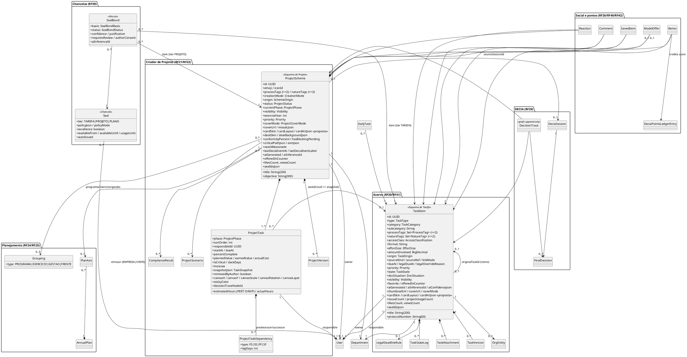

# Anatomias dos esquemas e Estúdio de Arte do Card — Work Station (v2, pesquisa profunda)

> Aprofunda e corrige [`ANATOMIA_CARDS.md`](ANATOMIA_CARDS.md) (v1) e a parte de cards de [`DESIGN_SYSTEM.md`](DESIGN_SYSTEM.md). Não repete o que lá já está certo: onde este documento diverge, a divergência está marcada com **⟲ corrige v1**. Wireframes estáticos em [`../lab/anatomias.html`](../lab/anatomias.html) (captura em [`../lab/capturas/anatomias.png`](../lab/capturas/anatomias.png)).

## 0. Como ler este documento

**Fontes e convenção de citação.** Cada afirmação traz a origem entre parênteses:

| Marca | Significado |
|---|---|
| `arquivo:linha` | arquivo do repositório do FAI (`tcc-2026-fashion-ai-backend`). Caminhos abreviados: `WardrobeItem.java` = `fai-domain/src/main/java/br/com/fashionai/domain/model/WardrobeItem.java` (idem `Scheme`, `SchemeItem`, `DnaScheme`, `DnaSchemeItem`, `SchemeGrouping`, `Seal`, `SealBond`); `Views.java` = `fai-application/src/main/java/br/com/fashionai/application/view/Views.java`; `types.ts` = `lib/api/types.ts`; `v17`, `v18`, `v19`, `DNA_v4` = `docs/anatomias/anatomias_card_v17_1.html`, `anatomias_card_v18.html`, `anatomias_card_v19.html`, `anatomia_cards_DNA_v4_1.html`; `02-rf.md` = `markdowns/02-rf-reestruturados-e-criterios-aceite.md`; `CARDS_ARTE.md` = `docs/checklist/CARDS_ARTE_RF11_2026-09-27.md`. |
| `board › <card>` | dump do board Trello Work Station (`board2.md`): `board › RF20` é o card cujo **título** começa com "RF20:"; `board › Identidade` = card "WORK AI — Identidade visual e estética"; `board › Chancelas` = card "WORK AI — Chancelas"; `board › Mapa` = card "Mapa de equivalência". |
| `TAXONOMIA §x.y` | `docs/arquitetura/TAXONOMIA.md` deste repositório. |
| **proposta** | não vem de nenhuma fonte; decisão de desenho deste documento, a validar (seção 6). |

**Atenção à renumeração (Q-44).** Os títulos dos cards RF4–RF26 do board mudaram, mas os CAs dentro dos cards mantêm os ids antigos. Exemplo: o card cujo título começa com "RF20: Utilizar o construtor de projetos…" é o **Criador de Tarefas** e seus CAs são `RF20.CA01…CA15`; o card "RF5: Utilizar o criador de projetos…" traz os CAs `RF21.CA01…CA14`; o card "RF19: Curtir, comentar…" traz `RF26.CA01…CA09`. Aqui **cada CA é citado com o id como está escrito no corpo do card** (`RF20.CA04`, `RF21.CA10`, `RF26.CA07`…), e o card é citado pelo título (`board › RF20`, `board › RF5`, `board › RF19`).

**Vocabulário.** *Esquema de Tarefa* = `TaskItem` + a sua ligação `ProjectTask` quando está dentro de um projeto (= peça + `SchemeItem` no FAI, `TAXONOMIA §2.1/§3.2`). *Esquema de Projeto* = `ProjectScheme` (= look/`Scheme`), com o seu plano/eixo (= DNA). *Estúdio de Arte do Card* = o que o board chama de "Etapa 5 — Arte do card (= Background Studio)" (`board › RF20`, "Etapa 5") e o RF38 chama de identidade visual.

**Regra de tradução usada em todo o documento.** Para cada elemento de moda do FAI pergunta-se: (1) qual *função* ele cumpre no card (identificar, classificar, medir, posicionar, decorar, reconhecer); (2) que dado do Work Station cumpre a *mesma função*; (3) se nenhum cumpre, o elemento é **descartado** com o motivo (§1.3). Elementos cuja função é a *moda em si* (sexo, estação, manequim, cor da peça) não são traduzidos à força.

---

## 1. Tradução moda → trabalho (campo a campo)

### 1.1 Peça (`WardrobeItem`) → Tarefa (`TaskItem`)

| Campo FAI (`WardrobeItem.java`) | Função no card do FAI | Campo Work Station | Função no card do WS | Fonte WS |
|---|---|---|---|---|
| `name` (:49-50, obrigatório, 180) | título | `title` (200) | título serif, 2 linhas, link | `board › RF20` Etapa 3 ("Nome → Título, obrigatório"); `TAXONOMIA §2.1` |
| `category` (:52-54, 5 partes do corpo) · `subcategory` (:56-57) | classifica a peça; decide o slot do look (`SchemeSlot`) | `category` (`TaskCategory`, 15) · `subcategory` | classifica; decide a **fase compatível** no Criador (mapa categoria→fase) | `board › RF20` Etapa 3; `board › RF5` "mapa categoria→fase, como SLOT_BY_CATEGORY" |
| — (a foto *é* o tipo) | — | `type` (`TaskType`, 13 no board / 15 na taxonomia) | glifo + cor no canto do card | `board › RF20` Etapa 3 ("Tipo (foto) → Tipo… detectado pela fonte, editável"); `board › Identidade §1` |
| `sex` (:59-61, RF4.CA07) | filtra o provador | — | — | descartado (`board › RF20` Etapa 3: "Sexo — não se aplica") |
| `brandName/brandLogoUrl/brandSource/brandRef` (:63-76) | marca com logo tratado | `orgEntityId` → `OrgEntity` (nome, logo tratado, fonte Wikidata/CNPJ/site) | órgão/fornecedor com logo | `board › RF20` Etapa 3 e `RF20.CA10`; `TAXONOMIA §2.6` |
| `color` (:78-79, obrigatório) | cor dominante; alimenta Espectro, Blocos, Cartela | `accessClass` (`AccessClassification`, obrigatório) | classificação de acesso **sempre com o nome em texto** | `board › RF20` Etapa 3 ("Cor → Classificação de acesso… LGPD"); `TAXONOMIA §2.1` |
| `material` (:81-82) | material | `format` (docx, xlsx, pdf, gdoc, url…) | selo da extensão no thumbnail | `board › RF20` Etapa 3; `DESIGN_SYSTEM §2.3` (tokens `--ext-*`) |
| `sizeLabel` (:84-85) | tamanho | `effortSize` P/M/G + `estimatedHours` | porte (esforço) | `board › RF20` Etapa 3 ("Tamanho → Porte") |
| `market` (:87-88) | mercado | `origin` (`TaskOrigin`) | origem INTERNA/ÓRGÃO/FORNECEDOR/CIDADÃO | `board › RF20` Etapa 3 ("Mercado → Origem") |
| `occasionTags` (≤2, :93-94) · `styleTags` (≤2, :90-91) | ocasião/estilo; decidem a Direção recomendada do Studio | `processTags` (≤2) · `natureTags` (≤2) | processo/natureza; chips no bloco de metadados; **decidem o layout/arte sugeridos** (§5.2) | `board › RF20` Etapa 3; `TAXONOMIA §2.1` |
| `price` (:120-121) | preço; total do look; Custo por uso | `amountInvolved` (R$) | valor envolvido; total do projeto | `board › RF20` Etapa 3 ("Preço → Valor envolvido, 0 se não se aplica") |
| `visibility` (:123-125, PRIVATE/FOLLOWERS/PUBLIC) | quem vê | `visibility` PRIVADA/DEPARTAMENTO/EMPRESA/PUBLICA | linha secundária do cabeçalho (só quando útil) | `board › RF20` Etapa 4; `TAXONOMIA §13` |
| `disponivel` + `availabilityStatus` (:127-132) · toggles do topo (RF6.CA11, `02-rf.md:210`) | estado do acervo | `state` (`TaskState`, 8 valores) | **etiqueta de protocolo** com nome em texto | `board › RF41` "Estados"; `RF38.CA05` |
| `condition` (:134-136) | condição da peça | `docSituation` MINUTA/REVISADO/ASSINADO/PUBLICADO | situação do documento | `board › RF20` Etapa 4 ("Situação do documento (= condição)") |
| `favorite` (:138-139) | ⭐ no topo do card (RF31.CA01) | `favorite` | ⭐ no topo | `board › RF41` sub-filtro "Favoritas"; `RF41.CA07` |
| `forSale` (:141-142) | "à venda" | `offeredInCounter` + `ModelOffer` | ficha DP com preço em pontos e licença | `board › RF20` Etapa 4 ("Oferecer no Balcão (= à venda)"); `RF40.CA01` |
| `wearCount` (:144-145) · `lastWornDate` (:147-148) | usos; nível "Clássica do armário" (≥30, `scheme-anatomies.tsx:155-156`) | `reuseCount` · `projectUsageCount` | reutilizações; nível **"Modelo consolidado"** (proposta de limiar, §6) | `TAXONOMIA §2.1`; `RF23.CA04` ("contador de reutilizações… aparece no card") |
| `lookDoDiaCount` (:150-151) | vezes como Look do Dia | — (derivável de `DailyTask`) | — | descartado do card (vive na sub-aba Tarefa do Dia, `board › RF44`) |
| `schemeUsageCount` (:153-154) | em quantos looks | `projectUsageCount` + `projectUsage[]` | "em uso em: projeto" | `ANATOMIA_CARDS §3`; `RF41.CA02` |
| `likesCount … viewCount` (:156-169) | contadores sociais | `likesCount … viewsCount` | rodapé social | `RF26.CA07`; `TAXONOMIA §2.1` |
| `moderationStatus/Confidence/ReasonsJson` (:171-179) | moderação | `antivirusStatus` (`TaskAttachment`) + `aiConfidenceJson` | aviso no card quando pendente | `RF20.CA01` (bloqueio de maliciosos); `RF20.CA12` (job pendente, "aviso no card") |
| `photoProcessingStatus … flatLayMetadataJson` (:181-195) | pipeline Flat Lay | `ocrStatus`, `studioStatus` (`Evidence`) | Estúdio de Documento | `board › RF20` Etapa 1 ("Estúdio de Documento (= Flat Lay/Estúdio)") |
| `backgroundConfigJson` (:197-199) | arte do card da peça (RF11) | **`cardArtJson`** (proposta, §5.7) + `cardSkin` + `coverMode` | arte do card | `TAXONOMIA §2.1` (`cardSkin`, `coverMode`); **proposta** (`cardArtJson`) |
| `hypeScore/hypeScoreGlobal/hypeGroupId` (:201-208) | popularidade da peça | — por tarefa; **Hype do autor** no card (opcional) | "autor com Hype 640" | `board › RF45 §3` ("pode aparecer… nos cards… como 'autor com Hype 640'") |
| `remixedFromPieceId` (:210-211) | crédito do remix | `originalTaskId` | "remixado de…" | `RF26.CA06`; `TAXONOMIA §2.1` |
| `groupingId` (:213-214) | coleção/era | via `GroupingItem` | — no card (chip opcional) | `TAXONOMIA §4.5`; Q-33 |
| `tags` (:216-217) · `notes` (:219-220) | tags/notas | `tags` · `notes` | detalhe | `board › RF20` Etapa 4 |
| `purchaseDate` (:222-223) · `purchaseLocation` (:225-226) | compra | `receivedAt` · `senderOrigin` | detalhe | `board › RF20` Etapa 4 |
| `sku` (:228-229) | código | `protocolNumber` (60) | nº de protocolo em mono no cabeçalho do detalhe e na arte "Protocolo" | `board › RF20` Etapa 4 ("Nº de protocolo/processo (= SKU)") |
| `careInstructions` (:231-232) | cuidados | `retentionPolicyJson` | guarda e temporalidade | `board › RF20` Etapa 4 |
| `model3dStatus/Url` (:234-240) | 3D | — (preview 2D/3D de .glb/.ifc é do tipo DESENHO_TECNICO) | glifo cubo 3D | descartado como campo; `board › Identidade §1` |
| `studioImageUrl/Backdrop/DetailUrl` (:242-251) · `studioFeedUrl` (`Views.java:62`) | foto de produto com variantes | `thumbnailUrl` · `coverUrl` · `coverMode` AUTO/MANUAL/IA | thumbnail automático + capa | `RF38.CA02`; `TAXONOMIA §2.1` |
| `pieceOrigin` (:264-266) | COMPRADA/GARIMPADA/… | `sourceKind` (ARQUIVO · COLAR · GOOGLE · MICROSOFT · EMAIL · LINK · PROTOCOLO · FOTO · TEXTO_IA …) | ícone da origem no detalhe; filtro "origem" | `board › RF20` Etapa 1; `board › RF41` filtros |
| `mannequinImageUrl/Face` (:268-274) | foto com manequim | — | — | descartado |
| — | — | `responsibleId`, `dueAt`, `legalDueAt`, `priority`, `departmentId` | responsável, prazo (⚖), prioridade, borda do departamento | `board › RF20` Etapa 3 última linha; `RF20.CA11`; `RF38.CA09` |
| — | — | `aiGenerated` + `aiInferenceId` | faísca ✦ com tooltip | `RF38.CA04`; `RF20.CA02` |

### 1.2 Look (`Scheme`) + `SchemeItem` + DNA → Projeto (`ProjectScheme`) + `ProjectTask` + Plano

| Campo FAI | Função | Campo WS | Fonte WS |
|---|---|---|---|
| `Scheme.title` (:49-50) · `description` (:52-53) | título/descrição | `title` · `objective` (300, 1 frase) · `descriptionMd` | `board › RF5` ficha; `RF29.CA01` (objetivo vira tema da sessão) |
| `creationMode` MANUAL/AI_ASSISTED (:55-57) | "feito com IA" no rótulo do container (`scheme-card.tsx:177`) | `creationMode` MANUAL/COM_IA | `board › RF5` "Modo de geração"; `RF21.CA06` |
| `origin` (:59-61, CRIAR_LOOK/PROVADOR/REMIX/COPILOT/…/AUTOPILOTO) | "feito pelo Autopiloto" | `origin` CRIAR_PROJETO/DECIA/REMIX/AUTOPILOTO/MODELO/CENARIO/DOSSIE/ATA_VIVA | `RF21.CA04`, `RF21.CA06`, `RF29.CA02`, `RF30.CA04` |
| `style` · `occasion` (:63-67, ≤3 CSV) | chips | `processTags`/`natureTags` (≤2) | `board › RF5` ficha |
| `season` (:69-71) · `mood` (:73-75) | estação (Cartela sazonal, arte sazonal automática) · humor | `exerciseYear` · `priority` | `board › RF5` ficha ("Exercício", "Prioridade") — *tradução de função, não de significado* (§1.3) |
| `visibility` · `status` DRAFT/PUBLISHED/ARCHIVED (:77-83) | ciclo | `visibility` · `status` (`ProjectStatus`, 8) | `TAXONOMIA §3.1`; `RF21.CA12` (EM_DECISÃO) |
| `displayMode` (:85-87) · `layoutAnatomy` (:123-124) · `layoutDensity` (:126-127) | layout do card | `cardArtJson.layout` + `density` (§5.7) | **proposta** |
| `lookDoDia` (:92-93) | badge "Look do dia" no cabeçalho (`scheme-card.tsx:161`) | — (projeto não é Tarefa do Dia) | descartado |
| `coverImageUrl` (:101-102) · `coverOf()` (`scheme-anatomies.tsx:110-111`: capa = foto do look ou foto da 1ª peça) | capa | `coverMode` MOSAICO/FOTO/IA · `coverUrl` · `mosaicJson` | `RF21.CA10`; `RF38.CA03` |
| `backgroundColor/Gradient/ArtUrl/AnimationType` (:104-115) "planos para busca" + `studioConfigJson` (:117-118) | fundo do card | `cardArtJson` + colunas planas `card_skin`, `card_layout` | **proposta** (§5.7), espelhando `Scheme.java:29-34` |
| `cardSkin` (:120-121) · `containerOrigin/Color/Mandatory` (:129-137) | skin e container | `cardArtJson.container.{skin,color}` | **proposta** |
| `totalPrice` (:157-158) | total | Σ `amountInvolved` + `evmJson.PV` | `TAXONOMIA §3.1` |
| `sealIdsJson` (:160-161) · `sealBadges` (`Views.java:194`) | medalhões na zona do selo | `sealIdsJson` + badges dos vínculos APROVADOS | `RF39.CA11`; `RF21.CA09` |
| `renderingStatus/virtualTryOnUrl` (:166-183) | provador | — | descartado |
| `hypeScore(Global)` (:185-189) | Hype do look | `conformityPercent`, `evmJson.{SPI,CPI}`, Hype do autor | `RF32.CA04`; `RF43.CA09`; `board › RF45 §3` |
| `revalidationPending` (:197-199, RF9.CA5) | vínculo com marca passa a "revalidação pendente" após edição | recertificação da chancela | `RF39.CA08` ("recertificação… a chancela caduca se o critério deixa de valer") |
| `favorite` (:204-206) · `publishedAt` (:201-202) | ⭐ · data | `favorite` (via `SavedItem`) · `publishedAt` | `RF26.CA04` |
| `recommendedDirection` (:208-210) | direção recomendada do Studio | **sugestão de arte por processo/natureza** (§5.2) | **proposta** |
| `backgroundVideoUrl` (:212-214) | vídeo em loop do Aura + material | — | descartado (§1.3) |
| `SchemeItem.slot` (:38-40, `SchemeSlot` TOP/BOTTOM/SHOES/ACCESSORY/FULL_BODY/OUTERWEAR) | posição no look | `ProjectTask.phase` (`ProjectPhase`, 7) | `board › Mapa §1` ("Slot do look → Fase do projeto") |
| `sortOrder` · `zIndex` (:46-50) | ordem | `sortOrder` · `canvasLayer` | `TAXONOMIA §3.2` |
| `positionX/Y, scale, rotation, opacity, filtersJson` (:52-68) | transformação no canvas | `canvasX/Y/Scale/Rotation`, `stickyColor` | `RF22.CA03` |
| `snapshotJson` (:70-72, RF7.CA03 peça excluída) | peça removida depois | `snapshotJson` (`TaskSnapshot`) + `removedByAuthor` | `RF23.CA03` |
| — | — | `responsibleId`, `dueAt`, `startAt`, `estimatedHours` (PERT), `percentComplete`, `plannedValue/earnedValue/actualCost`, `isCritical`, `slackDays`, `moscow`, `decisionTraceNodeId` | `RF21.CA04`, `RF21.CA08`, `TAXONOMIA §3.2` |
| `DnaScheme` (2–6 esquemas, `DnaScheme.java:28-31`) · `DnaSchemeItem.cell` (:33-35) | DNA de Estilo | `AnnualPlan` · `PlanAxis` (6 eixos) | `board › Mapa §1` ("DNA de Estilo (6 células) → Plano Anual (6 eixos)") |
| `DnaScheme.cardLayout` (:141-143) · `narrativeType` (:62-64) · `targetElement` (:145-147) | anatomia A1–A4 · narrativas B1–B12 | layouts do **card de plano** (fora do escopo deste doc; §4.4 mapeia) | — |
| `DnaSchemeItem.milestone` (:49-51) · `eraLabel` (:37-38) | marco · época | marco do eixo · exercício | `TAXONOMIA §4.2` |
| `SchemeGrouping` (type/label/cover/period/accentColor, :27-53) | coleção/era/temporada | `Grouping` PROGRAMA/EXERCICIO/GESTAO/FRENTE | `TAXONOMIA §4.4`; `board › RF25` |

### 1.3 O que foi descartado e por quê

| Elemento FAI | Fonte | Por que não entra no Work Station |
|---|---|---|
| `sex` e filtro do provador | `WardrobeItem.java:59-61` | "não se aplica" (`board › RF20` Etapa 3). Nenhum dado de trabalho cumpre a função de "filtrar por corpo". |
| Manequim, Provador 2D, try-on, `renderingStatus`, 3D da peça | `WardrobeItem.java:234-274`, `Scheme.java:166-183` | o Provador vira Simulador de Cenários (`board › Mapa §2`), que é uma tela, não um elemento de card. Preview 3D de `.glb/.ifc` fica como *mídia* do tipo DESENHO_TECNICO, não como campo. |
| `season`/Cartela sazonal/arte sazonal automática | `Scheme.java:69-71`; `scheme-anatomies.tsx:100,400-421`; `background-studio.tsx:65,194` | a "estação" é a época real do look (`v17:~1240`); o análogo temporal do trabalho é o **exercício** (ano), que já é agrupamento (`Grouping EXERCICIO`). Uma arte "por exercício" não comunica nada visualmente; descartada. A faixa de **ciclo** da chancela (`board › Chancelas §1`, "ciclo (ex.: 1º semestre 2026)") cobre o que resta da função. |
| `mood` | `Scheme.java:73-75` | o humor do look vira **prioridade** só por posição na ficha (`board › RF5`); a tradução é de função (um seletor curto na ficha), não de sentido. |
| Hype por peça (`hypeScore` da peça, Hype Focus por peça) | `WardrobeItem.java:201-208`; `scheme-anatomies.tsx:373-398` | o board desloca o Hype para a **pessoa** (RF45) e para a **eficiência diária** (RF44). O card mostra, no máximo, "autor com Hype 640" (`board › RF45 §3`). |
| `wearCount` como "Clássica do armário" por uso | `scheme-anatomies.tsx:155-156`; `v18:~750` | a função (premiar o uso) é cumprida por `reuseCount` (RF23.CA04) e pela chancela; o limiar de 30 não tem base no board (§6, P-07). |
| Aura + material + vídeo em loop + mosaico 3×4 de materiais | `card-art.ts:12,93-106`; `Scheme.java:212-214`; `RF11_MOSAICO_EXEMPLO.jpg` | texturas de tecido/couro/veludo são linguagem de moda. A função "superfície com matéria" é cumprida pelas **texturas de papelaria** (papel, cortiça, blueprint — `board › Identidade §9`) e pela **malha de nós** (o fio de decisão como padrão). O vídeo em loop é descartado também por custo (feed estático, `CARDS_ARTE.md:36-37`). |
| LEGO/Blocos (anatomia, pinos como zona de selo, placa-base com marca) | `scheme-anatomies.tsx:26,48,423-441`; `v18:~1497-1512` ("LEGO é marca registrada") | brinquedo não cabe na "repartição do futuro" (`board › Identidade`, conceito) e a própria v18 registra o problema de marca. A função "o card inteiro feito de outra matéria" é cumprida pelo estilo **Terminal** (§5.3) e pelas texturas. |
| Passarela (trilho por curtidas, holofotes) | `scheme-anatomies.tsx:183-209` | ordenar tarefas por curtidas contradiz a ordem cronológica das fases (`board › Mapa`, "ordem cronológica/sequencial"). A função "destaque do mais reconhecido" vai para a **Vitrine** (hero, `board › RF27`) e para o Painel de métricas. |
| Etiqueta de preço pendurada (hang tag) | `scheme-anatomies.tsx:216-238` | a função (ficha com preço) é cumprida pela **ficha de protocolo** e pela **ficha DP** do Balcão (`board › Chancelas §6`). |
| Espectro (área por cor) | `scheme-anatomies.tsx:288-312` | não há cor por tarefa. A função "proporção das partes" vira a **barra de 7 fases** e, no layout Kanban em miniatura, a contagem de tarefas por fase. |
| Silhueta & Proporção (manequim) | `scheme-anatomies.tsx:342-368` | a forma do corpo não tem análogo. A "forma" de um projeto é a sua **linha do tempo** (caminho crítico, `RF21.CA08`). |
| Raio-X com pinos sobre a foto | `scheme-anatomies.tsx:240-258` | a composição de um projeto não é uma imagem. A função "decompor e numerar" é cumprida pela **prancha técnica** (layout PRANCHA, legenda numerada) e pelo fio de decisão. |
| Zona de selo `STUDS` | `scheme-anatomies.tsx:33,48` | depende dos Blocos. |
| Selo por peça dentro do look (`pieceRows`, `linkedPieceIdsJson`) | `scheme-anatomies.tsx:34-38`; `SealBond.java:49-50` | **mantido** como "lacre por tarefa dentro do projeto" (`RF21.CA09`: "a chancela vem da tarefa"). Entra em §3.5. |
| Reações Trend/Elegante/Criativo | `v19 §11` | substituídas por ÚTIL / BEM FUNDAMENTADO / INOVADOR / CONFORME (`RF26.CA02`). |
| 11 skins de card com nomes editoriais (`atelier`, `spread`, `fai_max`, `luxury_glass_warm`…) | `lib/skins.ts:2-14` | substituídas por 6 skins de papelaria (§5.4). A mecânica (bg/ink/accent/border/radius/titleWeight + tons claro/escuro) é mantida. |
| Direção recomendada por estilo/ocasião (`/api/backgrounds/recommendations`) | `background-studio.tsx:82,173` | mantida como **sugestão de layout/estilo por processo e natureza** (§5.2), sem endpoint de "direção". |

---

## 2. (A) Esquema de Tarefa — todas as entidades

Esquema de Tarefa = `TaskItem` (`TAXONOMIA §2.1`) + `ProjectTask` quando a tarefa está em um projeto (`TAXONOMIA §3.2`) + agregados lidos pelo card (`TaskAttachment`, `TaskVersion`, `SealBond`, contadores, `DecisionTrace`). Colunas: **Obrig.** (obrigatório no `RF20.CA04`), **Origem** (U = usuário, IA = detecção/IA, S = sistema), **No card** (zona da anatomia, §4.2: `TOPO` toggles · `CAB` cabeçalho · `MIDIA` · `META` · `FASES` · `SELO` · `FAISCA` · `RODAPE` · `DET` só no detalhe).

### 2.1 Identificação

| Campo | Tipo | Obrig. | Origem | Validação | No card | RF/CA | Equivalente FAI |
|---|---|---|---|---|---|---|---|
| `id` | UUID | S | S | — | — (link) | — | `VersionedAuditableEntity` |
| `title` | String(200) | **sim** | U/IA | 1–200, trim; IA pré-preenche com confiança | `CAB` (serif, 2 linhas, é o link do card) | `RF20.CA02`, `RF20.CA04` | `name` (`WardrobeItem.java:49-50`); título como link que cobre o container (`scheme-card.tsx:98-103,139`) |
| `type` | `TaskType` | **sim** (detectado) | IA/S (pela fonte), editável | um dos 13 do board: TEXTO_MANUAL · TEXTO_IA · IMAGEM_WEB · IMAGEM_EDITADA · PLANILHA · DOCUMENTO · PASTA · LINK · DESENHO_TECNICO · FORMULARIO · ATA/REGISTRO · E-MAIL · PROTOCOLO (`board › RF20` Etapa 3). ⟲ a `TAXONOMIA §13` acrescenta CRONOGRAMA e ESTUDO_TECNICO_PRELIMINAR (15) — ver P-01 | `CAB`: glifo + cor da família (chip 24 px) | `RF38.CA01`, `RF20.CA06` (colar → TEXTO_MANUAL/PLANILHA/IMAGEM_EDITADA), `RF20.CA09` (PROTOCOLO) | a foto é o tipo; no WS o tipo é um campo (`board › RF20` Etapa 3) |
| `category` | `TaskCategory` (15) | **sim** | IA/U | lista oficial; decide a fase compatível, o prazo legal e o layout sugerido | `CAB` (label mono maiúsculo abaixo do título) | `RF20.CA04`; `board › RF5` (categoria→fase) | `category` (`WardrobeItem.java:52-54`) |
| `subcategory` | String(80) | não | IA/U | depende da categoria (lista por categoria) | `DET` | `board › RF20` Etapa 3 | `subcategory` (:56-57) |
| `summary` | Text (3 linhas) | não | IA | ≤ 3 linhas; marcada com ✦ quando gerada | `DET` (ampliado), tooltip no compacto | `RF20.CA02` | `description` do look (`Scheme.java:52-53`) |
| `descriptionMd` | Text | não | U | markdown seguro | `DET` | `board › RF20` Etapa 1 (e-mail → corpo vira descrição) | `notes` |
| `format` | String(20) | S | S | derivado do MIME real do anexo (`TaskAttachment.mimeType` "detectado, não só extensão", `TAXONOMIA §2.2`) | `MIDIA`: selo da extensão (`--ext-*`) | `board › RF20` Etapa 3 ("Formato… automático") | `material` (:81-82) |

### 2.2 Taxonomia

| Campo | Tipo | Obrig. | Origem | Validação | No card | RF/CA | Equivalente FAI |
|---|---|---|---|---|---|---|---|
| `processTags` | Set<`ProcessTag`> | **≥1** | IA/U | ≤ 2; lista por categoria | `META` chips | `RF20.CA04` | `occasionTags` ≤2 (`WardrobeItem.java:93-94`; javadoc :29) |
| `natureTags` | Set<`NatureTag`> | **≥1** | IA/U | ≤ 2 (Técnica · Jurídica · Financeira · Administrativa · Ambiental · Social) | `META` chips | `RF20.CA04` | `styleTags` ≤2 (:90-91) |
| `accessClass` | `AccessClassification` | **sim** | IA (sugere) / U | PUBLICO · INTERNO · RESTRITO · SIGILOSO; **nome sempre em texto**; RESTRITO/SIGILOSO nunca vai à IA externa | `META` (etiqueta com nome) e borda do anexo no DECIA | `RF20.CA04`; `TAXONOMIA §2.1` | `color` (:78-79) |

### 2.3 Características

| Campo | Tipo | Obrig. | Origem | Validação | No card | RF/CA | Equivalente FAI |
|---|---|---|---|---|---|---|---|
| `effortSize` + `estimatedHours` | `EffortSize` P/M/G + número | não | U/IA | horas ≥ 0; PERT O/M/P só no `ProjectTask` | `META` ("M · 6 h") | `board › RF20` Etapa 3; `board › RF44 §1` (WSJF usa o Porte) | `sizeLabel` (:84-85) |
| `amountInvolved` | BigDecimal | não (0 = n/a) | IA/U | ≥ 0, 2 casas | `META` (só quando > 0) | `board › RF20` Etapa 3 | `price` (:120-121); no card do FAI o preço só aparece "à venda" (`piece-card.tsx:98`) |
| `orgEntityId` | UUID → `OrgEntity` | não | U (busca web) / IA | candidato com fonte (Wikidata/CNPJ/site) e logo tratado | `CAB` linha secundária: logo 18 px + nome (como `BrandLogo` em `piece-card.tsx:58-60`) | `RF20.CA10` | `brandName/LogoUrl/Source/Ref` (:63-76) |
| `origin` | `TaskOrigin` | não | IA/U | INTERNA · ORGAO_EXTERNO · FORNECEDOR · CIDADAO | `DET` | `board › RF20` Etapa 3 | `market` (:87-88) |
| `departmentId` | UUID → `Department` | **sim** (padrão: lotação do dono) | S/U | pertence à empresa do dono | **borda do card** (2 px na cor) + monograma | `RF38.CA09` | `brand` não tem análogo; a borda é novidade do WS |
| `sourceKind` · `sourceRef` · `linkMode` | enums/String | S | S | VINCULADO exige token OAuth válido; revogar → COPIADO (snapshot) | `DET`; ícone da origem no cabeçalho do ampliado | `RF20.CA07`, `RF20.CA08`, `RF20.CA09` | `pieceOrigin` (:264-266) |

### 2.4 Responsabilidade e tempo

| Campo | Tipo | Obrig. | Origem | Validação | No card | RF/CA | Equivalente FAI |
|---|---|---|---|---|---|---|---|
| `responsibleId` | UUID → `User` | **sim** (padrão: eu) | U | membro da empresa | `META`: avatar iniciais 20 px + nome | `board › RF20` Etapa 3 | `owner` do post (`card-header.tsx:18-35`) — no WS o **dono** fica no cabeçalho e o **responsável** no meta (podem diferir, `RF10` atribuição) |
| `dueAt` | LocalDate | **quando a categoria tem prazo legal** | U/IA | ≥ hoje ao criar; no projeto, ≥ prazo da predecessora (`RF21.CA08`) | `META`: relógio + data; âmbar ≤ 3 dias, vermelho vencido | `RF20.CA04`, `RF38.CA05`, `RF41.CA04` | — (novidade) |
| `legalDeadlineRuleId` · `legalDeadlineBaseDate` · `legalDueAt` · `legalOverrideReason` | FK / data / data / String | regra: S; base: U | S calcula ("15 dias úteis a partir do recebimento — base legal X"); sobrescrever exige justificativa | `META`: ⚖ junto do prazo; tooltip com a base legal | `RF20.CA11` | — |
| `priority` | `Priority` BAIXA/MEDIA/ALTA/CRITICA | não (padrão MEDIA) | U/IA | — | `DET`; CRITICA ganha etiqueta no `META` (**proposta**) | `board › RF20` Etapa 3 | `mood` do look (função) |

### 2.5 Estado

| Campo | Tipo | Obrig. | Origem | Validação | No card | RF/CA | Equivalente FAI |
|---|---|---|---|---|---|---|---|
| `state` | `TaskState` | S (padrão RASCUNHO/DISPONIVEL) | U/S | máquina RASCUNHO→DISPONÍVEL→EM_USO⇄BLOQUEADA→CONCLUÍDA→ARQUIVADA; EM_USO automático ao entrar em projeto ativo; MODELO_PÚBLICO só via chancela/publicação; OFERECIDA (Q-36: etiqueta derivada) | `TOPO`/`META`: etiqueta de protocolo (tracejado · sólido · pulso · cadeado · carimbo · esmaecido · estrela · ficha) | `RF41.CA02`, `RF38.CA05` | `disponivel`/`availabilityStatus` (:127-132); toggles do topo (`02-rf.md:210`, RF6.CA11) |
| `blockedByTaskId` · `blockedByUserId` · `blockReason` | FK/FK/String | quando BLOQUEADA | U | ao menos um dos dois + motivo | `META` extra: "bloqueada por …" | `board › RF44 §3` (BLOQUEADA cria dependência) | — |
| `docSituation` | `DocSituation` MINUTA/REVISADO/ASSINADO/PUBLICADO | não | U | — | `DET`; na arte Protocolo vira carimbo discreto (**proposta**) | `board › RF20` Etapa 4 | `condition` (:134-136) |
| `protocolNumber` | String(60) | não (obrigatório no tipo PROTOCOLO) | U/S | formato livre; único por empresa (**proposta**) | `CAB` do ampliado (mono); arte "Protocolo" imprime "PROTOCOLO Nº …" | `RF20.CA09`; `ANATOMIA_CARDS §4` | `sku` (:228-229) |
| `receivedAt` · `senderOrigin` | LocalDate · String | não | U/IA | — | `DET` | `board › RF20` Etapa 4 | `purchaseDate` · `purchaseLocation` (:222-226) |
| `retentionPolicyJson` | JSON | não | U | prazo de retenção + destinação | `DET` | `board › RF20` Etapa 4 | `careInstructions` (:231-232) |
| `favorite` | boolean | S | U | — | `TOPO` ⭐ (só para o dono, como `piece-card.tsx:65-70`) | `RF41.CA07` | `favorite` (:138-139) |
| `offeredInCounter` | boolean (+ `ModelOffer`) | S | U | preço em DP ≥ 0, licença, período | `META`: ficha DP (preço + licença) | `RF40.CA01`, `RF20.CA15` | `forSale` (:141-142) |
| `visibility` | `Visibility` | S (herdada) | U | PRIVADA · DEPARTAMENTO · EMPRESA · PUBLICA | `CAB` linha secundária só se ≠ PUBLICA e viewer é o dono | `board › RF20` Etapa 4; `RF26.CA08` | `visibility` (:123-125); regra "só quando é informação útil" (`piece-card.tsx:30-33,56`) |

### 2.6 Vínculos

| Campo / agregado | Tipo | Obrig. | Origem | Validação | No card | RF/CA | Equivalente FAI |
|---|---|---|---|---|---|---|---|
| `tags` | Set<String> | não | U/IA | normalizadas (como `lib/pieces/tags.ts` no FAI) | `DET` | `board › RF20` Etapa 4 | `tags` (:216-217) |
| `notes` | Text | não | U | — | `DET` | idem | `notes` (:219-220) |
| Dependências (`ProjectTaskDependency`) | FS/SS/FF/SF + lag | não | U | sem ciclos (422); dentro do projeto | `FASES`/`DET`: "depende de N" | `RF21.CA08`; `TAXONOMIA §3.3` | — |
| `TaskAttachment[]` | lista | ≥1 para tipos de arquivo | U/S | MIME real, antivírus, OCR | `MIDIA` (o `isPrimary` gera o thumbnail) | `RF20.CA01`, `RF20.CA12` | `imageUrl/originalImageUrl` (:99-103) |
| `TaskVersion[]` (Google/Microsoft) | lista | só VINCULADO | S | sincronização por OAuth; revogado → snapshot | `DET`: "versão N · sincronizada há…"; thumbnail atualizado | `RF20.CA07`; `RF41.CA03` | — (a foto do FAI tem "versão pendente" com aprovação, `v19 §8`; aqui a versão é a do provedor) |
| `SealBond[]` (chancelas) | vínculos APROVADOS | não | IA (sugere) / U (aceita) / emissor | 1 por par item×emissor; consentimento do autor; `APROVADA_PRIVADA` não aparece | `SELO`: lacre 36 px (22 sm) na zona do layout (§4.3) | `RF20.CA13`, `RF39.CA07`, `RF39.CA08`, `RF39.CA11` | `sealIdsJson` (:96-97) + `SealSlot` (`scheme-card.tsx:38-53`) |
| Interações (`Reaction`, `Comment`, `SavedItem`, `Share`, `Remix`) | contadores | S | outros usuários | respeitam visibilidade | `RODAPE`: curtir · comentar · salvar · compartilhar (+ remixar no detalhe) com contagem no nome acessível | `RF26.CA01-CA09` | `CardActions` (`piece-card.tsx:91`; `v19 §11`) |
| `originalTaskId` · `sourceProjectId` · `checklistItemId` | FK | não | S | — | `DET`: "remixado de / extraída de / sugerida pelo Espelho" | `RF23.CA01`, `RF32.CA03` | `remixedFromPieceId` (:210-211) |
| `projectUsage[]` (derivado) | lista {projectId, phase} | — | S | — | `META` extra em EM_USO: "em uso em: projeto" | `RF41.CA02`; `ANATOMIA_CARDS §3` | `schemeUsageCount` (:153-154) |
| `DecisionTrace` (nós que apontam para a tarefa) | grafo | não | S | append-only | `DET`: painel "Por que isto existe?"; no compacto, nó colorido ao lado do título quando existe (**proposta**) | `RF29.CA04`, `RF29.CA06`, `RF38.CA07` | — |

### 2.7 Indicadores

| Campo | Tipo | Origem | No card | RF/CA | Equivalente FAI |
|---|---|---|---|---|---|
| `aiGenerated` + `aiInferenceId` + `aiConfidenceJson` | boolean / UUID / JSON | S | `FAISCA` ✦ 14 px no cabeçalho; tooltip "gerado por IA em [data] · revisado por [pessoa]" | `RF38.CA04`, `RF20.CA02` | rótulo "feito com IA" no container (`scheme-card.tsx:177`) |
| `reuseCount` · `projectUsageCount` | int | S | `META` (contador "↻ N reutilizações"); nível **Modelo consolidado** a partir de um limiar (P-07) | `RF23.CA04` | `wearCount` + `CLASSIC_USES` (`scheme-anatomies.tsx:155-156`) |
| `likesCount … viewsCount` | long | S | `RODAPE` | `RF26.CA07` | `Counters` (`Views.java:40-41`) |
| HSE da Tarefa do Dia (`DailyTask`, `EfficiencyScoreSnapshot`) | 0–100 previsto × realizado | S (motor determinístico) | **só no contexto Tarefa do Dia** (§4.6): ficha de protocolo com índice de prioridade decomposto e HSE previsto; não aparece no card comum | `RF44.CA01`, `RF44.CA03`, `RF44.CA09` | Hype do Look do Dia (`Scheme.java:92-96`) |
| Hype do autor | 0–1000 (`ProfileHypeScore`) | S | `CAB` opcional: "autor com Hype 640" (respeita `HypeVisibility`) | `board › RF45 §3`, `RF45.CA06` | `HypeBadge` (`scheme-card.tsx:26-31`) — no FAI mostra faixa qualitativa, não número |
| `antivirusStatus` / `ocrStatus` pendentes | enum | S | `MIDIA`: aviso "processando" (como o estado 3D processando, `v19 §10`) | `RF20.CA12` | `photoProcessingStatus` (:181-183) |

### 2.8 Arte

| Campo | Tipo | Origem | No card | RF/CA | Equivalente FAI |
|---|---|---|---|---|---|
| `thumbnailUrl` | String | S (job assíncrono por tipo: 1ª página, mini-gráfico, silhueta do desenho, monograma, favicon+captura) | `MIDIA` 3:2 | `RF38.CA02`, `board › Identidade §2` | `thumbnailUrl` (:105-106) + variantes de estúdio (`Views.java:62`, `piece-card.tsx:23-28`) |
| `coverUrl` · `coverMode` AUTO/MANUAL/IA | String / enum | U / IA | `MIDIA` quando MANUAL/IA (com ✦ se IA) | `RF38.CA02` | `studioImageUrl` (:242-244); `aiArt.url/uploadUrl` (`background-studio.tsx:12`) |
| `cardArtJson` (**proposta**, §5.7) | JSON (`CardArtConfig`) | U (Estúdio) | fundo, layout, container, destaques | `board › RF20` Etapa 5 | `backgroundConfigJson` (:197-199) + v2 `PieceArt` (`lib/piece-art.ts:25-32`) |
| `cardSkin` | String (coluna plana) | U | skin do card (tinta, borda, raio) | `TAXONOMIA §2.1` | `cardSkin` do look (`Scheme.java:120-121`); `CARD_SKINS` (`lib/skins.ts:2-14`) |
| `cardLayout` (**proposta**, coluna plana) | String | U | layout efetivo (§5.1) | — | `layoutAnatomy` (`Scheme.java:123-124`) |

### 2.9 Relacionamentos do Esquema de Tarefa

| Com | Via | Regra que o card precisa saber | Fonte |
|---|---|---|---|
| **Projeto** | `ProjectTask` (fase, ordem, responsável, prazo, dependências, snapshot) | ao entrar em projeto ativo a tarefa vai a EM_USO e o card mostra "em uso em: projeto"; rascunho de projeto não gera EM_USO | `RF21.CA04`, `RF21.CA14`, `RF41.CA02` |
| **Plano** | só indiretamente: projeto → `planAxisId` | o card de tarefa não mostra o eixo; a Tarefa do Dia usa "ligada a eixo do plano (+50)" no HSE | `RF44 §2` (Eficácia) |
| **Chancela** | `SealBond` (item × emissor), tier TAREFA | lacre só com vínculo APROVADA e consentimento; a chancela da tarefa "sobe" para "Chancelas do projeto" | `RF39.CA07`, `RF21.CA09`, `SealBond.java:22-26` (fluxo de estados espelhado) |
| **DecisionTrace** | nó `mensagem → tarefa` | tarefa criada por "Transformar em tarefa" nasce com o nó; decisão validada cria ATA_REGISTRO com carimbo VALIDADO | `RF29.CA04`, `RF29.CA05`, `RF29.CA06` |
| **DECIA Points** | `DeciaPointsLedgerEntry` via `Remix`/`ModelOffer` | remix de modelo oferecido debita/credita; o card do Balcão mostra o preço em DP e "DP recebidos" no perfil | `RF40.CA03`, `RF40.CA06`; `board › Chancelas §6` (ficha "DP" com faísca) |
| **Tarefa do Dia** | `DailyTask` (1 por dia, único usuário+data) | o card vira **ficha de protocolo** no topo do perfil/Acervo/Mesa | `RF44.CA01`; `board › Identidade §12` |

---

## 3. (B) Esquema de Projeto — todas as entidades

Esquema de Projeto = `ProjectScheme` (`TAXONOMIA §3.1`) + `ProjectTask[]` (+ `ProjectTaskDependency`) + ligações com `PlanAxis`, `Grouping`, `DeciaSession`, `SealBond`, `ComplianceResult`, `DecisionTrace`. No FAI o equivalente é `Scheme` + `SchemeItem[]` (`Scheme.java:29-34`; `SchemeItem.java:19-23`).

### 3.1 Ficha (= título · ocasião · estilo do look)

| Campo | Tipo | Obrig. | Origem | Validação | No card | RF/CA | Equivalente FAI |
|---|---|---|---|---|---|---|---|
| `title` | String(200) | **sim** | U/IA | — | `CAB` serif 2 linhas (link) | `RF21.CA04` | `Scheme.title` (:49-50) |
| `emoji` / `iconId` | String | não | U | emoji único ou ícone do catálogo | `CAB` antes do título (22 px) | `board › Identidade §13`; `TAXONOMIA §3.1` | — |
| `objective` | String(300) | não (mas vira tema da sessão) | U/IA | 1 frase | `DET`; hero da Vitrine mostra | `RF29.CA01` | `description` (:52-53) |
| `descriptionMd` | Text | não | U | — | `DET` | — | — |
| `processTags` (≤2) · `natureTags` (≤2) | Set | **≥1 processo** | U/IA | ≤2 cada | `META` chips | `RF21.CA04`; `board › RF5` ficha | `occasion`/`style` ≤3 CSV (`Scheme.java:31,63-67`) ⟲ limite 2, não 3 |
| `departmentId` · `companyId` | FK | **sim** | S/U | — | **borda** + monograma + sigla | `RF38.CA09`; `ANATOMIA_CARDS §5` | — |
| `exerciseYear` | int | não (padrão: ano atual) | U | 4 dígitos | `META` ("2026") | `board › RF5` ficha | `season` (função) |
| `programGroupingId` · `exerciseGroupingId` · `managementGroupingId` | FK → `Grouping` | não | U | 1 por tipo (Q-33) | `DET`; chip "Programa X" no `META` (**proposta**) | `RF25.CA02` | `groupingId` (`Scheme.java:194-195`) |
| `planAxisId` | FK → `PlanAxis` | não | U/IA | 1 eixo por plano | `DET`; no Painel de métricas, "alinhado ao eixo …" | `RF24.CA02`; `RF44 §2` | célula do DNA (`DnaSchemeItem.scheme`, `:29-31`) |
| `priority` | `Priority` | não | U | — | `DET` | `board › RF5` ficha | `mood` |
| `aiOrientation` | Text | não | U | ≤ 1000 (**proposta**) | — (entrada da IA) | `RF21.CA06` | prompt do Studio (`background-studio.tsx:121`) |

### 3.2 Ciclo (= status · visibilidade · origem)

| Campo | Tipo | Obrig. | Origem | Validação | No card | RF/CA | Equivalente FAI |
|---|---|---|---|---|---|---|---|
| `status` | `ProjectStatus` RASCUNHO · PUBLICADO · EM_DECISAO · APROVADO · EM_EXECUCAO · CONCLUIDO · ARQUIVADO · DEVOLVIDO | S | S/U | EM_DECISÃO ao abrir sessão (`RF21.CA12`); APROVADO/DEVOLVIDO pela revisão (`RF29.CA05`, Q-17); CONCLUÍDO/ARQUIVADO bloqueiam edição (`RF22.CA06`) | etiqueta (sólida · pulso roxo em EM_DECISÃO · carimbo VALIDADO/DEVOLVIDO sobre a capa) | `RF38.CA05/CA06` | `SchemeStatus` DRAFT/PUBLISHED/ARCHIVED (`Scheme.java:81-83`) |
| `visibility` | `Visibility` | S (herdada do perfil) | U | — | `CAB` linha secundária | `RF21.CA04`, `RF21.CA11` | `visibility` (:77-79) |
| `origin` | `SchemeOrigin` (8) | S | S | CRIAR_PROJETO (manual), AUTOPILOTO (IA integral), DECIA (da sessão), REMIX, MODELO, CENARIO, DOSSIE, ATA_VIVA | rótulo do container "criado pelo Autopiloto" / "nascido da sessão DECIA" (**proposta**, como `data-label` em `scheme-card.tsx:177`) | `RF21.CA04/CA06`, `RF29.CA02`, `RF30.CA04` | `SchemeOrigin` (`Scheme.java:59-61`) |
| `creationMode` | MANUAL/COM_IA | S | U | — | ✦ quando COM_IA (junto de `aiGenerated`) | `RF21.CA06` | `CreationMode` (:55-57) |
| `originalProjectId` · `sourceSessionId` | FK | não | S | — | `DET`: "remix de … / a partir da sessão …" | `RF26.CA06`, `RF29.CA02` | `originalScheme` (:45-47) |
| `publishedAt` · `favorite` (via `SavedItem`) | Instant / boolean | — | S/U | — | `CAB` (data relativa) · `TOPO` ⭐ | `RF26.CA04` | `publishedAt`/`favorite` (:201-206) |
| `autosaveDraftJson` | JSON | — | S | — | — | `RF21.CA14` | — |

### 3.3 Montagem (= `SchemeItem[]`)

| Campo (`ProjectTask`) | Tipo | Obrig. | Origem | Validação | No card | RF/CA | Equivalente FAI |
|---|---|---|---|---|---|---|---|
| `phase` | `ProjectPhase` (7) | **sim** | U/IA | compatível com a categoria da tarefa; mínimo **1 em DEMANDA + 1 em outra fase** | `FASES`: barra de 7 segmentos; mini-kanban | `RF21.CA04`, `RF21.CA05` | `slot` (`SchemeItem.java:38-40`); mínimo de 1 peça (`RF5.CA06`, `02-rf.md:194`) ⟲ a v1 cita "2 peças"; o board do WS exige 2 fases |
| `sortOrder` | int | S | U (arrastar) | único por fase | ordem na lista e no kanban | `TAXONOMIA §3.2` | `sortOrder` (:46-47) |
| `responsibleId` | FK | S (padrão: dono da tarefa) | U | — | `META`: "n pessoas"; avatares no detalhe | `RF21.CA04` | — |
| `dueAt` · `startAt` | LocalDate | S (padrão: prazo da tarefa) | U | ≥ prazo da predecessora (422) | Linha do tempo; `META`: próximo marco | `RF21.CA08` | — |
| `estimatedHours` (PERT O/M/P) · `actualHours` · `percentComplete` | número | não | U | 0–100 | anel de progresso (média ponderada por fase) | `RF43.CA09`; `RF38.CA03` | — |
| `plannedValue` · `earnedValue` · `actualCost` | BigDecimal | não | S | — | Painel de métricas (SPI/CPI) | `RF43.CA09` | `totalPrice` (:157-158) |
| `isCritical` · `slackDays` | boolean/int | S | S (CPM) | — | Linha do tempo: barras do caminho crítico em destaque | `RF21.CA08` | — |
| `moscow` | MUST/SHOULD/COULD/WONT | não | U | — | `DET` | `board › RF44 §1` | — |
| `snapshotJson` (`TaskSnapshot`: title, type, category, thumbnailUrl, summary, ownerName, capturedAt) · `removedByAuthor` | JSON / boolean | S | S | preenchido ao publicar; obrigatório quando `taskId = NULL` | mosaico usa o thumbnail do snapshot; célula "removida pelo autor" esmaecida | `RF23.CA03`, `RF41.CA05` | `snapshotJson` (`SchemeItem.java:70-72`, RF7.CA03) |
| `canvasX/Y/Scale/Rotation/Layer` · `stickyColor` | números / String | não | U (Mesa) | — | só na Mesa (post-it) | `RF22.CA03` | `positionX/Y, scale, rotation, zIndex` (`SchemeItem.java:49-62`) |
| `decisionTraceNodeId` | FK | não | S | — | nó do fio ao lado da tarefa no detalhe | `RF29.CA04` | — |
| `ProjectTaskDependency` (type FS/SS/FF/SF, lagDays) | entidade | não | U | sem ciclos | linhas na Linha do tempo e na Mesa | `RF21.CA08`; `TAXONOMIA §3.3` | — |

### 3.4 Integrações

| Com | Campo/entidade | No card | RF/CA |
|---|---|---|---|
| Sessão DECIA | `sourceSessionId`; sessão aberta a partir do projeto; `lastDeciaEventAt/Label` | `META`: "decisão validada há 2 dias" (cor da classe); pulso em EM_DECISÃO | `RF29.CA01`, `RF29.CA02`; `board › Identidade §8` |
| Rastro (`DecisionTrace`) | nós mensagem → tarefa → projeto → decisão → revisão | detalhe: fio de decisão vertical; carimbo VALIDADO/DEVOLVIDO com data e revisor sobre a capa | `RF29.CA05/CA06`, `RF38.CA06/CA07` |
| Chancelas | `sealIdsJson` (tier PROJETO) + chancelas herdadas das tarefas (tier TAREFA) | zona do lacre (§4.3); "Chancelas do projeto" na ficha | `RF21.CA09`, `RF39.CA11` |
| Conformidade | `ComplianceResult.percent`, `blockingCount`; `conformityPercent`, `hasBlockingPending` | selo de conformidade (%) e ⛔ pendente no `META` | `RF32.CA02/CA04` |
| Cenários | `ProjectScenario` | — no card (tela própria); "cenário aplicado" vira versão | `RF31` |
| Mesa | `deskSkin`, `deskBackgroundJson` | post-it sobre skin papel/cortiça/blueprint | `RF22.CA03`; `RF38.CA08` |
| Balcão / Kit | `offeredInCounter`; `ProcessKit` | ficha DP; "criar a partir de modelo" | `RF21.CA13`, `RF40.CA01` |

### 3.5 Indicadores

| Indicador | Cálculo / origem | No card | RF/CA | Equivalente FAI |
|---|---|---|---|---|
| Progresso por fase | `percentComplete` ponderado; `currentPhase` | anel 36 px sobre o mosaico; barra de fases com a atual em aro | `RF38.CA03` | — |
| SPI · CPI (+ EAC, ETC, VAC, TCPI) | `evmJson` (EV÷PV, EV÷AC) | Painel de métricas (layout §5.1); no compacto, só quando o viewer é dono/departamento (**proposta**, como Custo por uso "só para o dono", `scheme-anatomies.tsx:93-102`) | `RF43.CA09` | Custo por uso (`scheme-anatomies.tsx:314-340`) |
| Conformidade % | `ComplianceResult` | selo % com cor de status; ⛔ | `RF32.CA04` | — |
| "n tarefas · n pessoas" | contagens de `ProjectTask` | `META` | `board › Identidade §8` | "Look · 4 peças" (`scheme-card.tsx:149`) |
| Próximo marco | menor `dueAt` futuro | `META` com relógio (âmbar/vermelho) | `board › Identidade §8` | — |
| Hype | Hype do autor (0–1000) e, opcionalmente, "remixado por N" | `CAB`/`RODAPE` | `board › RF45 §3`, `RF26.CA06` | `hypeScore` do look (`Scheme.java:185-189`) |
| Contadores sociais | `likesCount … viewsCount` | `RODAPE` | `RF26.CA07` | `Counters` |

### 3.6 Aparência

| Campo | Tipo | Origem | No card | RF/CA | Equivalente FAI |
|---|---|---|---|---|---|
| `coverMode` MOSAICO/FOTO/IA (Q-41 unificação com AUTO/MANUAL/IA) | enum | U | capa: mosaico 2×3 dos thumbnails (padrão), foto (passa pelo Estúdio: endireitar/recortar), ilustração IA com ✦ | `RF21.CA10`, `RF38.CA03` | `coverImageUrl` (:101-102) + `coverOf()` (`scheme-anatomies.tsx:110-111`) |
| `mosaicJson` | JSON (≤ 6 tiles: taskId, thumbnailUrl, type, ext) | S (recalculado quando as tarefas mudam) | mosaico; "pasta em branco" quando vazio | `RF38.CA03` | `GRADE_PECAS` (mosaico 3+N das peças, `scheme-anatomies.tsx:15`) |
| `emoji`/`iconId` | String | U | cabeçalho | `board › Identidade §13` | — |
| `cardArtJson` (**proposta**) | `CardArtConfig` | U | fundo, layout, container, destaques | `board › RF11` (card do WS: "editor de arte de fundo para… tarefas e projetos") | `studioConfigJson` (`Scheme.java:117-118`) |
| `cardSkin` · `cardLayout` (colunas planas, **proposta**) | String | U | skin; layout efetivo | — | `cardSkin`, `layoutAnatomy`, `layoutDensity` (:120-127) |

### 3.7 Diagrama de classes (PlantUML)

Fontes do diagrama: atributos de `TAXONOMIA §2.1, §3.1–3.3, §4, §6, §8`; cardinalidade mínima de `ProjectTask` (1 em DEMANDA + 1 em outra fase) de `RF21.CA05`; `taskId` nulo com snapshot de `RF23.CA03`; ligações com `Seal`/`SealBond` de `board › Chancelas §1` (espelho de `Seal.java:19-23` e `SealBond.java:22-26`); `cardArtJson`/`cardLayout` são **proposta** (§5.7). ⟲ `DIAGRAMA_CLASSES_v1.md` não tinha `cardArtJson` nem a ligação `Remix → DeciaPointsLedgerEntry`.
