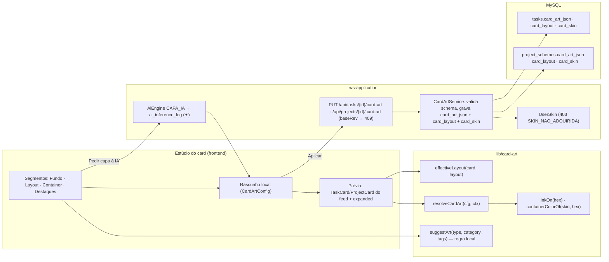
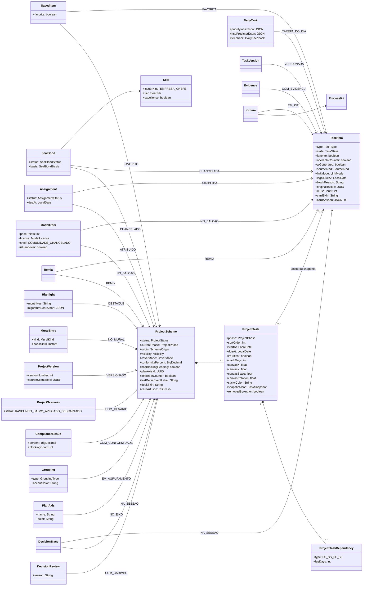
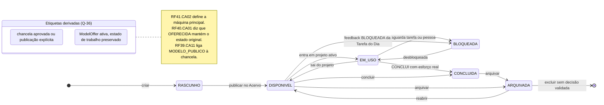
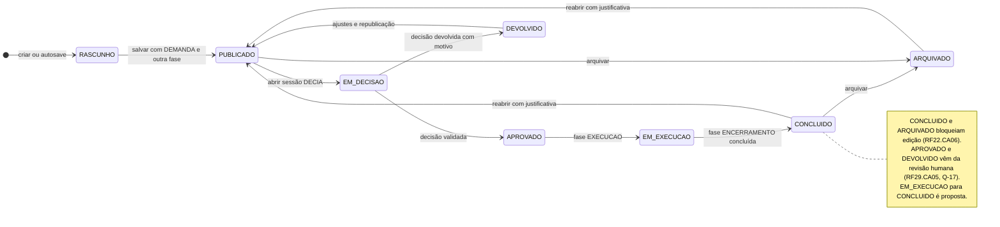

# Anatomia dos esquemas — catálogo de Esquemas de Tarefa e de Projeto, variações, visões e Estúdio (v3)

> Catálogo definitivo do que um **Esquema de Tarefa** e um **Esquema de Projeto** mostram em cada layout, em cada visão e em cada variação (estado, favorito, destaque, chancela, modelo, remix, linha do tempo, Mesa…). Substitui a v2 (pesquisa FAI → WS, campo a campo); o que dela sobreviveu está em §6 (Estúdio) e nas fontes (§9). Camadas, zonas e tokens continuam em [`ANATOMIA_CARDS.md`](ANATOMIA_CARDS.md); componentes e props em [`DESIGN_SYSTEM.md`](DESIGN_SYSTEM.md) §3. Pranchas SVG em [`anatomias/svg/`](anatomias/svg/) (gerador [`anatomias/gerar.mjs`](anatomias/gerar.mjs)), galeria em [`anatomias/index.html`](anatomias/index.html) e wireframes em [`../lab/anatomias.html`](../lab/anatomias.html).

## 0. Como ler

**Citações.** Toda afirmação traz a fonte entre parênteses:

| Marca | Significado |
|---|---|
| `board › RFnn` | card do board Trello Work Station (dump `board4.md`) cujo **título** começa com "RFnn:". Os CAs são citados **com o id escrito no corpo do card** (renumeração Q-44): o card `board › RF4`/`RF20` (Criador de Tarefas) tem CAs `RF20.CAxx`; `board › RF5` (Criador de Projetos) tem `RF21.CAxx`; `board › RF19` (interações) tem `RF26.CAxx`; `board › RF26` (perfil) tem `RF19.CAxx`. `board › Mapa` = card "Mapa de equivalência"; `board › Identidade` = "Identidade visual e estética"; `board › Chancelas` = "Chancelas (= selos)". Cards **vazios** no board (RF4, RF6–RF18, RF21, RF46): só o título é citado e a lacuna é registrada em §8. |
| `TAXONOMIA §x.y` | [`../arquitetura/TAXONOMIA.md`](../arquitetura/TAXONOMIA.md). Este documento **não a edita**: o que falta vira Q-140+ e entra na lista "atributos propostos" (§8.2). |
| `ANATOMIA_CARDS §n` · `DESIGN_SYSTEM §n` · `tokens.mjs` · `cards.mjs` | documentos e gerador do design system deste repositório. |
| `FAI` | referência de anatomia (`tcc-2026-fashion-ai-backend`: `background-studio.tsx`, `card-art.ts`, `SCHEME_ANATOMIES`, `PIECE_ANATOMIES`, `CARD_SKINS`). Só a **mecânica** é herdada; nada de moda é copiado. |
| **proposta** | decisão de desenho deste documento, sem fonte no board; listada em §8 para validação. |

**Glossário.**

| Termo | Definição | Onde vive |
|---|---|---|
| **Esquema de Tarefa** | `TaskItem` + agregados que o card lê (`TaskAttachment`, `TaskVersion`, `SealBond`, contadores, `DecisionTrace`) e, dentro de um projeto, a ligação `ProjectTask` (= peça + `SchemeItem` do FAI). | `TAXONOMIA §2.1, §3.2`; `board › Mapa §1` |
| **Esquema de Projeto** | `ProjectScheme` + `ProjectTask[]` + `ProjectTaskDependency` + ligações com `PlanAxis`, `Grouping`, `DeciaSession`, `SealBond`, `ComplianceResult`, `ProjectScenario`, `ProjectVersion` (= look + `SchemeItem[]`). | `TAXONOMIA §3`; `board › Mapa §1` |
| **Esquema composto** | esquema cujo conteúdo são outros esquemas: Kit de Processo, Agrupamento (Programa · Exercício · Gestão · Frente) e Plano Anual/Trilha (6 eixos). | `TAXONOMIA §3.10, §4`; `board › RF24`, `RF25` |
| **Layout** | a forma do card determinada pelo **contexto** (densidade e largura): tarefa `compact · list · expanded · attachment · mini`; projeto `mosaic · hero · mural · postit`. É a prop `layout` de `TaskCard`/`ProjectCard`. | `DESIGN_SYSTEM §3`; `ANATOMIA_CARDS §3, §5` |
| **Composição** | o que o container mostra dentro do layout `compact`/`expanded` (tarefa: `PAGINA · GRADE · PRANCHA · MENSAGEM · FICHA`; projeto: `MOSAICO · LINHA_TEMPO · KANBAN_MINI · PAINEL_METRICAS · CAPA_FOTO`). Escolhida no Estúdio, gravada em `cardLayout` (**proposta**) e resolvida por `effectiveLayout` (§6.1). Na v2 chamava-se "layout do Estúdio"; o nome muda para não colidir com a prop `layout`. | §6; `FAI SCHEME_ANATOMIES` |
| **Visão** | modo de **edição** do Esquema de Projeto: `Quadro por fase · Linha do tempo · Mesa/canvas livre` (`SchemeView`, §3.5). Visões não são layouts: mostram o projeto inteiro, não o card. | `board › RF22` |
| **Variação** | aparência condicional do card disparada por um atributo/entidade (estado, favorito, chancela, destaque…). Várias variações coexistem no mesmo card; cada uma declara gatilho, dado de origem, mudança visual por layout, ações e contadores (§2, §4). | este documento |
| **Estado** | variação governada por um enum de ciclo de vida: `TaskState` (8) e `ProjectStatus` (8), sempre com o **nome em texto** na etiqueta de protocolo. | `TAXONOMIA §13`; `RF38.CA05`; `board › RF41` |
| **Família de arte** | composição decorativa das quatro faixas (passe-partout) em volta do container: Protocolo · Carimbo · Pasta · Blueprint · Monograma. Nunca cobre a mídia. | `ANATOMIA_CARDS §1, §4` |
| **Skin** | conjunto de variáveis CSS do container (fundo, tinta, acento, borda, raio, peso do título): `timbrado · protocolo · carimbo · blueprint · noturno · contraste`; skins da **Mesa**: papel · cortiça · blueprint · papel timbrado. Skins compradas ficam em `UserSkin`. | §6.4; `TAXONOMIA §12.7`; `RF38.CA08`; `board › RF42` (Loja) |

**Regras transversais que valem em todas as fichas** (não repetidas em cada seção): o nome do estado, da fase, da classificação e da cor aparece em texto (`RF38.CA05`, `board › Identidade §11`); tudo que a IA gerou carrega a faísca ✦ âmbar com tooltip "gerado por IA em [data], revisado por [pessoa]" (`RF38.CA04`); a borda do card é da cor do departamento (`RF38.CA09`); a arte é decorativa (`aria-hidden`, sem foco) e só o título é link (`ANATOMIA_CARDS §1`); contadores sociais em tempo quase real (`RF26.CA07`); interações respeitam a visibilidade (`RF26.CA08`); cards da mesma linha têm a mesma altura (`ANATOMIA_CARDS §2`).

---

## 1. Esquemas de Tarefa — catálogo por `TaskType`

### 1.1 Lista de tipos e divergência de contagem

A `TAXONOMIA §2.1/§13` tem **15** valores de `TaskType`. O board lista **13** no card do Criador de Tarefas (`board › RF20` Etapa 3: TEXTO_MANUAL, TEXTO_IA, IMAGEM_WEB, IMAGEM_EDITADA, PLANILHA, DOCUMENTO, PASTA, LINK, DESENHO_TECNICO, FORMULARIO, ATA/REGISTRO, E-MAIL, PROTOCOLO — igual a `board › Mapa §1`) e **11** na tabela de glifos (`board › Identidade §1`, sem E-MAIL e PROTOCOLO). Os dois a mais da taxonomia nascem de outros RFs: **CRONOGRAMA** é criado pela extração de desenhos (`RF34.CA03`: "nova tarefa PLANILHA … ou CRONOGRAMA") e **ESTUDO_TECNICO_PRELIMINAR** pela Ficha de Viabilidade do Autopilot (`RF43.CA10`). Não há um 16º tipo em nenhum card; o "cubo 3D" de `board › Identidade §1` é um **glifo alternativo** de DESENHO_TECNICO para `.glb/.ifc` (`icons.mjs` `desenho-3d`), não um tipo. Divergência registrada como **Q-140** (§8).

### 1.2 Tabela-resumo (glifo · cor · thumbnail · composição padrão)

| `TaskType` | Glifo (`board › Identidade §1`; `icons.mjs`) | Cor da família (`tokens.mjs` `type`) | Thumbnail automático (`RF38.CA02`; `board › Identidade §2`; * = **proposta** do design system, `svg.mjs thumbArt`) | Composição padrão (§6.1) | Anexos / extensões aceitos (`board › RF20` Etapa 1; `board › Mapa §1`) |
|---|---|---|---|---|---|
| TEXTO_MANUAL | folha com caneta | grafite `--type-texto-manual` | monograma com as iniciais do título sobre a cor da categoria | PAGINA | nenhum obrigatório; texto colado (`RF20.CA06`) ou digitado; `.txt/.md` |
| TEXTO_IA | folha com faísca ✦ | âmbar `--type-texto-ia` | monograma + ✦ no canto | PAGINA | nenhum; pedido + até 5 tarefas de referência (`board › RF20` Etapa 1 "Texto com IA") |
| IMAGEM_WEB | moldura com globo | azul `--type-imagem-web` | a própria imagem (recorte 3:2)* | PAGINA | `.png/.jpg` por URL |
| IMAGEM_EDITADA | moldura com pincel | violeta `--type-imagem-editada` | a imagem tratada pelo Estúdio de Documento* | PAGINA | `.png/.jpg`; captura colada (`RF20.CA06`); foto de vistoria (`RF41.CA06`); captura do visualizador 3D (`RF34.CA05`) |
| PLANILHA | grade | verde `--type-planilha` | mini-gráfico dos dados | GRADE (fallback PAGINA) | `.xlsx/.csv`, Google Sheets, Excel do OneDrive; tabela colada (`RF20.CA06`); resultado de extração (`RF34.CA03`) |
| DOCUMENTO | pasta com aba; cor **por extensão** (docx azul, pdf vermelho, md/txt cinza) | ardósia `--type-documento`, final por `--ext-*` | primeira página estilizada + selo da extensão | PAGINA (FICHA se tiver `protocolNumber`) | `.docx/.pdf/.txt/.md/.pptx`, Google Docs/Slides, Word do OneDrive |
| PASTA (zip) | pasta suspensa com zíper | marrom `--type-pasta` | mosaico das primeiras páginas dos itens* | PAGINA (ênfase no topo 22/10, família Pasta) | `.zip` até 200 MB; "explodir em N tarefas" (`RF20.CA05`) |
| LINK | clipe | ciano `--type-link` | favicon + captura | PAGINA | URL pública/interna; link do Teams; link de Agenda |
| DESENHO_TECNICO | esquadro + compasso (2D) / cubo (3D `.glb`) | laranja `--type-desenho-tecnico` | silhueta do `.dwg/.ifc` sobre papel blueprint | PRANCHA (fallback PAGINA) | `.dwg/.dxf/.rvt/.ifc/.glb` (`.dwg` depende de conversão externa, Q-09) |
| FORMULARIO | prancheta com check | teal `--type-formulario` | lista de campos com caixas marcadas* | PAGINA | Google Forms; `.pdf` de formulário |
| ATA_REGISTRO | carimbo | vermelho institucional `--type-ata-registro` | página pautada com carimbo "ATA"* | FICHA (fallback PAGINA) | texto da Ata Viva (`RF37.CA03`); `.docx/.pdf`; decisão validada (`RF29.CA05`) |
| EMAIL | envelope (`icons.mjs email`) | azul-ardósia `--type-email`* | envelope com remetente* | MENSAGEM (fallback PAGINA) | `.eml/.msg`; encaminhamento para `tarefas+<usuário>@…`; Outlook/Gmail (`RF20.CA08`) |
| PROTOCOLO | comprovante picotado (`icons.mjs protocolo`) | oliva `--type-protocolo`* | comprovante com "Nº …"* | FICHA | nº do e-Protocolo/SEI (`RF20.CA09`); sem arquivo obrigatório |
| CRONOGRAMA | Gantt (`icons.mjs cronograma`) | índigo `--type-cronograma`* | mini-Gantt com a linha "hoje"* | GRADE (fallback PAGINA) | `.xlsx/.mpp` convertido; gerado por `RF34.CA03` |
| ESTUDO_TECNICO_PRELIMINAR | folha com lupa (`icons.mjs estudo-tecnico-preliminar`) | ameixa `--type-estudo-tecnico-preliminar`* | página com lupa e título em destaque* | PAGINA | Ficha de Viabilidade (`RF43.CA08/CA10`); `.docx/.pdf` |

Os quatro tipos marcados com * nas cores não estão em `board › Identidade §1`; as cores foram escolhidas em `tokens.mjs` com contraste verificado (`DESIGN_SYSTEM §2.9`) — **Q-140** pede a ratificação.

### 1.3 Contrato comum a todas as fichas

O que **toda** tarefa contém, independentemente do tipo (`board › RF20` Etapas 3–4; `RF20.CA04`; `TAXONOMIA §2.1`):

| Grupo | Obrigatório | Opcional |
|---|---|---|
| Identificação | `title` (200), `type` (detectado pela fonte, editável), `category` (15 valores, `TaskCategory`) | `subcategory`, `summary` (3 linhas, IA), `descriptionMd`, `format` (automático pelo MIME real, `TAXONOMIA §2.2`) |
| Taxonomia | ≥ 1 `processTags` (≤ 2), ≥ 1 `natureTags` (≤ 2), `accessClass` (PÚBLICO · INTERNO · RESTRITO · SIGILOSO, nome em texto) | `tags` |
| Responsabilidade | `departmentId` (lotação do dono), `responsibleId` (padrão: eu), `dueAt` **quando a categoria tem prazo legal** (`RF20.CA11`) | `priority`, `effortSize` + `estimatedHours`, `amountInvolved` (0 = n/a), `orgEntityId` (busca web, `RF20.CA10`), `origin` |
| Ciclo | `state` inicial RASCUNHO ou DISPONÍVEL; `visibility` herdada do perfil | `docSituation`, `receivedAt`, `senderOrigin`, `protocolNumber`, `retentionPolicyJson`, `offeredInCounter` (`RF20.CA15`), dependências, vínculo a projeto/fase |
| Arte | `thumbnailUrl` (job assíncrono) | `coverUrl` + `coverMode` AUTO/MANUAL/IA, `cardSkin`, `cardArtJson` (**proposta**, §6.7) |

**O card em cada layout** (base comum, `ANATOMIA_CARDS §3`; `board › Identidade §7`): **compact** (240 px, grade) mostra ícone do tipo · categoria · dept · formato · mídia 3:2 · título (2 linhas) · etiqueta de estado · prazo · responsável · contadores · ✦ · lacre. **list** (72 px) mostra miniatura 64 px com o ícone sobreposto · título 1 linha · categoria · dept · formato · esforço · estado · prazo · avatar · curtidas. **expanded** (detalhe) mostra dono/origem/protocolo, transparência da IA, mídia, título h1, categoria/tipo/ext, resumo, grade de metadados (prazo, prazo legal com base, acesso, situação, esforço, origem/vínculo), ação principal única, linha de interações com as 4 reações (`RF26.CA02`), versões, projetos em uso, fio de decisão "Por que isto existe?" (`RF41.CA03`, `RF29.CA06`). **attachment** (66×44 na bolha do DECIA) mostra miniatura · glifo · título · categoria · formato · estado · dept · "abrir" se tiver permissão (`RF29.CA03`). **mini** (32 px) mostra miniatura · glifo · título · ponto de estado + nome · categoria; desabilitada com motivo em itálico (`RF21.CA03`). As fichas abaixo só dizem **o que muda** em cada layout.

### 1.4 Fichas por tipo

Cada ficha: **contém** (campos específicos além do contrato §1.3) · **thumbnail** (como é gerado) · **por layout** (o que muda) · **comportamentos** · **fontes**.

#### TEXTO_MANUAL
- **Contém:** corpo em `descriptionMd`; nasce de texto colado (`RF20.CA06`) ou de "Transformar em tarefa" de uma mensagem do DECIA (`RF29.CA04`: título + descrição = texto da mensagem + nó `DecisionTrace`). Categorias típicas: Ofício/Memorando, Parecer técnico.
- **Thumbnail:** monograma das iniciais do título sobre `--type-texto-manual-soft` (`board › Identidade §2` "texto → monograma").
- **Por layout:** compact — família Monograma sugerida (§6.2); list — sem miniatura rica, o monograma 64 px basta; expanded — o corpo markdown aparece abaixo do resumo; attachment/mini — padrão.
- **Comportamentos:** quando vem de "Transformar em tarefa", o compact mostra o nó colorido do fio ao lado do título (**proposta**) e o expanded abre "Por que isto existe?" já expandido (`RF29.CA06`).
- **Fontes:** `board › RF20` Etapas 1, 3; `RF29.CA04`; `TAXONOMIA §2.1`.

#### TEXTO_IA
- **Contém:** `aiGenerated = true`, `aiInferenceId`, `aiConfidenceJson`; pedido original e as ≤ 5 tarefas de referência (`board › RF20` Etapa 1 "Texto com IA"); `sourceKind = TEXTO_IA`.
- **Thumbnail:** monograma + ✦ (`svg.mjs thumbArt TEXTO_IA`).
- **Por layout:** todos — faísca ✦ **obrigatória** (`RF38.CA04`; o Estúdio só encurta o tooltip, nunca oculta a faísca, §6.5); expanded — linha "gerado por IA em … · revisado por …" sempre visível; attachment — ✦ depois do título.
- **Comportamentos:** se `accessClass` RESTRITO/SIGILOSO, a geração só roda no motor local e o expanded avisa (`RF43.CA02`). Enquanto gera, a faísca anima (`RF38.CA10`).
- **Fontes:** `board › RF20` Etapa 1; `RF20.CA02`; `RF38.CA04`; `RF43.CA02`.

#### IMAGEM_WEB
- **Contém:** `sourceRef` = URL da imagem; `TaskAttachment` com `mimeType` real; crédito/origem em `senderOrigin`.
- **Thumbnail:** a própria imagem recortada 3:2 (**proposta**; o board não cita imagem).
- **Por layout:** compact — mídia é a imagem, sem selo de extensão; list — miniatura 64×43 da imagem; expanded — lightbox ao toque (`ANATOMIA_CARDS §2`).
- **Comportamentos:** `antivirusStatus`/`ocrStatus` pendentes mostram "processando" na mídia (`RF20.CA12`).
- **Fontes:** `board › RF20` Etapas 1, 3; `TAXONOMIA §2.2`.

#### IMAGEM_EDITADA
- **Contém:** imagem tratada pelo **Estúdio de Documento** (endireitar, recortar, contraste, remover fundo, OCR — `board › RF20` Etapa 1 "Foto/scanner"); `Evidence.derivedTaskId` quando veio de Anexos & Evidências (`RF41.CA06`, `TAXONOMIA §2.7`); captura do visualizador 3D (`RF34.CA05`).
- **Thumbnail:** a imagem tratada.
- **Por layout:** compact — mídia = imagem; quando há `Evidence` vinculada, chip "evidência · data · local" no META (variação **com evidência**, §2); expanded — galeria de evidências ligadas.
- **Comportamentos:** OCR alimenta a busca (`RF27.CA03`); geolocalização opcional e cifrada (`TAXONOMIA §2.7`).
- **Fontes:** `RF20.CA06`; `RF41.CA06`; `RF34.CA05`.

#### PLANILHA
- **Contém:** anexo `.xlsx/.csv` ou vínculo Google Sheets/Excel (`linkMode` VINCULADO/COPIADO, `RF20.CA07`); `TaskVersion[]` quando vinculada; `amountInvolved` costuma vir da planilha (IA, `RF20.CA02`); resultado de extração (`ExtractionResult`, `RF34.CA01/CA03`) quando gerada do desenho.
- **Thumbnail:** mini-gráfico dos dados (`board › Identidade §2`).
- **Por layout:** compact — composição **GRADE**: 3 blocos de número (linhas · total R$ · atualizado em) e faixas quadriculadas (§6.1); list — assinatura "sparkline" após o título (§6.1.1); expanded — tabela pré-visualizada; versão e "sincronizada há N" quando VINCULADO.
- **Comportamentos:** categoria Planilha orçamentária → fase ELABORAÇÃO/ANÁLISE no Criador (`board › RF5` mapa categoria→fase). Gerada por `RF34.CA03` nasce com ✦ e vínculo à tarefa de origem.
- **Fontes:** `RF20.CA06/CA07`; `RF34.CA03`; `board › RF5`.

#### DOCUMENTO
- **Contém:** `TaskAttachment.isPrimary` (gera o thumbnail), `format` por MIME real, `docSituation` (MINUTA · REVISADO · ASSINADO · PUBLICADO), `protocolNumber` opcional, `TaskVersion[]` se vinculado ao Google/Microsoft.
- **Thumbnail:** primeira página estilizada + selo da extensão em `--ext-*` (`board › Identidade §1-2`; `DESIGN_SYSTEM §2.3`).
- **Por layout:** compact — família Protocolo padrão; ícone do tipo colorido **pela extensão**; list — selo da extensão no canto da miniatura; expanded — pré-visualização do documento, grade de metadados com situação do documento; attachment — "PDF" no chip.
- **Comportamentos:** "Extrair itens e prazos" (`RF34.CA02`) cria tarefas filhas; Dossiê de Transição nasce como DOCUMENTO PDF com ✦ (`RF36.CA02`); categorias com prazo legal exigem `dueAt` (`RF20.CA11`); tarefa ligada a decisão validada não pode ser excluída, só arquivada (`RF41.CA05`).
- **Fontes:** `board › RF20` Etapas 3–4; `RF34.CA02`; `RF36.CA02`; `RF41.CA05`.

#### PASTA
- **Contém:** `.zip` até 200 MB (`board › RF20` Etapa 1); lista de itens; opção "explodir em N tarefas" (`RF20.CA05`) cria rascunhos filhos com `sourceProjectId`/vínculo à pasta.
- **Thumbnail:** mosaico das primeiras páginas dos itens (**proposta**; análogo da capa-mosaico, `RF38.CA03`).
- **Por layout:** compact — família **Pasta suspensa** (aba no topo, faixas 22/10, `ANATOMIA_CARDS §4`); contador "N itens" no META; list — "N itens" após a categoria; expanded — lista dos itens com ação "virar tarefa".
- **Comportamentos:** dossiês e kits usam a mesma família; ao arquivar, oferece "repassar ao Balcão" (`RF40.CA05`).
- **Fontes:** `RF20.CA05`; `board › Identidade §1`; `RF40.CA05`.

#### LINK
- **Contém:** `sourceRef` = URL; título e favicon capturados (`board › RF20` Etapa 1 "Link"); link do Teams/canal (`board › RF20` Etapa 1 "Microsoft 365").
- **Thumbnail:** favicon + captura da página (`board › Identidade §2`).
- **Por layout:** compact — mídia = captura com barra de navegador (`svg.mjs thumbArt LINK`); domínio em caption; list — favicon 16 px antes do domínio; expanded — "abrir no sistema de origem" como ação secundária.
- **Comportamentos:** link interno exige permissão do provedor; captura não roda para RESTRITO/SIGILOSO (**proposta**, decorrência de `RF43.CA02`).
- **Fontes:** `board › RF20` Etapa 1; `TAXONOMIA §2.1 sourceKind LINK`.

#### DESENHO_TECNICO
- **Contém:** `.dwg/.dxf/.rvt/.ifc/.glb`; `ExtractionResult` (item, unidade, quantidade, área/volume, confiança por linha — `RF34.CA01`); escala/folha/protocolo na legenda; glifo cubo quando o anexo é 3D.
- **Thumbnail:** silhueta do desenho sobre papel blueprint (`board › Identidade §2`).
- **Por layout:** compact — composição **PRANCHA** + família Blueprint (legenda "FL. 01 · ESC. · protocolo", ênfase 10/22, até 4 itens extraídos numerados); list — assinatura "FL. · ESC."; expanded — visualizador 2D/3D com medição (`RF34.CA05`) e tabela de quantitativos com ação "virar PLANILHA/CRONOGRAMA" (`RF34.CA03`); attachment — glifo cubo quando `.glb/.ifc`.
- **Comportamentos:** "Extrair quantitativos" com ✦ e log (`RF34.CA06`); correções do usuário são guardadas por departamento (`RF34.CA04`); categoria Projeto básico/executivo → fase ELABORAÇÃO (`board › RF5`).
- **Fontes:** `RF34.CA01–CA06`; `board › Identidade §1`; `ANATOMIA_CARDS §4`.

#### FORMULARIO
- **Contém:** Google Forms vinculado ou `.pdf`; contagem de respostas quando vinculado (**proposta**).
- **Thumbnail:** campos com caixas marcadas (`svg.mjs thumbArt FORMULARIO`, **proposta**).
- **Por layout:** compact — padrão PAGINA; list — padrão; expanded — pré-visualização do formulário e link de resposta.
- **Comportamentos:** categoria Formulário → qualquer fase ("Outro em qualquer fase", `board › RF5`).
- **Fontes:** `board › RF20` Etapa 1 (Google Workspace: Forms); `board › Identidade §1`.

#### ATA_REGISTRO
- **Contém:** ata estruturada (participantes, pauta, deliberações, encaminhamentos — `RF37.CA02`); `protocolNumber`; carimbo de decisão quando criada por `RF29.CA05` (VALIDADO com data e revisor, ou DEVOLVIDO com motivo); encaminhamentos como tarefas dependentes (`RF37.CA03`).
- **Thumbnail:** página pautada com carimbo "ATA" (**proposta**).
- **Por layout:** compact — composição **FICHA** + família Carimbo (`ANATOMIA_CARDS §4`), carimbo mini VALIDADO/DEVOLVIDO sobre a mídia quando houver decisão; list — carimbo mini 18 px após o título; expanded — fio de decisão completo e lista de encaminhamentos com responsável e prazo; attachment — "usado na decisão · +6 DP" quando `usedInDecision` (`cards.mjs tarefaAnexo`, `RF42`).
- **Comportamentos:** nasce na fase APROVAÇÃO quando vem de decisão validada (`RF29.CA05`); publicada na sessão como mensagem com anexos e prazo de 48 h para ratificar (`RF37.CA04`); ratificação credita DP (`board › RF42` tabela).
- **Fontes:** `RF29.CA05`; `RF37.CA02–CA04`; `RF38.CA06`.

#### EMAIL
- **Contém:** assunto → título, corpo → descrição, remetente → `senderOrigin`/origem, anexos → anexos ou tarefas filhas, thread referenciada (`RF20.CA08`); `sourceKind = EMAIL`, `sourceRef` = messageId.
- **Thumbnail:** envelope com remetente (**proposta**).
- **Por layout:** compact — composição **MENSAGEM**: avatar do remetente · assunto · data · nº de anexos · thread (§6.1); list — remetente antes do título; expanded — corpo do e-mail e anexos como mini cards; attachment — padrão.
- **Comportamentos:** anexos "viram anexos ou tarefas filhas, à escolha" (`RF20.CA08`); importado via Outlook/Gmail com ícone do provedor (variação **importada**, §2).
- **Fontes:** `RF20.CA08`; `board › RF20` Etapa 1 "E-mail → tarefa".

#### PROTOCOLO
- **Contém:** `protocolNumber` **obrigatório**, link para o sistema de origem (e-Protocolo/SEI), metadados lidos pela integração quando disponível (`RF20.CA09`); prazo legal calculado pela categoria (Ofício/Protocolo → DEMANDA, `board › RF5`).
- **Thumbnail:** comprovante com "Nº …" (**proposta**).
- **Por layout:** compact — composição **FICHA**: nº em mono grande, situação do documento, prazo legal ⚖ com base, órgão de origem; list — nº de protocolo após o título; expanded — ação secundária "abrir no sistema de origem"; mini — nº em vez da categoria (**proposta**).
- **Comportamentos:** prazo legal âmbar a 3 dias / vermelho vencido com ⚖ e notificação (`RF41.CA04`); sobrescrever o prazo exige justificativa (`RF20.CA11`).
- **Fontes:** `RF20.CA09/CA11`; `RF41.CA04`; `board › RF20` Etapa 4 "Nº de protocolo (= SKU)".

#### CRONOGRAMA
- **Contém:** barras/marcos; `estimatedHours` PERT por item quando ligado a `ProjectTask` (`TAXONOMIA §3.2`); gerado pela extração (`RF34.CA03`) com vínculo à origem.
- **Thumbnail:** mini-Gantt com a linha "hoje" (`svg.mjs thumbArt CRONOGRAMA`, **proposta**).
- **Por layout:** compact — composição **GRADE** (mini-Gantt como mídia); list — assinatura mini-régua; expanded — Gantt navegável, caminho crítico em destaque quando dentro de projeto (`RF21.CA08`).
- **Comportamentos:** categoria Cronograma → fase PLANEJAMENTO (`board › RF5`); alimenta o CPM do projeto e a Linha do tempo (§3.5).
- **Fontes:** `RF34.CA03`; `RF21.CA08`; `board › RF5`.

#### ESTUDO_TECNICO_PRELIMINAR
- **Contém:** Ficha de Viabilidade: custo P10/P50/P90, PERT/CPM, Monte Carlo, score 0–100 decomposto, top 5 riscos, WBS, RACI, premissas e "o que a IA não sabe" (`RF43 §7`, `RF43.CA08`); `aiGenerated = true`.
- **Thumbnail:** página com lupa (**proposta**).
- **Por layout:** compact — ✦ + chip "viabilidade 72/100" no META (**proposta**); list — score após a categoria; expanded — ficha completa com os intervalos e premissas, botões "criar projeto RASCUNHO" / "abrir sessão DECIA" / "descartar (motivo)" (`RF43.CA10`).
- **Comportamentos:** categoria ETP → fase PLANEJAMENTO; "ETP antes do TR" é item de conformidade (`RF32.CA01`).
- **Fontes:** `RF43.CA08/CA10`; `RF32.CA01`; `board › RF5`.

---

## 2. Variações do Esquema de Tarefa

Cada variação: **gatilho** · **dado de origem** (TAXONOMIA, sem editá-la) · **mudança visual por layout** · **ações** · **contadores**. As zonas (`TOPO · CAB · MIDIA · META · FASES · SELO · FAISCA · RODAPE · DET`) são as de `ANATOMIA_CARDS §1, §3` (DET = só no expanded).

### 2.1 Estado (`TaskState`)

Gatilho: `TaskItem.state`; transições em `TaskStateLog` (`RF41.CA02`). Máquina: RASCUNHO → DISPONÍVEL → EM_USO ⇄ BLOQUEADA → CONCLUÍDA → ARQUIVADA; EM_USO automático ao entrar em projeto ativo e volta a DISPONÍVEL ao sair; MODELO_PÚBLICO só via chancela ou publicação explícita; OFERECIDA ao oferecer no Balcão "mantendo o estado de trabalho original" (`RF40.CA01`) — por isso MODELO_PÚBLICO e OFERECIDA são tratados como **etiquetas derivadas** sobrepostas ao estado de trabalho (Q-36). A lista do pedido do PO ("PRONTA", "EM_DECISAO") não coincide com a TAXONOMIA: **Q-141** (§8).

| Estado | Etiqueta (`RF38.CA05`; `board › Identidade §6`; `tokens.mjs TASK_STATES`) | compact | list | expanded | attachment · mini | Ações disponíveis (`RF41.CA07`) |
|---|---|---|---|---|---|---|
| RASCUNHO | tracejada, neutra | borda tracejada, título esmaecido, contadores zerados, prazo "—" | idem, "rascunho salvo há N" | banner "rascunho" + "Publicar no Acervo" | não anexável; mini desabilitada "rascunho" | editar, excluir, duplicar; **não** entra em projeto ativo (`RF21.CA14`) |
| DISPONÍVEL | sólida primária | padrão | padrão | ação principal "Adicionar ao projeto" | padrão | todas as rápidas: favoritar, duplicar, levar ao projeto, compartilhar na sessão, pedir chancela, oferecer no Balcão, arquivar |
| EM_USO | pulso suave (`--dur-pulse`), cor argumento | linha "no projeto X" | etiqueta com pulso | lista "projetos em que está em uso" (`RF41.CA03`) | mini **desabilitada** com motivo "em uso no projeto …" (`RF21.CA03`) | idem DISPONÍVEL; "Levar ao projeto" permite outro projeto |
| BLOQUEADA | cadeado + cor divergência | linha "aguarda <tarefa/pessoa>" (`blockedByTaskId/UserId/blockReason`) | cadeado na etiqueta | painel "bloqueada por …" com link para a dependência; botão "desbloquear" | mini desabilitada com motivo | desbloquear, notificar quem bloqueia; feedback BLOQUEADA da Tarefa do Dia cria a dependência (`RF44.CA04`) |
| CONCLUÍDA | carimbo verde sobre a mídia | carimbo "Concluída" −10° | carimbo mini | esforço real × estimado (vem do CONCLUÍ, `RF44.CA03`) | padrão | arquivar, repassar ao Balcão, pedir chancela |
| ARQUIVADA | esmaecida (`--opacity-arquivado` .62, `--saturate-arquivado` .35; 1 no contraste) | card inteiro esmaecido | linha esmaecida | banner "arquivada" + "reabrir" | mini desabilitada "arquivada" (`RF21.CA03`) | reabrir, repassar ao Balcão (`RF40.CA05`), excluir se não houver decisão validada (`RF41.CA05`) |
| MODELO_PÚBLICO | estrela + lacre | estrela na etiqueta; lacre na zona SELO | estrela | "modelo oficial · N reutilizações" | padrão | remixar (visitante), "Levar ao meu acervo" (`RF23.CA01`) |
| OFERECIDA | ficha DP | linha "40 DP · licença: atribuição" | ficha DP após o prazo | bloco da oferta (preço, licença, período, visualizações, remixes, DP recebidos — `RF40.CA06`) | padrão | retirar a oferta; comprador: remixar (`RF40.CA03`) |

Prancha: `tarefa-estado-*` (8) em `anatomias/svg/`.

### 2.2 Demais variações

| Variação | Gatilho | Dado de origem (TAXONOMIA) | Mudança visual · compact | · list | · expanded | · attachment / mini | Ações | Contadores | Fontes |
|---|---|---|---|---|---|---|---|---|---|
| **Favorita / salva** | o viewer salvou o item | `SavedItem(userId, targetType TASK, targetId, favorite)` (§8.3); `TaskItem.favorite` (§2.1) — duplicidade, Q-142 | ⭐ no TOPO (só para o dono do salvamento), `aria-pressed` no botão salvar | ⭐ antes do título | botão "salvar" preenchido; "em Tarefas salvas" | mini: ⭐ após o título | salvar/desfazer; sub-filtro **Favoritas** no Acervo (`board › RF41`) e sub-aba 8 do perfil (`board › RF26`) | `savesCount` sobe para o dono do item | `RF26.CA04`; `RF41.CA07`; `board › RF41` sub-filtros |
| **Tarefa do Dia** | existe `DailyTask(userId, hoje)` apontando para ela | `DailyTask` (§9.4): `priorityIndexJson`, `hsePredictedJson`, `feedback` | o card vira **ficha de protocolo** no topo do Acervo/perfil/Mesa: índice decomposto (Eisenhower · WSJF · folga CPM · MoSCoW) + HSE previsto por componente + ✦ | chip "Tarefa do Dia" antes do estado | mesma ficha + botões CONCLUÍ / ADIEI / BLOQUEADA / DELEGUEI | não se aplica | trocar por outra (pede motivo, `RF44.CA02`); feedback | HSE previsto × realizado; streak na Semana planejada | `RF44.CA01–CA05`; `board › Identidade §12`; `board › RF26` sub-aba 9 |
| **Atribuída** | `Assignment` ativo para a tarefa | `Assignment` (§12b.4): `fromUserId`, `toUserId`, `status` PROPOSTA · ACEITA · RECUSADA · DEVOLVIDA, `dueAt`, `message`, `origin` | avatar do **atribuidor** sobreposto ao do responsável ("de AC → para MH") + prazo da atribuição; etiqueta "proposta" tracejada enquanto PROPOSTA | dois avatares encadeados | painel "Atribuição": quem, quando, mensagem, prazo, botões aceitar / recusar (motivo) / devolver (motivo) | attachment na mensageria com botões aceitar/recusar inline (`board › RF46` título) | aceitar, recusar, devolver, retornar (`board › RF18`/`RF19` títulos) | — (`previousResponsibleId` no histórico) | `board › RF10`, `RF18`, `RF19`, `RF46` (títulos; corpos vazios → Q-57); `TAXONOMIA §12b` |
| **Compartilhada na sessão DECIA** | `Share.channel = SESSAO_DECIA` ou `MessageAttachment` | `Share` (§8.4), `MessageAttachment` (§5.5, ≤ 5 por mensagem), `DecisionTrace` | chip "na sessão <tema>" com o nó da última classificação; borda do chip na cor da classe | ícone sessão + nome | lista de sessões em que foi anexada; "usado na decisão · +6 DP" quando `usedInDecision` | é o próprio layout attachment (borda na cor da classificação da mensagem, `RF38.CA07`) | abrir a sessão; "Transformar em tarefa" nasce de mensagem (`RF29.CA04`) | `sharesCount`; DP creditados ao autor (`board › RF42` "+6") | `RF29.CA03`; `RF26.CA05`; `RF42.CA01` |
| **Em decisão / com carimbo** | decisão da sessão referencia a tarefa; ATA_REGISTRO criada por `RF29.CA05` | `FinalDecision`, `DecisionReview` (§5.11–5.12), `DecisionTrace` nó decisão | carimbo **VALIDADO** (verde, data, revisor) ou **DEVOLVIDO** (vermelho, motivo) sobre a mídia; enquanto a sessão está aberta, pulso roxo (classe pergunta) no chip da sessão | carimbo mini 18 px | fio de decisão com o carimbo no fim (`DecisionThread`) | carimbo mini no chip | reabrir só via `ReopenRequest` (RF14) | — | `RF29.CA05/CA06`; `RF38.CA06/CA07`; `board › Identidade §4` |
| **Chancelada** | `SealBond.status = APROVADA` (não `APROVADA_PRIVADA`) | `SealBond` (§6.3) + `Seal.issuerKind` EMPRESA/CHEFE, `excellence`, `tier TAREFA`; cache `sealIdsJson` | **lacre** 36 px na zona SELO: dourado (empresa), azul-marinho (chefe), fita vermelha (Excelência); vários emissores = vários lacres; partido/esmaecido se REVOGADA/EXPIRADA (`board › Chancelas §6`) | lacre 22 px no fim da linha | lacres com tooltip emissor · critério (`SealBondBasis`) · validade; "Chancelas" na ficha | lacre 22 px | pedir chancela (`RF41.CA07`), aceitar/editar/recusar sugestão (`RF39.CA03`), indicar colega (`RF39.CA06`); a chancela "sobe" para o projeto (`RF21.CA09`) | métricas do emissor (`RF39.CA11`) | `RF39.CA07/CA08/CA11`; `RF38.CA06`; `board › Chancelas §6` |
| **Modelo público / oferecida no Balcão** | `TaskItem.offeredInCounter` + `ModelOffer` ativa | `ModelOffer` (§7.1): `pricePoints`, `license`, `shelf` COMUNIDADE/CHANCELADO, `isHandover`, `visibility`, `remixCount`, `pointsEarned` | ficha DP "40 DP · atribuição"; etiqueta "repasse" quando `isHandover` (preço 0, `RF40.CA05`); estrela quando MODELO_PÚBLICO | ficha DP compacta | bloco da oferta + prateleira; botão "Remixar (40 DP)" para visitantes; "Retirar oferta" para o dono | — | oferecer/retirar; remixar debita e credita no mesmo lançamento (`RF40.CA03`); licença SOMENTE_LEITURA só permite "Levar ao projeto" como referência (`RF40.CA04`) | `viewsCount`, `remixCount`, `pointsEarned` (`RF40.CA06`) | `RF40.CA01–CA06`; `RF20.CA15`; `board › Chancelas §5` |
| **Remix** | `TaskItem.originalTaskId` preenchido e `sourceKind` REMIX/EXTRAIDA_DE_PROJETO | `Remix` (§8.5), `originalTaskId`, `sourceProjectId`, `reuseCount`, `remixesCount` | linha "remixado de <autor>" com avatar (crédito **imutável** na licença ATRIBUIÇÃO, `RF40.CA04`); no original, contador "↻ N reutilizações" | "↻ N" junto das curtidas | linhagem: original → esta cópia; no original, "remixado por N pessoas" (`RF26.CA06`) | — | remixar (público), "Levar ao meu acervo" (`RF23.CA01`, cópia com crédito e link ao projeto) | `remixesCount`, `reuseCount` (`RF23.CA04`: aparece no card e no perfil deliberativo); nível "Modelo consolidado" a partir de 10 reutilizações (**proposta**, Q-143) | `RF26.CA06`; `RF23.CA01–CA04`; `RF40.CA04` |
| **Importada / vinculada** | `sourceKind` ∈ GOOGLE · MICROSOFT · EMAIL · LINK · PROTOCOLO · ARQUIVO; `linkMode = VINCULADO` | `sourceKind`, `sourceRef`, `linkMode` (§2.1), `TaskVersion[]` (§2.3) | ícone do provedor (Drive, OneDrive/SharePoint, Outlook/Gmail, Teams, e-Protocolo — ícones **próprios**, não logos de terceiros, Q-144) no CAB, após o formato; "sincronizada há N" quando VINCULADO | ícone do provedor antes do formato | "versão N · sincronizada em …"; "revogar acesso converte em snapshot" (`RF20.CA07`); "abrir na origem" | ícone do provedor no chip | ressincronizar; converter em cópia | `versionNumber` | `RF20.CA07/CA08/CA09`; `board › RF20` Etapa 1; `board › RF41` filtro "origem" |
| **Com prazo legal** | `legalDueAt` preenchido (categoria com `LegalDeadlineRule`) | `legalDeadlineRuleId`, `legalDeadlineBaseDate`, `legalDueAt`, `legalOverrideReason` (§2.1, §2.5) | prazo com **⚖** em vez do relógio; âmbar ≤ 3 dias, vermelho vencido (`--due-soon`, `--due-over`) | coluna de prazo com ⚖ | "Prazo legal 20 OUT (Lei 14.133, art. 18) — 15 dias úteis a partir do recebimento"; justificativa quando sobrescrito | ⚖ no chip | sobrescrever com justificativa (`RF20.CA11`) | notificação ao responsável; sobe na Tarefa do Dia (`RF41.CA04`; `board › RF44 §1` Eisenhower) | `RF20.CA11`; `RF41.CA04`; `RF38.CA05` |
| **Bloqueada** | ver §2.1 | `blockedByTaskId`, `blockedByUserId`, `blockReason` | cadeado + "aguarda …" | cadeado | painel da dependência | mini desabilitada | desbloquear | — | `board › RF41`; `RF44.CA04` |
| **Versão** | `TaskVersion` com `versionNumber > 1` | `TaskVersion` (§2.3): `externalRevisionId`, `syncedAt`, `thumbnailUrl`, `changeSummary` | "v3" em mono junto do formato; thumbnail da versão atual | "v3" | lista de versões com `changeSummary`; thumbnails pendentes não aparecem para visitantes (`cards.mjs tarefaAmpliado`) | — | comparar, restaurar (snapshot) | `versionNumber` | `RF20.CA07`; `RF41.CA03` |
| **Em kit** | `KitItem.taskId` aponta para ela | `KitItem` (§3.11): `kitId`, `phase`, `optional`; `ProcessKit` | chip "kit: <nome>" com o emoji do kit (`board › Identidade §13`); "opcional" em itálico quando `KitItem.optional` | chip após a categoria | lista de kits que a incluem | — | abrir o kit; "Criar a partir de modelo" (`RF21.CA13`) | `ProcessKit.remixCount` | `TAXONOMIA §3.10–3.11`; `board › Mapa §1` (Cápsula → Kit); `board › RF26` sub-aba 10 |
| **Com evidência** | `Evidence.linkedTaskId` | `Evidence` (§2.7): `takenAt`, `latitude/longitude` (AES, opcional), `caption`, `studioStatus` | chip "📎 N evidências · data" (ícone próprio, não emoji) no META; miniatura da 1ª evidência no canto da mídia | "N evidências" | galeria com data, local e `studioStatus`; "virar IMAGEM_EDITADA" | — | anexar evidência; abrir Anexos & Evidências | nº de evidências | `RF41.CA06`; `TAXONOMIA §2.7` |
| **Gerada por IA** | `aiGenerated = true` | `aiGenerated`, `aiInferenceId`, `aiConfidenceJson` (§2.1); `ai_inference_log` | ✦ 14 px no CAB (anima só enquanto gera) | ✦ após o título | linha de transparência "gerado por IA em … · revisado por …"; confiança por campo | ✦ no chip | revisar (registra `reviewedBy`) | — | `RF38.CA04/CA10`; `RF20.CA02`; `RF43 §1` |
| **Duplicada** | ação rápida "duplicar" | **sem atributo próprio** na TAXONOMIA (`originalTaskId` serve ao remix/extração, não à cópia do mesmo dono) — Q-145 | linha "cópia de <título>" (**proposta**) | — | link para a original | — | duplicar (`RF41.CA07`) | — | `RF41.CA07` |
| **Destacada** | item em `Highlight` do mês | `Highlight` (§9.3) aceita `targetType` PROJECT · DECISION · USER — **tarefa não é destacável**; a tarefa aparece nos Destaques só através do projeto ou da decisão (Q-146) | — | — | — | — | — | — | `RF35.CA03`; `TAXONOMIA §9.3` |
| **Arquivada** | ver §2.1 | `state = ARQUIVADA` | esmaecida | esmaecida | reabrir | mini desabilitada | reabrir, repassar | — | `board › RF41`; `RF40.CA05` |

### 2.3 Matriz variação × layout × elemento visual

**Slots fixos do cabeçalho (compact/expanded), da direita para a esquerda:** 1 faísca ✦ · 2 favorito ⭐ · 3 ícone do provedor; cada slot tem 22 px e só é ocupado quando a variação existe (os seguintes deslizam para a direita). O **lacre** fica na superfície externa (zona SELO do layout) e, quando presente, empurra os três slots 22 px para a esquerda. **Cadeado** e **⚖** não ocupam slot: vivem na etiqueta de estado e no prazo. Nenhum marcador cobre outro; a faísca nunca é coberta (`RF38.CA04`). Ordem registrada em D-50.

Legenda: ⭐ marcador · 🔒 cadeado · ⚖ balança · ✦ faísca · ◉ lacre · ▣ carimbo · DP ficha DP · ◦ pulso · ⌁ chip/linha de texto · — não aparece. (Os símbolos são abreviações da tabela; na UI são os glifos próprios de `icons.mjs`, nunca emoji.)

| Variação | compact | list | expanded | attachment | mini |
|---|---|---|---|---|---|
| Estado RASCUNHO | borda tracejada + etiqueta | etiqueta | banner | — (não anexável) | desabilitada |
| Estado EM_USO | ◦ etiqueta + ⌁ projeto | ◦ etiqueta | lista de projetos | etiqueta | desabilitada + motivo |
| Estado BLOQUEADA | 🔒 etiqueta + ⌁ motivo | 🔒 | painel | 🔒 | desabilitada + motivo |
| Estado CONCLUÍDA | ▣ verde na mídia | ▣ mini | esforço real | etiqueta | etiqueta |
| Estado ARQUIVADA | esmaecido | esmaecido | banner | — | desabilitada |
| MODELO_PÚBLICO | ⭐ etiqueta + ◉ | ⭐ | ⌁ reutilizações | etiqueta | etiqueta |
| OFERECIDA | DP | DP | bloco da oferta | — | — |
| Favorita | ⭐ TOPO | ⭐ | botão preenchido | — | ⭐ |
| Tarefa do Dia | ficha de protocolo | ⌁ chip | ficha + feedback | — | — |
| Atribuída | 2 avatares + prazo | 2 avatares | painel aceitar/recusar | botões inline | — |
| Compartilhada na sessão | ⌁ chip + nó | ícone sessão | lista de sessões | borda da classe | — |
| Em decisão / carimbo | ▣ VALIDADO/DEVOLVIDO (+ ◦ roxo se aberta) | ▣ mini | fio + ▣ | ▣ mini | — |
| Chancelada | ◉ 36 px (fita se Excelência) | ◉ 22 px | ◉ + tooltip | ◉ 22 px | — |
| Modelo / Balcão | DP + ⭐ (+ "repasse") | DP | bloco + prateleira | — | — |
| Remix | ⌁ "remixado de" + avatar | ↻ N | linhagem | — | — |
| Importada | ícone provedor + ⌁ sync | ícone | versões + origem | ícone | — |
| Prazo legal | ⚖ âmbar/vermelho | ⚖ | base legal | ⚖ | — |
| Versão | ⌁ "v3" | v3 | lista | — | — |
| Em kit | ⌁ chip kit | chip | lista de kits | — | — |
| Com evidência | ⌁ chip + mini-foto | ⌁ | galeria | — | — |
| Gerada por IA | ✦ | ✦ | transparência | ✦ | — |
| Duplicada | ⌁ "cópia de" | — | link | — | — |

### 2.4 Matriz variação × atributo de origem

| Variação | Entidade · atributo | Contexto TAXONOMIA | Existe? |
|---|---|---|---|
| Estado | `TaskItem.state`, `TaskStateLog` | §2.1, §2.4 | sim |
| Favorita | `SavedItem.favorite` (viewer) · `TaskItem.favorite` (dono) | §8.3 · §2.1 | sim (duplicado, Q-142) |
| Tarefa do Dia | `DailyTask.taskId`, `priorityIndexJson`, `hsePredictedJson`, `feedback` | §9.4 | sim |
| Atribuída | `Assignment.*` | §12b.4 (proposta) | sim, proposta |
| Compartilhada na sessão | `Share.channel`, `MessageAttachment`, `DecisionTrace` | §8.4, §5.5, §5.15 | sim |
| Em decisão / carimbo | `FinalDecision`, `DecisionReview`, `DecisionTrace` | §5.11, §5.12, §5.15 | sim |
| Chancelada | `SealBond.status`, `Seal.issuerKind/excellence/tier`, `sealIdsJson` | §6.1, §6.3 | sim |
| Modelo / Balcão | `offeredInCounter`, `ModelOffer.*`, `state MODELO_PUBLICO/OFERECIDA` | §2.1, §7.1 | sim |
| Remix | `originalTaskId`, `sourceProjectId`, `Remix`, `reuseCount`, `remixesCount` | §2.1, §8.5 | sim |
| Importada | `sourceKind`, `sourceRef`, `linkMode`, `TaskVersion` | §2.1, §2.3 | sim |
| Prazo legal | `legalDueAt`, `legalDeadlineRuleId`, `LegalDeadlineRule` | §2.1, §2.5 | sim |
| Bloqueada | `blockedByTaskId/UserId`, `blockReason` | §2.1 | sim |
| Versão | `TaskVersion.versionNumber` | §2.3 | sim |
| Em kit | `KitItem.taskId/phase/optional` | §3.11 | sim |
| Com evidência | `Evidence.linkedTaskId` | §2.7 | sim |
| Gerada por IA | `aiGenerated`, `aiInferenceId`, `aiConfidenceJson` | §2.1 | sim |
| Duplicada | — | — | **não** (Q-145) |
| Destacada | `Highlight.targetType` não inclui TASK | §9.3 | **não** (Q-146) |
| Arte do card | `cardSkin` · `cardArtJson`, `cardLayout` | §2.1 · — | parcial (Q-58) |

---

## 3. Esquemas de Projeto — catálogo

### 3.1 Ficha (o que o projeto contém)

| Grupo | Obrigatório | Opcional | Fonte |
|---|---|---|---|
| Identificação | `title` (200); ≥ 1 `processTags` (≤ 2) | `emoji`/`iconId` (`board › Identidade §13`), `objective` (300, 1 frase; vira tema da sessão), `descriptionMd`, `natureTags` (≤ 2), `aiOrientation` | `RF21.CA04`; `board › RF5` ficha; `RF29.CA01` |
| Institucional | `companyId`, `departmentId` (borda + monograma), `exerciseYear` (padrão: ano atual), `visibility` (herdada do perfil) | `priority`, `programGroupingId`/`exerciseGroupingId`/`managementGroupingId` (`RF25.CA02`), `planAxisId` (1 eixo por plano, `RF24.CA02`) | `board › RF5` ficha; `RF21.CA11`; `TAXONOMIA §3.1` |
| Origem e ciclo | `creationMode` MANUAL/COM_IA; `origin` (CRIAR_PROJETO · DECIA · REMIX · AUTOPILOTO · MODELO · CENARIO · DOSSIE · ATA_VIVA); `status` (8); `currentPhase` | `originalProjectId`, `sourceSessionId`, `autosaveDraftJson` (`RF21.CA14`) | `TAXONOMIA §3.1`; `RF21.CA06`; `RF29.CA02`; `RF30.CA04` |
| Montagem | ≥ 1 `ProjectTask` em DEMANDA **+** ≥ 1 em outra fase (`RF21.CA05`) | dependências FS/SS/FF/SF + lag (sem ciclos, 422), responsável e prazo por `ProjectTask` (padrão: dono e prazo da tarefa) | `RF21.CA04/CA05/CA08`; `TAXONOMIA §3.2–3.3` |
| Indicadores (derivados) | — | `conformityPercent`, `hasBlockingPending`, `criticalPathJson`, `evmJson`, `nextMilestoneAt`, `lastDeciaEventAt/Label`, contadores | `RF32.CA04`; `RF43.CA09`; `TAXONOMIA §3.1` |
| Aparência | `coverMode` MOSAICO (padrão) · FOTO · IA; `mosaicJson` recalculado | `coverUrl`, `deskSkin`, `deskBackgroundJson`, `cardSkin`/`cardArtJson` (**proposta**) | `RF21.CA10`; `RF38.CA03`; `RF22.CA03` |

### 3.2 Fases (`ProjectPhase`, 7)

Nomes exatos do board (`board › Mapa §1`; `board › RF5` "Slots por fase"): **DEMANDA · PLANEJAMENTO · ELABORAÇÃO · ANÁLISE · APROVAÇÃO · EXECUÇÃO · ENCERRAMENTO** (índices 0..6 na `PhaseBar`). Mapa categoria→fase (`board › RF5`, "como SLOT_BY_CATEGORY"; configurável ou fixo — Q-07): Ofício/Protocolo → DEMANDA; ETP/TR/Cronograma → PLANEJAMENTO; Projeto básico/Planilha/Parecer → ELABORAÇÃO/ANÁLISE; Ata/Portaria → APROVAÇÃO; Contrato/Vistoria → EXECUÇÃO; Relatório final → ENCERRAMENTO; "Outro" em qualquer fase. A barra de 7 fases mostra concluídas em `--primary`, a atual em `--primary-strong` com aro e **nome em texto**, futuras vazadas (`DESIGN_SYSTEM §3 PhaseBar`; `board › Identidade §8`).

### 3.3 Montagem (`ProjectTask`)

Cada tarefa selecionada vira um `ProjectTask` com `phase`, `sortOrder` (único por fase), `responsibleId`, `startAt`/`dueAt` (≥ prazo da predecessora), `estimatedHours` PERT O/M/P, `percentComplete`, EVM (`plannedValue/earnedValue/actualCost`), `isCritical`/`slackDays` (CPM), `moscow`, posição na Mesa (`canvasX/Y/Scale/Rotation/Layer`, `stickyColor`), `decisionTraceNodeId` e `snapshotJson` (`TaskSnapshot`: title, type, category, thumbnailUrl, summary, ownerName, capturedAt) preenchido ao publicar e obrigatório quando `taskId` é nulo — a tarefa "removida pelo autor" continua ocupando a fase e as dependências (`RF23.CA03`, `RF41.CA05`, Q-31). A mídia do mosaico usa o thumbnail do snapshot; a célula removida fica esmaecida com o texto "removida pelo autor" (`cards.mjs projetoMosaico`). Fontes: `TAXONOMIA §3.2–3.3`; `RF21.CA04/CA08`; `RF22.CA03`.

### 3.4 Capas e layouts de card

**Capas** (`RF21.CA10`; `RF38.CA03`; `board › Identidade §3`): **mosaico** 2×3 dos thumbnails das tarefas principais (`mosaicJson`, ≤ 6 tiles; recalculado quando as tarefas mudam; "pasta em branco" quando vazio) + anel de progresso por fase + borda do departamento; **foto** (passa pelo Estúdio: endireitar/recortar); **IA** (ilustração flat do tema a partir do objetivo, ✦ e selo "capa gerada por IA"); **monograma** (iniciais do título sobre a cor do departamento quando não há tarefa nem foto — **proposta**, estende a família Monograma de `ANATOMIA_CARDS §4`). `coverMode` da tarefa (AUTO/MANUAL/IA) e do projeto (MOSAICO/FOTO/IA) ainda são dois enums (Q-41).

**Layouts** (`DESIGN_SYSTEM §3 ProjectCard`; `ANATOMIA_CARDS §5`):

| Layout | Onde | Elementos (a…h de `board › Identidade §8`) | O que muda |
|---|---|---|---|
| **mosaic** (260 px) | grade de projetos, pré-visualização do Criador (`RF21`), Balcão, Buscar, perfil | capa + anel · título · dept (monograma + sigla) · etiqueta de status · barra de 7 fases · próximo marco · "n tarefas · n pessoas" · último evento DECIA · contadores · lacres · ✦ | composição do Estúdio (MOSAICO · LINHA_TEMPO · KANBAN_MINI · PAINEL_METRICAS · CAPA_FOTO, §6.1) troca a área da capa |
| **hero** (16:9, largura total) | Vitrine, Destaques do mês (`RF27`, `RF35`) | kicker ("VITRINE · DESTAQUE DO MÊS"), título h2, objetivo, dept · n tarefas · n pessoas, barra de fases larga, 1 botão ("Ver projeto"/"Remixar"), contadores, lacre 40 px | aura `--primary-soft` do lado da capa; some no alto contraste |
| **mural** (linha 92 px) | Mural da empresa, Seguindo (`MuralEntry`, `RF27`) | avatar do ator + verbo + objeto + tempo + dept; nó do fio + nome do evento; carimbo mini; mini-mosaico 96×64; barra mini; reações inline (`RF27.CA02`) | `MuralEntry.kind` decide o verbo e o nó (COMPARTILHAMENTO · DECISAO_VALIDADA · PROJETO_PUBLICADO · RECONHECIMENTO · META · DESTAQUE · IMPULSO) |
| **postit** (176×160) | Mesa de Trabalho (`RF22`) e Mesa do DECIA | código em mono, título serif itálico (≤ 3 linhas), fase + barra 4 px, monograma, pino (fixado/solto), canto dobrado, rotação `canvasRotation`, cor `stickyColor` | tinta fixa escura: o post-it é objeto, não superfície; não muda com o tema |

### 3.5 Visões de edição (`SchemeView`, `board › RF22`)

Três visões do **mesmo** `ProjectScheme`; mudar de visão não perde dados (`RF22.CA03`); só dono, responsáveis e chefe editam (`RF22.CA01`); toda alteração estrutural gera `ProjectVersion` com diff legível (`RF22.CA02`); colaboração com propagação ≤ 3 s e último-vence com aviso (`RF22.CA04`); painel lateral com comentários por tarefa e fio de decisão (`RF22.CA05`); CONCLUÍDO/ARQUIVADO bloqueados (`RF22.CA06`); exportação PDF/ZIP (`RF22.CA07`).

| Visão (`SchemeView`) | O que mostra | Como o Esquema de Tarefa aparece | Interações | Dados persistidos |
|---|---|---|---|---|
| **BOARD — Quadro por fase** (kanban) | 7 colunas DEMANDA…ENCERRAMENTO com contagem; coluna da fase atual com aro; WIP visível | card **mini** ou **compact** estreito (toggle de densidade) com estado, prazo, responsável, lacre 22 px; snapshot esmaecido "removida pelo autor" | arrastar entre fases ("encaixe" animado, `RF38.CA10`); reordenar (`sortOrder`); menu ⋯ com as ações rápidas; "Cadastrar nova tarefa" por coluna (`RF21.CA07`) | `ProjectTask.phase`, `sortOrder` |
| **TIMELINE — Linha do tempo** (Gantt) | régua de datas com "hoje"; uma barra por `ProjectTask` (`startAt` → `dueAt`), colorida pela fase; **caminho crítico** em `--primary-strong` e borda grossa (`isCritical`); **dependências** como conectores FS/SS/FF/SF com lag em rótulo; **marcos** (losango) no `dueAt` de tarefas-marco e no `nextMilestoneAt`; folga (`slackDays`) hachurada; prazo legal ⚖ na barra | barra = título truncado + glifo do tipo + avatar; clique abre o expanded em painel lateral | arrastar extremidades (muda `startAt/dueAt`, 422 se anterior à predecessora, `RF21.CA08`); criar dependência arrastando entre barras (sem ciclos); zoom dia/semana/mês | `startAt`, `dueAt`, `ProjectTaskDependency`, `isCritical`/`slackDays` recalculados (CPM, `RF43.CA09`) |
| **DESK — Mesa / canvas livre** | textura da mesa (skin papel · cortiça · blueprint · papel timbrado, `RF38.CA08`), post-its com x, y, escala, rotação e camada, conectores de dependência tracejados, textos livres e agrupamentos por fase opcionais | **postit** (§3.4); versão **mini** quando `canvasScale` < 0,6 (**proposta**) | mover/redimensionar/girar; trocar `stickyColor`; fixar (pino); conectar; trocar skin (salva em `UserPreferences.deskSkin` ou `ProjectScheme.deskSkin`); skins compradas via `UserSkin` (403 `SKIN_NAO_ADQUIRIDA`, Q-42) | `canvasX/Y/Scale/Rotation/Layer`, `stickyColor`, `deskSkin`, `deskBackgroundJson` |

Textos livres e agrupamentos visuais na Mesa não têm entidade na TAXONOMIA (`deskBackgroundJson` só guarda o fundo) — **Q-147**.

### 3.6 Páginas derivadas

| Página | Como o esquema aparece | Fonte |
|---|---|---|
| **Espelho de Conformidade** (`/projects/[id]/mirror`) | lista de itens do checklist com ✅ atendido (e a tarefa que atende, em layout **list**), ⚠️ recomendado ausente, ⛔ obrigatório ausente/fora de ordem; cada ausente tem "Criar tarefa faltante" (nasce na fase esperada com tipo/categoria e `checklistItemId`); o card do projeto ganha o **selo de conformidade %** e ⛔ quando `hasBlockingPending`; chefe pode aprovar com justificativa (`overrideReason`) | `RF32.CA01–CA06`; `TAXONOMIA §3.7–3.9` |
| **Simulador de Cenários** (`/projects/[id]/simulate`) | o projeto em **Linha do tempo** recalculada lado a lado (até 3 cenários): barras deslocadas, novo prazo final, risco por fase, conformidade, prós/contras; tarefas removidas esmaecidas, adicionadas tracejadas; salvar = variante (`ProjectScenario.status SALVO`), aplicar = `ProjectVersion.sourceScenarioId`; compartilhar na sessão (`sharedInSessionId`) | `RF31.CA01–CA05`; `TAXONOMIA §3.6` |
| **Sessão DECIA aberta a partir do projeto** | projeto como contexto da IA; tarefas anexadas (layout **attachment**); status EM_DECISÃO com pulso; decisão validada volta como ATA_REGISTRO com carimbo | `RF29.CA01/CA05`; `RF21.CA12` |
| **Autopilot** (`/autopilot`) | proposta aberta na **Mesa** em modo rascunho; nada persiste até confirmar; ✦ e log | `RF30.CA03/CA04` |
| **Exportação** | PDF com fases, tarefas, responsáveis, prazos e decisões; ZIP com anexos | `RF22.CA07` |

### 3.7 Esquemas compostos

| Esquema composto | Anatomia do card | Conteúdo | Fontes |
|---|---|---|---|
| **Kit de Processo** (`ProcessKit` + `KitItem[]`) | card **mosaic** com emoji do kit, nome, `processTag`, "N tarefas-base · M projetos gerados" (fator de reutilização), lista mini das tarefas por fase com "opcional" em itálico; lacre quando chancelado; ficha DP quando oferecido | tarefas reutilizáveis para um processo recorrente (= Cápsula); "Criar a partir de modelo" pré-preenche os selects (`RF21.CA13`) | `TAXONOMIA §3.10–3.11`; `board › Mapa §1`; `board › Identidade §13`; `RF40.CA01` (kits no Balcão) |
| **Agrupamento** (`Grouping` PROGRAMA · EXERCÍCIO · GESTÃO · FRENTE) | card com capa (`coverUrl`), chip do tipo, período (`periodFrom`–`periodTo`), `accentColor` como filete, grade de projetos em **mosaic** compacto, progresso agregado, linha do tempo de decisões (`RF25.CA03`); GESTÃO encerrada mostra o Dossiê de Transição (`RF25.CA05`) | projetos e tarefas (`GroupingItem`); 1 programa + 1 exercício + 1 gestão por item (`RF25.CA02`) | `RF25.CA01–CA05`; `TAXONOMIA §4.4–4.5` |
| **Plano Anual / Trilha** (`AnnualPlan` + 6 `PlanAxis`) | card com capa, exercício, `identityPhrase`, **6 células** (eixos) com nome, cor, ícone, nº de projetos, % concluídos, prazo mais próximo e risco agregado (`RF24.CA03`); escopo EMPRESA (oficial) · DEPARTAMENTO · PESSOAL; "derivado do plano oficial" quando `derivedFromPlanId` (`RF24.CA04`); lacre tier PLANO; interações (`RF24.CA06`) | eixos → projetos (`PlanAxisProject`, 1 eixo por plano) | `RF24.CA01–CA07`; `TAXONOMIA §4.1–4.3`; `board › Mapa §1` (DNA → Plano) |

---

## 4. Variações do Esquema de Projeto

### 4.1 Status (`ProjectStatus`)

Gatilho: `ProjectScheme.status`. Transições (fontes): RASCUNHO → PUBLICADO ao salvar/publicar (`RF21.CA04/CA11`); PUBLICADO → EM_DECISÃO ao abrir sessão (`RF21.CA12`, `RF29.CA01`); EM_DECISÃO → APROVADO ou DEVOLVIDO pela revisão (`RF29.CA05`, Q-17); APROVADO → EM_EXECUÇÃO (fase EXECUÇÃO); EM_EXECUÇÃO → CONCLUÍDO; CONCLUÍDO/qualquer → ARQUIVADO; DEVOLVIDO → PUBLICADO após ajustes (**proposta**); CONCLUÍDO/ARQUIVADO bloqueiam edição e reabrir exige justificativa (`RF22.CA06`). O pedido do PO cita "EM_ANDAMENTO"; a TAXONOMIA usa EM_EXECUÇÃO (**Q-141**).

| Status | Etiqueta (`tokens.mjs PROJECT_STATUS`) | mosaic | hero | mural | postit | Ações |
|---|---|---|---|---|---|---|
| RASCUNHO | tracejada, neutra | borda tracejada, capa "pasta em branco", "Sem título (rascunho salvo automaticamente)", fase 0, sem contadores | não entra na Vitrine | não publica | post-it com borda tracejada (**proposta**) | continuar editando (autosave, `RF21.CA14`); não gera EM_USO nas tarefas |
| PUBLICADO | sólida primária | padrão | padrão | "publicou o projeto" | padrão | abrir sessão DECIA, simular, Espelho, oferecer, chancelar |
| EM_DECISÃO | pulso roxo (classe pergunta) | linha "sessão DECIA ativa · divergência aberta há 3 h" com nó pulsante na cor da última classificação | pulso no kicker | "abriu sessão sobre o projeto" | pino roxo | ir à sessão; edição estrutural pede confirmação (**proposta**) |
| APROVADO | carimbo verde | **carimbo VALIDADO** com data e revisor sobre a capa | carimbo no canto da capa | "validou a decisão" + carimbo mini | carimbo mini | passar a EXECUÇÃO |
| EM_EXECUÇÃO | sólida, cor argumento | barra de fases na EXECUÇÃO; EVM no PAINEL_METRICAS (`RF43.CA09`) | padrão | "avançou a fase" | padrão | alertas "SPI < 0,9 há 2 semanas" → Simulador |
| CONCLUÍDO | carimbo verde | carimbo; barra 7/7; lacre na zona PHASE_BAR quando chancelado ("modelo oficial") | "Concluído · modelo oficial" | "concluiu o projeto" | esmaecido leve | bloqueado; reabrir com justificativa (`RF22.CA06`); remixar |
| ARQUIVADO | esmaecida | card esmaecido (`--opacity-arquivado`) | — | — | — | reabrir com justificativa |
| DEVOLVIDO | carimbo vermelho | **carimbo DEVOLVIDO** + linha "motivo: …" (`DecisionReview.reason`) | — | "devolveu a decisão" + carimbo | pino vermelho | ajustar e republicar; `ReopenRequest` |

Pranchas: `projeto-estado-*` (5) + `projeto-chancelado`.

### 4.2 Demais variações

| Variação | Gatilho | Dado de origem (TAXONOMIA) | mosaic | hero | mural | postit | Ações | Contadores | Fontes |
|---|---|---|---|---|---|---|---|---|---|
| **Favorito / salvo** | viewer salvou | `SavedItem(targetType PROJECT, favorite)` (§8.3) | ⭐ no TOPO (só para quem salvou) | ⭐ no kicker | — | ⭐ no canto do post-it | salvar; sub-aba 7 **Projetos salvos** (`board › RF26`); filtro "favoritos" em Meus Projetos | `savesCount` | `RF26.CA04`; `board › RF6` (título) |
| **Destaque** | `Highlight(targetType PROJECT, monthKey)` publicado; ou `MuralEntry.kind DESTAQUE/IMPULSO` | `Highlight.algorithmScoreJson` (critérios visíveis), `curatedBy`, `position` (§9.3); `MuralEntry.boostUntil` (§8.7) | faixa "Destaque do mês · <dept>" no topo da capa com os critérios no tooltip (reações BEM FUNDAMENTADO/CONFORME, reutilizações, rastro completo, conformidade — `RF35.CA03`) | **é o layout da Vitrine**: kicker "VITRINE · DESTAQUE DO MÊS", lacre de Excelência quando houver | "entrou nos Destaques"; impulso de 24 h com rótulo "impulsionado" (`board › RF42` Loja) | — | remixar em destaque (`board › RF27` Vitrine); curadoria do chefe | — | `RF35.CA03`; `board › RF27` sub-aba 2; `RF42` "Impulso no Mural" |
| **Chancelado** | `SealBond APROVADA` tier PROJETO; herdadas das tarefas (tier TAREFA) | `SealBond`, `Seal.excellence`, `sealIdsJson` (§6.1, §6.3) | lacre 36 px no canto da capa (dourado/azul-marinho; fita = Excelência); lacres 22 px herdados nas linhas de tarefas (`RF21.CA09`); CONCLUÍDO + chancelado → lacre também no fim da barra (zona PHASE_BAR, **proposta**) | lacre 40 px com fita | lacre mini após o título | lacre 16 px no canto | pedir, aceitar/editar/recusar; recertificação (`RF39.CA08`) | métricas do emissor | `RF39.CA07/CA11`; `RF21.CA09`; `board › Chancelas §6` |
| **Modelo no Balcão / remixável** | `offeredInCounter` + `ModelOffer(targetType PROJECT)`; ou MODELO_PÚBLICO via chancela | `ModelOffer.shelf` CHANCELADO/COMUNIDADE, `pricePoints`, `license` (§7.1) | ficha DP "60 DP · cópia livre"; prateleira em chip | botão "Remixar (60 DP)" | — | — | "Criar a partir de modelo" pré-preenche os selects com cópias/remixes das tarefas e crédito (`RF21.CA13`); chefe pode destacar e converter em chancelado (`RF40.CA07`) | `viewsCount`, `remixCount`, `pointsEarned` | `RF40.CA01–CA07`; `RF21.CA13` |
| **Remix** | `origin = REMIX`/`MODELO`, `originalProjectId` | `originalProjectId`, `Remix` (§8.5), `remixesCount` | linha "remix de <projeto> · <autor>" com avatar; no original, "remixado por N pessoas" | idem | "remixou o projeto de …" | — | abrir o original | `remixesCount` | `RF26.CA06`; `RF30.CA02` (Autopilot remixa modelos com crédito a cada um) |
| **Em sessão DECIA / decisão validada** | `sourceSessionId` ou sessão aberta a partir do projeto; `lastDeciaEventAt/Label` | `DeciaSession`, `DecisionTrace`, `FinalDecision`, `DecisionReview` (§5) | linha "decisão validada há 2 dias" (ícone da sessão, cor da classe); carimbo VALIDADO/DEVOLVIDO sobre a capa; rótulo do container "nascido da sessão DECIA" quando `origin = DECIA` (**proposta**) | — | nó do fio + carimbo mini (é o item típico do Mural) | pino na cor da classe | abrir sessão; "Criar projeto a partir desta sessão" (`RF29.CA02`) | % de projetos com rastro completo (`RF29.CA09`) | `RF29.CA01/CA02/CA05/CA06`; `board › Identidade §8` |
| **Atribuído** | `Assignment(targetType PROJECT)` | `Assignment.*` (§12b.4); preenche o responsável de todas as `ProjectTask`? (Q-57) | avatar do atribuidor + "para <pessoa>" + prazo; etiqueta "proposta" até ACEITA | — | "atribuiu o projeto a …" | — | aceitar / recusar / devolver com motivo | — | `board › RF10` (título); `TAXONOMIA §12b` |
| **Compartilhado / no Mural** | `Share.channel = MURAL` ou `MuralEntry.kind PROJETO_PUBLICADO/COMPARTILHAMENTO` | `Share`, `MuralEntry` (§8.4, §8.7) | — | — | **é o layout mural**: ator + verbo + mini-mosaico + reações inline | — | compartilhar no Mural, na sessão ou por link externo com imagem exportada (capa + resumo) e expiração (`RF26.CA05`) | `sharesCount` | `RF26.CA05`; `RF27.CA01/CA02` |
| **Com cenário simulado** | `ProjectScenario` com status SALVO/APLICADO | `ProjectScenario.variablesJson`, `impactReportJson`, `status`, `appliedVersionId` (§3.6) | chip "cenário 'corte 20 %' aplicado · v7" (**proposta**); ✦ (cálculo da IA, `RF31.CA05`) | — | "aplicou um cenário" | — | abrir Simulador; comparar até 3 (`RF31.CA03`); compartilhar na sessão (`RF31.CA04`) | nº de cenários salvos | `RF31.CA01–CA05`; `TAXONOMIA §3.6` |
| **Com conformidade** | `ComplianceResult` avaliado | `conformityPercent`, `hasBlockingPending`, `ComplianceResult.percent/blockingCount/overrideReason` (§3.1, §3.9) | **selo de conformidade %** (semáforo: ≥ 90 verde · 60–89 âmbar · < 60 vermelho — limiares **proposta**, Q-148) + ⛔ quando pendente obrigatório | selo no kicker | — | — | abrir o Espelho; "Criar tarefa faltante" (`RF32.CA03`); chefe aprova com justificativa (`RF32.CA04`) | `blockingCount` | `RF32.CA02–CA04` |
| **Derivado do plano / alinhado a eixo** | `planAxisId` (projeto) · `AnnualPlan.derivedFromPlanId` (plano) | `PlanAxisProject`, `PlanAxis.name/color` (§4.2–4.3); `derivedFromPlanId` (§4.1) | chip "eixo: Mobilidade" na cor do eixo (**proposta**); no card do **plano**, "derivado do plano oficial 2026" | — | — | — | mover de eixo (1 por plano, `RF24.CA02`) | `PlanAxis.projectsCount` | `RF24.CA02/CA04/CA07`; `board › RF44 §2` (Eficácia +50) |
| **Em agrupamento** | `GroupingItem` ou `programGroupingId/exerciseGroupingId/managementGroupingId` | `Grouping.type/label/accentColor` (§4.4–4.5) | chip "Programa Cidade Acessível 2026" com filete na `accentColor`; exercício já aparece como ano | — | — | — | abrir o agrupamento (`RF25.CA03`) | progresso agregado | `RF25.CA02–CA04` |
| **Gerado pelo Autopilot** | `origin = AUTOPILOTO`, `aiGenerated` | `origin`, `aiGenerated`, `aiInferenceId` (§3.1) | ✦ no canto da capa + rótulo do container "criado pelo Autopilot" (**proposta**); modelos de referência no tooltip (`RF30.CA04`) | ✦ | "criou com o Autopilot" | ✦ no post-it | revisar na Mesa antes de persistir (`RF30.CA03`) | — | `RF30.CA02–CA04`; `RF21.CA06` |
| **Publicado × privado × departamento** | `visibility` | `Visibility` PRIVADA · DEPARTAMENTO · EMPRESA · PUBLICA (§13) | linha secundária do CAB com o nome da visibilidade **só quando ≠ PÚBLICA e o viewer é o dono** (regra "só quando é informação útil", FAI `piece-card.tsx`) | — | só itens EMPRESA/PÚBLICA entram no Mural; PRIVADA não recebe interações de terceiros (`RF26.CA08`) | — | mudar visibilidade (herdada do perfil por padrão, `RF21.CA11`) | — | `RF21.CA11`; `RF26.CA08`; `RF27.CA04` |
| **Versão** | `ProjectVersion` | `ProjectVersion.versionNumber/authorId/diffJson/reason/restoredFromVersionId` (§3.4) | "v7" em mono junto do status; "restaurada da v5" quando `restoredFromVersionId` | — | "restaurou a versão 5" | — | comparar, restaurar (`RF22.CA02`) | `versionNumber` | `RF22.CA02`; `RF31.CA03` (aplicar cenário gera versão) |
| **Arquivado** | ver §4.1 | `status = ARQUIVADO` | esmaecido | — | — | — | reabrir com justificativa | — | `RF22.CA06` |

### 4.3 Matriz variação × layout × elemento visual

**Sobreposições na capa:** a faixa de destaque (18 px, topo da capa) é pintada **antes** da faísca ✦, que desce 20 px quando a faixa existe — a faísca nunca é coberta (`RF38.CA04`); favorito ⭐ no canto superior esquerdo (abaixo da faixa quando houver), selo de conformidade no canto inferior esquerdo, anel de progresso no inferior direito, carimbo centrado na base, lacre na superfície externa. **Visibilidade:** a linha "visibilidade: X" só aparece para o dono e quando ≠ PÚBLICA; PRIVADA = só o dono; DEPARTAMENTO = equipe do departamento (entra no quadro da equipe, `ABAS_POR_PERFIL`); EMPRESA = toda a empresa (`RF21.CA11`, `RF26.CA08`).

| Variação | mosaic | hero | mural | postit |
|---|---|---|---|---|
| RASCUNHO | tracejado + pasta em branco | — | — | tracejado |
| EM_DECISÃO | ◦ roxo + ⌁ sessão | ◦ kicker | ⌁ verbo | pino roxo |
| APROVADO / DEVOLVIDO | ▣ VALIDADO / DEVOLVIDO (+ ⌁ motivo) | ▣ canto | ▣ mini | ▣ mini |
| CONCLUÍDO | ▣ + barra 7/7 (+ ◉ PHASE_BAR) | "modelo oficial" | ⌁ | esmaecido |
| ARQUIVADO | esmaecido | — | — | — |
| Favorito | ⭐ TOPO | ⭐ | — | ⭐ |
| Destaque | faixa "Destaque do mês" | kicker + ◉ fita | ⌁ "impulsionado" | — |
| Chancelado | ◉ 36 + ◉ 22 por tarefa | ◉ 40 | ◉ mini | ◉ 16 |
| Modelo / Balcão | DP + chip prateleira | botão Remixar | — | — |
| Remix | ⌁ "remix de" + avatar | ⌁ | ⌁ | — |
| Sessão DECIA / decisão | ⌁ evento + ▣ | — | nó + ▣ | pino da classe |
| Atribuído | 2 avatares + prazo | — | ⌁ | — |
| No Mural | — | — | layout inteiro | — |
| Cenário | ⌁ chip + ✦ | — | ⌁ | — |
| Conformidade | selo % + ⛔ | selo | — | — |
| Eixo do plano | ⌁ chip na cor do eixo | — | — | — |
| Agrupamento | ⌁ chip + filete | — | — | — |
| Autopilot | ✦ + rótulo | ✦ | ⌁ | ✦ |
| Visibilidade | ⌁ linha secundária (dono) | — | filtro | — |
| Versão | ⌁ "v7" | — | ⌁ | — |

### 4.4 Matriz variação × atributo de origem

| Variação | Entidade · atributo | TAXONOMIA | Existe? |
|---|---|---|---|
| Status | `ProjectScheme.status`, `currentPhase` | §3.1 | sim |
| Favorito | `SavedItem.favorite` | §8.3 | sim |
| Destaque | `Highlight`, `MuralEntry.kind DESTAQUE/IMPULSO`, `boostUntil` | §9.3, §8.7 | sim |
| Chancelado | `SealBond`, `Seal`, `sealIdsJson` | §6.1, §6.3 | sim |
| Modelo / Balcão | `offeredInCounter`, `ModelOffer` | §3.1, §7.1 | sim |
| Remix | `originalProjectId`, `origin`, `Remix`, `remixesCount` | §3.1, §8.5 | sim |
| Sessão DECIA / decisão | `sourceSessionId`, `lastDeciaEventAt/Label`, `DecisionTrace`, `FinalDecision`, `DecisionReview` | §3.1, §5 | sim |
| Atribuído | `Assignment` | §12b.4 (proposta) | sim, proposta |
| No Mural | `Share`, `MuralEntry` | §8.4, §8.7 | sim |
| Cenário | `ProjectScenario`, `ProjectVersion.sourceScenarioId` | §3.6, §3.4 | sim |
| Conformidade | `conformityPercent`, `hasBlockingPending`, `ComplianceResult` | §3.1, §3.9 | sim |
| Eixo / plano | `planAxisId`, `PlanAxisProject`, `AnnualPlan.derivedFromPlanId` | §3.1, §4 | sim |
| Agrupamento | `programGroupingId…`, `GroupingItem`, `Grouping.accentColor` | §3.1, §4.4–4.5 | sim |
| Autopilot | `origin AUTOPILOTO`, `aiGenerated` | §3.1 | sim |
| Visibilidade | `visibility` | §3.1 | sim |
| Versão | `ProjectVersion` | §3.4 | sim |
| Visões (posição) | `ProjectTask.canvas*`, `stickyColor`, `deskSkin`, `deskBackgroundJson` | §3.2, §3.1 | sim (textos livres da Mesa: não, Q-147) |
| Arte do card | `cardSkin`, `cardArtJson`, `cardLayout` | — | **não** (Q-58) |

---

## 5. Visões e contextos de exibição

| Contexto (aba/rota) | Esquemas exibidos | Layout | Densidade / largura | Variações mais frequentes | Fonte |
|---|---|---|---|---|---|
| **Acervo de Tarefas** (`/tasks`) | tarefa | compact (grade); list por toggle | 240 px; 20 por página | estado, favorita (sub-filtro Favoritas), prazo legal, chancelada, oferecida, importada (filtro origem); Tarefa do Dia como ficha no topo | `RF41.CA01/CA07/CA09`; `board › RF41` sub-filtros |
| **Detalhe da tarefa** (`/tasks/[id]`) | tarefa | expanded | modal ou página | todas | `RF41.CA03` |
| **Criador de Projetos** (`/projects/new`) | tarefa (Acervo filtrável à esquerda; selects por fase) · projeto (pré-visualização à direita) | compact (esquerda) · mini (SelectList) · mosaic (prévia) | compact 240; mini 44 px por opção | EM_USO/BLOQUEADA/ARQUIVADA desabilitadas com motivo; chancela herdada; caminho crítico na prévia | `RF21.CA01/CA03/CA08/CA09`; `board › RF5` layout |
| **Mesa de Trabalho** (`/projects/[id]/edit`, `/desk`) | projeto nas 3 visões; tarefas como post-it/mini | postit (DESK) · mini/compact (BOARD) · barras (TIMELINE) | canvas livre; colunas; Gantt | posição persistida, dependências, caminho crítico, snapshot "removida pelo autor", skin da Mesa; Tarefa do Dia no topo | `RF22.CA03`; `board › RF22`; `board › RF44` (widget) |
| **Mural da empresa** (`/mural`) | projeto · tarefa · reconhecimento | mural (linha) | 92 px; coluna única no celular | decisão validada (carimbo), publicado, destaque, impulso, reconhecimento | `RF27.CA01/CA02`; `TAXONOMIA §8.7` |
| **Vitrine de projetos** | projeto chancelado / modelo público | hero | 16:9 largura total | destaque, chancelado (Excelência com fita), remixável | `board › RF27` sub-aba 2; `RF35.CA03` |
| **Seguindo** | projeto · tarefa das pessoas/departamentos seguidos | mural | 92 px | compartilhado, publicado | `board › RF27` sub-aba 3; `RF27.CA06` |
| **Buscar** (`/search`) | projetos · tarefas (+ pessoas, empresas, chefes) | compact · mosaic | 240 / 260 px; 5 abas com contadores | chancelado (filtro), prazo (filtro), fase, exercício | `RF27.CA03/CA04`; `board › RF27` Buscar |
| **Meu perfil** (`/profile`, 15 sub-abas) | 1 Acervo (compact) · 2 Meus Projetos (mosaic; filtros favoritos/publicados/rascunhos/arquivados) · 3 Programas & Agrupamentos (card de agrupamento) · 4 Decisões (fio + carimbo) · 6 Planos (card de plano) · 7 Projetos salvos (mosaic ⭐) · 8 Tarefas salvas (compact ⭐) · 9 Tarefa do Dia (ficha + histórico 30 dias) · 10 Kits (card de kit) · 11 Modelos oferecidos (compact/mosaic + DP) · 12 Reconhecimentos e Chancelas (medalhas, lacres) | conforme a sub-aba | compact 240 / mosaic 260 | favorito, oferecido, chancelado, Tarefa do Dia | `board › RF26` sub-abas; `RF19.CA01–CA03` |
| **Perfil de outro usuário** (`/u/[username]`) | sub-abas 1–5 com visibilidade compatível | compact · mosaic | idem | "Levar ao meu acervo" | `RF19.CA02`; `RF41.CA08`; `RF23.CA01` |
| **Balcão de Modelos** (`/models`) | tarefa · projeto · kit oferecidos | compact · mosaic + ficha DP | 240 / 260 px; duas prateleiras | oferecida (preço, licença, "repasse"), chancelada, remix count | `RF40.CA02/CA05`; `board › Chancelas §5` |
| **Loja Work AI** (`/store`) | modelos do Balcão, skins da Mesa, molduras de card, capas IA em lote, impulsos, kits chancelados | compact com preço em DP; tiles de skin | 240 px | oferecida; skin adquirida/não adquirida (`UserSkin`) | `board › RF42` "Onde se gasta"; `RF42.CA04`; `TAXONOMIA §7.4, §12.7` |
| **Destaques** (`/highlights`) | projetos, decisões e pessoas do mês | hero (1º) + mosaic | largura total + grade | destaque (critérios visíveis), chancela de Excelência | `RF35.CA03`; `board › Mapa §2` |
| **Sessão DECIA** (`/decia/[sessionId]`) | tarefa · projeto · plano como anexo de mensagem | attachment | 66×44 na bolha; ≤ 5 por mensagem | compartilhada (borda da classe), usada na decisão (+DP), carimbo | `RF29.CA03`; `TAXONOMIA §5.5` |
| **Mesa do DECIA** | tarefas/opções da sessão | postit | canvas | classe da mensagem na cor do pino | [`../produto/DECIA_SESSAO_E_MESA.md`](../produto/DECIA_SESSAO_E_MESA.md) §C |
| **Insights** (`/insights`) | tarefas paradas, duplicadas, fantasma, lacunas; modelos recomendados; projetos sugeridos (Ficha de Viabilidade) | list (tarefas) · compact (modelos) · ETP expanded (ficha) | listas densas | ✦ em tudo; ação em 1 clique (arquivar, repassar, criar faltante) | `RF43.CA03/CA08` |
| **Tarefa do Dia** (sub-aba 9 + widget) | 1 tarefa por dia | ficha de protocolo | topo do Acervo, Mesa e perfil | índice decomposto, HSE previsto × realizado, feedback | `RF44.CA01/CA07`; `board › Identidade §12` |
| **Mensageria** (chat WS) | tarefa · projeto atribuídos | attachment com botões aceitar/recusar | bolha | atribuída (PROPOSTA → ACEITA/RECUSADA/DEVOLVIDA) | `board › RF46` (título); `TAXONOMIA §12b.3` |
| **Espelho de Conformidade** | projeto + tarefas que atendem/faltam | list (tarefas) + selo % | página | conformidade, "criar faltante" | `RF32.CA02/CA03` |
| **Simulador de Cenários** | projeto em até 3 cenários | TIMELINE lado a lado | página | cenário, ✦ | `RF31.CA02/CA03` |
| **Página da empresa / departamento** | programas, plano oficial, chancelas e modelos oficiais, destaques | cards de agrupamento, plano, mosaic | grade | chancelado, destaque | `board › RF28` sub-abas; `RF25.CA04` |
| **Prévia no Estúdio** | o próprio card | compact **idêntico ao do feed** + expanded | mesma largura de coluna | única diferença: lugar reservado do lacre visível | §6.5; FAI `piece-art-editor.tsx` |

---

## 6. Estúdio de Arte do card (RF11 · `board › RF20` Etapa 5 · RF38)

O board pede pouco: "thumbnail automático (RF38) ou capa manual/gerada por IA; skin do card; pré-visualização do card antes de salvar" (`board › RF20` Etapa 5) e "editor de arte de fundo para personalizar esquemas de tarefas e projetos" (`board › RF11`, corpo vazio). O Estúdio resolve a arte em três eixos independentes herdados do FAI (`card-art.ts`, `background-studio.tsx`): **composição** (o que o container mostra), **fundo** (arte das quatro faixas) e **container/skin** (tinta e borda), mais os **destaques**. Regra central: a arte ocupa só as faixas (passe-partout), o container fica por cima e legível, a mídia nunca recebe arte (`ANATOMIA_CARDS §1`). O projeto também recebe faixas (P-03 da v2, mantida), para Mural/Vitrine/grade mostrarem a mesma arte.

### 6.1 Composições (`cardLayout`, **proposta**) e `effectiveLayout`

| Esquema | Composição | Seção | Quando usar | Exige | Fallback |
|---|---|---|---|---|---|
| tarefa | `PAGINA` | A | padrão | — | — |
| tarefa | `GRADE` | B · arte própria | PLANILHA, CRONOGRAMA, tarefa com `ExtractionResult` | dados tabulares | PAGINA |
| tarefa | `PRANCHA` | B · arte própria | DESENHO_TECNICO, MAPA_GEORREFERENCIA | tipo desenho/mapa | PAGINA |
| tarefa | `MENSAGEM` | B | EMAIL | tipo EMAIL | PAGINA |
| tarefa | `FICHA` | B | PROTOCOLO, ATA_REGISTRO, Portaria, Ofício com protocolo | `protocolNumber` | PAGINA |
| projeto | `MOSAICO` | A | padrão | — | — |
| projeto | `LINHA_TEMPO` | B · arte própria | ≥ 2 tarefas com prazo | `dueCount ≥ 2` | MOSAICO |
| projeto | `KANBAN_MINI` | B | ≥ 2 fases preenchidas | `phasesFilled ≥ 2` | MOSAICO |
| projeto | `PAINEL_METRICAS` | B · só dono/departamento | `evmJson` presente | permissão (dono, responsáveis, chefe, EMPRESA — P-16) | MOSAICO |
| projeto | `CAPA_FOTO` | B | `coverMode` FOTO/IA | `coverUrl` | MOSAICO |

Os layouts de contexto (`list`, `attachment`, `mini`, `mural`, `postit`) **ignoram** a composição. No Estúdio, a composição que exige dado aparece desabilitada com a explicação (= `CARTELA_SAZONAL` bloqueada sem estação no FAI). **Assinatura no compacto** (uma linha sob o título): GRADE → sparkline; PRANCHA → "FL. · ESC."; FICHA → nº de protocolo; MENSAGEM → remetente; LINHA_TEMPO → mini-régua com caminho crítico; KANBAN_MINI → 7 pontos com contagem; PAINEL_METRICAS → medidor SPI + "só você vê"; MOSAICO → 4 mini-thumbs.

```ts
export function effectiveLayout(card: { kind: "task" | "project"; composition?: string | null; type?: string; protocolNumber?: string | null;
  hasTabularData?: boolean; coverUrl?: string | null; dueCount?: number; phasesFilled?: number; hasEvm?: boolean;
  viewer?: { canEdit: boolean; sameDepartment: boolean } }, layout: "compact" | "expanded" | "list" | "attachment" | "mini" | "mosaic" | "hero" | "mural" | "postit"): string {
  if (!["compact", "expanded", "mosaic", "hero"].includes(layout)) return card.kind === "task" ? "LINHA" : "COMPACTO";
  const a = card.composition ?? (card.kind === "task" ? "PAGINA" : "MOSAICO");
  if (card.kind === "task") {
    if (a === "GRADE" && !card.hasTabularData) return "PAGINA";
    if (a === "PRANCHA" && !["DESENHO_TECNICO", "MAPA_GEORREFERENCIA"].includes(card.type ?? "")) return "PAGINA";
    if (a === "MENSAGEM" && card.type !== "EMAIL") return "PAGINA";
    if (a === "FICHA" && !card.protocolNumber) return "PAGINA";
    return a;
  }
  if (a === "LINHA_TEMPO" && (card.dueCount ?? 0) < 2) return "MOSAICO";
  if (a === "KANBAN_MINI" && (card.phasesFilled ?? 0) < 2) return "MOSAICO";
  if (a === "PAINEL_METRICAS" && (!card.hasEvm || !(card.viewer?.canEdit || card.viewer?.sameDepartment))) return "MOSAICO";
  if (a === "CAPA_FOTO" && !card.coverUrl) return "MOSAICO";
  return a;
}
```

### 6.2 Sugestão automática (regra local, sem IA — P-14)

A partir de `type`, `category`, `processTags`, `natureTags`: DESENHO_TECNICO → PRANCHA + textura blueprint; ATA_REGISTRO/Portaria → FICHA + papel + carimbo; PLANILHA/CRONOGRAMA → GRADE + papel quadriculado; EMAIL → MENSAGEM + cor sólida; PROTOCOLO → FICHA + família Protocolo; TEXTO_* → PAGINA + Monograma; PASTA → PAGINA + família Pasta; projeto OBRA → MOSAICO + blueprint; projeto JURÍDICO → MOSAICO + papel timbrado. Botão "Aplicar sugerida". Só a **capa por IA** carrega ✦ (`RF38.CA02/CA04`). **Proposta.**

### 6.3 Fundo (`ArtKind`)

| `ArtKind` | O que é | Config | Observação |
|---|---|---|---|
| `none` | faixas na cor da superfície | — | padrão |
| `color` | cor sólida | `fundo.color` (8 cores de departamento + 6 neutras) | tinta por `inkOn` |
| `gradient` | gradiente da marca ou departamento→primária | `fundo.gradientPresetId` marca · dept · spark | só presets (P-10) |
| `mesh` | **malha de nós** (fio de decisão como padrão) | `fundo.meshPresetId` argumento · consenso · misto, `meshDensity` 1–3 | SVG; anima só no expanded |
| `terminal` | fundo escuro com grade mono e prompt `>` | `fundo.terminalTheme` verde · âmbar · azul | substitui os Blocos do FAI; contraste 4,5:1 |
| `texture` | papel · cortiça · blueprint · timbrado | `fundo.texture` | mesmas skins da Mesa (`DESIGN_SYSTEM §2.8`) |
| `monograma` | iniciais sobre a cor da categoria | `fundo.monogram` | família Monograma (`ANATOMIA_CARDS §4`) |
| `mosaic` | mosaico esmaecido dos thumbnails **nas faixas** | `fundo.mosaic` | diferente da capa-mosaico |
| `ai` | ilustração flat do tema | `fundo.aiArt {url, prompt ≤ 300, generatedAt, inferenceId}` | ✦ obrigatória; galeria sem IA |
| `upload` | imagem enviada e recortada | `fundo.uploadUrl` | validação de formato e proporção |

Precedência (= `resolveLayers`): base `color → gradient → texture/terminal/monograma` (a última escolhida vence); imagem `ai/upload → mesh → mosaic` (a de cima vence). Composições com arte própria (GRADE, PRANCHA, LINHA_TEMPO) sobrepõem a camada de imagem e desligam o segmento Fundo com a explicação. Tema `contraste`: `resolveCardArt` devolve preto/branco, sem gradiente nem textura; tema `blueprint`: textura blueprint vira papel (P-18).

### 6.4 Skins e cor do container

| Skin | bg · ink · accent · border · radius · titleWeight | Tom |
|---|---|---|
| `timbrado` (padrão) | `--surface` · `--ink` · `--primary` · `--line-soft` · 10 · 600 | claro |
| `protocolo` | #FBFAF6 · #1B1F26 · `--primary` · `--ink` · 4 · 600 (título mono) | claro |
| `carimbo` | #FBF7EF · #2A241C · `--type-ata-registro` · #2A241C · 2 · 700 | claro |
| `blueprint` | #0F3260 · #EAF2FF · #FFD166 · rgba(255,255,255,.22) · 4 · 600 | escuro |
| `noturno` | #1C1F24 · #ECEAE4 · #8DBFF2 · rgba(255,255,255,.18) · 10 · 500 | escuro |
| `contraste` | #000 · #FFF · #FFFF00 · #FFF · 0 · 700 | forçada pelo tema |

Mecânica (FAI `CARD_SKINS`, `containerColorOf`, `inkOn`): a skin vira CSS variables no `article`; skins escuras trocam os tokens internos para manter AA; cor do container = manual (hex válido) senão a nativa da skin; tinta = `inkOn(hex)` por luminância (0,299 R + 0,587 G + 0,114 B > 140 → tinta escura). Paleta do container na v1 = nativa + 5 amostras (P-04); cor livre só em skins compradas (`UserSkin`, `StoreItem MOLDURA_CARD`, `TAXONOMIA §7.4, §12.7`). Acabamento `solid | frosted` (desfoque só no expanded). Borda do departamento sempre prevalece (`RF38.CA09`).

### 6.5 Segmentos e prévia

**Fundo · Layout · Container · Destaques** (= Cor · Aura & Material · Layout & Estilo · Container do FAI). No segmento **Layout** o usuário escolhe a composição (§6.1) com a mini-maquete da zona do lacre e a skin. **Destaques**: lacre (lugar reservado na prévia; zona vem da composição), faísca (só o tooltip pode ser encurtado), barra de fases compacta/com nomes, carimbo canto/centro/oculto, Hype do autor (respeita `HypeVisibility`, P-06), movimento nenhum/pulso/malha (só expanded; `prefers-reduced-motion` e `data-reduce-motion` desligam, `RF38.CA10`). Limite de **2 destaques decorativos** (carimbo e movimento contam; lacre, faísca e barra não — P-08). **Prévia** = o próprio card do feed na largura de uma coluna + o expanded; igualdade medida por layout, não por pixel (P-13). Rascunho local; Aplicar grava com `baseRev` → 409 se outra janela aplicou antes.

### 6.6 Zona do lacre por composição

| Composição | Zona | Descrição |
|---|---|---|
| PAGINA · GRADE | META_BLOCK | linha categoria · departamento · formato · lacres / bloco de números |
| PRANCHA · CAPA_FOTO · MOSAICO | COVER_CORNER | canto superior direito da mídia/capa; MOSAICO também lacre 22 px por tarefa nas linhas |
| MENSAGEM · FICHA · KANBAN_MINI · PAINEL_METRICAS | HEADER | ao lado do remetente / nº de protocolo / sigla / medidor |
| LINHA (list) · LINHA_TEMPO · COMPACTO | TITLE_ROW | fim da linha do título |
| **PHASE_BAR** (**proposta**) | fim da barra de fases | projeto CONCLUÍDO e chancelado ("modelo oficial") |

Tamanhos 36 px / 22 px sm (`--card-seal`, `--card-seal-sm`); lugar reservado invisível no feed, visível só na prévia.

### 6.7 Persistência (`CardArtConfig` v1, **proposta** — Q-58)

Coluna JSON `card_art_json` em `tasks` e `project_schemes`; colunas planas `card_skin` (existe, `TAXONOMIA §2.1`) e `card_layout` (nova, guarda a composição). `PUT /api/tasks/{id}/card-art` e `PUT /api/projects/{id}/card-art` (só dono; `baseRev` → 409 `REVISAO_DESATUALIZADA`; schema inválido → 422). Leitura tolerante: config sem `v` é v1 com padrões; valor desconhecido cai no padrão; só regravado quando a pessoa aplica.

```json
{ "v": 1, "rev": 3,
  "layout": "PAGINA | GRADE | PRANCHA | MENSAGEM | FICHA | MOSAICO | LINHA_TEMPO | KANBAN_MINI | PAINEL_METRICAS | CAPA_FOTO",
  "fundo": { "color": "#RRGGBB|null", "gradientPresetId": "marca|dept|spark|null", "texture": "papel|cortica|blueprint|timbrado|null",
             "terminalTheme": "verde|ambar|azul|null", "monogram": false, "meshPresetId": "argumento|consenso|misto|null", "meshDensity": 1,
             "mosaic": false, "aiArt": { "url": "", "prompt": "", "generatedAt": "", "inferenceId": "" }, "uploadUrl": null },
  "container": { "skin": "timbrado|protocolo|carimbo|blueprint|noturno|contraste", "color": "#RRGGBB|null", "style": "solid|frosted" },
  "destaques": { "sealPlaceholder": true, "sparkTooltip": "curto|completo", "phaseBar": "compacta|nomes", "stamp": "canto|centro|oculto", "authorHype": false },
  "motion": "none|pulse|thread" }
```

### 6.8 Diagrama de componentes do Estúdio



---

## 7. Contrato visual ↔ dados

### 7.1 Elemento visual → atributo/entidade

| Elemento visual | Esquema | Atributo / entidade | TAXONOMIA | Fonte visual |
|---|---|---|---|---|
| Glifo + cor do tipo | tarefa | `TaskItem.type`; cor por `format` quando DOCUMENTO | §2.1 | `RF38.CA01` |
| Thumbnail / capa | ambos | `thumbnailUrl`, `coverUrl`, `coverMode`; projeto `mosaicJson` | §2.1, §3.1 | `RF38.CA02/CA03` |
| Etiqueta de estado/status | ambos | `TaskItem.state` · `ProjectScheme.status` | §2.1, §3.1 | `RF38.CA05` |
| Borda tracejada | ambos | `state/status = RASCUNHO` | — | `board › Identidade §6` |
| Pulso | ambos | EM_USO · EM_DECISÃO (+ `lastDeciaEventAt`) | — | `board › Identidade §6` |
| Cadeado + motivo | tarefa | `blockedByTaskId/UserId`, `blockReason` | §2.1 | `board › RF41` |
| Carimbo CONCLUÍDA / VALIDADO / DEVOLVIDO | ambos | `state = CONCLUIDA`; `FinalDecision` + `DecisionReview.reason` | §5.11–5.12 | `RF38.CA06`; `RF29.CA05` |
| Esmaecido | ambos | ARQUIVADA/ARQUIVADO; snapshot "removida pelo autor" | §2.1, §3.2 | `ANATOMIA_CARDS §3.1` |
| Estrela | tarefa | `state = MODELO_PUBLICO` | §2.1 | `board › Identidade §5` |
| ⭐ favorito | ambos | `SavedItem.favorite` (viewer) · `TaskItem.favorite` | §8.3, §2.1 | `RF26.CA04` |
| Prazo (relógio / ⚖, âmbar, vermelho) | ambos | `dueAt`, `legalDueAt`; projeto `nextMilestoneAt` | §2.1, §3.1 | `RF38.CA05`; `RF41.CA04` |
| Avatar do responsável | ambos | `responsibleId` · `ProjectTask.responsibleId` | §2.1, §3.2 | `board › Identidade §7` |
| Avatar do atribuidor + prazo | ambos | `Assignment.fromUserId/toUserId/dueAt/status` | §12b.4 | `board › RF10/RF46` |
| Borda + monograma do departamento | ambos | `departmentId` → `Department.color/monogram/acronym` | §1.5 | `RF38.CA09` |
| Faísca ✦ (nunca coberta por faixa, lacre ou marcador; slot 1 do cabeçalho / canto da capa) | ambos | `aiGenerated`, `aiInferenceId`; projeto `creationMode = COM_IA`, `origin = AUTOPILOTO` | §2.1, §3.1 | `RF38.CA04` |
| Lacre (dourado · azul-marinho · fita · partido) | ambos | `SealBond.status`, `Seal.issuerKind`, `Seal.excellence`, `sealIdsJson` | §6.1, §6.3 | `RF38.CA06`; `board › Chancelas §6` |
| Ficha DP (preço · licença · "repasse") | ambos | `ModelOffer.pricePoints/license/isHandover/shelf`, `offeredInCounter` | §7.1 | `board › Chancelas §6`; `RF40` |
| "remixado de" / "↻ N" | ambos | `originalTaskId` · `originalProjectId`, `Remix`, `reuseCount`, `remixesCount` | §2.1, §3.1, §8.5 | `RF26.CA06`; `RF23.CA04` |
| Ícone do provedor + "sincronizada há" | tarefa | `sourceKind`, `linkMode`, `TaskVersion.syncedAt` | §2.1, §2.3 | `RF20.CA07` |
| "v N" | ambos | `TaskVersion.versionNumber` · `ProjectVersion.versionNumber` | §2.3, §3.4 | `RF22.CA02` |
| Chip de sessão + nó colorido | ambos | `MessageAttachment`, `Share.channel`, `DecisionTrace`, `MessageClassification` | §5.5, §8.4, §5.15, §5.4 | `RF38.CA07` |
| Barra de 7 fases + anel | projeto | `currentPhase`, `ProjectTask.phase`, `percentComplete` | §3.1, §3.2 | `RF38.CA03`; `board › Identidade §8` |
| "n tarefas · n pessoas" | projeto | contagem de `ProjectTask`, responsáveis distintos | §3.2 | `board › Identidade §8` |
| Último evento DECIA | projeto | `lastDeciaEventAt/Label` | §3.1 | `board › Identidade §8` |
| Selo de conformidade % + ⛔ | projeto | `conformityPercent`, `hasBlockingPending`, `ComplianceResult` | §3.1, §3.9 | `RF32.CA04` |
| Faixa "Destaque do mês" | projeto | `Highlight`, `MuralEntry.kind DESTAQUE/IMPULSO`, `boostUntil` | §9.3, §8.7 | `RF35.CA03` |
| Chip de cenário | projeto | `ProjectScenario.status`, `ProjectVersion.sourceScenarioId` | §3.6, §3.4 | `RF31.CA03` |
| Chip do eixo / agrupamento / kit | ambos | `planAxisId`→`PlanAxis.color`; `GroupingItem`→`Grouping.accentColor`; `KitItem`→`ProcessKit.emoji` | §4.2, §4.4, §3.10 | `RF24`, `RF25`, `board › Identidade §13` |
| Chip de evidência | tarefa | `Evidence.linkedTaskId/takenAt/studioStatus` | §2.7 | `RF41.CA06` |
| Ficha da Tarefa do Dia | tarefa | `DailyTask.priorityIndexJson/hsePredictedJson/hseRealizedJson/feedback` | §9.4 | `RF44.CA01` |
| Post-it (posição, cor, pino) | projeto | `ProjectTask.canvasX/Y/Scale/Rotation/Layer`, `stickyColor`; `deskSkin` | §3.2, §3.1 | `RF22.CA03` |
| Barras do Gantt, conectores, caminho crítico, marcos | projeto | `ProjectTask.startAt/dueAt/isCritical/slackDays`, `ProjectTaskDependency.type/lagDays`, `criticalPathJson`, `nextMilestoneAt` | §3.2, §3.3, §3.1 | `RF21.CA08`; `board › RF22` |
| Contadores sociais | ambos | `likesCount, commentsCount, savesCount, sharesCount, remixesCount, viewsCount` | §2.1, §3.1 | `RF26.CA07` |
| "autor com Hype 640" | ambos | `ProfileHypeScore.score` + `User.hypeVisibility` | §9.8, §1.1 | `board › RF45 §3` |
| Arte das faixas, skin, composição | ambos | `cardArtJson`, `cardSkin`, `cardLayout` | §2.1 (só `cardSkin`) | §6 |

### 7.2 Enums propostos para o frontend (`TaskCard` / `ProjectCard`)

As variações **coexistem**, por isso o contrato é um conjunto de flags derivado dos dados (nunca escrito à mão: tipos vêm do OpenAPI, D-21), mais dois enums de posicionamento.

```ts
/** Onde o card está (prop `layout`). */
export type TaskCardLayout = "compact" | "list" | "expanded" | "attachment" | "mini";
export type ProjectCardLayout = "mosaic" | "hero" | "mural" | "postit";

/** Composição escolhida no Estúdio (CardArtConfig.layout); resolvida por effectiveLayout. */
export type TaskComposition = "PAGINA" | "GRADE" | "PRANCHA" | "MENSAGEM" | "FICHA";
export type ProjectComposition = "MOSAICO" | "LINHA_TEMPO" | "KANBAN_MINI" | "PAINEL_METRICAS" | "CAPA_FOTO";

/** Visão de edição do Esquema de Projeto (RF22). */
export type SchemeView = "BOARD" | "TIMELINE" | "DESK";
/** Páginas derivadas que reutilizam a visão TIMELINE/listas. */
export type SchemeDerivedPage = "MIRROR" | "SIMULATOR";

/** Variações do card de tarefa — flags derivadas dos dados (§2). */
export type TaskCardVariant =
  | "RASCUNHO" | "DISPONIVEL" | "EM_USO" | "BLOQUEADA" | "CONCLUIDA" | "ARQUIVADA" | "MODELO_PUBLICO" | "OFERECIDA" // TaskState
  | "FAVORITA" | "TAREFA_DO_DIA" | "ATRIBUIDA" | "NA_SESSAO" | "COM_CARIMBO" | "CHANCELADA" | "NO_BALCAO" | "REMIX"
  | "IMPORTADA" | "VINCULADA" | "PRAZO_LEGAL" | "VERSIONADA" | "EM_KIT" | "COM_EVIDENCIA" | "GERADA_IA" | "DUPLICADA"
  | "REMOVIDA_PELO_AUTOR"; // snapshot dentro de projeto

/** Variações do card de projeto (§4). */
export type ProjectCardVariant =
  | "RASCUNHO" | "PUBLICADO" | "EM_DECISAO" | "APROVADO" | "EM_EXECUCAO" | "CONCLUIDO" | "ARQUIVADO" | "DEVOLVIDO" // ProjectStatus
  | "FAVORITO" | "DESTAQUE" | "IMPULSIONADO" | "CHANCELADO" | "EXCELENCIA" | "NO_BALCAO" | "REMIX" | "NA_SESSAO" | "COM_CARIMBO"
  | "ATRIBUIDO" | "NO_MURAL" | "COM_CENARIO" | "COM_CONFORMIDADE" | "PENDENCIA_BLOQUEANTE" | "NO_EIXO" | "EM_AGRUPAMENTO"
  | "AUTOPILOT" | "GERADO_IA" | "PRIVADO" | "DEPARTAMENTO" | "EMPRESA" | "VERSIONADO";

export interface TaskCardProps { task: TaskView; layout: TaskCardLayout; variants?: ReadonlySet<TaskCardVariant>; composition?: TaskComposition; family?: "protocolo" | "carimbo" | "pasta" | "blueprint" | "monograma"; viewer: ViewerContext; }
export interface ProjectCardProps { project: ProjectView; layout: ProjectCardLayout; variants?: ReadonlySet<ProjectCardVariant>; composition?: ProjectComposition; cover?: "mosaico" | "foto" | "ia" | "monograma"; viewer: ViewerContext; }

/** Deriva as flags a partir do view da API — única fonte das variações. */
export function taskVariants(t: TaskView, viewer: ViewerContext): Set<TaskCardVariant>;
export function projectVariants(p: ProjectView, viewer: ViewerContext): Set<ProjectCardVariant>;
```

Regras: `variants` é sempre **derivado** (`taskVariants`/`projectVariants`), nunca passado à mão fora de testes e do lab; `data-variant="FAVORITA CHANCELADA …"` no `article` para estilização; cada flag tem `aria-label` ou texto visível (`RF38.CA05`). Registrado como **D-50**.

### 7.3 Diagramas







---

## 8. Lacunas e perguntas

### 8.1 Perguntas (entram em `DECISOES.md` como Q-140+)

| # | Pergunta | Opções | Recomendação |
|---|---|---|---|
| Q-140 | **Contagem de tipos**: 15 (TAXONOMIA) × 13 (`board › RF20`) × 11 (`board › Identidade §1`). CRONOGRAMA e ESTUDO_TECNICO_PRELIMINAR valem como tipos? As cores de EMAIL, PROTOCOLO, CRONOGRAMA e ETP (`tokens.mjs`) estão ratificadas? | 13 · 15 · 13 + subtipos | **15**; adicionar os 4 glifos/cores à tabela do card de identidade |
| Q-141 | **Nomes dos estados**: o PO cita PRONTA, EM_DECISAO (tarefa) e EM_ANDAMENTO (projeto); a TAXONOMIA tem DISPONIVEL, nenhum EM_DECISAO em `TaskState`, e EM_EXECUCAO. | renomear enums · manter TAXONOMIA · adicionar EM_DECISAO à tarefa | manter a TAXONOMIA (DISPONÍVEL = "pronta" na UI); "em decisão" da tarefa é variação derivada da sessão, não estado |
| Q-142 | **Favorito duplicado**: `TaskItem.favorite` (dono) e `SavedItem.favorite` (qualquer viewer). Qual vale para o ⭐ e para o sub-filtro Favoritas? | só `SavedItem` · só `TaskItem.favorite` · ambos | só `SavedItem` (um conceito, polimórfico; o do dono é um `SavedItem` do próprio dono); remover `TaskItem.favorite` |
| Q-143 | **Limiar "Modelo consolidado"** por `reuseCount` (FAI usava 30 usos). | 5 · 10 · 20 · só chancela | 10 |
| Q-144 | **Ícones de provedor** (Drive, OneDrive, Outlook, Gmail, Teams, e-Protocolo) na variação importada: logos oficiais exigem licença; glifos próprios perdem reconhecimento. | logos · glifos próprios · texto | glifos próprios + nome em texto (coerente com `RF38.CA01` "nunca emoji/logo de terceiros") |
| Q-145 | **Duplicar** (`RF41.CA07`) não tem atributo: `originalTaskId` já significa remix/extração. Criar `duplicatedFromTaskId` ou usar `sourceKind = DUPLICADA`? | novo FK · novo `sourceKind` · nada | `sourceKind = DUPLICADA` + `originalTaskId` (sem crédito nem `reuseCount`) |
| Q-146 | **Tarefa destacada**: `Highlight.targetType` só aceita PROJECT · DECISION · USER (`RF35.CA03`). Tarefa nunca é Destaque? | adicionar TASK · manter | manter: a tarefa aparece via projeto/decisão; sem variação "destacada" na tarefa |
| Q-147 | **Textos livres e agrupamentos visuais na Mesa** (`board › RF22` "canvas livre") não têm entidade; `deskBackgroundJson` guarda só o fundo. | `DeskNote` entidade · JSON em `deskBackgroundJson` · fora do escopo | JSON `deskObjectsJson` em `ProjectScheme` (texto, moldura de fase, seta livre), versionado com `ProjectVersion` |
| Q-148 | **Semáforo do selo de conformidade** (`RF32.CA04` só pede "%"). Limiares? | 90/60 · 80/50 · só % | ≥ 90 verde · 60–89 âmbar · < 60 vermelho, sempre com o número em texto |
| Q-149 | **Capa monograma** para projeto sem tarefa nem foto (em vez de "pasta em branco") e **`CoverMode` unificado** AUTO · MANUAL · IA (fecha Q-41). | unificar · manter dois enums | unificar; AUTO = thumbnail (tarefa) / mosaico (projeto); "pasta em branco" só no RASCUNHO vazio |
| Q-150 | **Rótulo do container** ("criado pelo Autopilot", "nascido da sessão DECIA", "remix de …") deriva de `origin`; o board só pede ✦. Mostrar o rótulo no compact ou só no expanded? | compact · expanded · nunca | expanded sempre; compact só para AUTOPILOTO e REMIX |
| Q-151 | **Cards RF4, RF6–RF18, RF21, RF46 continuam vazios** no board (só título). Favoritos (RF6), atribuição (RF10), editor de arte (RF11), mensageria (RF46) foram derivados de outros cards e da TAXONOMIA §12b. Confirmar ou escrever os CAs. | — | escrever CAs; até lá, este documento é a referência |

Perguntas da v2 que **continuam abertas** e são referenciadas aqui: P-03 (faixas no projeto), P-04 (cor do container), P-06 (Hype do autor), P-08 (2 destaques), P-10 (gradiente só preset), P-13 (prévia por layout), P-14 (sugestão por regra), P-16 (quem vê PAINEL_METRICAS), P-18 (blueprint → papel); Q-07 (mapa categoria→fase), Q-17 (APROVADO/DEVOLVIDO), Q-31 (snapshot), Q-36 (etiquetas derivadas), Q-41/Q-149 (CoverMode), Q-42 (`SKIN_NAO_ADQUIRIDA`), Q-57 (Assignment), Q-58 (`card_art_json`).

### 8.2 Atributos propostos (para o agente de domínio incorporar à TAXONOMIA)

| Entidade | Atributo | Para quê | Pergunta |
|---|---|---|---|
| `TaskItem`, `ProjectScheme` | `cardArtJson` (JSON `CardArtConfig`), `cardLayout` (composição) | Estúdio §6.7 | Q-58 |
| `TaskItem` | remover `favorite` (ou marcá-lo derivado de `SavedItem` do dono) | ⭐ único | Q-142 |
| `TaskItem.sourceKind` | valor `DUPLICADA` | variação duplicada | Q-145 |
| `ProjectScheme` | `deskObjectsJson` (textos livres, molduras, setas da Mesa) | visão DESK | Q-147 |
| `CoverMode` | unificar em AUTO · MANUAL · IA; capa `MONOGRAMA` derivada | capas §3.4 | Q-149 |
| `Highlight.targetType` | (decisão) manter sem TASK | §2.2 destacada | Q-146 |
| `ProjectStatus` | transição explícita EM_EXECUCAO → CONCLUIDO e DEVOLVIDO → PUBLICADO | máquina §7.3 | Q-141 |
| `ComplianceResult` | nada novo; limiares do semáforo em configuração da empresa (`compliance_thresholds` ou `Company.settingsJson`) | selo % | Q-148 |

---

## 9. Fontes

**Board Trello Work Station** (`board4.md`): Mapa de equivalência §1–§5; Identidade visual §1–§13; Chancelas §1–§6; RF5 (CAs RF21.*), RF19 (CAs RF26.*), RF20 (Etapas 1–5, CAs RF20.*), RF22, RF23, RF24, RF25, RF26 (sub-abas do perfil, CAs RF19.*), RF27, RF28, RF29, RF30, RF31, RF32, RF34, RF35, RF36, RF37, RF38, RF39, RF40, RF41, RF42, RF43, RF44, RF45; títulos de RF4, RF6, RF7, RF8, RF10, RF11, RF12, RF17, RF18, RF21, RF46 (corpos vazios).

**Repositório**: `docs/arquitetura/TAXONOMIA.md` §2, §3, §4, §5, §6, §7, §8, §9, §12b, §13; `docs/design-system/ANATOMIA_CARDS.md`; `DESIGN_SYSTEM.md` §2–§3; `anatomias/lib/{tokens,icons,svg,cards,galeria}.mjs`; `tokens.css`; `tokens-ws.css`/`TOKENS.md`; `GLYPHS.md`; `docs/produto/DECIA_SESSAO_E_MESA.md` §C; `docs/produto/ABAS_POR_PERFIL.md`; `docs/diagramas/RF4|RF11|RF22|RF38|RF41/README.md`; `docs/DECISOES.md` (D-01…D-23, Q-01…Q-81).

**FAI** (`tcc-2026-fashion-ai-backend`, só mecânica): `components/background-studio.tsx`, `components/scheme-anatomies.tsx` (`SCHEME_ANATOMIES`, `PIECE_ANATOMIES`, `SEAL_PLACEMENT`, `effectiveAnatomy`, `CompactSignature`), `lib/card-art.ts` (`resolveCardArt`, `resolveLayers`, `inkOn`, `containerColorOf`), `lib/skins.ts` (`CARD_SKINS`), `components/piece-art-editor.tsx`, `components/piece-card.tsx`, `components/scheme-card.tsx`.
