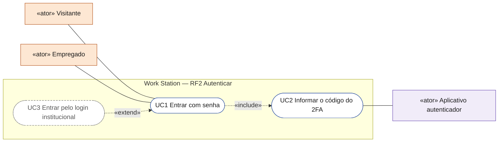

# Convenções dos diagramas por RF

Cada RF tem a pasta `docs/diagramas/RFnn/` com um único `README.md` contendo, nesta ordem, **seis diagramas Mermaid** (renderizam no GitHub sem build). O primeiro, acrescentado em 17/10/2026, é o diagrama de casos de uso (seção 0); os outros cinco seguem como antes:

0. `## 0. Diagrama de casos de uso` — `flowchart LR` no formato abaixo (Mermaid não tem diagrama de casos de uso nativo; este formato reproduz a notação UML). Vem logo antes de `## 1.`, depois dos critérios de aceite.

1. `## 1. Diagrama de classes` — `classDiagram`. Só entidades/enums de `docs/arquitetura/TAXONOMIA.md` (mesmos nomes e atributos; pode listar um subconjunto de atributos e terminar com `.. +N campos ..` em nota). Inclui os serviços de aplicação (`XxxService`), portas (`XxxPort`) e adaptadores relevantes, com estereótipos `<<entity>>`, `<<enum>>`, `<<service>>`, `<<port>>`, `<<adapter>>`, `<<controller>>`.
2. `## 2. Diagrama de atividades` — `flowchart TD` com subgraphs por raia (ator humano · Web/BFF · `ws-application` · IA (AiEngine) · Persistência). Decisões em losango `{}`; erros HTTP nomeados como no CA (`422 VALIDACAO`, `403 ACESSO_NEGADO`, `409 ...`).
3. `## 3. Diagrama de sequência` — `sequenceDiagram` com participantes: `Usuário`, `Next.js (App Router)`, `Controller (ws-web)`, `Service (ws-application)`, `AiEngine`, `Repository/MySQL`, `Cassandra`, `OpenSearch`, `Redis`, `S3`, `DomainEvents (AFTER_COMMIT)` — só os que o RF usa. Mostrar o caminho feliz e pelo menos um `alt` de erro do CA.
4. `## 4. Máquina de estados` — `stateDiagram-v2` da entidade central do RF (ex.: `TaskState`, `ProjectStatus`, `SessionStatus`, `SealBondStatus`, `DecisionStatus`). Quando o RF não tem estados próprios, usar os da entidade que ele afeta e dizer qual.
5. `## 5. Diagrama de componentes` — `flowchart LR` (ou `C4Component`) com os módulos Maven `ws-web → ws-application → ws-domain` e `ws-infrastructure/*` (persistence-mysql, persistence-cassandra, search-opensearch, cache-redis, storage-s3, ai-providers, platform), o frontend Next.js (`app/`, `components/ui`) e serviços externos (Claude/Gemini, Google Workspace, Microsoft 365, e-Protocolo) que o RF toca.

### Formato do diagrama de casos de uso (seção 0)

- **Atores** só do catálogo de [`../arquitetura/ATORES_E_ATRIBUTOS.md`](../arquitetura/ATORES_E_ATRIBUTOS.md) §2: o id do nó é o id do catálogo (`empregado`, `chefe`, `empresa`, `visitante`, `autenticado`, `admin`, `curador`, `dono`, `colaborador`, `responsavel`, `decisor`, `participante_daci`, `participante_sessao`, `ia`, `agendador`, `oidc`, `autenticador`, `email`, `conectores`) e o rótulo é `«ator» Nome`. Pessoas e papéis com a classe `ator`, declarados **antes** do limite do sistema (ficam à esquerda); IA, agendador e externos com a classe `atorSis`, declarados **depois** (ficam à direita). O verificador recusa ator fora do catálogo.
- **Limite do sistema**: um `subgraph` com o título `Work Station — RFnn <nome curto>`.
- **Casos de uso**: nós em forma de pílula `UCn(["UCn Verbo + objeto"])`, numerados no RF. Três classes: `uc` quando funciona com a API real; `ucDemo` (borda âmbar pontilhada) quando funciona na tela só com dados de demonstração em memória, sem API nem persistência; `ucPlan` (tracejado cinza) quando é planejado. A coluna Situação repete a classificação ("real", "DEMO no front, sem API", "planejado").
- **Ligações**: ator–caso com linha simples `---`; `«include»` do caso base para o incluído e `«extend»` da extensão para o caso base, ambos tracejados com rótulo (`-. "«include»" .->`); generalização entre atores com `-- "é um" -->`.
- Logo abaixo do diagrama, uma tabela `| Caso de uso | Ator(es) | CAs | Situação |` (a primeira coluna é o `UCn`, nunca o id do CA, para não confundir o gerador do catálogo).



Cabeçalho obrigatório de cada README:

```
# RFnn — <título do card do board>
**HU:** HUnn · **Sprint (board Work Station):** n · **Equivalente FAI:** <texto do card> · **Aba/rota:** <se houver>
**Critérios de aceite cobertos:** RFnn.CA01 … — regra: o **título do card** define o RF; se o corpo do card estiver vazio, derivar 4–6 CAs do título + HU de mesmo número e marcar "(CA a confirmar)"; se o corpo contiver CAs de outro id (ex.: card RF5 com RF21.CA01–14), citar esses CAs como estão escritos e anotar "corpo do card = antigo RFxx" no cabeçalho
```

Depois dos 6 diagramas: `## 6. Rastreabilidade` — tabela `CA → elemento do diagrama (classe / passo / mensagem / transição / componente)`.

Regras Mermaid: sem `<br>` em `classDiagram`; rótulos com `:` ou `()` entre aspas; ids ASCII sem acento (texto pode ter acento); um diagrama por bloco ```mermaid. Nomes de módulos: `ws-domain`, `ws-application`, `ws-infrastructure`, `ws-web`, `ws-bootstrap`. Pacote Java raiz: `br.gov.pr.secid.workstation`.


As pastas `docs/diagramas/RF1…RF48` seguem a numeração **atual** do board Work Station (leitura de 2026-10-05; RF47 e RF48 lidos em 2026-10-06). As versões anteriores dos RFs renumerados ficam em `docs/diagramas/_anterior/` e o mapa está em `RENUMERACAO.md`.
