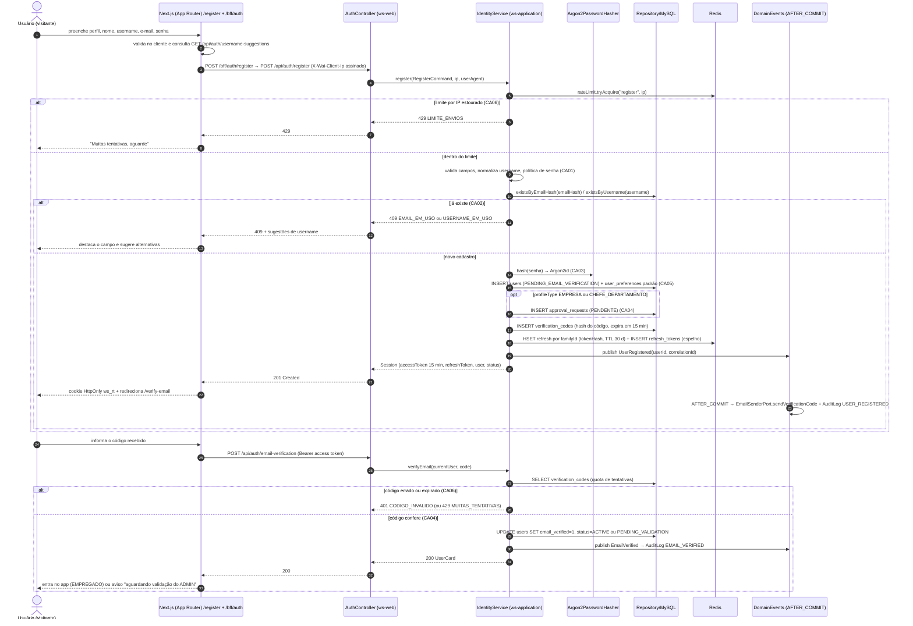
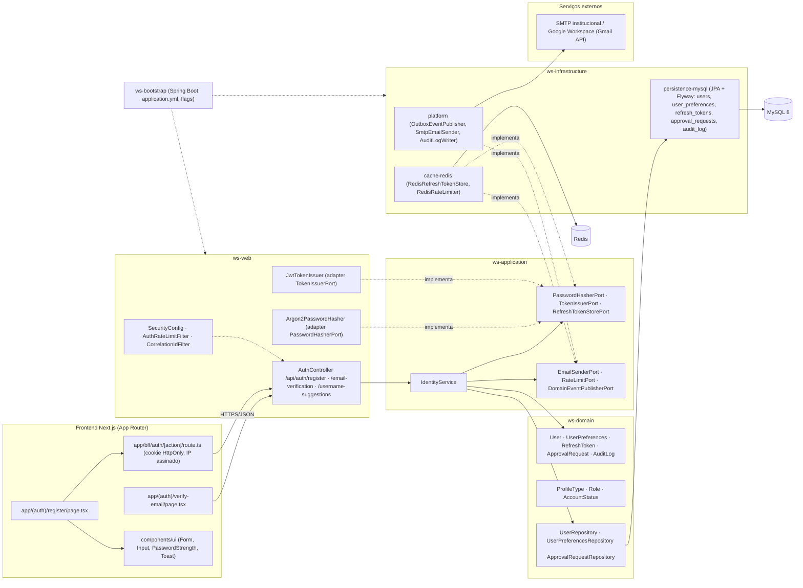

# RF1 — Cadastrar usuário na plataforma com dados de acesso
**HU:** HU1 · **Sprint (board Work Station):** 1 · **Equivalente FAI:** RF1 Cadastro (`AuthController POST /api/auth/register`, `IdentityService.register`, `Argon2PasswordHasher`, BFF `/bff/auth/register`) · **Aba/rota:** `/register` → `/verify-email` (BFF `/bff/auth/register`) — rota sugerida
**Critérios de aceite cobertos:** RF1.CA01 … RF1.CA06 (RF1–RF18 não têm CAs no board: derivados da HU1 e marcados "CA a confirmar")

> **HU1** — COMO visitante do sistema POSSO realizar meu cadastro na plataforma informando meus dados de acesso PARA obter uma conta e acessar as funcionalidades do DECIA.

## Critérios de aceite derivados da HU1 (todos "CA a confirmar")

| CA | Enunciado (Dado / Quando / Então) |
|---|---|
| **RF1.CA01** (CA a confirmar) | Dado o formulário de cadastro, quando informo perfil (`ProfileType` EMPREGADO · EMPRESA · CHEFE_DEPARTAMENTO), nome completo, `username`, e-mail, senha e confirmação, então cada campo é validado (formato de e-mail, username normalizado sem reservados, política mínima de senha, senhas iguais) e os erros voltam como `422 VALIDACAO` com `details` por campo e `correlationId`. |
| **RF1.CA02** (CA a confirmar) | Dado um e-mail (`emailHash`) ou `username` já cadastrado, quando envio o formulário, então recebo `409 EMAIL_EM_USO` ou `409 USERNAME_EM_USO`; o sistema oferece sugestões de username livres (`GET /api/auth/username-suggestions`). |
| **RF1.CA03** (CA a confirmar) | Dado um cadastro válido, então a senha é guardada apenas como hash **Argon2id** (parâmetros mínimos OWASP) via `PasswordHasherPort`, nunca aparece em log, evento ou auditoria; e-mail e telefone são cifrados em repouso (`AesGcmStringConverter`, LGPD). |
| **RF1.CA04** (CA a confirmar) | Dado o cadastro criado, então a conta nasce com `AccountStatus PENDING_EMAIL_VERIFICATION` e recebe um código de verificação por e-mail (AFTER_COMMIT); ao confirmar o código, EMPREGADO → `ACTIVE` e EMPRESA/CHEFE_DEPARTAMENTO → `PENDING_VALIDATION` com `ApprovalRequest PENDENTE` para o ADMIN (RF28.CA01). |
| **RF1.CA05** (CA a confirmar) | Dado o cadastro criado, então o sistema cria `UserPreferences` padrão (theme AUTO, language PT_BR, timezone America/Sao_Paulo, wipLimit 3, aiModeDefault ECONOMIA) e já emite a sessão (access JWT 15 min + `RefreshToken` em cookie HttpOnly pelo BFF) como no RF2, levando o usuário para `/verify-email`. |
| **RF1.CA06** (CA a confirmar) | Dado tentativas repetidas, então há limite por IP (`429 LIMITE_ENVIOS`) e por código informado (`429 MUITAS_TENTATIVAS`); `AuditLog USER_REGISTERED` e `EMAIL_VERIFIED` são gravados sem dados sensíveis e com `correlationId`. |

## 1. Diagrama de classes

Entidades de `docs/arquitetura/TAXONOMIA.md` §1 (Identidade & Acesso) e §12 (Plataforma); serviços e portas sugeridos para `ws-application`, adaptadores em `ws-web`/`ws-infrastructure`.

## 2. Diagrama de atividades

Raias: Visitante · Web/BFF · `ws-application` · Persistência (o RF1 não usa o AiEngine).

## 3. Diagrama de sequência

Caminho feliz (cadastro → sessão → verificação de e-mail) e os `alt` de erro dos CA02 e CA06.

## 4. Máquina de estados

Entidade central: `User.status` (`AccountStatus`). O RF1 cobre a criação em `PENDING_EMAIL_VERIFICATION` e as duas saídas da verificação; os demais estados são do RF2/RF28/LGPD e aparecem para contexto.

## 5. Diagrama de componentes

## 6. Rastreabilidade

| CA | Classe (§1) | Passo da atividade (§2) | Mensagem da sequência (§3) | Transição de estado (§4) | Componente (§5) |
|---|---|---|---|---|---|
| RF1.CA01 | `IdentityService.register`, `User.username/fullName/email`, `ProfileType` | `B1`, `C2` → `E422` | 7 (valida campos) · `else novo cadastro` | — | `FE1`, `FE4`, `W1`, `S1` |
| RF1.CA02 | `User.emailHash`, `User.username`, `IdentityService.usernameSuggestions` | `C3` → `E409` | 8–11 (`existsByEmailHash`, 409) | — | `W1 /username-suggestions`, `D3 UserRepository` |
| RF1.CA03 | `PasswordHasherPort`, `Argon2PasswordHasher`, `User.passwordHash`, `User.email` (AES) | `C4` | 12 (`hash(senha) → Argon2id`) | — | `W3`, `I1` (AesGcmStringConverter) |
| RF1.CA04 | `AccountStatus`, `ApprovalRequest`, `IdentityService.verifyEmail`, `EmailSenderPort` | `C5`, `C6`–`C7`, `C14`–`C17` | 13–15, 22–31 | `[*] → PENDING_EMAIL_VERIFICATION`, `→ ACTIVE`, `→ PENDING_VALIDATION` | `FE2`, `I3 SmtpEmailSender`, `X1` |
| RF1.CA05 | `UserPreferences`, `RefreshToken`, `TokenIssuerPort`, `RefreshTokenStorePort` | `C5`, `C8`, `B9`, `B10` | 13, 17–20 (sessão + cookie HttpOnly) | — | `FE3`, `W4`, `I2 RedisRefreshTokenStore` |
| RF1.CA06 | `RateLimitPort`, `AuditLog`, `DomainEventPublisherPort` | `C1` → `E429`, `C14` → `E429b`/`E401`, `C9` | 5–6, 21, 25–27 | — | `W2 AuthRateLimitFilter`, `I2 RedisRateLimiter`, `I3 AuditLogWriter` |
| RF1.CA07 (CA a confirmar, D-14) | `Argon2PasswordHasher` (m=19456 KiB, t=2, p=1, salt 16, hash 32) | `C4` | 12 | — | `W3` · SEG §1 `Argon2PasswordHasher` |
| RF1.CA08 (CA a confirmar, D-14) | `AuthRateLimitFilter.RULES` (register 10/h, envios do cadastro 40/h, username-suggestions 60/10 min, availability 120/10 min), `ClientIpResolver` | `B2` (IP assinado), `C1` → `E429` | 3, 5–6 | — | `W2 AuthRateLimitFilter`, `FE3` · SEG §2 `D2`–`D4`, §3 3–9 |
| RF1.CA09 (CA a confirmar, D-14) | `HashBulkhead` (bulkhead do `POST /api/auth/register`) | `C1` → `C4` (vaga antes do hash) | 12 | — | `W2` · SEG §2 `D5`–`D6` → `E503`, §3 10–12 |
| RF1.CA10 (CA a confirmar, D-14) | `IdentityService.reservedUsername` (`admin`, `root`, `suporte`, `secid`, `decia`, `workstation`, prefixos `demo_`/`e2e_`) | `C2` → `E422` | 7 | — | `S1` · SEG §1 nota de `IdentityService` |
| RF1.CA11 (CA a confirmar, D-14) | `IdentityService.verifyEmail` (`noRollbackFor`, `MAX_CODE_ATTEMPTS` 5), `requireCodeAttemptQuota` (10/h por pessoa e finalidade) | `C14` → `E429b`/`E401` | 24–27 | — | `S1`, `I2` · SEG §2 `F14` |
| RF1.CA12 (CA a confirmar, D-14) | `User.accountOrigin` (`AccountOrigin` REAL desde o V1), `fixtureKey`, `testAccount` gerada | `C5` | 13 | `[*] → PENDING_EMAIL_VERIFICATION` (nasce `REAL`) | `I1` (V1 baseline) · SEG §1 `AccountOrigin` |
| RF1.CA13 (CA a confirmar, D-14) | `IdentityService.maskEmail`, `AuditLog` sem senha/código, `JwtTokenIssuer` (TTL em aberto, Q-49) | `C8`, `C9` | 17, 21 | — | `W4`, `I3 AuditLogWriter` · SEG §1 notas de `IdentityService` e `JwtTokenIssuer` |

## 7. Controles de segurança (D-14)

Herdados do RF49 do FAI pela **D-14**; detalhes, diagramas e rastreabilidade RN/CA em [`../SEG/README.md`](../SEG/README.md). Todos "(CA a confirmar)": a Q-48 decide se virarão CAs deste RF ou um RNF do board. Os controles do login (sem oráculo, bloqueio por conta, reconferência) estão no RF2 §7; aqui ficam os que tocam o cadastro e a verificação de e-mail.

| CA | Enunciado (Dado / Quando / Então) | Bloco do brief |
|---|---|---|
| **RF1.CA07** (CA a confirmar) | Dado um cadastro válido, então a senha é guardada com **Argon2id** exatamente em m=19456 KiB, t=2, p=1, salt 16 bytes, hash 32 bytes (mínimo OWASP), e `needsRehash` refaz o hash no próximo login quando os parâmetros mudarem. | 3 |
| **RF1.CA08** (CA a confirmar) | Dado o mesmo IP (assinado pelo BFF em `X-Ws-Client-Ip`/`X-Ws-Proxy-Ts`/`X-Ws-Proxy-Sig`; senão `X-Real-IP`; senão TCP; nunca `X-Forwarded-For`; IPv6 por /64), então o `AuthRateLimitFilter` aplica, **antes do Spring Security**, `POST /api/auth/register` 10/h, envios do cadastro 40/h, `GET /api/auth/username-suggestions` 60/10 min e disponibilidade de username 120/10 min; o excedente recebe `429 MUITAS_TENTATIVAS` com `Retry-After` (substitui o `429 LIMITE_ENVIOS` do CA06). | 3 |
| **RF1.CA09** (CA a confirmar) | Dado um pico de cadastros, então o `HashBulkhead` (permits = `max(1, min(max(2, núcleos), poolDoBanco/2))`, espera 2 s) limita os Argon2 simultâneos e o excedente recebe `503 AUTENTICACAO_OCUPADA` + `Retry-After`; 60 pedidos paralelos geram zero HTTP 500. | 3 |
| **RF1.CA10** (CA a confirmar) | Dado um `username` que, depois da normalização, seja `admin`, `root`, `suporte`, `secid`, `decia`, `workstation` ou comece com `demo_`/`e2e_`, então o cadastro responde `422 VALIDACAO` (nome reservado); a conta de administração só nasce pelo `AdminBootstrap` (segredo `WS_ADMIN_PASSWORD`, nunca promove conta existente sem `WS_ADMIN_PROMOTE_EXISTING=true`). | 3 |
| **RF1.CA11** (CA a confirmar) | Dado o código de verificação, então há no máximo 5 tentativas por código (`attempts++` persiste mesmo com erro, `noRollbackFor`) e um contador atômico de 10 tentativas/h por pessoa e finalidade; o excedente recebe `429 MUITAS_TENTATIVAS`. | 3 |
| **RF1.CA12** (CA a confirmar) | Dado o cadastro criado, então `users.account_origin` nasce `REAL` (enum `AccountOrigin` REAL/TEST_SEED/DEMO/SYSTEM desde o `V1__baseline.sql`), com `fixture_key` NULL e `test_account` gerada = false; contas `TEST_SEED`/`DEMO` ficam fora de rankings, HSE, DECIA Points e métricas do RF43, e o e-mail nunca é enviado a `.test`/`.example`/`.invalid`/`.localhost`. | 2, 6 |
| **RF1.CA13** (CA a confirmar) | Dado qualquer log ou evento do cadastro, então o e-mail aparece mascarado (`maskEmail`: `m***@dominio`) e nunca há senha, token ou código; a sessão emitida no CA05 segue o RF2 (TTL do access token em aberto na **Q-49**: 10 min na ARQUITETURA, 15 min aqui). | 1, 3 |
