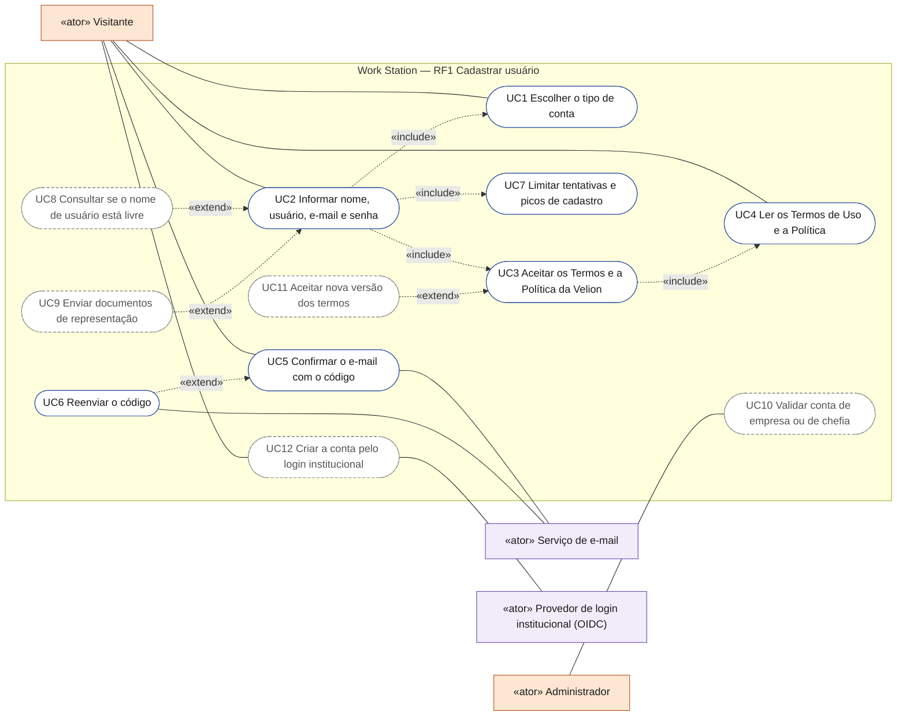
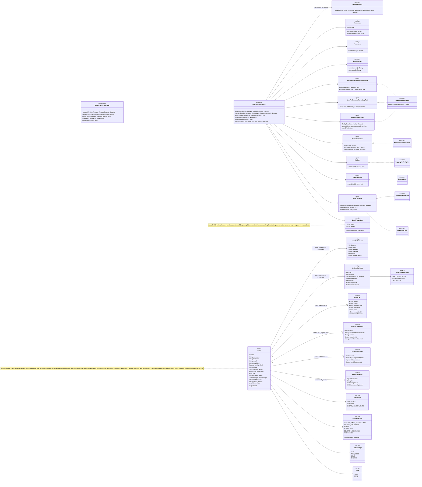
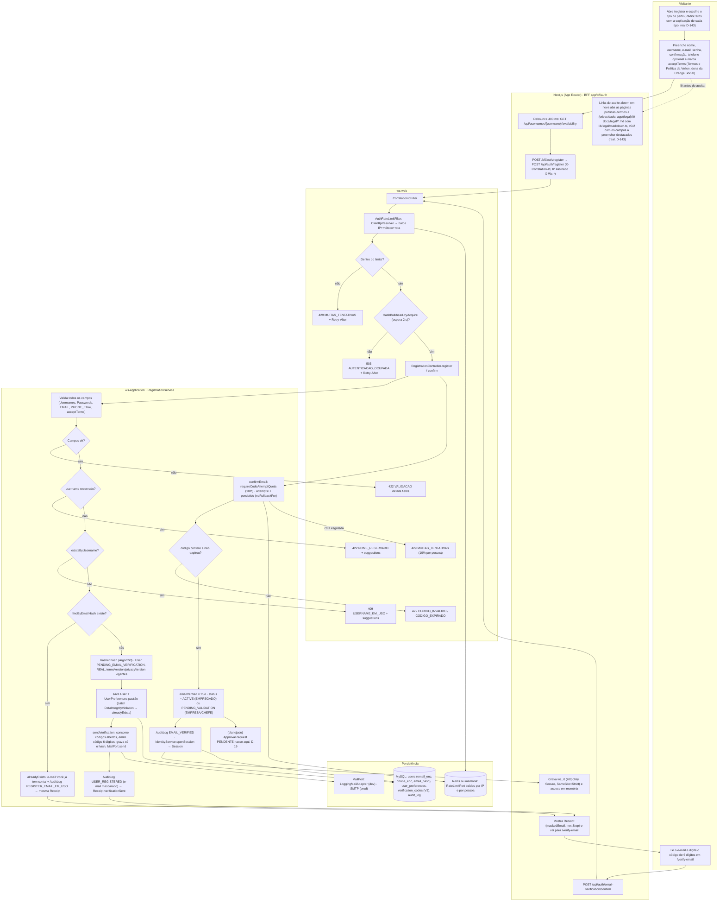
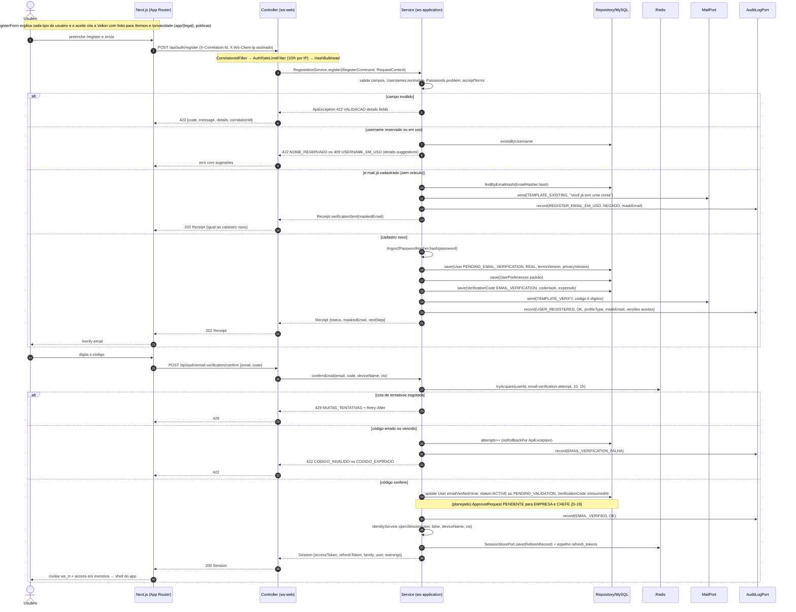
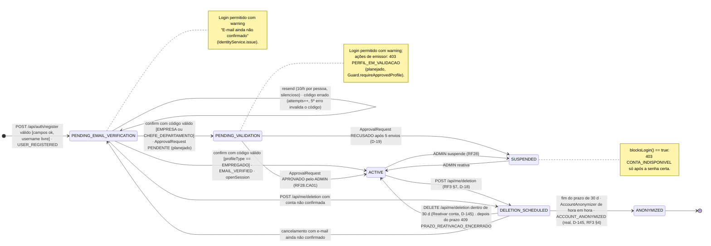
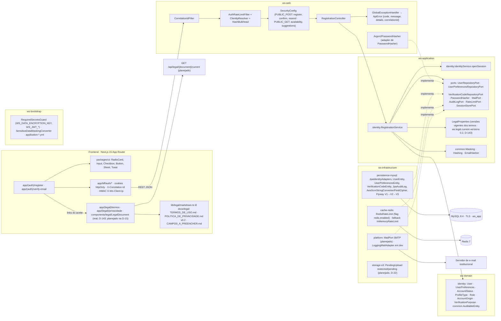
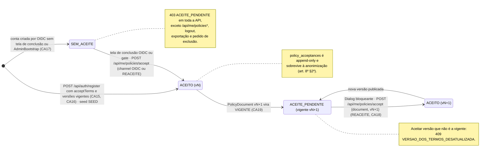

# RF1 — Cadastrar usuário na plataforma com dados de acesso
**HU:** HU1 · **Sprint (board Work Station):** 1 (card "SPRINT 1 — Cadastro, autenticação, perfil e abertura de sessão") · **Equivalente FAI:** RF1 Cadastro (`AuthController POST /api/auth/register`, `IdentityService.register`, `Argon2PasswordHasher`) · **Aba/rota:** `/register` → `/verify-email` (BFF `app/bff/auth/register` → `POST /api/auth/register`); `/termos` e `/privacidade` (D-15) — **real desde 17/10/2026 (D-143):** páginas públicas `app/(legal)/termos` e `app/(legal)/privacidade`, lidas de `docs/legal/*.md`
**Critérios de aceite cobertos:** RF1.CA01 … RF1.CA06 (corpo do card vazio → derivados do título + HU1, todos "(CA a confirmar)") · RF1.CA07 … RF1.CA13 (§7, controles de segurança D-14) · RF1.CA14 … RF1.CA27 (§8, aceite dos termos e tipos de perfil, D-15…D-22) — regra: o título do card define o RF; os CAs foram atualizados para o código real do Bloco 3 (`RegistrationController`, `RegistrationService`, `V3__rf1_rf2_autenticacao.sql`); atualização de 17/10/2026 (D-143): tipo de usuário explicado em cada opção, aceite dos Termos de Uso e da Política de Privacidade da Velion com links para `/termos` e `/privacidade`, versões 0.2

> **HU1** — COMO visitante do sistema POSSO realizar meu cadastro na plataforma informando meus dados de acesso PARA obter uma conta e acessar as funcionalidades do DECIA.

O cadastro local é o Bloco 3 do plano de segurança (ARQUITETURA §6 (c)). Classes marcadas **(real)** existem em `origin/main` (Bloco 3, PR #16); as marcadas **(planejado)** vêm da TAXONOMIA §1.8–1.15 e do `CADASTRO_E_LGPD.md` (blocos A/B).

**Atualização 17/10/2026 (real, D-143):** no `RegisterForm` (`components/auth/AuthForms.tsx`) cada tipo de usuário do `RadioCards` traz uma explicação (`auth.register.typeHint.EMPREGADO|EMPRESA|CHEFE_DEPARTAMENTO`; EMPRESA e CHEFE_DEPARTAMENTO somam `auth.register.validationNote`, a validação do RF28). O `Checkbox` do aceite diz "Li e aceito os Termos de Uso e a Política de Privacidade da **Velion, dona da Orange Social**", com links que abrem em nova aba as páginas públicas `/termos` e `/privacidade` (`app/(legal)/layout.tsx`, `app/(legal)/termos/page.tsx`, `app/(legal)/privacidade/page.tsx`, `components/legal/LegalDocument.tsx`). As páginas leem `docs/legal/TERMOS_DE_USO.md` e `docs/legal/POLITICA_DE_PRIVACIDADE.md` com `lib/legal/markdown.ts`, que monta uma árvore de dados sem HTML cru, tira as seções internas e destaca os campos `{{...}}` ainda não preenchidos (lista em `docs/legal/CAMPOS_A_PREENCHER.md`; texto v0.2 em rascunho, Q-243). O erro `422 details.fields.acceptTerms` aparece abaixo dos links. As versões gravadas em `users.terms_version/privacy_version` vêm de `ws.legal.current-versions` (`WS_LEGAL_TERMS_VERSION`/`WS_LEGAL_PRIVACY_VERSION`, padrão **0.2**) pela `LegalProperties`. Teste: `components/account/account.test.tsx` ("cadastro: tipo de usuário com explicação e links para os Termos e a Política da Velion"). Evidência: `docs/auditoria/2026-10-17/evidencias/IDENTIDADE.json` passos 3–5 (cadastro exige o aceite, `/termos` público com 25 campos destacados, `/privacidade` público) e capturas `id-02-cadastro-tipo-termos-celular.png` e `id-03-termos-desktop.png` (roteiro `docs/auditoria/2026-10-17/scripts/identidade.mjs`). Continuam **planejados**: `PolicyAcceptance`/`policy_acceptances`, `LegalController` (`GET /api/legal/...`), `PolicyGateFilter` e o histórico de versões.

## Critérios de aceite derivados da HU1 (todos "CA a confirmar")

| CA | Enunciado (Dado / Quando / Então) |
|---|---|
| **RF1.CA01** (CA a confirmar) | Dado o formulário de cadastro, quando informo `profileType` (EMPREGADO · EMPRESA · CHEFE_DEPARTAMENTO), `fullName` (3–160), `username` (3–30, `Usernames.normalize`), `email`, `password` + `confirmPassword` (`Passwords.problem`), telefone opcional (E.164) e `acceptTerms`, então cada campo é validado e os erros voltam juntos como `422 VALIDACAO` com `details.fields` por campo e `correlationId`. |
| **RF1.CA02** (CA a confirmar) | Dado um `username` já em uso, então `409 USERNAME_EM_USO` com `details.suggestions`; nome reservado (`admin`, `root`, `suporte`, `secid`, `decia`, `workstation`, prefixos `demo_`/`e2e_`) → `422 NOME_RESERVADO`. Dado um **e-mail** já cadastrado, então a resposta é a **mesma** `202 Receipt` do cadastro novo (sem oráculo, D-27/Q-86): o dono recebe o e-mail "você já tem conta" e `AuditLog REGISTER_EMAIL_EM_USO`. Disponibilidade em `GET /api/usernames/{username}/availability` e sugestões em `GET /api/auth/username-suggestions`. |
| **RF1.CA03** (CA a confirmar) | Dado um cadastro válido, então a senha é guardada só como hash **Argon2id** (`Argon2PasswordHasher`), nunca aparece em log, evento ou auditoria (`SensitiveDataMaskingConverter`); e-mail e telefone vão ao banco cifrados (`FieldCipher`/`AesGcmStringConverter`, AES-256-GCM `enc:v1:`, colunas `email_enc`/`phone_enc`) e a busca usa `emailHash` = HMAC-SHA256 com chave derivada de `WS_DATA_ENCRYPTION_KEY` (`HmacEmailHasher`, Q-87). |
| **RF1.CA04** (CA a confirmar) | Dado o cadastro criado, então a conta nasce `AccountStatus PENDING_EMAIL_VERIFICATION`, `accountOrigin REAL`, com `UserPreferences` padrão e um `VerificationCode` (6 dígitos, só o hash, TTL) enviado por `MailPort`; ao confirmar em `POST /api/auth/email-verification/confirm`, EMPREGADO → `ACTIVE` e EMPRESA/CHEFE_DEPARTAMENTO → `PENDING_VALIDATION` com `ApprovalRequest PENDENTE` (planejado, RF28.CA01, D-19). |
| **RF1.CA05** (CA a confirmar) | Dado o código confirmado, então `RegistrationService.confirmEmail` grava `emailVerified`, `AuditLog EMAIL_VERIFIED` e abre a sessão pelo `IdentityService.openSession` (access JWT RS256 + refresh em `ws_rt`, como no RF2), levando ao shell do app; antes disso o cadastro responde só `202 Receipt {status VERIFICACAO_ENVIADA, maskedEmail, nextStep}` e redireciona para `/verify-email` **sem sessão** (emitir no `register` revelaria se a conta era nova, D-27/Q-86). |
| **RF1.CA06** (CA a confirmar) | Dado tentativas repetidas, então o `AuthRateLimitFilter` limita por IP (`register` 10/h, `resend` 10/h, `confirm` 20/h → `429 MUITAS_TENTATIVAS` + `Retry-After`), o reenvio é silencioso e limitado por pessoa (`RateLimitPort` `email-verification-send`), e `AuditLog USER_REGISTERED` / `EMAIL_VERIFIED` / `EMAIL_VERIFICATION_FALHA` são gravados com e-mail mascarado e `correlationId`. |

## 0. Diagrama de casos de uso

Quem se cadastra é sempre um visitante: escolhe o tipo de conta, aceita os termos da Velion e confirma o e-mail. Contas EMPRESA e CHEFE ainda dependem da validação do administrador. Atores do catálogo em [`ATORES_E_ATRIBUTOS.md`](../../arquitetura/ATORES_E_ATRIBUTOS.md).

| Caso de uso | Ator(es) | CAs | Situação |
|---|---|---|---|
| UC1 Escolher o tipo de conta | Visitante | RF1.CA01, RF1.CA22, RF1.CA23 | real: `RegisterForm` com explicação de cada tipo; EMPRESA e CHEFE nascem em validação |
| UC2 Informar nome, usuário, e-mail e senha | Visitante | RF1.CA01, RF1.CA02, RF1.CA03, RF1.CA04, RF1.CA07, RF1.CA10, RF1.CA12, RF1.CA13, RF1.CA21 | real: `POST /api/auth/register` (`RegistrationService.register`); idade mínima depende da Q-63 |
| UC3 Aceitar os Termos e a Política da Velion | Visitante | RF1.CA14, RF1.CA15, RF1.CA16, RF1.CA20 | real: checkbox com links e `422` sem aceite; versão padrão 0.2 (D-143); `policy_acceptances` planejado |
| UC4 Ler os Termos de Uso e a Política | Visitante | RF1.CA19 | real: `/termos` e `/privacidade` públicos com os campos `{{...}}` destacados; `/api/legal` planejado |
| UC5 Confirmar o e-mail com o código | Visitante, Serviço de e-mail | RF1.CA05, RF1.CA11 | real: `RegistrationService.confirmEmail`, 5 tentativas por código; e-mail só em log (sem SMTP) |
| UC6 Reenviar o código | Visitante, Serviço de e-mail | RF1.CA06 | real: `POST /api/auth/email-verification/resend` |
| UC7 Limitar tentativas e picos de cadastro | (sistema) | RF1.CA06, RF1.CA08, RF1.CA09 | real: `AuthRateLimitFilter`, `ClientIpResolver`, `HashBulkhead` |
| UC8 Consultar se o nome de usuário está livre | Visitante | RF1.CA26 | planejado: a API de disponibilidade existe, a tela ainda não consulta |
| UC9 Enviar documentos de representação | Visitante | RF1.CA24, RF1.CA25 | planejado (D-22, Q-62) |
| UC10 Validar conta de empresa ou de chefia | Administrador | RF1.CA27 | planejado (`ApprovalRequest` só no domínio) |
| UC11 Aceitar nova versão dos termos | Visitante | RF1.CA18 | planejado (gate `403 ACEITE_PENDENTE`) |
| UC12 Criar a conta pelo login institucional | Visitante, Provedor OIDC | RF1.CA17 | planejado: OIDC existe e está desligado por padrão; captura do aceite no primeiro login planejada |

## 1. Diagrama de classes

Entidades e enums da TAXONOMIA §1 (`User`, `UserPreferences`, `VerificationCode`, `AuditLog`) com os nomes do código do Bloco 3; `PolicyDocument`, `PolicyAcceptance`, `ApprovalRequest` e `PendingUpload` são **(planejado)**.

## 2. Diagrama de atividades

## 3. Diagrama de sequência

## 4. Máquina de estados

Entidade central: **`User.status`** (`AccountStatus`, enum real em `ws-domain`). O trecho do cadastro vai até `ACTIVE`/`PENDING_VALIDATION`; `SUSPENDED`, `DELETION_SCHEDULED` e `ANONYMIZED` são do RF3 §7 e do RF28.

## 5. Diagrama de componentes

## 6. Rastreabilidade

| CA | Classe (§1) | Passo da atividade (§2) | Mensagem da sequência (§3) | Transição de estado (§4) | Componente (§5) | Situação |
|---|---|---|---|---|---|---|
| RF1.CA01 | `RegistrationService.register`, `Usernames`, `Passwords`, `EmailHasher` | `S1`→`S2`→`E422` | 4–7 | — | `RC`, `RS`, `GEH`, `UI` | real (Bloco 3, main) |
| RF1.CA02 | `RegistrationService.alreadyExists/availability`, `Usernames.problem`, `UserRepositoryPort.existsByUsername/findByEmailHash` | `S3`→`E422R`, `S4`→`E409`, `S5`→`S6`, `F1` | 8–15 | — | `RC` (`availability`, `suggestions`), `SEC.PUBLIC_GET` | real; sem `409 EMAIL_EM_USO` (anti-enumeração) |
| RF1.CA03 | `Argon2PasswordHasher`, `FieldCipher`/`AesGcmStringConverter`, `HmacEmailHasher`, `Masking` | `S7` | 16–17 | — | `A2`, `MY` (`email_enc`, `phone_enc`), `B1` | real |
| RF1.CA04 | `User.status`, `UserPreferences`, `VerificationCode`, `MailPort`, `ApprovalRequest` (planejado) | `S7`→`S10`, `C3`, `C5` | 17–21, 36 | `[*]`→`PEV`, `PEV`→`ACT`/`PV` | `MY` (V3 `verification_codes`), `PLT` | real + ApprovalRequest planejado |
| RF1.CA05 | `RegistrationService.confirmEmail`, `IdentityService.openSession`, `SessionStorePort` | `C3`→`C4`→`F5`, `F3` | 22–24, 35–42 | `PEV`→`ACT`/`PV` | `IS`, `BFF` (`ws_rt`) | real |
| RF1.CA06 | `AuthRateLimitFilter`, `RateLimitPort`, `AuditLogPort`, `AuditActions` | `W2`→`W3`→`E429`, `C1`→`E429C`, `S10` | 3, 27–33 | `PEV`→`PEV` (resend/erro) | `ARL`, `RDS`, `CIF` | real |
| RF1.CA07 | `Argon2PasswordHasher`, `PasswordHasher.needsRehash` | `S7` | 16 | — | `A2` | real (§7, D-26) |
| RF1.CA08 | `AuthRateLimitFilter.RULES`, `ClientIpResolver` | `W2`→`W3`→`E429` | 3 | — | `ARL`, `BFF` | real (§7) |
| RF1.CA09 | `HashBulkhead` | `W4`→`E503` | 3 | — | `ARL` | real (§7) |
| RF1.CA10 | `Usernames.RESERVED`, `AdminBootstrap` | `S3`→`E422R` | 9 | — | `RS`, `B1` | real (§7) |
| RF1.CA11 | `VerificationCode.attempts`, `RegistrationService.requireCodeAttemptQuota` | `C1`→`C2`→`E422C`/`E429C` | 27–33 | `PEV`→`PEV` | `MY` (V3), `RDS` | real (§7) |
| RF1.CA12 | `AccountOrigin`, `User.accountOrigin/fixtureKey/testAccount` | `S7` | 17 | — | `MY` (V2 CHECK, coluna gerada) | real (§7) |
| RF1.CA13 | `Masking.maskEmail`, `SensitiveDataMaskingConverter`, `AuditEvent` | `S6`, `S10`, `C4` | 11, 20, 31, 37 | — | `MK`, `B1`, `CIF` | real (§7) |
| RF1.CA14 | `Checkbox`, `Sheet` (`packages/ui`), `RegisterForm` (`components/auth/AuthForms.tsx`) | `A2`, `F0` | 1 (nota D-143) | — | `UI`, `LEG`, `LMD` | parcial real (D-143): `Checkbox` desmarcado cita a Velion, links para `/termos` e `/privacidade` em nova aba, erro `acceptTerms` abaixo; botão `disabled` e `Sheet` planejados — teste `account.test.tsx` "cadastro: tipo de usuário…"; evidência `IDENTIDADE.json` passo 3, `id-02` |
| RF1.CA15 | `RegistrationService.register` (`acceptTerms`), `LegalProperties.currentVersions` | `S1`→`E422` | 5–7 | — | `RS`, `LP` | real (`acceptTerms`; versões 0.2 de `ws.legal.current-versions`, D-143; evidência `IDENTIDADE.json` passo 3 "cadastro exige aceitar os termos"); `409 VERSAO_DOS_TERMOS_DESATUALIZADA` planejado |
| RF1.CA16 | `PolicyAcceptance`, `User.termsVersion/privacyVersion` | `S7` | 17, 20 | — | `MY` (`policy_acceptances`, planejado) | parcial: cópia em `users` real, tabela planejada |
| RF1.CA17 | `AcceptanceChannel`, `OidcAccountLinker`, `AdminBootstrap` | — | — | `[*]`→`PEV` | `RS`, `B1` | planejado |
| RF1.CA18 | `PolicyGateFilter` (planejado) | — | — | nota de `ACT` | `SEC` | planejado |
| RF1.CA19 | `PolicyDocument`, `LegalController` (planejado); `app/(legal)/termos`, `app/(legal)/privacidade`, `lib/legal/markdown.ts` (real) | `F0` | 1 (nota D-143) | — | `LEG`, `LMD`, `API_LEGAL` | parcial real (D-143): páginas públicas sem login lendo `docs/legal/*.md` v0.2 (evidência `IDENTIDADE.json` passos 4–5, `id-03-termos-desktop.png`); `GET /api/legal/...`, histórico e `PolicyTextGuardTest` planejados (os campos pendentes usam `{{...}}`, `CAMPOS_A_PREENCHER.md`) |
| RF1.CA20 | `UserConsent` (RF3 §7) | — | — | — | — | planejado |
| RF1.CA21 | `User.birthDate` (condicional Q-63) | `S1` | 5 | — | `RS` | planejado |
| RF1.CA22 | `RegistrationService.parseProfileType`, `RadioCard`, `RegisterForm` | `A1`, `S1`→`E422` | 5–7 | — | `UI`, `RS` | real (`details.fields.profileType`); explicação de cada tipo em `RadioCards` (D-143, `account.test.tsx`, `id-02`) |
| RF1.CA23 | `EmpresaProfileExtension`, `ChefeProfileExtension` (TAXONOMIA §1.1) | `S1` | 5 | — | `RS` | planejado (Q-64) |
| RF1.CA24 | `VerificationPolicy.freeMailDomainsJson` | `S1` | 5 | — | `RS` | planejado (Q-62) |
| RF1.CA25 | `PendingUpload`, `PendingUploadCleanupJob` | — | — | — | `S3`, `ARL` (uploads 40/h) | planejado (D-22); regra de IP já em `AuthRateLimitFilter.RULES` |
| RF1.CA26 | `RegistrationController.availability/suggestions` | `F1` | — | — | `RC`, `SEC.PUBLIC_GET` | real (rota `/api/usernames/{username}/availability`) |
| RF1.CA27 | `ApprovalRequest`, `Guard.requireApprovedProfile` (planejado) | `C5` | 36 | `PEV`→`PV`, `PV`→`ACT`/`SUS` | `RS` | planejado (D-19) |

## 7. Controles de segurança (D-14)

Herdados do RF49 do FAI pela **D-14**; detalhes e rastreabilidade por bloco em [`../SEG/README.md`](../SEG/README.md). Todos "(CA a confirmar)" até a Q-48 decidir se viram CAs deste RF ou um RNF. Os controles do login (sem oráculo, bloqueio por conta, reconferência) estão no RF2 §7; aqui ficam os que tocam o cadastro e a verificação de e-mail. Coluna **Código**: o que já existe em `origin/main` (Bloco 3, PR #16).

| CA | Enunciado (Dado / Quando / Então) | Código |
|---|---|---|
| **RF1.CA07** (CA a confirmar) | Dado um cadastro válido, então a senha é guardada com **Argon2id** nos parâmetros mínimos OWASP (m=19456 KiB, t=2, p=1, salt 16 B, hash 32 B) e `needsRehash` refaz o hash no próximo login quando os parâmetros mudarem. | `Argon2PasswordHasher`, `Argon2PasswordHasherTest` |
| **RF1.CA08** (CA a confirmar) | Dado o mesmo IP (assinado pelo BFF em `X-Ws-Client-Ip`/`X-Ws-Proxy-Ts`/`X-Ws-Proxy-Sig`; senão `X-Real-IP`; senão TCP; nunca `X-Forwarded-For`; IPv6 por /64), então o `AuthRateLimitFilter` aplica **antes do Spring Security** `POST /api/auth/register` 10/h, `email-verification/resend` 10/h, `confirm` 20/h, `GET /api/auth/username-suggestions` 60/10 min e `POST /api/auth/uploads` 40/h; o excedente recebe `429 MUITAS_TENTATIVAS` com `Retry-After`. | `AuthRateLimitFilter.RULES`, `ClientIpResolver`, `AuthRateLimitFilterTest`, `ClientIpResolverTest` |
| **RF1.CA09** (CA a confirmar) | Dado um pico de cadastros, então o `HashBulkhead` (permits = `max(1, min(max(2, núcleos), pool/2))`, espera 2 s) limita os Argon2 simultâneos e o excedente recebe `503 AUTENTICACAO_OCUPADA` + `Retry-After`; 60 pedidos paralelos geram zero HTTP 500. | `HashBulkhead`, regra `register` com `hashes=true` |
| **RF1.CA10** (CA a confirmar) | Dado um `username` que, normalizado, seja reservado (`admin`, `root`, `suporte`, `secid`, `decia`, `workstation`, prefixos `demo_`/`e2e_`), então o cadastro responde `422 NOME_RESERVADO` com sugestões; a conta ADMIN só nasce pelo `AdminBootstrap` (`WS_ADMIN_BOOTSTRAP_ENABLED=true`, `WS_ADMIN_INITIAL_PASSWORD` ≥ 16 chars sem padrão, só se não existe nenhum ADMIN; nunca promove conta existente sem `WS_ADMIN_PROMOTE_EXISTING=true`). | `Usernames`, `AdminBootstrap`, `AdminBootstrapTest`, `UsernamesAndPasswordsTest` |
| **RF1.CA11** (CA a confirmar) | Dado o código de verificação, então há no máximo 5 tentativas por código (`attempts++` persiste mesmo com erro, `@Transactional(noRollbackFor = ApiException.class)`) e um contador atômico de 10 tentativas/h por pessoa e finalidade (`RateLimitPort`); o excedente recebe `429 MUITAS_TENTATIVAS`. | `RegistrationService.confirmEmail`, `V3__rf1_rf2_autenticacao.sql`, `RegistrationServiceTest` |
| **RF1.CA12** (CA a confirmar) | Dado o cadastro criado, então `users.account_origin` nasce `REAL` (CHECK no V2), `fixture_key` NULL e `test_account` gerada = false; contas `TEST_SEED`/`DEMO` ficam fora de rankings, HSE, DECIA Points e métricas (RF43), e o e-mail nunca é enviado a `.test`/`.example`/`.invalid`/`.localhost`. | `AccountOrigin`, `V2__baseline_dominio_base.sql`, `ForeignKeyPolicyTest`, `AccountOriginTest` |
| **RF1.CA13** (CA a confirmar) | Dado qualquer log ou evento do cadastro, então o e-mail aparece mascarado (`Masking.maskEmail`) e nunca há senha, token ou código; a sessão emitida no CA05 segue o RF2 (TTL do access em aberto na **Q-49**). | `Masking`, `SensitiveDataMaskingConverter`, `AuditEvent`, `MaskingTest` |

## 8. Aceite dos termos e tipos de perfil no cadastro (CA a confirmar, D-15…D-22)

Blocos **A** (aceite dos Termos de Uso e da Política de Privacidade) e **B** (tipos de perfil, campos por tipo e envios do cadastro) de `docs/produto/CADASTRO_E_LGPD.md`. Entidades em `TAXONOMIA.md` §1.8–1.15 (**proposta**); dúvidas Q-60…Q-73. O que já existe no Bloco 3: `acceptTerms` obrigatório (`422 details.fields.acceptTerms`), cópia das versões vigentes em `users.terms_version/privacy_version` (`LegalProperties`) e `USER_REGISTERED` com as versões. O resto (tabela `policy_acceptances`, `PolicyGateFilter`, `LegalController`, `PendingUpload`, extensões de perfil) é **planejado**. **Desde 17/10/2026 (D-143, real):** links do aceite para `/termos` e `/privacidade` (páginas públicas em `app/(legal)/*` lendo `docs/legal/`, controladora **Velion, dona da Orange Social**), versões gravadas 0.2 e explicação de cada tipo de usuário.

### 8.1 Bloco A — aceite (RF1.CA14–CA21)

| CA | Enunciado (Dado / Quando / Então) |
|---|---|
| **RF1.CA14** (CA a confirmar) | Dado o formulário, então o `Checkbox` "Li e aceito os Termos de Uso e a Política de Privacidade" vem **desmarcado**, com links para os dois documentos (abrem em `Sheet` ou nova aba sem perder o formulário); "Criar conta" fica `disabled` até marcar. **Real (D-143):** desmarcado, texto com a Velion e links que abrem `/termos` e `/privacidade` em nova aba; sem marcar, o envio volta com `422 details.fields.acceptTerms` (o `disabled` e o `Sheet` seguem planejados). |
| **RF1.CA15** (CA a confirmar) | Dado o pedido sem `acceptTerms=true`, então `422 VALIDACAO` com `details.fields.acceptTerms` (**real**); o cliente envia `termsVersion`/`privacyVersion` exibidas e, se alguma não for a `VIGENTE`, recebe `409 VERSAO_DOS_TERMOS_DESATUALIZADA` (planejado, Q-70). |
| **RF1.CA16** (CA a confirmar) | Dado o cadastro aceito, então são gravadas **duas** linhas em `policy_acceptances` (TERMOS e PRIVACIDADE com `version`, `accepted_at`, `ip`, `user_agent`, `channel`), a cópia em `users.terms_version/privacy_version` (**real**) e `AuditLog POLICY_ACCEPTED`; a tabela é append-only, FK `RESTRICT`, e **sobrevive à anonimização** (art. 8º §2º). |
| **RF1.CA17** (CA a confirmar) | Dado qualquer caminho que cria conta, então o aceite é capturado: `CADASTRO_LOCAL`, **primeiro login OIDC** numa tela de conclusão (`OIDC`, `OidcAccountLinker`) e seed (`SEED`); o admin do `AdminBootstrap` passa pelo gate (CA18) no primeiro login. |
| **RF1.CA18** (CA a confirmar) | Dado versão `VIGENTE` mais nova que a aceita, então `Dialog` bloqueante com o `changelog` e `403 ACEITE_PENDENTE` a tudo, **exceto** `GET /api/me/policies`, `POST /api/me/policies/accept`, logout, exportação e pedido de exclusão (`PolicyGateFilter` depois do JWT). |
| **RF1.CA19** (CA a confirmar) | Dado `/termos` e `/privacidade`, então funcionam sem login e pelo gate, mostram a versão vigente e o histórico (`GET /api/legal/{TERMOS\|PRIVACIDADE}/current` e `/versions`); `PolicyTextGuardTest` recusa texto com marcador `[`…`]` ou "validar com jurídico". **Real (D-143):** as duas páginas são públicas e mostram a versão do cabeçalho YAML de `docs/legal/*.md` (0.2, rascunho); histórico, API e o guarda de texto seguem planejados. |
| **RF1.CA20** (CA a confirmar) | Dado o cadastro, então **nenhum** consentimento opcional (`ConsentPurpose`) é pedido junto com o aceite; `user_consents` nasce vazio (RF3.CA10). |
| **RF1.CA21** (CA a confirmar, Q-63) | Dado a resposta à Q-63: se menores não podem usar, `birthDate` não é coletada; se podem, é **obrigatória no servidor** (`422 details.fields.birthDate`) e a regra do art. 14 é aplicada. |

### 8.2 Bloco B — tipos de perfil e envios (RF1.CA22–CA27)

| CA | Enunciado (Dado / Quando / Então) |
|---|---|
| **RF1.CA22** (CA a confirmar) | Dado a escolha do tipo com `RadioCard`, então `profileType` fora de EMPREGADO/EMPRESA/CHEFE_DEPARTAMENTO (inclusive `ADMIN`) recebe `422 VALIDACAO details.fields.profileType` (**real**, `parseProfileType`); CURADOR não é tipo (D-09). **Real (D-143):** cada opção traz a explicação do tipo. |
| **RF1.CA23** (CA a confirmar, Q-64) | Dado o tipo, então os campos extras são: EMPREGADO `jobTitle` e `intendedDepartmentId` opcional (não lota); EMPRESA `legalName`, `companyCnpj`, `officialSite` **obrigatório** (`https://`, recusa `@perfil`), `representationDocId`; CHEFE `companyId` existente, departamento e `appointmentLink`. Erros `422 VALIDACAO` por campo. |
| **RF1.CA24** (CA a confirmar, Q-62) | Dado a resposta à Q-62, então EMPREGADO pode exigir domínio institucional; para EMPRESA, e-mail no domínio do `officialSite` (fora de `freeMailDomainsJson`) marca o critério `REPRESENTACAO` automaticamente (RF28.CA15). |
| **RF1.CA25** (CA a confirmar) | Dado `POST /api/auth/uploads?kind=avatar\|identity\|representation`, então tipo real por magic bytes, limite de bytes e de pixels, reencode sem EXIF/GPS, documentos em `restricted/pending/…`, `PendingUpload.expiresAt = +24 h`; o cadastro só aceita upload **do mesmo `kind`** e não consumido; `PendingUploadCleanupJob` apaga os abandonados (teste prova o `@Scheduled`). A regra de IP (40/h) já está em `AuthRateLimitFilter.RULES`. |
| **RF1.CA26** (CA a confirmar) | Dado o campo `username`, então a disponibilidade é consultada com debounce de 400 ms em `GET /api/usernames/{username}/availability` (**real**: `{username, available, reason, suggestions}`) e sugestões em `GET /api/auth/username-suggestions?base=`. |
| **RF1.CA27** (CA a confirmar) | Dado EMPRESA ou CHEFE_DEPARTAMENTO, então o `ApprovalRequest` nasce **só depois da confirmação do e-mail** (passo `C5` do §2); o prazo em dias úteis conta daí (RF28.CA12); enquanto `PENDING_VALIDATION`, `Guard.requireApprovedProfile` responde `403 PERFIL_EM_VALIDACAO`. |

### 8.3 Máquina de estados do aceite (por documento)

Estado derivado por `(users.terms_version, users.privacy_version)` × versão `VIGENTE` de cada `PolicyDocument`; avaliado pelo `PolicyGateFilter` (planejado) depois do JWT e antes dos controllers.

Tela/aba: `/register` (esqueleto em `app/(auth)/register/page.tsx`) · `/verify-email` (esqueleto em `app/(auth)/verify-email/page.tsx`) · `/termos` e `/privacidade` (`app/(legal)/*`, real, D-143)
