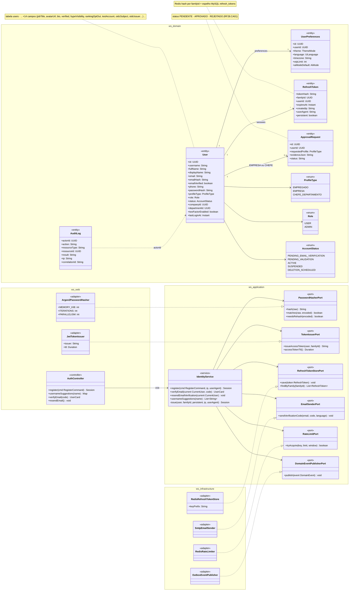
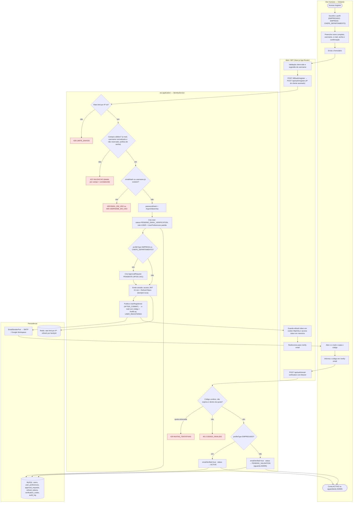
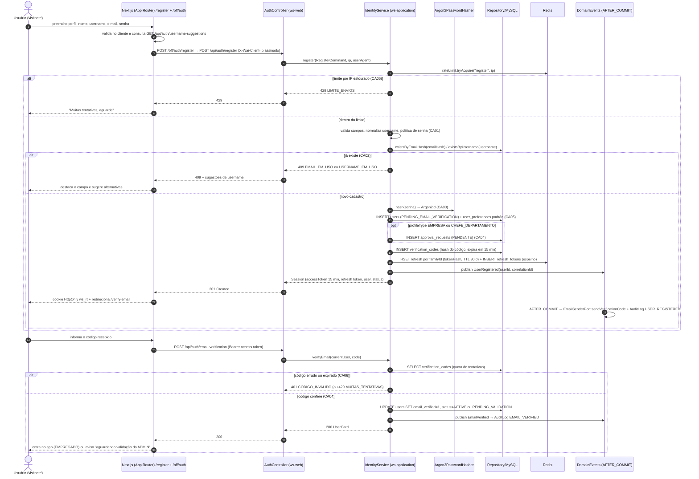
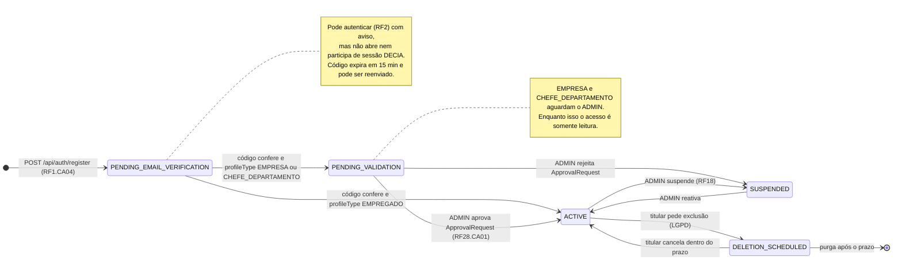
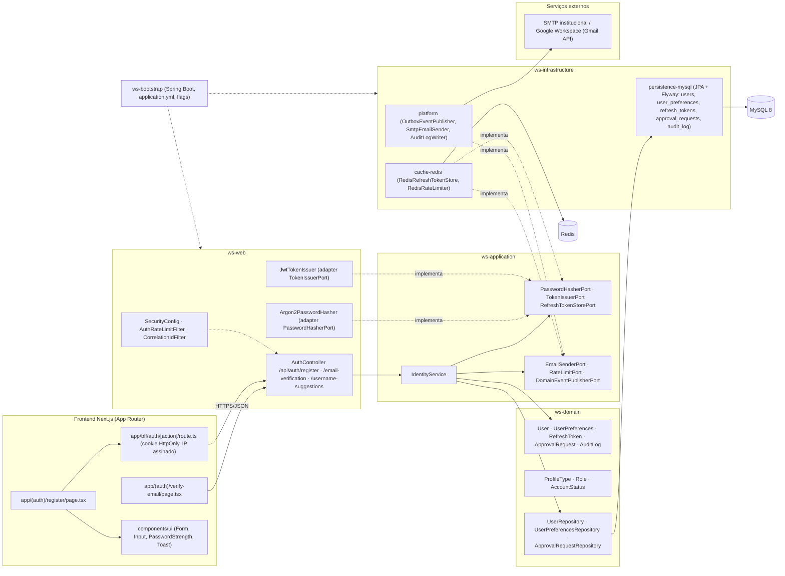
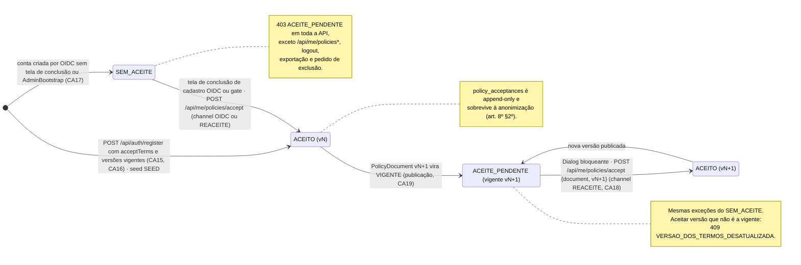

# RF1 — Cadastrar usuário na plataforma com dados de acesso
**HU:** HU1 · **Sprint (board Work Station):** 1 · **Equivalente FAI:** RF1 Cadastro (`AuthController POST /api/auth/register`, `IdentityService.register`, `Argon2PasswordHasher`, BFF `/bff/auth/register`) · **Aba/rota:** `/register` → `/verify-email` (BFF `/bff/auth/register`) — rota sugerida
**Critérios de aceite cobertos:** RF1.CA01 … RF1.CA06 (RF1–RF18 não têm CAs no board: derivados da HU1 e marcados "CA a confirmar") · RF1.CA07–CA13 (§7, segurança D-14) · RF1.CA14–CA27 (§8, aceite dos termos e tipos de perfil, D-15…D-22, "CA a confirmar")

> **HU1** — COMO visitante do sistema POSSO realizar meu cadastro na plataforma informando meus dados de acesso PARA obter uma conta e acessar as funcionalidades do DECIA.

## Critérios de aceite derivados da HU1 (todos "CA a confirmar")

| CA | Enunciado (Dado / Quando / Então) |
|---|---|
| **RF1.CA01** (CA a confirmar) | Dado o formulário de cadastro, quando informo perfil (`ProfileType` EMPREGADO · EMPRESA · CHEFE_DEPARTAMENTO), nome completo, `username`, e-mail, senha e confirmação, então cada campo é validado (formato de e-mail, username normalizado sem reservados, política mínima de senha, senhas iguais) e os erros voltam como `422 VALIDACAO` com `details` por campo e `correlationId`. |
| **RF1.CA02** (CA a confirmar — **corrigido no Bloco 3, Q-86/D-27**) | Dado um `username` já cadastrado, então `409 USERNAME_EM_USO` com `details.suggestions` (username é público; `GET /api/usernames/{u}/availability` e `GET /api/auth/username-suggestions`). Dado um **e-mail** já cadastrado, então a resposta é a **mesma `202 VERIFICACAO_ENVIADA`** do cadastro novo (sem oráculo) e a pessoa recebe um e-mail "você já tem uma conta" em vez do código — **não** há `409 EMAIL_EM_USO`. Implementado em `RegistrationService.register`. |
| **RF1.CA03** (CA a confirmar) | Dado um cadastro válido, então a senha é guardada apenas como hash **Argon2id** (parâmetros mínimos OWASP) via `PasswordHasherPort`, nunca aparece em log, evento ou auditoria; e-mail e telefone são cifrados em repouso (`AesGcmStringConverter`, LGPD). |
| **RF1.CA04** (CA a confirmar) | Dado o cadastro criado, então a conta nasce com `AccountStatus PENDING_EMAIL_VERIFICATION` e recebe um código de verificação por e-mail (AFTER_COMMIT); ao confirmar o código, EMPREGADO → `ACTIVE` e EMPRESA/CHEFE_DEPARTAMENTO → `PENDING_VALIDATION` com `ApprovalRequest PENDENTE` para o ADMIN (RF28.CA01). |
| **RF1.CA05** (CA a confirmar — **ajustado no Bloco 3, Q-86**) | Dado o cadastro criado, então o sistema cria `UserPreferences` padrão (theme AUTO, language PT_BR, timezone America/Sao_Paulo, wipLimit 3, aiModeDefault ECONOMIA) e grava `terms_version`/`privacy_version` vigentes; a sessão (access JWT 15 min + refresh para o BFF) é emitida **só na confirmação do código** (`POST /api/auth/email-verification/confirm`) — emitir no `register` revelaria se a conta era nova. A tela vai para `/verify-email` sem sessão. |
| **RF1.CA06** (CA a confirmar) | Dado tentativas repetidas, então há limite por IP (`429 LIMITE_ENVIOS`) e por código informado (`429 MUITAS_TENTATIVAS`); `AuditLog USER_REGISTERED` e `EMAIL_VERIFIED` são gravados sem dados sensíveis e com `correlationId`. |

## 1. Diagrama de classes

Entidades de `docs/arquitetura/TAXONOMIA.md` §1 (Identidade & Acesso) e §12 (Plataforma); serviços e portas sugeridos para `ws-application`, adaptadores em `ws-web`/`ws-infrastructure`.

## 2. Diagrama de atividades

Raias: Visitante · Web/BFF · `ws-application` · Persistência (o RF1 não usa o AiEngine).

## 3. Diagrama de sequência

Caminho feliz (cadastro → sessão → verificação de e-mail) e os `alt` de erro dos CA02 e CA06.

## 4. Máquina de estados

Entidade central: `User.status` (`AccountStatus`). O RF1 cobre a criação em `PENDING_EMAIL_VERIFICATION` e as duas saídas da verificação; os demais estados são do RF2/RF28/LGPD e aparecem para contexto.

## 5. Diagrama de componentes

## 6. Rastreabilidade

| CA | Classe (§1) | Passo da atividade (§2) | Mensagem da sequência (§3) | Transição de estado (§4) | Componente (§5) |
|---|---|---|---|---|---|
| RF1.CA01 | `IdentityService.register`, `User.username/fullName/email`, `ProfileType` | `B1`, `C2` → `E422` | 7 (valida campos) · `else novo cadastro` | — | `FE1`, `FE4`, `W1`, `S1` |
| RF1.CA02 | `User.emailHash`, `User.username`, `IdentityService.usernameSuggestions` | `C3` → `E409` | 8–11 (`existsByEmailHash`, 409) | — | `W1 /username-suggestions`, `D3 UserRepository` |
| RF1.CA03 | `PasswordHasherPort`, `Argon2PasswordHasher`, `User.passwordHash`, `User.email` (AES) | `C4` | 12 (`hash(senha) → Argon2id`) | — | `W3`, `I1` (AesGcmStringConverter) |
| RF1.CA04 | `AccountStatus`, `ApprovalRequest`, `IdentityService.verifyEmail`, `EmailSenderPort` | `C5`, `C6`–`C7`, `C14`–`C17` | 13–15, 22–31 | `[*] → PENDING_EMAIL_VERIFICATION`, `→ ACTIVE`, `→ PENDING_VALIDATION` | `FE2`, `I3 SmtpEmailSender`, `X1` |
| RF1.CA05 | `UserPreferences`, `RefreshToken`, `TokenIssuerPort`, `RefreshTokenStorePort` | `C5`, `C8`, `B9`, `B10` | 13, 17–20 (sessão + cookie HttpOnly) | — | `FE3`, `W4`, `I2 RedisRefreshTokenStore` |
| RF1.CA06 | `RateLimitPort`, `AuditLog`, `DomainEventPublisherPort` | `C1` → `E429`, `C14` → `E429b`/`E401`, `C9` | 5–6, 21, 25–27 | — | `W2 AuthRateLimitFilter`, `I2 RedisRateLimiter`, `I3 AuditLogWriter` |
| RF1.CA07 (CA a confirmar, D-14) | `Argon2PasswordHasher` (m=19456 KiB, t=2, p=1, salt 16, hash 32) | `C4` | 12 | — | `W3` · SEG §1 `Argon2PasswordHasher` |
| RF1.CA08 (CA a confirmar, D-14) | `AuthRateLimitFilter.RULES` (register 10/h, envios do cadastro 40/h, username-suggestions 60/10 min, availability 120/10 min), `ClientIpResolver` | `B2` (IP assinado), `C1` → `E429` | 3, 5–6 | — | `W2 AuthRateLimitFilter`, `FE3` · SEG §2 `D2`–`D4`, §3 3–9 |
| RF1.CA09 (CA a confirmar, D-14) | `HashBulkhead` (bulkhead do `POST /api/auth/register`) | `C1` → `C4` (vaga antes do hash) | 12 | — | `W2` · SEG §2 `D5`–`D6` → `E503`, §3 10–12 |
| RF1.CA10 (CA a confirmar, D-14) | `IdentityService.reservedUsername` (`admin`, `root`, `suporte`, `secid`, `decia`, `workstation`, prefixos `demo_`/`e2e_`) | `C2` → `E422` | 7 | — | `S1` · SEG §1 nota de `IdentityService` |
| RF1.CA11 (CA a confirmar, D-14) | `IdentityService.verifyEmail` (`noRollbackFor`, `MAX_CODE_ATTEMPTS` 5), `requireCodeAttemptQuota` (10/h por pessoa e finalidade) | `C14` → `E429b`/`E401` | 24–27 | — | `S1`, `I2` · SEG §2 `F14` |
| RF1.CA12 (CA a confirmar, D-14) | `User.accountOrigin` (`AccountOrigin` REAL desde o V1), `fixtureKey`, `testAccount` gerada | `C5` | 13 | `[*] → PENDING_EMAIL_VERIFICATION` (nasce `REAL`) | `I1` (V1 baseline) · SEG §1 `AccountOrigin` |
| RF1.CA13 (CA a confirmar, D-14) | `IdentityService.maskEmail`, `AuditLog` sem senha/código, `JwtTokenIssuer` (TTL em aberto, Q-49) | `C8`, `C9` | 17, 21 | — | `W4`, `I3 AuditLogWriter` · SEG §1 notas de `IdentityService` e `JwtTokenIssuer` |
| RF1.CA14 (CA a confirmar, D-15) | `PolicyDocument` (§8), `AuthController.register` | §8 passo "checkbox desmarcado · botão desabilitado" | — | §8 `SEM_ACEITE` | `FE1`, `FE4` (+ `Checkbox`, `Sheet` de `packages/ui`) |
| RF1.CA15 (CA a confirmar, D-15) | `IdentityService.register` (`acceptTerms`, `termsVersion`, `privacyVersion`) | `C2` → `E422` (`details.acceptTerms`) · `409 VERSAO_DOS_TERMOS_DESATUALIZADA` | 7 | §8 `SEM_ACEITE → ACEITO_V1` | `S1`, `W1` |
| RF1.CA16 (CA a confirmar, D-16) | `PolicyAcceptance` (append-only), `User.termsVersion/privacyVersion`, `AuditLog POLICY_ACCEPTED` | `C5` (INSERT `policy_acceptances`) | 13, 21 | §8 `→ ACEITO_V1` | `I1` (`policy_acceptances`), `I3 AuditLogWriter` |
| RF1.CA17 (CA a confirmar, D-16) | `AcceptanceChannel` (CADASTRO_LOCAL · OIDC · REACEITE · SEED), `AdminBootstrap` | `C5`; RF2 `loginOidc` → tela de conclusão | 13 | §8 `SEM_ACEITE` (admin do bootstrap entra aqui) | `S1`, RF2 `I3 SpringOidcClientAdapter`, seed demo |
| RF1.CA18 (CA a confirmar, D-16) | `PolicyGateFilter` (`403 ACEITE_PENDENTE`), `GET/POST /api/me/policies*` | — (RF2/RF3) | — | §8 `ACEITO_V1 → ACEITE_PENDENTE → ACEITO_V2` | `W2` (filtro após o JWT), `Dialog` de `packages/ui` |
| RF1.CA19 (CA a confirmar, D-15) | `PolicyDocument.status/effectiveFrom/changelog`, `LegalController` (`/api/legal/{document}/current`, `/versions`), `PolicyTextGuardTest` | — | — | — | `app/(public)/termos`, `app/(public)/privacidade`, `W1 LegalController` |
| RF1.CA20 (CA a confirmar, D-17) | `UserConsent` nasce vazio; nenhum `ConsentPurpose` no `RegisterCommand` | `C5` | 13 | — | `FE1` (sem Switch de consentimento) |
| RF1.CA21 (CA a confirmar, Q-63) | `User.birthDate` (AES, condicional), `IdentityService.register` (regra art. 14 **no servidor**) | `C2` → `E422` (`details.birthDate`) | 7 | — | `S1` |
| RF1.CA22 (CA a confirmar, D-09) | `ProfileType` (ADMIN não selecionável → `422 details.profileType`), `RadioCard` | `A2`, `C2` → `E422` | 1, 7 | — | `FE1`, `FE4` (+ `RadioCard`) |
| RF1.CA23 (CA a confirmar, Q-64) | `EmpresaProfileExtension`, `ChefeProfileExtension`, `User.jobTitle/intendedDepartmentId` | `A3`, `C2` → `E422` (details por campo) | 1, 7 | — | `FE1`, `S1`, `I1` (`user_empresa_ext`, `user_chefe_ext`) |
| RF1.CA24 (CA a confirmar, Q-62) | `IdentityService.allowedEmailDomain`, `VerificationPolicy.freeMailDomainsJson` (REPRESENTACAO automática) | `C2` → `E422` (`details.email`) | 7 | — | `S1`, RF28 §7 |
| RF1.CA25 (CA a confirmar, D-22) | `PendingUpload` (kind, expiresAt 24 h), `PendingUploadCleanupJob` (`@Scheduled` + lock), `OwnMedia` (`restricted/pending/`) | `POST /api/auth/uploads?kind=` antes de `A4`; `C2` → `E422` (upload de outro `kind`) | antes de 3 | — | `W1 /api/auth/uploads`, `storage-s3 restricted/pending/`, `I3` (job) |
| RF1.CA26 (CA a confirmar, D-14) | `IdentityService.usernameAvailable/usernameSuggestions`, lista reservada (CA10) | `B1` (debounce 400 ms) | 2 | — | `W1 /username-availability`, `/username-suggestions` |
| RF1.CA27 (CA a confirmar, D-19) | `ApprovalRequest` nasce **após** `verifyEmail` (não em `register`), `Guard.requireApprovedProfile` (`403 PERFIL_EM_VALIDACAO`) | `C17` (cria `ApprovalRequest` aqui, não em `C7`) | 29 (INSERT approval_requests move para depois do código) | `→ PENDING_VALIDATION` | `S1`, RF28 §7 |

## 7. Controles de segurança (D-14)

Herdados do RF49 do FAI pela **D-14**; detalhes, diagramas e rastreabilidade RN/CA em [`../SEG/README.md`](../SEG/README.md). Todos "(CA a confirmar)": a Q-48 decide se virarão CAs deste RF ou um RNF do board. Os controles do login (sem oráculo, bloqueio por conta, reconferência) estão no RF2 §7; aqui ficam os que tocam o cadastro e a verificação de e-mail.

| CA | Enunciado (Dado / Quando / Então) | Bloco do brief |
|---|---|---|
| **RF1.CA07** (CA a confirmar) | Dado um cadastro válido, então a senha é guardada com **Argon2id** exatamente em m=19456 KiB, t=2, p=1, salt 16 bytes, hash 32 bytes (mínimo OWASP), e `needsRehash` refaz o hash no próximo login quando os parâmetros mudarem. | 3 |
| **RF1.CA08** (CA a confirmar) | Dado o mesmo IP (assinado pelo BFF em `X-Ws-Client-Ip`/`X-Ws-Proxy-Ts`/`X-Ws-Proxy-Sig`; senão `X-Real-IP`; senão TCP; nunca `X-Forwarded-For`; IPv6 por /64), então o `AuthRateLimitFilter` aplica, **antes do Spring Security**, `POST /api/auth/register` 10/h, envios do cadastro 40/h, `GET /api/auth/username-suggestions` 60/10 min e disponibilidade de username 120/10 min; o excedente recebe `429 MUITAS_TENTATIVAS` com `Retry-After` (substitui o `429 LIMITE_ENVIOS` do CA06). | 3 |
| **RF1.CA09** (CA a confirmar) | Dado um pico de cadastros, então o `HashBulkhead` (permits = `max(1, min(max(2, núcleos), poolDoBanco/2))`, espera 2 s) limita os Argon2 simultâneos e o excedente recebe `503 AUTENTICACAO_OCUPADA` + `Retry-After`; 60 pedidos paralelos geram zero HTTP 500. | 3 |
| **RF1.CA10** (CA a confirmar — **ajustado no Bloco 3**) | Dado um `username` que, depois da normalização (`Usernames.normalize`), seja `admin`, `root`, `suporte`, `secid`, `decia`, `workstation` ou comece com `demo_`/`e2e_`, então o cadastro responde **`422 NOME_RESERVADO`** (código próprio, com `details.suggestions`); a conta de administração só nasce pelo `AdminBootstrap` (`WS_ADMIN_BOOTSTRAP_ENABLED=true`, segredo **`WS_ADMIN_INITIAL_PASSWORD`** ≥ 16 chars sem padrão, só se não existe nenhum ADMIN; nunca promove conta existente sem `WS_ADMIN_PROMOTE_EXISTING=true`). | 3 |
| **RF1.CA11** (CA a confirmar) | Dado o código de verificação, então há no máximo 5 tentativas por código (`attempts++` persiste mesmo com erro, `noRollbackFor`) e um contador atômico de 10 tentativas/h por pessoa e finalidade; o excedente recebe `429 MUITAS_TENTATIVAS`. | 3 |
| **RF1.CA12** (CA a confirmar) | Dado o cadastro criado, então `users.account_origin` nasce `REAL` (enum `AccountOrigin` REAL/TEST_SEED/DEMO/SYSTEM desde o `V1__baseline.sql`), com `fixture_key` NULL e `test_account` gerada = false; contas `TEST_SEED`/`DEMO` ficam fora de rankings, HSE, DECIA Points e métricas do RF43, e o e-mail nunca é enviado a `.test`/`.example`/`.invalid`/`.localhost`. | 2, 6 |
| **RF1.CA13** (CA a confirmar) | Dado qualquer log ou evento do cadastro, então o e-mail aparece mascarado (`maskEmail`: `m***@dominio`) e nunca há senha, token ou código; a sessão emitida no CA05 segue o RF2 (TTL do access token em aberto na **Q-49**: 10 min na ARQUITETURA, 15 min aqui). | 1, 3 |

### 7.1 Implementação (Bloco 3, PR sec-b3)

| CA | Classe(s) | Teste(s) | Observação |
|---|---|---|---|
| CA01 / CA15 / CA22 | `RegistrationService.register` (422 `VALIDACAO` por campo; `acceptTerms` obrigatório; `profileType` só EMPREGADO/EMPRESA/CHEFE_DEPARTAMENTO), `Passwords`, `Usernames`, `RegistrationController` | `RegistrationServiceTest.validacoesDoFormularioVoltamPorCampoENomesReservadosDao422NomeReservado`, `RegistrationAndResetControllerWebTest` | `termsVersion`/`privacyVersion` vêm de `ws.legal.current-versions` (gancho do bloco LGPD A; sem `PolicyDocument` ainda) |
| CA02 | `RegistrationService.register/availability/suggestions` | `RegistrationServiceTest.emailJaCadastradoRecebeAMesmaRespostaEUmEmailDeContaExistente`, `.usernameOcupadoDa409ComSugestoesEDisponibilidadeResponde` | Q-86 |
| CA03 / CA07 | `Argon2PasswordHasher`, `FieldCipher`/`AesGcmStringConverter` (`email_enc`, `phone_enc`), `HmacEmailHasher` (`email_hash`) | `Argon2PasswordHasherTest`, `FieldCipherTest`, `IdentityPersistenceIT` | Q-87 |
| CA04 / CA05 / CA27 | `RegistrationService.confirmEmail` (EMPREGADO → `ACTIVE`; EMPRESA/CHEFE → `PENDING_VALIDATION`; abre a sessão), `UserPreferences` padrão | `RegistrationServiceTest.codigoCertoConfirmaEmpresaFicaPendenteDeValidacaoEmpregadoFicaAtivoEAbreSessao` | `ApprovalRequest` é o RF28 |
| CA06 / CA08 / CA09 | `AuthRateLimitFilter.RULES` (register 10/h, uploads 40/h, suggestions 60, availability 120/10 min, resend 10/h, confirm 20/h), `HashBulkhead` | `AuthRateLimitFilterTest.tabelaDoBriefLimitaCadaRotaSeparadamente`, `.hashesSimultaneosAcimaDoTetoRecebem503` | `429 LIMITE_ENVIOS` virou `MUITAS_TENTATIVAS` |
| CA10 | `Usernames.RESERVED/RESERVED_PREFIXES`, `AdminBootstrap` | `UsernamesAndPasswordsTest`, `AdminBootstrapTest` | — |
| CA11 | `RegistrationService.confirmEmail/requireCodeAttemptQuota`, `VerificationCode.failedAttempt` (`@Transactional(noRollbackFor = ApiException.class)`), `verification_codes` (V3) | `RegistrationServiceTest.confirmacaoDoCodigoLimitaCincoTentativasPersistidasEDezPorHora` | — |
| CA12 | `User.accountOrigin = REAL` no cadastro; `test_account` gerada no banco | `IdentityPersistenceIT` (`test_account = 0`) | — |
| CA13 | `AuditEvent` (saneamento), `Masking.maskEmail` nos metadados, `LoggingMailAdapter` (destinatário mascarado) | `AuditEventTest`, `RegistrationServiceTest.cadastroValidoCriaContaPendente…` (`audit.dump()` sem senha/código/e-mail) | — |

## 8. Aceite dos termos e tipos de perfil no cadastro (CA a confirmar, D-15…D-22)

Blocos **A** (aceite dos Termos de Uso e da Política de Privacidade) e **B** (tipos de perfil, campos por tipo e envios
do cadastro) do brief `PROMPT_DECIA_CADASTRO_LGPD`. Entidades novas em `TAXONOMIA.md` §1.8–1.15 (todas **proposta**);
plano em `docs/produto/CADASTRO_E_LGPD.md`; dúvidas Q-60…Q-73. Os diagramas §1–§5 **não** foram reescritos: as
mudanças que eles sofrem estão anotadas na rastreabilidade (§6) e no bloco de estados abaixo. Os defeitos do FAI que
estes CAs evitam: aceite sem histórico e sem reaceite (3), botão nunca desabilitado (4), idade só conferida se a data
vier (5), páginas de Termos/Privacidade inexistentes e textos com marcadores (2).

### 8.1 Bloco A — aceite (RF1.CA14–CA21)

| CA | Enunciado (Dado / Quando / Então) |
|---|---|
| **RF1.CA14** (CA a confirmar) | Dado o formulário de cadastro, então o `Checkbox` "Li e aceito os Termos de Uso e a Política de Privacidade" vem **desmarcado**, com links para os dois documentos que abrem em `Sheet` ou em nova aba **sem perder o formulário**; o botão "Criar conta" fica `disabled` até marcar (teste Vitest: sem o checkbox o submit não dispara). |
| **RF1.CA15** (CA a confirmar) | Dado o pedido chegando sem `acceptTerms=true`, então o servidor responde `422 VALIDACAO` com `details.acceptTerms` (teste de integração); o cliente envia as versões que exibiu (`termsVersion`, `privacyVersion`) e, se alguma não for a `VIGENTE`, recebe `409 VERSAO_DOS_TERMOS_DESATUALIZADA` (Q-70). |
| **RF1.CA16** (CA a confirmar) | Dado o cadastro aceito, então são gravadas **duas** linhas em `policy_acceptances` (TERMOS e PRIVACIDADE, cada uma com `version`, `accepted_at`, `ip`, `user_agent`, `channel`), a cópia em `users.terms_version/privacy_version` e o `AuditLog POLICY_ACCEPTED {document, version, channel}`. A tabela é append-only e a FK é `ON DELETE RESTRICT`: o registro **sobrevive à anonimização** (art. 8º, § 2º). |
| **RF1.CA17** (CA a confirmar) | Dado qualquer caminho que cria conta, então o aceite é capturado: cadastro local (`CADASTRO_LOCAL`), **primeiro login OIDC** numa tela de conclusão de cadastro (`OIDC`, Q-02) e seed demo (`SEED`). O admin do `AdminBootstrap` **não** recebe aceite automático e passa pelo gate (CA18) no primeiro login. |
| **RF1.CA18** (CA a confirmar) | Dado que a versão `VIGENTE` de um documento é mais nova que a aceita, então o app abre um `Dialog` bloqueante com o `changelog` e a API responde `403 ACEITE_PENDENTE` a tudo, **exceto** `GET /api/me/policies`, `POST /api/me/policies/accept {document, version}`, logout, exportação (`/api/me/exports*`) e pedido de exclusão (`/api/me/deletion*`): quem recusa continua exercendo seus direitos. O aceite novo entra com `channel REACEITE`. |
| **RF1.CA19** (CA a confirmar) | Dado as páginas públicas `/termos` e `/privacidade`, então elas funcionam sem login e pelo gate, mostram a versão vigente e o histórico (`GET /api/legal/{TERMOS\|PRIVACIDADE}/current` e `/versions`), e o `PolicyTextGuardTest` falha se a versão publicada tiver marcador `[` … `]` ou "validar com jurídico" (regras em `docs/legal/README.md`). |
| **RF1.CA20** (CA a confirmar) | Dado o cadastro, então **nenhum** consentimento de finalidade opcional (`ConsentPurpose`) é pedido junto com o aceite (art. 8º, § 4º); `user_consents` nasce vazio e os interruptores ficam só em `/settings?tab=privacidade` (RF3.CA10). |
| **RF1.CA21** (CA a confirmar, Q-63) | Dado a resposta à Q-63: se menores **não** podem usar, a data de nascimento **não é coletada**; se podem, `birthDate` é **obrigatória no servidor** (campo vazio → `422 details.birthDate`, nunca "pulado" como no FAI) e a regra do art. 14 é aplicada. |

### 8.2 Bloco B — tipos de perfil e envios (RF1.CA22–CA27)

| CA | Enunciado (Dado / Quando / Então) |
|---|---|
| **RF1.CA22** (CA a confirmar) | Dado a escolha do tipo, então ela é feita com `RadioCard` (ícone, título, uma linha do que o perfil pode fazer e o aviso "precisa de validação" em EMPRESA e CHEFE_DEPARTAMENTO); `ADMIN` enviado no corpo recebe `422 VALIDACAO` (`details.profileType`); CURADOR não é tipo (D-09). |
| **RF1.CA23** (CA a confirmar, Q-64) | Dado o tipo escolhido, então os campos extras são (proposta): EMPREGADO `jobTitle` e `intendedDepartmentId` opcional (**não lota**; quem lota é o chefe, RF28.CA02); EMPRESA `legalName`, `companyCnpj` (dígitos verificadores), `officialSite` **obrigatório** (normalizado para `https://`, recusa `@perfil`) e `representationDocId`; CHEFE `companyId` existente, departamento e `appointmentLink` (Diário Oficial). Erros voltam como `422 VALIDACAO` com `details` por campo. |
| **RF1.CA24** (CA a confirmar, Q-62) | Dado a resposta à Q-62, então EMPREGADO pode exigir e-mail de domínio institucional numa lista permitida (`422 details.email`); para EMPRESA, se o domínio do e-mail for igual ao do `officialSite` (fora da lista de e-mails gratuitos), o critério `REPRESENTACAO` da validação é marcado automaticamente (RF28.CA15). |
| **RF1.CA25** (CA a confirmar) | Dado `POST /api/auth/uploads?kind=`, então `kind` só pode ser `avatar`, `identity` ou `representation`; há limite de bytes e de pixels (SEG RN49.08), reencode que remove EXIF/GPS, documentos vão para `restricted/pending/…` e viram `PendingUpload` com `expiresAt = +24 h`; o cadastro só aceita URL de envio pendente **do mesmo `kind`** (`422 details.<campo>`); o `PendingUploadCleanupJob` apaga os abandonados, e um teste prova que o método está agendado (`@Scheduled` + lock). |
| **RF1.CA26** (CA a confirmar) | Dado o campo `username`, então a disponibilidade é consultada com debounce de 400 ms (`GET /api/auth/username-availability`), a lista de reservados normalizada inclui `secid`, `decia`, `workstation` e os prefixos `demo_`/`e2e_` (CA10) e há sugestões (`/username-suggestions`). |
| **RF1.CA27** (CA a confirmar) | Dado EMPRESA ou CHEFE_DEPARTAMENTO, então o `ApprovalRequest` nasce **só depois da confirmação do e-mail** (resolve a divergência entre o CA04 e o passo `C7` do §2, onde ele nascia no registro); o prazo em dias úteis conta daí (RF28.CA12); enquanto `PENDING_VALIDATION`, `Guard.requireApprovedProfile` responde `403 PERFIL_EM_VALIDACAO` e o menu esconde as ações de emissor. |

### 8.3 Máquina de estados do aceite (por documento)

Estado derivado por `(users.terms_version, users.privacy_version)` × versão `VIGENTE` de cada `PolicyDocument`; um
estado por documento, avaliado pelo `PolicyGateFilter` depois do JWT e antes dos controllers.

Tela/aba: `/register` (esqueleto em `app/(auth)/register/page.tsx`) · `/verify-email` (esqueleto em `app/(auth)/verify-email/page.tsx`)
