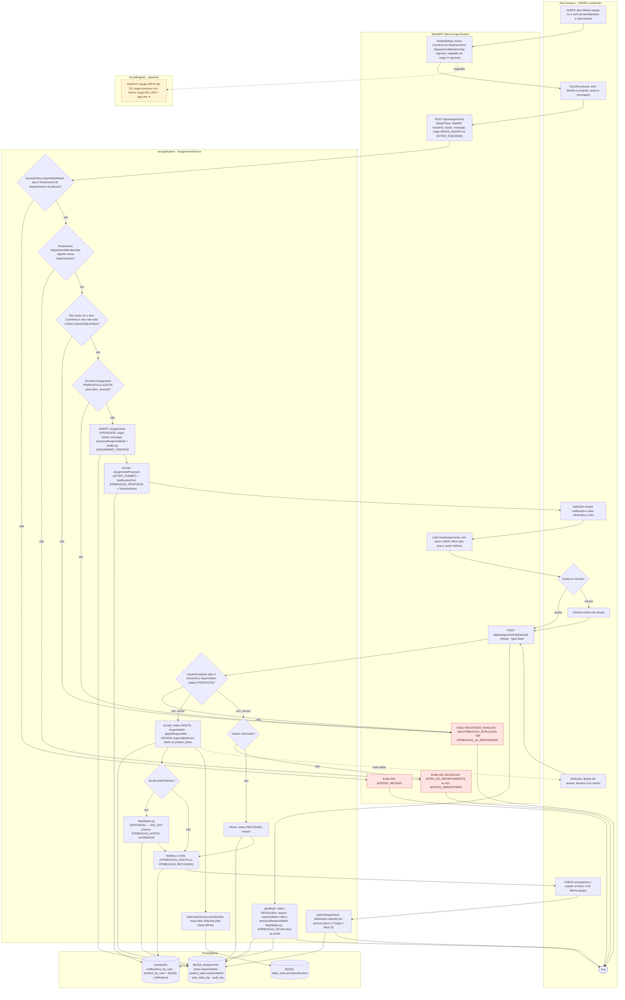
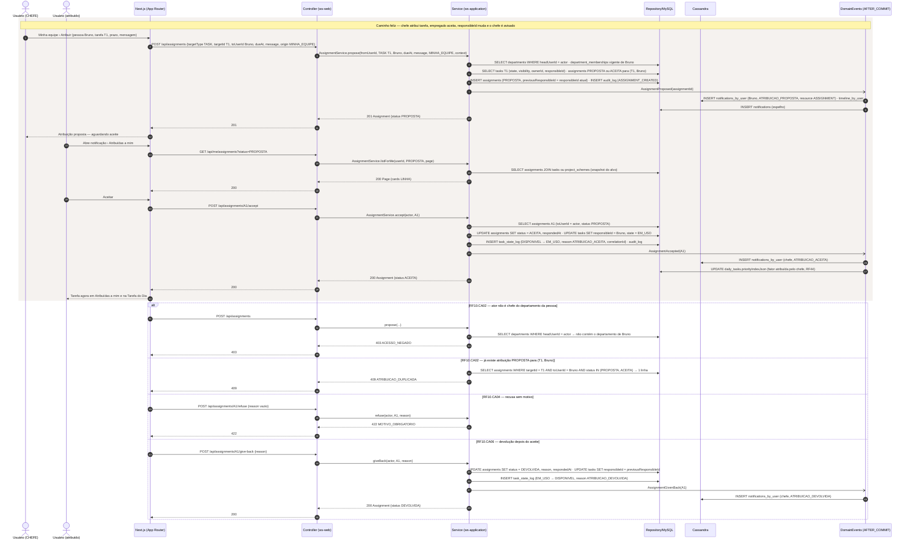
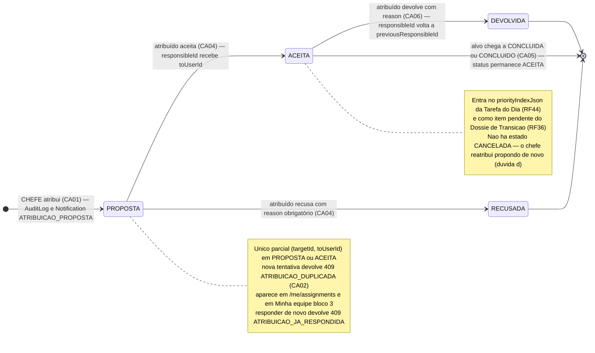
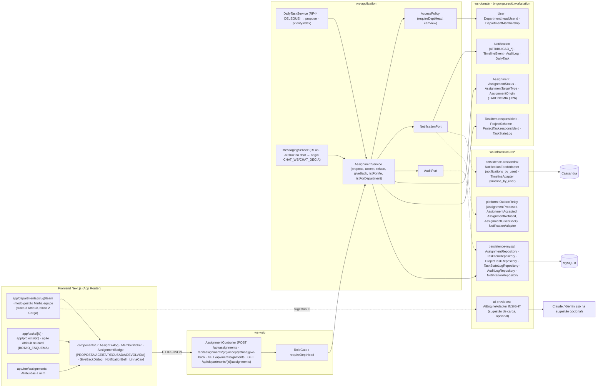

# RF10 — Permitir que o chefe de departamento possa atribuir uma tarefa ou projeto a um usuário
**HU:** HU10 · **Sprint (board Work Station):** lista *Requisitos Funcionais* (card novo, sem sprint atribuída — a confirmar) · **Equivalente FAI:** nenhum (o FAI não tem hierarquia chefe → empregado; a atribuição é escopo novo do Work Station, ver `docs/produto/ABAS_POR_PERFIL.md` §7.b, TAXONOMIA §12b e `docs/diagramas/RF46/README.md`) · **Aba/rota:** página do departamento › **Equipe › Minha equipe (gestão)** (`/departments/[slug]/team?mode=manage`, origem `MINHA_EQUIPE`), ação "Atribuir" no card de tarefa (`/tasks/[id]`) e de projeto (`/projects/[id]`, origem `BOTAO_ESQUEMA`); lado do atribuído: `/me/assignments` ("Atribuídas a mim") e Tarefa do Dia (RF44); API `POST /api/assignments`
**Critérios de aceite cobertos:** RF10.CA01 · RF10.CA02 · RF10.CA03 · RF10.CA04 · RF10.CA05 · RF10.CA06 — corpo do card vazio: CAs derivados do título + HU10 + `ABAS_POR_PERFIL.md` §7.b (bloco 3) e P-02 + RF46.CA03–CA05 (mesma entidade `Assignment`), marcados **(CA a confirmar)**

> **HU10** — COMO chefe de departamento POSSO clicar em "Atribuir tarefa ou projeto" PARA que um empregado possa visualizar sua lista de tarefas ou projetos pendentes dentro de seu escopo de trabalho.

A atribuição usa a entidade **`Assignment`** da TAXONOMIA §12b (contexto *Mensageria & Atribuição*, marcado **proposta** na taxonomia): `targetType` `AssignmentTargetType` (TASK · PROJECT), `fromUserId`, `toUserId`, `origin` `AssignmentOrigin` (MINHA_EQUIPE · BOTAO_ESQUEMA · CHAT_WS · CHAT_DECIA), `status` `AssignmentStatus` (PROPOSTA · ACEITA · RECUSADA · DEVOLVIDA), `dueAt`, `message`, `reason`, `previousResponsibleId`, `traceNodeId`, `respondedAt`. O RF10 é o caso em que **`fromUserId` é o CHEFE** (`Department.headUserId`) e as origens são `MINHA_EQUIPE` ou `BOTAO_ESQUEMA`; o RF46 cobre as origens `CHAT_WS`/`CHAT_DECIA` e a proposta entre colegas. O `responsibleId` (`TaskItem` §2.1 / `ProjectTask` §3.2) só é escrito no **aceite**; `previousResponsibleId` permite a **devolução**. Rastro: `Assignment` + `AuditLog` + `TaskStateLog` (quando o aceite muda `TaskState`) + `Notification` ATRIBUICAO_PROPOSTA · ATRIBUICAO_ACEITA · ATRIBUICAO_RECUSADA · ATRIBUICAO_DEVOLVIDA (já em `NotificationType`, §8.8).

| CA | Enunciado (CA a confirmar) |
|---|---|
| **RF10.CA01** | Dado um CHEFE (`Department.headUserId`) em *Minha equipe* ou num card de tarefa/projeto, quando aciona **Atribuir** escolhendo pessoa, alvo (`TaskItem` ou `ProjectScheme`), prazo opcional e mensagem (≤ 500), então `POST /api/assignments` cria `Assignment` com `status = PROPOSTA`, `fromUserId` = chefe, `toUserId`, `targetType`, `targetId`, `dueAt`, `message`, `origin` (MINHA_EQUIPE ou BOTAO_ESQUEMA) e `previousResponsibleId` = responsável atual; `AuditLog` ASSIGNMENT_CREATED com `correlationId`. |
| **RF10.CA02** | Dado o pedido, então o serviço exige `AccessPolicy.requireDeptHead` do departamento da pessoa: ator que não é chefe → `403 ACESSO_NEGADO`; pessoa sem `DepartmentMembership` vigente no departamento do chefe → `422 VALIDACAO (FORA_DO_DEPARTAMENTO)`; alvo que o ator não pode ver (`Visibility.PRIVADA` de terceiro) → `403 ACESSO_NEGADO`; alvo em CONCLUIDA/ARQUIVADA (tarefa) ou CONCLUIDO/ARQUIVADO (projeto) → `409 ESTADO_INVALIDO`; já existe `Assignment` PROPOSTA ou ACEITA para o mesmo (`targetId`, `toUserId`) → `409 ATRIBUICAO_DUPLICADA`. |
| **RF10.CA03** | Dado o commit, então o evento `AssignmentProposed` (AFTER_COMMIT) grava `Notification` tipo **ATRIBUICAO_PROPOSTA**, categoria SISTEMA, `resourceType = ASSIGNMENT`, em `notifications_by_user` (Cassandra) + espelho MySQL, e `TimelineEvent` do atribuído; o chefe acompanha o estado no bloco 3 de *Minha equipe* (`GET /api/departments/{id}/assignments`). |
| **RF10.CA04** | Dado o atribuído (`toUserId`), quando **aceita** (`POST /api/assignments/{id}/accept`), então `status = ACEITA`, `respondedAt`, `TaskItem.responsibleId` ou `ProjectTask.responsibleId` (todas as `ProjectTask` sem responsável, quando PROJECT) recebe `toUserId`, `TaskStateLog` é gravado se a tarefa passa de DISPONIVEL para EM_USO (`reason` ATRIBUICAO_ACEITA) e o chefe recebe ATRIBUICAO_ACEITA; quando **recusa** (`/refuse`), então `reason` é obrigatório (`422 MOTIVO_OBRIGATORIO`), `status = RECUSADA` e o chefe recebe ATRIBUICAO_RECUSADA; quem não é `toUserId` → `403 ACESSO_NEGADO`; responder atribuição já respondida → `409 ATRIBUICAO_JA_RESPONDIDA`. |
| **RF10.CA05** | Dado o atribuído, então `/me/assignments` (`AssignmentService.listForMe`) lista as atribuições PROPOSTA e ACEITA (filtros: tipo, prazo, quem atribuiu) com o alvo em card `LINHA`; a `Assignment` ACEITA entra no `priorityIndexJson` da Tarefa do Dia (RF44) com o fator "atribuída pelo chefe" e no Dossiê de Transição (RF36) como item pendente; o chefe vê, por pessoa, as atribuições abertas em *Minha equipe* (bloco 2 Carga e bloco 3). |
| **RF10.CA06** | Dado o atribuído com `Assignment` ACEITA, quando **devolve** com motivo (`POST /api/assignments/{id}/give-back`), então `status = DEVOLVIDA`, `reason` obrigatório (`422 MOTIVO_OBRIGATORIO`), o `responsibleId` volta a `previousResponsibleId`, `TaskStateLog` registra a volta e o chefe recebe ATRIBUICAO_DEVOLVIDA; DELEGUEI da Tarefa do Dia (RF44) e "Atribuir" no chat (RF46) chamam o mesmo `AssignmentService.propose` com `origin` CHAT_WS/CHAT_DECIA; delegação para pessoa de outro departamento exige aceite do chefe dela **(a confirmar)**. |

## 1. Diagrama de classes

```mermaid
classDiagram
  direction LR

  class Assignment {
    <<entity>>
    +UUID id
    +AssignmentTargetType targetType
    +UUID targetId
    +UUID fromUserId
    +UUID toUserId
    +AssignmentOrigin origin
    +AssignmentStatus status
    +LocalDate dueAt
    +String message
    +String reason
    +UUID previousResponsibleId
    +UUID traceNodeId
    +Instant respondedAt
  }
  class AssignmentStatus {
    <<enum>>
    PROPOSTA
    ACEITA
    RECUSADA
    DEVOLVIDA
  }
  class AssignmentTargetType {
    <<enum>>
    TASK
    PROJECT
  }
  class AssignmentOrigin {
    <<enum>>
    MINHA_EQUIPE
    BOTAO_ESQUEMA
    CHAT_WS
    CHAT_DECIA
  }
  class TaskItem {
    <<entity>>
    +UUID id
    +UUID ownerId
    +UUID departmentId
    +String title
    +UUID responsibleId
    +LocalDate dueAt
    +TaskState state
    +Visibility visibility
  }
  class ProjectScheme {
    <<entity>>
    +UUID id
    +UUID ownerId
    +UUID departmentId
    +String title
    +ProjectStatus status
    +Visibility visibility
  }
  class ProjectTask {
    <<entity>>
    +UUID id
    +UUID projectId
    +UUID taskId
    +ProjectPhase phase
    +UUID responsibleId
    +LocalDate dueAt
  }
  class TaskStateLog {
    <<entity>>
    +UUID id
    +UUID taskId
    +TaskState fromState
    +TaskState toState
    +UUID actorId
    +String reason
    +String correlationId
  }
  class User {
    <<entity>>
    +UUID id
    +String username
    +String fullName
    +ProfileType profileType
    +UUID departmentId
  }
  class Department {
    <<entity>>
    +UUID id
    +String acronym
    +UUID headUserId
  }
  class DepartmentMembership {
    <<entity>>
    +UUID userId
    +UUID departmentId
    +DeptRole roleInDept
    +Instant startedAt
    +Instant endedAt
  }
  class Notification {
    <<entity>>
    +UUID recipientId
    +UUID actorId
    +NotificationType type
    +String category
    +String resourceType
    +UUID resourceId
    +String groupKey
  }
  class NotificationType {
    <<enum>>
    ATRIBUICAO_PROPOSTA
    ATRIBUICAO_ACEITA
    ATRIBUICAO_RECUSADA
    ATRIBUICAO_DEVOLVIDA
  }
  class DailyTask {
    <<entity>>
    +UUID userId
    +LocalDate taskDate
    +String priorityIndexJson
    +DailyFeedback feedback
    +UUID delegatedToUserId
  }
  class AuditLog {
    <<entity>>
    +UUID actorId
    +String action
    +String resourceType
    +UUID resourceId
    +String correlationId
  }

  class AssignmentController {
    <<controller>>
    +POST_api_assignments(body) 201
    +POST_api_assignments_id_accept() 200
    +POST_api_assignments_id_refuse(reason) 200
    +POST_api_assignments_id_give_back(reason) 200
    +GET_api_me_assignments(status, page) 200
    +GET_api_departments_id_assignments(status, userId) 200
  }
  class AssignmentService {
    <<service>>
    +propose(fromUserId, target, toUserId, dueAt, message, origin, context) Assignment
    +accept(toUserId, assignmentId) Assignment
    +refuse(toUserId, assignmentId, reason) Assignment
    +giveBack(toUserId, assignmentId, reason) Assignment
    +listForMe(userId, status, page) Page
    +listForDepartment(headId, deptId, filters) Page
    -requireAssignee(actor, assignment) 403 ACESSO_NEGADO
    -requireOpen(assignment) 409 ATRIBUICAO_JA_RESPONDIDA
    -applyResponsible(assignment) TaskItem ou ProjectTask
  }
  class AccessPolicy {
    <<service>>
    +requireDeptHead(user, deptId) void
    +canView(user, target) boolean
  }
  class DailyTaskService {
    <<service>>
    +delegate(userId, taskId, toUserId) Assignment
    +priorityIndex(userId) inclui ACEITA do chefe
  }
  class NotificationPort {
    <<port>>
    +notify(recipientId, type, resource, payload)
  }
  class AssignmentRepository {
    <<adapter>>
    MySQL assignments
  }
  class NotificationFeedAdapter {
    <<adapter>>
    Cassandra notifications_by_user
  }

  Assignment --> AssignmentStatus
  Assignment --> AssignmentTargetType
  Assignment --> AssignmentOrigin
  Assignment --> User : fromUserId CHEFE
  Assignment --> User : toUserId
  Assignment --> User : previousResponsibleId
  Assignment ..> TaskItem : targetId quando TASK
  Assignment ..> ProjectScheme : targetId quando PROJECT
  Department --> User : headUserId
  DepartmentMembership --> User
  DepartmentMembership --> Department
  ProjectScheme "1" --> "*" ProjectTask
  ProjectTask --> TaskItem : taskId
  TaskItem --> User : responsibleId
  ProjectTask --> User : responsibleId
  TaskItem "1" --> "*" TaskStateLog
  Notification --> NotificationType
  Notification ..> Assignment : resourceId
  DailyTask ..> Assignment : fator atribuida pelo chefe

  AssignmentController --> AssignmentService
  AssignmentService --> AccessPolicy
  AssignmentService --> AssignmentRepository
  AssignmentService --> NotificationPort
  AssignmentService ..> AuditLog
  AssignmentService ..> TaskStateLog : aceite DISPONIVEL para EM_USO e devolucao
  DailyTaskService --> AssignmentService : DELEGUEI
  NotificationPort <|.. NotificationFeedAdapter

  note for Assignment "TAXONOMIA §12b (proposta) — tabela assignments · mesma entidade do RF46 e das acoes atribuir/retornar (RF18/RF19) · no RF10 fromUserId e o headUserId e origin e MINHA_EQUIPE ou BOTAO_ESQUEMA · unico parcial (targetId, toUserId) em PROPOSTA ou ACEITA (409 ATRIBUICAO_DUPLICADA, proposta deste RF)"
  note for NotificationType "subconjunto dos valores de TAXONOMIA §8.8 usados aqui"
  note for TaskItem "responsibleId e escrito so no aceite (CA04) e volta a previousResponsibleId na devolucao (CA06)"
```

## 2. Diagrama de atividades

## 3. Diagrama de sequência

## 4. Máquina de estados

Entidade central: **`Assignment.status`** (enum `AssignmentStatus` — TAXONOMIA §12b/§13). O aceite escreve `TaskItem.responsibleId`/`ProjectTask.responsibleId` e pode mover `TaskState` DISPONIVEL → EM_USO (RF41), registrado em `TaskStateLog`; a devolução restaura `previousResponsibleId`.

## 5. Diagrama de componentes

## 6. Rastreabilidade

| CA | Classe | Passo (atividades) | Mensagem (sequência) | Transição (estados) | Componente |
|---|---|---|---|---|---|
| RF10.CA01 | `Assignment` (targetType, targetId, fromUserId, toUserId, dueAt, message, origin, previousResponsibleId), `AssignmentService.propose`, `AssignmentController.POST_api_assignments`, `AuditLog` | U1, U2, W1, W2, S5 | 1–6 | `[*] → PROPOSTA` | `AssignDialog`, `MemberPicker`, `AssignmentController`, `AssignmentRepository` |
| RF10.CA02 | `AccessPolicy.requireDeptHead/canView`, `Department.headUserId`, `DepartmentMembership` (vigente), `TaskItem.state/visibility`, `ProjectScheme.status`, índice único parcial de `Assignment` | S1–S4, W5, W6, W7 | 4–5; `alt` 403 ACESSO_NEGADO; `alt` 409 ATRIBUICAO_DUPLICADA | nota de PROPOSTA (409 na repetição) | `RoleGate / requireDeptHead`, `AccessPolicy` |
| RF10.CA03 | `Notification` (ATRIBUICAO_PROPOSTA, resourceType ASSIGNMENT), `NotificationType`, `TimelineEvent`, `NotificationPort`, evento `AssignmentProposed`, `AssignmentService.listForDepartment` | S6, D2, U3, U6, S16 | 7–9 | rótulo da transição `[*] → PROPOSTA` | `OutboxRelay`, `NotificationFeedAdapter`, `TimelineAdapter`, `NotificationBell`, bloco 3 de `Minha equipe` |
| RF10.CA04 | `AssignmentService.accept/refuse/requireAssignee/requireOpen/applyResponsible`, `Assignment.reason/respondedAt`, `TaskItem.responsibleId`, `ProjectTask.responsibleId`, `TaskStateLog` | U4, U5, W4, S7–S13 | 19–30; `alt` 422 MOTIVO_OBRIGATORIO | `PROPOSTA → ACEITA`, `PROPOSTA → RECUSADA` | `AssignmentBadge`, `TaskStateLogRepository`, `ProjectTaskRepository` |
| RF10.CA05 | `AssignmentService.listForMe/listForDepartment`, `DailyTask.priorityIndexJson`, `DailyTaskService.priorityIndex` | W3, S15, S16, D3 | 13–18, 28 | nota de ACEITA; `ACEITA → [*]` quando o alvo conclui | `app/me/assignments`, `LinhaCard`, `DailyTaskService` |
| RF10.CA06 | `AssignmentService.giveBack`, `Assignment.previousResponsibleId`, `AssignmentOrigin` (CHAT_WS, CHAT_DECIA), `DailyTaskService.delegate`, `MessagingService` | U7, S14 | `alt` RF10.CA06 (give-back, ATRIBUICAO_DEVOLVIDA) | `ACEITA → DEVOLVIDA` | `GiveBackDialog`, `DailyTaskService (RF44)`, `MessagingService (RF46)` |

**Dúvidas para confirmar:** (a) nomes dos campos: TAXONOMIA §12b usa `fromUserId`/`toUserId`/`message`/`reason`; `RF46/README.md` usa `assignerId`/`assigneeId`/`note`/`responseReason` e acrescenta `projectTaskId`, `companyId`, `departmentId`, `conversationId`, `sessionId` — unificar; (b) atribuir um **projeto inteiro** preenche todas as `ProjectTask` sem responsável ou só marca o projeto; (c) índice único parcial (`targetId`, `toUserId`) em PROPOSTA/ACEITA e o erro `409 ATRIBUICAO_DUPLICADA` são proposta deste RF; (d) o chefe pode **cancelar** uma PROPOSTA (estado CANCELADA não existe em `AssignmentStatus`) ou só o atribuído responde; (e) delegação (RF44 DELEGUEI) para fora do departamento exige aceite do chefe de destino; (f) sprint do card.
