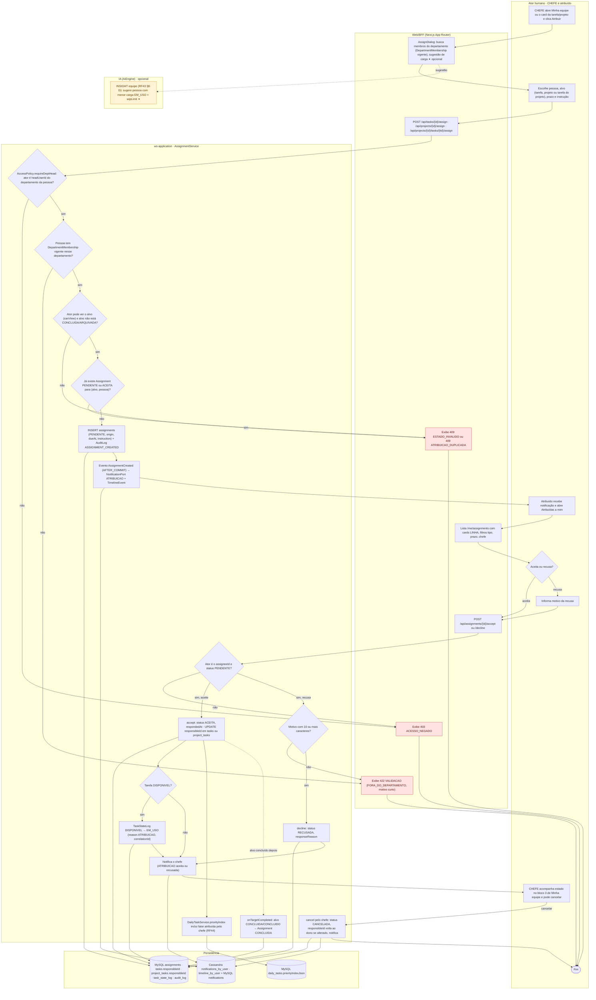
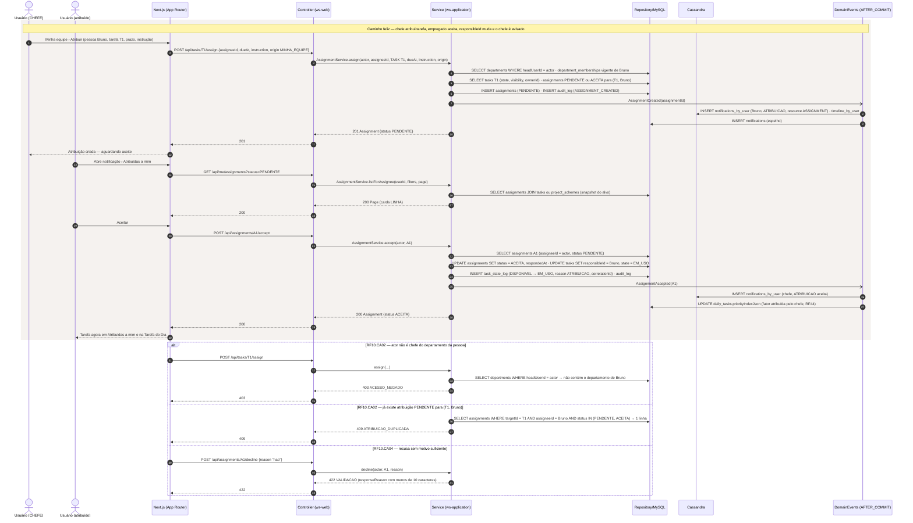
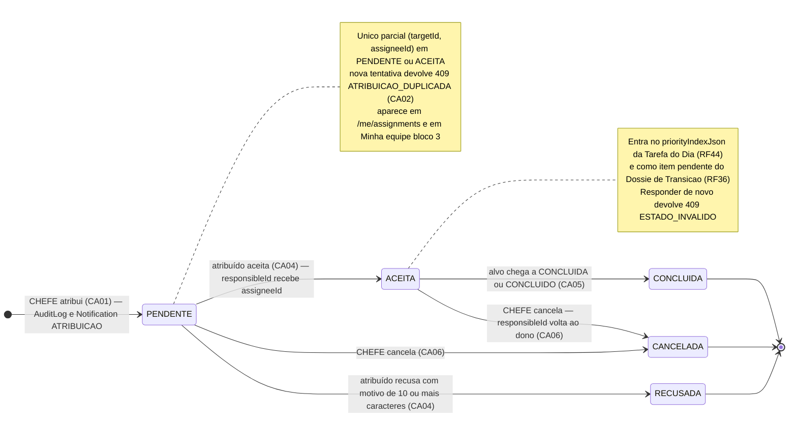
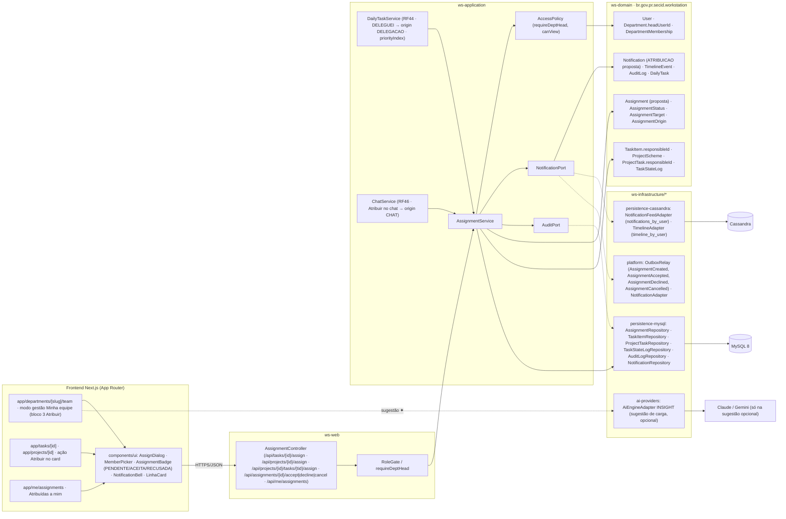

# RF10 — Permitir que o chefe de departamento possa atribuir uma tarefa ou projeto a um usuário
**HU:** HU10 · **Sprint (board Work Station):** lista *Requisitos Funcionais* (card novo, sem sprint atribuída — a confirmar) · **Equivalente FAI:** nenhum (o FAI não tem hierarquia chefe → empregado; a atribuição é escopo novo do Work Station, ver `docs/produto/ABAS_POR_PERFIL.md` §7.b e o card RF46) · **Aba/rota:** página do departamento › **Equipe › Minha equipe (gestão)** (`/departments/[slug]/team?mode=manage`), ação "Atribuir" no card de tarefa (`/tasks/[id]`) e de projeto (`/projects/[id]`); lado do atribuído: `/me/assignments` ("Atribuídas a mim") e Tarefa do Dia (RF44)
**Critérios de aceite cobertos:** RF10.CA01 · RF10.CA02 · RF10.CA03 · RF10.CA04 · RF10.CA05 · RF10.CA06 — corpo do card vazio: CAs derivados do título + HU10 + `ABAS_POR_PERFIL.md` §7.b (bloco 3) e P-02, marcados **(CA a confirmar)**

> **HU10** — COMO chefe de departamento POSSO clicar em "Atribuir tarefa ou projeto" PARA que um empregado possa visualizar sua lista de tarefas ou projetos pendentes dentro de seu escopo de trabalho.

A TAXONOMIA só tem o campo `responsibleId` em `TaskItem` (§2.1) e em `ProjectTask` (§3.2); não há entidade de atribuição. Este RF **propõe** a entidade `Assignment` (tabela `assignments`) para guardar quem atribuiu, a quem, o alvo, o prazo, a instrução e o **aceite/recusa** — o `responsibleId` só é escrito quando a pessoa **aceita**. O rastro fica em `Assignment` + `AuditLog` (+ `TaskStateLog` quando o aceite muda o estado da tarefa). Alternativa sem entidade nova (escrever `responsibleId` direto, sem aceite) fica registrada como dúvida no §6.

| CA | Enunciado (CA a confirmar) |
|---|---|
| **RF10.CA01** | Dado um CHEFE (`Department.headUserId`) em *Minha equipe* ou num card de tarefa/projeto, quando aciona **Atribuir** escolhendo pessoa, alvo (`TaskItem`, `ProjectScheme` ou uma `ProjectTask` do projeto), prazo opcional e instrução (≤ 500), então é criada `Assignment` **(proposta)** com `status = PENDENTE`, `assignerId`, `assigneeId`, `departmentId`, `targetType`, `targetId`, `dueAt`, `instruction`, `origin` (MINHA_EQUIPE · CARD · CHAT · DELEGACAO) e `AuditLog` ASSIGNMENT_CREATED. |
| **RF10.CA02** | Dado o pedido, então o serviço exige `requireDeptHead` do departamento da pessoa: ator que não é chefe → `403 ACESSO_NEGADO`; pessoa sem `DepartmentMembership` vigente no departamento do chefe → `422 VALIDACAO (FORA_DO_DEPARTAMENTO)`; alvo que o ator não pode ver (`Visibility.PRIVADA` de terceiro) → `403 ACESSO_NEGADO`; alvo em CONCLUIDA/ARQUIVADA (tarefa) ou CONCLUIDO/ARQUIVADO (projeto) → `409 ESTADO_INVALIDO`; já existe `Assignment` PENDENTE ou ACEITA para o mesmo (alvo, pessoa) → `409 ATRIBUICAO_DUPLICADA`. |
| **RF10.CA03** | Dado o commit, então o evento `AssignmentCreated` (AFTER_COMMIT) grava `Notification` tipo **ATRIBUICAO (proposta de novo valor de `NotificationType`)**, categoria SISTEMA, `resourceType = ASSIGNMENT`, em `notifications_by_user` (Cassandra) + espelho MySQL, e `TimelineEvent` do atribuído; o chefe vê o estado da atribuição no bloco 3 de *Minha equipe*. |
| **RF10.CA04** | Dado o atribuído, quando **aceita**, então `Assignment.status = ACEITA`, `TaskItem.responsibleId` ou `ProjectTask.responsibleId` recebe `assigneeId` (projeto inteiro: todas as `ProjectTask` sem responsável), `TaskStateLog` é gravado se a tarefa passa de DISPONIVEL para EM_USO, e o chefe é notificado; quando **recusa**, então `responseReason` é obrigatório (≥ 10 caracteres, senão `422 VALIDACAO`), `status = RECUSADA` e o chefe é notificado; quem não é o atribuído → `403 ACESSO_NEGADO`; responder a atribuição já respondida ou cancelada → `409 ESTADO_INVALIDO`. |
| **RF10.CA05** | Dado o atribuído, então `/me/assignments` lista as atribuições PENDENTE e ACEITA (filtros: tipo, prazo, chefe) com o alvo em card `LINHA`; a `Assignment` ACEITA entra no `priorityIndexJson` da Tarefa do Dia (RF44) com o fator "atribuída pelo chefe" e no Dossiê de Transição (RF36) como item pendente; `CONCLUIDA` é derivada quando o alvo chega a CONCLUIDA/CONCLUIDO. |
| **RF10.CA06** | Dado o chefe, quando **cancela** uma atribuição PENDENTE ou ACEITA (motivo opcional), então `status = CANCELADA`, o `responsibleId` volta ao dono do alvo se tinha sido alterado pelo aceite, e o atribuído é notificado; DELEGUEI da Tarefa do Dia (RF44) e "Atribuir" no chat (RF46) chamam o mesmo `AssignmentService` com `origin` DELEGACAO/CHAT; delegação para pessoa de outro departamento exige aceite do chefe dela **(a confirmar)**. |

## 1. Diagrama de classes

```mermaid
classDiagram
  direction LR

  class Assignment {
    <<entity>>
    +UUID id
    +UUID assignerId
    +UUID assigneeId
    +UUID departmentId
    +AssignmentTarget targetType
    +UUID targetId
    +LocalDate dueAt
    +String instruction
    +AssignmentOrigin origin
    +AssignmentStatus status
    +String responseReason
    +Instant respondedAt
    +UUID cancelledBy
    +String correlationId
  }
  class AssignmentStatus {
    <<enum>>
    PENDENTE
    ACEITA
    RECUSADA
    CANCELADA
    CONCLUIDA
  }
  class AssignmentTarget {
    <<enum>>
    TASK
    PROJECT
    PROJECT_TASK
  }
  class AssignmentOrigin {
    <<enum>>
    MINHA_EQUIPE
    CARD
    CHAT
    DELEGACAO
  }
  class TaskItem {
    <<entity>>
    +UUID id
    +UUID ownerId
    +UUID departmentId
    +String title
    +UUID responsibleId
    +LocalDate dueAt
    +TaskState state
    +Visibility visibility
  }
  class ProjectScheme {
    <<entity>>
    +UUID id
    +UUID ownerId
    +UUID departmentId
    +String title
    +ProjectStatus status
    +Visibility visibility
  }
  class ProjectTask {
    <<entity>>
    +UUID id
    +UUID projectId
    +UUID taskId
    +ProjectPhase phase
    +UUID responsibleId
    +LocalDate dueAt
  }
  class TaskStateLog {
    <<entity>>
    +UUID id
    +UUID taskId
    +TaskState fromState
    +TaskState toState
    +UUID actorId
    +String reason
    +String correlationId
  }
  class User {
    <<entity>>
    +UUID id
    +String username
    +String fullName
    +ProfileType profileType
    +UUID departmentId
  }
  class Department {
    <<entity>>
    +UUID id
    +String acronym
    +UUID headUserId
  }
  class DepartmentMembership {
    <<entity>>
    +UUID userId
    +UUID departmentId
    +DeptRole roleInDept
    +Instant startedAt
    +Instant endedAt
  }
  class Notification {
    <<entity>>
    +UUID recipientId
    +UUID actorId
    +NotificationType type
    +String category
    +String resourceType
    +UUID resourceId
    +String groupKey
  }
  class DailyTask {
    <<entity>>
    +UUID userId
    +LocalDate taskDate
    +String priorityIndexJson
    +DailyFeedback feedback
    +UUID delegatedToUserId
  }
  class AuditLog {
    <<entity>>
    +UUID actorId
    +String action
    +String resourceType
    +UUID resourceId
    +String correlationId
  }

  class AssignmentController {
    <<controller>>
    +POST_api_tasks_id_assign(body) 201
    +POST_api_projects_id_assign(body) 201
    +POST_api_projects_id_tasks_tid_assign(body) 201
    +POST_api_assignments_id_accept() 200
    +POST_api_assignments_id_decline(reason) 200
    +POST_api_assignments_id_cancel(reason) 200
    +GET_api_me_assignments(status, page) 200
    +GET_api_departments_id_assignments(status) 200
  }
  class AssignmentService {
    <<service>>
    +assign(actor, assigneeId, target, dueAt, instruction, origin) Assignment
    +accept(actor, assignmentId) Assignment
    +decline(actor, assignmentId, reason) Assignment
    +cancel(actor, assignmentId, reason) Assignment
    +listForAssignee(userId, filters, page) Page
    +listForDepartment(headId, deptId, filters) Page
    +onTargetCompleted(event) marca CONCLUIDA
  }
  class AccessPolicy {
    <<service>>
    +requireDeptHead(user, deptId) void
    +canView(user, target) boolean
  }
  class DailyTaskService {
    <<service>>
    +delegate(userId, taskId, toUserId) Assignment
    +priorityIndex(userId) inclui atribuicoes ACEITA
  }
  class NotificationPort {
    <<port>>
    +notify(recipientId, type, resource, payload)
  }
  class AssignmentRepository {
    <<adapter>>
    MySQL assignments
  }
  class NotificationFeedAdapter {
    <<adapter>>
    Cassandra notifications_by_user
  }

  Assignment --> AssignmentStatus
  Assignment --> AssignmentTarget
  Assignment --> AssignmentOrigin
  Assignment --> User : assignerId chefe
  Assignment --> User : assigneeId
  Assignment --> Department : departmentId
  Assignment ..> TaskItem : targetId quando TASK
  Assignment ..> ProjectScheme : targetId quando PROJECT
  Assignment ..> ProjectTask : targetId quando PROJECT_TASK
  Department --> User : headUserId
  DepartmentMembership --> User
  DepartmentMembership --> Department
  ProjectScheme "1" --> "*" ProjectTask
  ProjectTask --> TaskItem : taskId
  TaskItem --> User : responsibleId
  ProjectTask --> User : responsibleId
  TaskItem "1" --> "*" TaskStateLog
  Notification ..> Assignment : resourceId
  DailyTask ..> Assignment : fator atribuida pelo chefe

  AssignmentController --> AssignmentService
  AssignmentService --> AccessPolicy
  AssignmentService --> AssignmentRepository
  AssignmentService --> NotificationPort
  AssignmentService ..> AuditLog
  AssignmentService ..> TaskStateLog : aceite DISPONIVEL para EM_USO
  DailyTaskService --> AssignmentService : DELEGUEI origin DELEGACAO
  NotificationPort <|.. NotificationFeedAdapter

  note for Assignment "PROPOSTA — tabela assignments. Nao existe na TAXONOMIA. Unico parcial (targetId, assigneeId) com status em PENDENTE ou ACEITA (409 ATRIBUICAO_DUPLICADA) .. +4 campos de auditoria .."
  note for Notification "NotificationType ATRIBUICAO e proposta de novo valor. Alternativa sem mudar o enum SISTEMA com payloadJson.kind ATRIBUICAO"
  note for TaskItem "responsibleId e escrito so no aceite (CA04). Antes do aceite o dono continua responsavel"
```

## 2. Diagrama de atividades

## 3. Diagrama de sequência

## 4. Máquina de estados

Entidade central: **`Assignment.status`** (enum `AssignmentStatus`, **proposta**). O aceite escreve `TaskItem.responsibleId`/`ProjectTask.responsibleId` e pode mover `TaskState` DISPONIVEL → EM_USO (RF41), registrado em `TaskStateLog`.

## 5. Diagrama de componentes

## 6. Rastreabilidade

| CA | Classe | Passo (atividades) | Mensagem (sequência) | Transição (estados) | Componente |
|---|---|---|---|---|---|
| RF10.CA01 | `Assignment` (proposta: assignerId, assigneeId, targetType, targetId, dueAt, instruction, origin), `AssignmentService.assign`, `AssignmentController.POST_*_assign`, `AuditLog` | U1, U2, W1, W2, S5 | 1–6 | `[*] → PENDENTE` | `AssignDialog`, `MemberPicker`, `AssignmentController`, `AssignmentRepository` |
| RF10.CA02 | `AccessPolicy.requireDeptHead/canView`, `Department.headUserId`, `DepartmentMembership` (vigente), `TaskItem.state/visibility`, `ProjectScheme.status`, índice único parcial de `Assignment` | S1–S4, W5, W6, W7 | 4–5; `alt` 403 ACESSO_NEGADO; `alt` 409 ATRIBUICAO_DUPLICADA | nota de PENDENTE (409 na repetição) | `RoleGate / requireDeptHead`, `AccessPolicy` |
| RF10.CA03 | `Notification` (type ATRIBUICAO proposta, resourceType ASSIGNMENT), `TimelineEvent`, `NotificationPort`, evento `AssignmentCreated` | S6, D2, U3, U6 | 7–9 | rótulo da transição `[*] → PENDENTE` | `OutboxRelay`, `NotificationFeedAdapter`, `TimelineAdapter`, `NotificationBell` |
| RF10.CA04 | `AssignmentService.accept/decline`, `Assignment.responseReason/respondedAt`, `TaskItem.responsibleId`, `ProjectTask.responsibleId`, `TaskStateLog` | U4, U5, W4, S7–S13 | 19–30; `alt` 422 VALIDACAO | `PENDENTE → ACEITA`, `PENDENTE → RECUSADA` | `AssignmentBadge`, `TaskStateLogRepository`, `ProjectTaskRepository` |
| RF10.CA05 | `AssignmentService.listForAssignee/onTargetCompleted`, `DailyTask.priorityIndexJson`, `DailyTaskService.priorityIndex` | W3, S15, S16, D3 | 13–18, 28 | `ACEITA → CONCLUIDA`, nota de ACEITA | `app/me/assignments`, `LinhaCard`, `DailyTaskService` |
| RF10.CA06 | `AssignmentService.cancel`, `Assignment.cancelledBy`, `AssignmentOrigin` (DELEGACAO, CHAT), `DailyTaskService.delegate`, `ChatService` | U6, S14 | — (cancelamento segue o mesmo padrão de 20–27 com status CANCELADA) | `PENDENTE → CANCELADA`, `ACEITA → CANCELADA` | `DailyTaskService (RF44)`, `ChatService (RF46)` |

**Dúvidas para confirmar:** (a) entidade `Assignment` nova **ou** escrever `responsibleId` diretamente sem aceite (sem rastro de recusa); (b) novo valor `NotificationType.ATRIBUICAO` ou reutilizar SISTEMA com `payloadJson.kind`; (c) atribuir um **projeto inteiro** preenche todas as `ProjectTask` sem responsável ou só marca o projeto; (d) delegação (RF44 DELEGUEI) para fora do departamento exige aceite do chefe de destino; (e) sprint do card no board.
