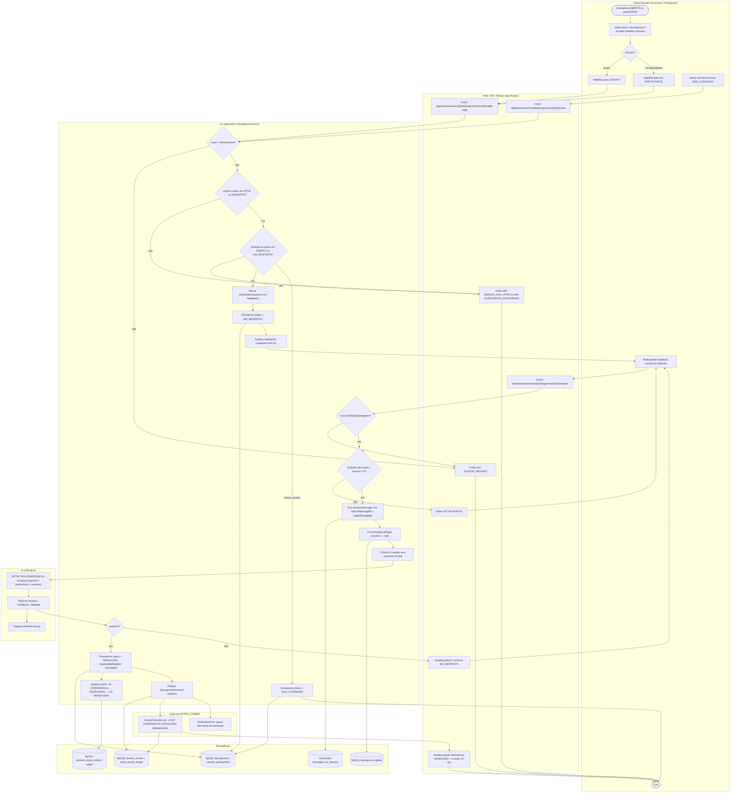
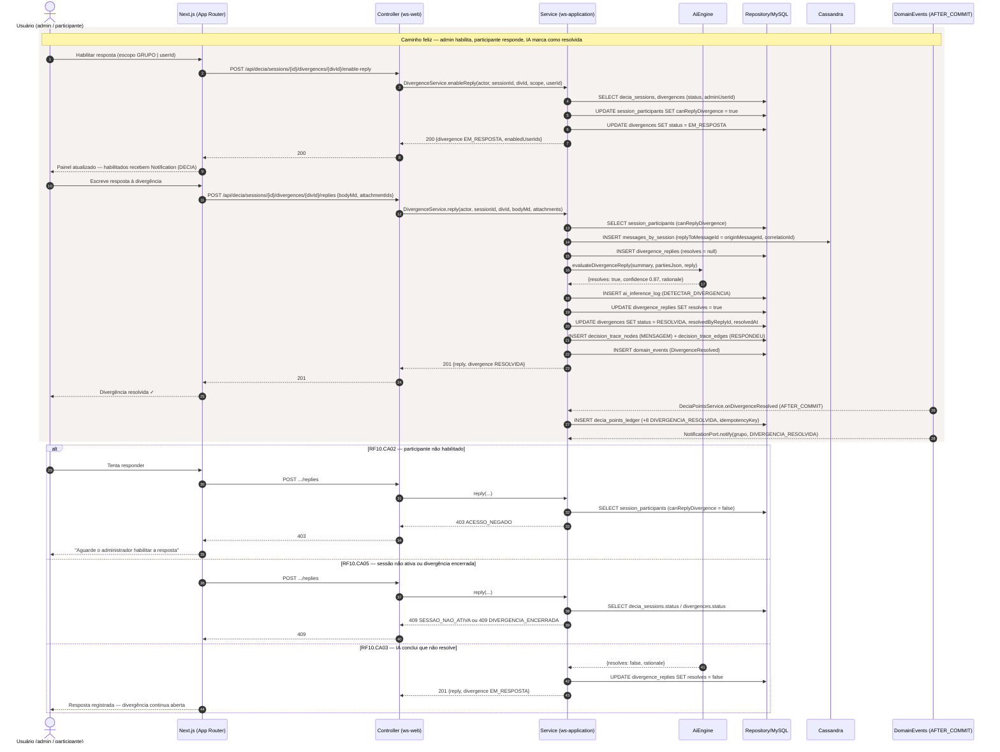
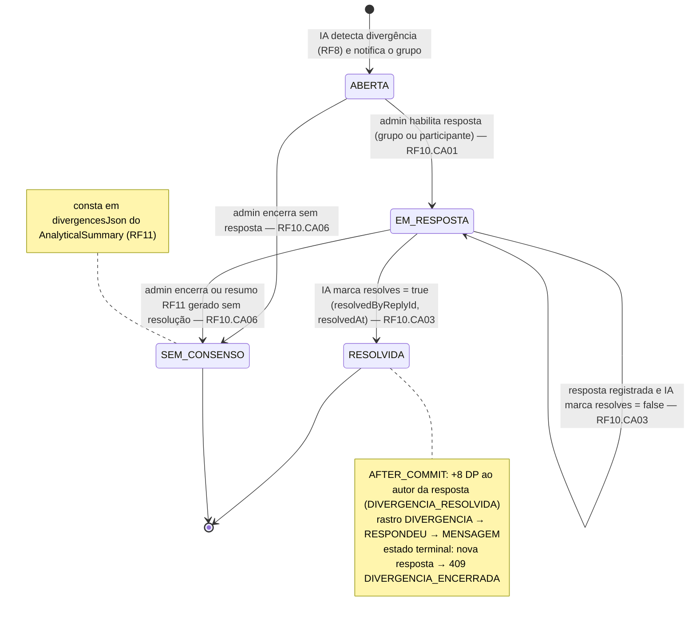
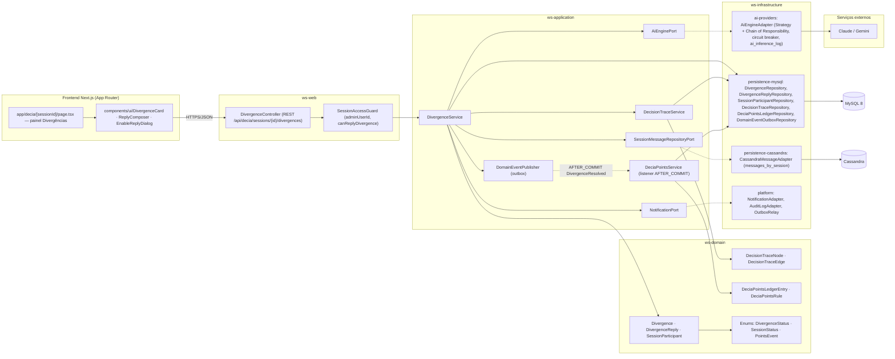

# RF10 — Permitir que o grupo ou usuário ativo na sessão possa responder uma divergência apontada pela IA
**HU:** HU10 · **Sprint (board Work Station):** 2 · **Equivalente FAI:** card RF10 não cita equivalente; pelo Mapa de equivalência o DECIA é o **RF10 Copilot** do FAI (mensagem do Copilot → mensagem do DECIA) · **Aba/rota:** DECIA — sessão (`/decia/[sessionId]`, painel "Divergências"; rota a confirmar)
**Critérios de aceite cobertos:** RF10.CA01 · RF10.CA02 · RF10.CA03 · RF10.CA04 · RF10.CA05 · RF10.CA06 (RF1–RF18 não têm CAs no board: derivados da HU10 + RF8/RF29/RF42 e marcados "CA a confirmar")

> **HU10** — COMO administrador da sessão de conversa POSSO habilitar que grupo ou usuário ativo responda uma divergência PARA permitir que os participantes esclareçam ou resolvam os pontos divergentes da discussão.

| CA | Enunciado (CA a confirmar) |
|---|---|
| **RF10.CA01** | Dado uma `Divergence` ABERTA detectada pela IA (RF8), quando o administrador da sessão habilita a resposta para **o grupo** ou para **um participante**, então `SessionParticipant.canReplyDivergence` é marcado nos habilitados, a divergência passa a EM_RESPOSTA e os habilitados recebem `Notification` (categoria DECIA). |
| **RF10.CA02** | Dado um participante habilitado, quando envia a resposta (mensagem com `replyToMessageId` = `originMessageId` da divergência), então é criado `DivergenceReply` ligado à `Divergence` e à `SessionMessage`; participante **não habilitado** recebe `403 ACESSO_NEGADO`. |
| **RF10.CA03** | Dado uma resposta registrada, quando a IA (capability DETECTAR_DIVERGENCIA) a avalia, então marca `DivergenceReply.resolves`; com `resolves=true` a divergência passa a RESOLVIDA (`resolvedByReplyId`, `resolvedAt`) e o grupo é notificado; com `false` permanece EM_RESPOSTA. |
| **RF10.CA04** | Dado divergência RESOLVIDA, quando o evento `DivergenceResolved` é publicado AFTER_COMMIT, então o autor da resposta recebe **+8 DP** (`PointsEvent.DIVERGENCIA_RESOLVIDA`) em lançamento idempotente (RF42.CA01) e o Rastro de Decisão ganha nó DIVERGENCIA → aresta RESPONDEU → nó MENSAGEM (RF29). |
| **RF10.CA05** | Dado sessão fora de ATIVA/REABERTA → `409 SESSAO_NAO_ATIVA`; divergência já RESOLVIDA ou SEM_CONSENSO → `409 DIVERGENCIA_ENCERRADA`; resposta vazia → `422 VALIDACAO`. |
| **RF10.CA06** | Dado divergência sem resposta resolutiva, quando o administrador a encerra como SEM_CONSENSO (ou o resumo RF11 é gerado), então ela consta em `divergencesJson` do resumo analítico. |

## 1. Diagrama de classes

```mermaid
classDiagram
  direction LR

  class DeciaSession {
    <<entity>>
    +UUID id
    +String topic
    +UUID adminUserId
    +SessionStatus status
    +AiMode aiMode
    +int messageCount
    +int participantCount
  }
  class SessionParticipant {
    <<entity>>
    +UUID id
    +UUID sessionId
    +UUID userId
    +ParticipantRole role
    +boolean canReplyDivergence
    +Instant joinedAt
    +Instant leftAt
  }
  class SessionMessage {
    <<entity>>
    +TIMEUUID id
    +UUID sessionId
    +UUID authorId
    +AuthorKind authorKind
    +String bodyMd
    +TIMEUUID replyToMessageId
    +Instant sentAt
    +UUID classificationId
    +String correlationId
  }
  class MessageClassification {
    <<entity>>
    +UUID id
    +UUID messageId
    +MessageClass label
    +BigDecimal confidence
    +boolean hasEvidence
    +UUID aiInferenceId
  }
  class Divergence {
    <<entity>>
    +UUID id
    +UUID sessionId
    +TIMEUUID originMessageId
    +boolean detectedByAi
    +String summary
    +String partiesJson
    +DivergenceStatus status
    +UUID resolvedByReplyId
    +Instant resolvedAt
    +Instant notifiedAt
    +UUID aiInferenceId
  }
  class DivergenceReply {
    <<entity>>
    +UUID id
    +UUID divergenceId
    +UUID authorId
    +TIMEUUID messageId
    +boolean resolves
    +Instant at
  }
  class DecisionTraceNode {
    <<entity>>
    +UUID id
    +UUID sessionId
    +TraceNodeType nodeType
    +UUID refId
    +String label
    +String classLabel
    +UUID actorId
    +Instant at
  }
  class DecisionTraceEdge {
    <<entity>>
    +UUID id
    +UUID fromNodeId
    +UUID toNodeId
    +TraceRelation relation
    +Instant at
  }
  class DeciaPointsLedgerEntry {
    <<entity>>
    +UUID id
    +UUID userId
    +int delta
    +PointsEvent eventCode
    +String refType
    +UUID refId
    +UUID sessionId
    +String idempotencyKey
    +LedgerStatus status
    +String correlationId
  }
  class Notification {
    <<entity>>
    +UUID id
    +UUID recipientId
    +NotificationType type
    +String category
    +String resourceType
    +UUID resourceId
    +String groupKey
  }
  class AiInferenceLog {
    <<entity>>
    +UUID id
    +AiCapability capability
    +String provider
    +String result
    +String correlationId
  }

  class SessionStatus {
    <<enum>>
    PROPOSTA
    ATIVA
    EM_RESUMO
    EM_DECISAO
    EM_REVISAO
    REABERTA
    ENCERRADA
    ARQUIVADA
  }
  class DivergenceStatus {
    <<enum>>
    ABERTA
    EM_RESPOSTA
    RESOLVIDA
    SEM_CONSENSO
  }
  class MessageClass {
    <<enum>>
    ARGUMENTO
    DIVERGENCIA
    RISCO
    CONSENSO
    PERGUNTA
    RUIDO
  }
  class ParticipantRole {
    <<enum>>
    ADMIN
    MEMBRO
    OBSERVADOR
    IA
  }
  class PointsEvent {
    <<enum>>
    DIVERGENCIA_RESOLVIDA
    ARGUMENTO_EVIDENCIA
    CONSENSO
    PERGUNTA_RESPONDIDA
  }

  class DivergenceController {
    <<controller>>
    +enableReply(sessionId, divergenceId, EnableReplyForm) 200
    +reply(sessionId, divergenceId, ReplyForm) 201
    +closeWithoutConsensus(sessionId, divergenceId) 200
    +list(sessionId) 200
  }
  class DivergenceService {
    <<service>>
    +enableReply(actor, sessionId, divergenceId, scope, userId)
    +reply(actor, sessionId, divergenceId, bodyMd, attachments)
    +evaluateReply(divergenceId, replyId)
    +closeWithoutConsensus(actor, divergenceId)
  }
  class DeciaPointsService {
    <<service>>
    +onDivergenceResolved(event) AFTER_COMMIT
    +credit(userId, eventCode, refId, sessionId)
  }
  class DecisionTraceService {
    <<service>>
    +appendNode(sessionId, nodeType, refId, label)
    +appendEdge(fromNodeId, toNodeId, relation)
  }
  class AiEnginePort {
    <<port>>
    +evaluateDivergenceReply(context) AiResult
  }
  class NotificationPort {
    <<port>>
    +notify(recipients, type, resource)
  }
  class SessionMessageRepositoryPort {
    <<port>>
    +append(SessionMessage)
    +findById(sessionId, messageId)
  }
  class DivergenceRepository {
    <<adapter>>
    MySQL divergences
  }
  class DivergenceReplyRepository {
    <<adapter>>
    MySQL divergence_replies
  }
  class CassandraMessageAdapter {
    <<adapter>>
    messages_by_session
  }
  class AiEngineAdapter {
    <<adapter>>
    Claude e Gemini com fallback local
  }

  DeciaSession "1" --> "*" SessionParticipant : participantes
  DeciaSession "1" --> "*" Divergence : divergências
  DeciaSession --> SessionStatus
  SessionParticipant --> ParticipantRole
  Divergence --> DivergenceStatus
  Divergence "1" --> "*" DivergenceReply : respostas
  Divergence ..> SessionMessage : originMessageId
  Divergence ..> DivergenceReply : resolvedByReplyId
  Divergence ..> AiInferenceLog : aiInferenceId
  DivergenceReply ..> SessionMessage : messageId
  SessionMessage "1" --> "0..1" MessageClassification : classificationId
  MessageClassification --> MessageClass
  DecisionTraceEdge --> DecisionTraceNode : fromNodeId
  DecisionTraceEdge --> DecisionTraceNode : toNodeId
  DecisionTraceNode ..> Divergence : refId quando DIVERGENCIA
  DeciaPointsLedgerEntry --> PointsEvent
  DeciaPointsLedgerEntry ..> DivergenceReply : refId

  DivergenceController --> DivergenceService
  DivergenceService --> DivergenceRepository
  DivergenceService --> DivergenceReplyRepository
  DivergenceService --> SessionMessageRepositoryPort
  DivergenceService --> AiEnginePort
  DivergenceService --> NotificationPort
  DivergenceService --> DecisionTraceService
  DivergenceService ..> DeciaPointsService : evento DivergenceResolved
  SessionMessageRepositoryPort <|.. CassandraMessageAdapter
  AiEnginePort <|.. AiEngineAdapter
  DeciaPointsService --> DeciaPointsLedgerEntry : INSERT idempotente

  note for Divergence "tabela divergences — status ABERTA, EM_RESPOSTA, RESOLVIDA, SEM_CONSENSO"
  note for SessionParticipant "tabela session_participants — canReplyDivergence habilitado pelo admin (RF10) .. +4 campos .."
  note for SessionMessage "Cassandra messages_by_session + índice MySQL session_messages_idx .. +5 campos .."
  note for DeciaPointsLedgerEntry "decia_points_ledger — idempotencyKey = tipo + idEvento + usuário .. +9 campos .."
```

## 2. Diagrama de atividades

## 3. Diagrama de sequência

## 4. Máquina de estados

Entidade central: `Divergence.status` (`DivergenceStatus`). A sessão (`SessionStatus`) precisa estar em ATIVA ou REABERTA para qualquer transição disparada por humano.

## 5. Diagrama de componentes

## 6. Rastreabilidade

| CA | Classe | Passo (atividades) | Mensagem (sequência) | Transição (estados) | Componente |
|---|---|---|---|---|---|
| RF10.CA01 | `SessionParticipant.canReplyDivergence`, `Divergence.status`, `DivergenceService.enableReply`, `NotificationPort` | A1–A4, B1, C1–C6 | 1–9 (enable-reply → UPDATE session_participants / divergences → Notification) | ABERTA → EM_RESPOSTA | `DivergenceController`, `SessionAccessGuard`, `DivergenceService`, `NotificationAdapter` |
| RF10.CA02 | `DivergenceReply`, `SessionMessage.replyToMessageId`, `DivergenceService.reply` | A5, B2, C7–C10, E2, E3 | 10–14 (INSERT messages_by_session + divergence_replies); `alt` 403 ACESSO_NEGADO | EM_RESPOSTA (sem transição) | `CassandraMessageAdapter`, `DivergenceReplyRepository` |
| RF10.CA03 | `DivergenceReply.resolves`, `Divergence.resolvedByReplyId/resolvedAt`, `AiEnginePort.evaluateDivergenceReply`, `AiInferenceLog` | C11–C13, D1–D3, B7/B8 | 15–19; `alt` resolves=false | EM_RESPOSTA → RESOLVIDA / EM_RESPOSTA → EM_RESPOSTA | `AiEngineAdapter`, Claude/Gemini |
| RF10.CA04 | `DeciaPointsLedgerEntry` (DIVERGENCIA_RESOLVIDA, idempotencyKey), `DeciaPointsService.onDivergenceResolved`, `DecisionTraceNode/Edge` (RESPONDEU) | C14, C16, F1, F2, E4, E5 | 20–26 (outbox → AFTER_COMMIT → ledger + notificação) | nota de RESOLVIDA | `DeciaPointsService`, `DecisionTraceService`, `OutboxRelay`, `DeciaPointsLedgerRepository` |
| RF10.CA05 | `DeciaSession.status`, `Divergence.status` (guardas) | C2, C3, C8, B5, B6 | `alt` 409 SESSAO_NAO_ATIVA / 409 DIVERGENCIA_ENCERRADA | RESOLVIDA e SEM_CONSENSO terminais | `SessionAccessGuard`, `DivergenceService` |
| RF10.CA06 | `Divergence.status = SEM_CONSENSO`, `DivergenceService.closeWithoutConsensus`, `AnalyticalSummary.divergencesJson` (RF11) | A6, B3, C15 | — (fluxo do admin; ver RF11) | ABERTA/EM_RESPOSTA → SEM_CONSENSO | `DivergenceController.closeWithoutConsensus` |
