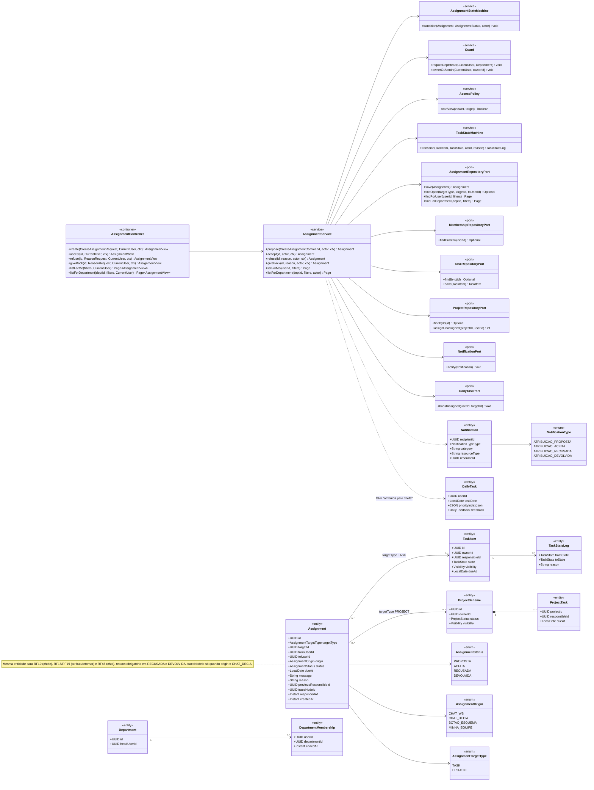
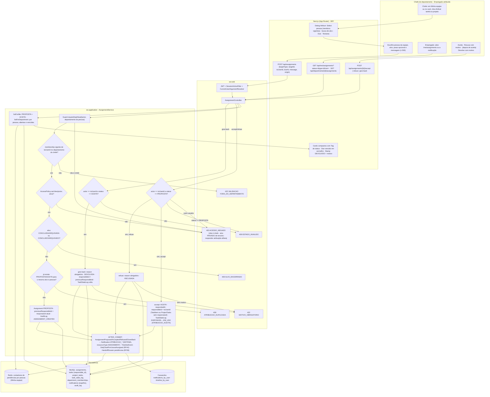
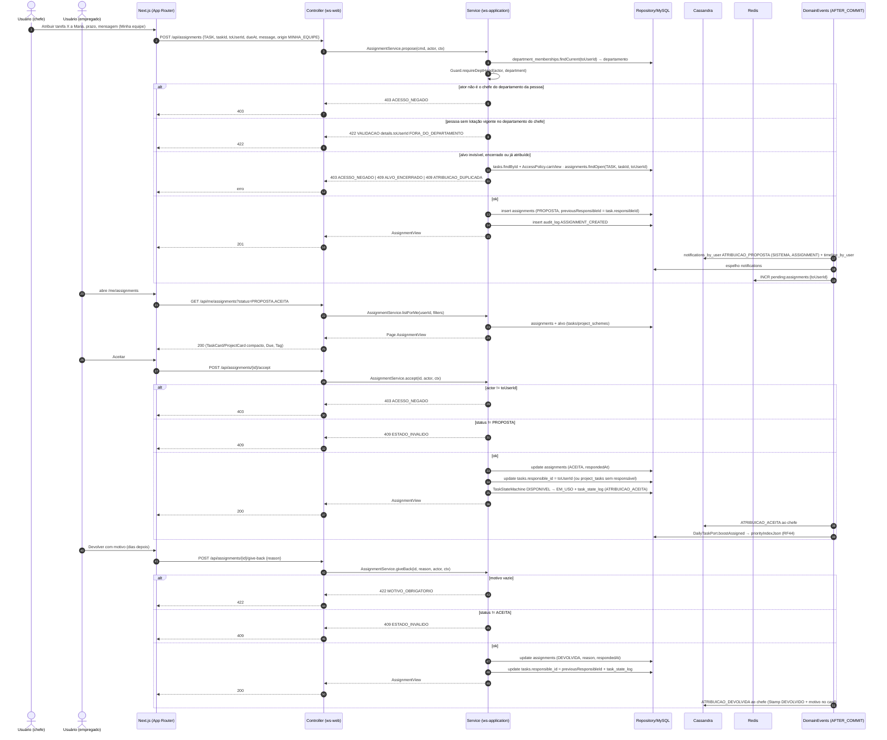
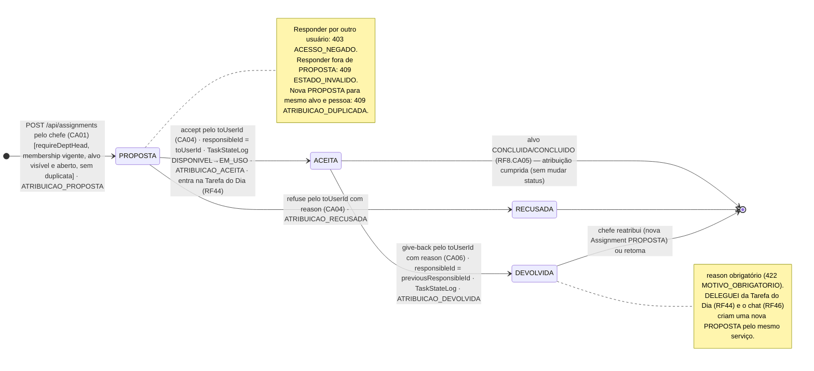
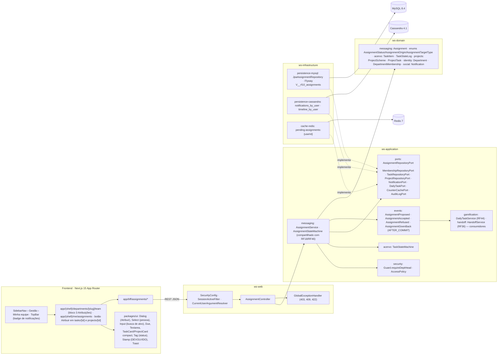

# RF10 — Permitir que o chefe de departamento possa atribuir uma tarefa ou projeto a um usuário
**HU:** HU10 · **Sprint (board Work Station):** lista *Requisitos Funcionais* sem sprint atribuída (card novo; o card "SPRINT 2" cita "RF10 Responder divergência", escopo antigo — `RENUMERACAO.md`; fase (g) da ARQUITETURA §6: "RF9/RF10/RF46") · **Equivalente FAI:** nenhum (o FAI não tem hierarquia chefe → empregado; a atribuição é escopo novo — TAXONOMIA §12b, ABAS_POR_PERFIL §7.b, `docs/diagramas/RF46/README.md`) · **Aba/rota:** página do departamento › **Equipe › Minha equipe (gestão)** (`/departments/[slug]/team?mode=manage`, origem `MINHA_EQUIPE`); ação "Atribuir" no card de tarefa (`/tasks/[id]`) e de projeto (`/projects/[id]`, origem `BOTAO_ESQUEMA`); lado do atribuído: `/me/assignments` ("Atribuídas a mim") e Tarefa do Dia (RF44); API `POST /api/assignments`, `POST /api/assignments/{id}/accept|refuse|give-back`, `GET /api/me/assignments`, `GET /api/departments/{id}/assignments`
**Critérios de aceite cobertos:** RF10.CA01 · RF10.CA02 · RF10.CA03 · RF10.CA04 · RF10.CA05 · RF10.CA06 — corpo do card vazio: CAs derivados do título + HU10 + ABAS_POR_PERFIL §7.b (bloco 3 de Minha equipe) + RF46.CA03–CA05 (mesma entidade `Assignment`), marcados **(CA a confirmar)**. Todas as classes do RF são **(planejado)**; reais: `Guard`, `AuditLogPort`, `SecurityConfig`, `SessionActiveFilter`.

> **HU10** — COMO chefe de departamento POSSO clicar em "Atribuir tarefa ou projeto" PARA que um empregado possa visualizar sua lista de tarefas ou projetos pendentes dentro de seu escopo de trabalho.

A entidade **`Assignment`** (TAXONOMIA §12b.4) é compartilhada por três entradas: o chefe em *Minha equipe* ou no card (este RF, origens `MINHA_EQUIPE`/`BOTAO_ESQUEMA`), as ações sociais "atribuir"/"retornar" de qualquer usuário (RF18, `BOTAO_ESQUEMA`) e o chat (RF46, `CHAT_WS`/`CHAT_DECIA`). O que distingue o RF10 é o **papel**: `Guard.requireDeptHead` e o alvo humano precisa ter `DepartmentMembership` vigente no departamento do chefe.

## Critérios de aceite derivados da HU10 (todos "CA a confirmar")

| CA | Enunciado (Dado / Quando / Então) |
|---|---|
| **RF10.CA01** (CA a confirmar) | Dado um CHEFE (`Department.headUserId`) em *Minha equipe* ou num card de tarefa/projeto, quando aciona **Atribuir** escolhendo pessoa, alvo (`TaskItem` ou `ProjectScheme`), prazo opcional e mensagem (≤ 500), então `POST /api/assignments` cria `Assignment` com `status PROPOSTA`, `fromUserId` = chefe, `toUserId`, `targetType`, `targetId`, `dueAt`, `message`, `origin` (MINHA_EQUIPE ou BOTAO_ESQUEMA), `previousResponsibleId` = responsável atual, e `AuditLog ASSIGNMENT_CREATED`. |
| **RF10.CA02** (CA a confirmar) | Dado o pedido, então o serviço exige `Guard.requireDeptHead` do departamento da pessoa: ator que não é chefe → `403 ACESSO_NEGADO`; pessoa sem `DepartmentMembership` vigente no departamento do chefe → `422 VALIDACAO (FORA_DO_DEPARTAMENTO)`; alvo que o ator não pode ver (`Visibility PRIVADA` de terceiro) → `403 ACESSO_NEGADO`; alvo em CONCLUIDA/ARQUIVADA (tarefa) ou CONCLUIDO/ARQUIVADO (projeto) → `409 ALVO_ENCERRADO`; já existe `Assignment` PROPOSTA/ACEITA do mesmo alvo para a mesma pessoa → `409 ATRIBUICAO_DUPLICADA`. |
| **RF10.CA03** (CA a confirmar) | Dado o commit, então o evento `AssignmentProposed` (AFTER_COMMIT) grava `Notification` tipo **ATRIBUICAO_PROPOSTA**, categoria SISTEMA, `resourceType ASSIGNMENT`, em `notifications_by_user` (Cassandra) + espelho MySQL, e `TimelineEvent` do atribuído; o chefe acompanha o estado no bloco 3 de *Minha equipe* (`GET /api/departments/{id}/assignments`, por pessoa). |
| **RF10.CA04** (CA a confirmar) | Dado o atribuído (`toUserId`), quando **aceita** (`POST /api/assignments/{id}/accept`), então `status ACEITA`, `respondedAt`, `TaskItem.responsibleId` ou `ProjectTask.responsibleId` (todas as `ProjectTask` sem responsável, quando PROJECT) recebe `toUserId`, `TaskStateLog` é gravado se a tarefa passa de DISPONIVEL para EM_USO (`reason ATRIBUICAO_ACEITA`) e o chefe recebe ATRIBUICAO_ACEITA; quando **recusa** (`/refuse`), `reason` é obrigatório (`422 MOTIVO_OBRIGATORIO`), `status RECUSADA` e o chefe recebe ATRIBUICAO_RECUSADA; outro usuário respondendo → `403 ACESSO_NEGADO`; resposta fora de PROPOSTA → `409 ESTADO_INVALIDO`. |
| **RF10.CA05** (CA a confirmar) | Dado o atribuído, então `/me/assignments` (`AssignmentService.listForMe`) lista as atribuições PROPOSTA e ACEITA (filtros: tipo, prazo, quem atribuiu) com o alvo em `TaskCard`/`ProjectCard` compacto; a `Assignment` ACEITA entra no `priorityIndexJson` da Tarefa do Dia (RF44) com o fator "atribuída pelo chefe" e no Dossiê de Transição (RF36) como item pendente; o chefe vê, por pessoa, as atribuições abertas e vencidas (`Due`). |
| **RF10.CA06** (CA a confirmar) | Dado o atribuído com `Assignment` ACEITA, quando **devolve** com motivo (`POST /api/assignments/{id}/give-back`), então `status DEVOLVIDA`, `reason` obrigatório (`422 MOTIVO_OBRIGATORIO`), o `responsibleId` volta a `previousResponsibleId`, `TaskStateLog` registra a volta e o chefe recebe ATRIBUICAO_DEVOLVIDA; DELEGUEI da Tarefa do Dia (RF44) e "Atribuir" no chat (RF46) chamam o mesmo `AssignmentService` com outra `origin`. |

## 1. Diagrama de classes

## 2. Diagrama de atividades

## 3. Diagrama de sequência

## 4. Máquina de estados

Entidade central: **`Assignment.status`** (`AssignmentStatus`, TAXONOMIA §12b.4/§13) com `AssignmentStateMachine`. Efeitos colaterais em `TaskItem.responsibleId`/`TaskState` anotados nas transições.

## 5. Diagrama de componentes

## 6. Rastreabilidade

| CA | Classe (§1) | Passo da atividade (§2) | Mensagem da sequência (§3) | Transição de estado (§4) | Componente (§5) | Situação |
|---|---|---|---|---|---|---|
| RF10.CA01 | `AssignmentController.create`, `AssignmentService.propose`, `Assignment` (`origin` MINHA_EQUIPE/BOTAO_ESQUEMA, `previousResponsibleId`) | `A1`→`A2`→`F2`→`S6` | 1–3, 15–18 | `[*]`→`PROP` | `PG`, `UI` (`Dialog`), `AS`, `MY` | planejado |
| RF10.CA02 | `Guard.requireDeptHead`, `MembershipRepositoryPort.findCurrent`, `AccessPolicy.canView`, `AssignmentRepositoryPort.findOpen` | `S1`→`S5`, `E403`, `E422F`, `E409E`, `E409D` | 4–14 | guardas de `[*]`→`PROP` | `SECU`, `GEH` | planejado (`Guard` base real) |
| RF10.CA03 | evento `AssignmentProposed`, `NotificationPort`, `Notification` ATRIBUICAO_PROPOSTA, `AssignmentService.listForDepartment` | `EV`, `F3` (departamento) | 19–21 | — | `EVT`, `CAS`, `RDS` | planejado |
| RF10.CA04 | `AssignmentService.accept/refuse`, `AssignmentStateMachine`, `TaskStateMachine`, `ProjectRepositoryPort.assignUnassigned` | `A4`→`F4`→`R1`→`R2`/`R3`, `E403`, `E409S`, `E422M` | 28–41 | `PROP`→`ACE`, `PROP`→`REC` | `AS`, `ACV` | planejado |
| RF10.CA05 | `AssignmentService.listForMe`, `DailyTaskPort.boostAssigned`, `DailyTask.priorityIndexJson`, `HandoffService` | `A3`→`F3`→`L1`→`F5`, `EV` | 22–27, 41 | nota de `ACE` | `PG` (`/me/assignments`), `GAM`, `UI` (`Due`) | planejado (RF44, RF36) |
| RF10.CA06 | `AssignmentService.giveBack`, `Assignment.reason/previousResponsibleId`, `TaskStateLog` | `F4`→`G1`→`G2`, `E422M`, `E409S` | 42–53 | `ACE`→`DEV` | `AS`, `UI` (`Stamp` DEVOLVIDO) | planejado (RF44 DELEGUEI, RF46) |
