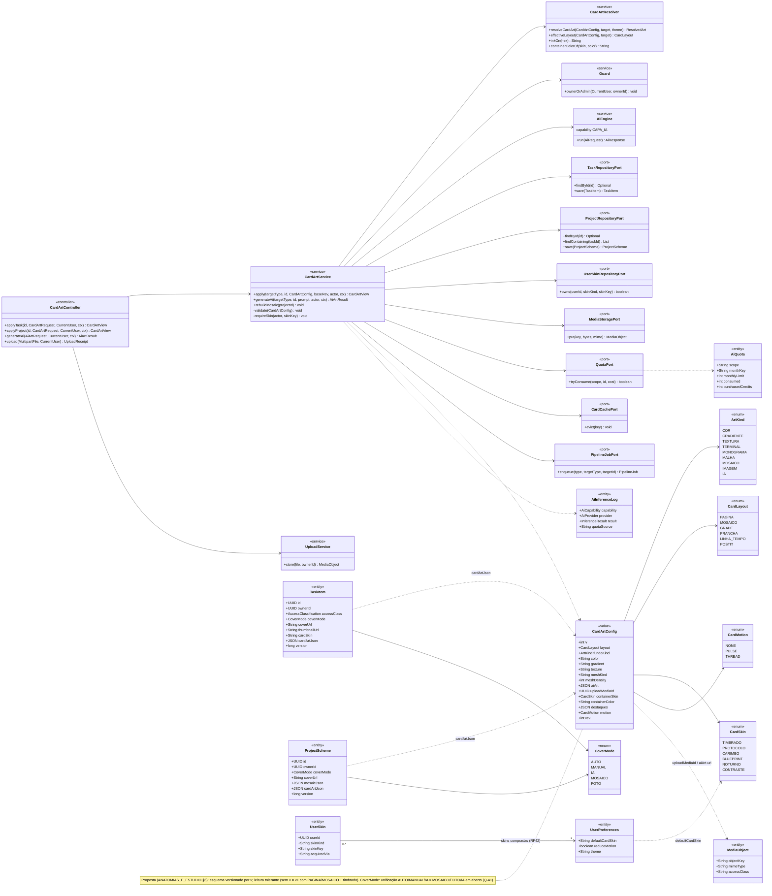
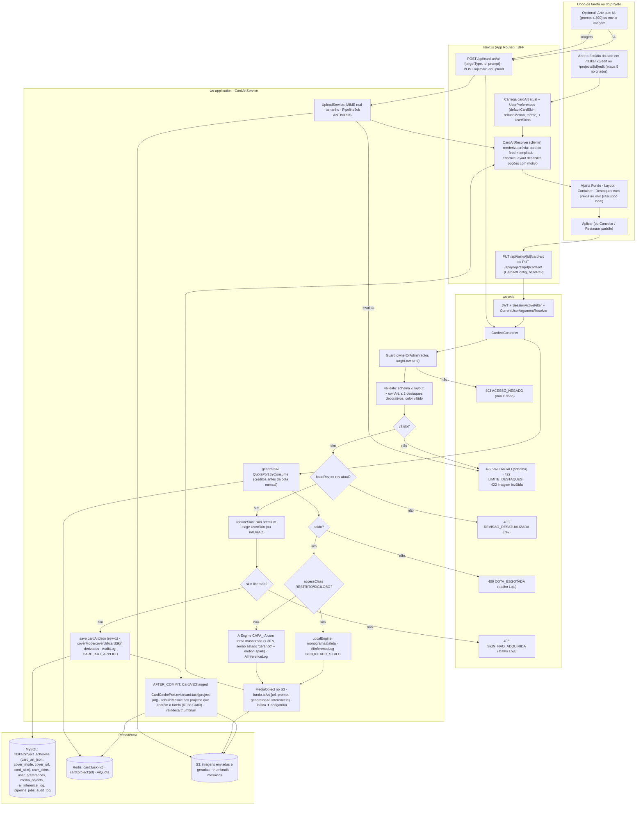
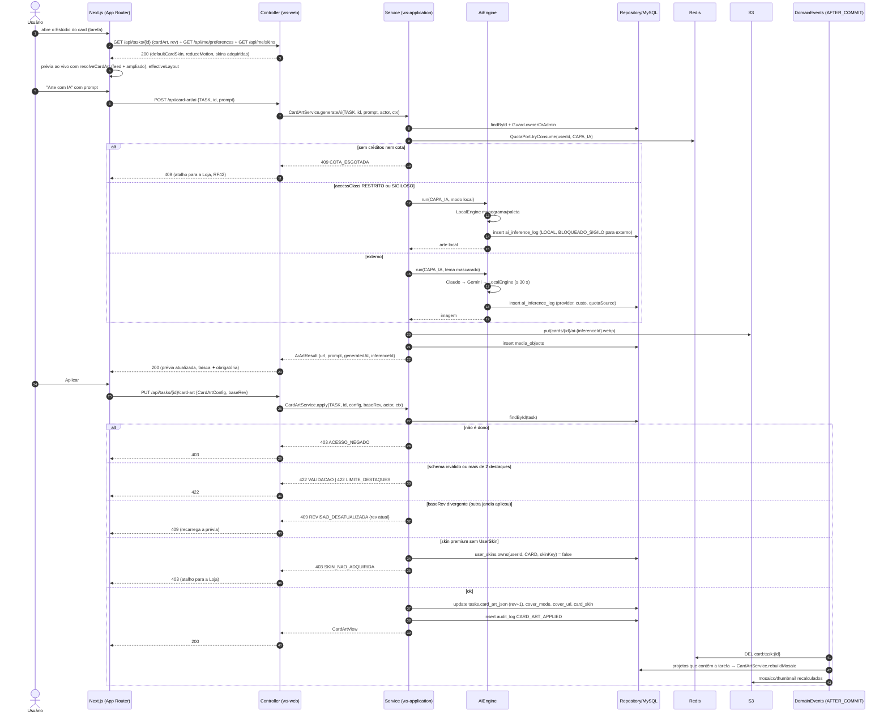
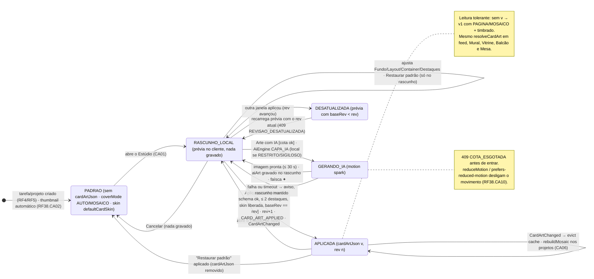
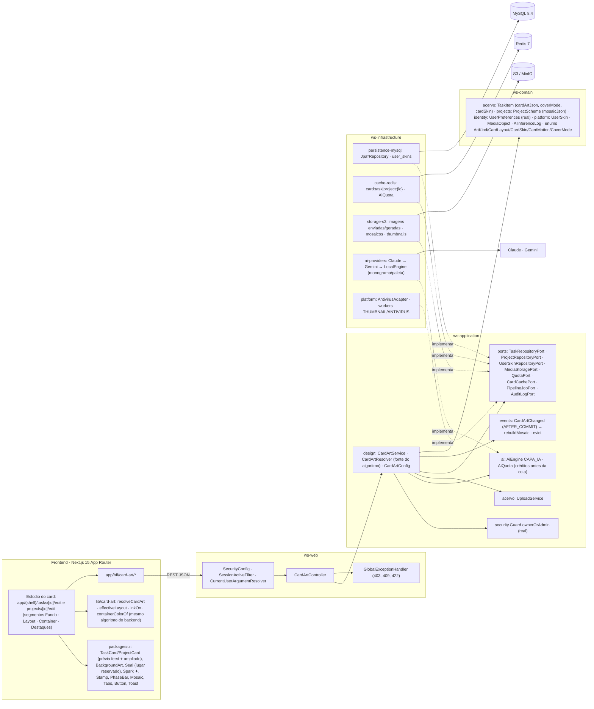

# RF11 — Utilizar o editor de arte de fundo para personalizar esquemas de tarefas e projetos
**HU:** HU11 · **Sprint (board Work Station):** lista *Requisitos Funcionais* sem sprint atribuída (card renumerado; o card "SPRINT 2" cita "RF11 Resumo analítico", escopo antigo — `RENUMERACAO.md`; origem `_anterior/RF38` Estúdio de Arte do Card) · **Equivalente FAI:** RF11 Background Studio (`PUT /api/pieces/{id}/background`, `backgroundConfigJson`, `resolveCardArt`, `CARD_SKINS`, `containerColorOf`, `inkOn`) + editor da arte do card da peça · **Aba/rota:** Estúdio do card dentro de `/tasks/[id]/edit` (etapa 5 "Arte do card" do criador, RF4) e `/projects/[id]/edit`; API `PUT /api/tasks/{id}/card-art`, `PUT /api/projects/{id}/card-art`, `POST /api/card-art/ai` (arte com IA), `POST /api/card-art/upload`
**Critérios de aceite cobertos:** RF11.CA01 · RF11.CA02 · RF11.CA03 · RF11.CA04 · RF11.CA05 · RF11.CA06 — corpo do card vazio: CAs derivados do título + HU11 + RF38.CA02/CA04/CA08/CA10 + `docs/design-system/ANATOMIAS_E_ESTUDIO.md` §6 (Estúdio de Arte do card), marcados **(CA a confirmar)**. Todas as classes do RF são **(planejado)**; reais: `UserPreferences.defaultCardSkin/reduceMotion` (Bloco 3), `Guard.ownerOrAdmin`, `AiProvidersConfig`, `S3StorageConfig`, `RedisAdaptersConfig`.

> **HU11** — COMO usuário criando um esquema de tarefa ou projeto POSSO utilizar o editor de arte de fundo PARA personalizar background de esquemas de tarefas ou projetos.

O **Estúdio de Arte do card** grava `cardArtJson` (`CardArtConfig`, **proposta**: `v`, `layout`, `fundo`, `container`, `destaques`) na `TaskItem` (`coverMode`, `cardSkin`, `coverUrl`) ou no `ProjectScheme` (`coverMode` MOSAICO/FOTO/IA, `coverUrl`, `mosaicJson`). A renderização é determinística (`CardArtResolver.resolveCardArt`) e a mesma em feed, Mural, Vitrine, Balcão e Mesa. A **arte com IA** usa o `AiEngine` capability `CAPA_IA` sob a governança de `accessClass` e `AiQuota`.

## Critérios de aceite derivados da HU11 (todos "CA a confirmar")

| CA | Enunciado (Dado / Quando / Então) |
|---|---|
| **RF11.CA01** (CA a confirmar) | Dado o dono de uma tarefa ou projeto (`ownerId`), quando abre o Estúdio do card, então vê os segmentos **Fundo · Layout · Container · Destaques** com prévia ao vivo (card do feed + ampliado); o rascunho é local (Cancelar não grava; Restaurar padrão só no rascunho); **Aplicar** envia `PUT /api/tasks/{id}/card-art` ou `PUT /api/projects/{id}/card-art` com `CardArtConfig` + `baseRev`; quem não é dono → `403 ACESSO_NEGADO`; `rev` divergente → `409 REVISAO_DESATUALIZADA`; JSON fora do schema → `422 VALIDACAO`. |
| **RF11.CA02** (CA a confirmar) | Dado o segmento **Fundo**, então o usuário escolhe cor sólida (8 cores de departamento + 6 neutras), gradiente (`marca`, `dept`, `spark`), textura (`papel`, `cortica`, `blueprint`, `timbrado`), terminal, monograma, malha de nós (`argumento`, `consenso`, `misto` + densidade 1–3), mosaico automático, imagem enviada ou arte com IA; `resolveCardArt` aplica a precedência (base `color → gradient → texture/terminal/monograma`; imagem `ai/upload → mesh → mosaic`); layouts com `ownArt` (GRADE, PRANCHA, LINHA_TEMPO) desligam o Fundo com explicação; layouts sem dado ficam desabilitados com motivo (`effectiveLayout`). |
| **RF11.CA03** (CA a confirmar) | Dado o segmento **Container**, então o usuário escolhe a skin (`timbrado` padrão, `protocolo`, `carimbo`, `blueprint`, `noturno`; `contraste` forçado pelo tema) e a cor do container (nativa, 5 amostras ou livre); a tinta vem de `inkOn(hex)` por luminância (0,299 R + 0,587 G + 0,114 B > 140 → `#1A1714`, senão `#F5F2EC`), garantindo ≥ 4,5:1; skin premium sem `UserSkin` → `403 SKIN_NAO_ADQUIRIDA` com atalho para a Loja (RF42); `UserPreferences.defaultCardSkin` é o valor inicial. |
| **RF11.CA04** (CA a confirmar) | Dado "Arte com IA" (prompt ≤ 300), então o serviço verifica `AiQuota` (créditos antes da cota mensal; sem saldo → `409 COTA_ESGOTADA` + Loja), `accessClass` RESTRITO/SIGILOSO → `LocalEngine` (monograma/paleta, `result BLOQUEADO_SIGILO` para externo), senão `AiEngine CAPA_IA` com tema mascarado; a imagem vai ao S3 (`MediaObject`) e `fundo.aiArt {url, prompt, generatedAt, inferenceId}` é gravado com `AiInferenceLog`; faísca ✦ obrigatória (RF38.CA04); resposta ≤ 30 s ou estado "gerando" com `motion spark`; **imagem enviada** passa por MIME real, tamanho e `PipelineJob ANTIVIRUS` → `422 VALIDACAO` se inválida. |
| **RF11.CA05** (CA a confirmar) | Dado o segmento **Destaques**, então o usuário configura lacre (lugar reservado), tooltip da faísca (curto/completo), barra de fases (projeto), carimbo de estado/decisão (canto/centro/oculto), Hype do autor (respeita `HypeVisibility`) e **movimento** (`none`, `pulse`, `thread`); no máximo **2 destaques decorativos** → `422 LIMITE_DESTAQUES`; o movimento só roda no card ampliado e é desligado por `prefers-reduced-motion` ou `UserPreferences.reduceMotion` (RF38.CA10). |
| **RF11.CA06** (CA a confirmar) | Dado `cardArtJson` gravado, então a API entrega `cardArt` no view da tarefa/projeto, a leitura é tolerante (config sem `v` lê como v1 com padrões PAGINA/MOSAICO + `timbrado`; valor desconhecido → padrão; `color` inválido → null); o mesmo `resolveCardArt` renderiza feed, Mural, Vitrine, Balcão e Mesa; o cache Redis do card é invalidado (`DEL card:task:{id}` / `card:project:{id}`) e `CardArtChanged` (AFTER_COMMIT) dispara `CardArtService.rebuildMosaic` nos projetos que contêm a tarefa (RF38.CA03). |

## 1. Diagrama de classes

## 2. Diagrama de atividades

## 3. Diagrama de sequência

## 4. Máquina de estados

Entidade central: a **arte do card** não tem enum de status na TAXONOMIA; os estados abaixo são **derivados** de `coverMode` + `cardArtJson.rev` da `TaskItem`/`ProjectScheme` e do ciclo de uma geração com IA (`AiInferenceLog.result`). A tarefa/projeto em si seguem `TaskState`/`ProjectStatus` (RF4/RF5 §4).

## 5. Diagrama de componentes

## 6. Rastreabilidade

| CA | Classe (§1) | Passo da atividade (§2) | Mensagem da sequência (§3) | Transição de estado (§4) | Componente (§5) | Situação |
|---|---|---|---|---|---|---|
| RF11.CA01 | `CardArtController.applyTask/applyProject`, `CardArtService.apply/validate`, `CardArtConfig.rev`, `Guard.ownerOrAdmin` | `A1`→`A2`→`A4`→`F4`→`S1`→`S4`, `E403`, `E409R`, `E422` | 1–4, 26–37, 42–47 | `PAD`→`RL`→`APL`, `RL`→`PAD`, `RL`→`DES` | `PG`, `CC`, `CAS`, `GD` | planejado |
| RF11.CA02 | `CardArtResolver.resolveCardArt/effectiveLayout`, `ArtKind`, `CardLayout` | `F2`, `S2` | 4 | `RL`→`RL` | `RES`, `CAS`, `UI` (`BackgroundArt`, `Mosaic`) | planejado |
| RF11.CA03 | `CardArtResolver.inkOn/containerColorOf`, `CardSkin`, `UserSkinRepositoryPort.owns`, `UserPreferences.defaultCardSkin` | `S5`→`S6`→`E403S` | 2–3, 38–41 | guarda de `RL`→`APL` | `RES`, `MY` (`user_skins`) | planejado (`UserPreferences` real) |
| RF11.CA04 | `CardArtService.generateAi`, `AiEngine` (CAPA_IA), `QuotaPort`/`AiQuota`, `AiInferenceLog`, `UploadService`, `MediaObject` | `A3`→`F3`→`AI1`→`AI6`, `UP1`, `E409Q`, `E422` | 5–25 | `RL`→`GER`→`RL` | `AIE`, `AIP`, `S3`, `PLT`, `RDS` | planejado |
| RF11.CA05 | `CardArtConfig.destaques/motion`, `CardMotion`, `UserPreferences.reduceMotion`, `CardArtService.validate` (≤ 2) | `S2`→`S3`→`E422` | 32–33 | nota de `GER` | `UI` (`Seal`, `Stamp`, `PhaseBar`, `Spark`) | planejado (RF38.CA10) |
| RF11.CA06 | `CardArtResolver` (leitura tolerante), `CardCachePort.evict`, evento `CardArtChanged`, `CardArtService.rebuildMosaic` | `S7`→`EV` | 42–47 | `APL`→`APL` | `EVT`, `RDS`, `S3`, `RES` | planejado (RF38.CA03) |
