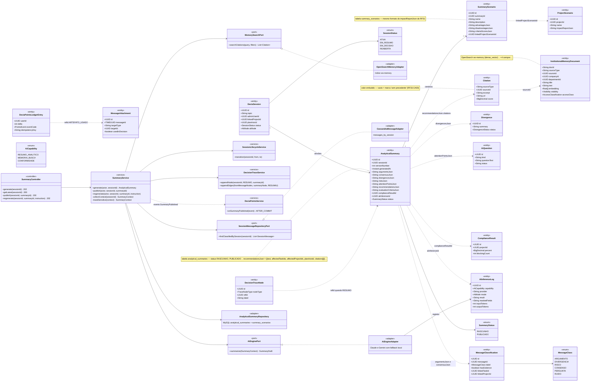
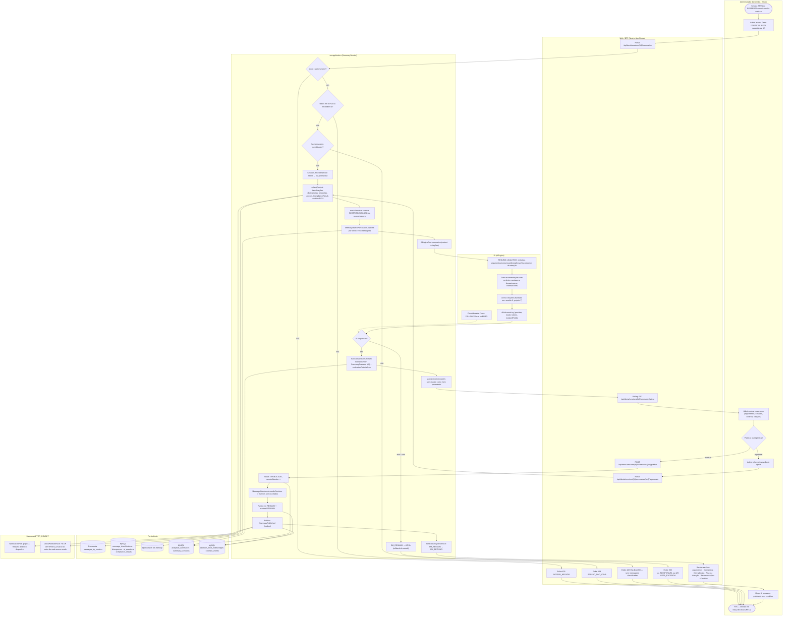
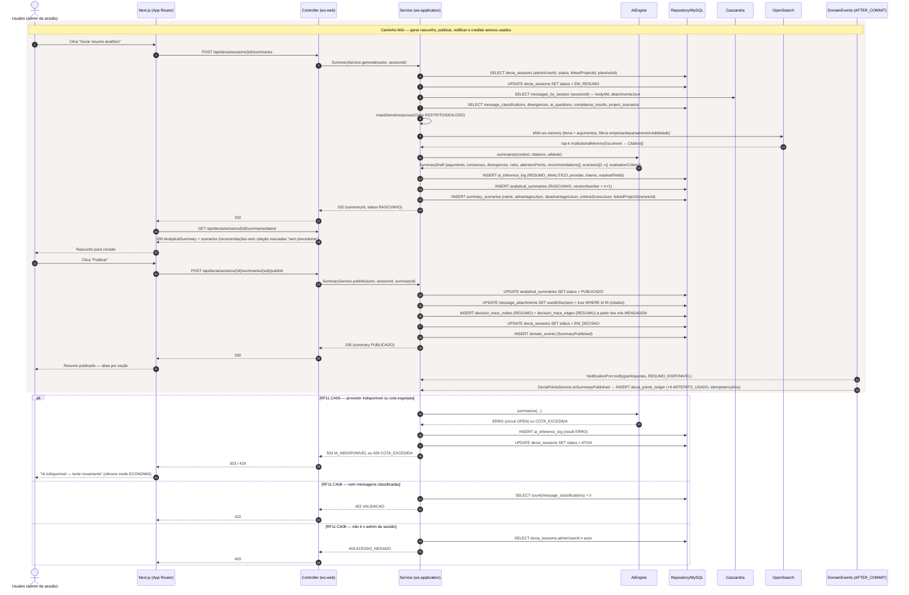
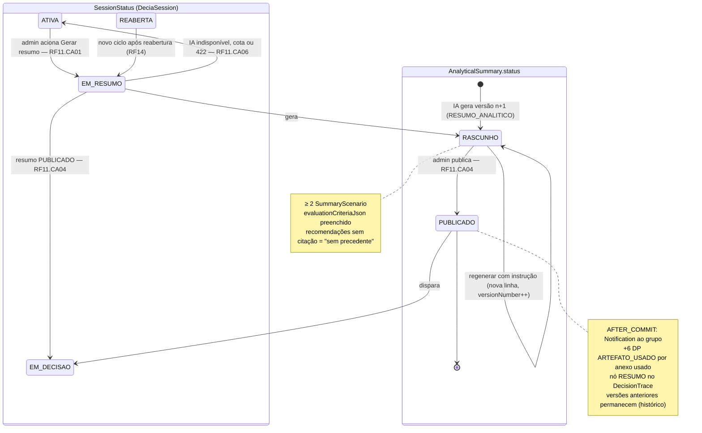
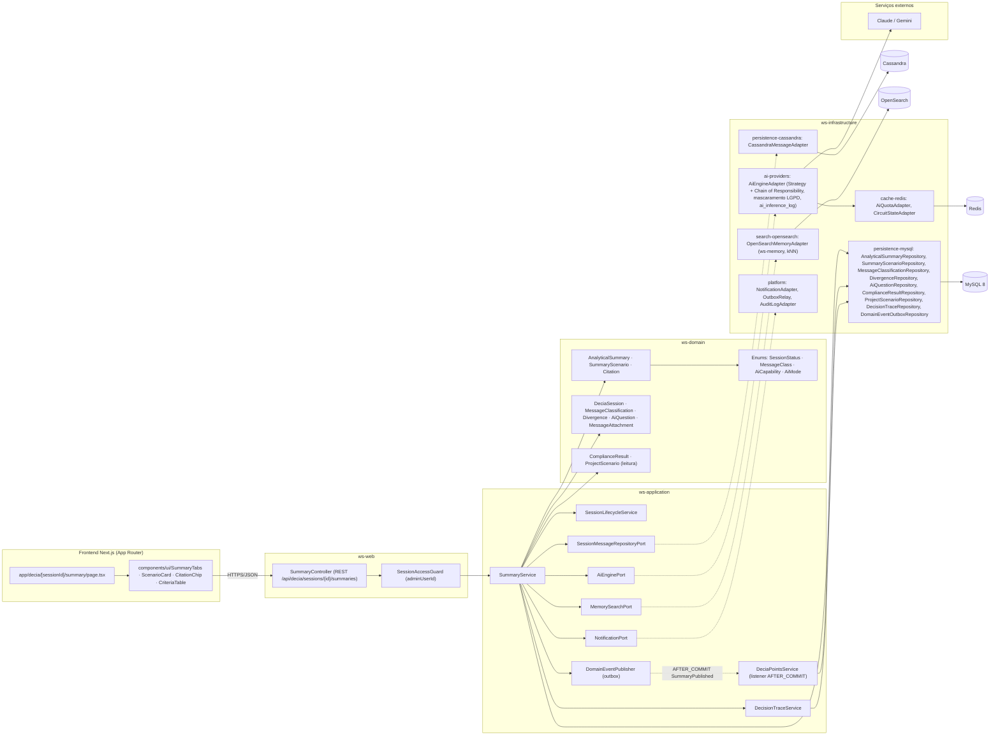

# RF11 — Gerar e disponibilizar ao grupo da conversa um resumo analítico estruturado da sessão, contendo argumentos identificados, consensos, divergências, riscos, pontos de atenção e recomendações fundamentadas, incluindo cenários alternativos, vantagens, desvantagens e critérios de avaliação utilizados pela IA
**HU:** HU11 · **Sprint (board Work Station):** 2 · **Equivalente FAI:** card RF11 não cita equivalente; pelo Mapa de equivalência o DECIA é o **RF10 Copilot** do FAI (sugestões do Copilot) + **RF24 IA do sistema**; a Loja (RF42) vende "sessão com IA avançada e resumo analítico estendido" · **Aba/rota:** DECIA — sessão › aba "Resumo" (`/decia/[sessionId]/summary`; rota a confirmar)
**Critérios de aceite cobertos:** RF11.CA01 · RF11.CA02 · RF11.CA03 · RF11.CA04 · RF11.CA05 · RF11.CA06 (RF1–RF18 não têm CAs no board: derivados da HU11 + RF29.CA08, RF31.CA02/CA04, RF32.CA05, RF33.CA03, RF42 e marcados "CA a confirmar")

> **HU11** — COMO IA do sistema POSSO gerar e disponibilizar ao grupo um resumo analítico estruturado da sessão — com argumentos, consensos, divergências, riscos e pontos de atenção — e recomendações fundamentadas com cenários alternativos, vantagens, desvantagens e critérios de avaliação PARA consolidar a discussão e apoiar o grupo na tomada de decisão.

| CA | Enunciado (CA a confirmar) |
|---|---|
| **RF11.CA01** | Dado sessão ATIVA ou REABERTA com mensagens classificadas (RF7), quando o administrador aciona "Gerar resumo" (ou a IA sugere ao detectar convergência), então a sessão passa a EM_RESUMO e a IA (capability RESUMO_ANALITICO) cria `AnalyticalSummary` RASCUNHO com `argumentsJson`, `consensusJson`, `divergencesJson` (RF8/RF10, inclusive SEM_CONSENSO), `risksJson`, `attentionPointsJson` (perguntas IGNORADAS do RF16) e `recommendationsJson`. |
| **RF11.CA02** | Dado o resumo gerado, então contém **≥ 2 `SummaryScenario`** (name, description, `advantagesJson`, `disadvantagesJson`, `criteriaScoresJson`) e `evaluationCriteriaJson` explicita os critérios usados pela IA; um cenário pode apontar `linkedProjectScenarioId` (Simulador RF31.CA04) e o `complianceResultId` do Espelho (RF32.CA05) entra no resumo. |
| **RF11.CA03** | Dado cada recomendação, então traz `citations[]` (`Citation`: sourceType, sourceId, excerpt, url, score) obtidas por busca semântica em `ws-memory` (RF33.CA03 — "baseado em: sessão X, projeto Y") ou a marca **"sem precedente"**, e lista `affectedTaskIds`, `affectedProjectIds` e `planAxisId` (RF29.CA08). |
| **RF11.CA04** | Dado o RASCUNHO, quando o administrador publica, então `status = PUBLICADO`, `versionNumber` incrementa a cada regeneração, o grupo recebe `Notification` (DECIA), o rastro ganha nó RESUMO com arestas RESUMIU a partir das mensagens-base, e os `MessageAttachment` usados ficam `usedInDecision = true` → evento AFTER_COMMIT credita **+6 DP** (`ARTEFATO_USADO`) ao autor do anexo (RF42). A sessão segue para EM_DECISAO (RF12). |
| **RF11.CA05** | Dado mensagens/anexos com `accessClass` RESTRITO ou SIGILOSO, quando o resumo é gerado, então esses trechos **não vão ao provedor externo** (mascarados ou processados no motor local), registrado em `ai_inference_log` com `maskedFields` / `result = BLOQUEADO_SIGILO`. |
| **RF11.CA06** | Dado provedor de IA indisponível (circuit OPEN) ou cota esgotada → `503 IA_INDISPONIVEL` / `429 COTA_EXCEDIDA` e a sessão volta a ATIVA; sessão sem mensagens classificadas → `422 VALIDACAO`; não-admin → `403 ACESSO_NEGADO`; sessão fora de ATIVA/REABERTA → `409 SESSAO_NAO_ATIVA`. |

## 1. Diagrama de classes

## 2. Diagrama de atividades

## 3. Diagrama de sequência

## 4. Máquina de estados

Entidade central: `AnalyticalSummary.status` (RASCUNHO → PUBLICADO), acoplada ao trecho ATIVA → EM_RESUMO → EM_DECISAO de `SessionStatus` (`DeciaSession`).

## 5. Diagrama de componentes

## 6. Rastreabilidade

| CA | Classe | Passo (atividades) | Mensagem (sequência) | Transição (estados) | Componente |
|---|---|---|---|---|---|
| RF11.CA01 | `AnalyticalSummary` (argumentsJson … recommendationsJson), `SummaryService.generate`, `SessionLifecycleService`, `AiEnginePort.summarize`, `AiCapability.RESUMO_ANALITICO` | A1, B1, C1–C5, C8, C10, D1, D4 | 1–16 | ATIVA/REABERTA → EM_RESUMO; [*] → RASCUNHO | `SummaryController`, `SummaryService`, `AiEngineAdapter`, `CassandraMessageAdapter` |
| RF11.CA02 | `SummaryScenario` (advantagesJson, disadvantagesJson, criteriaScoresJson, linkedProjectScenarioId), `AnalyticalSummary.evaluationCriteriaJson/complianceResultId`, `ProjectScenario`, `ComplianceResult` | C5, C10, D2 | 7, 12, 15 | nota de RASCUNHO | `SummaryScenarioRepository`, `ComplianceResultRepository`, `ProjectScenarioRepository` |
| RF11.CA03 | `Citation`, `InstitutionalMemoryDocument`, `MemorySearchPort.searchCitations`, `recommendationsJson.affectedTaskIds/affectedProjectIds/planAxisId` | C7, C11, D3, E3 | 9–10, 19 ("sem precedente") | nota de RASCUNHO | `OpenSearchMemoryAdapter`, `CitationChip` |
| RF11.CA04 | `AnalyticalSummary.status/versionNumber`, `MessageAttachment.usedInDecision`, `DecisionTraceNode` RESUMO / aresta RESUMIU, `DeciaPointsService.onSummaryPublished`, `NotificationPort` | A3, B3, C13–C17, F1, F2 | 21–33 | RASCUNHO → PUBLICADO; EM_RESUMO → EM_DECISAO | `DecisionTraceService`, `DeciaPointsService`, `OutboxRelay`, `NotificationAdapter` |
| RF11.CA05 | `SummaryService.maskSensitive`, `AiInferenceLog.maskedFields/result BLOQUEADO_SIGILO`, `AccessClassification` | C6, D4 | 8, 13 | — | `AiEngineAdapter` (mascaramento LGPD), `ai.local.only` flag |
| RF11.CA06 | `AiProviderCircuitState`, `AiQuota`, guardas de `SummaryService` | C1–C3, C9, C12, B5–B8, D5 | `alt` 503/429, 422, 403 | EM_RESUMO → ATIVA | `AiQuotaAdapter`, `CircuitStateAdapter`, `SessionAccessGuard` |
