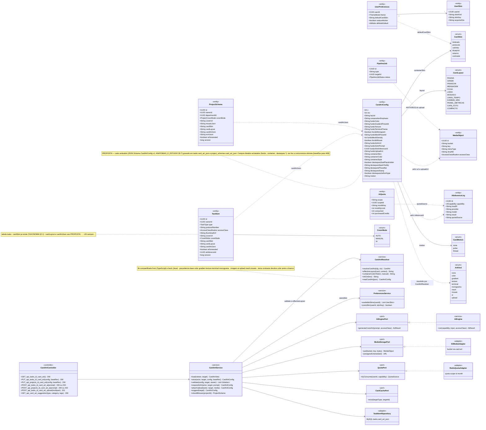
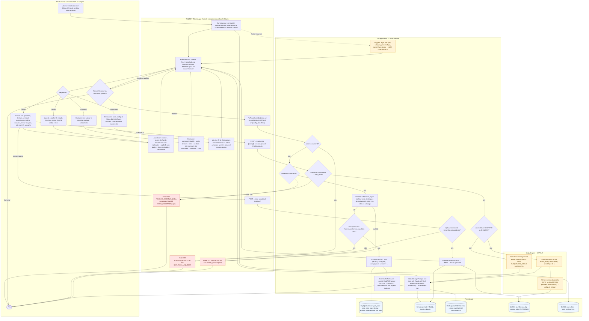
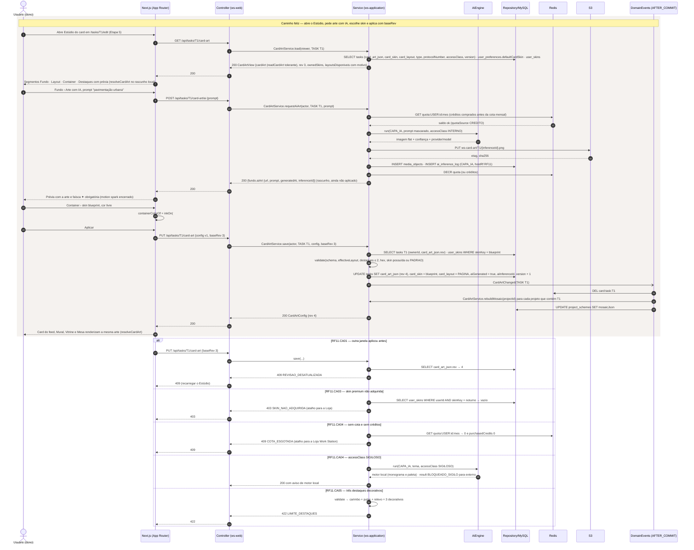
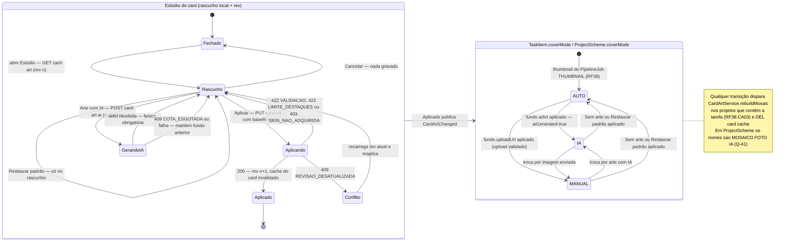
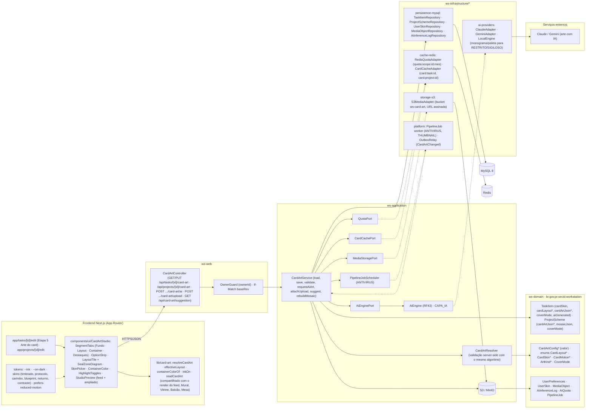

# RF11 — Utilizar o editor de arte de fundo para personalizar esquemas de tarefas e projetos
**HU:** HU11 · **Sprint (board Work Station):** lista *Requisitos Funcionais* (card renumerado, sem sprint atribuída — a confirmar) · **Equivalente FAI:** **RF11 Background Studio** (`PUT /api/pieces/{id}/background`, `backgroundConfigJson`, `resolveCardArt`, `CARD_SKINS`, `containerColorOf`, `inkOn`) + editor da arte do card da peça (v2 `PieceArt`) · **Aba/rota:** Estúdio do card dentro de `/tasks/[id]/edit` (Etapa 5 "Arte do card" do criador de tarefas, RF4/RF20) e `/projects/[id]/edit`; API `PUT /api/tasks/{id}/card-art` e `PUT /api/projects/{id}/card-art`
**Critérios de aceite cobertos:** RF11.CA01 · RF11.CA02 · RF11.CA03 · RF11.CA04 · RF11.CA05 · RF11.CA06 — corpo do card vazio: CAs derivados do título + HU11 + RF38.CA02/CA04/CA08/CA10 + `docs/design-system/ANATOMIAS_E_ESTUDIO.md` §5, marcados **(CA a confirmar)**

> **HU11** — COMO usuário criando um esquema de tarefa ou projeto POSSO utilizar o editor de arte de fundo PARA personalizar background de esquemas de tarefas ou projetos.

Na UI o editor chama-se **Estúdio do card** ("arte de fundo" é o rótulo do segmento *Fundo*, P-17 de `ANATOMIAS_E_ESTUDIO.md`). Quatro segmentos — **Fundo · Layout · Container · Destaques** — gravam um único JSON `CardArtConfig` v1 na coluna **`cardArtJson` (proposta)** de `tasks` e `project_schemes`, com colunas planas `cardSkin` (já na TAXONOMIA §2.1) e **`cardLayout` (proposta)**. A arte ocupa só as quatro faixas (passe-partout) entre a borda e o container; o container fica sempre legível (tinta por `inkOn`); a mídia nunca recebe arte. O RF reaproveita do RF38 o `CardArtService`, a capa por IA (`AiEngine CAPA_IA`, faísca ✦) e `UserSkin` (403 `SKIN_NAO_ADQUIRIDA`).

| CA | Enunciado (CA a confirmar) |
|---|---|
| **RF11.CA01** | Dado o dono de uma tarefa ou projeto (`ownerId`), quando abre o Estúdio do card, então vê os segmentos Fundo · Layout · Container · Destaques com prévia ao vivo (card do feed + ampliado); o rascunho é local (Cancelar não grava, Restaurar padrão só no rascunho); **Aplicar** envia `PUT /api/tasks/{id}/card-art` ou `PUT /api/projects/{id}/card-art` com `CardArtConfig` + `baseRev`; quem não é dono → `403 ACESSO_NEGADO`; `rev` divergente (outra janela aplicou antes) → `409 REVISAO_DESATUALIZADA`; JSON fora do schema → `422 VALIDACAO`. |
| **RF11.CA02** | Dado o segmento **Fundo**, então o usuário escolhe cor sólida (catálogo 8 cores de departamento + 6 neutras), gradiente (`marca`, `dept`, `spark`), textura (`papel`, `cortica`, `blueprint`, `timbrado`), terminal, monograma, malha de nós (`argumento`, `consenso`, `misto` + densidade 1–3), mosaico automático, imagem enviada ou arte com IA; `resolveCardArt` aplica a precedência (base `color → gradient → texture/terminal/monograma`; imagem `ai/upload → mesh → mosaic`); layouts com `ownArt` (GRADE, PRANCHA, LINHA_TEMPO) desligam o segmento Fundo com a explicação; layouts da seção B ficam desabilitados com motivo quando falta o dado (`effectiveLayout`). |
| **RF11.CA03** | Dado o segmento **Container**, então o usuário escolhe a skin (`timbrado` padrão, `protocolo`, `carimbo`, `blueprint`, `noturno`; `contraste` é forçado pelo tema) e a cor do container (nativa da skin, 5 amostras ou livre); a tinta vem de `inkOn(hex)` por luminância (0,299 R + 0,587 G + 0,114 B > 140 → `#1A1714`, senão `#F5F2EC`) garantindo ≥ 4,5:1; skin premium sem `UserSkin` (e não PADRAO) → `403 SKIN_NAO_ADQUIRIDA` com atalho para a Loja; `UserPreferences.defaultCardSkin` é o valor inicial. |
| **RF11.CA04** | Dado "Arte com IA" (prompt ≤ 300) no Fundo, então o serviço verifica `AiQuota` (créditos comprados antes da cota mensal; sem saldo → `409 COTA_ESGOTADA` + Loja), `accessClass` RESTRITO/SIGILOSO → motor local (monograma/paleta, `result = BLOQUEADO_SIGILO` para externo), senão `AiEngine CAPA_IA` com tema mascarado; a imagem vai ao S3 (`MediaObject`) e `fundo.aiArt {url, prompt, generatedAt, inferenceId}` é gravado com `AiInferenceLog`; a faísca ✦ é obrigatória (só o tooltip estendido pode ser ocultado, RF38.CA04); resposta ≤ 30 s ou estado "gerando" com `motion spark`; **imagem enviada** passa por validação (mime real, tamanho, antivírus `PipelineJob ANTIVIRUS`) → `422 VALIDACAO` se inválida. |
| **RF11.CA05** | Dado o segmento **Destaques**, então o usuário configura lacre (lugar reservado; zona vem do layout), tooltip da faísca (curto/completo), barra de fases (projeto), carimbo de estado/decisão (canto/centro/oculto), Hype do autor (respeita `HypeVisibility`) e **movimento** (`none`, `pulse`, `thread`); no máximo **2 destaques decorativos** (carimbo e movimento contam) → `422 LIMITE_DESTAQUES`; o movimento só roda no card ampliado e é desligado por `prefers-reduced-motion` ou `UserPreferences.reduceMotion` (RF38.CA10). |
| **RF11.CA06** | Dado `cardArtJson` gravado, então a API entrega `cardArt` no view da tarefa/projeto (campos planos mesclados), a leitura é tolerante (config sem `v` lê como v1 com padrões PAGINA/MOSAICO + `timbrado`; valores desconhecidos caem no padrão; `color` inválido → null); o mesmo `resolveCardArt` renderiza feed, Mural, Vitrine, Balcão e Mesa; o cache Redis do card é invalidado (`DEL card:task:{id}` / `card:project:{id}`) e o evento `CardArtChanged` dispara `CardArtService.rebuildMosaic` nos projetos que contêm a tarefa (RF38.CA03). |

## 1. Diagrama de classes

## 2. Diagrama de atividades

## 3. Diagrama de sequência

## 4. Máquina de estados

O RF11 não tem entidade com estado próprio: `CardArtConfig` é um valor embutido. Usa-se o **rascunho do Estúdio** (estado do componente, com `rev` para concorrência) e o **`TaskItem.coverMode` / `ProjectScheme.coverMode`** que a arte com IA afeta (mesmos estados do RF38).

## 5. Diagrama de componentes

*Legenda: `*` = proposta (fora da TAXONOMIA v1).*

## 6. Rastreabilidade

| CA | Classe | Passo (atividades) | Mensagem (sequência) | Transição (estados) | Componente |
|---|---|---|---|---|---|
| RF11.CA01 | `CardArtController.GET/PUT_*_card_art`, `CardArtService.load/save/validate`, `CardArtConfig.rev` (proposta), `TaskItem.ownerId`, `ProjectScheme.ownerId` | U1, U7, W1, W2, W6, S1, S2, S3, S5, W9, W10, W11 | 1–7, 24–28, 33–35; `alt` 409 REVISAO_DESATUALIZADA | `Fechado → Rascunho → Aplicando → Aplicado / Conflito` | `CardArtStudio`, `StudioPreview`, `OwnerGuard · If-Match baseRev`, `TaskItemRepository` |
| RF11.CA02 | `CardArtConfig.fundo*`, enum `ArtKind` (10 valores), enum `CardLayout` (12), `CardArtResolver.resolveCardArt/effectiveLayout` | U3, U4, W3, S3 | 7 (prévia via resolveCardArt), 35 | `Rascunho → Rascunho` (muda Fundo/Layout) | `lib/card-art`, `OptionStrip`, `LayoutTile + SealZoneDiagram` |
| RF11.CA03 | `CardArtConfig.containerSkin/containerColor/containerStyle`, enum `CardSkin`, `CardArtResolver.containerColorOf/inkOn`, `UserSkin`, `UserPreferences.defaultCardSkin`, `PreferencesService.ownsSkin` | U5, W4, S4, W9 | 4, 22–23, 26; `alt` 403 SKIN_NAO_ADQUIRIDA | `Aplicando → Rascunho` (403) | `SkinPicker`, `ContainerColor`, `tokens --ink · --on-dark`, `UserSkinRepository` |
| RF11.CA04 | `CardArtService.requestAiArt/attachUpload`, `AiEnginePort`, `QuotaPort`, `AiQuota`, `AiInferenceLog` (CAPA_IA, hostRf RF11), `MediaObject`, `PipelineJob` ANTIVIRUS, `TaskItem.accessClass/aiGenerated/aiInferenceId` | W7, W8, S7–S11, A1–A3 | 8–20; `alt` 409 COTA_ESGOTADA; `alt` SIGILOSO (motor local) | `Rascunho → GerandoIA → Rascunho`; `AUTO → IA`, `AUTO → MANUAL` | `AiEngine CAPA_IA`, `ClaudeAdapter/GeminiAdapter/LocalEngine`, `S3MediaAdapter`, `RedisQuotaAdapter`, `PipelineJob worker ANTIVIRUS` |
| RF11.CA05 | `CardArtConfig.destaques*/motion`, enum `CardMotion`, `UserPreferences.reduceMotion`, `CardArtService.validate` (≤ 2 decorativos) | U6, W5, S3, W11 | 22, 26; `alt` 422 LIMITE_DESTAQUES | `Aplicando → Rascunho` (422) | `HighlightToggles`, `tokens prefers-reduced-motion`, `StudioPreview` (movimento só ampliado) |
| RF11.CA06 | `TaskItem.cardLayout/cardSkin` (planos), `CardArtResolver.readCardArt` (tolerante), `CardCachePort`, `CardArtService.rebuildMosaic`, evento `CardArtChanged` | W1, S5, S6, D1, D3 | 3–5, 27–32, 35 | `Aplicado` publica `CardArtChanged`; nota de `Cover` | `lib/card-art` compartilhada, `CardCacheAdapter`, `OutboxRelay`, `ProjectSchemeRepository` |

**Dúvidas para confirmar:** (a) aprovar `cardArtJson` + `cardLayout` como colunas novas em `tasks` e `project_schemes` (TAXONOMIA só tem `cardSkin`, `coverMode`, `coverUrl`, `mosaicJson`); (b) nome na UI: "Estúdio do card" × "editor de arte de fundo" (P-17); (c) limite de 2 destaques decorativos; (d) unificar `CoverMode` (AUTO·MANUAL·IA) e `ProjectCoverMode` (MOSAICO·FOTO·IA) — Q-41; (e) arte com IA debita a cota de IA do usuário (RF42.CA06) ou tem cota própria `CAPA_IA_LOTE` da Loja; (f) sprint do card.

Tela/aba: `/tasks/[id]/edit` (esqueleto em `app/(shell)/tasks/[id]/edit/page.tsx`) · `/projects/[id]/edit` (esqueleto em `app/(shell)/projects/[id]/edit/page.tsx`) · `/lab/anatomias` (esqueleto em `app/(shell)/lab/anatomias/page.tsx`)
