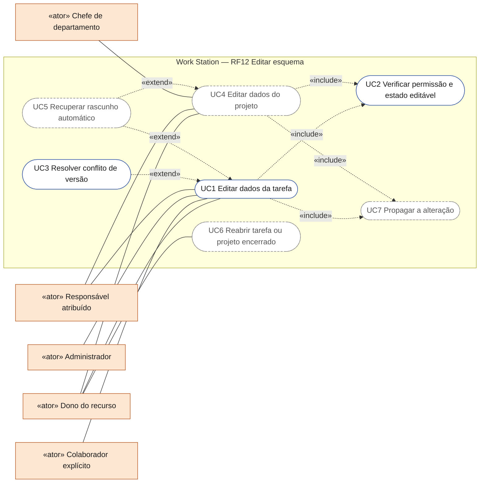
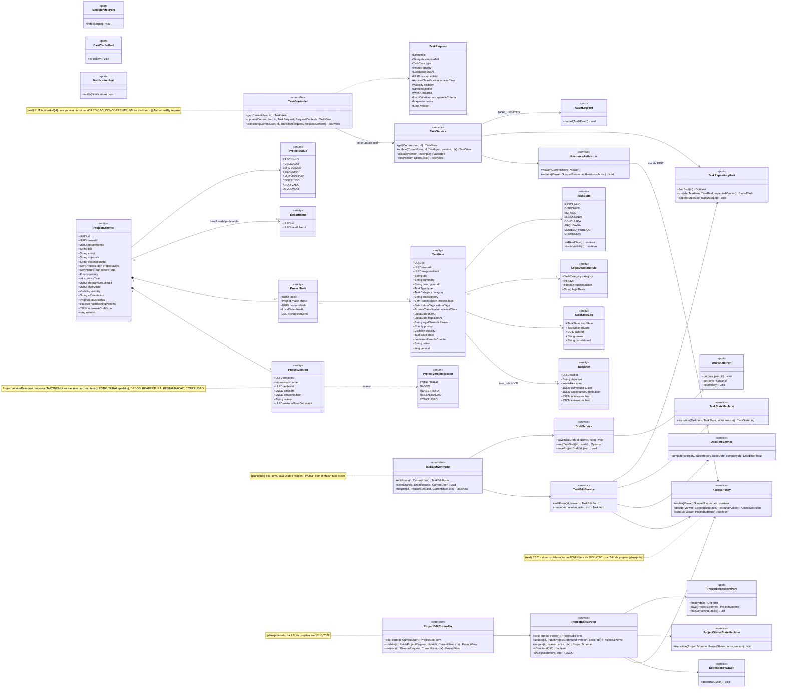
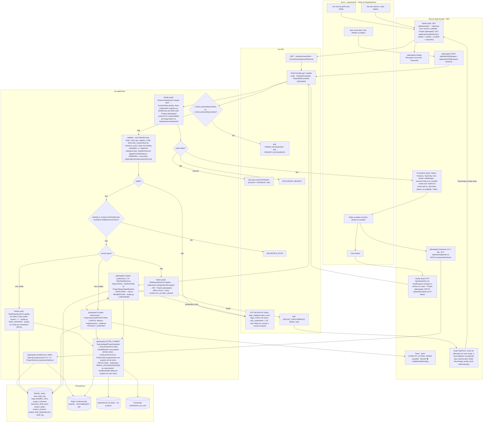
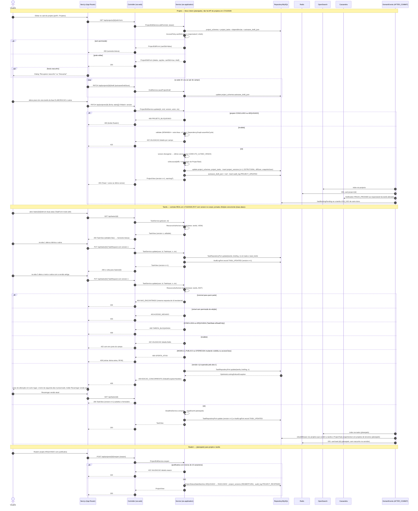
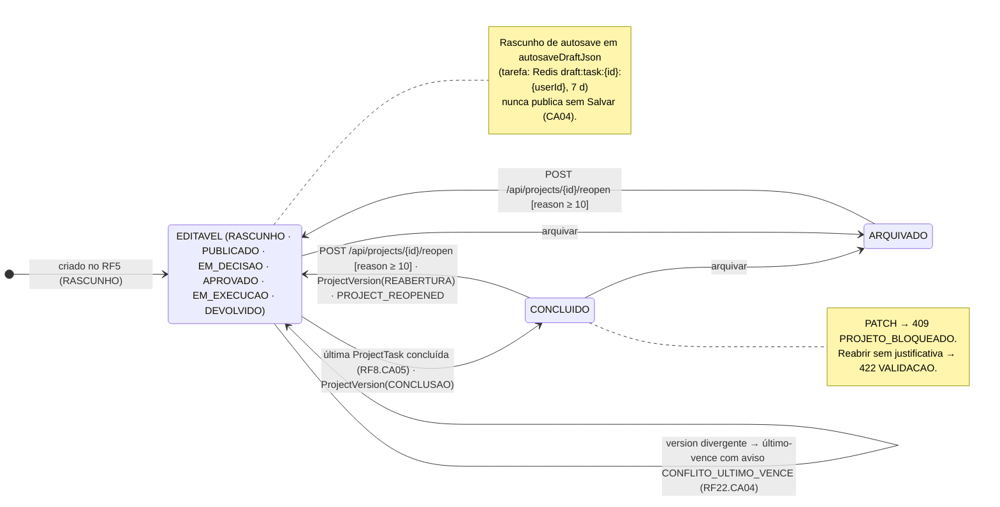
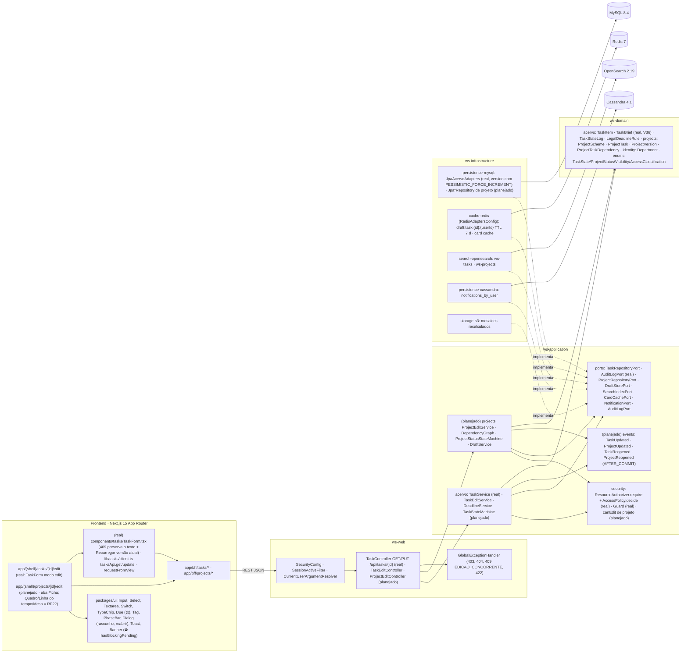

# RF12 — Editar um esquema de tarefa ou projeto de meu perfil
**HU:** HU12 · **Sprint (board Work Station):** lista *Requisitos Funcionais* sem sprint atribuída (card renumerado; o card "SPRINT 3" cita "RF12 Registrar decisão final", escopo antigo — `RENUMERACAO.md`; fase (e) da ARQUITETURA §6: "RF7/RF8/RF12 detalhe e edição") · **Equivalente FAI:** RF9 Editar esquema (`PUT /api/schemes/{id}`, `SchemeService.update`, versões) + RF8 Editar peça (`WardrobeService.update`) · **Aba/rota:** Meu perfil (`/profile`) › sub-abas Acervo Digital e Projetos (RF6) › card › **Editar** → `/tasks/[id]/edit` e `/projects/[id]/edit` (a Mesa completa — Quadro, Linha do tempo, canvas — é o RF21/RF22; os **arquivos** são o RF8); API `GET /api/tasks/{id}/edit-form`, `PATCH /api/tasks/{id}`, `PATCH /api/projects/{id}`, `PUT /api/tasks/{id}/draft`, `POST /api/tasks/{id}/reopen`, `POST /api/projects/{id}/reopen` · **contrato real em 17/10/2026:** `GET /api/tasks/{id}` e `PUT /api/tasks/{id}` (corpo `TaskRequest` com `version`; sem `version` → `422 VALIDACAO`; versão superada → `409 EDICAO_CONCORRENTE`), estados por `POST /api/tasks/{id}/transitions` (RF41); `edit-form`, `PATCH`, `draft`, `reopen` e todas as rotas de projeto seguem **(planejado)** — ver «Contrato real × documento»
**Critérios de aceite cobertos:** RF12.CA01 · RF12.CA02 · RF12.CA03 · RF12.CA04 · RF12.CA05 · RF12.CA06 — corpo do card vazio: CAs derivados do título + HU12 + RF22 (CA01 permissão, CA02 `ProjectVersion`, CA04 concorrência, CA06 bloqueio) + RF20.CA07/CA11 + RF21.CA14 (autosave) + RF41.CA02 (`TaskStateLog`), marcados **(CA a confirmar)**. Classes **(real)** desde 17/10/2026 (`97611a0`, `013657a`, `474b6cb`): `TaskController.get/update` (`@AuthorizedBy("require")`), `TaskRequest`, `TaskService.get/update` (`TaskInput`, `TaskView` com `version` e `editable`), `TaskRepositoryPort.update` (versão obrigatória), `ResourceAuthorizer`, `AccessPolicy`, `TaskState.isReadOnly/locksVisibility`, `GlobalExceptionHandler` (`409 EDICAO_CONCORRENTE`) e a tela `/tasks/[id]/edit` com `TaskForm` modo edit; as demais (projeto, rascunho/autosave, reabrir, prazo legal, eventos AFTER_COMMIT) seguem **(planejado)**; transversais reais: `Guard`, `AuditLogPort`, `SecurityConfig`, `SessionActiveFilter`, `RedisAdaptersConfig`.

> **HU12** — COMO usuário visualizando um esquema de tarefa ou projeto POSSO editar os dados deste esquema PARA atualizar minha gestão pessoal e empresarial.

Este RF cobre a edição dos **dados** (ficha) da `TaskItem` e do `ProjectScheme`: validação igual à do criador (RF4/RF5), lock otimista para tarefa e último-vence com aviso para projeto (RF22.CA04), versões (`ProjectVersion`, `TaskStateLog`), autosave e bloqueio de itens encerrados. A edição de **arquivos** (anexos, versões, provedor externo) é o RF8 e a arte do card é o RF11.

## Critérios de aceite derivados da HU12 (todos "CA a confirmar")

| CA | Enunciado (Dado / Quando / Então) |
|---|---|
| **RF12.CA01** (CA a confirmar) | Dado o usuário no card de uma tarefa ou projeto **do seu perfil**, quando aciona **Editar**, então `/tasks/[id]/edit` (ou `/projects/[id]/edit`) carrega o formulário com os dados atuais; **tarefa**: título, resumo, descrição, tipo, categoria/subcategoria, `processTags`/`natureTags` (≤ 2 cada), `accessClass`, prazo e prazo legal, prioridade, responsável, visibilidade, notas, Estúdio do card (RF11); **projeto**: título, emoji, objetivo, descrição, tags, prioridade, exercício, agrupamentos (RF25), eixo do plano (RF24), visibilidade, lista de tarefas por fase com prazo e responsável, orientação para a IA; `AccessPolicy.canEdit` = `ownerId` OU `responsibleId` (de alguma `ProjectTask`) OU `Department.headUserId`; demais → somente leitura e `403 ACESSO_NEGADO` na API. |
| **RF12.CA02** (CA a confirmar) | Dado o envio (`PATCH /api/tasks/{id}` ou `PATCH /api/projects/{id}` com `If-Match: version`), então o serviço valida: título ≤ 200, ≤ 2 tags por eixo, categoria compatível com o tipo, prazo legal recalculado por `LegalDeadlineRule` quando a categoria tem prazo (`legalOverrideReason` obrigatório para sobrescrever, RF20.CA11), projeto com ≥ 1 tarefa em DEMANDA + 1 em outra fase (RF21.CA05) e sem ciclo de dependências → `422 VALIDACAO`; `version` divergente → `409 CONFLITO_VERSAO` para tarefa e **último-vence com aviso `CONFLITO_ULTIMO_VENCE`** para projeto (RF22.CA04). **Contrato real da tarefa (17/10/2026):** `PUT /api/tasks/{id}` com o `TaskRequest` completo e `version` no corpo (não `PATCH` + `If-Match`) e `409 EDICAO_CONCORRENTE` (não `CONFLITO_VERSAO`); categoria×tipo, tags por eixo e prazo legal ainda não são validados. |
| **RF12.CA03** (CA a confirmar) | Dado o salvamento, então **projeto** com alteração estrutural (tarefa adicionada/removida, fase, prazo, responsável, dependência) grava `ProjectVersion` (`versionNumber + 1`, `authorId`, `diffJson` legível, `snapshotJson`); mudanças só descritivas também geram versão com `reason DADOS`; **tarefa** com mudança de `state` grava `TaskStateLog`; tudo com `AuditLog TASK_UPDATED`/`PROJECT_UPDATED` e `correlationId`. |
| **RF12.CA04** (CA a confirmar) | Dado o formulário aberto, então o rascunho é salvo a cada 10 s ou ao sair do campo: projeto em `ProjectScheme.autosaveDraftJson` (RF21.CA14); tarefa em Redis `draft:task:{id}:{userId}` com TTL 7 dias **(proposta)**; ao reabrir, o sistema oferece **Recuperar rascunho** ou **Descartar**; o rascunho nunca é publicado sem o clique em Salvar. |
| **RF12.CA05** (CA a confirmar) | Dado alvo em `TaskState` CONCLUIDA/ARQUIVADA ou `ProjectStatus` CONCLUIDO/ARQUIVADO, então toda escrita devolve `409 TAREFA_BLOQUEADA` / `409 PROJETO_BLOQUEADO`; **Reabrir** exige justificativa (≥ 10 caracteres, senão `422 VALIDACAO`) e gera `TaskStateLog`/`ProjectVersion.reason REABERTURA` + `AuditLog TASK_REOPENED`/`PROJECT_REOPENED`; tarefa `MODELO_PUBLICO` ou `OFERECIDA` (RF40/RF41) não pode mudar `visibility`/`accessClass` sem antes retirar a oferta (`409 OFERTA_ATIVA`). |
| **RF12.CA06** (CA a confirmar) | Dado o commit, então eventos AFTER_COMMIT `TaskUpdated`/`ProjectUpdated`: reindexam o item no OpenSearch (RF17/RF27), recalculam a capa-mosaico dos projetos que contêm a tarefa (RF38.CA03), invalidam o cache do card (Redis), atualizam `ProjectTask.snapshotJson` nos projetos de terceiros que referenciam a tarefa (RF23.CA03) e notificam (`Notification PRAZO_PROXIMO`/`SISTEMA`) o responsável quando prazo ou responsável mudou; tarefa EM_USO em projeto de **outro** dono tem mudança de prazo sinalizada no projeto (⛔ `hasBlockingPending`). |

## Contrato real × documento (divergência registrada em 17/10/2026)

A MATRIZ_RF de 17/10/2026 (`docs/auditoria/2026-10-17/MATRIZ_RF.md`, linha RF12) registra: «doc pede PATCH/If-Match e a API usa PUT com versão no corpo». Os diagramas abaixo seguem o **contrato real** na parte da tarefa; a parte de projeto continua **(planejado)** porque não há API de projetos.

| Tema | Documento (CA a confirmar) | Real em 17/10/2026 (`TaskController`, `TaskService`) |
|---|---|---|
| Carregar para editar | `GET /api/tasks/{id}/edit-form` | `GET /api/tasks/{id}` → `TaskView` com `version` e `editable` (estado + permissão); `editable = false` → `/tasks/[id]/edit` mostra «Somente leitura» |
| Salvar | `PATCH /api/tasks/{id}` + cabeçalho `If-Match: version` | `PUT /api/tasks/{id}` com o `TaskRequest` completo e `version` no corpo; sem `version` → `422 VALIDACAO` (`fields.version`) |
| Conflito | `409 CONFLITO_VERSAO` | `409 EDICAO_CONCORRENTE` (`GlobalExceptionHandler` ← `OptimisticLockingFailureException` do `TaskRepositoryPort.update`; `JpaAcervoAdapters` sobe a versão com `PESSIMISTIC_FORCE_INCREMENT`, até quando só o briefing muda); o `TaskForm` preserva o texto digitado e oferece «Recarregar versão atual» |
| Quem edita | `AccessPolicy.canEdit` = dono OU responsável de `ProjectTask` OU chefe do departamento | `ResourceAuthorizer.require(..., EDIT)` → `AccessPolicy.decide`: dono, colaborador explícito ou ADMIN (nunca em SIGILOSO, D-139); invisível → `404 NAO_ENCONTRADO` igual a inexistente; visível sem permissão → `403 ACESSO_NEGADO` |
| Encerrada / oferecida | `409 TAREFA_BLOQUEADA`, `409 OFERTA_ATIVA` | iguais: `TaskState.isReadOnly()` e `TaskState.locksVisibility()` |
| Autosave e rascunho | Redis `draft:task:{id}:{userId}` (7 d) + «Recuperar rascunho» | não existe: o `TaskForm` só avisa ao sair com alterações (`beforeunload`) e não grava nada no navegador (pode ser sigiloso) — **(planejado)** |
| Reabrir | `POST /api/tasks/{id}/reopen` com justificativa ≥ 10 | não existe — **(planejado)**; concluída fica somente leitura na tela |
| Auditoria e histórico | `AuditLog TASK_UPDATED`, `TaskStateLog` se o estado mudou | `TASK_UPDATED` com a nova `version`; a edição não muda estado (estado só por `/transitions`, que grava `task_state_log` e `TASK_STATE_CHANGED`) |
| Eventos AFTER_COMMIT | reindexar, mosaico, `snapshotJson`, notificação | não existem — **(planejado)** |

## 0. Diagrama de casos de uso

Quem edita os dados de uma tarefa ou projeto e o que consegue fazer. Borda contínua: existe no código em 17/10/2026; tracejada: planejado (projeto, rascunho, reabertura e eventos).

| Caso de uso | Ator(es) | CAs | Situação |
|---|---|---|---|
| UC1 Editar dados da tarefa | dono, colaborador, admin fora de SIGILOSO (real); responsavel (planejado) | RF12.CA01, RF12.CA02, RF12.CA03 | real: `/tasks/[id]/edit` (`TaskForm` modo edit) → `PUT /api/tasks/{id}` com `version` → `TaskService.update`, `TASK_UPDATED` |
| UC2 Verificar permissão e estado editável | — (incluído por UC1 e UC4) | RF12.CA01, RF12.CA05 | real para tarefa: `ResourceAuthorizer.require(EDIT)` (invisível → `404`, sem permissão → `403`), `TaskState.isReadOnly` → `409 TAREFA_BLOQUEADA`, `locksVisibility` → `409 OFERTA_ATIVA` |
| UC3 Resolver conflito de versão | dono, colaborador | RF12.CA02 | real: `409 EDICAO_CONCORRENTE` e «Recarregar versão atual» sem perder o texto |
| UC4 Editar dados do projeto | dono, responsavel, chefe | RF12.CA01, RF12.CA02, RF12.CA03 | planejado (sem API de projetos; `ProjectVersion`, último-vence com aviso) |
| UC5 Recuperar rascunho automático | dono | RF12.CA04 | planejado (o `TaskForm` só avisa ao sair com alterações) |
| UC6 Reabrir tarefa ou projeto encerrado | dono | RF12.CA05 | planejado (justificativa ≥ 10 caracteres) |
| UC7 Propagar a alteração | — (incluído por UC1 e UC4) | RF12.CA06 | planejado (reindexar, mosaico, `snapshotJson`, notificar o responsável) |

## 1. Diagrama de classes

## 2. Diagrama de atividades

## 3. Diagrama de sequência

## 4. Máquina de estados

Entidade central: **`ProjectScheme.status`** (`ProjectStatus`) no recorte da edição — quais estados aceitam `PATCH` e como se reabre; a máquina completa está no RF5 §4. Para a tarefa vale `TaskState` (RF4/RF6 §4): a edição de dados é permitida em RASCUNHO, DISPONIVEL, EM_USO e BLOQUEADA; `CONCLUIDA`/`ARQUIVADA` exigem Reabrir; `MODELO_PUBLICO`/`OFERECIDA` não mudam visibilidade/classificação (`409 OFERTA_ATIVA`). **Real (17/10/2026):** essas duas regras da tarefa já valem (`TaskState.isReadOnly()` → `409 TAREFA_BLOQUEADA`; `TaskState.locksVisibility()` → `409 OFERTA_ATIVA`) e a tela mostra «Somente leitura» para tarefa concluída ou arquivada; **Reabrir** com justificativa segue **(planejado)** — a tabela do `TaskState` já permite CONCLUIDA → EM_USO/DISPONIVEL e ARQUIVADA → DISPONIVEL por `POST /api/tasks/{id}/transitions` (RF41), sem justificativa obrigatória, e a tela não oferece o botão. A máquina de `ProjectStatus` abaixo é toda **(planejado)**.

## 5. Diagrama de componentes

## 6. Rastreabilidade

| CA | Classe (§1) | Passo da atividade (§2) | Mensagem da sequência (§3) | Transição de estado (§4) | Componente (§5) | Situação |
|---|---|---|---|---|---|---|
| RF12.CA01 | `TaskEditController.editForm`, `ProjectEditController.editForm`, `TaskEditService.editForm`, `ProjectEditService.editForm`, `AccessPolicy.canEdit`, `Department.headUserId`; real: `TaskController.get`, `TaskService.get`, `TaskView.editable`, `ResourceAuthorizer.require`, `AccessPolicy.decide` | `A1`→`F1`→`S1`→`S2`→`F2`, `E403`, `E404` | 1–10 (projeto); real: 32–37 | — | `PG`, `UI`, `SECU`, `TFE` | **real** para tarefa (`TaskServiceTest.colegaDaEmpresaVeMasNaoEdita`, `sigilosoNaoEhVistoPorColegaNemAdminSemVinculo`; `tasks.test.tsx` «404 diz que não existe ou não há acesso»; `97611a0`, `013657a`); projeto e chefe do departamento planejados |
| RF12.CA02 | `ProjectEditService.update`, `DeadlineService`, `LegalDeadlineRule`, `DependencyGraph.assertNoCycle`; real: `TaskController.update` (`TaskRequest.version`), `TaskService.update/validate`, `TaskRepositoryPort.update`, `GlobalExceptionHandler` | `S4`→`S5`→`E422`, `S7`→`S8`→`E409V`→`F8` | 14–22 (projeto); real: 39–41, 45–48, 55–56, 59–66 | `EDT`→`EDT` (último-vence) | `ACV`, `PRJ`, `GEH`, `MY`, `TFE` | **real** para tarefa com o contrato `PUT` + `version` e `409 EDICAO_CONCORRENTE` (`TaskServiceTest.editarPreservaConteudoEExigeVersaoAtual`, `TaskControllerWebTest.edicaoExigeVersaoEPropagaConflitoEAusencia`, `TaskPersistenceIT.salvaReabreEditaOBriefingESobeAVersao`, `tasks.test.tsx` «422 do servidor aparece junto do campo; 409 mantém o texto e oferece recarregar»; jornada «Edição concorrente (duas abas)», captura 04; `97611a0`, `013657a`); categoria×tipo, tags, prazo legal e projeto planejados |
| RF12.CA03 | `ProjectVersion` (`ProjectVersionReason`), `ProjectEditService.isStructural/diffLegivel`, `TaskStateLog`, `AuditLogPort` | `S9`, `S10` | 23–25 (projeto); real: 42, 68 | `EDT`→`EDT` | `PRJ`, `MY` | **real** para tarefa: `AuditLog TASK_UPDATED` com a nova `version` (`97611a0`); `task_state_log` só nas transições (RF41); `ProjectVersion` planejado |
| RF12.CA04 | `DraftService`, `DraftStorePort`, `ProjectScheme.autosaveDraftJson` | `A2`→`F3`→`D1`, `A3`→`F4` | 10–13, 25 | nota de `EDT` | `RDS`, `UI` (`Dialog`) | planejado (o real só avisa ao sair com alterações não salvas, `beforeunload` no `TaskForm`, e não grava rascunho) |
| RF12.CA05 | `TaskEditService.reopen`, `ProjectEditService.reopen`, `TaskStateMachine`, `ProjectStatusStateMachine`, `TaskItem.offeredInCounter`; real: `TaskState.isReadOnly/locksVisibility` | `S3`→`E409B`, `S6`→`E409O`, `A5`→`F6`→`R1`, `E422` | 17–18, 74–79 (planejado); real: 53–54, 57–58 | `CON`→`EDT`, `ARQ`→`EDT`, nota de `CON` | `ACV`, `PRJ` | **real** para `409 TAREFA_BLOQUEADA` (`TaskServiceTest.transicoesSeguemATabelaEBloqueioExigeCausa`; tela «Somente leitura», captura 06) e `409 OFERTA_ATIVA` (`TaskService.update`, sem teste dedicado); Reabrir com justificativa planejado (RF40/RF41) |
| RF12.CA06 | eventos `TaskUpdated`/`ProjectUpdated`, `SearchIndexPort`, `CardCachePort`, `ProjectTask.snapshotJson`, `NotificationPort`, `ProjectScheme.hasBlockingPending` | `EV` | 28–31, 71–73 | — | `EVT`, `OSE`, `RDS`, `CAS`, `S3` | planejado (RF23.CA03, RF38.CA03) |
