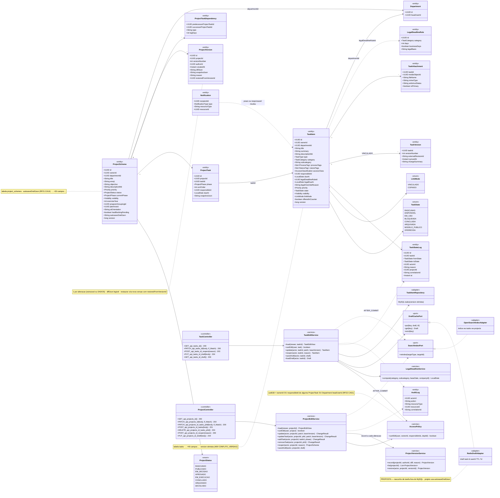
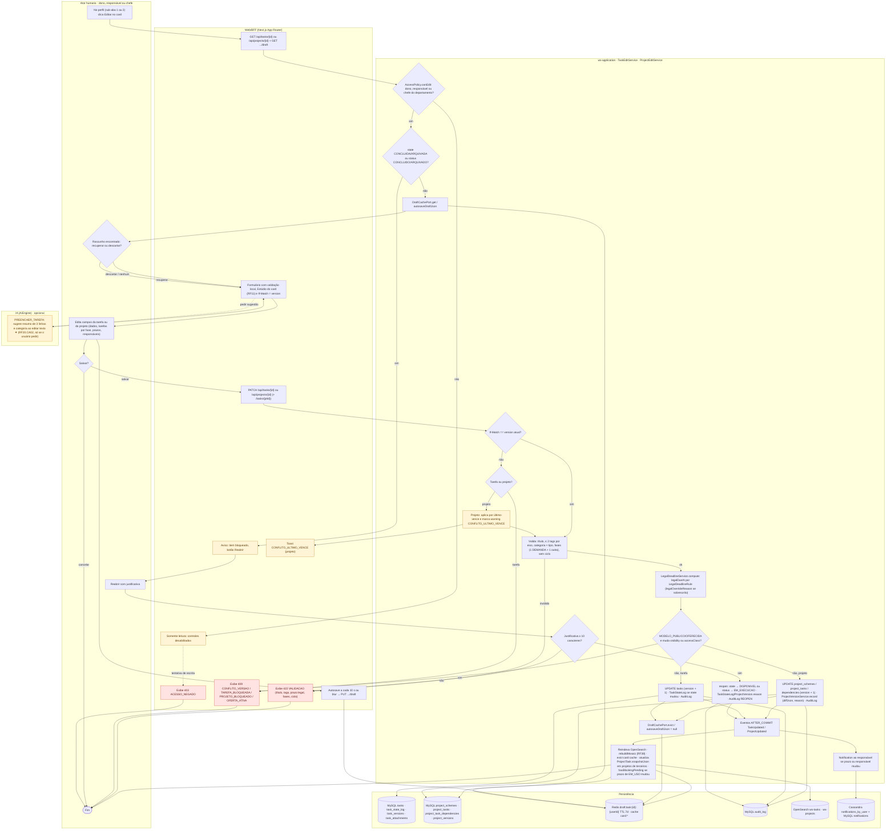
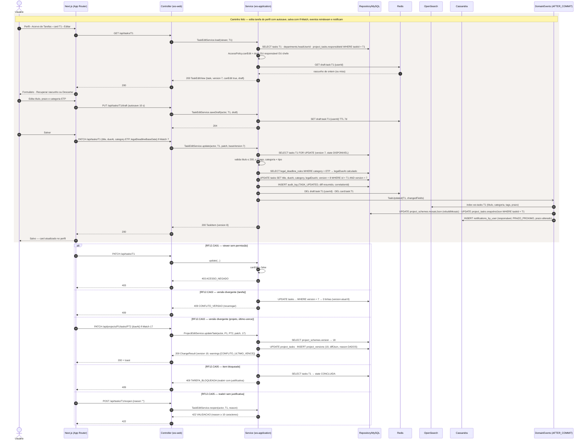
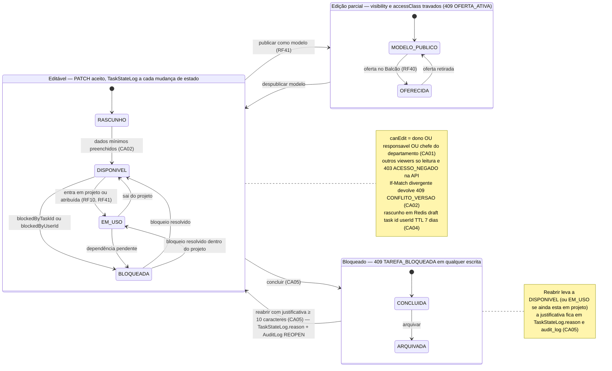
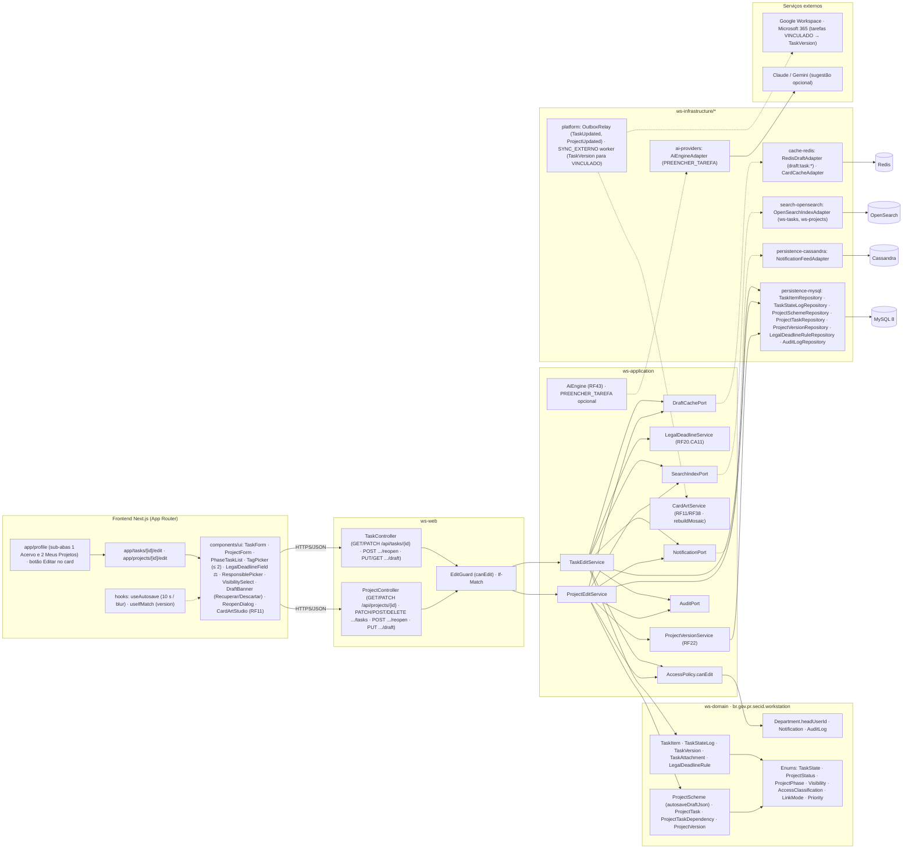

# RF12 — Editar um esquema de tarefa ou projeto de meu perfil
**HU:** HU12 · **Sprint (board Work Station):** lista *Requisitos Funcionais* (card renumerado, sem sprint atribuída — a confirmar) · **Equivalente FAI:** RF9 Editar esquema (`PUT /api/schemes/{id}`, `SchemeService.update`, versões) + RF8 editar peça (`WardrobeService.update`) · **Aba/rota:** Meu perfil (`/profile`) › sub-abas **1 Acervo de Tarefas** e **2 Meus Projetos** › card › **Editar** → `/tasks/[id]/edit` e `/projects/[id]/edit` (a Mesa de Trabalho completa — Quadro, Linha do tempo, canvas — é o RF21/RF22)
**Critérios de aceite cobertos:** RF12.CA01 · RF12.CA02 · RF12.CA03 · RF12.CA04 · RF12.CA05 · RF12.CA06 — corpo do card vazio: CAs derivados do título + HU12 + `docs/diagramas/RF22/README.md` (CA01 permissão, CA02 `ProjectVersion`, CA04 concorrência, CA06 bloqueio) + RF20.CA07/CA11 + RF21.CA14 (autosave) + RF41.CA02 (`TaskStateLog`), marcados **(CA a confirmar)**

> **HU12** — COMO usuário visualizando um esquema de tarefa ou projeto POSSO editar os dados deste esquema PARA atualizar minha gestão pessoal e empresarial.

Edição **dos dados** do esquema (formulário), em contraste com o RF22 (manipulação na Mesa). *Esquema de Tarefa* = `TaskItem` (+ a sua `ProjectTask` quando dentro de um projeto); *Esquema de Projeto* = `ProjectScheme` + `ProjectTask`s. Regras reaproveitadas do RF22: `canEdit` = dono OU responsável OU chefe do departamento (403 fora disso); toda alteração estrutural de projeto gera `ProjectVersion` com `diffJson` legível; mudança de estado de tarefa gera `TaskStateLog`; CONCLUIDO/ARQUIVADO bloqueiam (409) e reabrir exige justificativa; **autosave** do rascunho em `ProjectScheme.autosaveDraftJson` (RF21.CA14) e, para tarefas, em Redis (**proposta**).

| CA | Enunciado (CA a confirmar) |
|---|---|
| **RF12.CA01** | Dado o usuário no card de uma tarefa ou projeto **do seu perfil**, quando aciona **Editar**, então `/tasks/[id]/edit` (ou `/projects/[id]/edit`) carrega o formulário com os dados atuais; **tarefa**: título, resumo, descrição, tipo, categoria/subcategoria, `processTags`/`natureTags` (≤ 2 cada), `accessClass`, prazo e prazo legal, prioridade, responsável, visibilidade, anexos, notas, Estúdio do card (RF11); **projeto**: título, emoji, objetivo, descrição, tags, prioridade, exercício, agrupamentos (RF25), eixo do plano (RF24), visibilidade, lista de tarefas por fase com prazo e responsável, orientação para a IA; `canEdit` = `ownerId` OU `responsibleId` (de alguma `ProjectTask`) OU `Department.headUserId`; demais → formulário somente leitura e `403 ACESSO_NEGADO` na API. |
| **RF12.CA02** | Dado o envio (`PATCH /api/tasks/{id}` ou `PATCH /api/projects/{id}` com `If-Match: version`), então o serviço valida: título obrigatório ≤ 200, ≤ 2 tags por eixo, categoria compatível com o tipo, prazo legal recalculado por `LegalDeadlineRule` quando a categoria tem prazo (`legalOverrideReason` obrigatório para sobrescrever, RF20.CA11), projeto com ≥ 1 tarefa em DEMANDA + 1 em outra fase (RF21.CA05) e sem ciclo de dependências → `422 VALIDACAO`; `version` divergente → `409 CONFLITO_VERSAO` para tarefa e **último-vence com aviso `CONFLITO_ULTIMO_VENCE`** para projeto (RF22.CA04). |
| **RF12.CA03** | Dado o salvamento, então: **projeto** com alteração estrutural (tarefa adicionada/removida, fase, prazo, responsável, dependência) grava `ProjectVersion` (`versionNumber + 1`, `authorId`, `diffJson` legível, `snapshotJson`); mudanças só de dados descritivos (título, objetivo, tags) também geram versão com `reason = DADOS`; **tarefa** com mudança de `state` grava `TaskStateLog` (`fromState`, `toState`, `actorId`, `reason`); tarefa `linkMode = VINCULADO` (Google/Microsoft) ganha `TaskVersion` ao sincronizar (RF20.CA07); tudo com `AuditLog` e `correlationId`. |
| **RF12.CA04** | Dado o formulário aberto, então o rascunho é salvo a cada 10 s ou ao sair do campo: projeto em `ProjectScheme.autosaveDraftJson` (RF21.CA14); tarefa em Redis `draft:task:{id}:{userId}` com TTL 7 dias **(proposta)**; ao reabrir, o sistema oferece **Recuperar rascunho** ou **Descartar**; o rascunho nunca é publicado sem o clique em Salvar. |
| **RF12.CA05** | Dado alvo em `TaskState` CONCLUIDA/ARQUIVADA ou `ProjectStatus` CONCLUIDO/ARQUIVADO, então toda escrita devolve `409 TAREFA_BLOQUEADA` / `409 PROJETO_BLOQUEADO`; **Reabrir** exige justificativa (≥ 10 caracteres, senão `422 VALIDACAO`) e gera `TaskStateLog`/`ProjectVersion.reason` + `AuditLog` (REOPEN); tarefa `MODELO_PUBLICO` ou `OFERECIDA` (RF40/RF41) não pode mudar `visibility`/`accessClass` sem antes retirar a oferta (`409 OFERTA_ATIVA`). |
| **RF12.CA06** | Dado o commit, então eventos AFTER_COMMIT: `TaskUpdated`/`ProjectUpdated` reindexam o item no OpenSearch (busca RF27), recalculam a capa-mosaico dos projetos que contêm a tarefa (RF38.CA03), invalidam o cache do card (Redis), atualizam `ProjectTask.snapshotJson` nos projetos de terceiros que referenciam a tarefa (RF23.CA03) e notificam (`Notification` PRAZO_PROXIMO/SISTEMA) o responsável quando prazo ou responsável mudou; tarefa EM_USO em projeto de **outro** dono tem mudança de prazo sinalizada no projeto (⛔ `hasBlockingPending`). |

## 1. Diagrama de classes

## 2. Diagrama de atividades

## 3. Diagrama de sequência

## 4. Máquina de estados

Entidade central: **`TaskItem.state`** (enum `TaskState`), vista sob a ótica de **edição**: o grupo *Editável* aceita PATCH (cada mudança de estado grava `TaskStateLog`); CONCLUIDA e ARQUIVADA bloqueiam; MODELO_PUBLICO e OFERECIDA aceitam edição de dados mas não de `visibility`/`accessClass`. Para projeto vale o mesmo com **`ProjectScheme.status`** (`ProjectStatus`): editável em RASCUNHO · PUBLICADO · EM_DECISAO · APROVADO · EM_EXECUCAO · DEVOLVIDO, bloqueado em CONCLUIDO · ARQUIVADO (máquina detalhada em `RF22/README.md` §4).

## 5. Diagrama de componentes

## 6. Rastreabilidade

| CA | Classe | Passo (atividades) | Mensagem (sequência) | Transição (estados) | Componente |
|---|---|---|---|---|---|
| RF12.CA01 | `TaskEditService.load/canEdit`, `ProjectEditService.load/canEdit`, `AccessPolicy.canEdit` (dono OU responsável OU `Department.headUserId`), campos de `TaskItem` e `ProjectScheme` listados | U1, W1, W2, S1, W5, W7 | 1–10; `alt` 403 ACESSO_NEGADO | nota do grupo *Editável* | `app/profile` › Editar, `TaskForm`, `ProjectForm`, `EditGuard` |
| RF12.CA02 | `TaskItem.version`, `ProjectScheme.version`, `LegalDeadlineService.compute`, `LegalDeadlineRule`, `TaskItem.legalOverrideReason`, `ProjectTaskDependency` (sem ciclo), `TaskController.PATCH` com `If_Match` | W4, S4–S9, W8, W9, W10 | 18–23; `alt` 409 CONFLITO_VERSAO; `alt` CONFLITO_ULTIMO_VENCE | `RASCUNHO → DISPONIVEL` (dados mínimos) | `TagPicker`, `LegalDeadlineField`, `useIfMatch`, `LegalDeadlineRuleRepository` |
| RF12.CA03 | `ProjectVersion` (versionNumber, authorId, diffJson, reason DADOS), `ProjectVersionService.record`, `TaskStateLog`, `TaskVersion` (VINCULADO), `AuditLog`, `TaskItem.linkMode` | S10, S11, D1, D2, D4 | 23–24 e INSERT project_versions no `alt` de projeto | toda transição dentro de *Editável* grava `TaskStateLog` | `ProjectVersionService`, `TaskStateLogRepository`, `SYNC_EXTERNO worker` |
| RF12.CA04 | `DraftCachePort`, `RedisDraftAdapter` (proposta), `ProjectScheme.autosaveDraftJson`, `TaskEditService.saveDraft/loadDraft` | S3, U5, W3, S12, D3 | 6–7, 12–15, 25 | nota de *Editável* (rascunho TTL 7 dias) | `useAutosave`, `DraftBanner`, `RedisDraftAdapter` |
| RF12.CA05 | enums `TaskState` (CONCLUIDA, ARQUIVADA, MODELO_PUBLICO, OFERECIDA) e `ProjectStatus`, `TaskEditService.reopen`, `ProjectEditService.reopen`, `TaskItem.offeredInCounter`, `AuditLog` REOPEN | S2, W6, U4, S13, S14, S9 | `alt` 409 TAREFA_BLOQUEADA; `alt` 422 reopen | grupos *Parcial* e *Bloqueado*, `Bloqueado → Editavel` com justificativa | `ReopenDialog`, `VisibilitySelect` (travado), `AuditLogRepository` |
| RF12.CA06 | eventos `TaskUpdated`/`ProjectUpdated`, `SearchIndexPort`, `CardArtService.rebuildMosaic`, `ProjectTask.snapshotJson`, `ProjectScheme.hasBlockingPending`, `Notification` (PRAZO_PROXIMO) | S15, S16, S17, D5, D6 | 26–29 | — (efeitos após `Editavel`) | `OutboxRelay`, `OpenSearchIndexAdapter`, `CardCacheAdapter`, `NotificationFeedAdapter` |

**Dúvidas para confirmar:** (a) escopo exato: RF12 = formulário de dados e RF21/RF22 = Mesa (Quadro/Linha do tempo/canvas), ou o card RF12 engloba a Mesa também; (b) rascunho de tarefa em Redis (proposta) × coluna `autosaveDraftJson` em `tasks`; (c) edição de dados descritivos de projeto gera `ProjectVersion` (`reason = DADOS`) ou só alterações estruturais (RF22.CA02); (d) política de concorrência: tarefa `409 CONFLITO_VERSAO` × projeto último-vence com aviso; (e) sprint do card.

Tela/aba: `/profile` (esqueleto em `app/(shell)/profile/page.tsx`) · `/tasks/[id]/edit` (esqueleto em `app/(shell)/tasks/[id]/edit/page.tsx`) · `/projects/[id]/edit` (esqueleto em `app/(shell)/projects/[id]/edit/page.tsx`)
