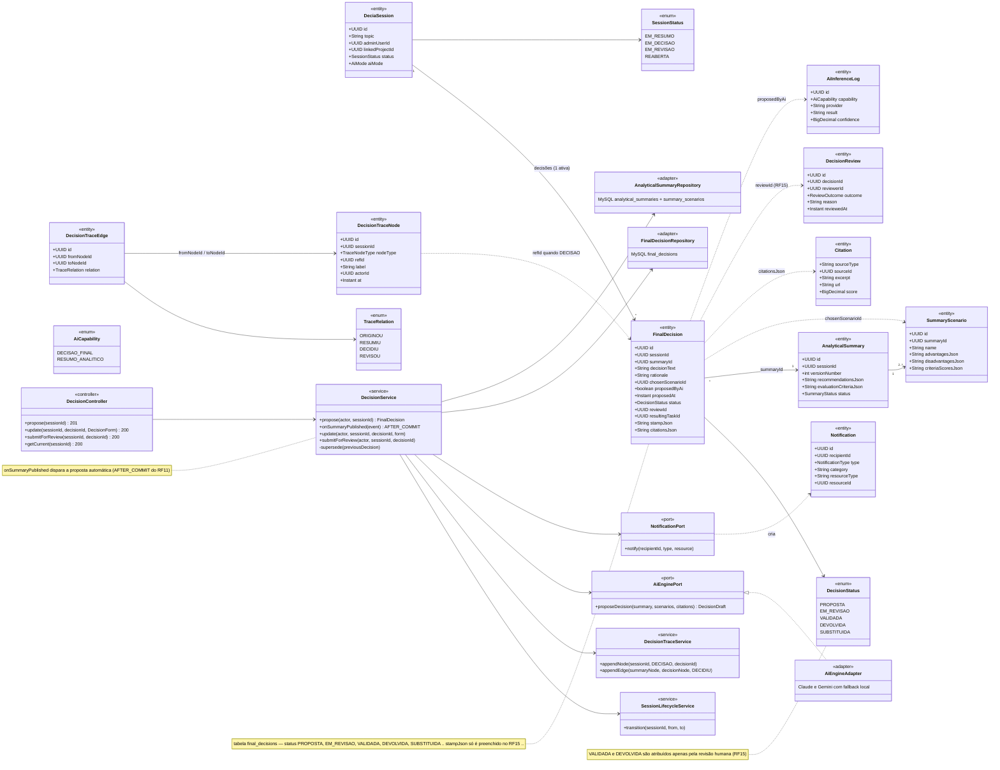
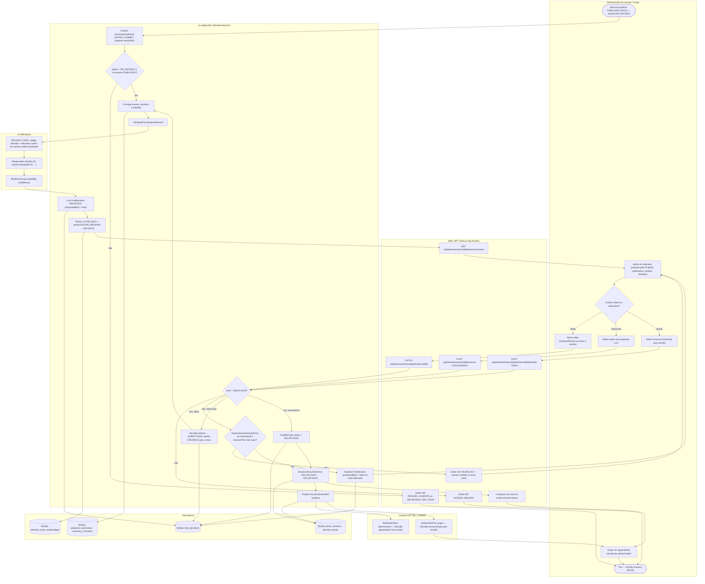
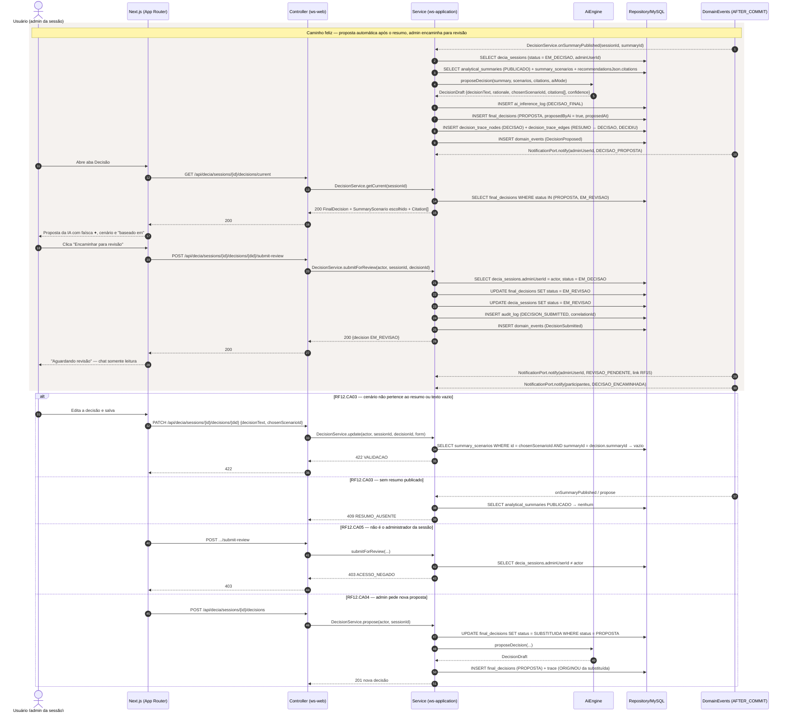
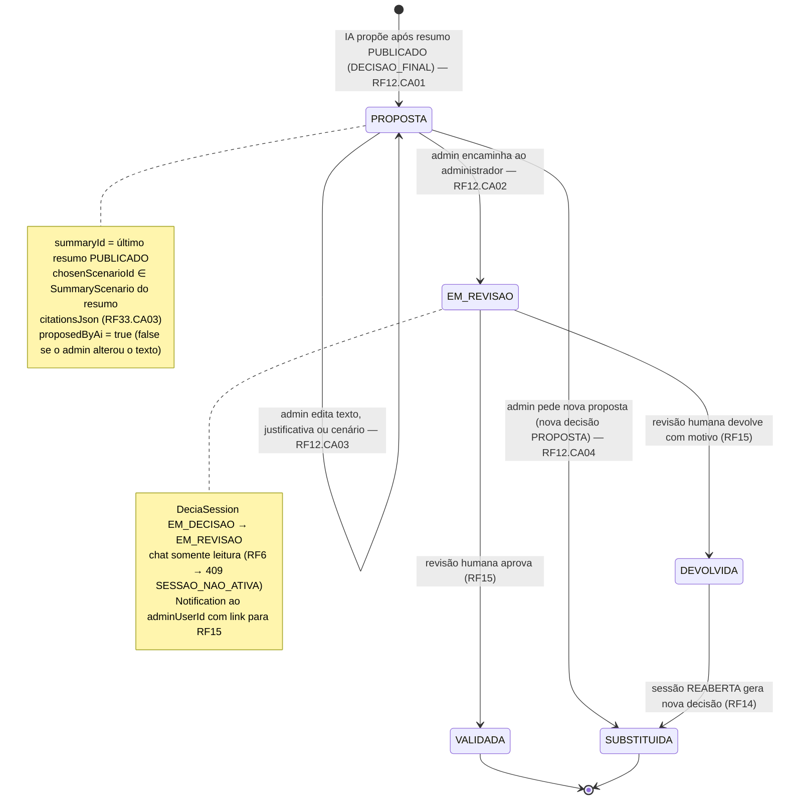
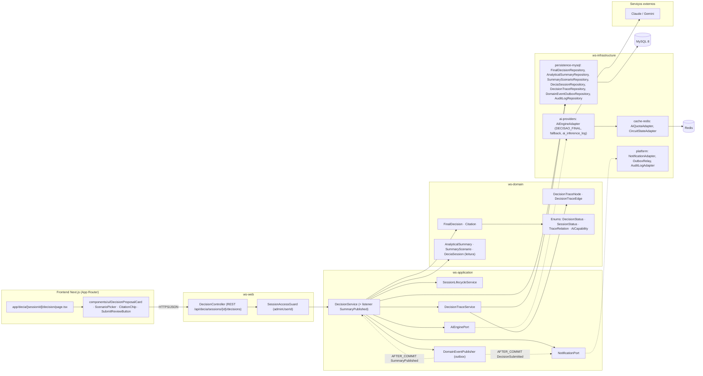

# RF12 — Registrar uma decisão final para o tema da conversa da sessão ativa, assim como enviá-la ao Administrador para revisão final
**HU:** HU12 · **Sprint (board Work Station):** 3 · **Equivalente FAI:** card RF12 não cita equivalente; pelo Mapa de equivalência o DECIA é o **RF10 Copilot** do FAI — a decisão proposta pela IA equivale à sugestão do Copilot que o usuário aceita/edita, aqui obrigatoriamente submetida a **revisão humana** (RF15) · **Aba/rota:** DECIA — sessão › aba "Decisão" (`/decia/[sessionId]/decision`; rota a confirmar)
**Critérios de aceite cobertos:** RF12.CA01 · RF12.CA02 · RF12.CA03 · RF12.CA04 · RF12.CA05 (RF1–RF18 não têm CAs no board: derivados da HU12 + RF11, RF15, RF29.CA05, RF33.CA03 e marcados "CA a confirmar")

> **HU12** — COMO IA do sistema POSSO registrar uma decisão final para o tema da sessão ativa e encaminhá-la ao administrador para revisão PARA formalizar a conclusão da discussão e garantir validação humana antes da publicação.

| CA | Enunciado (CA a confirmar) |
|---|---|
| **RF12.CA01** | Dado sessão EM_DECISAO com `AnalyticalSummary` PUBLICADO (RF11), quando a IA (capability DECISAO_FINAL) propõe a decisão — automaticamente após a publicação do resumo ou quando o administrador aciona "Propor decisão" — então é criada `FinalDecision` PROPOSTA com `decisionText`, `rationale`, `chosenScenarioId` (um `SummaryScenario` do resumo), `citationsJson` (RF33.CA03) e `proposedByAi = true`, `proposedAt`. |
| **RF12.CA02** | Dado a decisão PROPOSTA, quando é encaminhada ao administrador, então `status = EM_REVISAO`, a sessão passa a EM_REVISAO, o `adminUserId` recebe `Notification` (categoria DECIA, link para a revisão RF15) e o grupo vê "aguardando revisão"; o chat fica **somente leitura** (RF6 responde `409 SESSAO_NAO_ATIVA`). |
| **RF12.CA03** | Dado a proposta, então `summaryId` aponta para o último resumo PUBLICADO e `chosenScenarioId` pertence a esse resumo; cenário inexistente ou texto vazio → `422 VALIDACAO`; sessão sem resumo publicado → `409 RESUMO_AUSENTE`; sessão fora de EM_DECISAO → `409 SESSAO_NAO_ATIVA`. |
| **RF12.CA04** | Dado nova proposta para sessão que já tem decisão PROPOSTA (ex.: admin pede "Reformular" antes de encaminhar), então a anterior passa a SUBSTITUIDA e o rastro liga as duas (nó DECISAO novo, aresta DECIDIU a partir do nó RESUMO; aresta ORIGINOU da decisão substituída). |
| **RF12.CA05** | Dado perfil que não seja o administrador da sessão, quando tenta propor/editar/encaminhar manualmente, então `403 ACESSO_NEGADO`; o status VALIDADA **nunca** é atribuído neste RF — só pela revisão humana (RF15). |

## 1. Diagrama de classes

## 2. Diagrama de atividades

## 3. Diagrama de sequência

## 4. Máquina de estados

Entidade central: `FinalDecision.status` (`DecisionStatus`). O RF12 cobre PROPOSTA → EM_REVISAO (e SUBSTITUIDA); VALIDADA/DEVOLVIDA são atribuídos no RF15.

## 5. Diagrama de componentes

## 6. Rastreabilidade

| CA | Classe | Passo (atividades) | Mensagem (sequência) | Transição (estados) | Componente |
|---|---|---|---|---|---|
| RF12.CA01 | `FinalDecision` (decisionText, rationale, chosenScenarioId, citationsJson, proposedByAi, proposedAt), `DecisionService.propose/onSummaryPublished`, `AiEnginePort.proposeDecision`, `AiCapability.DECISAO_FINAL` | A0, C0–C5, D1–D3 | 1–10 | [*] → PROPOSTA | `DecisionService`, `AiEngineAdapter`, `FinalDecisionRepository`, `DecisionTraceService` |
| RF12.CA02 | `FinalDecision.status = EM_REVISAO`, `DeciaSession.status = EM_REVISAO`, `SessionLifecycleService`, `NotificationPort` | A5, B4, C10–C12, F1, F2, B8 | 18–30 | PROPOSTA → EM_REVISAO | `DecisionController.submitForReview`, `SessionLifecycleService`, `NotificationAdapter`, `OutboxRelay` |
| RF12.CA03 | `FinalDecision.summaryId/chosenScenarioId`, `SummaryScenario`, `AnalyticalSummary.status PUBLICADO` | C1, C7, B6, B7 | `alt` 422 VALIDACAO; `alt` 409 RESUMO_AUSENTE | PROPOSTA → PROPOSTA (edição) | `AnalyticalSummaryRepository`, `ScenarioPicker` |
| RF12.CA04 | `FinalDecision.status = SUBSTITUIDA`, `DecisionService.supersede`, `DecisionTraceEdge` ORIGINOU | A4, B3, C9 | `alt` RF12.CA04 (UPDATE SUBSTITUIDA → INSERT nova) | PROPOSTA → SUBSTITUIDA | `DecisionService`, `DecisionTraceService` |
| RF12.CA05 | `SessionAccessGuard`, `DeciaSession.adminUserId`, `DecisionStatus` (VALIDADA só no RF15) | C6, B5 | `alt` 403 ACESSO_NEGADO | EM_REVISAO → VALIDADA apenas via RF15 | `SessionAccessGuard`, `AuditLogAdapter` |
