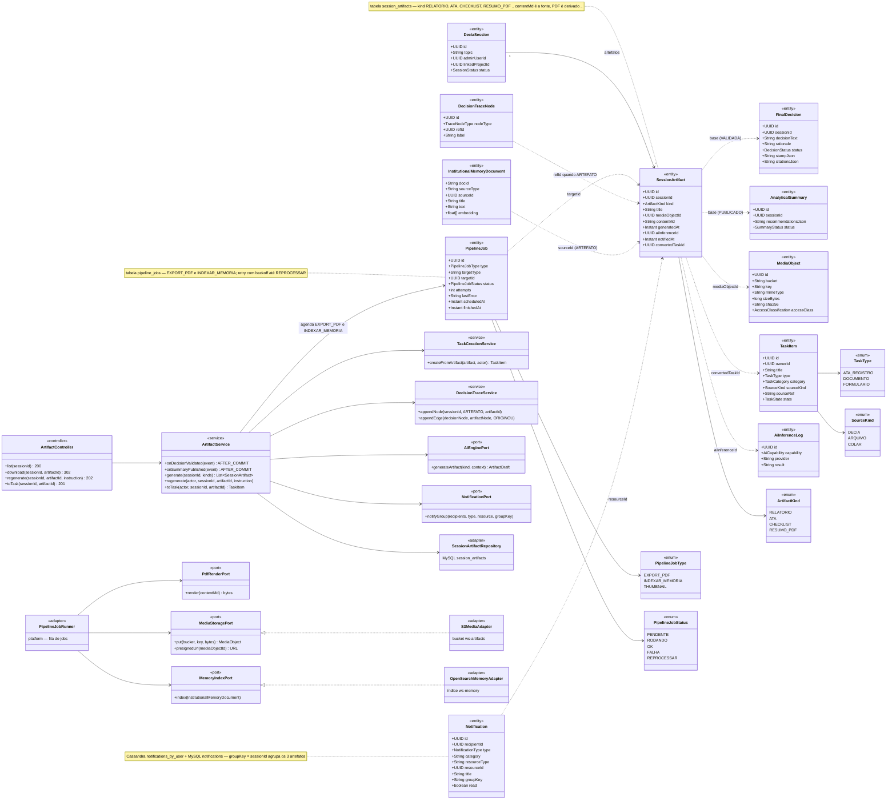
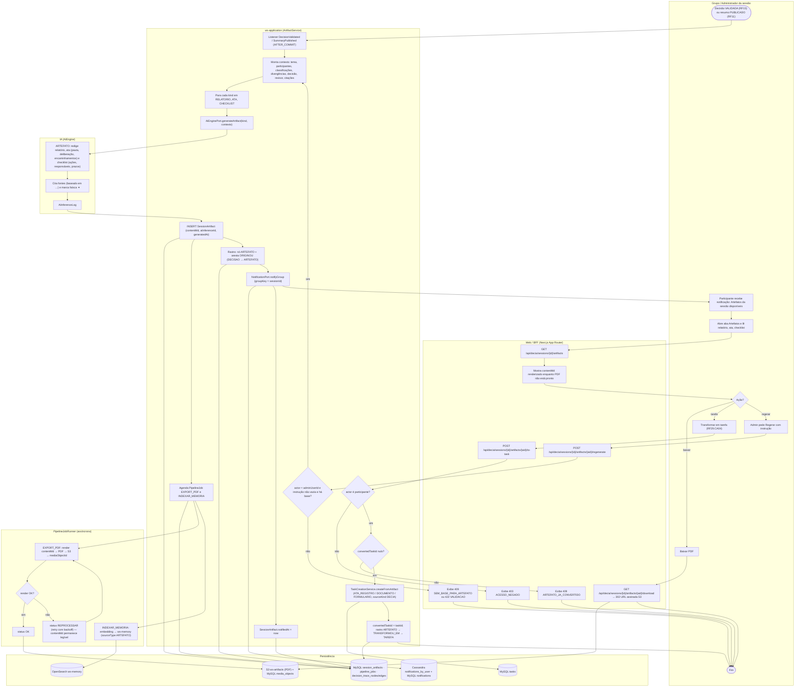
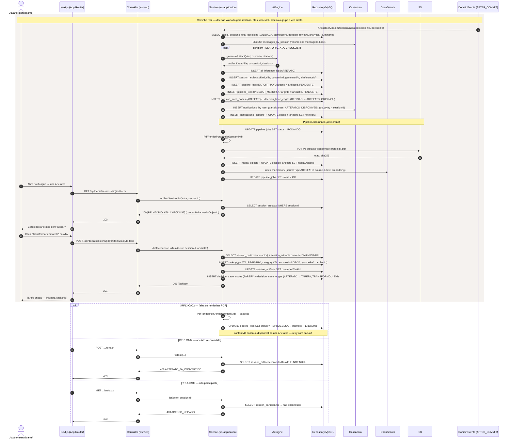
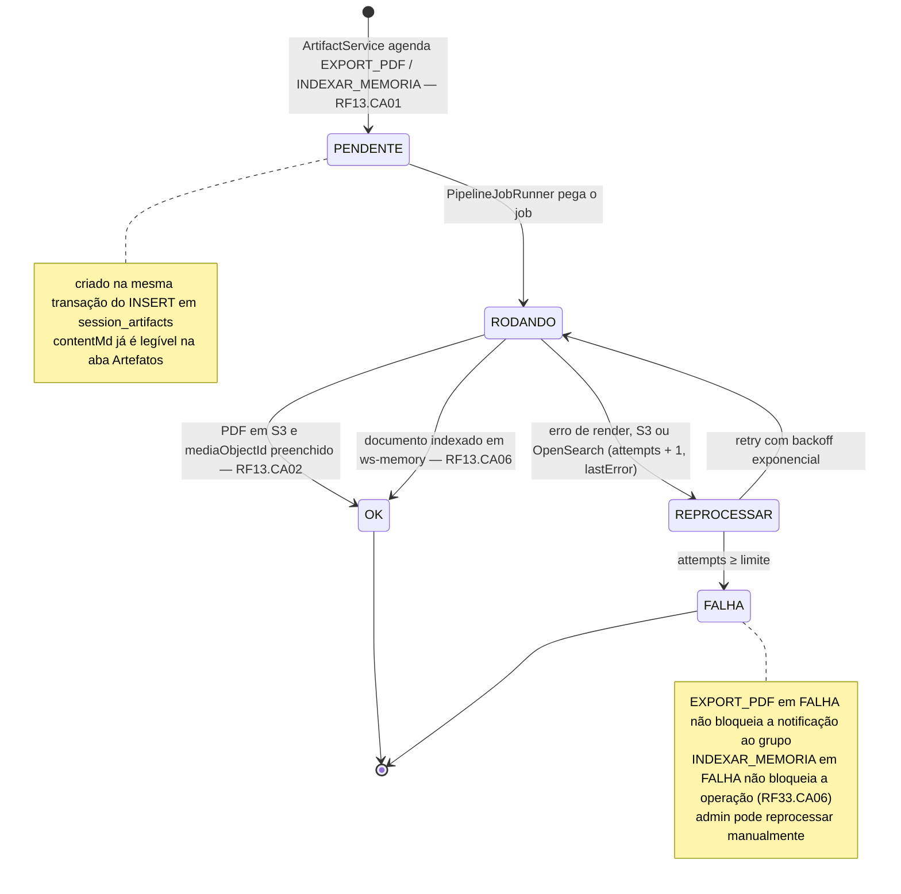
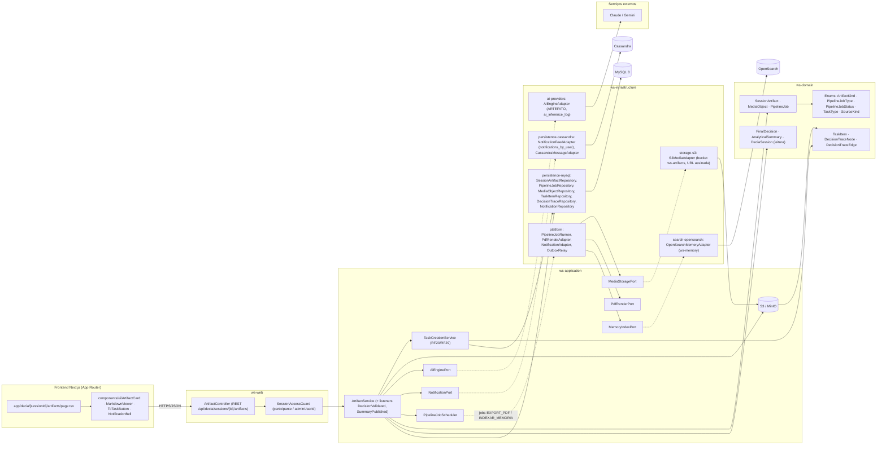

# RF13 — Gerar artefatos automáticos (relatório, ata, checklist) como resposta ao grupo, através de notificações e análise fundamentada
**HU:** HU13 · **Sprint (board Work Station):** 3 · **Equivalente FAI:** **RF13 artefatos automáticos (ata)** do FAI — citado como equivalente no card RF37 (Ata Viva "estende os artefatos automáticos do RF13") · **Aba/rota:** DECIA — sessão › aba "Artefatos" (`/decia/[sessionId]/artifacts`; rota a confirmar) + Notificações
**Critérios de aceite cobertos:** RF13.CA01 · RF13.CA02 · RF13.CA03 · RF13.CA04 · RF13.CA05 · RF13.CA06 (RF1–RF18 não têm CAs no board: derivados da HU13 + RF29.CA02/CA04, RF33.CA01, RF37, RF42 e marcados "CA a confirmar")

> **HU13** — COMO IA do sistema POSSO gerar automaticamente artefatos (relatório, ata, checklist) e disponibilizá-los ao grupo por meio de notificações PARA documentar formalmente a sessão e facilitar a execução das ações decorrentes.

| CA | Enunciado (CA a confirmar) |
|---|---|
| **RF13.CA01** | Dado decisão VALIDADA (RF15) — ou resumo PUBLICADO (RF11) para o artefato RESUMO_PDF — quando o evento AFTER_COMMIT dispara, então a IA (capability ARTEFATO) gera `SessionArtifact` de kind **RELATORIO**, **ATA** e **CHECKLIST** com `contentMd` fundamentado (tema, participantes, argumentos, divergências, decisão, revisor, citações) e `aiInferenceId`; `generatedAt` preenchido. |
| **RF13.CA02** | Dado o `contentMd` salvo, então um `PipelineJob` EXPORT_PDF renderiza o PDF, grava em S3 (`MediaObject`) e preenche `mediaObjectId`; falha de renderização mantém o `contentMd` legível e o job vai a REPROCESSAR (retry com backoff). |
| **RF13.CA03** | Dado artefatos prontos, então cada participante recebe **uma** `Notification` (categoria DECIA, `groupKey` = sessionId para agrupar os três) com título e link para a aba Artefatos; `notifiedAt` é preenchido em cada `SessionArtifact`. |
| **RF13.CA04** | Dado um artefato, quando um participante aciona **"Transformar em tarefa"** (RF29.CA04), então é criada `TaskItem` (ATA → tipo ATA_REGISTRO / categoria ATA; RELATORIO → DOCUMENTO; CHECKLIST → FORMULARIO) com `sourceKind = DECIA`, `convertedTaskId` preenchido e rastro ARTEFATO → TRANSFORMOU_EM → TAREFA; repetir a ação → `409 ARTEFATO_JA_CONVERTIDO`. |
| **RF13.CA05** | Dado o administrador da sessão, quando aciona "Regerar" com instrução de ajuste, então uma nova linha de `SessionArtifact` é gerada e a anterior preservada; não-participante → `403 ACESSO_NEGADO`; sessão sem decisão validada nem resumo publicado → `409 SEM_BASE_PARA_ARTEFATO`; instrução vazia → `422 VALIDACAO`. |
| **RF13.CA06** | Dado artefato gerado, então é indexado na Memória Institucional (`InstitutionalMemoryDocument.sourceType = ARTEFATO`, RF33.CA01) por `PipelineJob` INDEXAR_MEMORIA assíncrono; falha não bloqueia a geração (RF33.CA06). |

## 1. Diagrama de classes

## 2. Diagrama de atividades

## 3. Diagrama de sequência

## 4. Máquina de estados

`SessionArtifact` não tem status próprio na taxonomia; o RF13 usa os estados de `PipelineJob.status` (`PipelineJobStatus`), entidade que ele cria para EXPORT_PDF e INDEXAR_MEMORIA de cada artefato.

## 5. Diagrama de componentes

## 6. Rastreabilidade

| CA | Classe | Passo (atividades) | Mensagem (sequência) | Transição (estados) | Componente |
|---|---|---|---|---|---|
| RF13.CA01 | `SessionArtifact` (kind, contentMd, generatedAt, aiInferenceId), `ArtifactService.onDecisionValidated/onSummaryPublished/generate`, `AiEnginePort.generateArtifact`, `AiCapability.ARTEFATO`, `DecisionTraceNode` ARTEFATO | A0, C0–C4, C6, D1–D3 | 1–10 (loop por kind) | [*] → PENDENTE | `ArtifactService`, `AiEngineAdapter`, `SessionArtifactRepository`, `DecisionTraceService` |
| RF13.CA02 | `PipelineJob` EXPORT_PDF, `MediaObject`, `SessionArtifact.mediaObjectId`, `PdfRenderPort`, `MediaStoragePort` | C5, F1–F4, E2 | 14–18; `alt` RF13.CA02 (REPROCESSAR) | PENDENTE → RODANDO → OK / REPROCESSAR → FALHA | `PipelineJobRunner`, `PdfRenderAdapter`, `S3MediaAdapter` |
| RF13.CA03 | `Notification` (category DECIA, groupKey = sessionId), `SessionArtifact.notifiedAt`, `NotificationPort.notifyGroup` | C7, C8, A1, E4 | 11–12 | nota de PENDENTE (contentMd já legível) | `NotificationAdapter`, `NotificationFeedAdapter`, `NotificationBell` |
| RF13.CA04 | `SessionArtifact.convertedTaskId`, `TaskItem` (ATA_REGISTRO / DOCUMENTO / FORMULARIO, sourceKind DECIA), `TaskCreationService.createFromArtifact`, aresta TRANSFORMOU_EM | A5, B3, C9–C12, E5 | 28–36; `alt` 409 ARTEFATO_JA_CONVERTIDO | — | `TaskCreationService`, `TaskItemRepository`, `ToTaskButton` |
| RF13.CA05 | `ArtifactService.regenerate`, `SessionAccessGuard`, guardas 403/409/422 | A6, B4, C13, B5, B7 | `alt` 403 ACESSO_NEGADO | nova linha → novo job PENDENTE | `ArtifactController.regenerate`, `SessionAccessGuard` |
| RF13.CA06 | `PipelineJob` INDEXAR_MEMORIA, `InstitutionalMemoryDocument` (sourceType ARTEFATO), `MemoryIndexPort` | C5, F5, E3 | 9, 19 | RODANDO → OK (indexado) / FALHA não bloqueante | `OpenSearchMemoryAdapter`, `PipelineJobRunner` |
