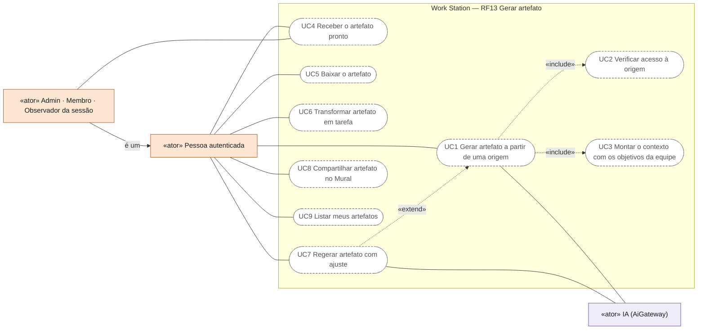
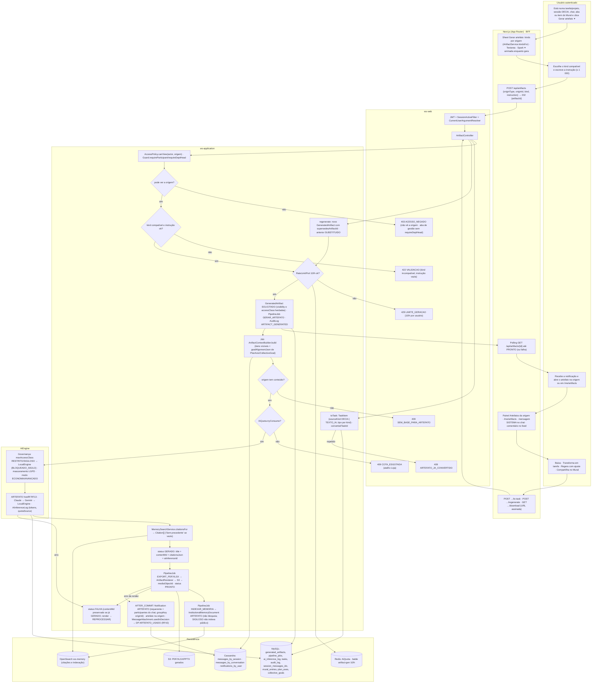
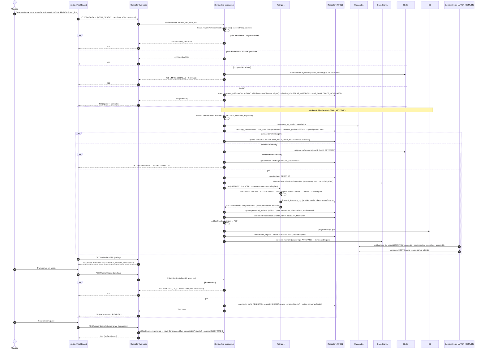
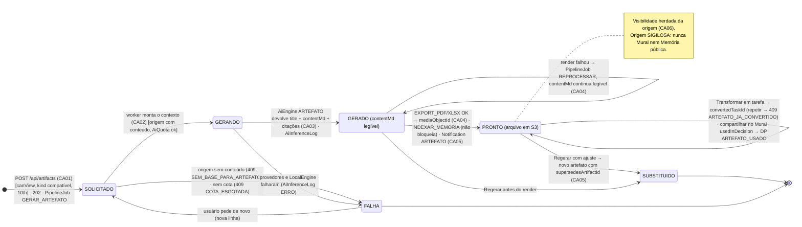
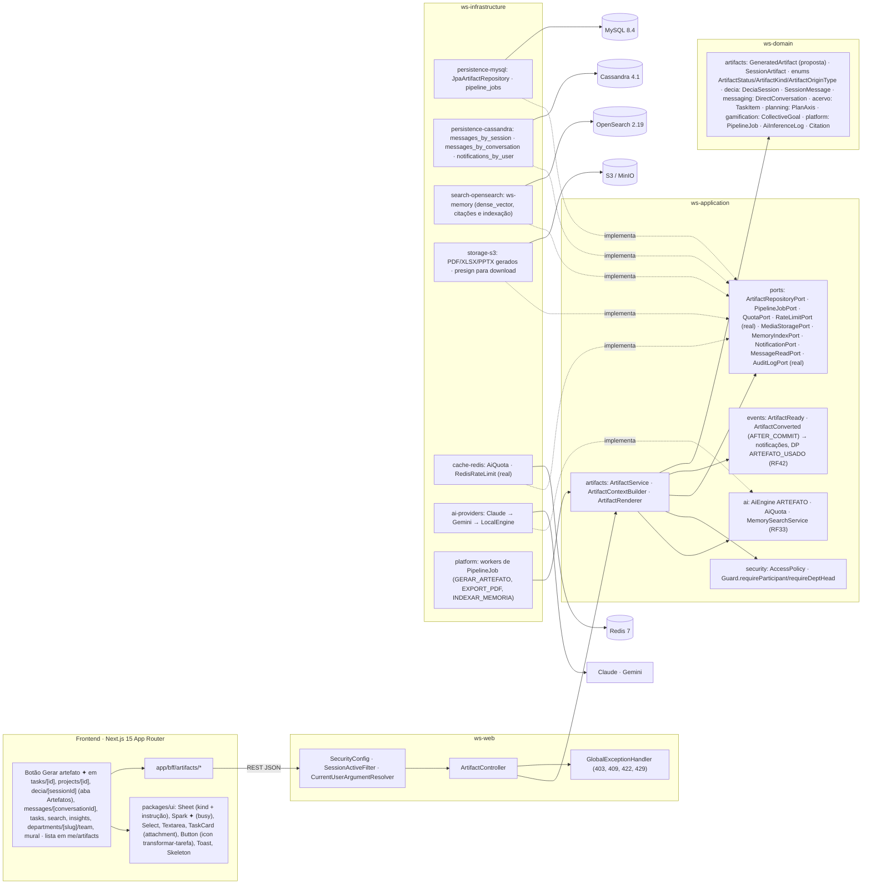

# RF13 — Utilizar a funcionalidade gerar artefato dentro de esquemas, chats, abas e feed do Work Station
**HU:** HU13 · **Sprint (board Work Station):** lista *Requisitos Funcionais* sem sprint atribuída (card renumerado; o card "SPRINT 3" cita "RF13 Artefatos automáticos" da sessão DECIA — escopo preservado em `_anterior/RF13` e **ampliado** aqui para esquemas, chats de mensageria, abas e feed; fase (f) da ARQUITETURA §6: "RF29 ponte + RF13 artefatos") · **Equivalente FAI:** RF13 artefatos automáticos do FAI (ata) — citado no card RF37 ("Ata Viva estende os artefatos automáticos do RF13") · **Aba/rota:** botão **Gerar artefato ✦** em `/tasks/[id]`, `/projects/[id]` (e Mesa), `/decia/[sessionId]` (aba Artefatos), `/messages/[conversationId]` (RF46), abas `/tasks`, `/search`, `/insights`, `/departments/[slug]/team` e itens do `/mural`; lista em `/me/artifacts`; API `POST /api/artifacts`, `GET /api/artifacts/{id}`, `GET /api/me/artifacts`, `POST /api/artifacts/{id}/to-task`, `POST /api/artifacts/{id}/regenerate`, `GET /api/artifacts/{id}/download`
**Critérios de aceite cobertos:** RF13.CA01 · RF13.CA02 · RF13.CA03 · RF13.CA04 · RF13.CA05 · RF13.CA06 — corpo do card vazio: CAs derivados do título + HU13 + `docs/diagramas/_anterior/RF13/README.md` (RF13.CA01–CA06 da sessão: geração, EXPORT_PDF, notificação, Transformar em tarefa, Regerar, INDEXAR_MEMORIA) + RF42.CA06 (cota) + RF33.CA03 (citações), marcados **(CA a confirmar)**. Todas as classes do RF são **(planejado)**; reais: `Guard`, `AuditLogPort`, `SecurityConfig`, `AiProvidersConfig`, `S3StorageConfig`.

> **HU13** — COMO usuário conectado dentro do Work Station POSSO clicar em gerar artefato dentro de um esquema ou chat DECIA PARA receber um arquivo produzido por IA e alinhado com os objetivos de minha equipe.

`SessionArtifact` (TAXONOMIA §5.14) nasce na sessão DECIA; o título atual do card estende a origem a **esquemas** (tarefa/projeto), **chats** (sessão DECIA e mensageria RF46), **abas** (Acervo, Buscar, Insights, Minha equipe) e **feed** (Mural). A entidade generalizada é `GeneratedArtifact` **(proposta)** com `originType`/`originId`, `status` (`ArtifactStatus`, proposta) e `goalAlignmentJson` (objetivos da equipe: `PlanAxis`, `CollectiveGoal`). A geração roda pelo `AiEngine` capability `ARTEFATO` com citações da Memória Institucional (RF33) e cota (`AiQuota`, RF42.CA06).

## Critérios de aceite derivados da HU13 (todos "CA a confirmar")

| CA | Enunciado (Dado / Quando / Então) |
|---|---|
| **RF13.CA01** (CA a confirmar) | Dado o usuário em um esquema (tarefa/projeto), chat (sessão DECIA ou mensageria RF46), aba (Acervo, Buscar, Insights, Minha equipe) ou item do feed/Mural, quando aciona **Gerar artefato ✦**, então escolhe o `kind` compatível com a origem (RELATORIO · ATA · CHECKLIST · RESUMO_PDF · **MINUTA_DOCUMENTO · PLANILHA · CRONOGRAMA · APRESENTACAO** propostos) e uma instrução (≤ 1 000); `POST /api/artifacts {originType, originId, kind, instruction}` cria `GeneratedArtifact SOLICITADO` e devolve `202 {artifactId}`; a geração roda em `PipelineJob GERAR_ARTEFATO` (tipo proposto) com resposta esperada ≤ 30 s; kind incompatível ou instrução vazia → `422 VALIDACAO`; origem sem conteúdo → `409 SEM_BASE_PARA_ARTEFATO`. |
| **RF13.CA02** (CA a confirmar) | Dado o job, então `ArtifactContextBuilder` monta o **contexto por origem**: esquema → `TaskItem`/`ProjectScheme` + `ProjectTask`s + decisões vinculadas (`DeciaSession.linkedProjectId`); chat → `SessionMessage`s + `MessageClassification` (ou `DirectMessage`s de `DirectConversation`, RF46); aba → filtros ativos + itens visíveis; feed → `MuralEntry` alvo; sempre acrescenta os **objetivos da equipe** (`PlanAxis` do `AnnualPlan` do departamento, `CollectiveGoal` ABERTAS) em `goalAlignmentJson`; só entra o que o requerente pode ver (`AccessPolicy.canView`); `accessClass` RESTRITO/SIGILOSO em qualquer item → motor local (`BLOQUEADO_SIGILO` para externo) ou item mascarado. |
| **RF13.CA03** (CA a confirmar) | Dado o contexto, então `AiEngine` (capability ARTEFATO, `hostRf RF13`, `inputSummaryJson.originType`) gera `title` + `contentMd` fundamentado com citações da Memória Institucional (`Citation`; "Sem precedente" quando vazio, RF33.CA03), após `AiQuota.tryConsume` (créditos antes da cota mensal; sem saldo → `409 COTA_ESGOTADA` + Loja); `AiInferenceLog` registra provider, modo (ECONOMIA/AVANCADO), tokens e `quotaSource`; faísca ✦ com tooltip "gerado por IA em data" (RF38.CA04); limite de 10 gerações/hora por usuário → `429 LIMITE_GERACAO` (proposta, `RateLimitPort`). |
| **RF13.CA04** (CA a confirmar) | Dado `contentMd` salvo (`GERADO`), então `PipelineJob EXPORT_PDF` (ou XLSX para PLANILHA/CRONOGRAMA) renderiza o arquivo, grava em S3 (`MediaObject`) e preenche `mediaObjectId` (`PRONTO`); `PipelineJob INDEXAR_MEMORIA` indexa `InstitutionalMemoryDocument.sourceType ARTEFATO`; falha de render mantém o `contentMd` legível e o job vai a REPROCESSAR; falha de indexação não bloqueia (RF33.CA06). |
| **RF13.CA05** (CA a confirmar) | Dado o artefato pronto, então `Notification ARTEFATO` vai ao requerente (e a todos os participantes quando a origem é chat, `groupKey = originId`); o artefato aparece **na origem** (painel Artefatos do esquema, aba Artefatos da sessão, mensagem SISTEMA no chat, bloco da aba, comentário do item do feed) e em `/me/artifacts`; ações: baixar (URL assinada), **Transformar em tarefa** (`TaskItem` com `sourceKind DECIA` se origem for sessão, senão TEXTO_IA; ATA → ATA_REGISTRO, RELATORIO/MINUTA → DOCUMENTO, CHECKLIST → FORMULARIO, PLANILHA → PLANILHA, CRONOGRAMA → CRONOGRAMA; `convertedTaskId`; repetir → `409 ARTEFATO_JA_CONVERTIDO`), **Regerar** com ajuste (nova linha, anterior preservada, `supersedesArtifactId`), compartilhar no Mural (RF26.CA05); anexado numa sessão e usado na decisão → `MessageAttachment.usedInDecision` e DP `ARTEFATO_USADO` (RF42). |
| **RF13.CA06** (CA a confirmar) | Dado o pedido, então `403 ACESSO_NEGADO` quando o requerente não pode ver a origem (não participante da sessão/chat, item PRIVADO de terceiro, aba de gestão sem `requireDeptHead`); a visibilidade do artefato herda a da origem (`Visibility` da tarefa/projeto, participantes do chat, dono da aba); artefatos de origem SIGILOSA nunca vão ao Mural nem à Memória pública; `AuditLog ARTIFACT_GENERATED` com `correlationId`. |

## 0. Diagrama de casos de uso

Quem gera artefatos com IA a partir de esquemas, chats, abas e feed, e o que faz com o resultado. Borda contínua: existe no código em 17/10/2026; tracejada: planejado (só há as entidades de domínio `SessionArtifact` e `ArtifactKind`).

| Caso de uso | Ator(es) | CAs | Situação |
|---|---|---|---|
| UC1 Gerar artefato a partir de uma origem | autenticado, ia | RF13.CA01, RF13.CA03 | planejado (`POST /api/artifacts`, capability `ARTEFATO`, cota e limite por hora) |
| UC2 Verificar acesso à origem | — (incluído por UC1) | RF13.CA02, RF13.CA06 | planejado (`AccessPolicy.canView` por item; só participantes geram a partir de uma sessão ou conversa) |
| UC3 Montar o contexto com os objetivos da equipe | — (incluído por UC1) | RF13.CA02 | planejado (`ArtifactContextBuilder`, `goalAlignmentJson`; RESTRITO/SIGILOSO só motor local) |
| UC4 Receber o artefato pronto | autenticado, participante_sessao | RF13.CA04, RF13.CA05 | planejado (`Notification ARTEFATO`; numa sessão ou conversa, todos os participantes recebem) |
| UC5 Baixar o artefato | autenticado | RF13.CA04, RF13.CA05 | planejado (PDF ou XLSX, URL assinada) |
| UC6 Transformar artefato em tarefa | autenticado | RF13.CA05 | planejado (`409 ARTEFATO_JA_CONVERTIDO`) |
| UC7 Regerar artefato com ajuste | autenticado, ia | RF13.CA05 | planejado (nova versão; a anterior fica preservada) |
| UC8 Compartilhar artefato no Mural | autenticado | RF13.CA05, RF13.CA06 | planejado (origem SIGILOSA nunca vai ao Mural) |
| UC9 Listar meus artefatos | autenticado | RF13.CA05 | planejado (`/me/artifacts`) |

## 1. Diagrama de classes

```mermaid
classDiagram
  direction LR

  class ArtifactController {
    <<controller>>
    +create(CreateArtifactRequest, CurrentUser, ctx) ResponseEntity
    +get(id, CurrentUser) ArtifactView
    +listMine(filters, CurrentUser) Page
    +toTask(id, CurrentUser, ctx) TaskView
    +regenerate(id, RegenerateRequest, CurrentUser, ctx) ResponseEntity
    +download(id, CurrentUser) PresignedUrl
  }
  class ArtifactService {
    <<service>>
    +request(CreateArtifactCommand, actor, ctx) GeneratedArtifact
    +generate(artifactId) void
    +toTask(id, actor, ctx) TaskItem
    +regenerate(id, instruction, actor, ctx) GeneratedArtifact
    -kindsFor(originType) Set~ArtifactKind~
  }
  class ArtifactContextBuilder {
    <<service>>
    +build(originType, originId, viewer) ArtifactContext
    -goalAlignment(departmentId) JSON
    -maxAccessClass(items) AccessClassification
  }
  class ArtifactRenderer {
    <<service>>
    +render(GeneratedArtifact) MediaObject
    PDF · XLSX · PPTX
  }
  class AiEngine {
    <<service>>
    +run(AiRequest) AiResponse
    capability ARTEFATO
  }
  class MemorySearchService {
    <<service>>
    +citationsFor(context) List~Citation~
  }
  class AccessPolicy {
    <<service>>
    +canView(viewer, origin) boolean
    +visibilityOf(origin) Visibility
  }
  class Guard {
    <<service>>
    +requireParticipant(CurrentUser, sessionId) void
    +requireDeptHead(CurrentUser, Department) void
  }
  class ArtifactRepositoryPort {
    <<port>>
    +save(GeneratedArtifact) GeneratedArtifact
    +findById(id) Optional
    +findByRequester(userId, filters) Page
  }
  class PipelineJobPort {
    <<port>>
    +enqueue(type, targetType, targetId) PipelineJob
  }
  class QuotaPort {
    <<port>>
    +tryConsume(scope, id, cost) boolean
  }
  class RateLimitPort {
    <<port>>
    +tryAcquire(owner, bucket, limit, window) boolean
  }
  class MediaStoragePort {
    <<port>>
    +put(key, bytes, mime) MediaObject
    +presign(key, ttl) URL
  }
  class MemoryIndexPort {
    <<port>>
    +index(InstitutionalMemoryDocument) void
  }
  class NotificationPort {
    <<port>>
    +notify(Notification) void
  }

  class GeneratedArtifact {
    <<entity>>
    +UUID id
    +ArtifactOriginType originType
    +UUID originId
    +UUID requesterId
    +ArtifactKind kind
    +String instruction
    +String title
    +String contentMd
    +JSON citationsJson
    +JSON goalAlignmentJson
    +ArtifactStatus status
    +UUID mediaObjectId
    +UUID aiInferenceId
    +UUID convertedTaskId
    +UUID supersedesArtifactId
    +Visibility visibility
    +AccessClassification accessClass
    +Instant generatedAt
    +Instant notifiedAt
  }
  class SessionArtifact {
    <<entity>>
    +UUID sessionId
    +String kind
    +String title
    +UUID mediaObjectId
    +String contentMd
    +UUID aiInferenceId
    +UUID convertedTaskId
  }
  class DeciaSession {
    <<entity>>
    +UUID id
    +UUID linkedProjectId
    +SessionStatus status
  }
  class SessionMessage {
    <<entity>>
    +UUID sessionId
    +String bodyMd
    +UUID classificationId
  }
  class DirectConversation {
    <<entity>>
    +UUID id
    +ConversationKind kind
  }
  class TaskItem {
    <<entity>>
    +UUID id
    +TaskType type
    +SourceKind sourceKind
    +AccessClassification accessClass
    +Visibility visibility
  }
  class ProjectScheme {
    <<entity>>
    +UUID id
    +UUID departmentId
    +Visibility visibility
  }
  class MuralEntry {
    <<entity>>
    +String kind
    +String targetType
    +UUID targetId
  }
  class PlanAxis {
    <<entity>>
    +String name
    +String goal
    +String indicator
  }
  class CollectiveGoal {
    <<entity>>
    +String title
    +GoalStatus status
  }
  class AiInferenceLog {
    <<entity>>
    +AiCapability capability
    +String hostRf
    +AiMode mode
    +String quotaSource
    +InferenceResult result
  }
  class Citation {
    <<value>>
    +MemorySourceType sourceType
    +UUID sourceId
    +String excerpt
    +BigDecimal score
  }
  class PipelineJob {
    <<entity>>
    +String type
    +PipelineJobStatus status
  }
  class ArtifactStatus {
    <<enum>>
    SOLICITADO
    GERANDO
    GERADO
    PRONTO
    FALHA
    SUBSTITUIDO
  }
  class ArtifactKind {
    <<enum>>
    RELATORIO
    ATA
    CHECKLIST
    RESUMO_PDF
    MINUTA_DOCUMENTO
    PLANILHA
    CRONOGRAMA
    APRESENTACAO
  }
  class ArtifactOriginType {
    <<enum>>
    TASK
    PROJECT
    DECIA_SESSION
    DIRECT_CONVERSATION
    TAB
    MURAL_ENTRY
  }

  ArtifactController --> ArtifactService
  ArtifactService --> ArtifactContextBuilder
  ArtifactService --> ArtifactRenderer
  ArtifactService --> AiEngine
  ArtifactService --> MemorySearchService
  ArtifactService --> AccessPolicy
  ArtifactService --> Guard
  ArtifactService --> ArtifactRepositoryPort
  ArtifactService --> PipelineJobPort
  ArtifactService --> QuotaPort
  ArtifactService --> RateLimitPort
  ArtifactService --> MediaStoragePort
  ArtifactService --> MemoryIndexPort
  ArtifactService --> NotificationPort
  ArtifactContextBuilder --> AccessPolicy
  GeneratedArtifact <|-- SessionArtifact : originType DECIA_SESSION (compatibilidade)
  GeneratedArtifact --> ArtifactStatus
  GeneratedArtifact --> ArtifactKind
  GeneratedArtifact --> ArtifactOriginType
  GeneratedArtifact "0..*" --> "0..1" DeciaSession : origem chat
  GeneratedArtifact "0..*" --> "0..1" DirectConversation : origem chat (RF46)
  GeneratedArtifact "0..*" --> "0..1" TaskItem : origem esquema
  GeneratedArtifact "0..*" --> "0..1" ProjectScheme : origem esquema
  GeneratedArtifact "0..*" --> "0..1" MuralEntry : origem feed
  GeneratedArtifact "0..*" --> "0..1" TaskItem : convertedTaskId
  GeneratedArtifact "0..*" --> "0..1" GeneratedArtifact : supersedesArtifactId
  GeneratedArtifact "0..*" --> "0..1" AiInferenceLog
  GeneratedArtifact ..> Citation : citationsJson
  DeciaSession "1" --> "0..*" SessionMessage
  ArtifactContextBuilder ..> PlanAxis : goalAlignmentJson
  ArtifactContextBuilder ..> CollectiveGoal : goalAlignmentJson
  PipelineJob "0..*" --> "1" GeneratedArtifact : GERAR_ARTEFATO · EXPORT_PDF · INDEXAR_MEMORIA
  note for GeneratedArtifact "Proposta: generaliza SessionArtifact (TAXONOMIA §5.14) para as 6 origens do título. ArtifactStatus e os kinds MINUTA_DOCUMENTO/PLANILHA/CRONOGRAMA/APRESENTACAO são propostos."
```

## 2. Diagrama de atividades

## 3. Diagrama de sequência

## 4. Máquina de estados

Entidade central: **`GeneratedArtifact.status`** (`ArtifactStatus`, **proposta** — `SessionArtifact` da TAXONOMIA não tem status). Os jobs `GERAR_ARTEFATO`, `EXPORT_PDF` e `INDEXAR_MEMORIA` seguem `PipelineJobStatus` (PENDENTE → RODANDO → OK | FALHA → REPROCESSAR), como no `_anterior/RF13`.

## 5. Diagrama de componentes

## 6. Rastreabilidade

| CA | Classe (§1) | Passo da atividade (§2) | Mensagem da sequência (§3) | Transição de estado (§4) | Componente (§5) | Situação |
|---|---|---|---|---|---|---|
| RF13.CA01 | `ArtifactController.create`, `ArtifactService.request/kindsFor`, `GeneratedArtifact`, `ArtifactKind`, `ArtifactOriginType`, `PipelineJobPort` | `A1`→`A2`→`F2`→`S3`→`S5`, `E422`, `E409B` | 1–3, 8–9, 14–17, 23–24 | `[*]`→`SOL`, `SOL`→`FAL` | `PG`, `UI` (`Sheet`), `AC`, `ART`, `PLT` | planejado |
| RF13.CA02 | `ArtifactContextBuilder.build/goalAlignment/maxAccessClass`, `AccessPolicy.canView`, `PlanAxis`, `CollectiveGoal`, `SessionMessage`, `DirectConversation`, `MuralEntry` | `J1`→`J2` | 19–22 | `SOL`→`GER` | `ART`, `CAS`, `MY` | planejado (RF46 para chat direto) |
| RF13.CA03 | `AiEngine` (ARTEFATO), `QuotaPort`/`AiQuota`, `MemorySearchService`, `Citation`, `AiInferenceLog`, `RateLimitPort` (10/h) | `S4`→`E429`, `J3`→`E409Q`, `I1`→`I2`→`J4`→`J5` | 10–13, 25–36 | `GER`→`GRD`, `GER`→`FAL` | `AIE`, `AIP`, `OSE`, `RDS` | planejado (`RateLimitPort` real) |
| RF13.CA04 | `ArtifactRenderer`, `PipelineJob EXPORT_PDF/INDEXAR_MEMORIA`, `MediaStoragePort`, `MemoryIndexPort`, `GeneratedArtifact.mediaObjectId` | `J6`→`J7`, `J8` | 37–41 | `GRD`→`PRO`, `GRD`→`GRD` (REPROCESSAR) | `S3`, `OSE`, `PLT` | planejado (RF33.CA06) |
| RF13.CA05 | `NotificationPort`, `ArtifactService.toTask/regenerate`, `GeneratedArtifact.convertedTaskId/supersedesArtifactId`, `TaskItem.sourceKind` | `EV`, `A3`→`A4`→`F5`→`T1`/`T2`, `E409C` | 42–43, 44–56 | `PRO`→`PRO`, `PRO`→`SUB`, `GRD`→`SUB` | `EVT`, `CAS`, `UI` (`TaskCard`, botão transformar) | planejado (RF42 DP) |
| RF13.CA06 | `AccessPolicy.canView/visibilityOf`, `Guard.requireParticipant/requireDeptHead`, `GeneratedArtifact.visibility/accessClass`, `AuditLogPort` (`ARTIFACT_GENERATED`) | `S1`→`S2`→`E403`, `S5`, `J7` (SIGILOSO não indexa público) | 4–7, 14 | nota de `PRO` | `SECU`, `GEH` | planejado (`Guard`/`AuditLogPort` reais) |
