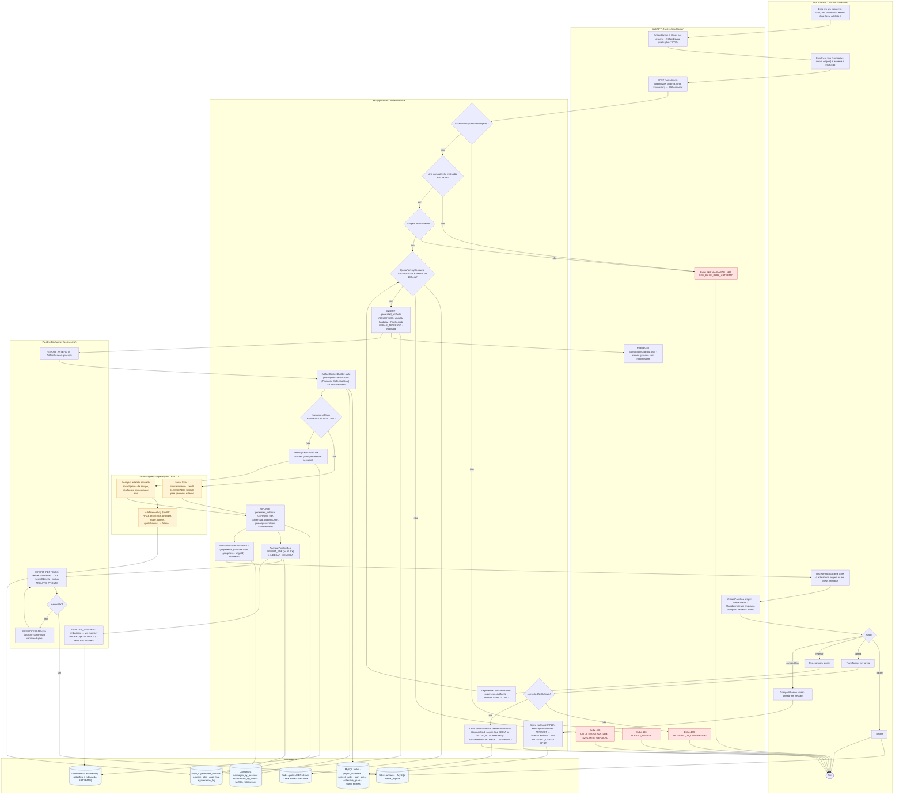
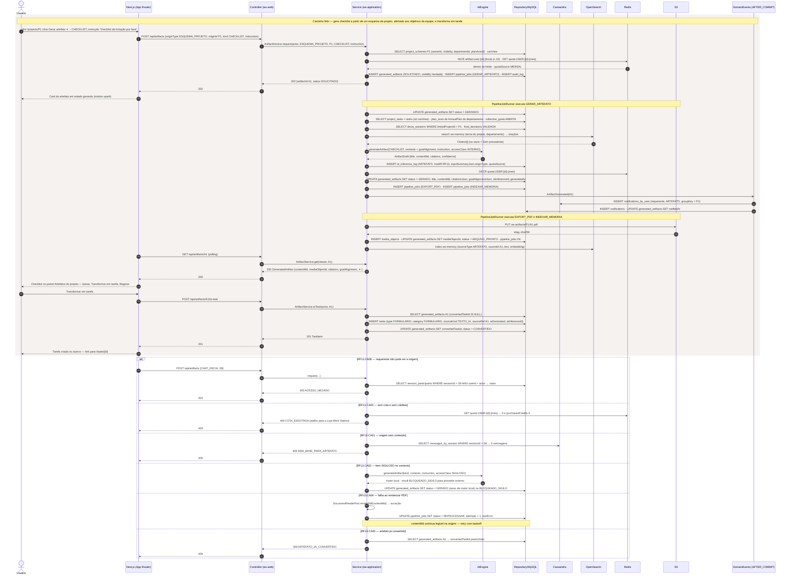
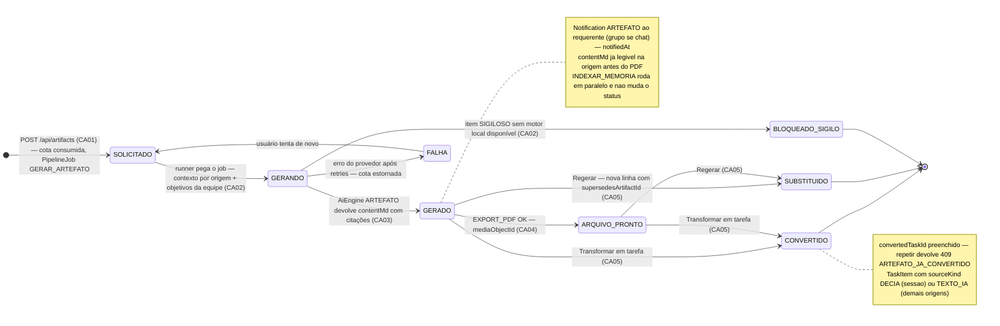
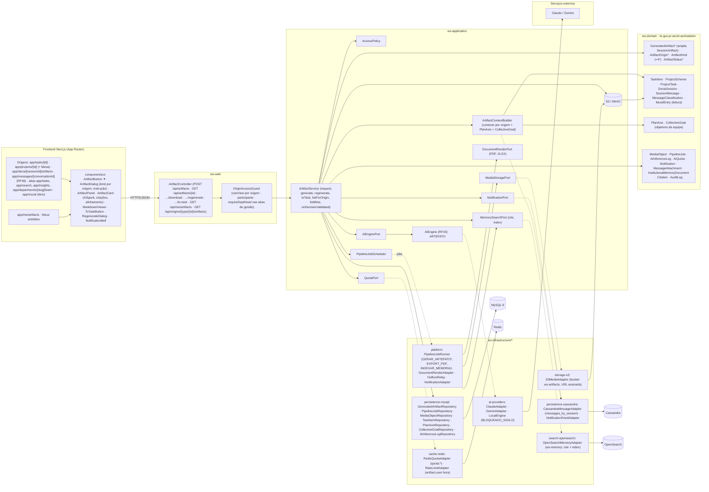

# RF13 — Utilizar a funcionalidade gerar artefato dentro de esquemas, chats, abas e feed do Work Station
**HU:** HU13 · **Sprint (board Work Station):** lista *Requisitos Funcionais* (card renumerado, sem sprint atribuída — a confirmar) · **Equivalente FAI:** RF13 artefatos automáticos do FAI (ata) — citado no card RF37 ("Ata Viva estende os artefatos automáticos do RF13"); no Work Station o escopo sai da sessão DECIA e vai para esquemas, chats de mensageria (RF46), abas e feed · **Aba/rota:** botão **Gerar artefato ✦** em `/tasks/[id]`, `/projects/[id]` (e Mesa), `/decia/[sessionId]` (aba Artefatos), `/messages/[conversationId]` (RF46), abas `/tasks`, `/search`, `/insights`, `/departments/[slug]/team` e itens do `/mural`; lista em `/me/artifacts`; API `POST /api/artifacts`
**Critérios de aceite cobertos:** RF13.CA01 · RF13.CA02 · RF13.CA03 · RF13.CA04 · RF13.CA05 · RF13.CA06 — corpo do card vazio: CAs derivados do título + HU13 + `docs/diagramas/_anterior/RF13/README.md` (RF13.CA01–CA06 da sessão: geração, EXPORT_PDF, notificação, Transformar em tarefa, Regerar, INDEXAR_MEMORIA) + RF42.CA06 (cota) + RF33.CA03 (citações), marcados **(CA a confirmar)**

> **HU13** — COMO usuário conectado dentro do Work Station POSSO clicar em gerar artefato dentro de um esquema ou chat DECIA PARA receber um arquivo produzido por IA e alinhado com os objetivos de minha equipe.

A TAXONOMIA §5.14 só prevê `SessionArtifact` (artefato **da sessão**, gerado automaticamente ao validar a decisão). Este RF **propõe** ampliá-lo para **`GeneratedArtifact`** (tabela `generated_artifacts`), com **origem** `ArtifactOrigin` (ESQUEMA_TAREFA · ESQUEMA_PROJETO · CHAT_DECIA · CHAT_MENSAGERIA · ABA · FEED), pedido explícito do usuário (`requestedBy`, `instruction`) e **alinhamento com os objetivos da equipe** (`goalAlignmentJson`: eixo do `AnnualPlan` do departamento e `CollectiveGoal` abertas). `SessionArtifact` vira o caso `originType = CHAT_DECIA` (geração automática do antigo RF13 continua). Tudo o que era do antigo RF13 se mantém: `AiEngine` capability ARTEFATO, `contentMd` como fonte e PDF derivado (`PipelineJob EXPORT_PDF`), `INDEXAR_MEMORIA`, `Notification`, **Transformar em tarefa** e **Regerar**. Novo: **cota de IA** (`AiQuota`, 409 `COTA_ESGOTADA`), origem/visibilidade e DECIA Points `ARTEFATO_USADO` quando o artefato é usado numa decisão (RF42).

| CA | Enunciado (CA a confirmar) |
|---|---|
| **RF13.CA01** | Dado o usuário em um esquema (tarefa/projeto), chat (sessão DECIA ou mensageria RF46), aba (Acervo, Buscar, Insights, Minha equipe) ou item do feed/Mural, quando aciona **Gerar artefato ✦**, então escolhe o `kind` compatível com a origem (RELATORIO · ATA · CHECKLIST · RESUMO_PDF · **MINUTA_DOCUMENTO · PLANILHA · CRONOGRAMA · APRESENTACAO (propostos)**) e uma instrução (≤ 1 000); `POST /api/artifacts {originType, originId, kind, instruction}` cria `GeneratedArtifact` **(proposta)** `status = SOLICITADO` e devolve `202 {artifactId}`; a geração roda em `PipelineJob GERAR_ARTEFATO` **(tipo proposto)** com resposta esperada ≤ 30 s; kind incompatível ou instrução vazia → `422 VALIDACAO`; origem sem conteúdo (chat vazio, aba sem itens) → `409 SEM_BASE_PARA_ARTEFATO`. |
| **RF13.CA02** | Dado o job, então o serviço monta o **contexto por origem**: esquema → `TaskItem`/`ProjectScheme` + `ProjectTask`s + decisões vinculadas (`DeciaSession.linkedProjectId`); chat → `SessionMessage`s + `MessageClassification` (ou `DirectMessage`s da `DirectConversation`, TAXONOMIA §12b, RF46); aba → filtros ativos + itens visíveis; feed → `MuralEntry` alvo; sempre acrescenta os **objetivos da equipe** (`PlanAxis` do `AnnualPlan` do departamento, `CollectiveGoal` ABERTAS) em `goalAlignmentJson`; só entra o que o requerente pode ver (`canView`); `accessClass` RESTRITO/SIGILOSO em qualquer item → motor local (`result = BLOQUEADO_SIGILO` para externo) ou item mascarado. |
| **RF13.CA03** | Dado o contexto, então `AiEngine` (capability ARTEFATO, `hostRf = RF13`, `inputSummaryJson.originType`) gera `title` + `contentMd` fundamentado com citações da Memória Institucional (`Citation`; "Sem precedente" quando vazio, RF33.CA03), após `AiQuota.tryConsume` (créditos comprados antes da cota mensal; sem saldo → `409 COTA_ESGOTADA` + Loja); `AiInferenceLog` registra provider, modo (ECONOMIA/AVANCADO), tokens e `quotaSource`; o artefato carrega faísca ✦ com tooltip "gerado por IA em data" (RF38.CA04); limite de 10 gerações/hora por usuário → `429 LIMITE_GERACAO` **(proposta)**. |
| **RF13.CA04** | Dado `contentMd` salvo (`status = GERADO`), então `PipelineJob EXPORT_PDF` (ou XLSX para PLANILHA/CRONOGRAMA) renderiza o arquivo, grava em S3 (`MediaObject`) e preenche `mediaObjectId`; `PipelineJob INDEXAR_MEMORIA` indexa `InstitutionalMemoryDocument.sourceType = ARTEFATO`; falha de render mantém o `contentMd` legível e o job vai a REPROCESSAR; falha de indexação não bloqueia (RF33.CA06). |
| **RF13.CA05** | Dado o artefato pronto, então `Notification` tipo ARTEFATO vai ao requerente (e a todos os participantes quando a origem é chat, `groupKey = originId`); o artefato aparece **na origem** (painel Artefatos do esquema, aba Artefatos da sessão, mensagem SISTEMA no chat, bloco da aba, comentário do item do feed) e em `/me/artifacts`; ações: baixar (URL assinada), **Transformar em tarefa** (`TaskItem` com `sourceKind` DECIA se origem for sessão, senão TEXTO_IA; ATA → ATA_REGISTRO, RELATORIO/MINUTA → DOCUMENTO, CHECKLIST → FORMULARIO, PLANILHA → PLANILHA, CRONOGRAMA → CRONOGRAMA; `convertedTaskId`; repetir → `409 ARTEFATO_JA_CONVERTIDO`), **Regerar** com ajuste (nova linha, anterior preservada, `supersedesArtifactId`), compartilhar no Mural (RF26.CA05); anexado numa sessão e usado na decisão → `MessageAttachment.usedInDecision` e DP `ARTEFATO_USADO` (RF42). |
| **RF13.CA06** | Dado o pedido, então `403 ACESSO_NEGADO` quando o requerente não pode ver a origem (não participante da sessão/chat, item PRIVADO de terceiro, aba de gestão sem `requireDeptHead`); a visibilidade do artefato herda a da origem (`Visibility` da tarefa/projeto, participantes do chat, dono da aba); artefatos de origem SIGILOSA nunca vão ao Mural nem à Memória pública; `AuditLog` ARTIFACT_GENERATED com `correlationId`. |

## 1. Diagrama de classes

```mermaid
classDiagram
  direction LR

  class GeneratedArtifact {
    <<entity>>
    +UUID id
    +ArtifactOrigin originType
    +UUID originId
    +UUID sessionId
    +UUID requestedBy
    +UUID departmentId
    +ArtifactKind kind
    +String title
    +String instruction
    +String contentMd
    +UUID mediaObjectId
    +String goalAlignmentJson
    +String citationsJson
    +Visibility visibility
    +AccessClassification accessClass
    +ArtifactStatus status
    +Instant generatedAt
    +UUID aiInferenceId
    +Instant notifiedAt
    +UUID convertedTaskId
    +UUID supersedesArtifactId
    +String correlationId
  }
  class ArtifactOrigin {
    <<enum>>
    ESQUEMA_TAREFA
    ESQUEMA_PROJETO
    CHAT_DECIA
    CHAT_MENSAGERIA
    ABA
    FEED
  }
  class ArtifactKind {
    <<enum>>
    RELATORIO
    ATA
    CHECKLIST
    RESUMO_PDF
    MINUTA_DOCUMENTO
    PLANILHA
    CRONOGRAMA
    APRESENTACAO
  }
  class ArtifactStatus {
    <<enum>>
    SOLICITADO
    GERANDO
    GERADO
    ARQUIVO_PRONTO
    FALHA
    BLOQUEADO_SIGILO
    CONVERTIDO
    SUBSTITUIDO
  }
  class SessionArtifact {
    <<entity>>
    +UUID id
    +UUID sessionId
    +ArtifactKind kind
    +String contentMd
    +UUID convertedTaskId
  }
  class TaskItem {
    <<entity>>
    +UUID id
    +UUID ownerId
    +String title
    +TaskType type
    +TaskCategory category
    +SourceKind sourceKind
    +String sourceRef
    +AccessClassification accessClass
    +Visibility visibility
    +boolean aiGenerated
    +UUID aiInferenceId
  }
  class ProjectScheme {
    <<entity>>
    +UUID id
    +UUID ownerId
    +UUID departmentId
    +String title
    +String objective
    +UUID planAxisId
    +Visibility visibility
  }
  class DeciaSession {
    <<entity>>
    +UUID id
    +String topic
    +UUID linkedProjectId
    +SessionStatus status
    +AiMode aiMode
  }
  class SessionMessage {
    <<entity>>
    +UUID id
    +UUID sessionId
    +String bodyMd
    +UUID classificationId
  }
  class MuralEntry {
    <<entity>>
    +UUID id
    +String kind
    +String targetType
    +UUID targetId
  }
  class PlanAxis {
    <<entity>>
    +UUID id
    +UUID planId
    +String name
    +String goal
    +String indicator
  }
  class CollectiveGoal {
    <<entity>>
    +UUID id
    +UUID departmentId
    +String title
    +String criterionJson
    +GoalStatus status
  }
  class MediaObject {
    <<entity>>
    +UUID id
    +String bucket
    +String key
    +String mimeType
    +AccessClassification accessClass
  }
  class PipelineJob {
    <<entity>>
    +UUID id
    +String type
    +UUID targetId
    +PipelineJobStatus status
    +int attempts
    +String lastError
  }
  class Notification {
    <<entity>>
    +UUID recipientId
    +NotificationType type
    +String resourceType
    +UUID resourceId
    +String groupKey
  }
  class AiInferenceLog {
    <<entity>>
    +UUID id
    +AiCapability capability
    +String hostRf
    +String provider
    +String mode
    +String result
    +String quotaSource
    +String inputSummaryJson
  }
  class AiQuota {
    <<entity>>
    +String scope
    +UUID scopeId
    +String monthKey
    +int consumed
    +int purchasedCredits
  }
  class InstitutionalMemoryDocument {
    <<entity>>
    +String docId
    +String sourceType
    +UUID sourceId
    +String text
  }
  class MessageAttachment {
    <<entity>>
    +UUID messageId
    +String targetType
    +UUID targetId
    +boolean usedInDecision
  }

  class ArtifactController {
    <<controller>>
    +POST_api_artifacts(body) 202
    +GET_api_artifacts_id() 200
    +GET_api_artifacts_id_download() 302
    +POST_api_artifacts_id_regenerate(instruction) 202
    +POST_api_artifacts_id_to_task() 201
    +GET_api_me_artifacts(originType, kind, page) 200
    +GET_api_origins_type_id_artifacts() 200
  }
  class ArtifactService {
    <<service>>
    +request(actor, originType, originId, kind, instruction) GeneratedArtifact
    +generate(artifactId) GeneratedArtifact
    +regenerate(actor, artifactId, instruction) GeneratedArtifact
    +toTask(actor, artifactId) TaskItem
    +listForOrigin(viewer, originType, originId) List
    +listMine(userId, filters, page) Page
    +onDecisionValidated(event) geracao automatica CHAT_DECIA
  }
  class ArtifactContextBuilder {
    <<service>>
    +build(originType, originId, viewer) ArtifactContext
    +teamGoals(departmentId) GoalAlignment
    +maxAccessClass(context) AccessClassification
  }
  class TaskCreationService {
    <<service>>
    +createFromArtifact(artifact, actor) TaskItem
  }
  class AccessPolicy {
    <<service>>
    +canView(user, originType, originId) boolean
    +requireDeptHead(user, deptId) void
  }
  class AiEnginePort {
    <<port>>
    +generateArtifact(kind, context, instruction, accessClass) ArtifactDraft
  }
  class QuotaPort {
    <<port>>
    +tryConsume(userId, capability) QuotaSource
  }
  class MemorySearchPort {
    <<port>>
    +cite(query, filters) List~Citation~
    +index(InstitutionalMemoryDocument)
  }
  class MediaStoragePort {
    <<port>>
    +put(bucket, key, bytes) MediaObject
    +presignedUrl(mediaId) URL
  }
  class DocumentRenderPort {
    <<port>>
    +renderPdf(contentMd) bytes
    +renderXlsx(contentMd) bytes
  }
  class NotificationPort {
    <<port>>
    +notify(recipients, type, resource, groupKey)
  }
  class GeneratedArtifactRepository {
    <<adapter>>
    MySQL generated_artifacts
  }
  class PipelineJobRunner {
    <<adapter>>
    platform GERAR_ARTEFATO EXPORT_PDF INDEXAR_MEMORIA
  }

  GeneratedArtifact --> ArtifactOrigin
  GeneratedArtifact --> ArtifactKind
  GeneratedArtifact --> ArtifactStatus
  GeneratedArtifact ..> TaskItem : originId quando ESQUEMA_TAREFA
  GeneratedArtifact ..> ProjectScheme : originId quando ESQUEMA_PROJETO
  GeneratedArtifact ..> DeciaSession : originId quando CHAT_DECIA
  GeneratedArtifact ..> MuralEntry : originId quando FEED
  GeneratedArtifact ..> MediaObject : mediaObjectId
  GeneratedArtifact ..> AiInferenceLog : aiInferenceId
  GeneratedArtifact ..> TaskItem : convertedTaskId
  GeneratedArtifact ..> GeneratedArtifact : supersedesArtifactId
  GeneratedArtifact ..> PlanAxis : goalAlignmentJson
  GeneratedArtifact ..> CollectiveGoal : goalAlignmentJson
  SessionArtifact ..|> GeneratedArtifact : caso CHAT_DECIA
  DeciaSession "1" --> "*" SessionMessage
  PipelineJob ..> GeneratedArtifact : targetId
  Notification ..> GeneratedArtifact : resourceId
  InstitutionalMemoryDocument ..> GeneratedArtifact : sourceId ARTEFATO
  MessageAttachment ..> GeneratedArtifact : targetType ARTIFACT
  AiQuota ..> AiInferenceLog : quotaSource

  ArtifactController --> ArtifactService
  ArtifactService --> ArtifactContextBuilder
  ArtifactService --> AccessPolicy
  ArtifactService --> QuotaPort
  ArtifactService --> AiEnginePort
  ArtifactService --> MemorySearchPort : citacoes
  ArtifactService --> GeneratedArtifactRepository
  ArtifactService --> NotificationPort
  ArtifactService --> TaskCreationService
  ArtifactService --> PipelineJob : agenda GERAR_ARTEFATO EXPORT_PDF INDEXAR_MEMORIA
  PipelineJobRunner --> ArtifactService : generate
  PipelineJobRunner --> DocumentRenderPort
  PipelineJobRunner --> MediaStoragePort
  PipelineJobRunner --> MemorySearchPort : index

  note for GeneratedArtifact "PROPOSTA — amplia SessionArtifact (TAXONOMIA §5.14) com origem fora da sessao, pedido do usuario, alinhamento com objetivos da equipe, cota e status. Tabela generated_artifacts. sessionId nulo fora de CHAT_DECIA"
  note for ArtifactKind "RELATORIO ATA CHECKLIST RESUMO_PDF existem · MINUTA_DOCUMENTO PLANILHA CRONOGRAMA APRESENTACAO sao PROPOSTA"
  note for ArtifactStatus "PROPOSTA — SessionArtifact nao tem status · ARQUIVO_PRONTO quando EXPORT_PDF termina"
  note for ArtifactContextBuilder "contexto por origem + PlanAxis do AnnualPlan do departamento + CollectiveGoal ABERTAS = alinhado com os objetivos de minha equipe (HU13)"
```

## 2. Diagrama de atividades

## 3. Diagrama de sequência

## 4. Máquina de estados

Entidade central: **`GeneratedArtifact.status`** (enum `ArtifactStatus`, **proposta** — `SessionArtifact` da TAXONOMIA não tem status). Os jobs `EXPORT_PDF` e `INDEXAR_MEMORIA` seguem `PipelineJobStatus` (PENDENTE → RODANDO → OK | FALHA → REPROCESSAR) como no `_anterior/RF13`.

## 5. Diagrama de componentes

*Legenda: `*` = proposta (fora da TAXONOMIA v1).*

## 6. Rastreabilidade

| CA | Classe | Passo (atividades) | Mensagem (sequência) | Transição (estados) | Componente |
|---|---|---|---|---|---|
| RF13.CA01 | `GeneratedArtifact` (proposta: originType, originId, kind, instruction, status), enums `ArtifactOrigin`, `ArtifactKind` (+4 propostos), `ArtifactController.POST_api_artifacts`, `ArtifactService.request`, `PipelineJob` GERAR_ARTEFATO | U1, U2, W1, W2, S2, S3, S5, W6 | 1–10; `alt` 409 SEM_BASE_PARA_ARTEFATO | `[*] → SOLICITADO` | `ArtifactButton`, `ArtifactDialog`, `ArtifactController`, `GeneratedArtifactRepository`, `PipelineJobRunner` |
| RF13.CA02 | `ArtifactContextBuilder.build/teamGoals/maxAccessClass`, `PlanAxis`, `CollectiveGoal`, `GeneratedArtifact.goalAlignmentJson`, `DeciaSession.linkedProjectId`, `SessionMessage`, `MuralEntry`, `AccessPolicy.canView` | S6, S7, A2, D2, D3 | 12–14; `alt` SIGILOSO | `SOLICITADO → GERANDO`, `GERANDO → BLOQUEADO_SIGILO` | `ArtifactContextBuilder`, `CassandraMessageAdapter`, `PlanAxisRepository`, `CollectiveGoalRepository`, `LocalEngine` |
| RF13.CA03 | `AiEnginePort.generateArtifact`, `AiInferenceLog` (ARTEFATO, hostRf RF13, quotaSource), `AiQuota`, `QuotaPort`, `MemorySearchPort.cite`, `Citation`, `GeneratedArtifact.citationsJson/aiInferenceId` | S4, S8, A1, A3, W7, D4 | 5–6, 15–20; `alt` 409 COTA_ESGOTADA | `GERANDO → GERADO`, `GERANDO → FALHA` | `AiEngine ARTEFATO`, `ClaudeAdapter/GeminiAdapter`, `RedisQuotaAdapter`, `RateLimitAdapter`, `OpenSearchMemoryAdapter`, `AiSpark` |
| RF13.CA04 | `PipelineJob` EXPORT_PDF / INDEXAR_MEMORIA, `MediaObject`, `GeneratedArtifact.mediaObjectId`, `DocumentRenderPort`, `MediaStoragePort`, `InstitutionalMemoryDocument` (ARTEFATO) | S10, F2–F5, D5, D6 | 21, 26–30; `alt` REPROCESSAR | `GERADO → ARQUIVO_PRONTO` | `PipelineJobRunner`, `DocumentRenderAdapter`, `S3MediaAdapter`, `OpenSearchMemoryAdapter` |
| RF13.CA05 | `Notification` (ARTEFATO, groupKey = originId), `GeneratedArtifact.notifiedAt/convertedTaskId/supersedesArtifactId`, `ArtifactService.toTask/regenerate/listForOrigin/listMine`, `TaskCreationService.createFromArtifact`, `TaskItem.sourceKind` (DECIA / TEXTO_IA), `MessageAttachment.usedInDecision` | S11, U3–U8, W4, S12–S15, W8 | 22–24, 31–44; `alt` 409 ARTEFATO_JA_CONVERTIDO | `GERADO/ARQUIVO_PRONTO → CONVERTIDO`, `→ SUBSTITUIDO`; nota de GERADO | `ArtifactPanel`, `ArtifactCard`, `ToTaskButton`, `RegenerateDialog`, `app/me/artifacts`, `NotificationFeedAdapter`, `TaskCreationService` |
| RF13.CA06 | `AccessPolicy.canView/requireDeptHead`, `OriginAccessGuard`, `GeneratedArtifact.visibility/accessClass`, `AuditLog` ARTIFACT_GENERATED | S1, W5, S5 | 4; `alt` 403 ACESSO_NEGADO | nota de GERADO (SIGILOSO não vai ao Mural nem à Memória pública) | `OriginAccessGuard`, `AccessPolicy`, `AuditLogRepository` |

**Dúvidas para confirmar:** (a) ampliar `SessionArtifact` para `GeneratedArtifact` (tabela nova) ou acrescentar `originType/originId/requestedBy` à tabela `session_artifacts` existente; (b) novos `ArtifactKind` (MINUTA_DOCUMENTO, PLANILHA, CRONOGRAMA, APRESENTACAO) e seus renderizadores (XLSX/PPTX); (c) "alinhado com os objetivos de minha equipe" = `PlanAxis` do plano do departamento + `CollectiveGoal` ABERTAS (ou também `Insight` EQUIPE do RF43); (d) geração a partir de **abas** e **feed**: quais abas e o que é o "contexto" de um item do feed; (e) cota: usa a `AiQuota` mensal do usuário (RF42.CA06) e o limite 10/hora; (f) o artefato gerado fora da sessão também pontua DP (`ARTEFATO_USADO` só quando usado em decisão); (g) sprint do card.

Tela/aba: `/messages/[conversationId]` (esqueleto em `app/(shell)/messages/[conversationId]/page.tsx`) · `/tasks` (esqueleto em `app/(shell)/tasks/page.tsx`) · `/tasks/[id]` (esqueleto em `app/(shell)/tasks/[id]/page.tsx`) · `/projects/[id]` (esqueleto em `app/(shell)/projects/[id]/page.tsx`) · `/decia/[sessionId]` (esqueleto em `app/(shell)/decia/[sessionId]/page.tsx`)
