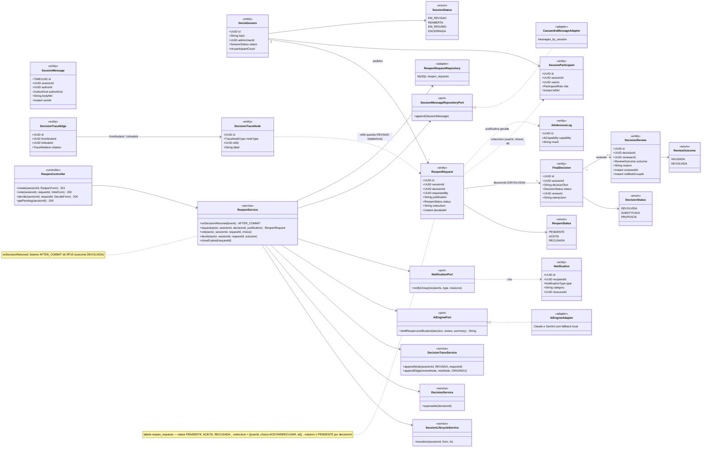
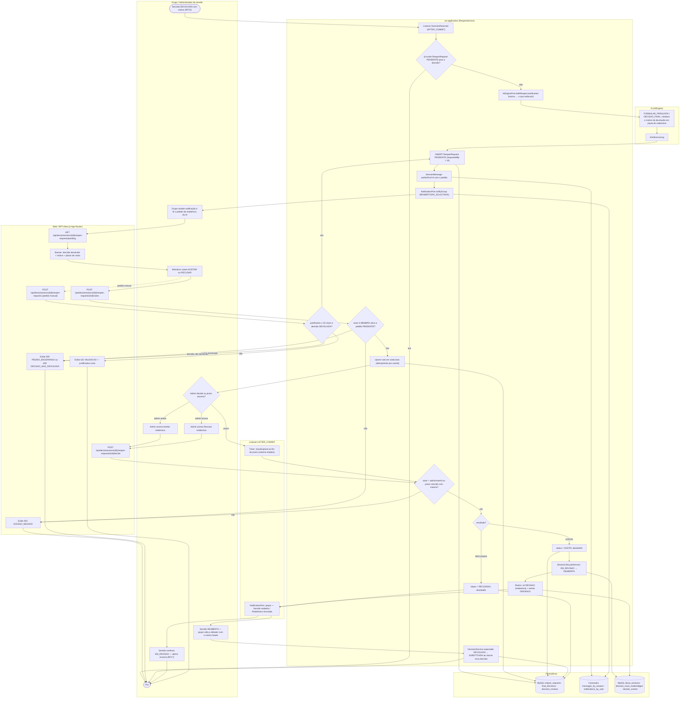
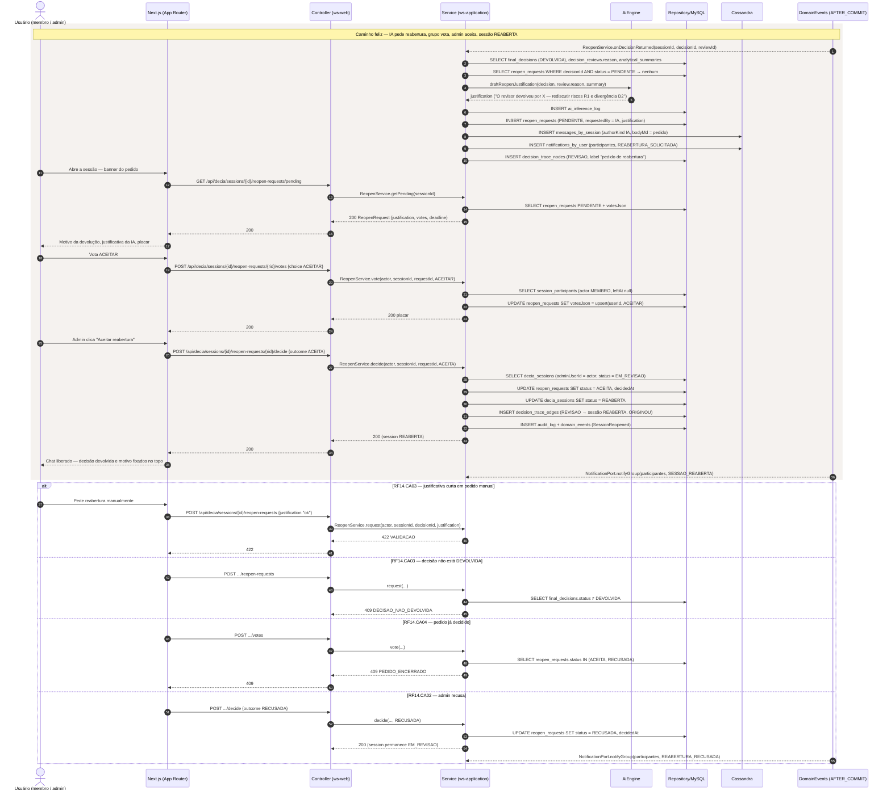
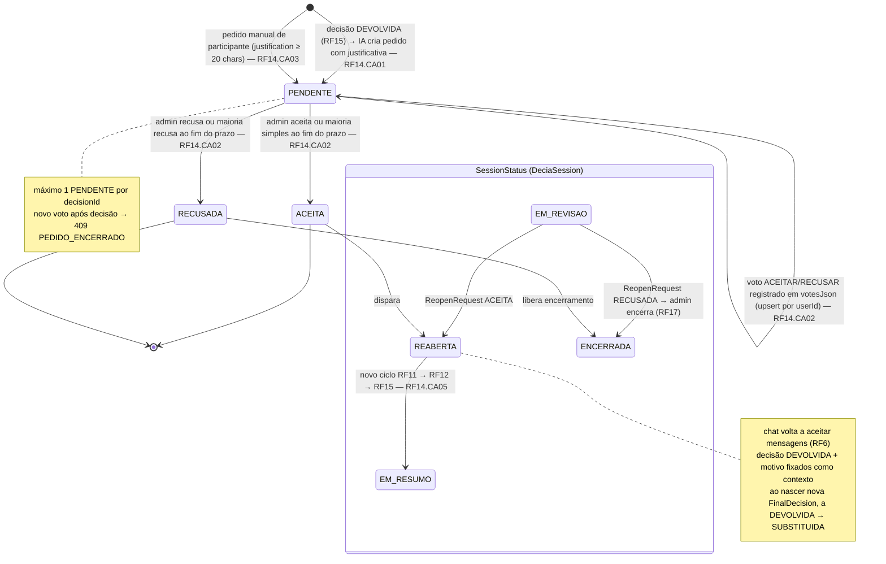
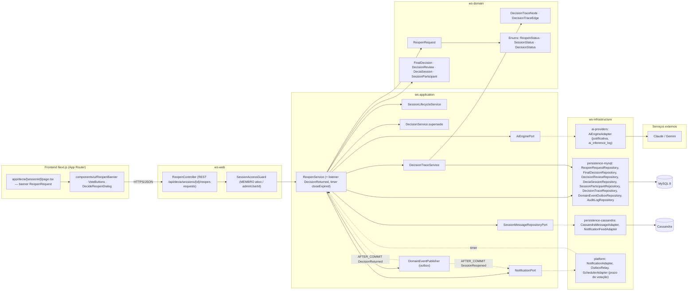

# RF14 — Solicitar reabertura da sessão ao grupo, em caso de rejeição, com motivo devidamente justificado
**HU:** HU14 · **Sprint (board Work Station):** 3 · **Equivalente FAI:** card RF14 não cita equivalente; sem análogo direto no FAI — no fluxo de `SealBond` (FAI RF20/RF21) um vínculo REJECTED é terminal; aqui a rejeição da decisão (RF15) abre um ciclo de reabertura deliberativa · **Aba/rota:** DECIA — sessão › banner "Pedido de reabertura" (`/decia/[sessionId]`; rota a confirmar)
**Critérios de aceite cobertos:** RF14.CA01 · RF14.CA02 · RF14.CA03 · RF14.CA04 · RF14.CA05 (RF1–RF18 não têm CAs no board: derivados da HU14 + RF15, RF12.CA04, RF29 e marcados "CA a confirmar")

> **HU14** — COMO IA do sistema POSSO solicitar ao grupo a reabertura da sessão, quando a decisão for rejeitada, com motivo devidamente justificado PARA permitir que a discussão seja retomada e a decisão refeita com base no motivo da rejeição.

| CA | Enunciado (CA a confirmar) |
|---|---|
| **RF14.CA01** | Dado `FinalDecision` DEVOLVIDA com `DecisionReview.reason` (RF15), quando o evento `DecisionReturned` dispara AFTER_COMMIT, então a IA cria `ReopenRequest` PENDENTE com `requestedBy = IA`, `decisionId` e `justification` redigida a partir do motivo da devolução (o que precisa ser rediscutido, quais divergências/riscos reabrir), e posta `SessionMessage` (authorKind IA) + `Notification` (DECIA) ao grupo. |
| **RF14.CA02** | Dado o pedido PENDENTE, quando participantes MEMBRO votam em `votesJson` (ACEITAR / RECUSAR), então o administrador decide (ou a maioria simples dos votantes decide ao fim do prazo configurável): **ACEITA** → sessão EM_REVISAO → REABERTA (`decidedAt`), o chat volta a aceitar mensagens (RF6) com a decisão DEVOLVIDA e o motivo fixados como contexto; **RECUSADA** → a sessão permanece EM_REVISAO para o administrador encerrar (RF17). |
| **RF14.CA03** | Dado um pedido manual (participante ou admin), quando `justification` tem menos de 20 caracteres → `422 VALIDACAO`; sessão sem decisão DEVOLVIDA → `409 DECISAO_NAO_DEVOLVIDA`; não-participante → `403 ACESSO_NEGADO`. |
| **RF14.CA04** | Dado pedido já ACEITA/RECUSADA, quando chega novo voto ou nova decisão → `409 PEDIDO_ENCERRADO`; existe no máximo **um** `ReopenRequest` PENDENTE por `decisionId`; voto repetido do mesmo usuário substitui o anterior (idempotente). |
| **RF14.CA05** | Dado sessão REABERTA, então um novo ciclo RF11 → RF12 → RF15 produz nova `FinalDecision`; a DEVOLVIDA passa a SUBSTITUIDA e o rastro liga REVISAO → ORIGINOU → (nó DECISAO novo), preservando a decisão devolvida (RF29.CA07). |

## 1. Diagrama de classes

## 2. Diagrama de atividades

## 3. Diagrama de sequência

## 4. Máquina de estados

Entidade central: `ReopenRequest.status` (PENDENTE → ACEITA | RECUSADA), acoplada à transição EM_REVISAO → REABERTA de `SessionStatus` (`DeciaSession`).

## 5. Diagrama de componentes

## 6. Rastreabilidade

| CA | Classe | Passo (atividades) | Mensagem (sequência) | Transição (estados) | Componente |
|---|---|---|---|---|---|
| RF14.CA01 | `ReopenRequest` (requestedBy = IA, justification, decisionId), `ReopenService.onDecisionReturned`, `AiEnginePort.draftReopenJustification`, `SessionMessage` (IA), `NotificationPort` | A0, C0–C5, D1, D2 | 1–10 | [*] → PENDENTE | `ReopenService`, `AiEngineAdapter`, `CassandraMessageAdapter`, `NotificationAdapter` |
| RF14.CA02 | `ReopenRequest.votesJson/status/decidedAt`, `ReopenService.vote/decide/closeExpired`, `SessionLifecycleService` (EM_REVISAO → REABERTA) | A2–A7, B2, B3, C6–C11, C14, F1, F2 | 11–36; `alt` RF14.CA02 (RECUSADA) | PENDENTE → PENDENTE (voto); PENDENTE → ACEITA / RECUSADA; EM_REVISAO → REABERTA | `ReopenController`, `VoteButtons`, `SchedulerAdapter`, `SessionLifecycleService` |
| RF14.CA03 | `ReopenService.request` (validação ≥ 20 chars), `FinalDecision.status DEVOLVIDA`, `SessionAccessGuard` | B4, C15, B7, B6, B5 | `alt` 422 VALIDACAO; `alt` 409 DECISAO_NAO_DEVOLVIDA | [*] → PENDENTE (manual) | `ReopenController.create`, `SessionAccessGuard` |
| RF14.CA04 | unicidade PENDENTE por `decisionId` (índice), upsert em `votesJson` | C1, C7, B6 | `alt` 409 PEDIDO_ENCERRADO; 3 (SELECT PENDENTE → nenhum) | nota de PENDENTE | `ReopenRequestRepository` |
| RF14.CA05 | `DecisionService.supersede` (DEVOLVIDA → SUBSTITUIDA), `DecisionTraceEdge` ORIGINOU, novo ciclo RF11–RF15 | A6, C12, C13 | 32 (trace), 36 | REABERTA → EM_RESUMO; DEVOLVIDA → SUBSTITUIDA (RF12) | `DecisionService`, `DecisionTraceService` |
