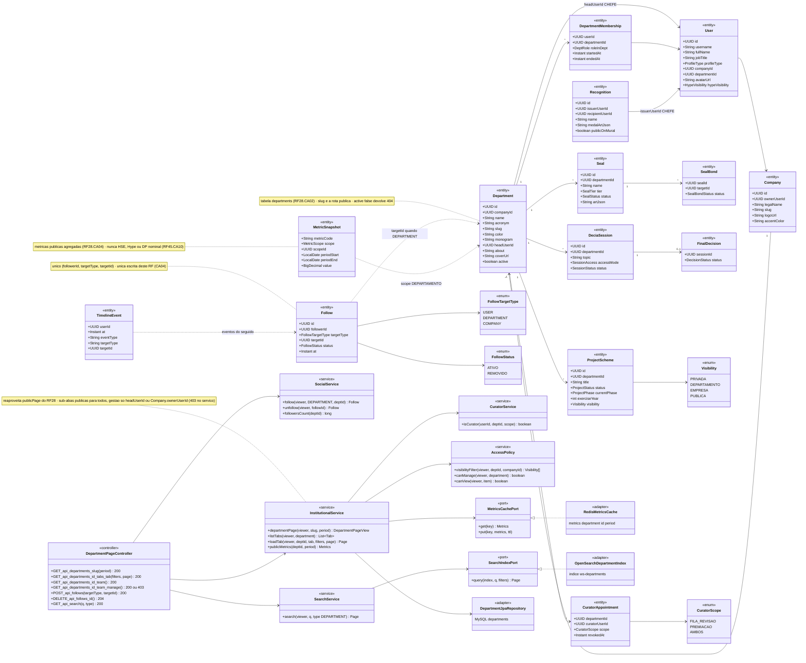
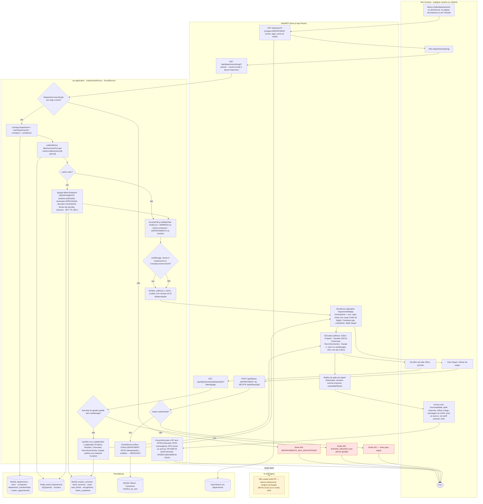
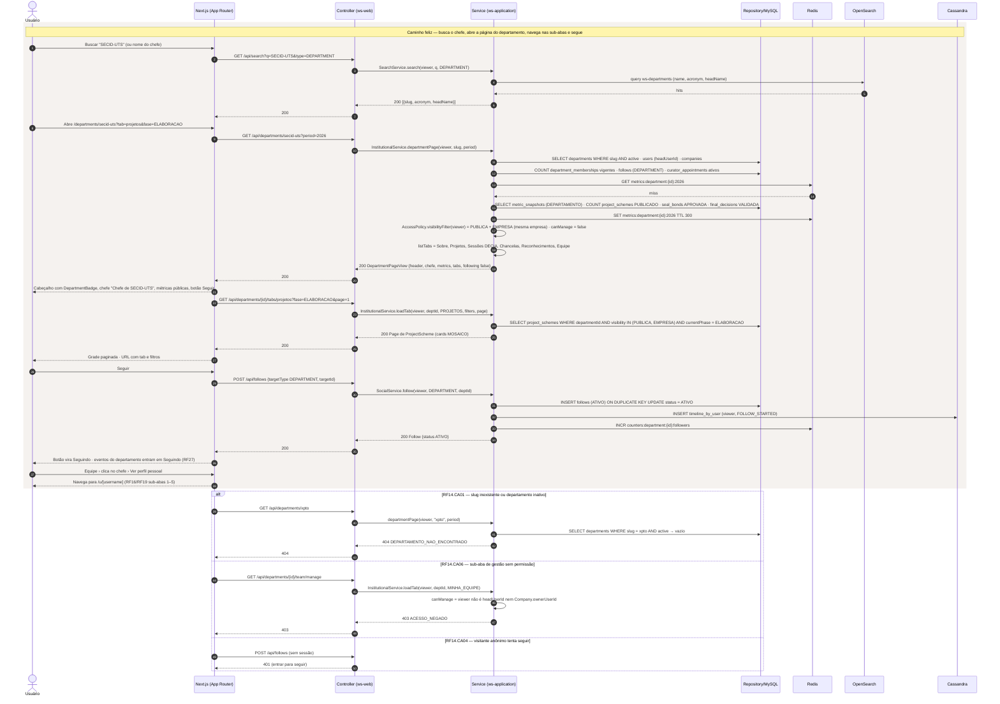
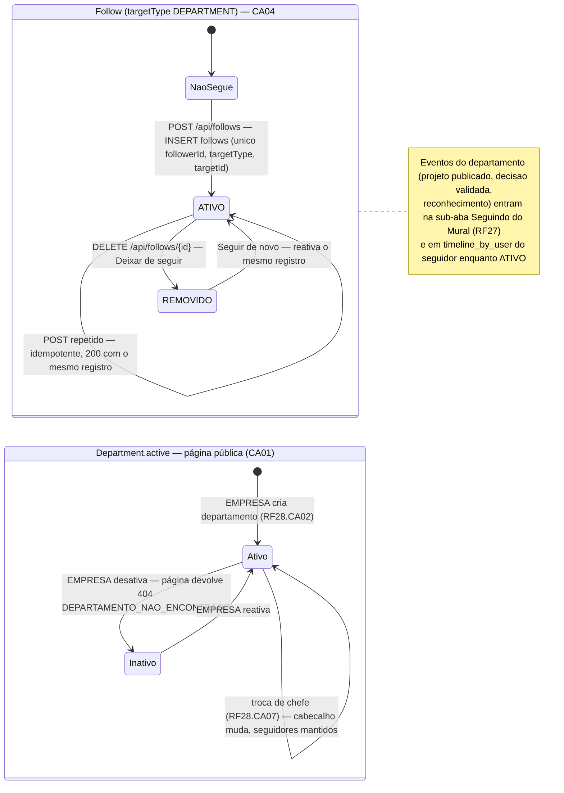
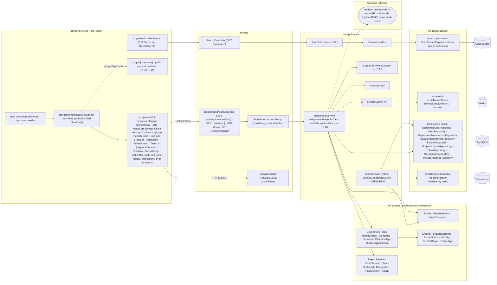

# RF14 — Visualizar perfil de um chefe de departamento
**HU:** HU14 · **Sprint (board Work Station):** lista *Requisitos Funcionais* (card renumerado, sem sprint atribuída — a confirmar) · **Equivalente FAI:** RF22 Perfil institucional (página da CELEBRIDADE, `brands/[slug]/page.tsx` abas públicas × `admin`) + RF17 perfil de outros · **Aba/rota:** **página do departamento** `/departments/[slug]` (Matriz D de `docs/produto/ABAS_POR_PERFIL.md` §5 — é o que o board chama de "perfil do chefe"), alcançada pela aba Buscar (RF27), por `/companies/[slug]` › Departamentos (RF15) ou pelo atalho no perfil pessoal do chefe (`/u/[username]`, RF16/RF19); API `GET /api/departments/{slug}` + `GET /api/departments/{id}/tabs/{tab}`
**Critérios de aceite cobertos:** RF14.CA01 · RF14.CA02 · RF14.CA03 · RF14.CA04 · RF14.CA05 · RF14.CA06 — corpo do card vazio: CAs derivados do título + HU14 + RF28.CA02/CA03/CA04/CA06/CA08 (`docs/diagramas/RF28/README.md`) + RF27.CA06 (seguir) + RF45.CA06/CA10 (Hype) + Matriz D, marcados **(CA a confirmar)**

> **HU14** — COMO usuário dentro do sistema Work Station POSSO procurar o perfil de um chefe de departamento PARA obter informação relevante ou realizar alguma funcionalidade.

O CHEFE é uma **pessoa** (perfil pessoal com as 15 sub-abas do RF19 em `/u/[username]`) **e** o `headUserId` de um `Department`. O "perfil de chefe" do board é a **página institucional do departamento**: cabeçalho com sigla, cor, monograma, capa e o chefe (avatar, nome, cargo "Chefe de {sigla}"), métricas públicas do período e sub-abas **públicas** (Sobre · Projetos · Sessões DECIA · Chancelas · Reconhecimentos · Equipe) + sub-abas de **gestão** só para o chefe/EMPRESA (Minha equipe RF9/RF10, Dashboard do emissor, Insights da Equipe), **negadas no serviço** e não só ocultas. Este RF é de **leitura**; a única escrita própria é **Seguir** (`Follow` targetType DEPARTMENT). Reaproveita `InstitutionalService.publicPage` e `RedisMetricsCache` do RF28.

| CA | Enunciado (CA a confirmar) |
|---|---|
| **RF14.CA01** | Dado qualquer usuário (inclusive visitante), quando busca um chefe/departamento (aba Buscar por nome, sigla ou nome do chefe; lista de departamentos da empresa; menção `@sigla`) e abre `/departments/[slug]`, então vê o cabeçalho: `Department.acronym`, `name`, `color`, `monogram`, `coverUrl`, `about`, chefe (`User` de `headUserId`: avatar, `fullName`, `jobTitle` → "Chefe de {acronym}"), `Company` (logo + link para RF15), contadores (pessoas com `DepartmentMembership` vigente, projetos publicados, decisões validadas, chancelas emitidas, seguidores) e botão **Seguir**; slug inexistente ou `active = false` → `404 DEPARTAMENTO_NAO_ENCONTRADO`. |
| **RF14.CA02** | Dado o cabeçalho, então as sub-abas públicas são: **Sobre** · **Projetos do departamento** (filtros fase, exercício; `canView` por item) · **Sessões DECIA** (abertas/encerradas: membro vê as suas, mesma empresa vê PÚBLICAS/encerradas com resumo, visitante não vê) · **Chancelas do departamento** (`Seal` ativas; a fila de revisão só para chefe/curador) · **Reconhecimentos emitidos** (`Recognition` com `publicOnMural`) · **Equipe** (modo público: nome, cargo, monograma, etiqueta "Curador" por `CuratorAppointment` ativo); tab + filtros + página ficam na URL (RF19.CA03). |
| **RF14.CA03** | Dado o período selecionado (padrão: exercício corrente), então as **métricas públicas** (RF28.CA04) são agregadas: projetos publicados, modelos oficiais/chancelas APROVADAS, decisões VALIDADAS, tempo médio até decisão, pessoas; vêm de `MetricSnapshot` (DEPARTAMENTO) com cache Redis `metrics:department:{id}:{period}` TTL 300 s; **nunca** expõem HSE, Hype ou DECIA Points nominais (RF45.CA10) — só histograma anonimizado quando o viewer é chefe. |
| **RF14.CA04** | Dado o viewer autenticado, quando aciona **Seguir**, então é criado `Follow {followerId, targetType DEPARTMENT, targetId, status ATIVO}` (único; repetir é idempotente → 200 com o mesmo registro); **Deixar de seguir** → `status REMOVIDO`; os eventos do departamento (projeto publicado, decisão validada, reconhecimento) entram na sub-aba Seguindo do Mural (RF27) e em `TimelineEvent` do seguidor; visitante anônimo → `401` com convite a entrar. |
| **RF14.CA05** | Dado o viewer, então as **ações** disponíveis a partir da página dependem do papel: membro do departamento → "Pedir chancela", "Indicar colega", "Propor chancela" (RF39.CA06), "Mensagem ao chefe" (RF46); mesma empresa → "Levar ao meu acervo" nos modelos oficiais (RF41.CA08), "Mensagem"; chefe (`headUserId`) e EMPRESA dona → "Gerir" (Minha equipe RF9/RF10, Dashboard do emissor RF28.CA06, Insights da Equipe RF43.CA14); link "Ver perfil pessoal" abre `/u/[username]` do chefe (sub-abas 1–5 e Hype conforme `hypeVisibility`, RF16/RF19). |
| **RF14.CA06** | Dado o viewer, então a **visibilidade por item** segue `AccessPolicy.visibilityFilter`: anônimo/outra empresa → só `PUBLICA`; mesma empresa → + `EMPRESA`; membro → + `DEPARTAMENTO`; sub-abas de gestão → `403 ACESSO_NEGADO` no serviço para quem não é `headUserId` nem `Company.ownerUserId` (curador com escopo FILA_REVISAO/PREMIACAO vê só a fila/premiação); dados pessoais (`email`, `phone`) nunca saem na API da equipe; página em pt-BR/en/es e responsiva (RF19.CA07). |

## 1. Diagrama de classes

## 2. Diagrama de atividades

## 3. Diagrama de sequência

## 4. Máquina de estados

O RF14 é de leitura e não tem estados próprios. A única entidade que ele altera é **`Follow.status`** (enum `FollowStatus`), e a página só existe enquanto **`Department.active = true`** (alterado pela EMPRESA no RF28). Ambas abaixo.

## 5. Diagrama de componentes

## 6. Rastreabilidade

| CA | Classe | Passo (atividades) | Mensagem (sequência) | Transição (estados) | Componente |
|---|---|---|---|---|---|
| RF14.CA01 | `Department` (slug, acronym, color, monogram, coverUrl, about, headUserId, active), `User` (jobTitle, avatarUrl), `Company`, `DepartmentMembership`, `InstitutionalService.departmentPage`, `SearchService.search` | U1, U2, W1, W2, W3, S1, S2, W8 | 1–13, 20–21; `alt` 404 DEPARTAMENTO_NAO_ENCONTRADO | `Department.active` Ativo/Inativo | `app/search`, `DepartmentBadge`, `HeadCard`, `CompanyLogo`, `OpenSearchDepartmentIndex`, `DepartmentJpaRepository` |
| RF14.CA02 | `InstitutionalService.listTabs/loadTab`, `ProjectScheme`, `DeciaSession` (accessMode), `Seal`, `Recognition.publicOnMural`, `CuratorAppointment` (etiqueta Curador), `CuratorService.isCurator` | U3, W4, W5, S8, S10 | 18, 22–27 | — | `SubTabs`, `FilterBar`, `Pagination`, `TeamList`, `SealWax`, `MedalBadge` |
| RF14.CA03 | `MetricSnapshot` (scope DEPARTAMENTO), `InstitutionalService.publicMetrics`, `MetricsCachePort`, `RedisMetricsCache` | S3, S4, S5, D2, D3 | 14–17 | — | `PublicMetrics`, `RedisMetricsCache`, `MetricSnapshotRepository` |
| RF14.CA04 | `Follow` (targetType DEPARTMENT, status), enums `FollowTargetType`/`FollowStatus`, `SocialService.follow/unfollow`, `TimelineEvent` | U4, W6, S11, S12, W10, D4 | 28–35; `alt` 401 | `NaoSegue → ATIVO → REMOVIDO → ATIVO` | `FollowButton`, `FollowController`, `FollowRepository`, `TimelineAdapter` |
| RF14.CA05 | `AccessPolicy.canManage`, `Department.headUserId`, `Company.ownerUserId`, `User.username/hypeVisibility` (perfil pessoal) | U5, W7, S7, S13 | 36–37 | — | `ActionBar`, `RoleGate`, link para `app/u/[username]`, RFs alvo (RF39, RF46, RF41, RF9/RF10, RF28, RF43) |
| RF14.CA06 | `AccessPolicy.visibilityFilter/canView`, enum `Visibility`, `CuratorScope`, `InstitutionalService.loadTab` (403 no serviço) | S6, S9, W9 | 17, 24; `alt` 403 ACESSO_NEGADO | nota de `Follow` (eventos só enquanto ATIVO) | `RoleGate / AccessPolicy`, `i18n next-intl`, layout responsivo |

**Dúvidas para confirmar:** (a) "perfil de um chefe" = página do departamento (`/departments/[slug]`) com atalho ao perfil pessoal, ou o inverso (perfil pessoal `/u/[username]` com bloco institucional) — o board usa as duas leituras (ABAS_POR_PERFIL §5 e §7.d); (b) quais métricas públicas entram (RF28.CA04 lista 3; aqui propomos 5); (c) a busca de chefe pelo **nome da pessoa** na aba Buscar deve resolver para o departamento ou para o perfil pessoal; (d) visitante anônimo vê a página (Sobre, Equipe nomes/cargos, Projetos PÚBLICOS) ou só usuários autenticados; (e) sprint do card.
