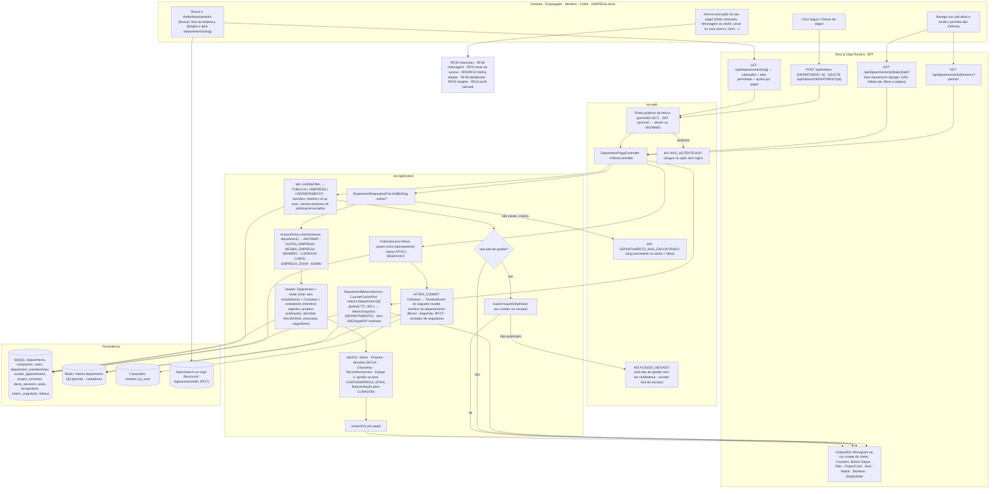
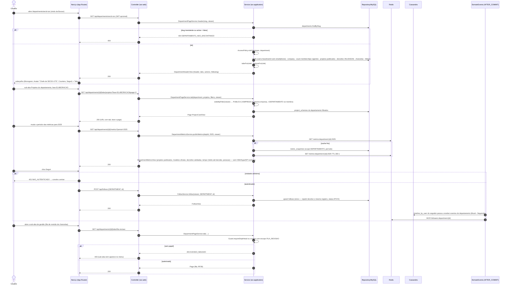
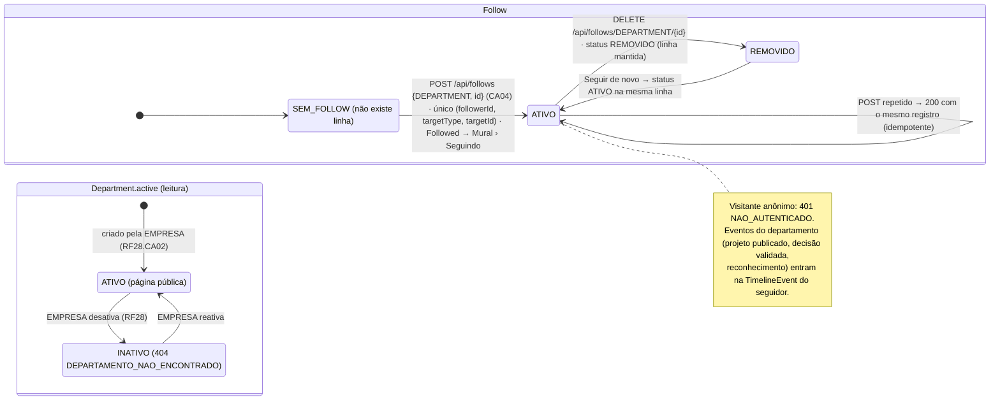
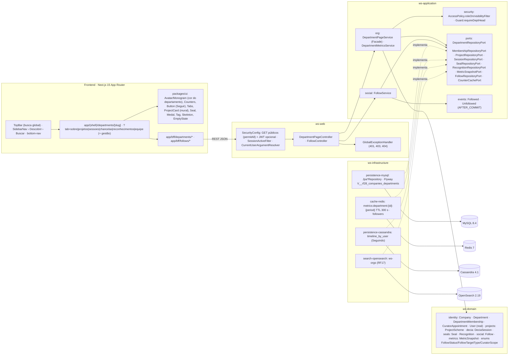

# RF14 — Visualizar perfil de um chefe de departamento
**HU:** HU14 · **Sprint (board Work Station):** lista *Requisitos Funcionais* sem sprint atribuída (card renumerado; o card "SPRINT 3" cita "RF14 Reabertura da sessão", escopo antigo preservado em `_anterior/RF14` — `RENUMERACAO.md`; fase (g) da ARQUITETURA §6: "RF14–RF19 perfis, busca, social") · **Equivalente FAI:** RF22 Perfil institucional (página da CELEBRIDADE, abas públicas × `admin`) + RF17 perfil de outros · **Aba/rota:** **página do departamento** `/departments/[slug]` (Matriz D de ABAS_POR_PERFIL §5 — é o que o board chama de "perfil do chefe"), alcançada pela aba Buscar (RF17), por `/companies/[slug]` › Departamentos (RF15) ou pelo perfil pessoal do chefe (`/u/[username]`, RF16); API `GET /api/departments/{slug}`, `GET /api/departments/{id}/tabs/{tab}`, `GET /api/departments/{id}/metrics?period=`, `POST|DELETE /api/follows`
**Critérios de aceite cobertos:** RF14.CA01 · RF14.CA02 · RF14.CA03 · RF14.CA04 · RF14.CA05 · RF14.CA06 — corpo do card vazio: CAs derivados do título + HU14 + RF28.CA02/CA03/CA04/CA06/CA08 (`docs/diagramas/RF28/README.md`) + RF27.CA06 (seguir) + RF45.CA06/CA10 (Hype) + Matriz D, marcados **(CA a confirmar)**. Todas as classes do RF são **(planejado)**; reais: `User` (`companyId`/`departmentId` sem FK até o RF28, D-23), `Guard`, `SecurityConfig`.

> **HU14** — COMO usuário dentro do sistema Work Station POSSO procurar o perfil de um chefe de departamento PARA obter informação relevante ou realizar alguma funcionalidade.

O "perfil do chefe" é a **página do departamento** (`Department`, TAXONOMIA §1.5) que ele chefia (`headUserId`): cabeçalho institucional, sub-abas públicas e **ações por papel** (`AccessPolicy`); a conta pessoal do chefe (`/u/[username]`) é o RF16. Métricas vêm de `MetricSnapshot` (scope DEPARTAMENTO) e nunca expõem dados nominais de desempenho (RF45.CA10).

## Critérios de aceite derivados da HU14 (todos "CA a confirmar")

| CA | Enunciado (Dado / Quando / Então) |
|---|---|
| **RF14.CA01** (CA a confirmar) | Dado qualquer usuário (inclusive visitante), quando busca um chefe/departamento (aba Buscar por nome, sigla ou nome do chefe; lista de departamentos da empresa; menção `@sigla`) e abre `/departments/[slug]`, então vê o cabeçalho: `Department.acronym`, `name`, `color`, `monogram`, `coverUrl`, `about`, chefe (`User` de `headUserId`: avatar, `fullName`, `jobTitle` → "Chefe de {acronym}"), `Company` (logo + link para RF15), contadores (pessoas com `DepartmentMembership` vigente, projetos publicados, decisões validadas, chancelas emitidas, seguidores) e botão **Seguir**; slug inexistente ou `active = false` → `404 DEPARTAMENTO_NAO_ENCONTRADO`. |
| **RF14.CA02** (CA a confirmar) | Dado o cabeçalho, então as sub-abas públicas são: **Sobre** · **Projetos do departamento** (filtros fase, exercício; `canView` por item) · **Sessões DECIA** (membro vê as suas, mesma empresa vê PÚBLICAS/encerradas com resumo, visitante não vê) · **Chancelas do departamento** (`Seal` ATIVA; a fila de revisão só para chefe/curador) · **Reconhecimentos emitidos** (`Recognition.publicOnMural`) · **Equipe** (modo público: nome, cargo, monograma, etiqueta "Curador" por `CuratorAppointment` ativo); tab + filtros + página ficam na URL. |
| **RF14.CA03** (CA a confirmar) | Dado o período selecionado (padrão: exercício corrente), então as **métricas públicas** (RF28.CA04) são agregadas: projetos publicados, modelos oficiais/chancelas APROVADAS, decisões VALIDADAS, tempo médio até decisão, pessoas; vêm de `MetricSnapshot` (DEPARTAMENTO) com cache Redis `metrics:department:{id}:{period}` TTL 300 s; **nunca** expõem HSE, Hype ou DECIA Points nominais (RF45.CA10) — só histograma anonimizado quando o viewer é o chefe. |
| **RF14.CA04** (CA a confirmar) | Dado o viewer autenticado, quando aciona **Seguir**, então é criado `Follow {followerId, targetType DEPARTMENT, targetId, status ATIVO}` (único; repetir é idempotente → 200 com o mesmo registro); **Deixar de seguir** → `status REMOVIDO`; os eventos do departamento (projeto publicado, decisão validada, reconhecimento) entram na sub-aba Seguindo do Mural (RF27) e em `TimelineEvent` do seguidor; visitante anônimo → `401 NAO_AUTENTICADO` com convite a entrar. |
| **RF14.CA05** (CA a confirmar) | Dado o viewer, então as **ações** da página dependem do papel: membro do departamento → "Pedir chancela", "Indicar colega", "Propor chancela" (RF39.CA06), "Mensagem ao chefe" (RF46); mesma empresa → "Levar ao meu acervo" nos modelos oficiais (RF41.CA08), "Mensagem"; chefe (`headUserId`) e EMPRESA dona → "Gerir" (Minha equipe RF9/RF10, Dashboard do emissor RF28.CA06, Insights da Equipe RF43.CA14); link "Ver perfil pessoal" abre `/u/[username]` do chefe (RF16). |
| **RF14.CA06** (CA a confirmar) | Dado o viewer, então a **visibilidade por item** segue `AccessPolicy.visibilityFilter`: anônimo/outra empresa → só `PUBLICA`; mesma empresa → + `EMPRESA`; membro → + `DEPARTAMENTO`; sub-abas de gestão → `403 ACESSO_NEGADO` no serviço para quem não é `headUserId` nem `Company.ownerUserId` (curador com escopo FILA_REVISAO/PREMIACAO vê só a fila/premiação); dados pessoais (`email`, `phone`) nunca saem na API da equipe; página em pt-BR/en/es e responsiva. |

## 1. Diagrama de classes

```mermaid
classDiagram
  direction LR

  class DepartmentPageController {
    <<controller>>
    +header(slug, viewer) DepartmentHeaderView
    +tab(id, tab, filters, viewer) Page
    +metrics(id, period, viewer) DepartmentMetricsView
  }
  class FollowController {
    <<controller>>
    +follow(FollowRequest, CurrentUser) FollowView
    +unfollow(targetType, targetId, CurrentUser) void
  }
  class DepartmentPageService {
    <<facade>>
    +header(slug, viewer) DepartmentHeaderView
    +tabsFor(department, viewer) List~TabKey~
    +tab(department, tab, filters, viewer) Page
    +actionsFor(department, viewer) List~Action~
  }
  class DepartmentMetricsService {
    <<service>>
    +publicMetrics(deptId, period, viewer) DepartmentMetricsView
  }
  class FollowService {
    <<service>>
    +follow(followerId, targetType, targetId) Follow
    +unfollow(followerId, targetType, targetId) void
  }
  class AccessPolicy {
    <<service>>
    +visibilityFilter(viewer, department) Set~Visibility~
    +roleOn(viewer, department) ViewerRole
  }
  class Guard {
    <<service>>
    +requireDeptHead(CurrentUser, Department) void
  }
  class DepartmentRepositoryPort {
    <<port>>
    +findBySlug(slug) Optional
  }
  class MembershipRepositoryPort {
    <<port>>
    +findCurrentByDept(deptId, page) Page
    +countCurrent(deptId) int
  }
  class ProjectRepositoryPort {
    <<port>>
    +findByDepartment(deptId, visibilities, filters) Page
  }
  class SessionRepositoryPort {
    <<port>>
    +findByDepartment(deptId, viewerScope) Page
  }
  class SealRepositoryPort {
    <<port>>
    +findActiveByDepartment(deptId) List
  }
  class RecognitionRepositoryPort {
    <<port>>
    +findPublicByIssuer(deptId) Page
  }
  class MetricSnapshotPort {
    <<port>>
    +latest(scope, scopeId, period) List~MetricSnapshot~
  }
  class FollowRepositoryPort {
    <<port>>
    +upsert(Follow) Follow
    +countFollowers(targetType, targetId) long
  }
  class CounterCachePort {
    <<port>>
    +getOrLoad(key, ttl, loader) Object
  }

  class Department {
    <<entity>>
    +UUID id
    +UUID companyId
    +String name
    +String acronym
    +String slug
    +String color
    +String monogram
    +UUID headUserId
    +String about
    +String coverUrl
    +boolean active
  }
  class Company {
    <<entity>>
    +UUID id
    +UUID ownerUserId
    +String legalName
    +String slug
    +String logoUrl
  }
  class User {
    <<entity>>
    +UUID id
    +String username
    +String fullName
    +String jobTitle
    +String avatarUrl
    +HypeVisibility hypeVisibility
  }
  class DepartmentMembership {
    <<entity>>
    +UUID userId
    +UUID departmentId
    +DeptRole roleInDept
    +Instant endedAt
  }
  class CuratorAppointment {
    <<entity>>
    +UUID curatorUserId
    +CuratorScope scope
    +Instant revokedAt
  }
  class ProjectScheme {
    <<entity>>
    +UUID departmentId
    +ProjectStatus status
    +ProjectPhase currentPhase
    +Visibility visibility
    +int exerciseYear
  }
  class DeciaSession {
    <<entity>>
    +UUID departmentId
    +SessionAccess accessMode
    +SessionStatus status
  }
  class Seal {
    <<entity>>
    +UUID departmentId
    +String name
    +SealTier tier
    +SealStatus status
  }
  class Recognition {
    <<entity>>
    +UUID issuerUserId
    +UUID recipientUserId
    +boolean publicOnMural
  }
  class MetricSnapshot {
    <<entity>>
    +String metricCode
    +MetricScope scope
    +UUID scopeId
    +LocalDate periodStart
    +LocalDate periodEnd
    +BigDecimal value
  }
  class Follow {
    <<entity>>
    +UUID followerId
    +FollowTargetType targetType
    +UUID targetId
    +FollowStatus status
    +Instant at
  }
  class FollowTargetType {
    <<enum>>
    USER
    DEPARTMENT
    COMPANY
  }
  class FollowStatus {
    <<enum>>
    ATIVO
    REMOVIDO
  }
  class CuratorScope {
    <<enum>>
    FILA_REVISAO
    PREMIACAO
    AMBOS
  }
  class ViewerRole {
    <<enum>>
    ANONIMO
    OUTRA_EMPRESA
    MESMA_EMPRESA
    MEMBRO
    CURADOR
    CHEFE
    EMPRESA_DONA
    ADMIN
  }

  DepartmentPageController --> DepartmentPageService
  DepartmentPageController --> DepartmentMetricsService
  FollowController --> FollowService
  DepartmentPageService --> AccessPolicy
  DepartmentPageService --> Guard
  DepartmentPageService --> DepartmentRepositoryPort
  DepartmentPageService --> MembershipRepositoryPort
  DepartmentPageService --> ProjectRepositoryPort
  DepartmentPageService --> SessionRepositoryPort
  DepartmentPageService --> SealRepositoryPort
  DepartmentPageService --> RecognitionRepositoryPort
  DepartmentPageService --> FollowRepositoryPort
  DepartmentMetricsService --> MetricSnapshotPort
  DepartmentMetricsService --> CounterCachePort
  FollowService --> FollowRepositoryPort
  AccessPolicy ..> ViewerRole
  Company "1" *-- "1..*" Department
  Department "1" --> "1" User : headUserId (chefe)
  Department "1" --> "0..*" DepartmentMembership : equipe (endedAt nulo)
  Department "1" --> "0..*" CuratorAppointment
  Department "1" --> "0..*" ProjectScheme
  Department "1" --> "0..*" DeciaSession
  Department "1" --> "0..*" Seal
  Department "1" --> "0..*" MetricSnapshot : scope DEPARTAMENTO
  Department "1" --> "0..*" Follow : targetType DEPARTMENT
  User "1" --> "0..*" Recognition : issuerUserId (chefe)
  Follow --> FollowTargetType
  Follow --> FollowStatus
  CuratorAppointment --> CuratorScope
  note for Follow "Único (followerId, targetType, targetId). Repetir Seguir é idempotente (200 com o mesmo registro)."
```

## 2. Diagrama de atividades

## 3. Diagrama de sequência

## 4. Máquina de estados

Entidade central: **`Follow.status`** (`FollowStatus`, TAXONOMIA §8.6) — a única entidade com estado que este RF cria/altera (CA04). `Department.active` (CA01) e o papel do viewer (`ViewerRole`, derivado) são leituras.

## 5. Diagrama de componentes

## 6. Rastreabilidade

| CA | Classe (§1) | Passo da atividade (§2) | Mensagem da sequência (§3) | Transição de estado (§4) | Componente (§5) | Situação |
|---|---|---|---|---|---|---|
| RF14.CA01 | `DepartmentPageController.header`, `DepartmentPageService.header`, `Department`, `User.headUserId`, `Company`, `FollowRepositoryPort.countFollowers` | `A1`→`F1`→`S1`→`S3`→`F5`, `E404` | 1–11 | `DA`/`DI` | `PG`, `UI` (`Monogram`, `Avatar`, `Counters`), `OSE` | planejado |
| RF14.CA02 | `DepartmentPageService.tabsFor/tab`, `ProjectRepositoryPort`, `SessionRepositoryPort`, `SealRepositoryPort`, `RecognitionRepositoryPort`, `MembershipRepositoryPort`, `CuratorAppointment` | `A2`→`F2`→`T1`→`F5` | 12–17 | — | `DP`, `UI` (`Tabs`, `ProjectCard`, `Seal`, `Medal`) | planejado |
| RF14.CA03 | `DepartmentMetricsService.publicMetrics`, `MetricSnapshotPort`, `MetricSnapshot`, `CounterCachePort` | `F3`→`M1` | 18–25 | — | `RDS`, `MY` (`metric_snapshots`) | planejado (RF28.CA04, RF45.CA10) |
| RF14.CA04 | `FollowController`, `FollowService.follow/unfollow`, `Follow`, `FollowStatus` | `A3`→`F4`→`FO1`→`EV`, `E401` | 26–35 | `SEM`→`ATV`→`REM`→`ATV` | `SOC`, `EVT`, `CAS` | planejado (RF27.CA06) |
| RF14.CA05 | `DepartmentPageService.actionsFor`, `AccessPolicy.roleOn`, `ViewerRole` | `S5`, `A4`→`RF` | 8–10 | — | `DP`, `UI` (`Button`) | planejado (RF39, RF46, RF41, RF9/RF10, RF28, RF43, RF16) |
| RF14.CA06 | `AccessPolicy.visibilityFilter`, `Guard.requireDeptHead`, `CuratorScope`, `User` sem `email`/`phone` na API | `T1`→`T2`→`T3`→`E403` | 14, 36–43 | — | `SECU`, `GEH` | planejado (`Guard` base real) |
