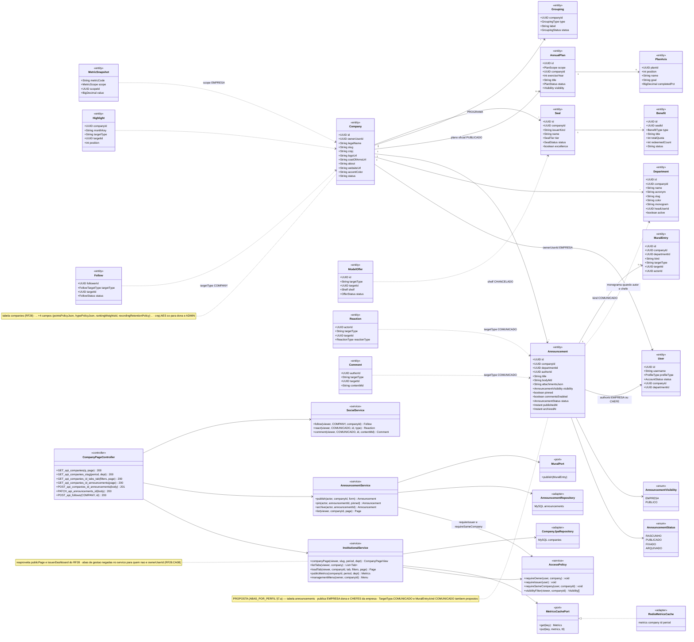
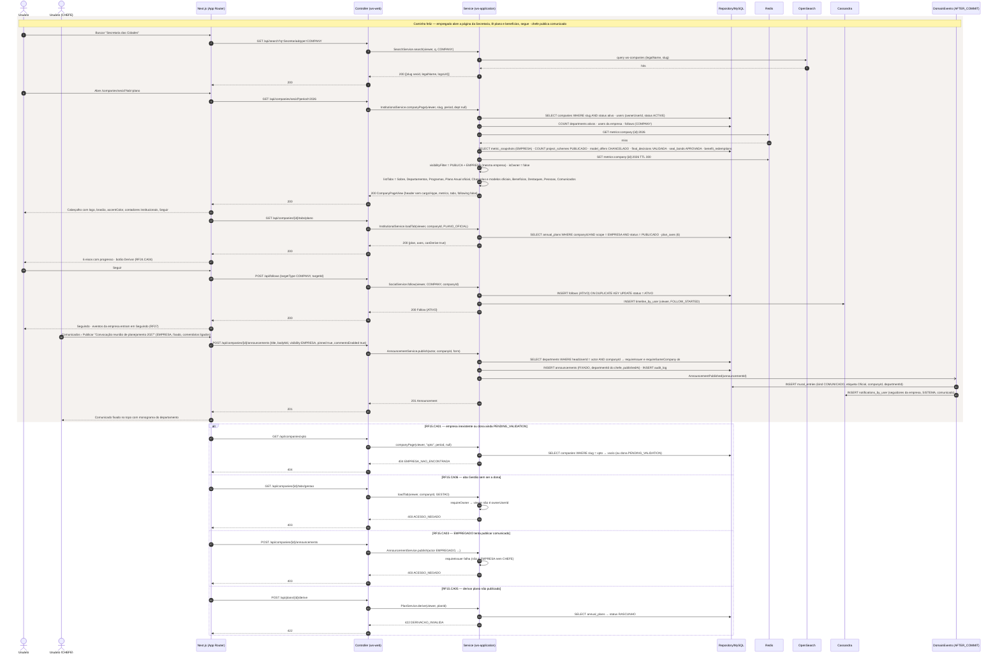
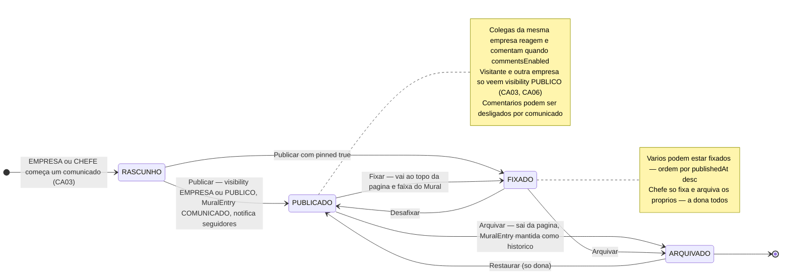
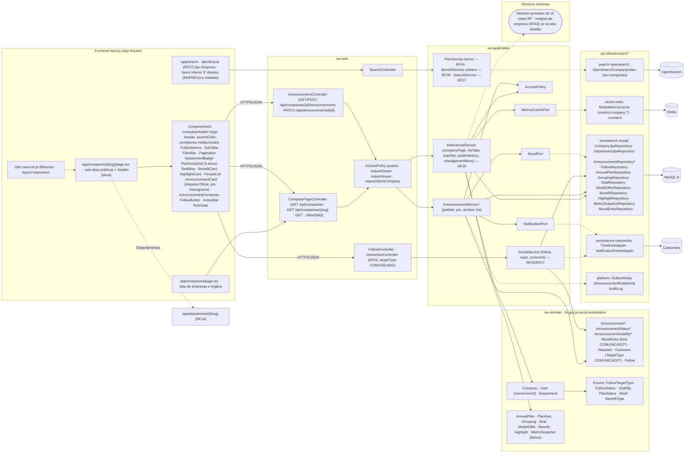

# RF15 — Visualizar perfil de um empresa ou órgão público/privado
**HU:** HU15 · **Sprint (board Work Station):** lista *Requisitos Funcionais* (card renumerado, sem sprint atribuída — a confirmar) · **Equivalente FAI:** RF14 Aba Marcas + RF22 Perfil institucional (página da MARCA, `brands/[slug]/page.tsx` abas públicas × `admin`, `InstitutionalService.java`) · **Aba/rota:** **página da empresa** `/companies/[slug]` (Matriz C de `docs/produto/ABAS_POR_PERFIL.md` §4), alcançada pela lista `/companies`, pela aba Buscar (RF27), pelo cabeçalho de qualquer perfil/departamento ou pela barra inferior (5º destino para EMPRESA e visitante); API `GET /api/companies/{slug}` + `GET /api/companies/{id}/tabs/{tab}`
**Critérios de aceite cobertos:** RF15.CA01 · RF15.CA02 · RF15.CA03 · RF15.CA04 · RF15.CA05 · RF15.CA06 — corpo do card vazio: CAs derivados do título + HU15 + RF28.CA01/CA04/CA06/CA08 (`docs/diagramas/RF28/README.md`) + RF24.CA04 + RF39.CA09/CA11 + RF27.CA06 + Matriz C e §7.a (Comunicados), marcados **(CA a confirmar)**

> **HU15** — COMO usuário dentro do sistema Work Station POSSO procurar o perfil de uma empresa ou órgão público/privado PARA obter informação relevante ou realizar alguma funcionalidade.

A **empresa/órgão** é a conta de perfil EMPRESA (`User.profileType = EMPRESA`) dona de uma `Company` (`ownerUserId`; ex.: Secretaria das Cidades). A página institucional mostra cabeçalho (logo, brasão, nome, sobre, site, cor de destaque, **contadores institucionais** — sem cargo, departamento ou Hype, RF19.CA06/P-04), **métricas públicas do período** (RF28.CA04) e sub-abas **públicas**: Sobre · Departamentos (→ RF14) · Programas (RF25) · Plano Anual oficial (RF24) · Chancelas e modelos oficiais (RF39) · Benefícios (RF39.CA09) · Destaques (RF35.CA03) · Pessoas · **Comunicados (proposta §7.a)**; e a aba **Gestão** só para a dona (negada no serviço). Este RF é de **leitura**, com duas escritas: **Seguir** (`Follow` COMPANY) e, pela dona/chefes, **Comunicados** — entidade `Announcement` **(proposta)**. Órgãos **externos** (fornecedores, órgãos sem conta) são `OrgEntity` e não têm página; só ficha (dúvida §6).

| CA | Enunciado (CA a confirmar) |
|---|---|
| **RF15.CA01** | Dado qualquer usuário (inclusive visitante), quando busca uma empresa/órgão (aba Buscar por `legalName`/sigla, lista `/companies`, link em perfil ou departamento) e abre `/companies/[slug]`, então vê o cabeçalho: `Company.logoUrl`, `coatOfArmsUrl`, `legalName`, `about`, `websiteUrl`, `accentColor` aplicado como cor de destaque, e contadores institucionais (departamentos ativos, pessoas, projetos publicados, modelos oficiais, decisões validadas, seguidores) — **sem** cargo, departamento, Hype, Tarefa do Dia ou DP; slug inexistente, `Company.status` inativo ou dona ainda em `PENDING_VALIDATION` (RF28.CA01) → `404 EMPRESA_NAO_ENCONTRADA`. |
| **RF15.CA02** | Dado o cabeçalho, então as sub-abas públicas são: **Sobre** · **Departamentos** (`Department` ativos com monograma, cor e chefe → `/departments/[slug]`, RF14) · **Programas** (`Grouping` tipo PROGRAMA, RF25) · **Plano Anual oficial** (`AnnualPlan` scope EMPRESA PUBLICADO com 6 `PlanAxis`; botão **Derivar** para mesma empresa, RF24.CA04) · **Chancelas e modelos oficiais** (`Seal` ATIVA da empresa + `ModelOffer` shelf CHANCELADO, RF39.CA11) · **Benefícios** (`Benefit` DISPONIVEL, RF39.CA09) · **Destaques** (`Highlight` do mês, RF35.CA03) · **Pessoas** (nomes/cargos públicos por departamento) · **Comunicados** (proposta); tab + filtros + página na URL (RF19.CA03). |
| **RF15.CA03** | Dado a sub-aba **Comunicados (proposta §7.a)**, então EMPRESA dona e CHEFES da empresa publicam `Announcement {companyId, departmentId?, authorId, title, bodyMd, attachmentsJson, visibility EMPRESA/PUBLICO, pinned, commentsEnabled, publishedAt, archivedAt}`; comunicado de chefe sai com o monograma do departamento; colegas da mesma empresa reagem (`Reaction`) e comentam (`Comment`, `TargetType.COMUNICADO` proposto) quando `commentsEnabled`; fixados ficam no topo; cada publicação entra no Mural (RF27) como `MuralEntry.kind = COMUNICADO` (proposto) com etiqueta "Oficial"; visitante/outra empresa vê só `PUBLICO`; EMPREGADO/CURADOR que tenta publicar → `403 ACESSO_NEGADO`; título vazio → `422 VALIDACAO`. |
| **RF15.CA04** | Dado o período selecionado (padrão: exercício corrente) e o filtro opcional por departamento, então as **métricas públicas** (RF28.CA04) — projetos publicados, modelos oficiais, decisões validadas, chancelas emitidas, benefícios resgatados — vêm de `MetricSnapshot` (scope EMPRESA) com cache Redis `metrics:company:{id}:{period}` TTL 300 s; nunca dados nominais de desempenho (RF45.CA10). |
| **RF15.CA05** | Dado o viewer autenticado, então as **ações** a partir da página são: **Seguir** (`Follow` targetType COMPANY, único e idempotente; eventos no Seguindo do Mural, RF27.CA06), **Derivar** o plano oficial (mesma empresa; plano não PUBLICADO → `422 DERIVACAO_INVALIDA`, RF24.CA04), **Resgatar** benefício (exige `SealBond` APROVADA → senão `409 CHANCELA_INVALIDA`, RF39.CA10), **Levar ao meu acervo** um modelo oficial (RF41.CA08), **Propor chancela** (EMPREGADO da empresa, RF39.CA06), **Mensagem** (RF46), abrir departamento (RF14); visitante anônimo → `401` nas ações. |
| **RF15.CA06** | Dado o viewer, então a aba **Gestão** (Departamentos & chefes, Pessoas & lotações, Chancelas & políticas, Benefícios, Plano oficial, Programas, Políticas, Dashboard do emissor, Insights da empresa, Dossiês, Comunicados) só aparece para `Company.ownerUserId` e é **negada no serviço** (`403 ACESSO_NEGADO`) para qualquer outro, inclusive CHEFE e ADMIN em escrita; visibilidade por item segue `AccessPolicy.visibilityFilter` (anônimo/outra empresa → `PUBLICA`; mesma empresa → + `EMPRESA`); `cnpj` (AES) só para a dona e ADMIN; página em pt-BR/en/es e responsiva. |

## 1. Diagrama de classes

## 2. Diagrama de atividades

```mermaid
flowchart TD
  classDef err fill:#ffe3e3,stroke:#c0392b,color:#5a1a12
  classDef ai fill:#fff3d6,stroke:#d68910,color:#5c3b00

  subgraph L1["Ator humano · usuário, visitante, dona (EMPRESA) e chefes"]
    U1["Procura a empresa/órgão: aba Buscar, lista /companies, link em perfil ou departamento"]
    U2["Abre /companies/[slug]"]
    U3["Escolhe sub-aba, filtros, período, departamento"]
    U4["Clica Seguir"]
    U5["Aciona funcionalidade: Derivar plano, Resgatar benefício, Levar ao acervo, Propor chancela, Mensagem, abrir departamento"]
    U6["EMPRESA ou CHEFE publica / fixa / arquiva comunicado"]
    U7["Colega reage ou comenta um comunicado"]
    U8["Dona abre a aba Gestão"]
    U9(["Fim"])
  end

  subgraph L2["Web/BFF (Next.js App Router)"]
    W1["GET /api/companies?q= · GET /api/search?type=COMPANY"]
    W2["GET /api/companies/{slug}?period=&dept= · locale e layout responsivo · accentColor como destaque"]
    W3["Cabeçalho: CompanyLogo, brasão, nome, sobre, site, contadores institucionais, Seguir · (Editar + Dashboard do emissor se dona)"]
    W4["Sub-abas: Sobre · Departamentos · Programas · Plano Anual oficial · Chancelas e modelos oficiais · Benefícios · Destaques · Pessoas · Comunicados · (Gestão se dona) · URL com tab e filtros"]
    W5["GET /api/companies/{id}/tabs/{tab}?filters&page"]
    W6["POST /api/follows {COMPANY, id}"]
    W7["POST /api/companies/{id}/announcements · PATCH /api/announcements/{id} (pinned, archived)"]
    W8["POST /api/interactions/COMUNICADO/{id}/reactions · /comments (RF26)"]
    W9["Exibe 404 EMPRESA_NAO_ENCONTRADA"]
    W10["Exibe 403 ACESSO_NEGADO (Gestão, publicar comunicado)"]
    W11["Exibe 422 VALIDACAO / 422 DERIVACAO_INVALIDA / 409 CHANCELA_INVALIDA / 401"]
  end

  subgraph L3["ws-application · InstitutionalService · AnnouncementService · SocialService"]
    S1{"Company por slug existe, status ativo e dona ACTIVE (não PENDING_VALIDATION)?"}
    S2["Carrega Company + contadores institucionais (departamentos ativos, pessoas, projetos publicados, modelos oficiais, decisões validadas, seguidores)"]
    S3["publicMetrics: MetricsCachePort.get metrics:company:{id}:{period}:{dept}"]
    S4{"cache vazio?"}
    S5["Agrega MetricSnapshot EMPRESA · SET TTL 300 s"]
    S6["AccessPolicy.visibilityFilter: PUBLICA + EMPRESA se mesma empresa · isOwner = viewer == ownerUserId"]
    S7["listTabs: públicas + Gestão se isOwner"]
    S8{"Aba Gestão ou escrita institucional sem isOwner?"}
    S9["loadTab por sub-aba: Departments, Groupings PROGRAMA, AnnualPlan PUBLICADO + PlanAxis, Seals + ModelOffer CHANCELADO, Benefits DISPONIVEL, Highlights, Pessoas, Announcements (visibility por viewer)"]
    S10{"viewer autenticado?"}
    S11["SocialService.follow COMPANY (idempotente)"]
    S12["Encaminha ao RF alvo: RF24 derivar, RF39 resgatar/propor, RF41 levar ao acervo, RF46 mensagem, RF14 departamento"]
    S13{"requireIssuer e requireSameCompany: EMPRESA dona ou CHEFE da empresa?"}
    S14{"título não vazio?"}
    S15["AnnouncementService.publish: INSERT announcements (PUBLICADO ou FIXADO, visibility, commentsEnabled) · AuditLog"]
    S16["Evento AnnouncementPublished (AFTER_COMMIT) → MuralEntry kind COMUNICADO etiqueta Oficial · Notification aos seguidores"]
    S17{"requireSameCompany e commentsEnabled?"}
    S18["Reaction / Comment com targetType COMUNICADO (RF26)"]
    S19["managementMenu: Departamentos & chefes · Pessoas · Chancelas & políticas · Benefícios · Plano oficial · Programas · Políticas · Dashboard do emissor · Insights · Dossiês · Comunicados"]
  end

  subgraph L4["IA (AiEngine)"]
    A1["Não usada neste RF — leitura institucional · Insights da empresa (RF43.CA14) só na aba Gestão"]
  end

  subgraph L5["Persistência"]
    D1[("MySQL companies · users · departments · follows · announcements · audit_log")]
    D2[("Redis metrics:company:{id}:{period}:{dept} · counters")]
    D3[("MySQL groupings · annual_plans · plan_axes · seals · model_offers · benefits · highlights · metric_snapshots · reactions · comments")]
    D4[("MySQL mural_entries · Cassandra timeline_by_user · notifications_by_user")]
    D5[("OpenSearch ws-companies")]
  end

  U1 --> W1 --> D5
  W1 --> U2 --> W2 --> S1
  S1 -->|"não"| W9 --> U9
  S1 -->|"sim"| S2 --> D1
  S2 --> S3 --> D2
  S3 --> S4
  S4 -->|"sim"| S5 --> D3
  S5 --> D2
  S4 -->|"não"| S6
  S5 --> S6 --> S7 --> W3 --> W4 --> U3 --> W5 --> S8
  S8 -->|"sim"| W10 --> U9
  S8 -->|"não"| S9 --> D3
  S9 --> W4
  W3 --> U4 --> W6 --> S10
  S10 -->|"não"| W11 --> U9
  S10 -->|"sim"| S11 --> D1
  S11 --> W3
  W4 --> U5 --> S12 --> U9
  W4 --> U6 --> W7 --> S13
  S13 -->|"não"| W10
  S13 -->|"sim"| S14
  S14 -->|"não"| W11
  S14 -->|"sim"| S15 --> D1
  S15 --> S16 --> D4
  S16 --> U9
  W4 --> U7 --> W8 --> S17
  S17 -->|"não"| W10
  S17 -->|"sim"| S18 --> D3
  S18 --> U9
  W4 --> U8 --> S8
  S8 -->|"não, dona"| S19 --> U9
  S19 -. "Insights" .-> A1

  class W9,W10,W11 err
  class A1 ai
```

## 3. Diagrama de sequência

## 4. Máquina de estados

O RF15 é de leitura e não tem entidade própria com estados; as escritas são **`Follow.status`** (igual ao RF14, `FollowStatus` ATIVO · REMOVIDO) e o **`Announcement.status`** (enum `AnnouncementStatus`, **proposta**), detalhado abaixo. A existência da página depende de `Company.status` + `User.status` da dona (`AccountStatus`, máquina em `RF28/README.md` §4).

## 5. Diagrama de componentes

*Legenda: `*` = proposta (fora da TAXONOMIA v1).*

## 6. Rastreabilidade

| CA | Classe | Passo (atividades) | Mensagem (sequência) | Transição (estados) | Componente |
|---|---|---|---|---|---|
| RF15.CA01 | `Company` (logoUrl, coatOfArmsUrl, legalName, about, websiteUrl, accentColor, status, slug), `User.status` da dona, `InstitutionalService.companyPage` | U1, U2, W1, W2, W3, S1, S2, W9 | 1–12, 20–21; `alt` 404 EMPRESA_NAO_ENCONTRADA | — (depende de `AccountStatus` da dona, RF28 §4) | `app/companies`, `CompanyHeader`, `OpenSearchCompanyIndex`, `CompanyJpaRepository` |
| RF15.CA02 | `InstitutionalService.listTabs/loadTab`, `Department`, `Grouping` (PROGRAMA), `AnnualPlan` + `PlanAxis`, `Seal`, `ModelOffer` (CHANCELADO), `Benefit`, `Highlight`, `Announcement` | U3, W4, W5, S7, S9 | 18, 22–27 | — | `SubTabs`, `DepartmentBadge`, `PlanAxesGrid`, `SealWax`, `BenefitCard`, `HighlightCard`, `PeopleList` |
| RF15.CA03 | `Announcement` (proposta), enums `AnnouncementStatus`/`AnnouncementVisibility`, `AnnouncementService.publish/pin/archive`, `MuralEntry.kind` COMUNICADO, `Reaction`/`Comment` COMUNICADO, `AccessPolicy.requireIssuer/requireSameCompany` | U6, U7, W7, W8, S13–S18 | 36–46; `alt` 403 (EMPREGADO publica) | toda a máquina `RASCUNHO → PUBLICADO/FIXADO → ARQUIVADO` | `AnnouncementCard`, `AnnouncementComposer`, `AnnouncementController`, `AnnouncementRepository`, `InteractionController`, `OutboxRelay` |
| RF15.CA04 | `MetricSnapshot` (scope EMPRESA), `InstitutionalService.publicMetrics`, `MetricsCachePort`, `RedisMetricsCache` | S3–S5, D2, D3 | 13–16 | — | `PublicMetrics`, `FilterBar` (período, departamento), `RedisMetricsCache` |
| RF15.CA05 | `Follow` (COMPANY), `SocialService.follow`, `PlanService.derive`, `BenefitService.redeem`, `AnnualPlan.status` | U4, U5, W6, S10–S12, W11 | 28–35; `alt` 422 DERIVACAO_INVALIDA | `Follow` ATIVO/REMOVIDO (RF14 §4) | `FollowButton`, `ActionBar`, `FollowController`, RFs alvo (RF24, RF39, RF41, RF46, RF14) |
| RF15.CA06 | `AccessPolicy.requireOwner/visibilityFilter`, `Company.ownerUserId`, `Company.cnpj` (AES), `InstitutionalService.managementMenu` | U8, S6, S8, S19, W10 | 17; `alt` 403 ACESSO_NEGADO (Gestão) | notas de PUBLICADO (visitante só PUBLICO) | `RoleGate`, `AccessPolicy guards`, `i18n next-intl`, layout responsivo |

**Dúvidas para confirmar:** (a) aceitar a sub-aba **Comunicados** e a entidade `Announcement` (ABAS_POR_PERFIL §7.a, P-06) — ou só o atalho para o Mural filtrado; (b) "órgão público/privado" **sem conta** no Work Station (`OrgEntity`: fornecedor, órgão externo) ganha página pública própria (`/orgs/[id]`) ou só a ficha no card da tarefa; (c) `Company.status` não tem valores na TAXONOMIA — propor ATIVA · SUSPENSA · ENCERRADA; (d) Plano Anual oficial sai do perfil "Meus Planos" da conta EMPRESA e fica só aqui (P-04/Q-08); (e) visitante anônimo vê a página inteira (métricas e Pessoas nomes/cargos) ou só Sobre; (f) sprint do card.

Tela/aba: `/companies/[slug]` (esqueleto em `app/(shell)/companies/[slug]/page.tsx`) · `/lab/perfis` (esqueleto em `app/(shell)/lab/perfis/page.tsx`)
