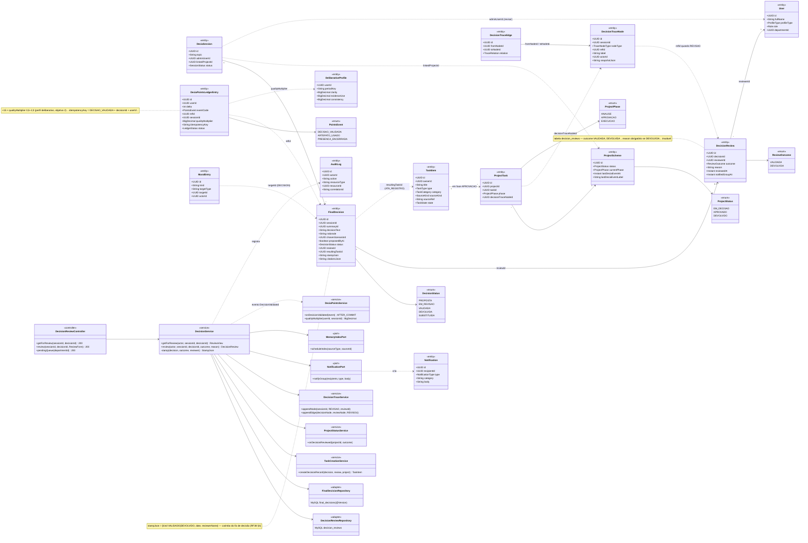
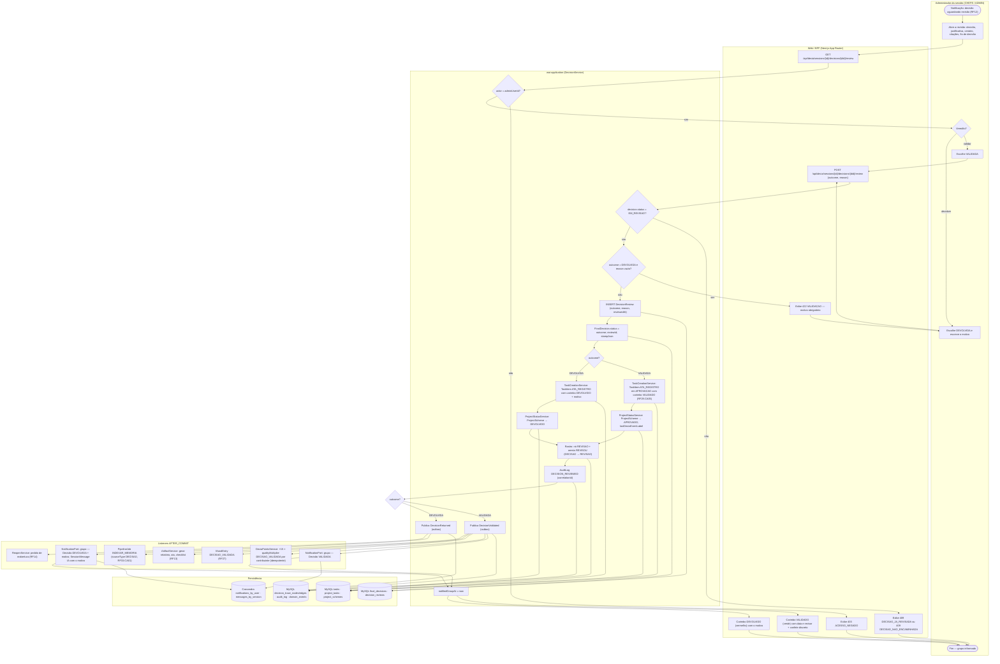
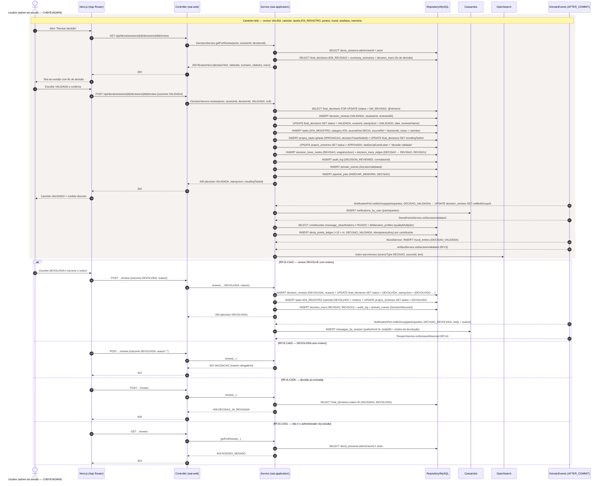
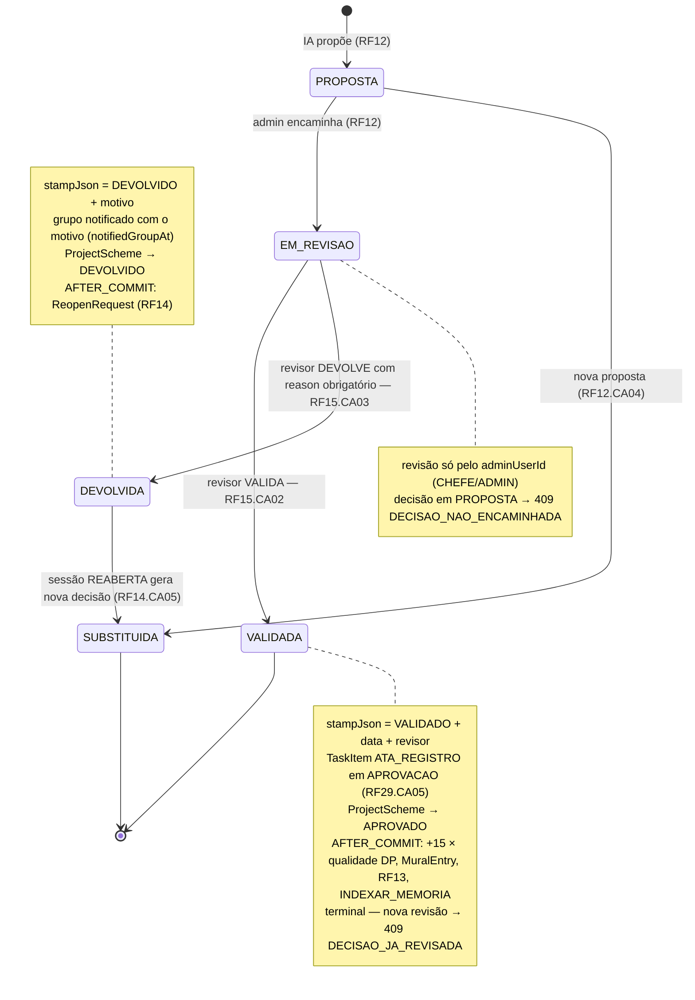
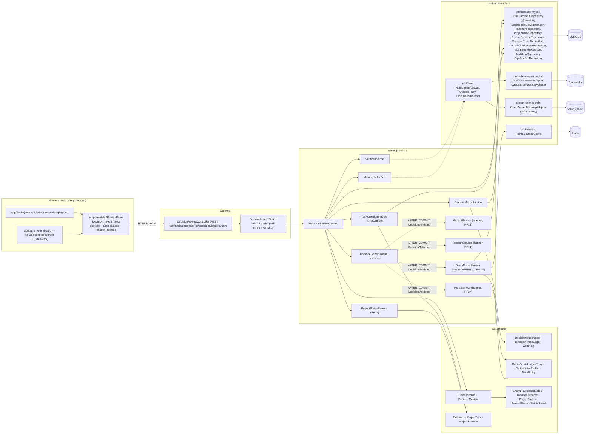

# RF15 — Revisar a decisão final gerada pela IA. Em caso de rejeição, deve-se responder ao grupo o motivo desta decisão
**HU:** HU15 · **Sprint (board Work Station):** 3 · **Equivalente FAI:** card RF15 não cita equivalente; análogo à **fila de revisão de `SealBond`** do FAI (RF20/RF21: marca aprova/rejeita com motivo → APPROVED/REJECTED), aqui aplicada à decisão da IA (carimbo VALIDADO/DEVOLVIDO, RF38 §4) · **Aba/rota:** DECIA — sessão › "Revisar decisão" (`/decia/[sessionId]/decision/review`; rota a confirmar) + fila "Decisões pendentes de revisão" no dashboard do CHEFE (RF28.CA06)
**Critérios de aceite cobertos:** RF15.CA01 · RF15.CA02 · RF15.CA03 · RF15.CA04 · RF15.CA05 · RF15.CA06 (RF1–RF18 não têm CAs no board: derivados da HU15 + RF29.CA05, RF33.CA01, RF38 §4, RF42 e marcados "CA a confirmar")

> **HU15** — COMO administrador do sistema POSSO revisar a decisão final gerada pela IA e, em caso de rejeição, registrar e comunicar ao grupo o motivo PARA garantir que apenas decisões validadas e alinhadas às políticas institucionais sejam oficializadas.

| CA | Enunciado (CA a confirmar) |
|---|---|
| **RF15.CA01** | Dado `FinalDecision` EM_REVISAO (RF12), quando o administrador da sessão (`adminUserId` — CHEFE DE DEPARTAMENTO ou ADMIN) abre a revisão, então vê `decisionText`, `rationale`, cenário escolhido, `citationsJson` e o fio de decisão (RF29.CA06); qualquer outro usuário → `403 ACESSO_NEGADO`. |
| **RF15.CA02** | Dado o revisor escolhe **VALIDADA**, então é criado `DecisionReview` (outcome VALIDADA, reviewedAt), `FinalDecision.status = VALIDADA`, `reviewId` e `stampJson = {kind: VALIDADO, date, reviewerName}`; o grupo é notificado (`notifiedGroupAt`); no projeto vinculado nasce `TaskItem` ATA_REGISTRO na fase APROVACAO com o carimbo (RF29.CA05, `resultingTaskId`) e `ProjectScheme.status` passa a APROVADO. |
| **RF15.CA03** | Dado o revisor escolhe **DEVOLVIDA**, então `reason` é obrigatório (vazio → `422 VALIDACAO`); `FinalDecision.status = DEVOLVIDA`, `stampJson = {kind: DEVOLVIDO, date, reviewerName}`; o grupo recebe `Notification` com o **motivo** e `SessionMessage` (IA) o republica no chat; a tarefa ATA_REGISTRO nasce com carimbo DEVOLVIDO + motivo e `ProjectScheme.status` passa a DEVOLVIDO; dispara o RF14. |
| **RF15.CA04** | Dado VALIDADA, quando `DecisionValidated` é publicado AFTER_COMMIT, então cada participante que contribuiu (≥ 1 mensagem classificada ≠ RUIDO) recebe **+15 DP × qualityMultiplier (0,5–2,0)** (`DECISAO_VALIDADA`, idempotente, RF42.CA01) e nasce `MuralEntry` kind DECISAO_VALIDADA (RF27); dispara RF13 (artefatos). |
| **RF15.CA05** | Dado decisão já VALIDADA/DEVOLVIDA, quando outra revisão chega → `409 DECISAO_JA_REVISADA`; decisão em PROPOSTA (não encaminhada) → `409 DECISAO_NAO_ENCAMINHADA`; a revisão é **imutável**, vai ao rastro (nó REVISAO, aresta REVISOU) e ao `audit_log`. |
| **RF15.CA06** | Dado decisão VALIDADA, então é indexada na Memória Institucional (`InstitutionalMemoryDocument.sourceType = DECISAO`, RF33.CA01) por `PipelineJob` INDEXAR_MEMORIA; e a sessão fica apta ao encerramento (RF17). |

## 1. Diagrama de classes

## 2. Diagrama de atividades

## 3. Diagrama de sequência

## 4. Máquina de estados

Entidade central: `FinalDecision.status` (`DecisionStatus`) — o RF15 é o único que atribui VALIDADA e DEVOLVIDA.

## 5. Diagrama de componentes

## 6. Rastreabilidade

| CA | Classe | Passo (atividades) | Mensagem (sequência) | Transição (estados) | Componente |
|---|---|---|---|---|---|
| RF15.CA01 | `DecisionService.getForReview`, `DeciaSession.adminUserId`, `DecisionTraceNode/Edge` (fio de decisão), `SessionAccessGuard` | A1, B1, C1, B3 | 1–8; `alt` 403 ACESSO_NEGADO | nota de EM_REVISAO | `DecisionReviewController.getForReview`, `ReviewPanel`, `DecisionThread` |
| RF15.CA02 | `DecisionReview` (VALIDADA), `FinalDecision.status/reviewId/stampJson/resultingTaskId`, `TaskItem` ATA_REGISTRO, `ProjectTask` APROVACAO, `ProjectScheme.status APROVADO`, `TaskCreationService`, `ProjectStatusService` | A3, B2, C4–C8, B6 | 9–24 | EM_REVISAO → VALIDADA | `DecisionService.review`, `TaskCreationService`, `ProjectStatusService`, `StampBadge` |
| RF15.CA03 | `DecisionReview.reason` (obrigatório), `stampJson` DEVOLVIDO, `DecisionReview.notifiedGroupAt`, `SessionMessage` (IA), `ProjectScheme.status DEVOLVIDO` | A4, C3, C9, C10, C14, F6, B5, B7 | `alt` RF15.CA03 (DEVOLVIDA) e `alt` 422 VALIDACAO | EM_REVISAO → DEVOLVIDA | `ReasonTextarea`, `NotificationAdapter`, `CassandraMessageAdapter`, `ReopenService` |
| RF15.CA04 | `DeciaPointsLedgerEntry` (DECISAO_VALIDADA, qualityMultiplier), `DeliberativeProfile`, `DeciaPointsService.onDecisionValidated`, `MuralEntry` DECISAO_VALIDADA, `ArtifactService` | C13, F1–F4 | 25–31 | nota de VALIDADA | `DeciaPointsService`, `MuralService`, `ArtifactService`, `OutboxRelay`, `PointsBalanceCache` |
| RF15.CA05 | `FinalDecisionRepository` (@Version, SELECT FOR UPDATE), `AuditLog`, `DecisionTraceNode` REVISAO / aresta REVISOU | C2, C11, C12, B4 | 12, 19, 20; `alt` 409 DECISAO_JA_REVISADA | VALIDADA/DEVOLVIDA sem transição de volta | `DecisionTraceService`, `AuditLogRepository` |
| RF15.CA06 | `PipelineJob` INDEXAR_MEMORIA, `InstitutionalMemoryDocument` (DECISAO), `MemoryIndexPort` | F5 | 22, 32 | nota de VALIDADA | `OpenSearchMemoryAdapter`, `PipelineJobRunner` |
