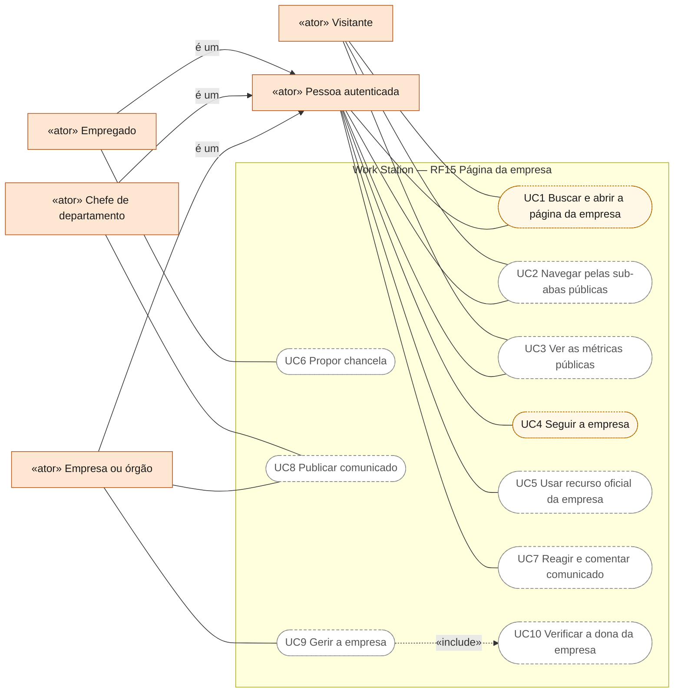
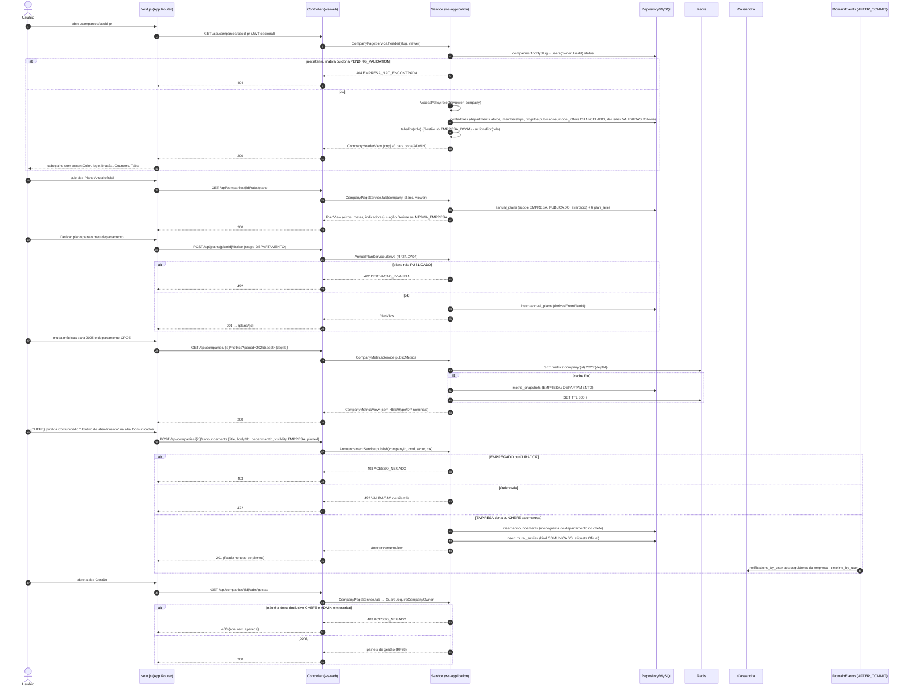
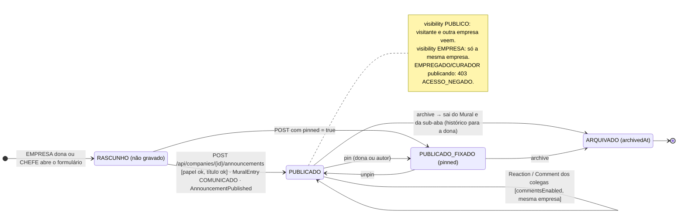
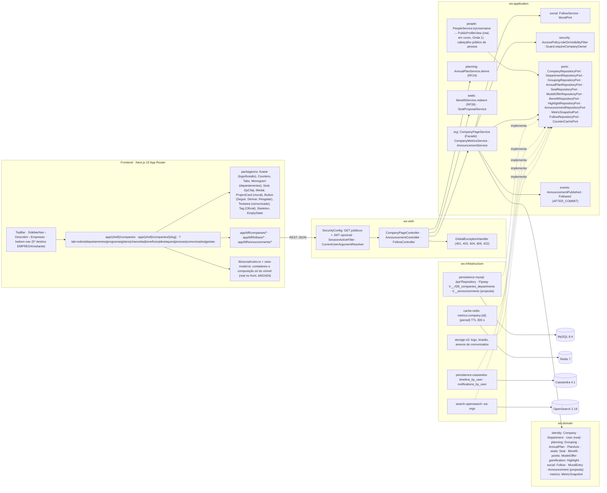

# RF15 — Visualizar perfil de um empresa ou órgão público/privado
**HU:** HU15 · **Sprint (board Work Station):** lista *Requisitos Funcionais* sem sprint atribuída (card renumerado; o card "SPRINT 3" cita "RF15 Revisar decisão", escopo antigo preservado em `_anterior/RF15` — `RENUMERACAO.md`; fase (g) da ARQUITETURA §6) · **Equivalente FAI:** RF14 Aba Marcas + RF22 Perfil institucional (página da MARCA, abas públicas × `admin`, `InstitutionalService`) · **Aba/rota:** **página da empresa** `/companies/[slug]` (Matriz C de ABAS_POR_PERFIL §4), alcançada pela lista `/companies`, pela aba Buscar (RF17), pelo cabeçalho de qualquer perfil/departamento ou pela barra inferior (5º destino para EMPRESA e visitante); API `GET /api/companies`, `GET /api/companies/{slug}`, `GET /api/companies/{id}/tabs/{tab}`, `GET /api/companies/{id}/metrics?period=&dept=`, `POST|DELETE /api/follows`, `POST /api/companies/{id}/announcements` (proposta)
**Critérios de aceite cobertos:** RF15.CA01 · RF15.CA02 · RF15.CA03 · RF15.CA04 · RF15.CA05 · RF15.CA06 — corpo do card vazio: CAs derivados do título + HU15 + RF28.CA01/CA04/CA06/CA08 (`docs/diagramas/RF28/README.md`) + RF24.CA04 + RF39.CA09/CA11 + RF27.CA06 + Matriz C e §7.a (Comunicados), marcados **(CA a confirmar)**. Todas as classes do RF são **(planejado)**; reais: `User.profileType EMPRESA`, `AccountStatus.PENDING_VALIDATION`, `Guard`, `SecurityConfig`. Atualização 17/10/2026: o cabeçalho público de **pessoa** (inclusive da conta EMPRESA dona e dos chefes) já tem fonte real em `GET /api/people/by-username/{username}` (`PeopleController` → `PeopleService.byUsername` → `PublicProfileView`, **em curso, Onda 1**); a API institucional da empresa segue **(planejado)**.

> **HU15** — COMO usuário dentro do sistema Work Station POSSO procurar o perfil de uma empresa ou órgão público/privado PARA obter informação relevante ou realizar alguma funcionalidade.

A **página da empresa** (`Company`, TAXONOMIA §1.4; `ownerUserId` = conta `EMPRESA` aprovada, RF28.CA01) agrega departamentos (RF14), programas (RF25), plano anual oficial (RF24), chancelas e modelos oficiais (RF39/RF40), benefícios (RF39.CA09), destaques (RF35), pessoas e **Comunicados** (proposta §7.a). A aba **Gestão** só existe para `Company.ownerUserId` e é negada no serviço.

**Atualização 17/10/2026.** A página da empresa e sua API (`/api/companies/*`) continuam **(planejado)**. O que já mudou: (1) o cabeçalho público de **pessoa** (nome, usuário, cargo, foto, `profileType`, `companyId`, `departmentId`, sem e-mail nem telefone) tem fonte **(real)** em `PeopleService.byUsername` → `PublicProfileView`, servido por `GET /api/people/by-username/{username}` com `404 NAO_ENCONTRADO` uniforme para conta não `ACTIVE` (a dona em `PENDING_VALIDATION` também não aparece) — o front sobre essa rota está **(em curso, Onda 1)** (`docs/auditoria/2026-10-17/PLANO_ONDAS.md`, P19); (2) no front de demonstração, os contadores e a composição de projeto respeitam a ACL do viewer — SIGILOSO equivale a PRIVADA e tarefas ocultas não entram em título nem total (`lib/social/rules.ts`, `lib/social/view-model.ts`, commit `b602d34`).

## Critérios de aceite derivados da HU15 (todos "CA a confirmar")

| CA | Enunciado (Dado / Quando / Então) |
|---|---|
| **RF15.CA01** (CA a confirmar) | Dado qualquer usuário (inclusive visitante), quando busca uma empresa/órgão (Buscar por `legalName`/sigla, lista `/companies`, link em perfil ou departamento) e abre `/companies/[slug]`, então vê o cabeçalho: `Company.logoUrl`, `coatOfArmsUrl`, `legalName`, `about`, `websiteUrl`, `accentColor` como cor de destaque, e contadores institucionais (departamentos ativos, pessoas, projetos publicados, modelos oficiais, decisões validadas, seguidores) — **sem** cargo, departamento, Hype, Tarefa do Dia ou DP; slug inexistente, `Company.status` inativo ou dona ainda `PENDING_VALIDATION` → `404 EMPRESA_NAO_ENCONTRADA`. **Real (17/10/2026):** o cabeçalho público da **pessoa** dona tem fonte em `PublicProfileView` (`GET /api/people/by-username/{username}`, em curso, Onda 1; não `ACTIVE` → `404 NAO_ENCONTRADO`); os contadores do front contam só o que o viewer vê (`b602d34`); o cabeçalho institucional segue planejado. |
| **RF15.CA02** (CA a confirmar) | Dado o cabeçalho, então as sub-abas públicas são: **Sobre** · **Departamentos** (`Department` ativos → RF14) · **Programas** (`Grouping` PROGRAMA, RF25) · **Plano Anual oficial** (`AnnualPlan` scope EMPRESA PUBLICADO com 6 `PlanAxis`; botão **Derivar**, RF24.CA04) · **Chancelas e modelos oficiais** (`Seal` ATIVA + `ModelOffer` shelf CHANCELADO, RF39.CA11) · **Benefícios** (`Benefit` DISPONIVEL, RF39.CA09) · **Destaques** (`Highlight` do mês, RF35.CA03) · **Pessoas** (nomes/cargos públicos por departamento) · **Comunicados** (proposta); tab + filtros + página na URL. |
| **RF15.CA03** (CA a confirmar) | Dado a sub-aba **Comunicados** (proposta), então EMPRESA dona e CHEFES da empresa publicam `Announcement {companyId, departmentId?, authorId, title, bodyMd, attachmentsJson, visibility EMPRESA/PUBLICO, pinned, commentsEnabled, publishedAt, archivedAt}`; comunicado de chefe sai com o monograma do departamento; colegas reagem (`Reaction`) e comentam (`Comment`, `TargetType ANNOUNCEMENT` proposto) quando `commentsEnabled`; fixados ficam no topo; cada publicação entra no Mural como `MuralEntry.kind COMUNICADO` (proposto) com etiqueta "Oficial"; visitante/outra empresa vê só `PUBLICO`; EMPREGADO/CURADOR que tenta publicar → `403 ACESSO_NEGADO`; título vazio → `422 VALIDACAO`. |
| **RF15.CA04** (CA a confirmar) | Dado o período (padrão: exercício corrente) e o filtro opcional por departamento, então as **métricas públicas** (RF28.CA04) — projetos publicados, modelos oficiais, decisões validadas, chancelas emitidas, benefícios resgatados — vêm de `MetricSnapshot` (scope EMPRESA) com cache Redis `metrics:company:{id}:{period}` TTL 300 s; nunca dados nominais de desempenho (RF45.CA10). |
| **RF15.CA05** (CA a confirmar) | Dado o viewer autenticado, então as **ações** são: **Seguir** (`Follow` COMPANY, único e idempotente; eventos no Seguindo do Mural, RF27.CA06), **Derivar** o plano oficial (mesma empresa; plano não PUBLICADO → `422 DERIVACAO_INVALIDA`, RF24.CA04), **Resgatar** benefício (exige `SealBond` APROVADA → senão `409 CHANCELA_INVALIDA`, RF39.CA10), **Levar ao meu acervo** um modelo oficial (RF41.CA08), **Propor chancela** (EMPREGADO da empresa, RF39.CA06), **Mensagem** (RF46), abrir departamento (RF14); visitante anônimo → `401 NAO_AUTENTICADO` nas ações. |
| **RF15.CA06** (CA a confirmar) | Dado o viewer, então a aba **Gestão** (Departamentos & chefes, Pessoas & lotações, Chancelas & políticas, Benefícios, Plano oficial, Programas, Políticas, Dashboard do emissor, Insights da empresa, Dossiês, Comunicados) só aparece para `Company.ownerUserId` e é **negada no serviço** (`403 ACESSO_NEGADO`) para qualquer outro, inclusive CHEFE e ADMIN em escrita; visibilidade por item segue `AccessPolicy.visibilityFilter` (anônimo/outra empresa → `PUBLICA`; mesma empresa → + `EMPRESA`); `cnpj` (AES) só para a dona e ADMIN; página em pt-BR/en/es e responsiva. **Real (17/10/2026):** no front, contadores e composição de projeto já seguem a ACL do viewer (SIGILOSO = PRIVADA, `lib/social/rules.ts`, `b602d34`); a projeção pública de pessoa (`PublicProfileView`) não carrega contato. |

## 0. Diagrama de casos de uso

Quem visita a página de uma empresa ou órgão e o que cada um pode fazer nela. Borda contínua: existe no código em 17/10/2026; tracejada: planejado ou em curso (a página roda sobre o repositório DEMO e a API `/api/companies/*` não existe).

| Caso de uso | Ator(es) | CAs | Situação |
|---|---|---|---|
| UC1 Buscar e abrir a página da empresa | visitante, autenticado | RF15.CA01 | planejado (`GET /api/companies/{slug}`); cabeçalho DEMO no front |
| UC2 Navegar pelas sub-abas públicas | visitante, autenticado | RF15.CA02, RF15.CA06 | planejado (Sobre, Departamentos, Programas, Plano Anual, Chancelas, Benefícios, Destaques, Pessoas, Comunicados; visibilidade por item) |
| UC3 Ver as métricas públicas | visitante, autenticado | RF15.CA04 | planejado (`MetricSnapshot`; nunca dados nominais) |
| UC4 Seguir a empresa | autenticado | RF15.CA05 | planejado (`Follow`); botão DEMO no front |
| UC5 Usar recurso oficial da empresa | autenticado | RF15.CA05 | planejado (derivar o plano oficial, resgatar benefício, levar modelo oficial ao acervo, mensagem) |
| UC6 Propor chancela | empregado (da empresa) | RF15.CA05 | planejado (RF39.CA06) |
| UC7 Reagir e comentar comunicado | autenticado | RF15.CA03 | planejado (só quando `commentsEnabled`) |
| UC8 Publicar comunicado | empresa (dona), chefe | RF15.CA03 | planejado (`Announcement`; empregado ou curador → `403`) |
| UC9 Gerir a empresa | empresa (dona) | RF15.CA06 | planejado (aba Gestão; aparece só para `Company.ownerUserId`) |
| UC10 Verificar a dona da empresa | — (incluído por UC9) | RF15.CA06 | planejado (negado no serviço com `403`, inclusive para chefe e admin em escrita) |

## 1. Diagrama de classes

```mermaid
classDiagram
  direction LR

  class CompanyPageController {
    <<controller>>
    +list(q, page) Page~CompanyCardView~
    +header(slug, viewer) CompanyHeaderView
    +tab(id, tab, filters, viewer) Page
    +metrics(id, period, deptId, viewer) CompanyMetricsView
  }
  class AnnouncementController {
    <<controller>>
    +publish(companyId, AnnouncementRequest, CurrentUser, ctx) AnnouncementView
    +pin(id, CurrentUser) void
    +archive(id, CurrentUser) void
  }
  class FollowController {
    <<controller>>
    +follow(FollowRequest, CurrentUser) FollowView
    +unfollow(targetType, targetId, CurrentUser) void
  }
  class CompanyPageService {
    <<facade>>
    +header(slug, viewer) CompanyHeaderView
    +tabsFor(company, viewer) List~TabKey~
    +tab(company, tab, filters, viewer) Page
    +actionsFor(company, viewer) List~Action~
  }
  class CompanyMetricsService {
    <<service>>
    +publicMetrics(companyId, period, deptId) CompanyMetricsView
  }
  class AnnouncementService {
    <<service>>
    +publish(companyId, cmd, actor, ctx) Announcement
    +pin(id, actor) void
    +archive(id, actor) void
  }
  class FollowService {
    <<service>>
    +follow(followerId, targetType, targetId) Follow
  }
  class AccessPolicy {
    <<service>>
    +roleOn(viewer, company) ViewerRole
    +visibilityFilter(viewer, company) Set~Visibility~
  }
  class Guard {
    <<service>>
    +requireCompanyOwner(CurrentUser, Company) void
    +requireRole(CurrentUser, Role) void
  }
  class CompanyRepositoryPort {
    <<port>>
    +findBySlug(slug) Optional
    +search(q, page) Page
  }
  class DepartmentRepositoryPort {
    <<port>>
    +findActiveByCompany(companyId) List
  }
  class GroupingRepositoryPort {
    <<port>>
    +findPrograms(companyId) Page
  }
  class AnnualPlanRepositoryPort {
    <<port>>
    +findOfficialPublished(companyId, year) Optional
  }
  class SealRepositoryPort {
    <<port>>
    +findActiveByCompany(companyId) List
  }
  class ModelOfferRepositoryPort {
    <<port>>
    +findChancelados(companyId) Page
  }
  class BenefitRepositoryPort {
    <<port>>
    +findAvailable(companyId) Page
  }
  class HighlightRepositoryPort {
    <<port>>
    +findMonth(companyId, monthKey) List
  }
  class AnnouncementRepositoryPort {
    <<port>>
    +save(Announcement) Announcement
    +findVisible(companyId, visibilities, page) Page
  }
  class MetricSnapshotPort {
    <<port>>
    +latest(scope, scopeId, period) List
  }
  class FollowRepositoryPort {
    <<port>>
    +upsert(Follow) Follow
  }
  class MuralPort {
    <<port>>
    +publish(MuralEntry) void
  }

  class Company {
    <<entity>>
    +UUID id
    +UUID ownerUserId
    +String legalName
    +String slug
    +String cnpj
    +String logoUrl
    +String coatOfArmsUrl
    +String about
    +String websiteUrl
    +String accentColor
    +JSON pointsPolicyJson
    +String status
  }
  class User {
    <<entity>>
    +UUID id
    +ProfileType profileType
    +AccountStatus status
  }
  class Department {
    <<entity>>
    +UUID companyId
    +String acronym
    +String monogram
    +UUID headUserId
    +boolean active
  }
  class Grouping {
    <<entity>>
    +GroupingType type
    +String label
    +GroupingStatus status
  }
  class AnnualPlan {
    <<entity>>
    +PlanScope scope
    +int exerciseYear
    +PlanStatus status
    +UUID derivedFromPlanId
  }
  class PlanAxis {
    <<entity>>
    +int position
    +String name
    +String goal
  }
  class Seal {
    <<entity>>
    +String name
    +SealTier tier
    +SealStatus status
  }
  class ModelOffer {
    <<entity>>
    +String shelf
    +int pricePoints
    +String status
  }
  class Benefit {
    <<entity>>
    +BenefitType type
    +String status
  }
  class Highlight {
    <<entity>>
    +String monthKey
    +String targetType
    +int position
  }
  class Announcement {
    <<entity>>
    +UUID id
    +UUID companyId
    +UUID departmentId
    +UUID authorId
    +String title
    +String bodyMd
    +JSON attachmentsJson
    +Visibility visibility
    +boolean pinned
    +boolean commentsEnabled
    +Instant publishedAt
    +Instant archivedAt
  }
  class MetricSnapshot {
    <<entity>>
    +String metricCode
    +MetricScope scope
    +UUID scopeId
    +BigDecimal value
  }
  class Follow {
    <<entity>>
    +UUID followerId
    +FollowTargetType targetType
    +UUID targetId
    +FollowStatus status
  }
  class MuralEntry {
    <<entity>>
    +String kind
    +UUID companyId
    +String targetType
    +UUID targetId
  }
  class ViewerRole {
    <<enum>>
    ANONIMO
    OUTRA_EMPRESA
    MESMA_EMPRESA
    CHEFE
    EMPRESA_DONA
    ADMIN
  }
  class AnnouncementVisibility {
    <<enum>>
    EMPRESA
    PUBLICO
  }

  CompanyPageController --> CompanyPageService
  CompanyPageController --> CompanyMetricsService
  AnnouncementController --> AnnouncementService
  FollowController --> FollowService
  CompanyPageService --> AccessPolicy
  CompanyPageService --> Guard
  CompanyPageService --> CompanyRepositoryPort
  CompanyPageService --> DepartmentRepositoryPort
  CompanyPageService --> GroupingRepositoryPort
  CompanyPageService --> AnnualPlanRepositoryPort
  CompanyPageService --> SealRepositoryPort
  CompanyPageService --> ModelOfferRepositoryPort
  CompanyPageService --> BenefitRepositoryPort
  CompanyPageService --> HighlightRepositoryPort
  CompanyPageService --> AnnouncementRepositoryPort
  CompanyMetricsService --> MetricSnapshotPort
  AnnouncementService --> Guard
  AnnouncementService --> AnnouncementRepositoryPort
  AnnouncementService --> MuralPort
  FollowService --> FollowRepositoryPort
  AccessPolicy ..> ViewerRole
  Company "1" --> "1" User : ownerUserId (EMPRESA aprovada)
  Company "1" *-- "1..*" Department
  Company "1" --> "0..*" Grouping : PROGRAMA
  Company "1" --> "0..1" AnnualPlan : oficial PUBLICADO
  AnnualPlan "1" *-- "6" PlanAxis
  Company "1" --> "0..*" Seal
  Company "1" --> "0..*" ModelOffer : shelf CHANCELADO
  Company "1" --> "0..*" Benefit
  Company "1" --> "0..*" Highlight
  Company "1" --> "0..*" Announcement
  Company "1" --> "0..*" MetricSnapshot : scope EMPRESA
  Company "1" --> "0..*" Follow : targetType COMPANY
  Announcement "0..*" --> "0..1" Department : monograma do chefe
  Announcement ..> MuralEntry : kind COMUNICADO (proposto)
  Announcement --> AnnouncementVisibility
  note for Announcement "Proposta (ABAS_POR_PERFIL §7.a): não está na TAXONOMIA. TargetType ANNOUNCEMENT e MuralKind COMUNICADO também propostos."
  class PeopleService {
    <<service>>
    +byUsername(CurrentUser, username) PublicProfileView
  }
  class PublicProfileView {
    <<value>>
    +String username
    +String name
    +String jobTitle
    +String avatarUrl
    +String profileType
    +UUID companyId
    +UUID departmentId
  }
  PeopleService ..> PublicProfileView
  User ..> PublicProfileView : projeção pública sem contato
  note for PeopleService "Real, em curso na Onda 1 (RF16). Fonte do cabeçalho público de pessoa. Conta não ACTIVE → 404 NAO_ENCONTRADO."
```

## 2. Diagrama de atividades

```mermaid
flowchart TD
  subgraph ATOR["Visitante · Empregado · Chefe · EMPRESA dona"]
    A1["Busca a empresa/órgão (Buscar, /companies, link) e abre /companies/{slug}"]
    A2["Navega nas sub-abas, muda período/departamento das métricas"]
    A3["Seguir · Derivar plano · Resgatar benefício · Levar ao meu acervo · Propor chancela · Mensagem"]
    A4["EMPRESA dona ou CHEFE: publica um Comunicado"]
    A5["EMPRESA dona: abre a aba Gestão"]
  end
  subgraph FE["Next.js (App Router) · BFF"]
    F1["GET /api/companies/{slug} → cabeçalho (accentColor aplicado), tabs permitidas, ações"]
    F2["GET /api/companies/{id}/tabs/{tab}?page=&dept= · URL reflete tab/filtros"]
    F3["GET /api/companies/{id}/metrics?period=&dept="]
    F4["POST /api/follows {COMPANY, id} · POST /api/plans/{id}/derive · POST /api/benefits/{id}/redeem · POST /api/tasks/{id}/extract · POST /api/seals/proposals · /messages"]
    F5["POST /api/companies/{id}/announcements {title, bodyMd, departmentId?, visibility, pinned, commentsEnabled}"]
    F6["Cabeçalho: logo + brasão, Counters · Tabs · Monogram dos departamentos · PhaseBar/eixos do plano · Seal · DpChip (preço) · Medal · Skeleton · EmptyState"]
  end
  subgraph WEB["ws-web"]
    W1["GET públicos (permitAll) · JWT opcional → viewer ou ANONIMO"]
    W2["CompanyPageController · AnnouncementController · FollowController"]
    E404["404 EMPRESA_NAO_ENCONTRADA (slug, status inativo, dona PENDING_VALIDATION)"]
    E401["401 NAO_AUTENTICADO (ações sem login)"]
    E403["403 ACESSO_NEGADO (Gestão sem ser a dona · publicar comunicado sem papel)"]
    E422D["422 DERIVACAO_INVALIDA (plano não PUBLICADO)"]
    E409C["409 CHANCELA_INVALIDA (resgate sem SealBond APROVADA)"]
    E422T["422 VALIDACAO (título vazio)"]
  end
  subgraph APP["ws-application"]
    S1["CompanyRepositoryPort.findBySlug · status ATIVA · dona ACTIVE?"]
    S2["AccessPolicy.roleOn(viewer, company) → ANONIMO · OUTRA_EMPRESA · MESMA_EMPRESA · CHEFE · EMPRESA_DONA · ADMIN"]
    S3["header: Company (cnpj só para dona/ADMIN) + contadores institucionais (departamentos ativos, pessoas, projetos publicados, modelos oficiais, decisões validadas, seguidores) — sem dados nominais"]
    S4["tabsFor: Sobre · Departamentos · Programas · Plano Anual oficial · Chancelas e modelos · Benefícios · Destaques · Pessoas · Comunicados (+ Gestão só EMPRESA_DONA)"]
    T1["tab: visibilityFilter (PUBLICA | +EMPRESA) · Comunicados: PUBLICO para fora, EMPRESA dentro · Pessoas: nome e cargo públicos"]
    T2{"aba Gestão?"}
    T3["Guard.requireCompanyOwner (CHEFE e ADMIN negados em escrita)"]
    M1["CompanyMetricsService: Redis metrics:company:{id}:{period} TTL 300 s → MetricSnapshot (EMPRESA, filtro dept)"]
    AN1["AnnouncementService.publish: papel EMPRESA_DONA ou CHEFE da empresa · título obrigatório · monograma do departamento se chefe"]
    AN2["save Announcement · MuralPort.publish(MuralEntry COMUNICADO, etiqueta Oficial) · fixados no topo"]
    FO1["FollowService.follow (COMPANY) idempotente"]
    EV["AFTER_COMMIT: AnnouncementPublished → Notification aos seguidores e à empresa · TimelineEvent · invalida cache de contadores"]
  end
  subgraph PERS["Persistência"]
    P1[("MySQL: companies, departments, groupings, annual_plans, plan_axes, seals, model_offers, benefits, highlights, announcements (proposta), metric_snapshots, follows, mural_entries")]
    P2[("Redis: metrics:company:{id}:{period} · contadores")]
    P3[("Cassandra: timeline_by_user · notifications_by_user")]
    P4[("OpenSearch ws-orgs (busca, RF17)")]
  end

  A1 --> P4
  A1 --> F1 --> W1 --> W2 --> S1
  S1 -->|"não"| E404
  S1 --> S2 --> S3 --> S4 --> F6
  S3 --> P1
  A2 --> F2 --> W2 --> T1 --> T2
  T2 -->|"sim"| T3
  T3 -->|"não é a dona"| E403
  T3 -->|"ok"| F6
  T2 -->|"não"| F6
  T1 --> P1
  A2 --> F3 --> W2 --> M1 --> P2
  M1 --> P1
  M1 --> F6
  A3 --> F4 --> W1
  W1 -->|"anônimo"| E401
  W2 --> FO1 --> P1
  F4 -->|"derivar plano não publicado"| E422D
  F4 -->|"resgate sem chancela"| E409C
  A4 --> F5 --> W2 --> AN1
  AN1 -->|"sem papel"| E403
  AN1 -->|"título vazio"| E422T
  AN1 --> AN2 --> P1
  AN2 --> EV --> P3
  EV --> P2
  A5 --> F2
```

## 3. Diagrama de sequência

## 4. Máquina de estados

Entidade central: **`Announcement`** (proposta, CA03) — ciclo RASCUNHO → PUBLICADO (fixado ou não) → ARQUIVADO, derivado de `publishedAt`/`pinned`/`archivedAt`. `Follow.status` (CA05) segue a máquina do RF14 §4 e `Company.status`/validação da dona (CA01) a do RF28.

## 5. Diagrama de componentes

## 6. Rastreabilidade

| CA | Classe (§1) | Passo da atividade (§2) | Mensagem da sequência (§3) | Transição de estado (§4) | Componente (§5) | Situação |
|---|---|---|---|---|---|---|
| RF15.CA01 | `CompanyPageController.list/header`, `CompanyPageService.header`, `Company`, `User.status` (dona), `CompanyRepositoryPort` | `A1`→`F1`→`S1`→`S3`→`F6`, `E404` | 1–11 | — | `PG`, `UI` (`Avatar`, `Counters`), `OSE`, `PPL`, `SR` | planejado (`AccountStatus` real); cabeçalho de pessoa com fonte **real (em curso, Onda 1)**: `PeopleService.byUsername` → `PublicProfileView` (`GET /api/people/by-username/{username}`, `PeopleServiceTest`); contadores do front respeitam a ACL (`b602d34`) |
| RF15.CA02 | `CompanyPageService.tabsFor/tab`, `DepartmentRepositoryPort`, `GroupingRepositoryPort`, `AnnualPlanRepositoryPort`, `SealRepositoryPort`, `ModelOfferRepositoryPort`, `BenefitRepositoryPort`, `HighlightRepositoryPort` | `A2`→`F2`→`T1`→`F6` | 12–16 | — | `CP`, `UI` (`Tabs`, `Monogram`, `Seal`, `DpChip`, `Medal`) | planejado (RF14, RF24, RF25, RF35, RF39, RF40) |
| RF15.CA03 | `AnnouncementController`, `AnnouncementService.publish/pin/archive`, `Announcement`, `MuralPort`, `MuralEntry` COMUNICADO | `A4`→`F5`→`AN1`→`AN2`→`EV`, `E403`, `E422T` | 32–43 | `RAS`→`PUB`/`FIX`→`ARQ` | `CP`, `SOC`, `EVT`, `CAS`, `S3` | planejado (proposta §7.a) |
| RF15.CA04 | `CompanyMetricsService.publicMetrics`, `MetricSnapshotPort`, `MetricSnapshot` (scope EMPRESA) | `F3`→`M1` | 25–31 | — | `RDS`, `MY` | planejado (RF28.CA04, RF45.CA10) |
| RF15.CA05 | `FollowService`, `Follow` COMPANY, `AnnualPlanService.derive`, `BenefitService.redeem`, `TaskExtractionService` (RF7), `SealProposalService` | `A3`→`F4`→`FO1`, `E401`, `E422D`, `E409C` | 17–24 | `Follow` em RF14 §4 | `SOC`, `PLN`, `SEAL` | planejado (RF27.CA06, RF24.CA04, RF39.CA06/CA10, RF41.CA08, RF46) |
| RF15.CA06 | `Guard.requireCompanyOwner`, `AccessPolicy.roleOn/visibilityFilter`, `Company.cnpj` (AES) | `T2`→`T3`→`E403` | 44–51 | — | `SECU`, `GEH`, `SR` | planejado (`Guard` base real); contadores e composição filtrados no front (`lib/social/rules.ts`, `b602d34`); `PublicProfileView` sem contato **(real, em curso, Onda 1)** |
