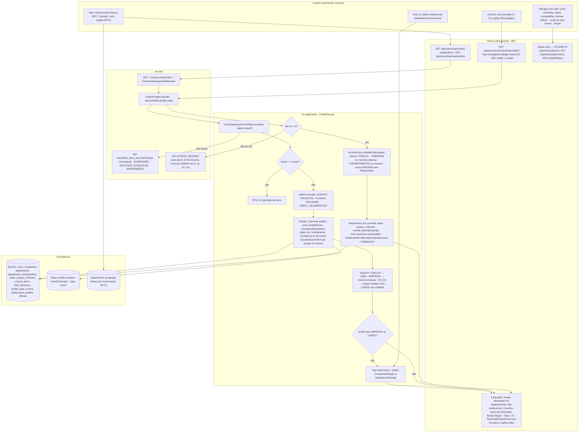
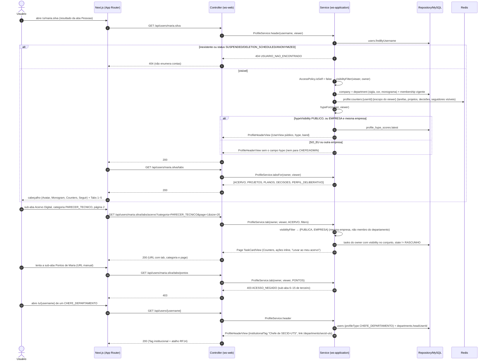
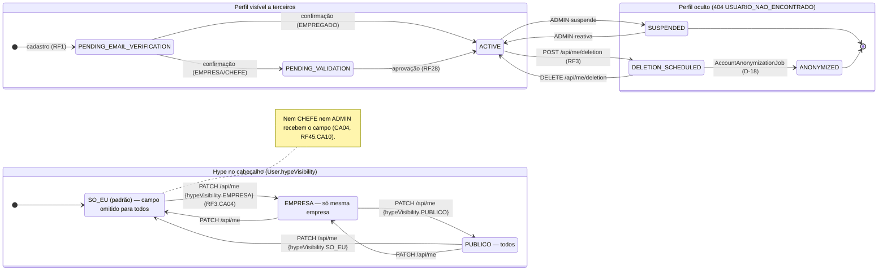
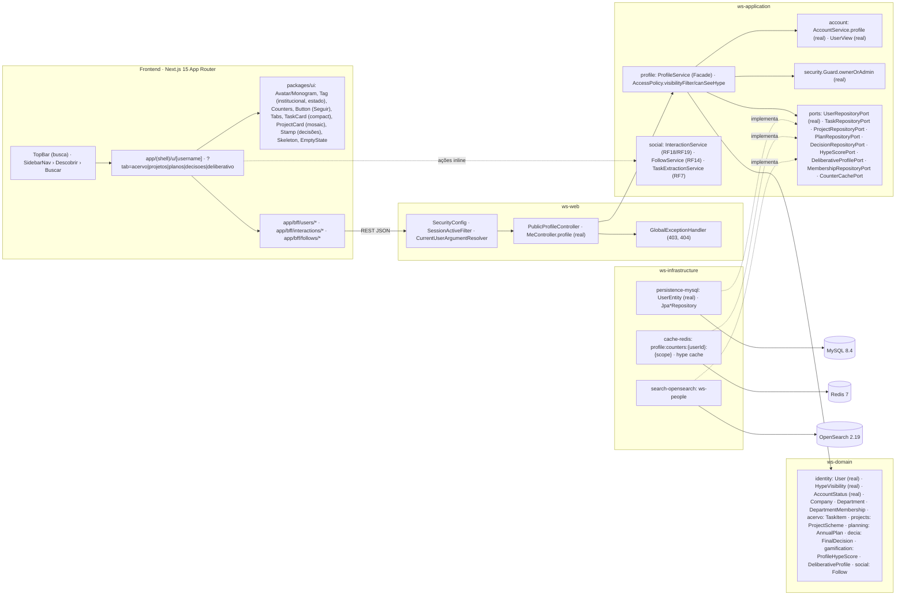

# RF16 — Visualizar perfil de um usuário comum que é empregado dentro de uma empresa
**HU:** HU16 · **Sprint (board Work Station):** lista *Requisitos Funcionais* sem sprint atribuída (card renomeado em 2026-10-02; origem `_anterior/RF19` = Sprint 4; o card "SPRINT 3" cita "RF16 Perguntas em pontos críticos", escopo antigo — `RENUMERACAO.md`) · **Equivalente FAI:** RF17 Perfil de outros usuários (Lookbook de terceiros, `LookbookService` com `!self`) · **Aba/rota:** perfil de terceiros `/u/[username]` (Matriz B de ABAS_POR_PERFIL §3, colunas "terceiros"); API `GET /api/users/{username}` (real como `GET /api/users/{id}` → `UserView`), `GET /api/users/{username}/tabs`, `GET /api/users/{username}/tabs/{tab}`, `POST|DELETE /api/follows`
**Critérios de aceite cobertos:** RF16.CA01 … RF16.CA06 — corpo do card vazio: CAs derivados do título + HU16 + `_anterior/RF19` CA02 (perfil de terceiros) e Matriz B (colunas "terceiros"); todos marcados "(CA a confirmar)". Real (Bloco 3): `MeController.profile` (`GET /api/users/{id}`, `Guard.ownerOrAdmin` para campos privados), `AccountService.profile`, `UserView`, `User.hypeVisibility`; o resto **(planejado)**.

> **HU16** — COMO usuário dentro do sistema Work Station POSSO visualizar o perfil de um usuário que trabalha dentro uma organização PARA realizar alguma funcionalidade.

O perfil de terceiros é o mesmo `/u/[username]` do RF6, mas com `viewer != owner`: só as sub-abas **1–5** (Acervo Digital, Projetos, Planos, Decisões, Perfil deliberativo público), itens filtrados por `AccessPolicy.visibilityFilter`, Hype conforme `User.hypeVisibility` e ações sociais inline (RF18/RF19) + "Levar ao meu acervo" (RF7). Contas institucionais (EMPRESA/CHEFE) recebem a etiqueta e o atalho para a página da empresa (RF15) ou do departamento (RF14).

## Critérios de aceite derivados da HU16 (todos "CA a confirmar")

| CA | Enunciado (Dado / Quando / Então) |
|---|---|
| **RF16.CA01** (CA a confirmar) | Dado um usuário autenticado, quando abre `/u/{username}` de um EMPREGADO, então vê o cabeçalho público: avatar, nome, cargo (`jobTitle`), empresa, departamento (sigla, cor, monograma), contadores (tarefas, projetos, decisões, seguidores) e o botão Seguir; `username` inexistente → `404 USUARIO_NAO_ENCONTRADO`; conta `SUSPENDED`/`DELETION_SCHEDULED`/`ANONYMIZED` → `404` (não enumera contas); `email`/`phone` nunca saem (`UserView` público). |
| **RF16.CA02** (CA a confirmar) | Dado o perfil de terceiro, quando a API devolve a lista de sub-abas, então só vêm as sub-abas **1–5** (Acervo Digital · Projetos · Planos · Decisões · Perfil deliberativo público); as 6–15 (salvos, pontos, Tarefa do Dia, HSE, configurações…) são omitidas e uma chamada direta a `/tabs/{6..15}` responde `403 ACESSO_NEGADO` (sem bypass para ADMIN nas sub-abas 9, 13, 14, 15 — dados de desempenho nominal, RF45.CA10). |
| **RF16.CA03** (CA a confirmar) | Dado uma sub-aba 1–4, quando listo os itens, então cada `TaskItem`, `ProjectScheme`, `AnnualPlan`/`Grouping` e `FinalDecision` passa pelo `visibilityFilter`: `PUBLICA` sempre; `EMPRESA` se `viewer.companyId == owner.companyId`; `DEPARTAMENTO` se o viewer tem `DepartmentMembership` vigente no departamento do item; `PRIVADA` nunca; `RASCUNHO` nunca. Contadores do cabeçalho contam só o que o viewer pode ver. |
| **RF16.CA04** (CA a confirmar) | Dado o cabeçalho, quando `owner.hypeVisibility` é `PUBLICO` então o Hype Score (`ProfileHypeScore`) aparece para todos; `EMPRESA` só para a mesma empresa; `SO_EU` nunca — a API **não devolve** o campo (nem para CHEFE nem para ADMIN). A sub-aba 5 mostra só `DeliberativeProfile.publicIndicatorsJson` e `badgesJson` escolhidos pelo dono. |
| **RF16.CA05** (CA a confirmar) | Dado uma sub-aba aberta, quando aplico filtros e paginação (`?tab=&fase=&categoria=&page=&size=20`), então a URL reflete o estado e cada card traz as ações inline do RF18/RF19 (curtir, comentar, salvar, compartilhar, remixar, atribuir) e, no Acervo, "Levar ao meu acervo" (RF7/RF41.CA08) — todas respeitando a visibilidade do item. |
| **RF16.CA06** (CA a confirmar) | Dado que o `username` pertence a uma conta `EMPRESA` ou `CHEFE_DEPARTAMENTO`, quando abro o perfil, então o cabeçalho mostra a etiqueta institucional ("Chefe de {sigla}" com monograma, ou logo da empresa) e o atalho para a página do departamento (RF14) ou da empresa (RF15); textos em pt-BR/en/es e layout responsivo. |

## 1. Diagrama de classes

```mermaid
classDiagram
  direction LR

  class MeController {
    <<controller>>
    +profile(CurrentUser, UUID id) UserView
  }
  class PublicProfileController {
    <<controller>>
    +header(username, viewer) ProfileHeaderView
    +tabs(username, viewer) List~TabKey~
    +tab(username, tab, filters, viewer) Page
  }
  class AccountService {
    <<service>>
    +profile(CurrentUser, userId) UserView
  }
  class ProfileService {
    <<facade>>
    +header(username, viewer) ProfileHeaderView
    +tabsFor(owner, viewer) List~TabKey~
    +tab(owner, viewer, tab, filters) Page
    -hypeFor(owner, viewer) Optional~Integer~
  }
  class AccessPolicy {
    <<service>>
    +visibilityFilter(viewer, owner) Set~Visibility~
    +canSeeHype(viewer, owner) boolean
    +isSelf(viewer, owner) boolean
  }
  class Guard {
    <<service>>
    +ownerOrAdmin(CurrentUser, ownerId) void
  }
  class UserRepositoryPort {
    <<port>>
    +findByUsername(username) Optional
  }
  class TaskRepositoryPort {
    <<port>>
    +findByOwnerVisible(ownerId, visibilities, filters) Page
    +countVisible(ownerId, visibilities) long
  }
  class ProjectRepositoryPort {
    <<port>>
    +findByOwnerVisible(ownerId, visibilities, filters) Page
  }
  class PlanRepositoryPort {
    <<port>>
    +findByOwnerVisible(ownerId, visibilities) Page
  }
  class DecisionRepositoryPort {
    <<port>>
    +findParticipatedVisible(userId, viewer) Page
  }
  class HypeScorePort {
    <<port>>
    +latest(userId) Optional~ProfileHypeScore~
  }
  class DeliberativeProfilePort {
    <<port>>
    +latestPublic(userId) Optional
  }
  class MembershipRepositoryPort {
    <<port>>
    +findCurrent(userId) Optional
  }
  class CounterCachePort {
    <<port>>
    +profileCounters(userId, viewerScope) Counters
  }

  class User {
    <<entity>>
    +UUID id
    +String username
    +String fullName
    +String displayName
    +String jobTitle
    +String avatarUrl
    +String coverUrl
    +String bio
    +ProfileType profileType
    +AccountStatus status
    +UUID companyId
    +UUID departmentId
    +HypeVisibility hypeVisibility
    +boolean verified
  }
  class UserView {
    <<value>>
    +UUID id
    +String username
    +String fullName
    +String displayName
    +ProfileType profileType
    +String jobTitle
    +String avatarUrl
  }
  class Department {
    <<entity>>
    +String acronym
    +String color
    +String monogram
    +String slug
    +UUID headUserId
  }
  class Company {
    <<entity>>
    +String legalName
    +String slug
    +String logoUrl
    +UUID ownerUserId
  }
  class DepartmentMembership {
    <<entity>>
    +UUID userId
    +UUID departmentId
    +Instant endedAt
  }
  class TaskItem {
    <<entity>>
    +UUID ownerId
    +TaskState state
    +Visibility visibility
  }
  class ProjectScheme {
    <<entity>>
    +UUID ownerId
    +ProjectStatus status
    +Visibility visibility
  }
  class AnnualPlan {
    <<entity>>
    +UUID ownerId
    +PlanStatus status
    +Visibility visibility
  }
  class FinalDecision {
    <<entity>>
    +UUID sessionId
    +DecisionStatus status
  }
  class ProfileHypeScore {
    <<entity>>
    +UUID userId
    +LocalDate scoreDate
    +int score
    +String bandCode
  }
  class DeliberativeProfile {
    <<entity>>
    +UUID userId
    +JSON publicIndicatorsJson
    +JSON badgesJson
  }
  class Follow {
    <<entity>>
    +UUID followerId
    +FollowTargetType targetType
    +UUID targetId
    +FollowStatus status
  }
  class HypeVisibility {
    <<enum>>
    PUBLICO
    EMPRESA
    SO_EU
  }
  class Visibility {
    <<enum>>
    PRIVADA
    DEPARTAMENTO
    EMPRESA
    PUBLICA
  }
  class ProfileType {
    <<enum>>
    EMPREGADO
    EMPRESA
    CHEFE_DEPARTAMENTO
  }
  class TabKey {
    <<enum>>
    ACERVO
    PROJETOS
    PLANOS
    DECISOES
    PERFIL_DELIBERATIVO
    PROJETOS_SALVOS
    TAREFAS_SALVAS
    PONTOS
    TAREFA_DO_DIA
    HSE
    HYPE_DETALHE
    RANKING
    INSIGHTS
    CONFIGURACOES
    SESSOES
  }

  MeController --> AccountService
  PublicProfileController --> ProfileService
  ProfileService --> AccountService
  ProfileService --> AccessPolicy
  ProfileService --> Guard
  ProfileService --> UserRepositoryPort
  ProfileService --> TaskRepositoryPort
  ProfileService --> ProjectRepositoryPort
  ProfileService --> PlanRepositoryPort
  ProfileService --> DecisionRepositoryPort
  ProfileService --> HypeScorePort
  ProfileService --> DeliberativeProfilePort
  ProfileService --> MembershipRepositoryPort
  ProfileService --> CounterCachePort
  AccountService ..> UserView
  ProfileService ..> TabKey : 1–5 para terceiros
  User "0..*" --> "0..1" Company
  User "0..*" --> "0..1" Department
  User "1" --> "0..*" DepartmentMembership
  User "1" --> "0..*" TaskItem
  User "1" --> "0..*" ProjectScheme
  User "1" --> "0..*" AnnualPlan
  User "1" --> "0..*" ProfileHypeScore
  User "1" --> "0..1" DeliberativeProfile
  User "1" --> "0..*" Follow : targetType USER
  User --> HypeVisibility
  User --> ProfileType
  TaskItem --> Visibility
  note for UserView "Real (Bloco 3): UserView nunca carrega email nem phone para terceiros. GET /api/users/{id}: Guard.ownerOrAdmin só para os campos privados."
```

## 2. Diagrama de atividades

## 3. Diagrama de sequência

## 4. Máquina de estados

Entidade central: este RF só lê. Usa **`User.status`** (`AccountStatus`, enum real) para decidir se o perfil existe para terceiros (CA01) e **`User.hypeVisibility`** (`HypeVisibility`) para a exposição do Hype (CA04); ambos mudam no RF3/RF28, não aqui.

## 5. Diagrama de componentes

## 6. Rastreabilidade

| CA | Classe (§1) | Passo da atividade (§2) | Mensagem da sequência (§3) | Transição de estado (§4) | Componente (§5) | Situação |
|---|---|---|---|---|---|---|
| RF16.CA01 | `PublicProfileController.header`, `ProfileService.header`, `UserView` (sem `email`/`phone`), `User.status`, `UserRepositoryPort.findByUsername`, `CounterCachePort` | `A1`→`F1`→`S1`→`S5`→`F3`, `E404` | 1–8, 16–19 | `VIS` × `OCU` | `PG`, `UI` (`Avatar`, `Counters`), `AC` | parcial: `GET /api/users/{id}` + `UserView` reais; por `username`, contadores e cabeçalho planejados |
| RF16.CA02 | `ProfileService.tabsFor`, `TabKey`, `AccessPolicy.isSelf` | `S2`→`S4`, `T1`→`E403` | 17–20, 28–31 | — | `PF`, `GEH` | planejado |
| RF16.CA03 | `AccessPolicy.visibilityFilter`, `TaskRepositoryPort.findByOwnerVisible/countVisible`, `ProjectRepositoryPort`, `PlanRepositoryPort`, `DecisionRepositoryPort`, `Visibility` | `A2`→`F2`→`T2`→`T3` | 21–27 | — | `PF`, `MY` | planejado |
| RF16.CA04 | `ProfileService.hypeFor`, `AccessPolicy.canSeeHype`, `User.hypeVisibility`, `HypeScorePort`, `DeliberativeProfilePort` (`publicIndicatorsJson`, `badgesJson`) | `S6` | 9–15 | bloco `HYPE` | `PF`, `RDS` | `hypeVisibility` real (Bloco 3); exposição planejada (RF45.CA06/CA10) |
| RF16.CA05 | URL `?tab=&fase=&categoria=&page=&size=`, `InteractionService` (RF18/RF19), `TaskExtractionService` (RF7), `FollowService` (RF14) | `A2`→`F2`, `A3`→`F4` | 21–27 | — | `UI` (`TaskCard`, `Counters`), `SOC` | planejado |
| RF16.CA06 | `ProfileService.header` (`institutionalTag`), `User.profileType`, `Department.headUserId`, `Company.ownerUserId` | `S7`→`S8`, `A4` | 32–36 | — | `UI` (`Tag`, `Monogram`), `PG` | planejado (`ProfileType` real) |
