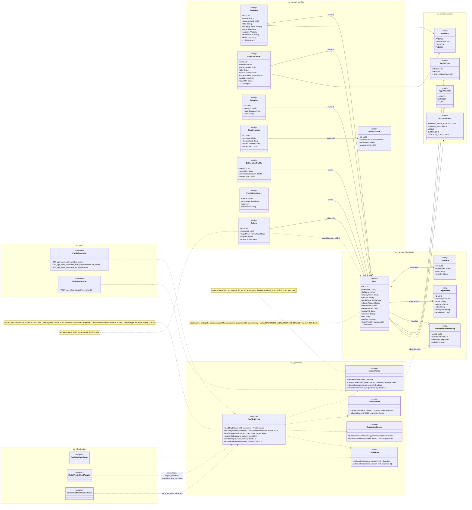
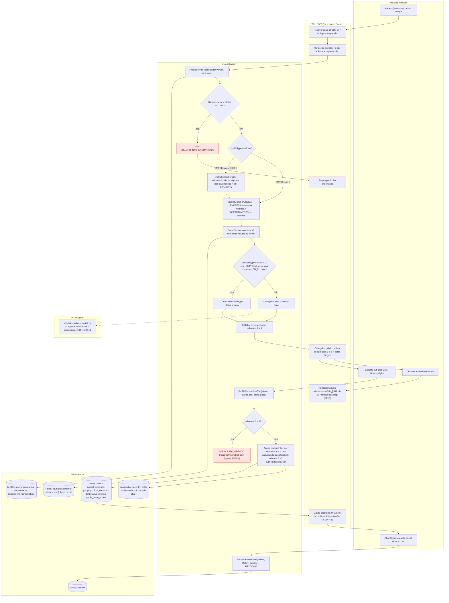
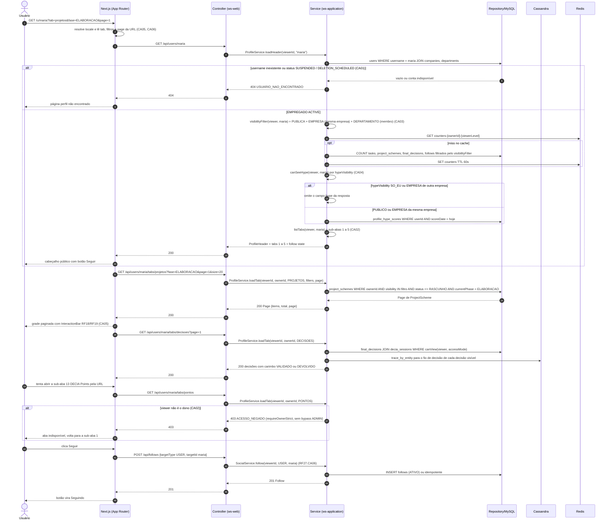
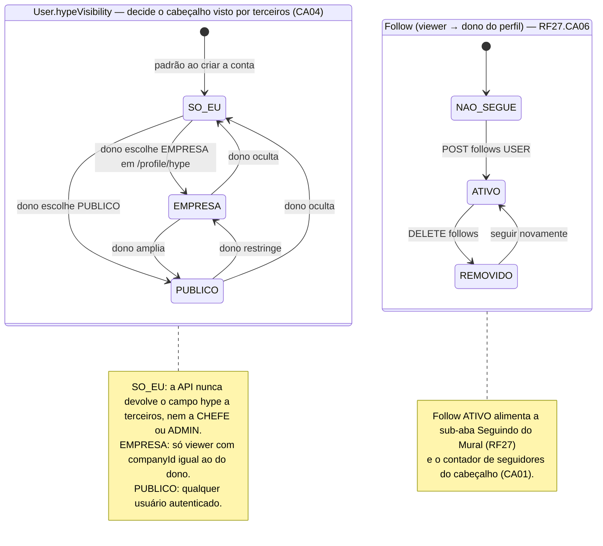
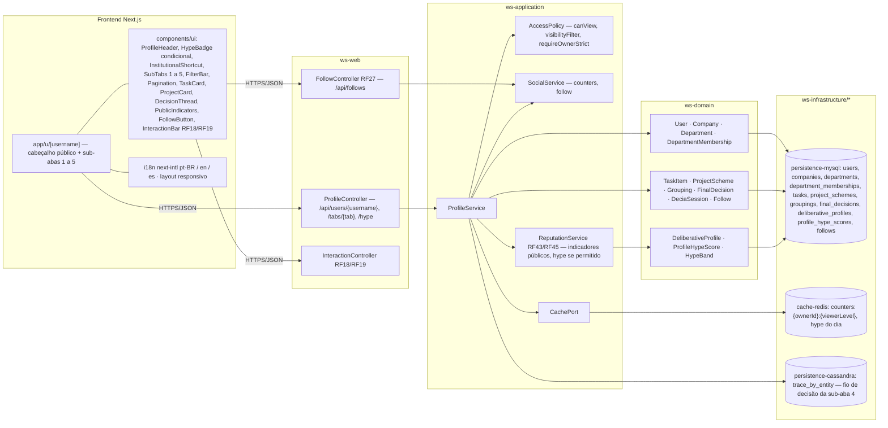

# RF16 — Visualizar perfil de um usuário comum que é empregado dentro de uma empresa
**HU:** HU16 · **Sprint (board Work Station):** a confirmar (card renomeado em 2026-10-02; origem `_anterior/RF19` = Sprint 4) · **Equivalente FAI:** RF17 Perfil de outros usuários (Lookbook de terceiros, `LookbookService` com `!self`) · **Aba/rota:** perfil de terceiros em `/u/[username]` (API `GET /api/users/{username}` e `GET /api/users/{username}/tabs/{tab}`)
**Critérios de aceite cobertos:** RF16.CA01 … RF16.CA06 — corpo do card vazio: CAs derivados do título + HU16 + `_anterior/RF19` CA02 (perfil de terceiros) e `docs/produto/ABAS_POR_PERFIL.md` Matriz B (colunas "terceiros"); todos marcados "(CA a confirmar)"

> **HU16** — COMO usuário dentro do sistema Work Station POSSO visualizar o perfil de um usuário que trabalha dentro de uma organização PARA realizar alguma funcionalidade.

O RF16 é a **visão de terceiros** do perfil pessoal (RF19 anterior / RF26 atual): quem abre `/u/[username]` de um **EMPREGADO** vê o cabeçalho público (avatar, nome, cargo, empresa, departamento, contadores) e apenas as **sub-abas 1–5** (Acervo de Tarefas · Meus Projetos · Programas & Agrupamentos · Decisões · Perfil deliberativo resumo); as sub-abas 6–15 são **omitidas** na lista e respondem `403 ACESSO_NEGADO` em chamada direta. Cada item listado passa pelo filtro de **visibilidade** (`PUBLICA` sempre · `EMPRESA` se mesma empresa · `DEPARTAMENTO` se membro do departamento · `PRIVADA` nunca). O **Hype Score** aparece no cabeçalho só conforme `User.hypeVisibility` (RF45.CA06). O RF16 é **somente leitura**; a única escrita é o botão **Seguir** (`Follow`, RF27.CA06) e as ações sociais inline dos cards (RF18/RF19), que pertencem aos seus RFs. Se o `username` for de uma conta EMPRESA ou CHEFE, o cabeçalho oferece o atalho para a página institucional (RF15 / RF14).

| CA | Enunciado (Dado / Quando / Então) |
|---|---|
| **RF16.CA01** (CA a confirmar) | Dado um usuário autenticado, quando abre `/u/{username}` de um EMPREGADO, então vê o cabeçalho público: avatar, nome, cargo (`jobTitle`), empresa, departamento (sigla, cor, monograma), contadores (tarefas, projetos, decisões, seguidores) e o botão Seguir; `username` inexistente → `404 USUARIO_NAO_ENCONTRADO`; conta `SUSPENDED`/`DELETION_SCHEDULED` → `404` (não enumera contas). |
| **RF16.CA02** (CA a confirmar) | Dado o perfil de terceiro, quando a API devolve a lista de sub-abas, então só vêm as sub-abas **1–5**; as 6–15 são omitidas e uma chamada direta a `/tabs/{6..15}` responde `403 ACESSO_NEGADO` (sem bypass para ADMIN nas sub-abas 9, 13, 14, 15). |
| **RF16.CA03** (CA a confirmar) | Dado uma sub-aba 1–4, quando listo os itens, então cada `TaskItem`, `ProjectScheme`, `Grouping` e `FinalDecision` passa pelo `visibilityFilter`: `PUBLICA` sempre; `EMPRESA` se `viewer.companyId == owner.companyId`; `DEPARTAMENTO` se o viewer tem `DepartmentMembership` vigente no departamento do item; `PRIVADA` nunca. Contadores do cabeçalho contam só o que o viewer pode ver. |
| **RF16.CA04** (CA a confirmar) | Dado o cabeçalho, quando `owner.hypeVisibility` é `PUBLICO` então o Hype Score aparece para todos; `EMPRESA` só para a mesma empresa; `SO_EU` nunca — a API **não devolve** o campo (nem para CHEFE nem para ADMIN). A sub-aba 5 mostra só `DeliberativeProfile.publicIndicatorsJson` e `badgesJson` escolhidos pelo dono. |
| **RF16.CA05** (CA a confirmar) | Dado uma sub-aba aberta, quando aplico filtros e paginação (`?tab=&fase=&categoria=&page=&size=20`), então a URL reflete o estado e cada card traz as ações inline do RF18/RF19 (curtir, comentar, salvar, compartilhar, remixar) e, no Acervo, "Levar ao meu acervo" (RF7/RF41.CA08) — todas respeitando a visibilidade do item. |
| **RF16.CA06** (CA a confirmar) | Dado que o `username` pertence a uma conta `EMPRESA` ou `CHEFE_DEPARTAMENTO`, quando abro o perfil, então o cabeçalho mostra a etiqueta institucional ("Chefe de {sigla}" com monograma, ou logo da empresa) e o atalho para a página do departamento (RF14) ou da empresa (RF15); textos em pt-BR/en/es e layout responsivo. |

| # | Sub-aba visível a terceiros | Entidade lida | Filtro |
|---|---|---|---|
| 1 | Acervo de Tarefas | `TaskItem` | `visibility` ∈ visibilityFilter · `state` ≠ RASCUNHO |
| 2 | Meus Projetos | `ProjectScheme` | `visibility` ∈ visibilityFilter · `status` ≠ RASCUNHO |
| 3 | Programas & Agrupamentos | `Grouping`, `GroupingItem` | itens filtrados individualmente |
| 4 | Decisões | `FinalDecision`, `DecisionTraceNode` | `canView` da `DeciaSession` (accessMode) |
| 5 | Perfil deliberativo (resumo) | `DeliberativeProfile.publicIndicatorsJson`, `badgesJson` | só o que o dono publicou |

## 1. Diagrama de classes

## 2. Diagrama de atividades

## 3. Diagrama de sequência

## 4. Máquina de estados

O RF16 é **somente leitura** e não tem estados próprios. Dois ciclos governam o que o terceiro vê: **`User.hypeVisibility`** (enum `HypeVisibility`, alterado pelo dono no RF45.CA06 — define se o Hype Score aparece no cabeçalho, CA04) e o **`Follow.status`** (enum `FollowStatus`, única escrita disparada a partir desta tela, RF27.CA06).

## 5. Diagrama de componentes

## 6. Rastreabilidade

| CA | Elemento do diagrama (classe / passo / mensagem / transição / componente) |
|---|---|
| RF16.CA01 | Classes `User` (jobTitle, companyId, departmentId, status), `Company`, `Department` (acronym, color, monogram), `ProfileService.loadHeader`, `SocialService.counters`, `CachePort` · Atividades `U1 → A1 → A2 → A3 404 / A6 → A7 → P2 → W3` · Sequência msgs 3–8 (`alt` 404) e 9–20 (contadores filtrados, cabeçalho) · Componentes `ProfileHeader`, `FollowButton`, `cache-redis` |
| RF16.CA02 | `ProfileService.listTabs` (nota "terceiro = 1 a 5"), `AccessPolicy.requireOwnerStrict` (nota P-05) · Atividades `A11`, `A13 → A14 403 ACESSO_NEGADO` · Sequência msg 17 (listTabs 1 a 5) e bloco `alt viewer não é o dono → 403` (msgs 37–40) · Componente `SubTabs 1 a 5` |
| RF16.CA03 | `ProfileService.visibilityFilter`, `AccessPolicy.canView/isSameCompany/isDeptMember`, `DepartmentMembership`, enum `Visibility` · Atividades `A6`, `A15` · Sequência msg 9 (visibilityFilter), msg 12 (COUNT filtrado), msgs 23–24 (`visibility IN filtro AND status <> RASCUNHO`), msgs 29–30 (`canView` da `DeciaSession`) · Tabela de sub-abas do cabeçalho |
| RF16.CA04 | `User.hypeVisibility`, enum `HypeVisibility`, `ProfileService.canSeeHype`, `ReputationService.hypeScoreIfAllowed/publicDeliberativeSummary`, `DeliberativeProfile.publicIndicatorsJson` · Atividades `A8 → A9 / A10`, `A15` (sub-aba 5) · Sequência msgs 14–16 (`alt SO_EU → omite o campo hype`) · Máquina de estados *User.hypeVisibility* e nota · Componentes `HypeBadge condicional`, `PublicIndicators` |
| RF16.CA05 | `ProfileController.GET_api_users_username_tabs_tab`, `ProfileService.loadTab` · Atividades `W2` (lê tab + filtros + page), `U2 → A12`, `W5` (InteractionBar) · Sequência msgs 1–2 e 22–27 (`?fase=&page=&size=20`, grade com InteractionBar) · Componentes `FilterBar`, `Pagination`, `InteractionBar RF18/RF19`, `InteractionController RF18/RF19` |
| RF16.CA06 | Enum `ProfileType`, `ProfileService.institutionalShortcut` · Atividades `W1` (locale, responsivo), `A4 → A5`, `U4 → W6` (RF14 / RF15) · Sequência msg 2 (locale) · Componentes `InstitutionalShortcut`, `i18n next-intl` |
| (escrita única) Seguir | `Follow`, `SocialService.follow`, `FollowController` · Atividades `U3 → A16 → P5` · Sequência msgs 41–46 · Máquina de estados *Follow* · pertence ao RF27.CA06 |
