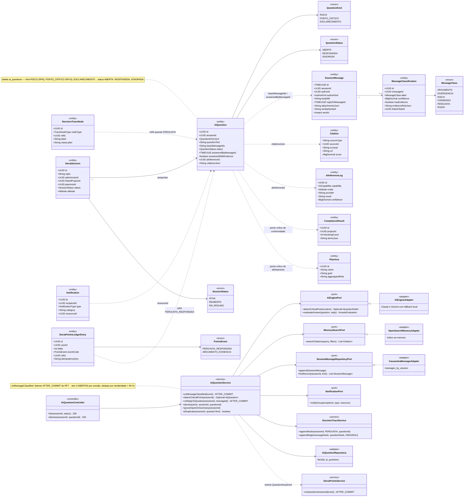
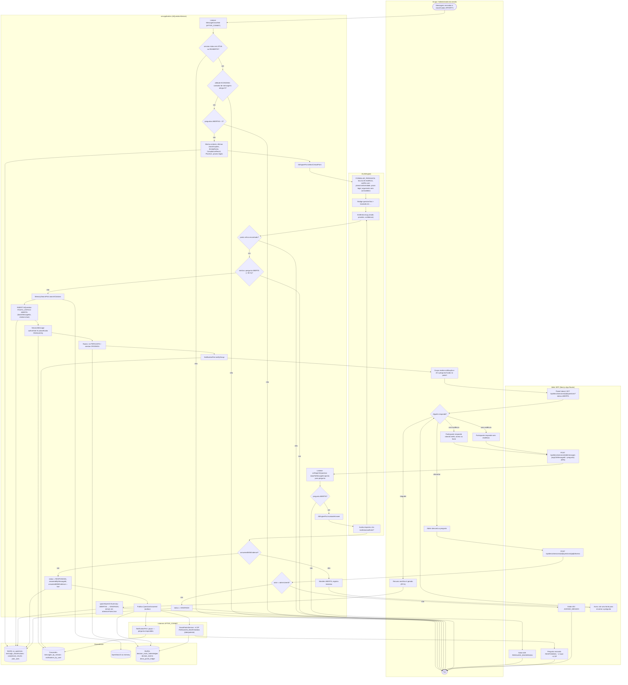
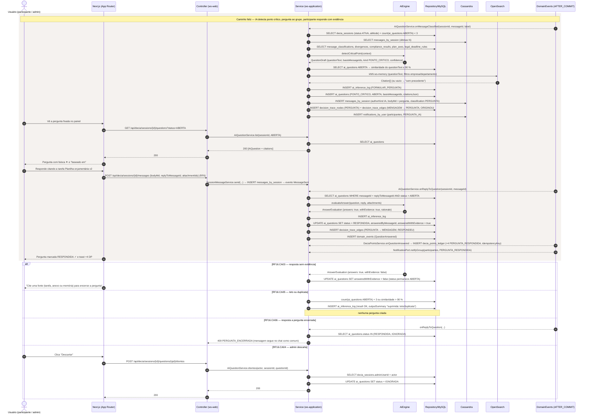
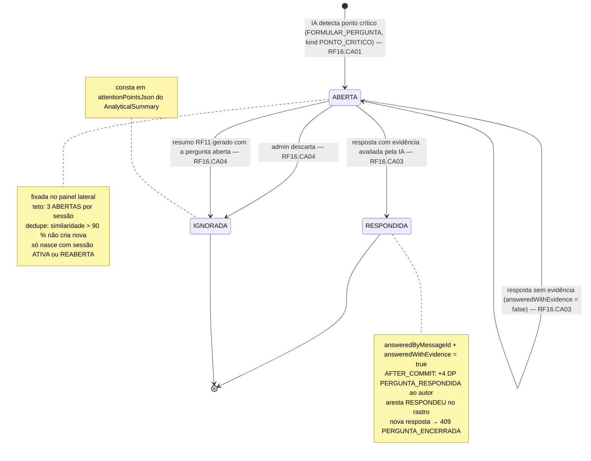
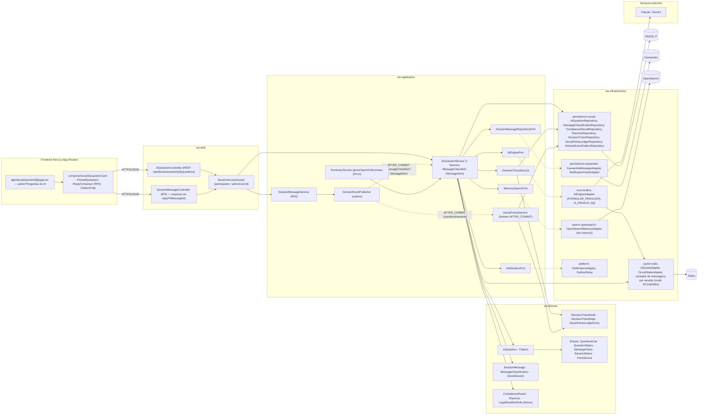

# RF16 — Formular perguntas ao grupo quando for identificado um ponto crítico na análise do tema da conversa
**HU:** HU16 · **Sprint (board Work Station):** 3 · **Equivalente FAI:** card RF16 não cita equivalente; pelo Mapa de equivalência o DECIA é o **RF10 Copilot** do FAI (o Copilot pergunta ao usuário para refinar a sugestão) — aqui a pergunta é dirigida ao grupo e auditada (`ai_questions`) · **Aba/rota:** DECIA — sessão › painel lateral "Perguntas da IA" (`/decia/[sessionId]`; rota a confirmar)
**Critérios de aceite cobertos:** RF16.CA01 · RF16.CA02 · RF16.CA03 · RF16.CA04 · RF16.CA05 · RF16.CA06 (RF1–RF18 não têm CAs no board: derivados da HU16 + RF7, RF8, RF11, RF33.CA03, RF42 e marcados "CA a confirmar")

> **HU16** — COMO IA do sistema POSSO formular perguntas ao grupo quando identificar um ponto crítico na análise do tema da conversa PARA esclarecer o ponto crítico e garantir que a análise do tema avance com clareza.

Diferença para o RF8: o RF8 formaliza perguntas a partir de mensagens **RISCO** (`AiQuestion.kind = RISCO`); o RF16 detecta **pontos críticos** da análise (`kind = PONTO_CRITICO`): lacuna de evidência numa recomendação, conflito com o plano anual (RF24) ou com o Espelho de Conformidade (RF32), prazo legal em risco (RF20.CA11), argumento central sem contraditório.

| CA | Enunciado (CA a confirmar) |
|---|---|
| **RF16.CA01** | Dado mensagens classificadas (RF7) e o contexto da sessão, quando a IA (capability FORMULAR_PERGUNTA) detecta um ponto crítico, então cria `AiQuestion` (kind PONTO_CRITICO, status ABERTA) com `questionText`, `basisMessageIds` e `citationsJson` (RF33.CA03 — "baseado em") e posta `SessionMessage` (authorKind IA) classificada como PERGUNTA. |
| **RF16.CA02** | Dado a pergunta criada, então o grupo recebe `Notification` (categoria DECIA) e a pergunta fica **fixada** no painel lateral até ser RESPONDIDA ou IGNORADA; nó PERGUNTA entra no rastro (RF29) com arestas ORIGINOU a partir das mensagens-base. |
| **RF16.CA03** | Dado um participante responde (mensagem com `replyToMessageId` = mensagem da pergunta), quando a IA avalia a resposta, então `status = RESPONDIDA`, `answeredByMessageId` e `answeredWithEvidence` (true se cita tarefa/anexo/fonte); com evidência, evento AFTER_COMMIT credita **+4 DP** (`PERGUNTA_RESPONDIDA`, idempotente, RF42.CA01). Resposta sem evidência mantém ABERTA com aviso "cite uma fonte para encerrar". |
| **RF16.CA04** | Dado pergunta ABERTA até a geração do resumo (RF11) ou descartada pelo administrador ("Descartar"), então `status = IGNORADA` e ela consta em `attentionPointsJson` do resumo. |
| **RF16.CA05** | Dado ≥ 3 perguntas ABERTAS na sessão ou pergunta similar já aberta (similaridade > 90 % do `questionText`), então a IA **não duplica**; em `aiMode` ECONOMIA a detecção roda a cada N mensagens; tudo registrado em `ai_inference_log`. |
| **RF16.CA06** | Dado sessão fora de ATIVA/REABERTA, então a IA não formula perguntas; resposta a pergunta RESPONDIDA/IGNORADA → `409 PERGUNTA_ENCERRADA`; descarte por não-admin → `403 ACESSO_NEGADO`. |

## 1. Diagrama de classes

## 2. Diagrama de atividades

## 3. Diagrama de sequência

## 4. Máquina de estados

Entidade central: `AiQuestion.status` (`QuestionStatus`: ABERTA → RESPONDIDA | IGNORADA). A sessão (`SessionStatus`) precisa estar em ATIVA ou REABERTA para a IA formular.

## 5. Diagrama de componentes

## 6. Rastreabilidade

| CA | Classe | Passo (atividades) | Mensagem (sequência) | Transição (estados) | Componente |
|---|---|---|---|---|---|
| RF16.CA01 | `AiQuestion` (kind PONTO_CRITICO, questionText, basisMessageIds, citationsJson), `AiQuestionService.onMessageClassified/detectCriticalPoint`, `AiEnginePort.detectCriticalPoint`, `MemorySearchPort`, `SessionMessage` (IA, PERGUNTA) | A0, C0, C4–C10, D1, D2, D4 | 1–12 | [*] → ABERTA | `AiQuestionService`, `AiEngineAdapter`, `OpenSearchMemoryAdapter`, `CassandraMessageAdapter` |
| RF16.CA02 | `Notification` (DECIA), `DecisionTraceNode` PERGUNTA / arestas ORIGINOU, `PinnedQuestions` | C11, C12, A1, B1 | 13–20 | nota de ABERTA (fixada) | `NotificationAdapter`, `DecisionTraceService`, `AiQuestionController.list` |
| RF16.CA03 | `AiQuestion.status/answeredByMessageId/answeredWithEvidence`, `AiEnginePort.evaluateAnswer`, `DeciaPointsLedgerEntry` (PERGUNTA_RESPONDIDA +4), `DeciaPointsService.onQuestionAnswered` | A3, A4, B2, C13–C19, F1, F2, B6, B7 | 21–34; `alt` sem evidência | ABERTA → RESPONDIDA; ABERTA → ABERTA | `SessionMessageService`, `DeciaPointsService`, `OutboxRelay` |
| RF16.CA04 | `AiQuestion.status = IGNORADA`, `AiQuestionService.dismiss/ignoreOpenOnSummary`, `AnalyticalSummary.attentionPointsJson` | A5, A6, B3, C20–C22 | `alt` RF16.CA04 (dismiss) | ABERTA → IGNORADA (2 gatilhos) | `AiQuestionController.dismiss`, `SummaryService` |
| RF16.CA05 | `AiQuestionService.isDuplicate`, teto 3 ABERTAS, `SessionMessage.similarityHash`, `AiMode` ECONOMIA (contador Redis), `AiInferenceLog` | C2, C3, C7 | 2, 7; `alt` RF16.CA05 | nota de ABERTA (teto/dedupe) | `AiQuotaAdapter`, contador Redis, `AiEngineAdapter` |
| RF16.CA06 | guarda `SessionStatus` ATIVA/REABERTA, `SessionAccessGuard` (admin), 409 PERGUNTA_ENCERRADA | C1, C14, C20, B4, B5 | `alt` 409 PERGUNTA_ENCERRADA | RESPONDIDA/IGNORADA terminais | `SessionAccessGuard`, `AiQuestionService` |
