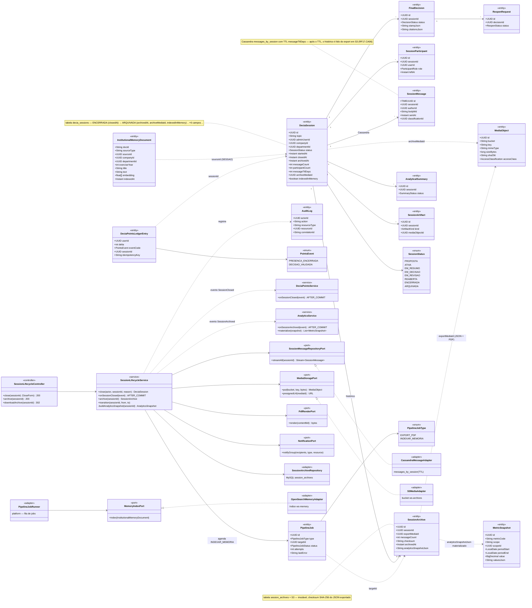
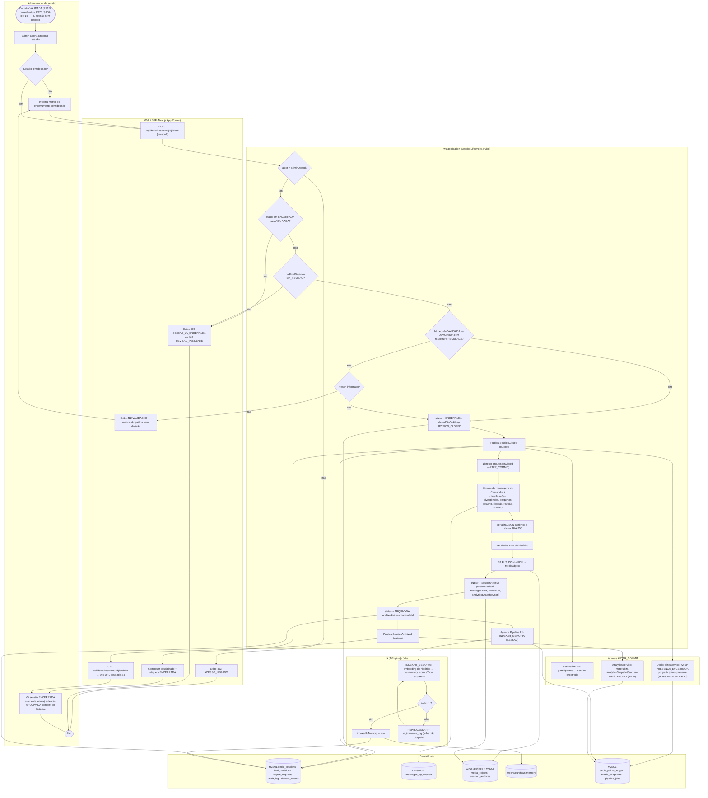
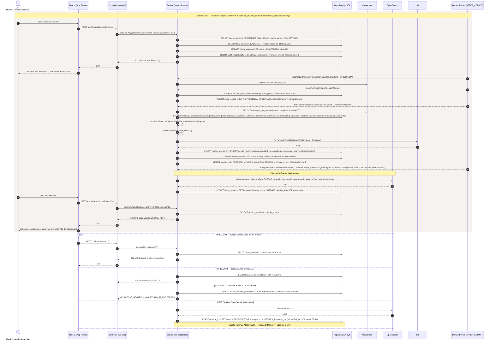
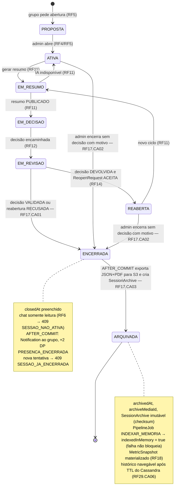
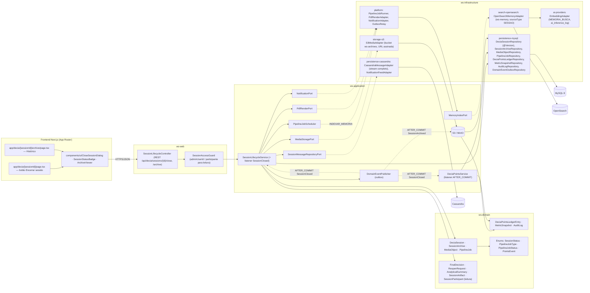

# RF17 — Encerrar uma sessão de conversa e salvar seu histórico para análise de dados
**HU:** HU17 · **Sprint (board Work Station):** 3 · **Equivalente FAI:** card RF17 não cita equivalente; pelo Mapa de equivalência o histórico encerrado alimenta a **Memória Institucional** (= FAI **RF26 Explorador Global**, via RF33) e o Dossiê de Transição (RF36 "usa o histórico RF17") · **Aba/rota:** DECIA — sessão › "Encerrar sessão" (`/decia/[sessionId]`), histórico em `/decia/[sessionId]/archive` (rotas a confirmar)
**Critérios de aceite cobertos:** RF17.CA01 · RF17.CA02 · RF17.CA03 · RF17.CA04 · RF17.CA05 · RF17.CA06 (RF1–RF18 não têm CAs no board: derivados da HU17 + RF29.CA06, RF33.CA01/CA06, RF42 e marcados "CA a confirmar")

> **HU17** — COMO administrador do sistema POSSO encerrar uma sessão de conversa e salvar todo o seu histórico para análise de dados PARA preservar o registro da deliberação e alimentar os indicadores e análises do sistema.

| CA | Enunciado (CA a confirmar) |
|---|---|
| **RF17.CA01** | Dado sessão EM_REVISAO com `FinalDecision` VALIDADA (ou DEVOLVIDA com `ReopenRequest` RECUSADA), quando o administrador da sessão aciona "Encerrar sessão", então `status = ENCERRADA`, `closedAt` preenchido, o chat fica somente leitura (RF6 → `409 SESSAO_NAO_ATIVA`) e os participantes recebem `Notification` (DECIA). |
| **RF17.CA02** | Dado sessão ATIVA/REABERTA **sem decisão**, quando o admin tenta encerrar, então o motivo é obrigatório (`422 VALIDACAO` sem motivo) e a sessão encerra "sem decisão" (flag em `analyticsSnapshotJson`); não-admin → `403 ACESSO_NEGADO`; sessão já ENCERRADA/ARQUIVADA → `409 SESSAO_JA_ENCERRADA`; decisão EM_REVISAO pendente → `409 REVISAO_PENDENTE`. |
| **RF17.CA03** | Dado ENCERRADA, quando `SessionClosed` dispara AFTER_COMMIT, então `SessionLifecycleService` exporta mensagens (Cassandra), classificações, divergências, perguntas, resumo, decisão, revisão e artefatos para **JSON + PDF** em S3 (`MediaObject`), cria `SessionArchive` (`exportMediaId`, `messageCount`, `checksum` SHA-256, `analyticsSnapshotJson`) e a sessão passa a ARQUIVADA com `archiveMediaId`/`archivedAt`. |
| **RF17.CA04** | Dado o arquivo criado, então `PipelineJob` INDEXAR_MEMORIA indexa a sessão em `ws-memory` (`InstitutionalMemoryDocument.sourceType = SESSAO`, metadados empresa/departamento/categoria/exercício/autor/data) e marca `indexedInMemory = true` (RF33.CA01); falha de indexação **não bloqueia** o encerramento e fica em `ai_inference_log` (RF33.CA06). |
| **RF17.CA05** | Dado ENCERRADA com resumo PUBLICADO, então cada participante presente (`leftAt` nulo, ≥ 1 mensagem) recebe **+2 DP** (`PRESENCA_ENCERRADA`, idempotente, RF42.CA01) e `analyticsSnapshotJson` (mensagens por classe, divergências resolvidas/abertas, perguntas respondidas, tempo até decisão, fontes citadas) alimenta `MetricSnapshot` (RF18). |
| **RF17.CA06** | Dado sessão ARQUIVADA, então o histórico permanece navegável a partir do rastro (RF29.CA06) e da aba Histórico mesmo após o TTL do Cassandra (`messageTtlDays`), lido do export em S3; `DeciaSession.archiveMediaId` e o `SessionArchive` são imutáveis (`audit_log`). |

## 1. Diagrama de classes

## 2. Diagrama de atividades

## 3. Diagrama de sequência

## 4. Máquina de estados

Entidade central: `DeciaSession.status` (`SessionStatus`) — ciclo completo, com destaque para ENCERRADA → ARQUIVADA, que é o trecho do RF17.

## 5. Diagrama de componentes

## 6. Rastreabilidade

| CA | Classe | Passo (atividades) | Mensagem (sequência) | Transição (estados) | Componente |
|---|---|---|---|---|---|
| RF17.CA01 | `DeciaSession.status/closedAt`, `SessionLifecycleService.close`, `FinalDecision` VALIDADA / `ReopenRequest` RECUSADA, `NotificationPort`, `AuditLog` | A1, B1, C4, C6, C7, B5, F1 | 1–12 | EM_REVISAO → ENCERRADA | `SessionLifecycleController.close`, `SessionLifecycleService`, `NotificationAdapter` |
| RF17.CA02 | guardas de `SessionLifecycleService` (reason, adminUserId, status, decisão EM_REVISAO), `analyticsSnapshotJson.closedWithoutDecision` | A2, A3, C1–C3, C5, B2–B4 | `alt` 422 VALIDACAO / 409 REVISAO_PENDENTE / 403 / 409 SESSAO_JA_ENCERRADA | ATIVA/REABERTA → ENCERRADA | `SessionAccessGuard`, `CloseSessionDialog` |
| RF17.CA03 | `SessionArchive` (exportMediaId, messageCount, checksum, analyticsSnapshotJson), `MediaObject`, `DeciaSession.archivedAt/archiveMediaId`, `SessionLifecycleService.onSessionClosed/archive`, `MediaStoragePort`, `PdfRenderPort` | C8–C14 | 16–24 | ENCERRADA → ARQUIVADA | `CassandraMessageAdapter`, `S3MediaAdapter`, `PdfRenderAdapter`, `SessionArchiveRepository` |
| RF17.CA04 | `PipelineJob` INDEXAR_MEMORIA, `InstitutionalMemoryDocument` (SESSAO), `DeciaSession.indexedInMemory`, `MemoryIndexPort`, `AiInferenceLog` | C15, D1–D4 | 25, 27–29; `alt` OpenSearch indisponível | nota de ARQUIVADA | `PipelineJobRunner`, `OpenSearchMemoryAdapter`, `EmbeddingAdapter` |
| RF17.CA05 | `DeciaPointsLedgerEntry` (PRESENCA_ENCERRADA +2), `DeciaPointsService.onSessionClosed`, `MetricSnapshot`, `AnalyticsService.onSessionArchived/materialize` | F2, F3, C16 | 13–15, 26 | nota de ENCERRADA / ARQUIVADA | `DeciaPointsService`, `AnalyticsService`, `MetricSnapshotRepository` |
| RF17.CA06 | `SessionArchive` imutável, `SessionMessage.messageTtlDays`, `SessionLifecycleController.downloadArchive`, rastro RF29.CA06 | B6, A4 | 30–36 | ARQUIVADA terminal | `ArchiveViewer`, `S3MediaAdapter` (URL assinada), `AuditLogRepository` |
