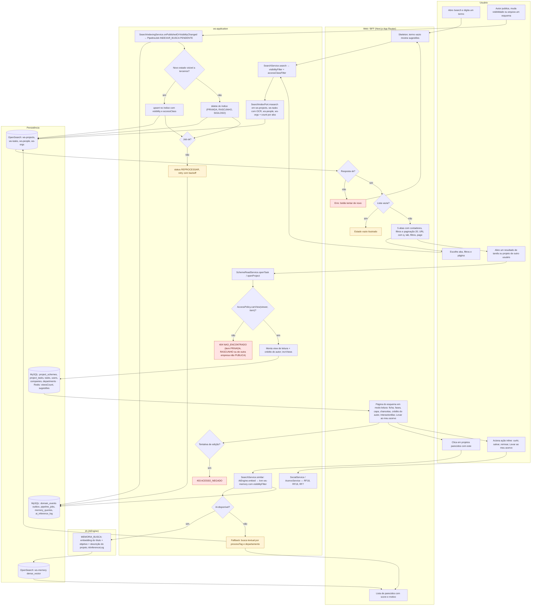
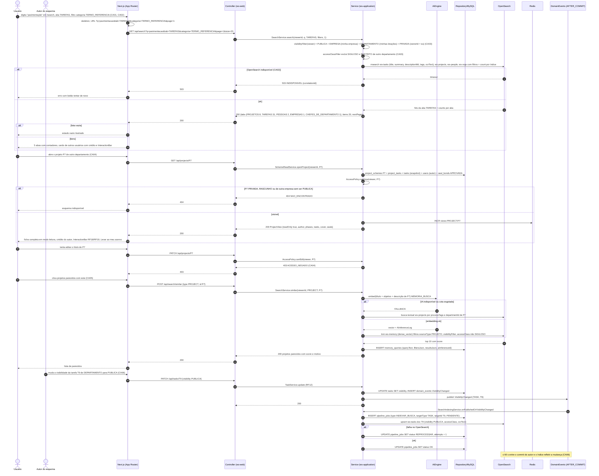
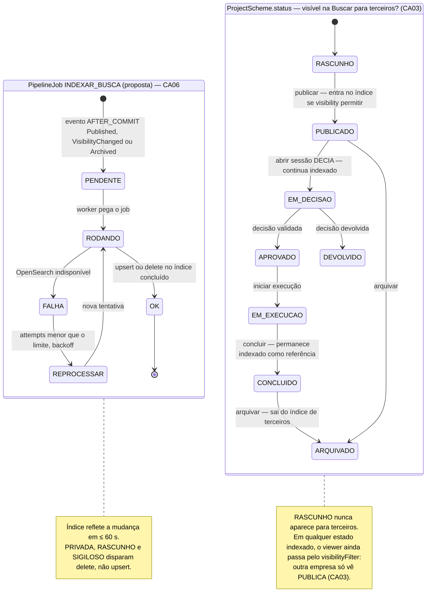
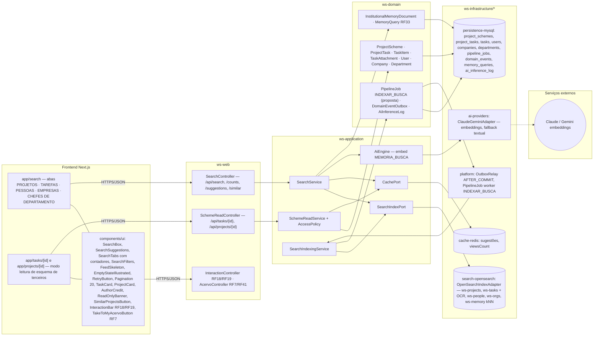

# RF17 — Visualizar esquemas de tarefa & projetos criados por outros usuários na rede social do Work Station, através da aba "Buscar"
**HU:** HU17 · **Sprint (board Work Station):** a confirmar (card renomeado em 2026-10-02; origem RF27 = Sprint 4) · **Equivalente FAI:** RF8 Buscar/Explorar (busca textual com abas e contadores, "looks parecidos com este") · **Aba/rota:** Buscar (`/search`, abas PROJETOS · TAREFAS · PESSOAS · EMPRESAS · CHEFES DE DEPARTAMENTO) e páginas de leitura de esquema de terceiros (`/tasks/[id]`, `/projects/[id]`)
**Critérios de aceite cobertos:** RF17.CA01 … RF17.CA06 — corpo do card vazio: CAs derivados do título + HU17 + RF27 (CA03 busca, CA04 visibilidade, CA05 semântica); todos marcados "(CA a confirmar)". O Mural (RF27.CA01/CA02/CA06) continua no RF27.

> **HU17** — COMO usuário autenticado no sistema POSSO visualizar esquemas de tarefa ou projeto criados por outros usuários, chefes ou empresas na aba "Buscar/Explorar" PARA me inspirar em outras combinações e ampliar minhas referências de projetos.

A aba **Buscar** é a porta de **descoberta de esquemas de terceiros**: busca textual (título, descrição, tags, texto OCR dos anexos via `TaskAttachment.ocrTextRef`) nos índices OpenSearch `ws-tasks`, `ws-projects`, `ws-people`, `ws-orgs`, devolvendo **5 abas com contadores**. Todo resultado passa pelo `visibilityFilter` do viewer (outra empresa só vê `PUBLICA`; `accessClass` SIGILOSO nunca é indexado para terceiros). Ao abrir um resultado o usuário vê o **esquema completo em modo leitura** (anatomia do card e ficha — `docs/design-system/ANATOMIAS_E_ESTUDIO.md` §2/§3) com **crédito do autor**, as ações sociais inline (RF18/RF19), "Levar ao meu acervo" (RF7/RF41.CA08) e, para projetos, **"projetos parecidos com este"** (kNN em `ws-memory`, RF33). A indexação é assíncrona: publicar ou mudar visibilidade emite evento AFTER_COMMIT → `PipelineJob INDEXAR_BUSCA` (proposta de novo tipo, hoje só existe `INDEXAR_MEMORIA`).

| CA | Enunciado (Dado / Quando / Então) |
|---|---|
| **RF17.CA01** (CA a confirmar) | Dado um usuário autenticado em `/search`, quando digita um termo, então o sistema busca em título, descrição, tags e texto OCR (OpenSearch `ws-tasks`, `ws-projects`, `ws-people`, `ws-orgs`) e devolve **5 abas com contadores** (PROJETOS · TAREFAS · PESSOAS · EMPRESAS · CHEFES DE DEPARTAMENTO) em ≤ 1 s p95; termo vazio mostra sugestões (recentes, em alta, chancelados). |
| **RF17.CA02** (CA a confirmar) | Dado uma aba, quando aplico filtros (categoria, tipo, fase, departamento, exercício, chancelado, prazo) e pagino (20 por página), então a URL reflete `q`, `tab`, filtros e `page`; a tela mostra skeleton ao carregar, estado vazio ilustrado e botão "tentar de novo" em erro (`503 INDISPONIVEL`). |
| **RF17.CA03** (CA a confirmar) | Dado os resultados, quando são devolvidos, então só contêm itens que o viewer pode ver: `PUBLICA` sempre; `EMPRESA` se mesma empresa; `DEPARTAMENTO` se membro; `PRIVADA` só os meus; `RASCUNHO` nunca aparece para terceiros; `accessClass` SIGILOSO nunca é indexado e RESTRITO só para o departamento dono. Resultados de outra empresa só se `PUBLICA`. |
| **RF17.CA04** (CA a confirmar) | Dado um resultado de tarefa ou projeto de outro usuário, quando o abro, então vejo o esquema completo em **modo leitura** (ficha, fases e tarefas do projeto, capa, chancelas) com o **crédito do autor** (avatar + link para RF16/RF14/RF15), as ações inline do RF18/RF19 e "Levar ao meu acervo" (RF7/RF41.CA08); edição é `403 ACESSO_NEGADO`; item que ficou PRIVADA depois de indexado responde `404` e sai do índice. |
| **RF17.CA05** (CA a confirmar) | Dado um projeto aberto, quando clico em "projetos parecidos com este", então o sistema gera o embedding (`AiEngine` `MEMORIA_BUSCA`) e faz kNN em `ws-memory` com o mesmo `visibilityFilter`, devolvendo até 10 projetos com score e motivo ("mesmo processo, 4 tarefas em comum"); sem IA disponível cai para "mais do mesmo processo/departamento" (busca textual). |
| **RF17.CA06** (CA a confirmar) | Dado que um autor publica, altera a visibilidade ou arquiva uma tarefa/projeto, quando a transação é confirmada, então o evento AFTER_COMMIT agenda `PipelineJob INDEXAR_BUSCA` e o índice reflete a mudança em ≤ 60 s; falha deixa o job `REPROCESSAR` sem afetar a operação do autor. |

| Aba de Buscar | Índice OpenSearch | Entidade | Filtros |
|---|---|---|---|
| PROJETOS | `ws-projects` | `ProjectScheme` | fase, departamento, exercício, chancelado, prazo |
| TAREFAS | `ws-tasks` (+ texto OCR) | `TaskItem`, `TaskAttachment.ocrTextRef` | categoria, tipo, departamento, chancelado, prazo |
| PESSOAS | `ws-people` | `User` (EMPREGADO) | departamento, empresa |
| EMPRESAS | `ws-orgs` | `Company` | — |
| CHEFES DE DEPARTAMENTO | `ws-people` (profileType CHEFE_DEPARTAMENTO) | `User`, `Department.headUserId` | empresa, departamento |
| semântica | `ws-memory` kNN | `InstitutionalMemoryDocument` | sourceType PROJETO/TAREFA |

## 1. Diagrama de classes

```mermaid
classDiagram
direction LR

namespace ws_domain_alvos {
  class ProjectScheme {
    <<entity>>
    +id: UUID
    +ownerId: UUID
    +companyId: UUID
    +departmentId: UUID
    +title: String
    +objective: String
    +descriptionMd: String
    +processTags: Set~ProcessTag~
    +currentPhase: ProjectPhase
    +status: ProjectStatus
    +visibility: Visibility
    +exerciseYear: int
    +sealIdsJson: JSON
    +coverUrl: String
    +nextMilestoneAt: LocalDate
    +viewsCount: long
    .. +25 campos ..
  }
  class ProjectTask {
    <<entity>>
    +projectId: UUID
    +taskId: UUID
    +phase: ProjectPhase
    +snapshotJson: JSON
  }
  class TaskItem {
    <<entity>>
    +id: UUID
    +ownerId: UUID
    +departmentId: UUID
    +title: String
    +summary: String
    +descriptionMd: String
    +tags: Set~String~
    +category: TaskCategory
    +type: TaskType
    +processTags: Set~ProcessTag~
    +state: TaskState
    +visibility: Visibility
    +accessClass: AccessClassification
    +sealIdsJson: JSON
    +thumbnailUrl: String
    +viewsCount: long
    .. +40 campos ..
  }
  class TaskAttachment {
    <<entity>>
    +taskId: UUID
    +ocrTextRef: String OpenSearch
  }
  class User {
    <<entity>>
    +id: UUID
    +username: String
    +fullName: String
    +jobTitle: String
    +profileType: ProfileType
    +companyId: UUID
    +departmentId: UUID
    +avatarUrl: String
  }
  class Company {
    <<entity>>
    +id: UUID
    +legalName: String
    +slug: String
    +logoUrl: String
  }
  class Department {
    <<entity>>
    +id: UUID
    +companyId: UUID
    +acronym: String
    +headUserId: UUID
  }
  class InstitutionalMemoryDocument {
    <<entity>>
    +docId: String
    +sourceType: MemorySourceType PROJETO TAREFA
    +sourceId: UUID
    +companyId: UUID
    +departmentId: UUID
    +visibility: Visibility
    +accessClass: AccessClassification
    +embedding: dense_vector
  }
  class MemoryQuery {
    <<entity>>
    +id: UUID
    +userId: UUID
    +queryText: String
    +filtersJson: JSON
    +resultsJson: JSON
    +aiInferenceId: UUID
  }
}

namespace ws_domain_plataforma {
  class PipelineJob {
    <<entity>>
    +id: UUID
    +type: String INDEXAR_BUSCA proposta
    +targetType: String TASK PROJECT
    +targetId: UUID
    +status: PipelineJobStatus
    +attempts: int
  }
  class DomainEventOutbox {
    <<entity>>
    +aggregateType: String
    +aggregateId: UUID
    +eventType: String VisibilityChanged Published Archived
    +publishedAt: Instant
  }
  class AiInferenceLog {
    <<entity>>
    +capability: AiCapability MEMORIA_BUSCA
    +result: InferenceResult
  }
}

namespace ws_domain_enums {
  class SearchTab {
    <<enum>>
    PROJETOS
    TAREFAS
    PESSOAS
    EMPRESAS
    CHEFES_DE_DEPARTAMENTO
  }
  class Visibility {
    <<enum>>
    PRIVADA
    DEPARTAMENTO
    EMPRESA
    PUBLICA
  }
  class AccessClassification {
    <<enum>>
    PUBLICO
    INTERNO
    RESTRITO
    SIGILOSO
  }
  class PipelineJobStatus {
    <<enum>>
    PENDENTE
    RODANDO
    OK
    FALHA
    REPROCESSAR
  }
}

namespace ws_application {
  class SearchService {
    <<service>>
    +search(viewerId, q, tab, filters, page 20) SearchResult 5 abas com contadores
    +suggestions(viewerId) Suggestions recentes em alta chancelados
    +similar(viewerId, PROJECT, id) List~Hit~ kNN ou fallback textual
    -visibilityFilter(viewer) PUBLICA EMPRESA DEPARTAMENTO PRIVADA só minhas
    -accessClassFilter(viewer) exclui SIGILOSO e RESTRITO de outro departamento
  }
  class SchemeReadService {
    <<service>>
    +openTask(viewerId, taskId) TaskView modo leitura + crédito
    +openProject(viewerId, projectId) ProjectView fases, tarefas, capa, chancelas
    +incrementViews(type, id)
  }
  class AccessPolicy {
    <<service>>
    +canView(viewer, item) boolean
    +canEdit(viewer, item) boolean
  }
  class SearchIndexingService {
    <<service>>
    +onPublishedOrVisibilityChanged(event) PipelineJob INDEXAR_BUSCA
    +index(type, id) upsert no índice com visibility e accessClass
    +remove(type, id) item PRIVADA ou RASCUNHO
  }
  class AiEngine {
    <<service>>
    +embed(text) vector MEMORIA_BUSCA
  }
  class SearchIndexPort {
    <<port>>
    +msearch(query, indices, filters) SearchResult
    +count(query, indices, filters) Map~SearchTab, long~
    +knn(index ws-memory, vector, filters) List~Hit~
    +upsert(index, doc)
    +delete(index, docId)
  }
  class CachePort {
    <<port>>
    +getSuggestions(companyId)
    +incrViews(type, id)
  }
}

namespace ws_web {
  class SearchController {
    <<controller>>
    +GET_api_search(q, tab, filters, page)
    +GET_api_search_counts(q, filters)
    +GET_api_search_suggestions()
    +POST_api_search_similar(type, id)
  }
  class SchemeReadController {
    <<controller>>
    +GET_api_tasks_id(id)
    +GET_api_projects_id(id)
  }
}

namespace ws_infrastructure {
  class OpenSearchIndexAdapter {
    <<adapter>>
  }
  class RedisCacheAdapter {
    <<adapter>>
  }
  class ClaudeGeminiAdapter {
    <<adapter>>
  }
  class OutboxRelay {
    <<adapter>>
  }
}

ProjectScheme "1" --> "*" ProjectTask : fases e tarefas
ProjectTask ..> TaskItem : taskId ou snapshotJson
TaskItem "1" --> "*" TaskAttachment : ocrTextRef indexado
ProjectScheme "*" --> "1" User : ownerId crédito
TaskItem "*" --> "1" User : ownerId crédito
User "*" --> "0..1" Company : companyId
User "*" --> "0..1" Department : departmentId
Department "*" --> "1" User : headUserId aba CHEFES
InstitutionalMemoryDocument ..> ProjectScheme : sourceId quando PROJETO
InstitutionalMemoryDocument ..> TaskItem : sourceId quando TAREFA
MemoryQuery ..> AiInferenceLog : aiInferenceId
PipelineJob ..> ProjectScheme : targetId quando PROJECT
PipelineJob ..> TaskItem : targetId quando TASK
DomainEventOutbox ..> PipelineJob : relay agenda INDEXAR_BUSCA
TaskItem --> Visibility
TaskItem --> AccessClassification
ProjectScheme --> Visibility
PipelineJob --> PipelineJobStatus

SearchController ..> SearchService
SchemeReadController ..> SchemeReadService
SearchService ..> SearchIndexPort
SearchService ..> AiEngine : embed MEMORIA_BUSCA
SearchService ..> CachePort : sugestões
SearchService ..> MemoryQuery : registra consulta semântica
SchemeReadService ..> AccessPolicy : canView 404 canEdit 403
SchemeReadService ..> CachePort : incrViews
SearchIndexingService ..> SearchIndexPort : upsert delete
SearchIndexingService ..> PipelineJob
OpenSearchIndexAdapter ..|> SearchIndexPort
RedisCacheAdapter ..|> CachePort
ClaudeGeminiAdapter ..> AiEngine
OutboxRelay ..> SearchIndexingService : AFTER_COMMIT

note for SearchService "msearch em ws-projects, ws-tasks com OCR, ws-people, ws-orgs — 5 abas com contadores (CA01) · visibilityFilter + accessClassFilter: outra empresa só PUBLICA, SIGILOSO nunca (CA03) · similar via ws-memory kNN com fallback textual (CA05)"
note for SchemeReadService "modo leitura com crédito do autor, InteractionBar RF18/RF19 e Levar ao meu acervo RF7/RF41.CA08 · canEdit falso → 403 (CA04)"
note for PipelineJob "tipo INDEXAR_BUSCA (proposta — TAXONOMIA só tem INDEXAR_MEMORIA) · ≤ 60 s · FALHA → REPROCESSAR (CA06)"
```

## 2. Diagrama de atividades

## 3. Diagrama de sequência

## 4. Máquina de estados

O RF17 é majoritariamente leitura e não tem estados próprios. O que ele governa é a **descobribilidade** de um esquema de terceiros, função de `ProjectScheme.status` / `TaskItem.state` (nunca RASCUNHO) e de `Visibility` + `AccessClassification`. O diagrama mostra o ciclo do **documento no índice OpenSearch** (`PipelineJob INDEXAR_BUSCA`, proposta — enum `PipelineJobStatus`) e, ao lado, os estados de `ProjectStatus` sob a ótica "aparece na Buscar para terceiros".

## 5. Diagrama de componentes

## 6. Rastreabilidade

| CA | Elemento do diagrama (classe / passo / mensagem / transição / componente) |
|---|---|
| RF17.CA01 | `SearchService.search/suggestions`, `SearchIndexPort.msearch/count`, enum `SearchTab`, `TaskAttachment.ocrTextRef`, tabela de índices do cabeçalho · Atividades `U1 → W1 → A1 → A2 → P1 → W6` · Sequência msgs 1–7 e 13–15 (`msearch … + count por índice`, `{tabs {PROJETOS 8, TAREFAS 31 …}}`) · Componentes `SearchBox`, `SearchSuggestions`, `SearchTabs com contadores`, `search-opensearch` |
| RF17.CA02 | `SearchController.GET_api_search(q, tab, filters, page)` · Atividades `W1` (skeleton), `W2 → W3` (tentar de novo), `W4 → W5` (vazio), `U2 → A1` (filtros e página), `W6` (URL) · Sequência msg 2 (URL com q, tab, filtros, page) e blocos `alt OpenSearch indisponível → 503 … tentar de novo` / `alt lista vazia` · Componentes `SearchFilters`, `FeedSkeleton`, `EmptyStateIllustrated`, `RetryButton`, `Pagination 20` |
| RF17.CA03 | `SearchService.visibilityFilter/accessClassFilter` (nota), enums `Visibility`, `AccessClassification`, `SearchIndexingService.remove` · Atividades `A1`, `A4 → A5 404`, `A14 → A16` · Sequência msgs 5–6 (filtros) e `alt P7 PRIVADA, RASCUNHO ou de outra empresa → 404` · Máquina *ProjectScheme.status — visível na Buscar?* e notas |
| RF17.CA04 | `SchemeReadService.openTask/openProject/incrementViews` (nota), `AccessPolicy.canView/canEdit`, `ProjectTask.snapshotJson`, `User` (crédito) · Atividades `U3 → A3 → A4 → A6 → P3 → W7`, `A7 → A8 403`, `U5 → A12` · Sequência msgs 20–31 (`ProjectView {readOnly true, author …}`) e 32–36 (`PATCH → 403 ACESSO_NEGADO`) · Componentes `app/tasks/[id]`, `app/projects/[id]`, `AuthorCredit`, `ReadOnlyBanner`, `InteractionBar RF18/RF19`, `TakeToMyAcervoButton RF7` |
| RF17.CA05 | `InstitutionalMemoryDocument` (embedding), `MemoryQuery`, `SearchService.similar`, `SearchIndexPort.knn`, `AiEngine.embed` · Atividades `U4 → A9 → A10 → I1 → P2 → W8` e `A10 (não) → A11` (fallback textual) · Sequência msgs 37–50 (`embed … MEMORIA_BUSCA`, `alt IA indisponível → busca textual`, `knn ws-memory`, `INSERT memory_queries`) · Componentes `SimilarProjectsButton`, `ws-memory kNN`, `ai-providers`, `Claude / Gemini embeddings` |
| RF17.CA06 | `PipelineJob` (tipo INDEXAR_BUSCA, proposta), `DomainEventOutbox`, `SearchIndexingService.onPublishedOrVisibilityChanged/index/remove`, `SearchIndexPort.upsert/delete`, `OutboxRelay` · Atividades `A0 → A13 → A14 → A15 / A16 → P1`, `A17 → A18 REPROCESSAR` · Sequência msgs 51–62 (`publish VisibilityChanged`, `INSERT pipeline_jobs INDEXAR_BUSCA`, `upsert ws-tasks`, `alt falha → REPROCESSAR`, nota ≤ 60 s) · Máquina *PipelineJob INDEXAR_BUSCA* · Componentes `platform: OutboxRelay, PipelineJob worker` |
