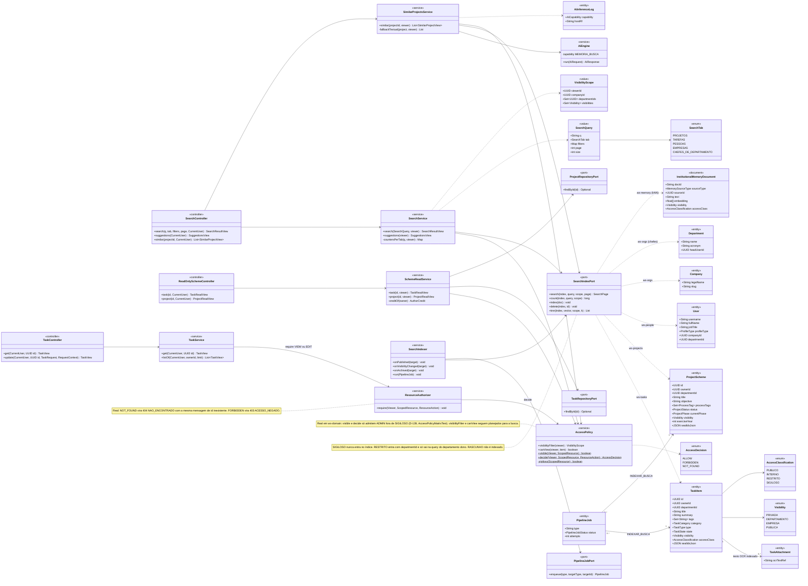
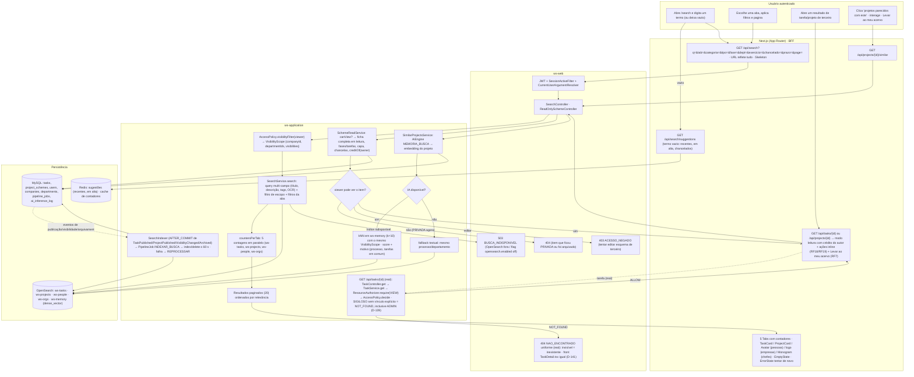
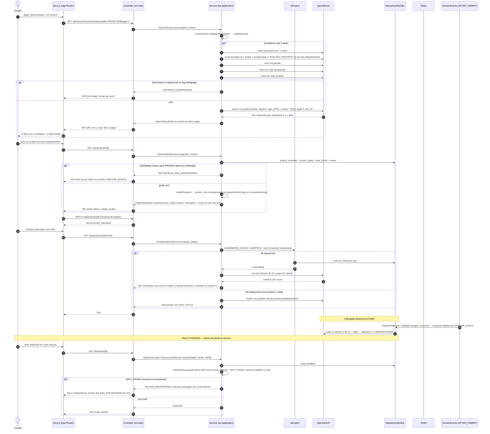
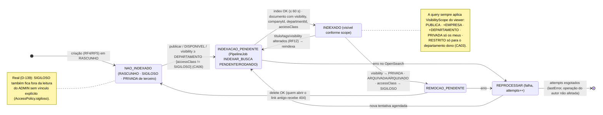
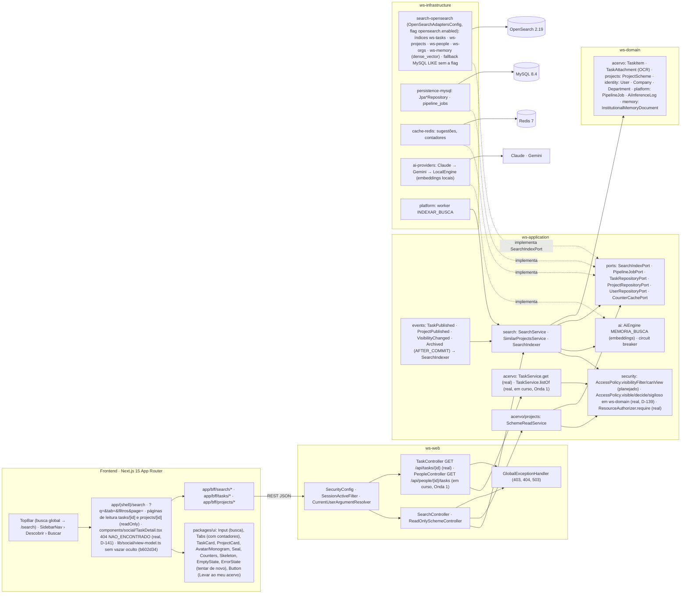

# RF17 — Visualizar esquemas de tarefa & projetos criados por outros usuários na rede social do Work Station, através da aba "Buscar"
**HU:** HU17 · **Sprint (board Work Station):** lista *Requisitos Funcionais* sem sprint atribuída (card renomeado em 2026-10-02; origem RF27 = Sprint 4; o card "SPRINT 3" cita "RF17 Encerrar sessão", escopo antigo preservado em `_anterior/RF17` — `RENUMERACAO.md`) · **Equivalente FAI:** RF8 Buscar/Explorar (busca textual com abas e contadores, "looks parecidos com este") · **Aba/rota:** Buscar (`/search`, abas PROJETOS · TAREFAS · PESSOAS · EMPRESAS · CHEFES DE DEPARTAMENTO) e páginas de leitura de esquema de terceiros (`/tasks/[id]`, `/projects/[id]`); API `GET /api/search?q=&tab=&filters…&page=`, `GET /api/search/suggestions`, `GET /api/projects/{id}/similar`, `GET /api/tasks/{id}`, `GET /api/projects/{id}` · **real:** `GET /api/tasks/{id}` (`TaskController.get`, `@AuthorizedBy("require")`) e `GET /api/people/{id}/tasks` (`PeopleController`, em curso, Onda 1)
**Critérios de aceite cobertos:** RF17.CA01 … RF17.CA06 — corpo do card vazio: CAs derivados do título + HU17 + RF27 (CA03 busca, CA04 visibilidade, CA05 semântica); todos marcados "(CA a confirmar)". O Mural (RF27.CA01/CA02/CA06) continua no RF27. Todas as classes do RF são **(planejado)**; reais: `OpenSearchAdaptersConfig` (flag `opensearch.enabled`), `AiProvidersConfig`, `Guard`, `SecurityConfig`. Atualização 17/10/2026 **(real)**: regra de leitura `AccessPolicy.visible/decide/sigiloso` (D-139), `TaskController.get` → `TaskService.get` → `ResourceAuthorizer.require` com `404 NAO_ENCONTRADO` uniforme, `TaskService.listOf` (em curso, Onda 1) e `components/social/TaskDetail.tsx` com o mesmo 404 (D-141).

> **HU17** — COMO usuário autenticado no sistema POSSO visualizar esquemas de tarefa ou projeto criados por outros usuários, chefes ou empresas na aba "Buscar/Explorar" PARA me inspirar em outras combinações e ampliar minhas referências de projetos.

A busca lê os índices OpenSearch `ws-tasks`, `ws-projects`, `ws-people` e `ws-orgs` (ARQUITETURA §3.2) com o mesmo `AccessPolicy.visibilityFilter` dos perfis (RF16), devolve 5 abas com contadores e abre o esquema de terceiro em **modo leitura** com crédito do autor. "Projetos parecidos" usa `AiEngine` capability `MEMORIA_BUSCA` (embedding) e kNN em `ws-memory` (RF33), com fallback textual. A indexação é assíncrona (`PipelineJob INDEXAR_BUSCA`, proposta) a partir dos eventos de publicação/alteração/arquivamento.

**Atualização 17/10/2026.** A busca segue **(planejado)**, mas a regra de leitura que ela vai aplicar já é **(real)** no domínio: `ws-domain/.../security/AccessPolicy.java` — `visible` e `decide` só admitem ADMIN fora de SIGILOSO (`sigiloso(ScopedResource)`, **D-139**; `AccessPolicyMatrixTest`); SIGILOSO equivale a PRIVADA (só dono e colaboradores explícitos) e RESTRITO nunca passa de DEPARTAMENTO. A leitura de tarefa de terceiro já é real em `GET /api/tasks/{id}` (`TaskController.get` → `TaskService.get` → `ResourceAuthorizer.require(VIEW)`): invisível responde **`404 NAO_ENCONTRADO`** com a mesma mensagem de id inexistente; visível sem permissão de edição → `PUT /api/tasks/{id}` `403 ACESSO_NEGADO`. O front faz o mesmo: `components/social/TaskDetail.tsx` mostra `404 NAO_ENCONTRADO` para tarefa invisível (**D-141**, Q-239, revisa a D-93). A composição de projeto no front não vaza títulos nem a contagem de tarefas ocultas (`lib/social/view-model.ts`, commit `b602d34`). As tarefas de uma pessoa (`GET /api/people/{id}/tasks` → `TaskService.listOf`, filtro por `AccessPolicy.visible`) estão **(em curso, Onda 1)** — RF16.

## Critérios de aceite derivados da HU17 (todos "CA a confirmar")

| CA | Enunciado (Dado / Quando / Então) |
|---|---|
| **RF17.CA01** (CA a confirmar) | Dado um usuário autenticado em `/search`, quando digita um termo, então o sistema busca em título, descrição, tags e texto OCR (OpenSearch `ws-tasks`, `ws-projects`, `ws-people`, `ws-orgs`) e devolve **5 abas com contadores** (PROJETOS · TAREFAS · PESSOAS · EMPRESAS · CHEFES DE DEPARTAMENTO) em ≤ 1 s p95; termo vazio mostra sugestões (recentes, em alta, chancelados) via `GET /api/search/suggestions`. |
| **RF17.CA02** (CA a confirmar) | Dado uma aba, quando aplico filtros (categoria, tipo, fase, departamento, exercício, chancelado, prazo) e pagino (20 por página), então a URL reflete `q`, `tab`, filtros e `page`; a tela mostra `Skeleton` ao carregar, `EmptyState` ilustrado e `ErrorState` com "tentar de novo" em erro (`503 BUSCA_INDISPONIVEL` quando o OpenSearch está fora ou a flag está desligada). |
| **RF17.CA03** (CA a confirmar) | Dado os resultados, quando são devolvidos, então só contêm itens que o viewer pode ver (`AccessPolicy.visibilityFilter` aplicado como filtro da query): `PUBLICA` sempre; `EMPRESA` se mesma empresa; `DEPARTAMENTO` se membro; `PRIVADA` só os meus; `RASCUNHO` nunca aparece para terceiros; `accessClass` SIGILOSO nunca é indexado e RESTRITO só para o departamento dono. Resultados de outra empresa só se `PUBLICA`. **Real (17/10/2026):** a regra item a item já existe em `AccessPolicy.visible/decide` — SIGILOSO só para dono e colaboradores explícitos, sem acesso implícito do ADMIN (`AccessPolicy.sigiloso`, D-139, `AccessPolicyMatrixTest`); a busca que a aplicará segue planejada. |
| **RF17.CA04** (CA a confirmar) | Dado um resultado de tarefa ou projeto de outro usuário, quando o abro, então vejo o esquema completo em **modo leitura** (ficha, fases e tarefas do projeto, capa, chancelas) com o **crédito do autor** (avatar + link para RF16/RF14/RF15), as ações inline do RF18/RF19 e "Levar ao meu acervo" (RF7/RF41.CA08); edição é `403 ACESSO_NEGADO`; item que ficou PRIVADA depois de indexado responde `404` e sai do índice. **Real (17/10/2026):** `GET /api/tasks/{id}` → invisível = `404 NAO_ENCONTRADO` uniforme (`ResourceAuthorizer.require` → `AccessDecision.NOT_FOUND`), também no front (`components/social/TaskDetail.tsx`, D-141, revisa a D-93); editar sem permissão → `PUT /api/tasks/{id}` `403 ACESSO_NEGADO`; o card de projeto não mostra título nem total de tarefa oculta (`lib/social/view-model.ts`, `b602d34`). Leitura de projeto pela API segue planejada (Onda 2). |
| **RF17.CA05** (CA a confirmar) | Dado um projeto aberto, quando clico em "projetos parecidos com este", então o sistema gera o embedding (`AiEngine MEMORIA_BUSCA`) e faz kNN em `ws-memory` com o mesmo `visibilityFilter`, devolvendo até 10 projetos com score e motivo ("mesmo processo, 4 tarefas em comum"); sem IA disponível cai para "mais do mesmo processo/departamento" (busca textual); `AiInferenceLog` registra a inferência. |
| **RF17.CA06** (CA a confirmar) | Dado que um autor publica, altera a visibilidade ou arquiva uma tarefa/projeto, quando a transação é confirmada, então o evento AFTER_COMMIT agenda `PipelineJob INDEXAR_BUSCA` (tipo proposto) e o índice reflete a mudança em ≤ 60 s; falha deixa o job `REPROCESSAR` sem afetar a operação do autor. |

## 1. Diagrama de classes

## 2. Diagrama de atividades

## 3. Diagrama de sequência

## 4. Máquina de estados

Entidade central: este RF só lê `TaskItem`/`ProjectScheme`; o que tem ciclo próprio aqui é a **presença no índice** (derivada de `state`/`status`, `visibility`, `accessClass` e do `PipelineJob INDEXAR_BUSCA`, CA03/CA06). As máquinas de `TaskState` e `ProjectStatus` estão em RF4/RF5 §4.

## 5. Diagrama de componentes

## 6. Rastreabilidade

| CA | Classe (§1) | Passo da atividade (§2) | Mensagem da sequência (§3) | Transição de estado (§4) | Componente (§5) | Situação |
|---|---|---|---|---|---|---|
| RF17.CA01 | `SearchController.search/suggestions`, `SearchService.search/countersPerTab`, `SearchQuery`, `SearchTab`, `SearchIndexPort.search/count` | `A1`→`F1`/`F2`→`S2`→`S3`→`S4`→`F3` | 1–10, 14–18 | — | `PG`, `UI` (`Tabs`), `SRCH`, `OSE`, `RDS` | planejado (`OpenSearchAdaptersConfig` real) |
| RF17.CA02 | URL `?q=&tab=&filtros&page=`, `Skeleton`/`EmptyState`/`ErrorState`, `503 BUSCA_INDISPONIVEL` | `A2`→`F2`→`F3`, `E503` | 11–13 | — | `UI`, `GEH`, `OSE` (flag) | planejado |
| RF17.CA03 | `AccessPolicy.visibilityFilter`, `VisibilityScope`, `SearchIndexer` (SIGILOSO nunca, RESTRITO por departamento, RASCUNHO nunca) | `S1`→`S2`, `RT1` | 4–9, 46 | nota de `IDX`, `NAO` (nota D-139) | `SECU`, `OSE`, `TS` | planejado (busca); **real**: `AccessPolicy.visible/decide/sigiloso` (classe `AccessPolicy`, D-139, `AccessPolicyMatrixTest`) |
| RF17.CA04 | `ReadOnlySchemeController`, `SchemeReadService.task/project/creditOf`, `AccessPolicy.canView` | `A3`→`F4`→`R1`→`R2`, `E403`, `E404`, `F4`→`RT1`→`E404U` | 19–29, 42–50 | `IDX`→`REMP`→`NAO` | `RD`, `UI` (`ProjectCard`, `Seal`, `Counters`), `TC`, `TS`, `PG` | planejado (RF7, RF16, RF18/RF19); **real**: `TaskController.get` → `TaskService.get` → `ResourceAuthorizer.require` (`404 NAO_ENCONTRADO` uniforme), `components/social/TaskDetail.tsx` (D-141), composição de projeto sem vazamento (`lib/social/view-model.ts`, `b602d34`) |
| RF17.CA05 | `SimilarProjectsService.similar/fallbackTextual`, `AiEngine` (MEMORIA_BUSCA), `SearchIndexPort.knn`, `InstitutionalMemoryDocument`, `AiInferenceLog` | `A4`→`F5`→`SIM1`→`SIM2`→`SIM3`/`SIM4` | 30–42 | — | `AIE`, `AIP`, `OSE` (`ws-memory`) | planejado (RF33) |
| RF17.CA06 | `SearchIndexer.onPublished/onVisibilityChanged/onArchived/run`, `PipelineJob INDEXAR_BUSCA`, `PipelineJobPort` | `IDX` | 43–44 | `NAO`→`PEN`→`IDX`, `IDX`→`REMP`, `REP` | `EVT`, `PLT`, `MY` | planejado |
