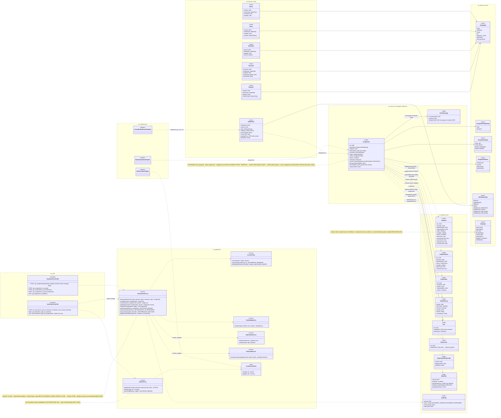
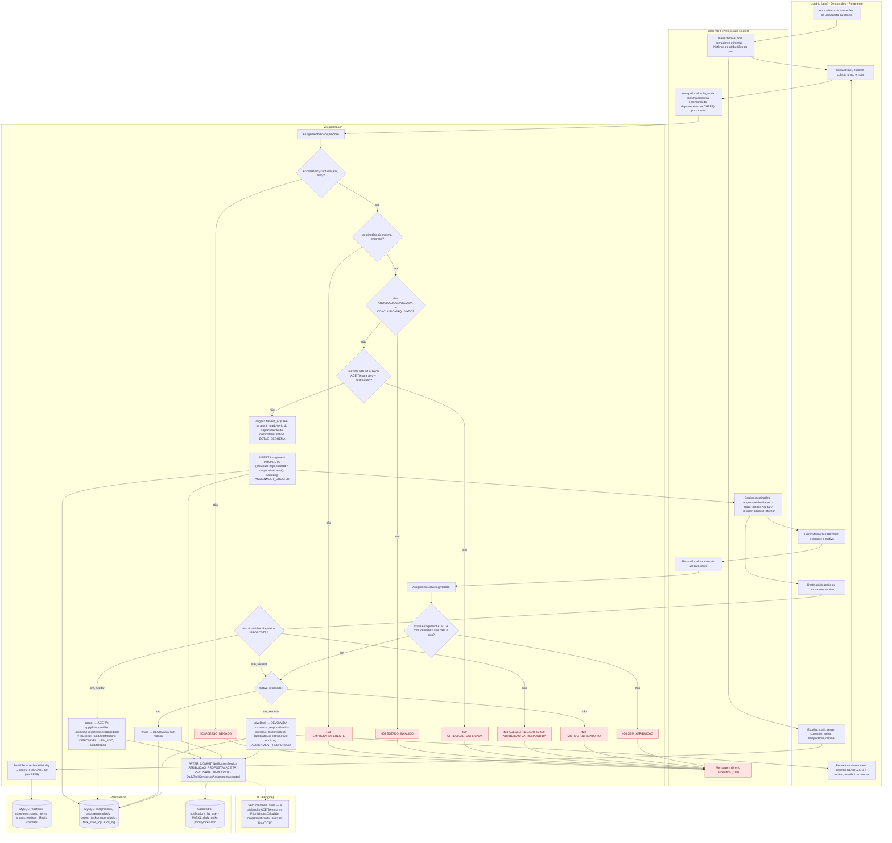
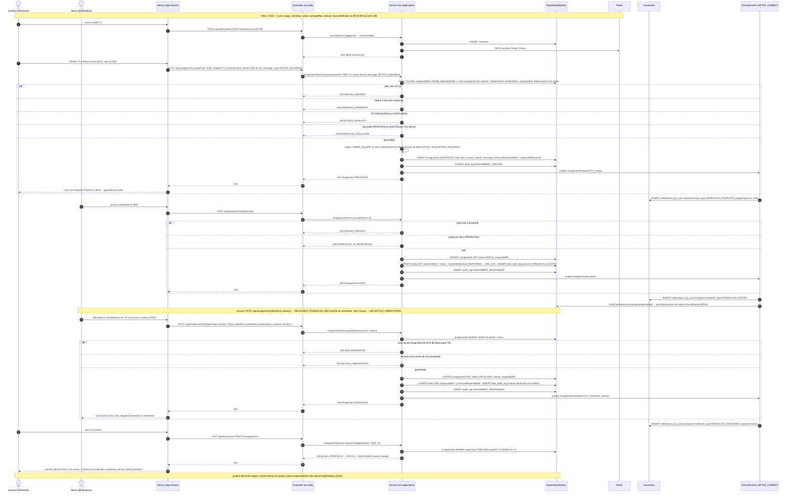
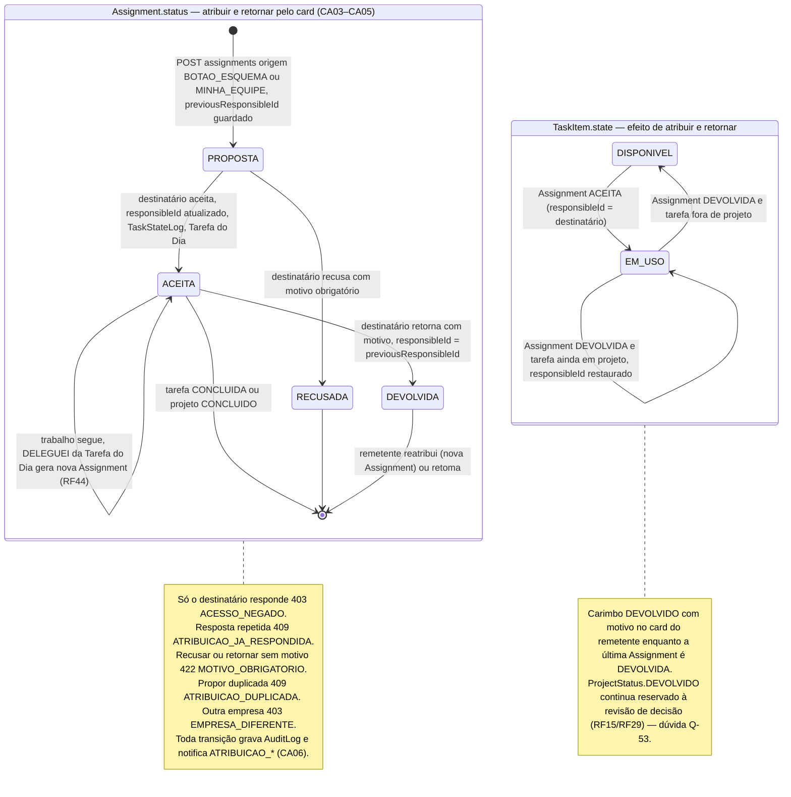
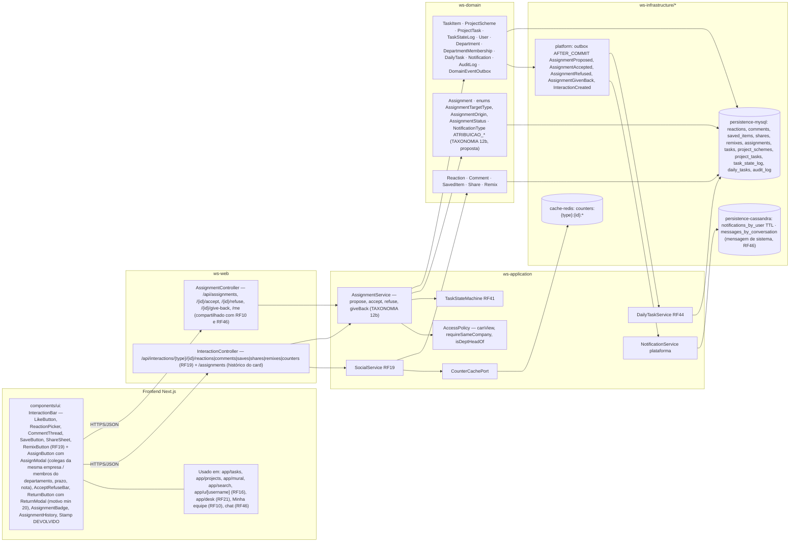

# RF18 — Interagir socialmente com tarefas e projetos: curtir, comentar, salvar, compartilhar, remixar, retornar e atribuir
**HU:** HU18 · **Sprint (board Work Station):** a confirmar (card renomeado em 2026-10-02; origem `_anterior/RF26` = Sprint 4) · **Equivalente FAI:** RF19 Interações sociais (alvo polimórfico) — **retornar** e **atribuir** não existem no FAI · **Aba/rota:** ações inline em todo card de tarefa/projeto (Acervo, Projetos, Mural, Buscar, perfil de terceiros, Mesa) · **API:** `/api/interactions/{type}/{id}/reactions|comments|saves|shares|remixes|counters` (RF19) + `POST /api/assignments` (origem `BOTAO_ESQUEMA`), `POST /api/assignments/{id}/accept|refuse|give-back` (TAXONOMIA §12b, compartilhada com RF10 e RF46)
**Critérios de aceite cobertos:** RF18.CA01 … RF18.CA06 — corpo do card vazio: CA01–CA02 remetem aos RF26.CA01–09 citados no card RF19; CA03–CA06 modelam as duas interações novas ("atribuir" = RF10/RF46.CA03–CA05 pelo botão do esquema; "retornar" = `Assignment` → DEVOLVIDA com motivo); todos marcados "(CA a confirmar)"

> **HU18** — COMO usuário visualizando um esquema de tarefa ou projeto POSSO utilizar as funcionalidades de rede social do sistema PARA interagir com usuários conectados ou membros de minha equipe, a fim de aumentar minha produtividade e gerar networking.

O RF18 é a **barra de interações** de todo card de **tarefa** (`TaskItem`) e **projeto** (`ProjectScheme`). As seis interações sociais clássicas (curtir/reagir, comentar, salvar, compartilhar, remixar) são as do antigo RF26, detalhadas no card **RF19** (RF26.CA01–09) e **não repetidas aqui**. Este README modela as **duas interações novas**, que mudam o fluxo de trabalho e não só a reputação, usando a entidade única **`Assignment`** (TAXONOMIA §12b, *proposta*; mesma entidade de RF10 "chefe atribui" e RF46 "atribuir pelo chat"):

- **Atribuir** — pelo botão do card (`AssignmentOrigin.BOTAO_ESQUEMA`) qualquer usuário **propõe** uma tarefa/projeto a um colega **da mesma empresa**, com prazo e nota (`Assignment` PROPOSTA, `fromUserId`, `toUserId`, `dueAt`, `message`, `previousResponsibleId`); o CHEFE atribuindo a membro do seu departamento (origem `MINHA_EQUIPE`, RF10) segue o mesmo caminho com `requireDeptHead`. O destinatário **aceita** (ACEITA → `TaskItem.responsibleId` / `ProjectTask.responsibleId`, `TaskStateLog`, Tarefa do Dia RF44) ou **recusa com motivo** (RECUSADA).
- **Retornar** — quem **aceitou** uma atribuição **devolve ao remetente com motivo** (`AssignmentService.giveBack` → `Assignment` DEVOLVIDA, `reason` obrigatório, `responsibleId` restaurado para `previousResponsibleId`, `TaskStateLog`, `Notification ATRIBUICAO_DEVOLVIDA`). Para **projeto** devolvido o card do remetente mostra o carimbo DEVOLVIDO com motivo (design system *Stamp*); `ProjectStatus.DEVOLVIDO` continua reservado à revisão de decisão (RF15/RF29) — **dúvida Q-53**. Retornar um item **sem** `Assignment` ACEITA (ex.: tarefa só compartilhada em sessão ou levada ao acervo) responde `404 SEM_ATRIBUICAO` nesta versão (a confirmar).

| CA | Enunciado (Dado / Quando / Então) |
|---|---|
| **RF18.CA01** (CA a confirmar) | Dado um card de tarefa ou projeto visível para mim, quando abro a barra de interações, então posso **curtir/reagir, comentar, salvar, compartilhar e remixar** exatamente como nos RF26.CA01–CA07 (citados no card RF19), com contadores em tempo quase real. |
| **RF18.CA02** (CA a confirmar) | Dado qualquer interação, quando é enviada, então respeita a visibilidade do alvo (RF26.CA08: PRIVADA só dono, DEPARTAMENTO só membros, EMPRESA só mesma empresa → `403 ACESSO_NEGADO`) e gera notificação agrupada por hora ao dono (RF26.CA09). |
| **RF18.CA03** (CA a confirmar) | Dado um usuário que vê a tarefa/projeto, quando clica **Atribuir**, escolhe um colega **da mesma empresa**, prazo e nota, então nasce `Assignment` PROPOSTA (`origin BOTAO_ESQUEMA`, `previousResponsibleId` = responsável atual), com `AuditLog ASSIGNMENT_CREATED` e `Notification ATRIBUICAO_PROPOSTA` ao destinatário; se o ator é CHEFE e o destinatário membro do seu departamento a origem é `MINHA_EQUIPE` (RF10); colega de outra empresa → `403 EMPRESA_DIFERENTE`; alvo que o ator não pode ver → `403 ACESSO_NEGADO`; tarefa ARQUIVADA/CONCLUIDA ou projeto CONCLUIDO/ARQUIVADO → `409 ESTADO_INVALIDO`; já existe PROPOSTA/ACEITA para o mesmo alvo e destinatário → `409 ATRIBUICAO_DUPLICADA`. |
| **RF18.CA04** (CA a confirmar) | Dado uma `Assignment` PROPOSTA para mim, quando **aceito**, então ela vai a ACEITA, `TaskItem.responsibleId` / `ProjectTask.responsibleId` passam a mim, `TaskStateLog` registra (DISPONIVEL → EM_USO se era DISPONIVEL), a atribuição entra no índice de prioridade da minha Tarefa do Dia (RF44) e o remetente recebe `ATRIBUICAO_ACEITA`; quando **recuso**, informo motivo (`reason`, sem ele `422 MOTIVO_OBRIGATORIO`) e ela vai a RECUSADA com `ATRIBUICAO_RECUSADA`; só o destinatário responde (`403 ACESSO_NEGADO`) e resposta repetida é `409 ATRIBUICAO_JA_RESPONDIDA`. |
| **RF18.CA05** (CA a confirmar) | Dado uma `Assignment` ACEITA minha, quando clico **Retornar** e informo o motivo (≥ 20 caracteres), então ela vai a DEVOLVIDA, `responsibleId` volta a `previousResponsibleId`, `TaskStateLog` registra com o motivo, `AuditLog ASSIGNMENT_RESPONDED` grava e o remetente recebe `ATRIBUICAO_DEVOLVIDA`; o card do remetente mostra carimbo DEVOLVIDO + motivo até ele reatribuir ou retomar; sem `Assignment` ACEITA para mim → `404 SEM_ATRIBUICAO`; motivo curto → `422 MOTIVO_OBRIGATORIO`. |
| **RF18.CA06** (CA a confirmar) | Dado o card, quando o abro, então vejo o histórico de atribuições e retornos (`Assignment` por alvo, com quem, quando, status e motivo) ao lado dos contadores sociais; o perfil do destinatário (RF16) mostra a etiqueta "atribuída por …" nos itens visíveis; DELEGUEI da Tarefa do Dia (RF44) cria uma nova `Assignment` PROPOSTA (caminho inverso) — regras completas em RF46.CA03–CA05. |

| Interação | Entidade | Quem pode | Efeito no alvo | Notificação |
|---|---|---|---|---|
| Curtir · reagir · comentar · salvar · compartilhar · remixar | `Reaction`, `Comment`, `SavedItem`, `Share`, `Remix` | qualquer usuário com visibilidade (RF26.CA08) | contadores desnormalizados | `REACAO`, `COMENTARIO`, `MENCAO`, `REMIX` (RF26.CA09) |
| **Atribuir** (propor) | `Assignment` PROPOSTA, origem `BOTAO_ESQUEMA` (ou `MINHA_EQUIPE` se CHEFE → membro, RF10) | quem vê o alvo, a colega da mesma empresa | ao aceitar: `responsibleId` = destinatário · DISPONIVEL → EM_USO | `ATRIBUICAO_PROPOSTA` → `ATRIBUICAO_ACEITA` / `ATRIBUICAO_RECUSADA` · prioridade na Tarefa do Dia (RF44) |
| **Retornar** (devolver) | `Assignment` ACEITA → DEVOLVIDA, `reason` obrigatório | só o destinatário (`toUserId`) de uma atribuição ACEITA | `responsibleId` = `previousResponsibleId` · `TaskStateLog` · carimbo DEVOLVIDO no card do remetente | `ATRIBUICAO_DEVOLVIDA` |

## 1. Diagrama de classes

## 2. Diagrama de atividades

## 3. Diagrama de sequência

## 4. Máquina de estados

Entidade central do RF18 é **`Assignment.status`** (`AssignmentStatus` PROPOSTA · ACEITA · RECUSADA · DEVOLVIDA, TAXONOMIA §12b — a mesma máquina do RF46 vista pelo botão do esquema). O segundo bloco mostra o efeito sobre **`TaskItem.state`** (`TaskState`), que **não ganha estado novo**: retornar restaura o responsável e volta a tarefa a DISPONIVEL se ninguém mais a usa (Q-53).

## 5. Diagrama de componentes

## 6. Rastreabilidade

| CA | Elemento do diagrama (classe / passo / mensagem / transição / componente) |
|---|---|
| RF18.CA01 | Classes `Reaction`, `Comment`, `SavedItem`, `Share`, `Remix`, `SocialService` (nota "seis interações detalhadas no RF19"), `CounterCachePort` · Atividades `U1 → W1 → U2 → A1 → P1` · Sequência msgs 1–6 (curtir T3, INCR counters) · Componentes `InteractionBar` (parte RF19), `cache-redis` · Detalhe completo: RF19 (RF26.CA01–07) |
| RF18.CA02 | `SocialService.checkVisibility` (403), `Notification.groupKey`, `NotificationService.notifyOwner` · Atividade `A1` · Sequência nota inicial · Componentes `NotificationService`, `persistence-cassandra` · Detalhe: RF19 (RF26.CA08–09) |
| RF18.CA03 | `Assignment` (TAXONOMIA 12b; nota), enums `AssignmentTargetType`, `AssignmentOrigin` (BOTAO_ESQUEMA, MINHA_EQUIPE), `AssignmentStatus`, `AssignmentService.propose/requireUnique`, `AccessPolicy.canView/requireSameCompany/isDeptHeadOf`, `Department.headUserId`, `AuditLog ASSIGNMENT_CREATED`, `NotificationType.ATRIBUICAO_PROPOSTA` · Atividades `U3 → W2 → A2 → A3 (403) → A5 (403 EMPRESA_DIFERENTE) → A7 (409 ESTADO_INVALIDO) → A9 (409 ATRIBUICAO_DUPLICADA) → A11 → A12 → P2 → A23` · Sequência msgs 7–24 (`POST /api/assignments … origin BOTAO_ESQUEMA`, 4 `alt` de erro, `INSERT assignments PROPOSTA … previousResponsibleId`, `notifications_by_user ATRIBUICAO_PROPOSTA`) · Transição `[*] → PROPOSTA` · Componentes `AssignButton`, `AssignModal`, `AssignmentController`, `AssignmentService` |
| RF18.CA04 | `AssignmentService.accept/refuse/requireAssignee/requireOpen/applyResponsible`, `TaskItem.responsibleId`, `ProjectTask.responsibleId`, `TaskStateMachine`, `TaskStateLog`, `DailyTaskService.onAssignmentAccepted`, `DailyTask.priorityIndexJson`, `NotificationType.ATRIBUICAO_ACEITA/ATRIBUICAO_RECUSADA` · Atividades `W3 → U4 → A13 (403/409) → A15 → P2 → A23` e `A16 (422) → A18` · Sequência msgs 25–38 (`accept`, `alt` 403 / 409, `responsibleId = maria · DISPONIVEL → EM_USO`, `ATRIBUICAO_ACEITA`, `onAssignmentAccepted`, nota recusar → 422) · Transições `PROPOSTA → ACEITA / RECUSADA`, `DISPONIVEL → EM_USO` · Componentes `AcceptRefuseBar`, `AssignmentBadge`, `DailyTaskService RF44` |
| RF18.CA05 | `AssignmentService.giveBack`, `Assignment.reason/previousResponsibleId/respondedAt`, `TaskStateLog`, `AuditLog ASSIGNMENT_RESPONDED`, `NotificationType.ATRIBUICAO_DEVOLVIDA` · Atividades `U5 → W4 → A19 → A20 (404 SEM_ATRIBUICAO) → A16 (422) → A22 → P2 → A23`, `U6` (carimbo) · Sequência msgs 39–52 (`POST /api/assignments/{id}/give-back {reason}`, `alt` 404 / 422, `status DEVOLVIDA`, `responsibleId = previousResponsibleId`, `ATRIBUICAO_DEVOLVIDA`) · Transição `ACEITA → DEVOLVIDA` e `EM_USO → EM_USO / DISPONIVEL` + notas (Q-53) · Componentes `ReturnButton`, `ReturnModal`, `Stamp DEVOLVIDO` |
| RF18.CA06 | `AssignmentService.historyForTarget`, `InteractionController.GET_api_interactions_type_id_assignments`, `DailyTask.feedback DELEGUEI/delegatedToUserId`, `AuditLog`, `DirectMessage.assignmentId` (RF46) · Atividades `W1` (histórico no card), `A23 → P3`, transição `ACEITA → ACEITA` (DELEGUEI) · Sequência msgs 53–59 (`GET …/assignments → histórico`, carimbo + botão Reatribuir, nota do projeto) · Componentes `AssignmentHistory`, `app/u/[username] (RF16)`, `Minha equipe (RF10)`, `chat (RF46)` |

Tela/aba: `/mural` (esqueleto em `app/(shell)/mural/page.tsx`) · `/u/[username]` (esqueleto em `app/(shell)/u/[username]/page.tsx`) · `/tasks` (esqueleto em `app/(shell)/tasks/page.tsx`) · `/admin` (esqueleto em `app/(shell)/admin/page.tsx`)
