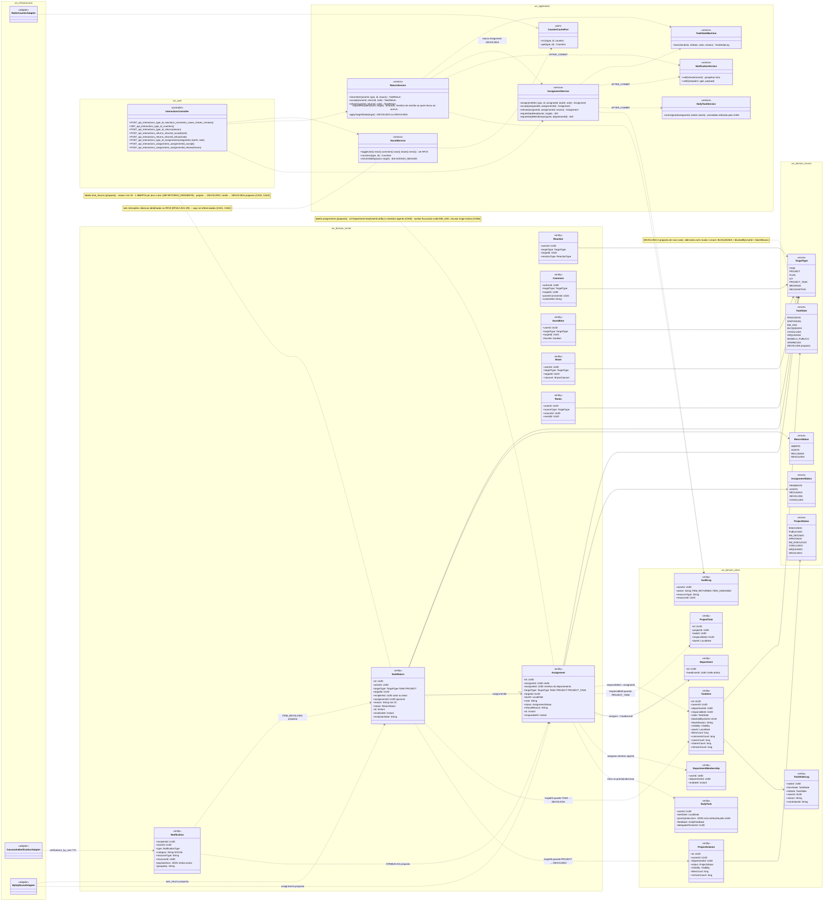
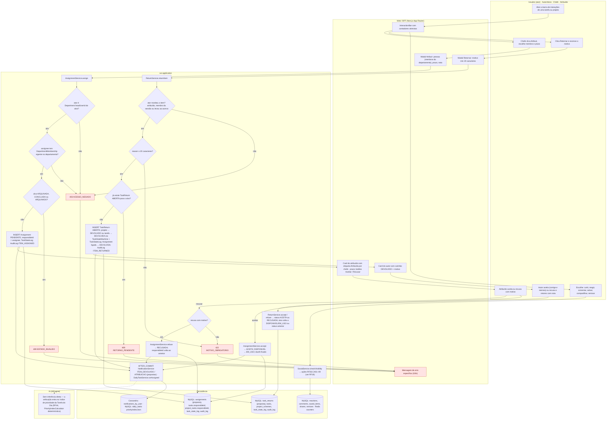
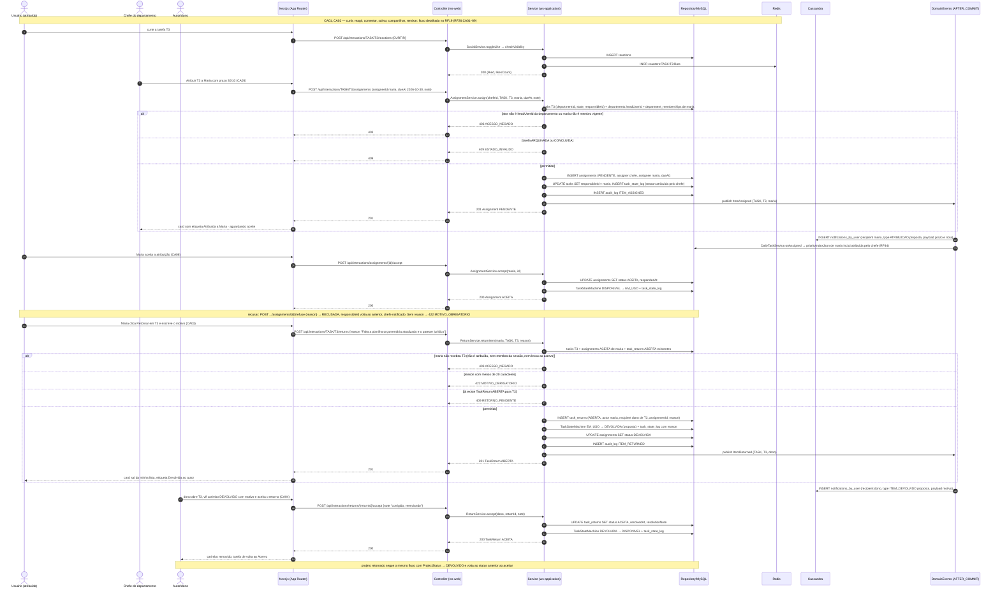
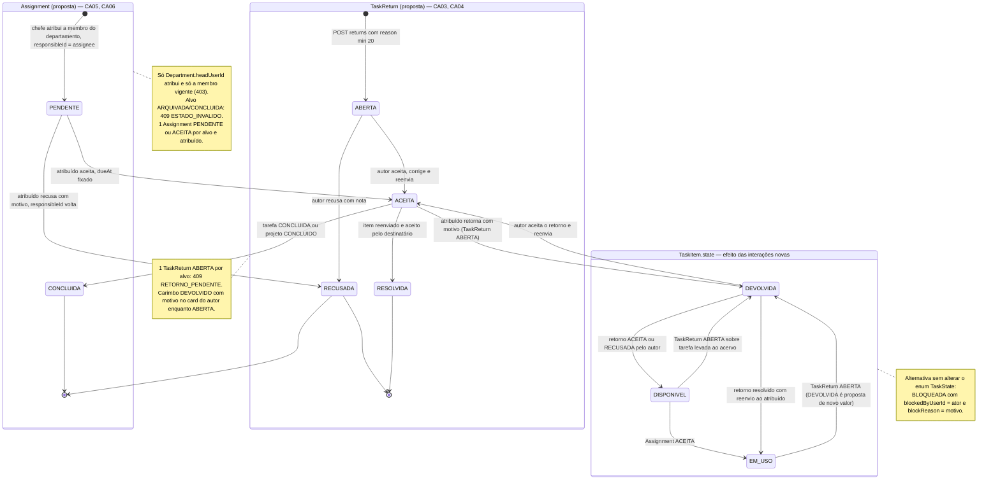
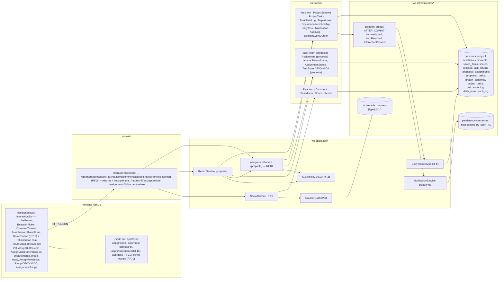

# RF18 — Interagir socialmente com tarefas e projetos: curtir, comentar, salvar, compartilhar, remixar, retornar e atribuir
**HU:** HU18 · **Sprint (board Work Station):** a confirmar (card renomeado em 2026-10-02; origem `_anterior/RF26` = Sprint 4) · **Equivalente FAI:** RF19 Interações sociais (alvo polimórfico) — **retornar** e **atribuir** não existem no FAI · **Aba/rota:** ações inline em todo card de tarefa/projeto (Acervo, Projetos, Mural, Buscar, perfil de terceiros) · **API:** `/api/interactions/{type}/{id}/reactions|comments|saves|shares|remixes|counters` (RF19) + `/api/interactions/{type}/{id}/returns` e `/api/interactions/{type}/{id}/assignments` (novas)
**Critérios de aceite cobertos:** RF18.CA01 … RF18.CA06 — corpo do card vazio: CA01–CA02 remetem aos RF26.CA01–09 citados no card RF19; CA03–CA06 modelam as duas interações novas ("retornar" e "atribuir", esta última = RF10); todos marcados "(CA a confirmar)"

> **HU18** — COMO usuário visualizando um esquema de tarefa ou projeto POSSO utilizar as funcionalidades de rede social do sistema PARA interagir com usuários conectados ou membros de minha equipe, a fim de aumentar minha produtividade e gerar networking.

O RF18 é a **barra de interações** de todo card de **tarefa** (`TaskItem`) e **projeto** (`ProjectScheme`). As seis interações sociais clássicas (curtir/reagir, comentar, salvar, compartilhar, remixar) são as do antigo RF26, agora detalhadas no card **RF19** (RF26.CA01–09) e **não são repetidas aqui**: este README as referencia e modela as **duas interações novas**, que mudam o fluxo de trabalho e não apenas a reputação:

- **Retornar** — quem recebeu uma tarefa/projeto (por atribuição RF10, por compartilhamento em sessão DECIA ou por "Levar ao meu acervo") **devolve ao autor com motivo** (≥ 20 caracteres). Entidade nova **`TaskReturn` (proposta)**: `id · actorId · targetType (TASK · PROJECT) · targetId · recipientId (autor/dono) · assignmentId (opcional) · reason · status (ABERTA · ACEITA · RECUSADA · RESOLVIDA) · at · resolvedAt · resolutionNote`. Efeito no alvo: projeto → `ProjectStatus.DEVOLVIDO` (já existe, com carimbo DEVOLVIDO + motivo); tarefa → **`TaskState.DEVOLVIDA` (proposta de novo valor; alternativa: `BLOQUEADA` com `blockReason` e `blockedByUserId`)** + `TaskStateLog`.
- **Atribuir** — o **CHEFE** (`Department.headUserId`) atribui tarefa ou projeto a um **membro do departamento** com prazo (ver RF10 / `ABAS_POR_PERFIL.md` §7.b). Entidade nova **`Assignment` (proposta)**: `id · assignerId · assigneeId · targetType (TASK · PROJECT · PROJECT_TASK) · targetId · dueAt · note · status (PENDENTE · ACEITA · RECUSADA · DEVOLVIDA · CONCLUIDA) · refusalReason · at · respondedAt`. Efeito: `TaskItem.responsibleId` / `ProjectTask.responsibleId` = atribuído, `TaskStateLog`, `Notification` e entrada no índice de prioridade da Tarefa do Dia (RF44). O atribuído **aceita ou recusa com motivo**; **DELEGUEI** (RF44) é o caminho inverso.

| CA | Enunciado (Dado / Quando / Então) |
|---|---|
| **RF18.CA01** (CA a confirmar) | Dado um card de tarefa ou projeto visível para mim, quando abro a barra de interações, então posso **curtir/reagir, comentar, salvar, compartilhar e remixar** exatamente como nos RF26.CA01–CA07 (citados no card RF19), com contadores em tempo quase real. |
| **RF18.CA02** (CA a confirmar) | Dado qualquer interação, quando é enviada, então respeita a visibilidade do alvo (RF26.CA08: PRIVADA só dono, DEPARTAMENTO só membros, EMPRESA só mesma empresa → `403 ACESSO_NEGADO`) e gera notificação agrupada por hora ao dono (RF26.CA09). |
| **RF18.CA03** (CA a confirmar) | Dado que recebi uma tarefa/projeto (atribuído a mim, compartilhado em sessão ou levado ao meu acervo), quando clico **Retornar** e informo o motivo (≥ 20 caracteres), então nasce `TaskReturn` ABERTA, o alvo muda para DEVOLVIDO (projeto) / DEVOLVIDA (tarefa, proposta) com `TaskStateLog`, a `Assignment` ligada vai a DEVOLVIDA, e o autor recebe `Notification` com o motivo; motivo curto → `422 MOTIVO_OBRIGATORIO`; alvo que não me foi entregue → `403 ACESSO_NEGADO`; retorno já aberto → `409 RETORNO_PENDENTE`. |
| **RF18.CA04** (CA a confirmar) | Dado um `TaskReturn` ABERTA, quando o autor aceita (corrige e reenvia) ou recusa com nota, então o retorno vai a ACEITA/RECUSADA e o alvo volta a DISPONIVEL/EM_USO (tarefa) ou ao status anterior (projeto); o card do autor mostra o carimbo DEVOLVIDO com motivo enquanto ABERTA (design system *Stamp*). |
| **RF18.CA05** (CA a confirmar) | Dado um CHEFE de departamento, quando clica **Atribuir** em uma tarefa/projeto e escolhe um membro do seu departamento e um prazo, então nasce `Assignment` PENDENTE, `responsibleId` passa ao atribuído, `TaskStateLog` registra, o atribuído recebe `Notification` e a atribuição entra no índice de prioridade da Tarefa do Dia dele (RF44); ator não CHEFE ou pessoa fora do departamento → `403 ACESSO_NEGADO`; tarefa ARQUIVADA/CONCLUIDA → `409 ESTADO_INVALIDO`. |
| **RF18.CA06** (CA a confirmar) | Dado uma `Assignment` PENDENTE, quando o atribuído aceita ou recusa com motivo, então ela vai a ACEITA (prazo fixado, tarefa EM_USO se estava DISPONIVEL) ou RECUSADA (`responsibleId` volta ao anterior, chefe notificado); a recusa sem motivo é `422 MOTIVO_OBRIGATORIO`; toda atribuição e retorno ficam em `AuditLog` e aparecem no histórico do card. |

| Interação | Entidade | Quem pode | Efeito no alvo | Notificação |
|---|---|---|---|---|
| Curtir · reagir · comentar · salvar · compartilhar · remixar | `Reaction`, `Comment`, `SavedItem`, `Share`, `Remix` | qualquer usuário com visibilidade (RF26.CA08) | contadores desnormalizados | `REACAO`, `COMENTARIO`, `MENCAO`, `REMIX` (RF26.CA09) |
| **Retornar** | `TaskReturn` (proposta) | quem recebeu o item (atribuído, membro da sessão, quem levou ao acervo) | projeto → DEVOLVIDO · tarefa → DEVOLVIDA (proposta) · `Assignment` → DEVOLVIDA | `ITEM_DEVOLVIDO` (proposta de novo `NotificationType`) |
| **Atribuir** | `Assignment` (proposta) | CHEFE do departamento (RF10) | `responsibleId` = atribuído · DISPONIVEL → EM_USO ao aceitar | `ATRIBUICAO` (proposta de novo `NotificationType`) · prioridade na Tarefa do Dia (RF44) |

## 1. Diagrama de classes

## 2. Diagrama de atividades

## 3. Diagrama de sequência

## 4. Máquina de estados

Entidades centrais do RF18 são as duas **propostas**: `Assignment.status` (`AssignmentStatus`) e `TaskReturn.status` (`ReturnStatus`). O terceiro bloco mostra o efeito sobre `TaskItem.state` (`TaskState`), incluindo o valor **DEVOLVIDA (proposta)**; para projetos o efeito equivalente é `ProjectStatus.DEVOLVIDO` (já existente — ver RF22/RF29).

## 5. Diagrama de componentes

## 6. Rastreabilidade

| CA | Elemento do diagrama (classe / passo / mensagem / transição / componente) |
|---|---|
| RF18.CA01 | Classes `Reaction`, `Comment`, `SavedItem`, `Share`, `Remix`, `SocialService` (nota "seis interações detalhadas no RF19"), `CounterCachePort` · Atividades `U1 → W1 → U2 → A1 → P1` · Sequência msgs 1–6 (curtir T3, INCR counters) · Componentes `InteractionBar` (parte RF19), `cache-redis` · Detalhe completo: RF19 (RF26.CA01–07) |
| RF18.CA02 | `SocialService.checkVisibility` (403), `Notification.groupKey`, `NotificationService.notifyOwner` · Atividade `A1` · Sequência nota inicial · Componentes `NotificationService`, `persistence-cassandra` · Detalhe: RF19 (RF26.CA08–09) |
| RF18.CA03 | `TaskReturn` (proposta; nota reason min 20, 1 ABERTA por alvo), enum `ReturnStatus`, `ReturnService.returnItem/requireRecipient/applyTargetState`, `TaskStateMachine`, `TaskState.DEVOLVIDA` (proposta), `ProjectStatus.DEVOLVIDO`, `AuditLog ITEM_RETURNED`, `Notification ITEM_DEVOLVIDO` (proposta) · Atividades `U3 → W2 → A2 → A3 (403) → A5 (422) → A7 (409) → A9 → P2 → A20` · Sequência msgs 33–47 (`POST …/returns`, `alt` 403 / 422 / 409, `INSERT task_returns`, `EM_USO → DEVOLVIDA`, `UPDATE assignments DEVOLVIDA`, `notifications_by_user ITEM_DEVOLVIDO`) · Transições `[*] → ABERTA` e `EM_USO → DEVOLVIDA` · Componentes `ReturnButton`, `ReturnModal`, `ReturnService (proposta)` |
| RF18.CA04 | `ReturnService.accept/refuse`, `TaskReturn.resolvedAt/resolutionNote` · Atividades `W3 (carimbo DEVOLVIDO) → U4 → A10 → P2` · Sequência msgs 48–55 (`POST …/returns/{id}/accept`, `DEVOLVIDA → DISPONIVEL`, nota do projeto) · Transições `ABERTA → ACEITA / RECUSADA`, `DEVOLVIDA → DISPONIVEL / EM_USO` · Componente `Stamp DEVOLVIDO` |
| RF18.CA05 | `Assignment` (proposta; nota), enum `AssignmentStatus`, `AssignmentService.assign/requireDeptHead/requireDeptMember`, `Department.headUserId`, `DepartmentMembership`, `TaskItem.responsibleId`, `ProjectTask.responsibleId`, `TaskStateLog`, `AuditLog ITEM_ASSIGNED`, `DailyTaskService.onAssigned`, `Notification ATRIBUICAO` (proposta) · Atividades `U5 → W4 → A11 → A12/A13 (403) → A14 (409) → A16 → P3 → A20 → P4` · Sequência msgs 7–22 (`POST …/assignments`, `alt` 403 / 409, `INSERT assignments PENDENTE`, `UPDATE tasks responsibleId`, `notifications_by_user ATRIBUICAO`, `DailyTaskService.onAssigned`) · Transição `[*] → PENDENTE` · Componentes `AssignButton`, `AssignModal`, `AssignmentService (proposta) — RF10`, `DailyTaskService RF44` |
| RF18.CA06 | `AssignmentService.accept/refuse`, `Assignment.refusalReason/respondedAt`, `AuditLog` · Atividades `W5 → U6 → A17 / A18 (422) → A19 → P3 → A20` · Sequência msgs 23–30 (`accept → ACEITA`, `DISPONIVEL → EM_USO`, nota recusar → 422 MOTIVO_OBRIGATORIO) · Transições `PENDENTE → ACEITA / RECUSADA`, `ACEITA → DEVOLVIDA / CONCLUIDA`, `DISPONIVEL → EM_USO` · Componentes `AcceptRefuseBar`, `AssignmentBadge` |
