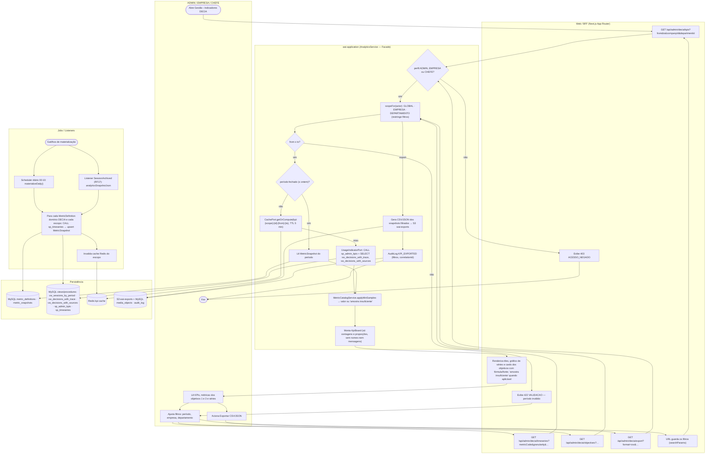
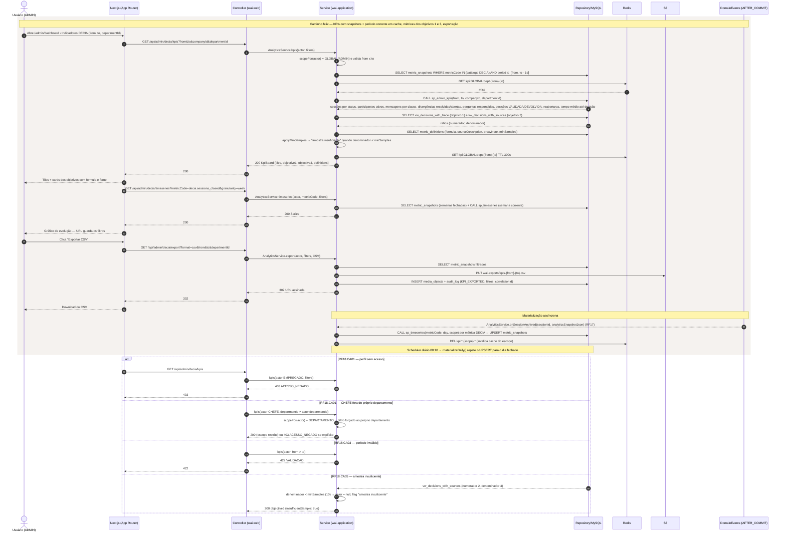
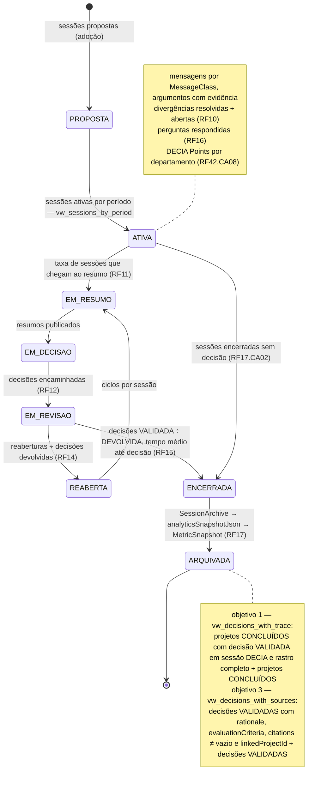
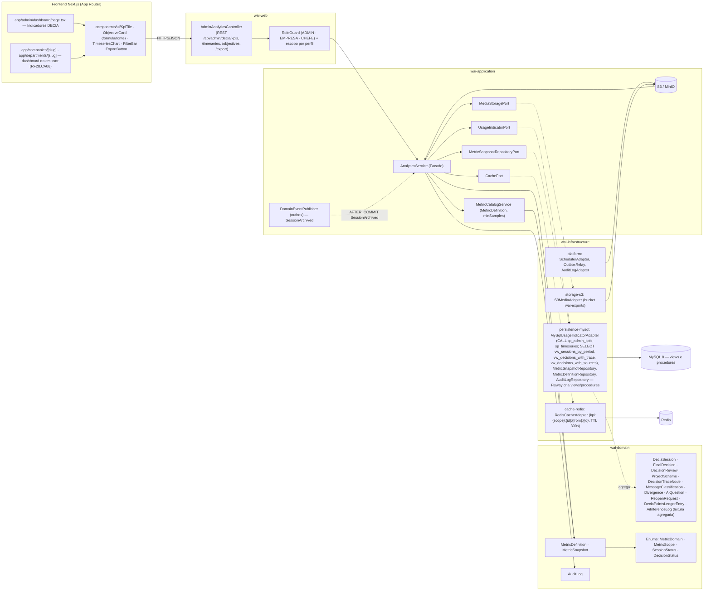

# RF18 — Exibir indicadores analíticos sobre uso do sistema do DECIA
**HU:** HU18 · **Sprint (board Work Station):** 3 · **Equivalente FAI:** aba **Gestão (admin) — Dashboard, usuários, moderação, sistema** do FAI → Gestão (+ painel IA do sistema) no Work AI (Mapa de equivalência, grupo "Gestão") · **Aba/rota:** Gestão › "Indicadores DECIA" (`/admin/dashboard`; rota a confirmar) — também consumido pelo dashboard do emissor EMPRESA/CHEFE (RF28.CA06)
**Critérios de aceite cobertos:** RF18.CA01 · RF18.CA02 · RF18.CA03 · RF18.CA04 · RF18.CA05 · RF18.CA06 (RF1–RF18 não têm CAs no board: derivados da HU18 + RF29.CA09, RF33.CA05, RF42.CA08, RF43.CA13, RF45.CA10 e marcados "CA a confirmar")

> **HU18** — COMO administrador do sistema POSSO visualizar indicadores analíticos sobre o uso do DECIA PARA acompanhar a adoção e o desempenho do sistema e subsidiar decisões de melhoria.

Fonte dos indicadores (`UsageIndicator`, TAXONOMIA §12.8): views/procedures MySQL `vw_sessions_by_period`, `vw_decisions_with_trace` (**objetivo 1**), `vw_decisions_with_sources` (**objetivo 3**), `sp_admin_kpis`, `sp_timeseries`; materializados em `MetricSnapshot` a partir de `MetricDefinition` (domínio DECIA) e do `analyticsSnapshotJson` de cada `SessionArchive` (RF17).

| CA | Enunciado (CA a confirmar) |
|---|---|
| **RF18.CA01** | Dado ADMIN (ou EMPRESA/CHEFE restritos à própria empresa/departamento, RF28.CA06), quando abre Gestão › Indicadores DECIA, então vê KPIs: sessões por período e por `SessionStatus`, participantes ativos, mensagens por `MessageClass`, divergências resolvidas ÷ abertas (RF10), perguntas respondidas (RF16), decisões VALIDADA/DEVOLVIDA (RF15), reaberturas (RF14), tempo médio até decisão; outro perfil → `403 ACESSO_NEGADO`. |
| **RF18.CA02** | Dado o painel, então exibe a **métrica do objetivo 1** (`vw_decisions_with_trace`: % de projetos CONCLUÍDOS com decisão registrada em sessão DECIA com rastro completo argumentos → tarefas → decisão validada, RF29.CA09) e a **métrica do objetivo 3** (`vw_decisions_with_sources`: proporção de decisões VALIDADAS com justificativa, critérios, fontes institucionais e projeto vinculado, RF33.CA05), cada uma com fórmula, fonte e proxy visíveis (`MetricDefinition`, RF43.CA13). |
| **RF18.CA03** | Dado filtros de período, empresa e departamento, quando aplicados, então `sp_admin_kpis(from, to, companyId, departmentId)` e `sp_timeseries(metricCode, granularity, …)` retornam os valores, as séries aparecem em gráfico e a URL guarda os filtros; filtro de período invertido → `422 VALIDACAO`. |
| **RF18.CA04** | Dado o fechamento diário (job `PipelineJob` tipo RECALC_METRICS — a confirmar) e cada `SessionArchived` (RF17), então `MetricSnapshot` materializa cada métrica (metricCode, scope, scopeId, periodStart/End, value, valuesJson); o painel lê dos snapshots e o período corrente é calculado sob demanda com cache Redis (TTL 5 min, chave por filtros). |
| **RF18.CA05** | Dado amostra abaixo de `MetricDefinition.minSamples`, então o indicador mostra "amostra insuficiente" em vez de valor; os agregados **nunca** expõem conteúdo de mensagens nem lista nominal (RF45.CA10) — somente contagens e proporções; DECIA Points por departamento e custo de IA comprado aparecem conforme RF42.CA08. |
| **RF18.CA06** | Dado o painel filtrado, quando aciono "Exportar", então recebo CSV/JSON dos `MetricSnapshot` filtrados (URL assinada S3 ou download direto), com registro em `audit_log` (KPI_EXPORTED, filtros, correlationId). |

## 1. Diagrama de classes

```mermaid
classDiagram
  direction LR

  class MetricDefinition {
    <<entity>>
    +String code
    +MetricDomain domain
    +String name
    +String formula
    +String sourceDescription
    +String proxyNote
    +String unit
    +int minSamples
  }
  class MetricSnapshot {
    <<entity>>
    +UUID id
    +String metricCode
    +MetricScope scope
    +UUID scopeId
    +LocalDate periodStart
    +LocalDate periodEnd
    +BigDecimal value
    +String valuesJson
    +Instant computedAt
  }
  class UsageIndicator {
    <<entity>>
    vw_sessions_by_period
    vw_decisions_with_trace
    vw_decisions_with_sources
    sp_admin_kpis
    sp_timeseries
  }
  class DeciaSession {
    <<entity>>
    +UUID id
    +UUID companyId
    +UUID departmentId
    +SessionStatus status
    +UUID linkedProjectId
    +Instant startedAt
    +Instant closedAt
    +int messageCount
    +int participantCount
  }
  class SessionArchive {
    <<entity>>
    +UUID id
    +UUID sessionId
    +int messageCount
    +String analyticsSnapshotJson
  }
  class FinalDecision {
    <<entity>>
    +UUID id
    +UUID sessionId
    +DecisionStatus status
    +String citationsJson
    +UUID resultingTaskId
  }
  class DecisionReview {
    <<entity>>
    +UUID id
    +UUID decisionId
    +ReviewOutcome outcome
    +Instant reviewedAt
  }
  class ProjectScheme {
    <<entity>>
    +UUID id
    +ProjectStatus status
    +UUID sourceSessionId
  }
  class DecisionTraceNode {
    <<entity>>
    +UUID id
    +UUID sessionId
    +TraceNodeType nodeType
  }
  class MessageClassification {
    <<entity>>
    +UUID id
    +UUID sessionId
    +MessageClass label
    +boolean hasEvidence
  }
  class Divergence {
    <<entity>>
    +UUID sessionId
    +DivergenceStatus status
  }
  class AiQuestion {
    <<entity>>
    +UUID sessionId
    +String status
  }
  class ReopenRequest {
    <<entity>>
    +UUID sessionId
    +ReopenStatus status
  }
  class DeciaPointsLedgerEntry {
    <<entity>>
    +UUID userId
    +int delta
    +PointsEvent eventCode
    +UUID sessionId
  }
  class AiInferenceLog {
    <<entity>>
    +UUID departmentId
    +BigDecimal estimatedCostUsd
    +String quotaSource
  }
  class AuditLog {
    <<entity>>
    +UUID actorId
    +String action
    +String metadataJson
  }

  class MetricDomain {
    <<enum>>
    INOVACAO
    TI
    PROJETOS
    EQUIPES
    DECIA
    PONTOS
  }
  class MetricScope {
    <<enum>>
    GLOBAL
    EMPRESA
    DEPARTAMENTO
  }
  class SessionStatus {
    <<enum>>
    PROPOSTA
    ATIVA
    EM_RESUMO
    EM_DECISAO
    EM_REVISAO
    REABERTA
    ENCERRADA
    ARQUIVADA
  }
  class DecisionStatus {
    <<enum>>
    PROPOSTA
    EM_REVISAO
    VALIDADA
    DEVOLVIDA
    SUBSTITUIDA
  }

  class AdminAnalyticsController {
    <<controller>>
    +kpis(from, to, companyId, departmentId) 200
    +timeseries(metricCode, granularity, filters) 200
    +objectives(filters) 200
    +export(filters, format) 302
  }
  class AnalyticsService {
    <<service>>
    Facade
    +kpis(actor, filters) KpiBoard
    +timeseries(actor, metricCode, filters) Series
    +objectiveMetrics(actor, filters) ObjectiveMetrics
    +export(actor, filters, format) MediaObject
    +onSessionArchived(event) AFTER_COMMIT
    +materializeDaily() scheduled
    -scopeFor(actor) MetricScope
  }
  class MetricCatalogService {
    <<service>>
    +definition(code) MetricDefinition
    +applyMinSamples(value, samples, def) MetricValue
  }
  class UsageIndicatorPort {
    <<port>>
    +adminKpis(filters) KpiRow
    +timeseries(metricCode, granularity, filters) List~Point~
    +decisionsWithTrace(filters) Ratio
    +decisionsWithSources(filters) Ratio
  }
  class MetricSnapshotRepositoryPort {
    <<port>>
    +find(metricCode, scope, scopeId, period) List~MetricSnapshot~
    +upsert(MetricSnapshot)
  }
  class CachePort {
    <<port>>
    +getOrCompute(key, ttl, supplier)
  }
  class MediaStoragePort {
    <<port>>
    +put(bucket, key, bytes) MediaObject
  }
  class MySqlUsageIndicatorAdapter {
    <<adapter>>
    CALL sp_admin_kpis / sp_timeseries
    SELECT vw_decisions_with_trace / vw_decisions_with_sources
  }
  class MetricSnapshotRepository {
    <<adapter>>
    MySQL metric_snapshots
  }
  class RedisCacheAdapter {
    <<adapter>>
    chave kpi por escopo, id e período
  }
  class S3MediaAdapter {
    <<adapter>>
    bucket wai-exports
  }

  MetricSnapshot "*" --> "1" MetricDefinition : metricCode
  MetricSnapshot --> MetricScope
  MetricDefinition --> MetricDomain
  UsageIndicator ..> DeciaSession : vw_sessions_by_period
  UsageIndicator ..> FinalDecision : vw_decisions_with_trace e vw_decisions_with_sources
  UsageIndicator ..> ProjectScheme : projetos CONCLUÍDOS (objetivo 1)
  UsageIndicator ..> DecisionTraceNode : rastro completo (objetivo 1)
  UsageIndicator ..> DecisionReview : VALIDADA / DEVOLVIDA
  UsageIndicator ..> MessageClassification : mensagens por classe
  UsageIndicator ..> Divergence : resolvidas ÷ abertas
  UsageIndicator ..> AiQuestion : respondidas
  UsageIndicator ..> ReopenRequest : reaberturas
  UsageIndicator ..> DeciaPointsLedgerEntry : pontos por departamento
  UsageIndicator ..> AiInferenceLog : custo de IA
  SessionArchive ..> MetricSnapshot : analyticsSnapshotJson materializado (RF17)
  DeciaSession --> SessionStatus
  FinalDecision --> DecisionStatus

  AdminAnalyticsController --> AnalyticsService
  AnalyticsService --> MetricCatalogService
  AnalyticsService --> UsageIndicatorPort
  AnalyticsService --> MetricSnapshotRepositoryPort
  AnalyticsService --> CachePort
  AnalyticsService --> MediaStoragePort
  AnalyticsService ..> AuditLog : KPI_EXPORTED
  MetricCatalogService --> MetricDefinition
  UsageIndicatorPort <|.. MySqlUsageIndicatorAdapter
  MetricSnapshotRepositoryPort <|.. MetricSnapshotRepository
  CachePort <|.. RedisCacheAdapter
  MediaStoragePort <|.. S3MediaAdapter
  MySqlUsageIndicatorAdapter ..> UsageIndicator

  note for UsageIndicator "views e procedures MySQL (TAXONOMIA §12.8) — não é tabela, é a fonte calculada dos KPIs"
  note for MetricSnapshot "tabela metric_snapshots — materialização diária e por SessionArchived .. único (metricCode, scope, scopeId, periodStart, periodEnd) .."
  note for MetricDefinition "catálogo metric_definitions (domínio DECIA) — fórmula, fonte, proxy e minSamples documentados em METRICAS_GESTAO.md (RF43.CA13)"
```

## 2. Diagrama de atividades

## 3. Diagrama de sequência

## 4. Máquina de estados

O RF18 não tem estados próprios: ele **lê** `DeciaSession.status` (`SessionStatus`), entidade contada por `vw_sessions_by_period`. Abaixo, o ciclo com o indicador que cada estado/transição alimenta.

## 5. Diagrama de componentes

## 6. Rastreabilidade

| CA | Classe | Passo (atividades) | Mensagem (sequência) | Transição (estados) | Componente |
|---|---|---|---|---|---|
| RF18.CA01 | `AnalyticsService.kpis/scopeFor`, `UsageIndicatorPort.adminKpis` (`sp_admin_kpis`, `vw_sessions_by_period`), `MetricScope`, `RoleGuard` | A0, B1, C1, C2, C7, C9, B5, B7 | 1–9, 15–17; `alt` 403 / escopo CHEFE | todos os estados contados em vw_sessions_by_period | `AdminAnalyticsController.kpis`, `RoleGuard`, `MySqlUsageIndicatorAdapter`, `KpiTile` |
| RF18.CA02 | `UsageIndicatorPort.decisionsWithTrace/decisionsWithSources` (`vw_decisions_with_trace`, `vw_decisions_with_sources`), `MetricDefinition` (formula, sourceDescription, proxyNote), `FinalDecision.citationsJson`, `DecisionTraceNode`, `ProjectScheme` | C7, C8, B7 | 10–12, 15 | nota de ARQUIVADA (objetivos 1 e 3) | `ObjectiveCard`, `MetricCatalogService`, Flyway (views) |
| RF18.CA03 | `AnalyticsService.timeseries`, `UsageIndicatorPort.timeseries` (`sp_timeseries`), validação from ≤ to | A1, B2, B3, B8, C3, B6 | 18–23; `alt` 422 VALIDACAO | — | `TimeseriesChart`, `FilterBar`, `MySqlUsageIndicatorAdapter` |
| RF18.CA04 | `MetricSnapshot`, `MetricSnapshotRepositoryPort.upsert`, `AnalyticsService.onSessionArchived/materializeDaily`, `CachePort` (TTL 300s), `SessionArchive.analyticsSnapshotJson` | C4–C6, D0–D4 | 5–7, 14, 33–36 | ENCERRADA → ARQUIVADA alimenta MetricSnapshot | `SchedulerAdapter`, `RedisCacheAdapter`, `MetricSnapshotRepository`, `OutboxRelay` |
| RF18.CA05 | `MetricDefinition.minSamples`, `MetricCatalogService.applyMinSamples`, KpiBoard só com agregados, `DeciaPointsLedgerEntry`/`AiInferenceLog` agregados por departamento | C8, C9 | 13; `alt` amostra insuficiente | nota de ATIVA (pontos por departamento) | `MetricCatalogService`, `ObjectiveCard` ("amostra insuficiente") |
| RF18.CA06 | `AnalyticsService.export`, `MediaStoragePort`, `MediaObject`, `AuditLog` KPI_EXPORTED | A3, B4, C10, C11 | 24–32 | — | `ExportButton`, `S3MediaAdapter`, `AuditLogAdapter` |
