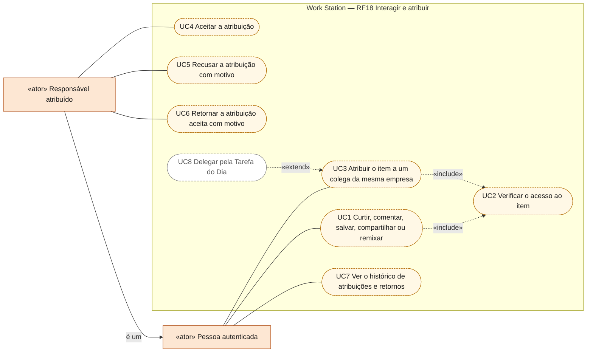
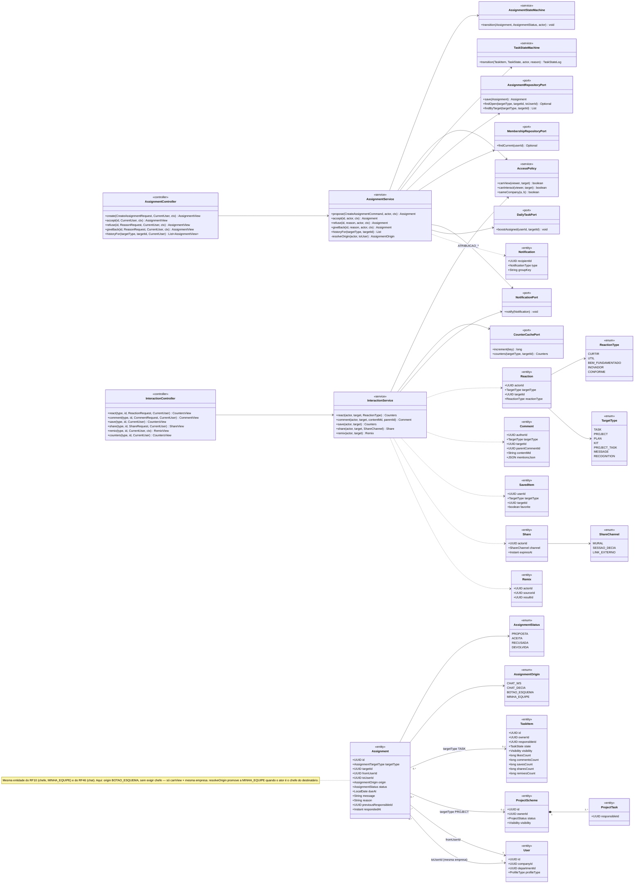
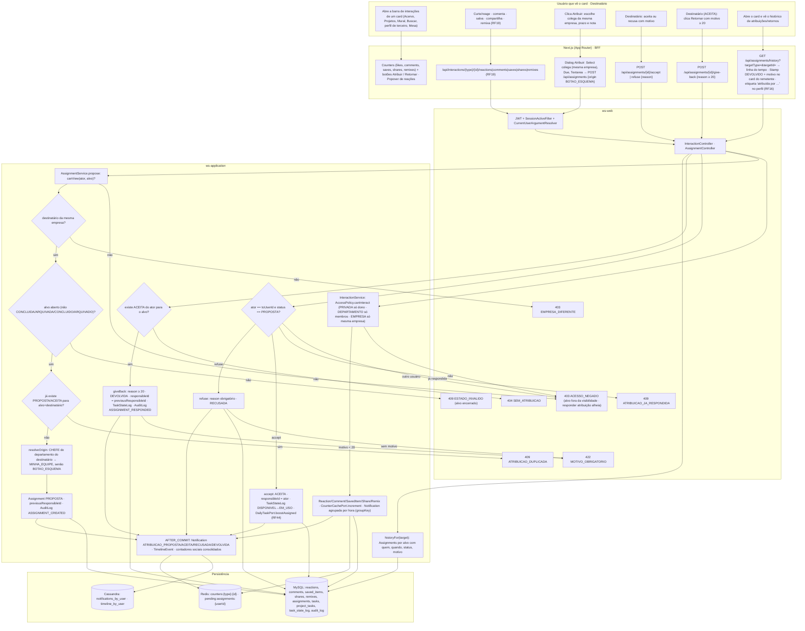
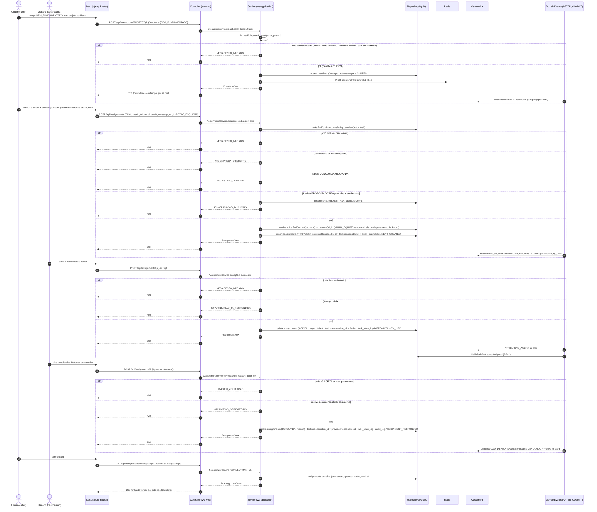
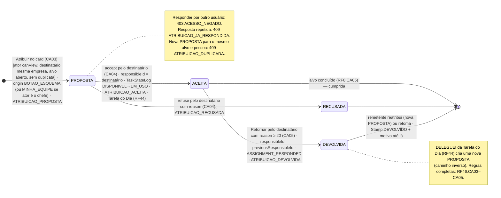
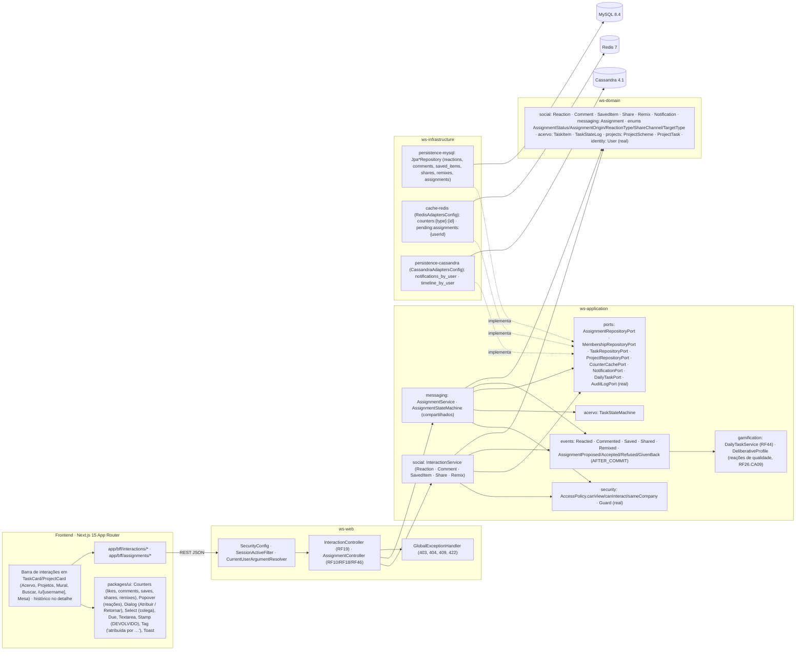
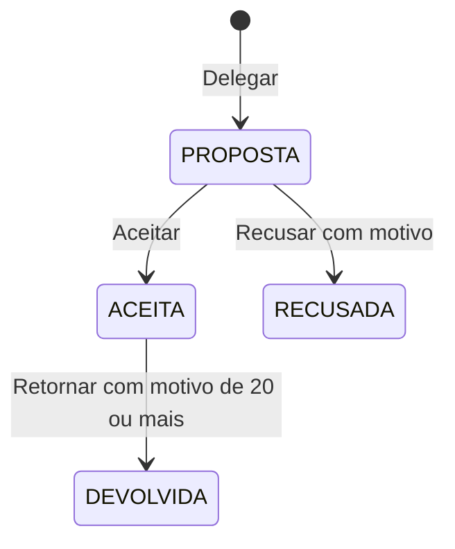

# RF18 — Interagir socialmente com tarefas e projetos: curtir, comentar, salvar, compartilhar, remixar, retornar e atribuir
**HU:** HU18 · **Sprint (board Work Station):** lista *Requisitos Funcionais* sem sprint atribuída (card renomeado em 2026-10-02; origem `_anterior/RF26` = Sprint 4; o card "SPRINT 3" cita "RF18 Indicadores", escopo antigo preservado em `_anterior/RF18` — `RENUMERACAO.md`) · **Equivalente FAI:** RF19 Interações sociais (alvo polimórfico PIECE/SCHEME/DNA) — **retornar** e **atribuir** não existem no FAI · **Aba/rota:** ações inline em todo card de tarefa/projeto (Acervo RF6, Projetos, Mural RF27, Buscar RF17, perfil de terceiros RF16, Mesa RF21/RF22); API `/api/interactions/{type}/{id}/reactions|comments|saves|shares|remixes|counters` (RF19) + `POST /api/assignments` (origem `BOTAO_ESQUEMA`), `POST /api/assignments/{id}/accept|refuse|give-back` (TAXONOMIA §12b, compartilhada com RF10 e RF46)
**Critérios de aceite cobertos:** RF18.CA01 … RF18.CA06 — corpo do card vazio: CA01–CA02 remetem aos RF26.CA01–09 citados no card RF19; CA03–CA06 modelam as duas interações novas do título ("atribuir" = `Assignment` PROPOSTA pelo botão do esquema, "retornar" = `Assignment` → DEVOLVIDA com motivo); todos marcados "(CA a confirmar)". Todas as classes do RF são **(planejado)**; reais: `Guard`, `AuditLogPort`, `SecurityConfig`, `RedisAdaptersConfig`, `CassandraAdaptersConfig`.

> **HU18** — COMO usuário visualizando um esquema de tarefa ou projeto POSSO utilizar as funcionalidades de rede social do sistema PARA interagir com usuários conectados ou membros de minha equipe, a fim de aumentar minha produtividade e gerar networking.

A barra de interações do card tem **sete** ações. As cinco sociais (`Reaction`, `Comment`, `SavedItem`, `Share`, `Remix`, TAXONOMIA §8) são detalhadas no **RF19** (que carrega os RF26.CA01–09 no corpo); aqui elas entram como remissão (CA01–CA02). As duas novas — **atribuir** e **retornar** — usam a mesma entidade `Assignment` do RF10 (chefe) e do RF46 (chat), com `origin BOTAO_ESQUEMA` e sem exigir papel de chefe: qualquer usuário que **vê** o item pode atribuí-lo a um colega **da mesma empresa**.

## Critérios de aceite derivados da HU18 (todos "CA a confirmar")

| CA | Enunciado (Dado / Quando / Então) |
|---|---|
| **RF18.CA01** (CA a confirmar) | Dado um card de tarefa ou projeto visível para mim, quando abro a barra de interações (`Counters`), então posso **curtir/reagir, comentar, salvar, compartilhar e remixar** exatamente como nos RF26.CA01–CA07 (card RF19), com contadores em tempo quase real (Redis → MySQL em lote). |
| **RF18.CA02** (CA a confirmar) | Dado qualquer interação, quando é enviada, então respeita a visibilidade do alvo (RF26.CA08: PRIVADA só dono, DEPARTAMENTO só membros, EMPRESA só mesma empresa → `403 ACESSO_NEGADO`, `AccessPolicy.canInteract`) e gera notificação agrupada por hora ao dono (RF26.CA09, `Notification.groupKey`). |
| **RF18.CA03** (CA a confirmar) | Dado um usuário que vê a tarefa/projeto, quando clica **Atribuir**, escolhe um colega **da mesma empresa**, prazo e nota, então nasce `Assignment PROPOSTA` (`origin BOTAO_ESQUEMA`, `previousResponsibleId` = responsável atual) com `AuditLog ASSIGNMENT_CREATED` e `Notification ATRIBUICAO_PROPOSTA`; se o ator é CHEFE e o destinatário membro do seu departamento a origem é `MINHA_EQUIPE` (RF10); colega de outra empresa → `403 EMPRESA_DIFERENTE`; alvo que o ator não pode ver → `403 ACESSO_NEGADO`; tarefa ARQUIVADA/CONCLUIDA ou projeto CONCLUIDO/ARQUIVADO → `409 ESTADO_INVALIDO`; já existe PROPOSTA/ACEITA para o mesmo alvo e destinatário → `409 ATRIBUICAO_DUPLICADA`. |
| **RF18.CA04** (CA a confirmar) | Dado uma `Assignment PROPOSTA` para mim, quando **aceito**, então ela vai a ACEITA, `TaskItem.responsibleId`/`ProjectTask.responsibleId` passam a mim, `TaskStateLog` registra (DISPONIVEL → EM_USO se era DISPONIVEL), a atribuição entra no índice de prioridade da minha Tarefa do Dia (RF44) e o remetente recebe `ATRIBUICAO_ACEITA`; quando **recuso**, informo motivo (`reason`, senão `422 MOTIVO_OBRIGATORIO`) e ela vai a RECUSADA com `ATRIBUICAO_RECUSADA`; só o destinatário responde (`403 ACESSO_NEGADO`) e resposta repetida é `409 ATRIBUICAO_JA_RESPONDIDA`. |
| **RF18.CA05** (CA a confirmar) | Dado uma `Assignment ACEITA` minha, quando clico **Retornar** e informo o motivo (≥ 20 caracteres), então ela vai a DEVOLVIDA, `responsibleId` volta a `previousResponsibleId`, `TaskStateLog` registra com o motivo, `AuditLog ASSIGNMENT_RESPONDED` grava e o remetente recebe `ATRIBUICAO_DEVOLVIDA`; o card do remetente mostra `Stamp DEVOLVIDO` + motivo até ele reatribuir ou retomar; sem `Assignment ACEITA` para mim → `404 SEM_ATRIBUICAO`; motivo curto → `422 MOTIVO_OBRIGATORIO`. |
| **RF18.CA06** (CA a confirmar) | Dado o card, quando o abro, então vejo o histórico de atribuições e retornos (`Assignment` por alvo: com quem, quando, status e motivo) ao lado dos contadores sociais; o perfil do destinatário (RF16) mostra a etiqueta "atribuída por …" nos itens visíveis; DELEGUEI da Tarefa do Dia (RF44) cria uma nova `Assignment PROPOSTA` (caminho inverso) — regras completas em RF46.CA03–CA05. |

## 0. Diagrama de casos de uso

As sete ações da barra de interações de um card: as cinco sociais (detalhadas no RF19) e as duas novas, atribuir ("Delegar") e retornar, que usam `Assignment`. Pílulas cheias existem no código hoje; tracejadas são planejadas.

| Caso de uso | Ator(es) | CAs | Situação |
|---|---|---|---|
| UC1 Curtir, comentar, salvar, compartilhar ou remixar | Pessoa autenticada | RF18.CA01, RF18.CA02 | planejado — regras completas no RF19; front DEMO (`lib/social/rules.ts`), sem API |
| UC2 Verificar o acesso ao item | (incluído por UC1, UC3) | RF18.CA02, RF18.CA03 | planejado — `AccessPolicy.canInteract` planejado; o front DEMO usa `canView` (`lib/social/rules.ts`) |
| UC3 Atribuir o item a um colega da mesma empresa | Pessoa autenticada | RF18.CA03 | planejado — `DelegateDialog` ("Delegar") no front DEMO (`lib/social/rules.ts`), sem API; a entidade `Assignment` existe em `ws-domain` |
| UC4 Aceitar a atribuição | Responsável atribuído | RF18.CA04 | planejado — `AssignmentInbox` no front DEMO (`lib/social/rules.ts`), sem API |
| UC5 Recusar a atribuição com motivo | Responsável atribuído | RF18.CA04 | planejado — `AssignmentInbox` no front DEMO (`lib/social/rules.ts`), sem API |
| UC6 Retornar a atribuição aceita com motivo | Responsável atribuído | RF18.CA05 | planejado — motivo com 20 ou mais caracteres; front DEMO (`lib/social/rules.ts`), sem API |
| UC7 Ver o histórico de atribuições e retornos | Pessoa autenticada | RF18.CA06 | planejado — no detalhe `/tasks/[id]` do front DEMO (`lib/social/rules.ts`), sem API |
| UC8 Delegar pela Tarefa do Dia | (estende UC3) | RF18.CA06 | planejado — DELEGUEI do RF44 (regras no RF46) |

## 1. Diagrama de classes

## 2. Diagrama de atividades

## 3. Diagrama de sequência

## 4. Máquina de estados

Entidade central: **`Assignment.status`** (`AssignmentStatus`), com as guardas específicas do botão do esquema (ator ≠ chefe). As entidades sociais (`Reaction`, `SavedItem`, `Share`, `Remix`, `Comment`) não têm estados além de existir/`active` e ficam no RF19.

## 5. Diagrama de componentes

## 6. Rastreabilidade

| CA | Classe (§1) | Passo da atividade (§2) | Mensagem da sequência (§3) | Transição de estado (§4) | Componente (§5) | Situação |
|---|---|---|---|---|---|---|
| RF18.CA01 | `InteractionController`, `InteractionService.react/comment/save/share/remix`, `Reaction`, `Comment`, `SavedItem`, `Share`, `Remix`, `CounterCachePort` | `A1`→`A2`→`F2`→`I1`→`I2` | 1–3, 8–12 | — (RF19) | `SOC`, `UI` (`Counters`), `RDS` | planejado — detalhe no RF19 (RF26.CA01–CA07) |
| RF18.CA02 | `AccessPolicy.canInteract`, `NotificationPort`, `Notification.groupKey` | `I1`→`E403`, `I2`→`EV` | 4–7, 13 | — | `SECU`, `EVT`, `CAS` | planejado (RF26.CA08/CA09) |
| RF18.CA03 | `AssignmentController.create`, `AssignmentService.propose/resolveOrigin`, `AccessPolicy.canView/sameCompany`, `AssignmentRepositoryPort.findOpen`, `Assignment` | `A3`→`F3`→`P1`→`P6`, `E403`, `E403E`, `E409E`, `E409D` | 14–33 | `[*]`→`PROP` | `ASG`, `UI` (`Dialog`), `MY` | planejado (RF10, RF46) |
| RF18.CA04 | `AssignmentService.accept/refuse`, `AssignmentStateMachine`, `TaskStateMachine`, `DailyTaskPort` | `A4`→`F4`→`R1`→`R2`/`R3`, `E403`, `E409R`, `E422M` | 34–47 | `PROP`→`ACE`, `PROP`→`REC` | `ASG`, `ACV`, `GAM` | planejado (RF44) |
| RF18.CA05 | `AssignmentService.giveBack`, `Assignment.reason/previousResponsibleId`, `TaskStateLog`, `AuditLogPort` (`ASSIGNMENT_RESPONDED`) | `A5`→`F5`→`G1`→`G2`, `E404`, `E422M` | 48–59 | `ACE`→`DEV` | `ASG`, `UI` (`Stamp` DEVOLVIDO) | planejado |
| RF18.CA06 | `AssignmentController.historyFor`, `AssignmentService.historyFor`, `AssignmentRepositoryPort.findByTarget`, etiqueta no RF16 | `A6`→`F6`→`H1` | 60–65 | nota de `DEV` | `PG`, `UI` (`Tag`) | planejado (RF16, RF44 DELEGUEI, RF46.CA03–CA05) |

## 7. Front implementado (onda Social, DEMO) — "Delegar"

No produto o botão "atribuir" aparece como **Delegar** (pt-BR/es "Delegar", en "Delegate"), na barra social de tarefas e projetos e no detalhe `/tasks/[id]`. `DelegateDialog` busca pessoas da mesma empresa (nome, @usuário, sigla), mostra desabilitadas com motivo as que não podem receber, aceita mensagem (≤ 1000) e prazo (≥ hoje). Regras em `lib/social/rules.ts`: `delegatePermission` (CA03: quem vê o item, mesma empresa, item não fechado; SIGILOSO só o dono — D-92), `recipientPermission` (a si mesmo, outra empresa, conta institucional, já responsável, classificação RESTRITO/SIGILOSO fora do departamento, duplicata PROPOSTA/ACEITA), `delegate` (origem `MINHA_EQUIPE` se o ator chefia o departamento do destinatário, senão `BOTAO_ESQUEMA`; `previousResponsibleId`; **uma** notificação `ATRIBUICAO_PROPOSTA`), `respond` (espelho de `Assignment.respond` do Java, mesma ordem de erros) e `respondToAssignment` (CA04: ACEITA → responsável = destinatário, DISPONIVEL → EM_USO; CA05: DEVOLVIDA com motivo ≥ 20 → responsável volta ao anterior). "Delegadas a mim" (`AssignmentInbox`, em `/profile`) tem Aceitar · Recusar (motivo) e, depois de aceita, Devolver; o card do remetente mostra "Delegada a Y · aguardando" e o histórico (CA06) fica no detalhe.

Capturas `50-delegar-dialogo.png` e `51-delegadas-a-mim.png`; e2e "delegar … aceita" em `e2e/social.spec.ts`.
