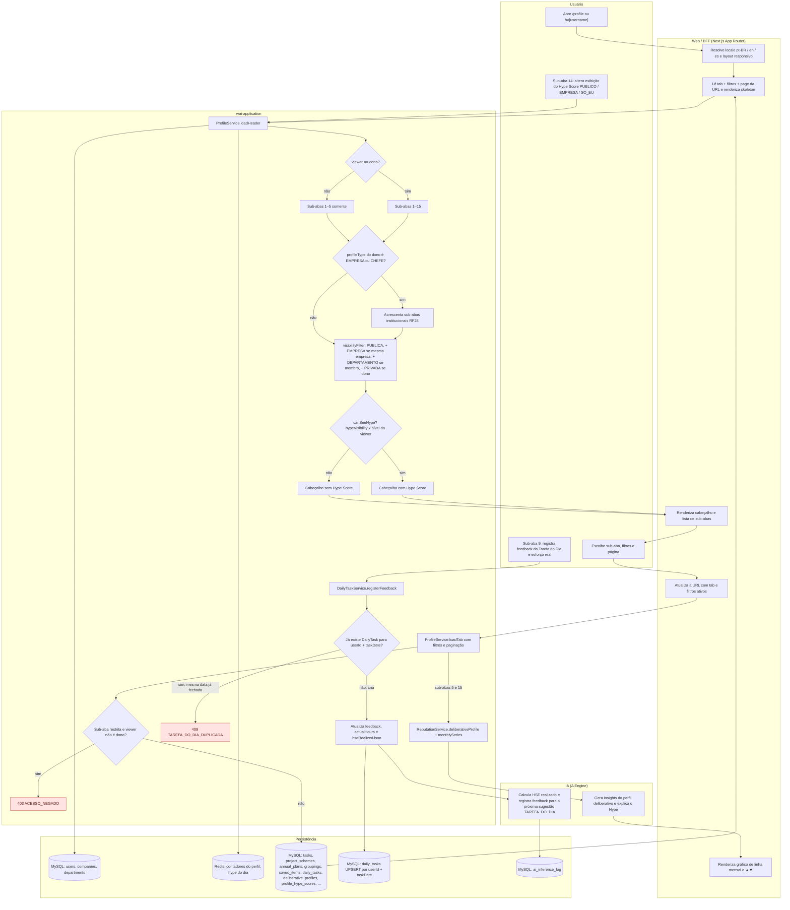
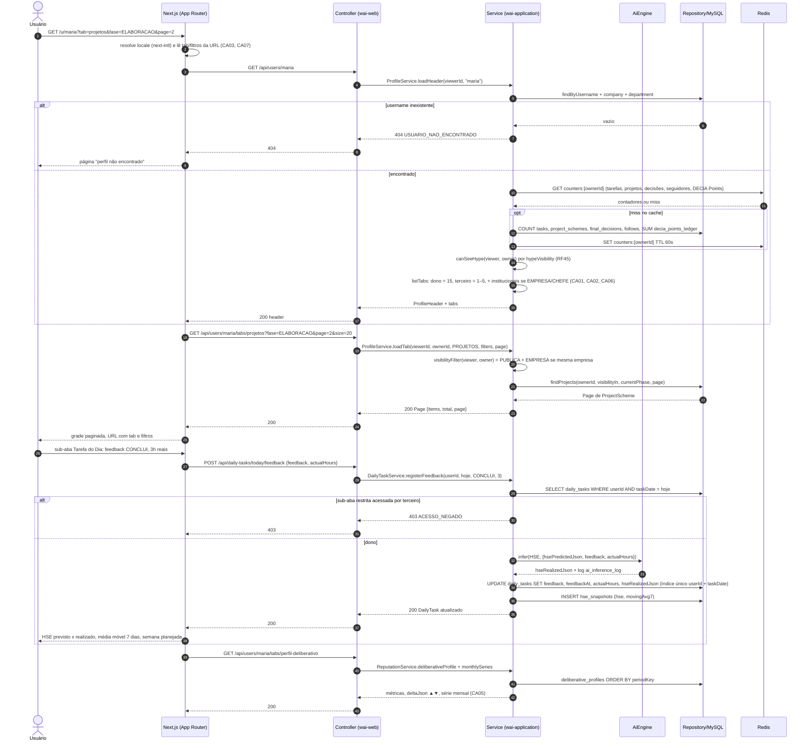
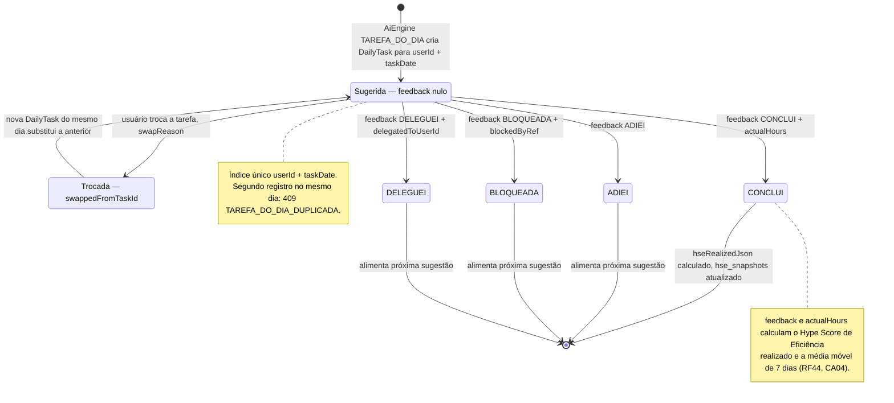
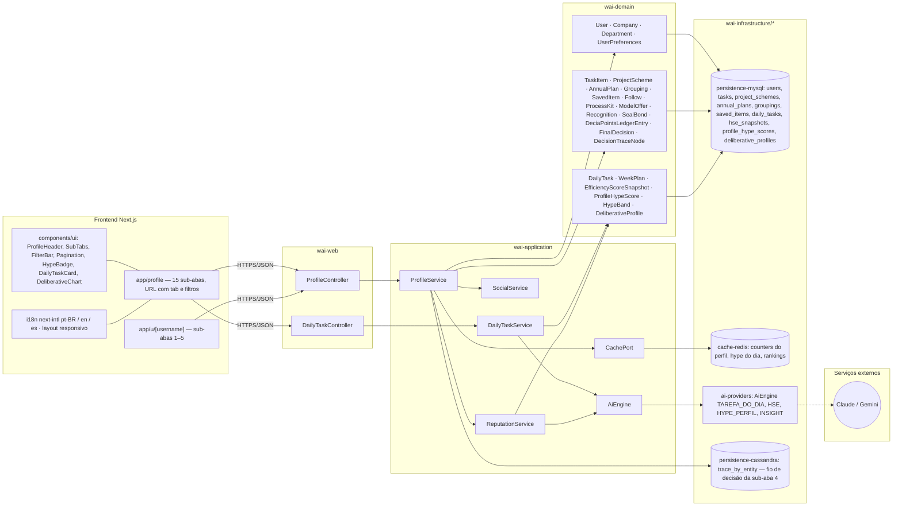

# RF19 — Exibir o perfil do usuário (Portfólio de trabalho) com tudo o que ele criou no Work AI, em sub-abas, incluindo o perfil deliberativo gerado pela IA
**HU:** HU19 · **Sprint (board Work Station):** 4 · **Equivalente FAI:** RF6 Perfil Lookbook (+ RF17 perfil de outros) · **Aba/rota:** Meu perfil (`/profile`), perfil de outros em `/u/[username]`
**Critérios de aceite cobertos:** RF19.CA01 · RF19.CA02 · RF19.CA03 · RF19.CA04 · RF19.CA05 · RF19.CA06 · RF19.CA07

O perfil é o **registro de tudo que o empregado produziu desde que entrou no sistema**: cabeçalho (avatar, nome, cargo, empresa, departamento, contadores e, se o dono permitir, o Hype Score do Perfil — RF45) e **15 sub-abas**. As sub-abas 1–5 são públicas (respeitando a visibilidade de cada item); as 6–15 só aparecem para o dono (*self*). Perfis EMPRESA e CHEFE DE DEPARTAMENTO ganham sub-abas institucionais (RF28). O RF19 **lê** entidades de quase todos os contextos; a única escrita própria é o feedback da *Tarefa do Dia* (sub-aba 9, RF44).

| # | Sub-aba | Visível para | Entidades lidas | RF fonte |
|---|---|---|---|---|
| 1 | Acervo de Tarefas | todos | `TaskItem` | RF41 |
| 2 | Meus Projetos | todos | `ProjectScheme` | RF21/RF22 |
| 3 | Programas & Agrupamentos | todos | `Grouping`, `GroupingItem` | RF25 |
| 4 | Decisões | todos | `FinalDecision`, `DecisionTraceNode` | RF29 |
| 5 | Perfil deliberativo (resumo) | todos | `DeliberativeProfile.publicIndicatorsJson`, `badgesJson` | RF43 |
| 6 | Meus Planos Anuais / Trilhas | dono | `AnnualPlan`, `PlanAxis` | RF24 |
| 7 | Projetos salvos | dono | `SavedItem` (PROJECT) | RF26 |
| 8 | Tarefas salvas | dono | `SavedItem` (TASK) | RF26 |
| 9 | Tarefa do Dia | dono | `DailyTask`, `WeekPlan`, `EfficiencyScoreSnapshot` | RF44 |
| 10 | Kits de Processo | dono | `ProcessKit`, `KitItem` | RF21 |
| 11 | Meus modelos oferecidos | dono | `ModelOffer` | RF40 |
| 12 | Meus Reconhecimentos e Chancelas | dono | `Recognition`, `SealBond` | RF35/RF39 |
| 13 | DECIA Points | dono | `DeciaPointsLedgerEntry`, `StoreItem` | RF42 |
| 14 | Hype Score do Perfil | dono | `ProfileHypeScore`, `HypeBand`, `User.hypeVisibility` | RF45 |
| 15 | Perfil deliberativo (completo) | dono | `DeliberativeProfile`, `Insight` | RF43 |

## 1. Diagrama de classes

```mermaid
classDiagram
direction LR

namespace wai_domain_identidade {
  class User {
    <<entity>>
    +id: UUID
    +username: String
    +fullName: String
    +displayName: String
    +jobTitle: String
    +profileType: ProfileType
    +companyId: UUID
    +departmentId: UUID
    +avatarUrl: String
    +coverUrl: String
    +bio: String
    +verified: boolean
    +hypeVisibility: HypeVisibility
    +rankingOptOut: boolean
    .. +20 campos ..
  }
  class Company {
    <<entity>>
    +id: UUID
    +legalName: String
    +slug: String
    +logoUrl: String
  }
  class Department {
    <<entity>>
    +id: UUID
    +companyId: UUID
    +name: String
    +acronym: String
    +color: String
    +monogram: String
    +headUserId: UUID
  }
  class UserPreferences {
    <<entity>>
    +language: UiLanguage
    +theme: ThemeMode
    +timezone: String
  }
}

namespace wai_domain_portfolio {
  class TaskItem {
    <<entity>>
    +id: UUID
    +ownerId: UUID
    +title: String
    +type: TaskType
    +category: TaskCategory
    +state: TaskState
    +visibility: Visibility
    +thumbnailUrl: String
    .. +45 campos ..
  }
  class ProjectScheme {
    <<entity>>
    +id: UUID
    +ownerId: UUID
    +title: String
    +status: ProjectStatus
    +currentPhase: ProjectPhase
    +exerciseYear: int
    +departmentId: UUID
    +visibility: Visibility
    .. +30 campos ..
  }
  class AnnualPlan {
    <<entity>>
    +id: UUID
    +ownerId: UUID
    +scope: PlanScope
    +exerciseYear: int
    +title: String
    +visibility: Visibility
  }
  class Grouping {
    <<entity>>
    +id: UUID
    +ownerId: UUID
    +type: GroupingType
    +label: String
    +status: String
  }
  class FinalDecision {
    <<entity>>
    +id: UUID
    +sessionId: UUID
    +decisionText: String
    +status: DecisionStatus
    +stampJson: JSON
  }
  class DecisionTraceNode {
    <<entity>>
    +id: UUID
    +sessionId: UUID
    +nodeType: TraceNodeType
    +classLabel: String
    +actorId: UUID
  }
  class SavedItem {
    <<entity>>
    +id: UUID
    +userId: UUID
    +targetType: TargetType
    +targetId: UUID
    +favorite: boolean
  }
  class Follow {
    <<entity>>
    +id: UUID
    +followerId: UUID
    +targetType: String
    +targetId: UUID
  }
  class ProcessKit {
    <<entity>>
    +id: UUID
    +ownerId: UUID
    +name: String
    +processTag: ProcessTag
  }
  class ModelOffer {
    <<entity>>
    +id: UUID
    +ownerId: UUID
    +targetType: String
    +pricePoints: int
    +status: String
  }
  class Recognition {
    <<entity>>
    +id: UUID
    +recipientUserId: UUID
    +name: String
    +medalArtJson: JSON
  }
  class SealBond {
    <<entity>>
    +id: UUID
    +sealId: UUID
    +targetOwnerId: UUID
    +status: SealBondStatus
  }
  class DeciaPointsLedgerEntry {
    <<entity>>
    +id: UUID
    +userId: UUID
    +delta: int
    +eventCode: PointsEvent
    +status: String
  }
}

namespace wai_domain_reputacao {
  class DailyTask {
    <<entity>>
    +id: UUID
    +userId: UUID
    +taskDate: LocalDate
    +taskId: UUID
    +suggestedByAi: boolean
    +priorityIndexJson: JSON
    +hsePredictedJson: JSON
    +hseRealizedJson: JSON
    +feedback: DailyFeedback
    +feedbackAt: Instant
    +actualHours: BigDecimal
    +weekPlanDayId: UUID
    +aiInferenceId: UUID
  }
  class WeekPlan {
    <<entity>>
    +id: UUID
    +userId: UUID
    +weekStart: LocalDate
    +streak: int
    +closingHse: BigDecimal
  }
  class EfficiencyScoreSnapshot {
    <<entity>>
    +userId: UUID
    +date: LocalDate
    +hse: BigDecimal
    +movingAvg7: BigDecimal
  }
  class ProfileHypeScore {
    <<entity>>
    +userId: UUID
    +scoreDate: LocalDate
    +score: int
    +bandCode: String
    +blocksJson: JSON
    +percentileInDept: BigDecimal
    +suggestionsJson: JSON
  }
  class HypeBand {
    <<entity>>
    +companyId: UUID
    +min: int
    +max: int
    +name: String
  }
  class DeliberativeProfile {
    <<entity>>
    +id: UUID
    +userId: UUID
    +periodKey: String
    +clarity: BigDecimal
    +evidenceUse: BigDecimal
    +consistency: BigDecimal
    +completeness: BigDecimal
    +reuse: BigDecimal
    +deltaJson: JSON
    +badgesJson: JSON
    +publicIndicatorsJson: JSON
    +aiInsightsJson: JSON
  }
}

namespace wai_domain_enums {
  class ProfileType {
    <<enum>>
    EMPREGADO
    EMPRESA
    CHEFE_DEPARTAMENTO
  }
  class HypeVisibility {
    <<enum>>
    PUBLICO
    EMPRESA
    SO_EU
  }
  class Visibility {
    <<enum>>
    PRIVADA
    DEPARTAMENTO
    EMPRESA
    PUBLICA
  }
  class DailyFeedback {
    <<enum>>
    CONCLUI
    ADIEI
    BLOQUEADA
    DELEGUEI
  }
  class UiLanguage {
    <<enum>>
    PT_BR
    EN
    ES
  }
}

namespace wai_application {
  class ProfileService {
    <<service>>
    +loadHeader(viewerId, username) ProfileHeader
    +listTabs(viewerId, ownerId) List~ProfileTab~
    +loadTab(viewerId, ownerId, tab, filters, page) Page
    +canSeeHype(viewer, owner) boolean
    +visibilityFilter(viewer, owner) Visibility[]
  }
  class DailyTaskService {
    <<service>>
    +today(userId) DailyTask
    +registerFeedback(userId, date, feedback, actualHours) DailyTask
    +weekPlan(userId) WeekPlan
  }
  class ReputationService {
    <<service>>
    +deliberativeProfile(userId, periodKey) DeliberativeProfile
    +monthlySeries(userId) List~Point~
    +hypeScore(userId) ProfileHypeScore
  }
  class SocialService {
    <<service>>
    +counters(ownerId) Counters
    +savedItems(userId, targetType, page) Page
  }
  class AiEngine {
    <<service>>
    +infer(capability, input) AiResult
  }
  class CachePort {
    <<port>>
    +getCounters(ownerId) Counters
    +putCounters(ownerId, counters, ttl)
  }
}

namespace wai_web {
  class ProfileController {
    <<controller>>
    +GET_api_profile_me()
    +GET_api_users_username(username)
    +GET_api_users_username_tabs_tab(username, tab, query)
    +POST_api_daily_tasks_today_feedback(body)
  }
}

namespace wai_infrastructure {
  class RedisCacheAdapter {
    <<adapter>>
  }
  class ClaudeGeminiAdapter {
    <<adapter>>
  }
}

User "1" --> "0..1" Company : companyId
User "1" --> "0..1" Department : departmentId
User "1" --> "1" UserPreferences : prefs
User --> ProfileType
User --> HypeVisibility
TaskItem "*" --> "1" User : ownerId
ProjectScheme "*" --> "1" User : ownerId
AnnualPlan "*" --> "1" User : ownerId
Grouping "*" --> "1" User : ownerId
SavedItem "*" --> "1" User : userId
Follow "*" --> "1" User : followerId
ProcessKit "*" --> "1" User : ownerId
ModelOffer "*" --> "1" User : ownerId
Recognition "*" --> "1" User : recipientUserId
SealBond "*" --> "1" User : targetOwnerId
DeciaPointsLedgerEntry "*" --> "1" User : userId
DecisionTraceNode "*" --> "1" FinalDecision : refId quando DECISAO
DailyTask "*" --> "1" User : userId unico por taskDate
DailyTask "*" --> "1" TaskItem : taskId
DailyTask "*" --> "0..1" WeekPlan : weekPlanDayId
DailyTask --> DailyFeedback
EfficiencyScoreSnapshot "*" --> "1" User : userId
ProfileHypeScore "*" --> "1" User : userId
ProfileHypeScore --> HypeBand : bandCode
DeliberativeProfile "*" --> "1" User : userId
TaskItem --> Visibility
ProjectScheme --> Visibility
UserPreferences --> UiLanguage

ProfileController ..> ProfileService
ProfileController ..> DailyTaskService
ProfileService ..> ReputationService
ProfileService ..> SocialService
ProfileService ..> CachePort
DailyTaskService ..> AiEngine : TAREFA_DO_DIA e HSE
ReputationService ..> AiEngine : HYPE_PERFIL e INSIGHT
RedisCacheAdapter ..|> CachePort
ClaudeGeminiAdapter ..> AiEngine : provider

note for User "tabela users · o cabeçalho usa jobTitle, companyId, departmentId, hypeVisibility"
note for DailyTask "tabela daily_tasks · índice único userId + taskDate (CA04)"
note for DeliberativeProfile "tabela deliberative_profiles · deltaJson guarda a variação ▲▼ entre sessão atual e anterior (CA05)"
note for ProfileService "15 sub-abas para o dono, 1–5 para terceiros, + institucionais para EMPRESA e CHEFE (CA01, CA02, CA06)"
```

## 2. Diagrama de atividades

## 3. Diagrama de sequência

## 4. Máquina de estados

O RF19 não possui estados próprios: a única entidade que ele altera é a **`DailyTask`** da sub-aba *Tarefa do Dia* (CA04). Os estados abaixo são o ciclo de vida diário de `DailyTask.feedback` (enum `DailyFeedback`); o estado inicial "Sugerida" corresponde a `feedback = null`.

## 5. Diagrama de componentes

## 6. Rastreabilidade

| CA | Elemento do diagrama (classe / passo / mensagem / transição / componente) |
|---|---|
| RF19.CA01 | Classes `User` (jobTitle, companyId, departmentId), `Company`, `Department`, `ProfileService.loadHeader/listTabs`, `CachePort` (contadores) · Atividades `A1`, `A2 → A3` (15 sub-abas), `A8/A9` (Hype se exibido) · Sequência msgs 3–5 e 10–17 (header + contadores Redis + listTabs) · Componentes `app/profile`, `ProfileHeader`, `SubTabs`, `cache-redis` |
| RF19.CA02 | `ProfileService.visibilityFilter/canSeeHype`, enum `HypeVisibility`, `Visibility` · Atividades `A2 → A4` (sub-abas 1–5), `A7` (PUBLICA + EMPRESA se mesma empresa), `A8`, `A12 → A13 403 ACESSO_NEGADO` · Sequência msgs 14–15 e 20 (canSeeHype, listTabs 1–5, visibilityFilter) e `alt` 403 (msgs 30–31) · Componente `app/u/[username]` |
| RF19.CA03 | Atividades `W2` (lê tab + filtros + page da URL), `W3` (atualiza URL), `A11` (loadTab com filtros e paginação) · Sequência msgs 1–2 e 18–25 (`tabs/projetos?fase=&page=&size=`) · Componentes `FilterBar`, `Pagination` |
| RF19.CA04 | Classes `DailyTask` (índice único userId + taskDate, feedback, actualHours, hseRealizedJson), `DailyTaskService.registerFeedback`, `EfficiencyScoreSnapshot`, `WeekPlan`, enum `DailyFeedback` · Atividades `U3 → A14 → A15 → A16/A17 409`, `I1`, `P4`, `P5` · Sequência msgs 26–38 · Máquina de estados inteira (SUGERIDA → CONCLUI/ADIEI/BLOQUEADA/DELEGUEI) · Componentes `DailyTaskController`, `DailyTaskService`, `DailyTaskCard` |
| RF19.CA05 | Classes `DeliberativeProfile` (clarity, evidenceUse, consistency, completeness, reuse, deltaJson ▲▼), `ReputationService.deliberativeProfile/monthlySeries` · Atividades `A18 → I2 → W5` (gráfico de linha mensal) · Sequência msgs 39–43 · Componente `DeliberativeChart` |
| RF19.CA06 | Enum `ProfileType`, `ProfileService.listTabs` · Atividades `A5 → A6` (sub-abas institucionais RF28) · Sequência msg 15 ("+ institucionais se EMPRESA/CHEFE") |
| RF19.CA07 | Classes `UserPreferences.language`, enum `UiLanguage` · Atividades `W1` (locale + responsivo) · Sequência msg 2 (next-intl) · Componente `F4` (i18n next-intl, layout responsivo) |
