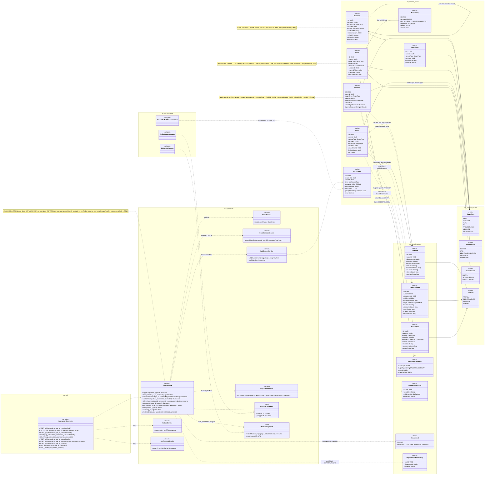
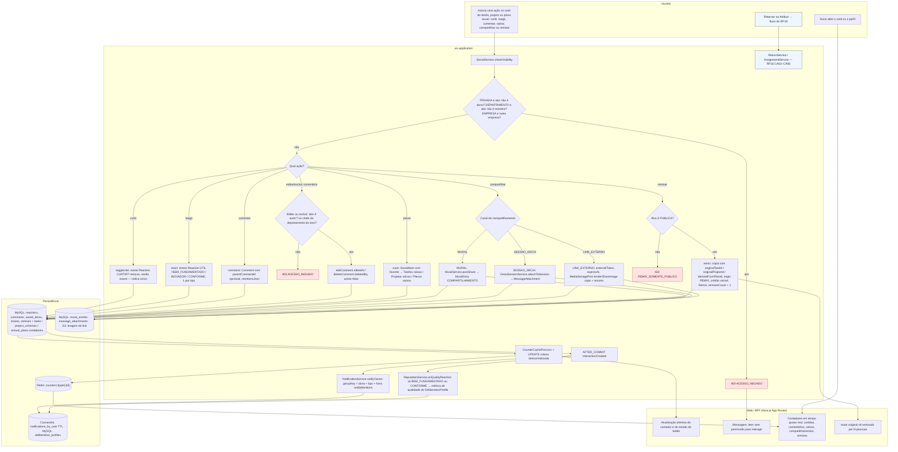
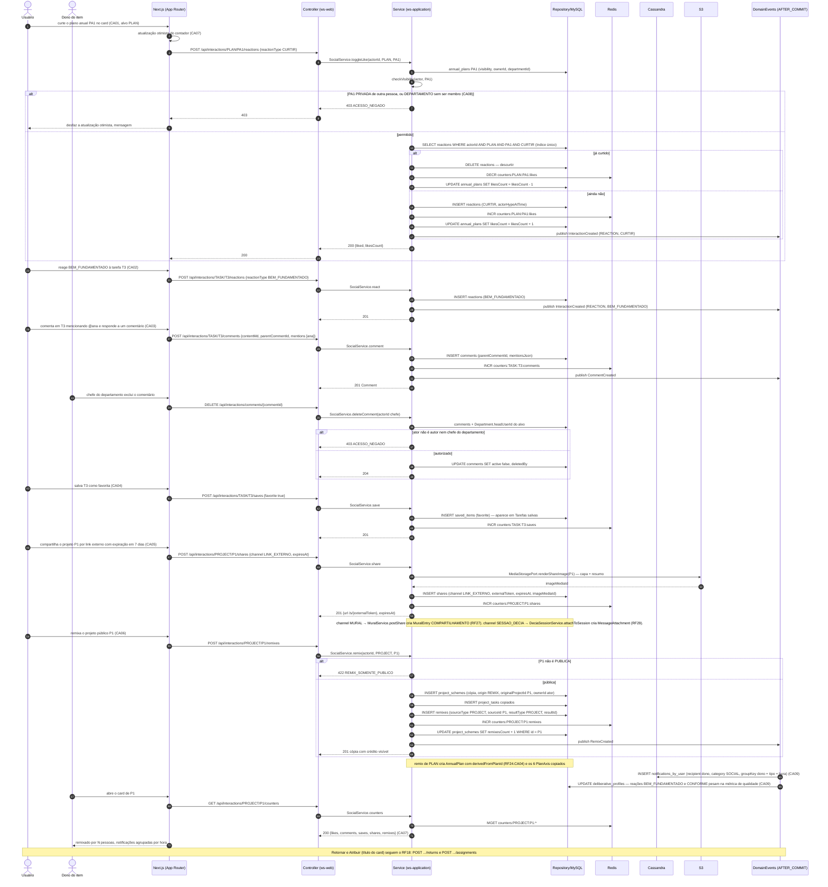
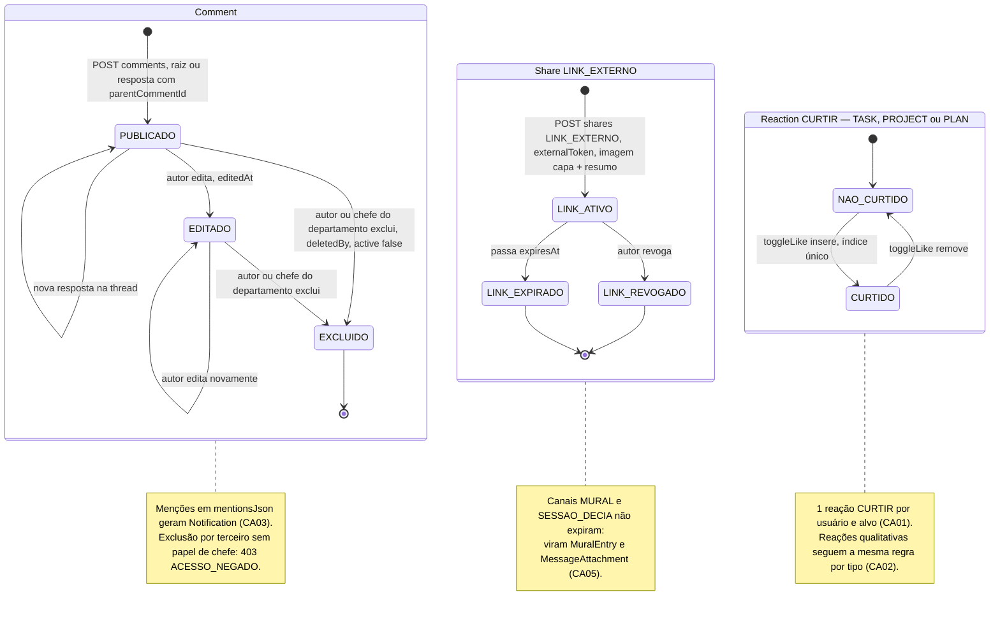
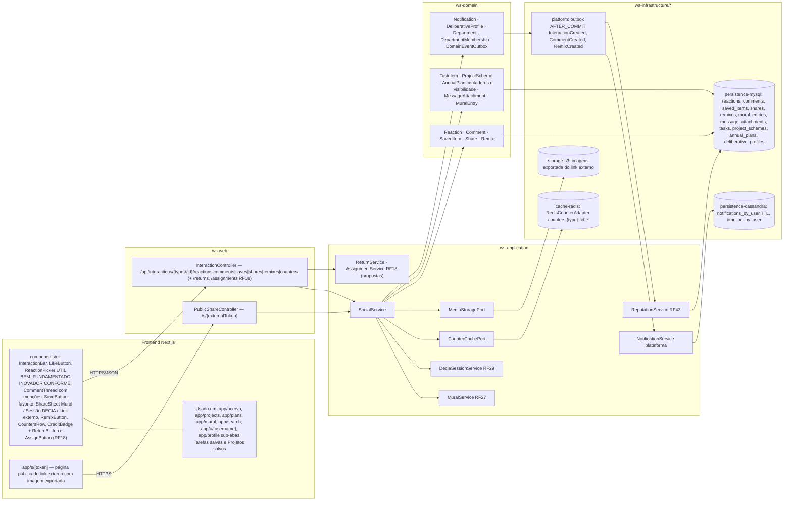

# RF19 — Curtir, comentar, salvar, compartilhar, retornar, atribuir e remixar tarefas, esquemas de projeto e planos anuais (interações sociais)
**HU:** HU19 · **Sprint (board Work Station):** a confirmar (card renomeado em 2026-10-02; origem `_anterior/RF26` = Sprint 4) · **Equivalente FAI:** RF19 Interações sociais (alvo polimórfico PIECE/SCHEME/DNA) · **Aba/rota:** ações inline em todos os cards (Acervo, Projetos, Planos Anuais, Mural, Buscar, perfil) · **API:** `/api/interactions/{type}/{id}/reactions|comments|saves|shares|remixes|counters`
**Critérios de aceite cobertos:** RF26.CA01 · RF26.CA02 · RF26.CA03 · RF26.CA04 · RF26.CA05 · RF26.CA06 · RF26.CA07 · RF26.CA08 · RF26.CA09 (citados como estão escritos no card — **corpo do card = antigo RF26**). As interações **retornar** e **atribuir** constam só no título, sem CA no corpo: estão modeladas no **RF18** (CA03–CA06) e aqui aparecem apenas como remissão.

> **HU19** — COMO usuário autenticado POSSO curtir, reagir, comentar, salvar, compartilhar e remixar tarefas, esquemas de projeto e planos anuais PARA colaborar, dar retorno de qualidade e reaproveitar o trabalho dos colegas. Ref.: RF26 (equivalente às Interações sociais RF19 do FAI).

Alvo polimórfico `TargetType` (**TASK · PROJECT · PLAN** — além de KIT, PROJECT_TASK, MESSAGE, RECOGNITION usados por outros RFs). Seis interações, cada uma com sua entidade: **curtir** (`Reaction` CURTIR, única por ator e alvo), **reagir** (`Reaction` ÚTIL · BEM_FUNDAMENTADO · INOVADOR · CONFORME), **comentar** (`Comment` com thread `parentCommentId`, edição, exclusão pelo autor ou pelo chefe do departamento, menções → `Notification`), **salvar** (`SavedItem` com marcador favorito → sub-abas *Tarefas salvas* / *Projetos salvos*), **compartilhar** (`Share` em canal MURAL → `MuralEntry` RF27, SESSAO_DECIA → `MessageAttachment` RF29, LINK_EXTERNO com `externalToken`, `expiresAt` e imagem exportada `imageMediaId`) e **remixar** (`Remix` + cópia com `originalTaskId` / `originalProjectId` / `derivedFromPlanId` e crédito visível). Contadores desnormalizados (`likesCount … remixesCount`) em tempo quase real via Redis; toda interação respeita a **visibilidade** do alvo e gera **notificação agrupada por hora** (`Notification.groupKey`) ao dono, alimentando o perfil deliberativo (reações BEM_FUNDAMENTADO e CONFORME pesam na métrica de qualidade).

| CA (como escrito no card) | Enunciado |
|---|---|
| **RF26.CA01** | Curtir/descurtir tarefa, projeto ou plano (1 reação por usuário e alvo, índice único). |
| **RF26.CA02** | Reações qualitativas: ÚTIL, BEM FUNDAMENTADO, INOVADOR, CONFORME (substituem TREND/ELEGANTE/CRIATIVO). |
| **RF26.CA03** | Comentários com resposta (thread), edição, exclusão pelo autor ou pelo chefe do departamento; menções @usuário geram notificação. |
| **RF26.CA04** | Salvar em *Tarefas salvas* / *Projetos salvos* com marcador de favorito. |
| **RF26.CA05** | Compartilhar: no **Mural** da empresa (RF27), **dentro de uma sessão DECIA** (RF29) ou por **link externo** com imagem exportada (capa + resumo) e controle de expiração. |
| **RF26.CA06** | **Remixar** um projeto ou tarefa pública: cria cópia com `originalId` e crédito visível; o autor original vê "remixado por N pessoas". |
| **RF26.CA07** | Contadores (curtidas, comentários, salvos, compartilhamentos, remixes) em tempo quase real nos cards e no perfil. |
| **RF26.CA08** | Interações respeitam a visibilidade: item PRIVADO não recebe interações de terceiros; item DEPARTAMENTO só de membros do departamento. |
| **RF26.CA09** | Toda interação gera notificação ao dono (agrupada por hora) e alimenta o perfil deliberativo (objetivo 2) — reações BEM FUNDAMENTADO e CONFORME pesam na métrica de qualidade. |
| *(título)* retornar · atribuir | Sem CA no corpo. Modelados no **RF18** (`TaskReturn` e `Assignment`, propostas). Aplicam-se a TASK e PROJECT; **não** a PLAN (a confirmar). |

| Interação | Entidade | Regra de unicidade / canal | Contador | Alvos |
|---|---|---|---|---|
| Curtir / descurtir | `Reaction` CURTIR | único (actorId, targetType, targetId, CURTIR) — toggle | `likesCount` | TASK · PROJECT · PLAN |
| Reagir | `Reaction` UTIL · BEM_FUNDAMENTADO · INOVADOR · CONFORME | 1 por tipo, ator e alvo | — (pesa no perfil deliberativo) | TASK · PROJECT · PLAN |
| Comentar | `Comment` | thread via `parentCommentId`, `editedAt`, `deletedBy`, `mentionsJson` | `commentsCount` | TASK · PROJECT · PLAN |
| Salvar | `SavedItem` | único (userId, targetType, targetId), `favorite` | `savesCount` | TASK · PROJECT · PLAN (sub-aba *Meus Planos* — a confirmar) |
| Compartilhar | `Share` | `channel` MURAL · SESSAO_DECIA · LINK_EXTERNO (`externalToken`, `expiresAt`, `imageMediaId`) | `sharesCount` | TASK · PROJECT · PLAN |
| Remixar | `Remix` + nova `TaskItem`/`ProjectScheme`/`AnnualPlan` | só alvos PUBLICA, `originalTaskId` / `originalProjectId` / `derivedFromPlanId` | `remixesCount` | TASK · PROJECT · PLAN |

## 1. Diagrama de classes

## 2. Diagrama de atividades

## 3. Diagrama de sequência

## 4. Máquina de estados

O RF19 não tem máquina de estados própria. A entidade com ciclo de vida mais rico que ele altera é o **`Comment`** (`active`, `editedAt`, `deletedBy`); os blocos seguintes mostram o ciclo do **`Share` LINK_EXTERNO** (`expiresAt`) e o toggle de **`Reaction` CURTIR**. Os ciclos de `TaskReturn` e `Assignment` (retornar/atribuir) estão no RF18.

## 5. Diagrama de componentes

## 6. Rastreabilidade

| CA | Elemento do diagrama (classe / passo / mensagem / transição / componente) |
|---|---|
| RF26.CA01 | `Reaction` (nota índice único actorId + targetType + targetId + CURTIR), `SocialService.toggleLike` · Atividades `A4 (curtir) → A5 → P1` · Sequência `POST …/PLAN/PA1/reactions {CURTIR}` → `alt já curtido → DELETE` / `INSERT reactions` (msgs 3–21) · Máquina *Reaction CURTIR* · Componente `LikeButton` |
| RF26.CA02 | Enum `ReactionType` (UTIL, BEM_FUNDAMENTADO, INOVADOR, CONFORME), `SocialService.react` · Atividades `A4 (reagir) → A6` · Sequência `POST …/TASK/T3/reactions {BEM_FUNDAMENTADO}` (msgs 22–26) · Nota de *Reaction CURTIR* · Componente `ReactionPicker` |
| RF26.CA03 | `Comment` (parentCommentId, mentionsJson, editedAt, deletedBy, active), `Department.headUserId`, `SocialService.comment/editComment/deleteComment`, `NotificationService.notifyMentions` · Atividades `A7`, `A8 → A9 403 / A10` · Sequência `POST …/comments {contentMd, parentCommentId, mentions}` e `DELETE /api/interactions/comments/{id}` com `alt ator não é autor nem chefe → 403` (msgs 27–40) · Máquina *Comment* · Componente `CommentThread` |
| RF26.CA04 | `SavedItem` (favorite), `SocialService.save` · Atividades `A4 (salvar) → A11` · Sequência `POST …/TASK/T3/saves {favorite true}` (msgs 41–45) · Componentes `SaveButton`, `app/profile sub-abas Tarefas salvas e Projetos salvos` |
| RF26.CA05 | `Share` (channel, sessionId, externalToken, expiresAt, imageMediaId), enum `ShareChannel`, `MuralEntry`, `MessageAttachment`, `MuralService.postShare`, `DeciaSessionService.attachToSession`, `MediaStoragePort.renderShareImage` · Atividades `A12 → A13 / A14 / A15 → P3` · Sequência `POST …/PROJECT/P1/shares {LINK_EXTERNO, expiresAt}` → `renderShareImage` → `INSERT shares` + nota MURAL / SESSAO_DECIA (msgs 46–53) · Máquina *Share LINK_EXTERNO* · Componentes `ShareSheet`, `PublicShareController /s/{token}`, `app/s/[token]`, `storage-s3` |
| RF26.CA06 | `Remix`, `TaskItem.originalTaskId`, `ProjectScheme.originalProjectId / origin REMIX`, `AnnualPlan.derivedFromPlanId`, `SocialService.remix` · Atividades `A16 → A17 422 REMIX_SOMENTE_PUBLICO / A18 → W4` · Sequência `POST …/PROJECT/P1/remixes` → `alt não é PUBLICA → 422` / `INSERT project_schemes (cópia, origin REMIX …)`, `INSERT remixes`, nota remix de PLAN (msgs 54–64) · Componentes `RemixButton`, `CreditBadge` |
| RF26.CA07 | `TaskItem/ProjectScheme/AnnualPlan.likesCount … remixesCount`, `CounterCachePort`, `RedisCounterAdapter`, `SocialService.counters` · Atividades `A19 → P2 → W3`, `W1` (otimista) · Sequência `INCR/DECR counters:…`, `UPDATE … likesCount`, `GET …/counters → MGET` (msgs 2, 67–71) · Componentes `CountersRow`, `cache-redis` |
| RF26.CA08 | `SocialService.checkVisibility` (nota), enum `Visibility`, `DepartmentMembership` · Atividades `A1 → A2 → A3 403 ACESSO_NEGADO → W2` · Sequência `checkVisibility(actor, PA1)` → `alt PA1 PRIVADA de outra pessoa, ou DEPARTAMENTO sem ser membro → 403` (msgs 6–9) |
| RF26.CA09 | `Notification.groupKey` (dono + tipo + hora, category SOCIAL), `DeliberativeProfile`, `NotificationService.notifyOwner`, `ReputationService.onQualityReaction`, `CassandraNotificationAdapter` · Atividades `A20 → A21 → P4`, `A20 → A22 → P4` · Sequência `DE->>CS INSERT notifications_by_user (… groupKey dono + tipo + hora)` e `DE->>DB UPDATE deliberative_profiles` (msgs 65–66) · Componentes `NotificationService`, `ReputationService RF43`, `persistence-cassandra` |
| *(título)* retornar · atribuir | `ReturnService`, `AssignmentService` (propostas, RF18), `InteractionController` (+ `/returns`, `/assignments`) · Atividade `U3 → A23` · Sequência nota final · Componentes `ReturnButton`, `AssignButton` · Detalhe, estados e CAs: **RF18.CA03–CA06** |
